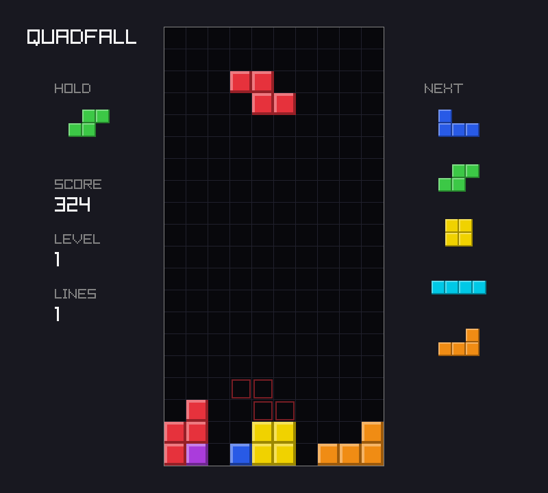
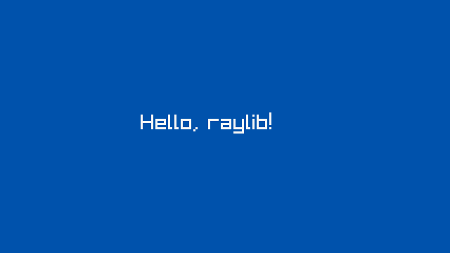
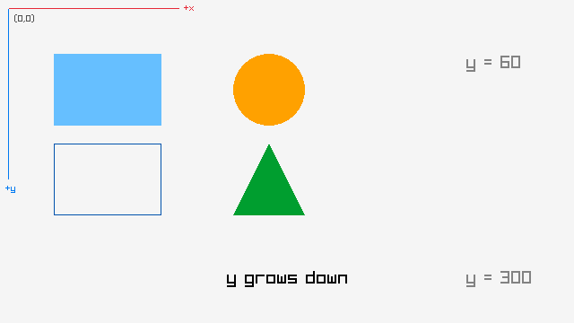
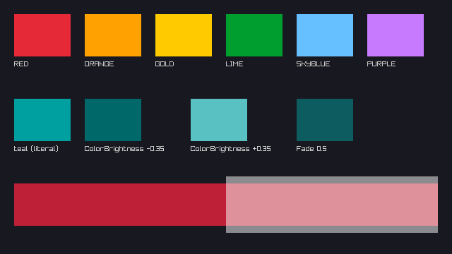
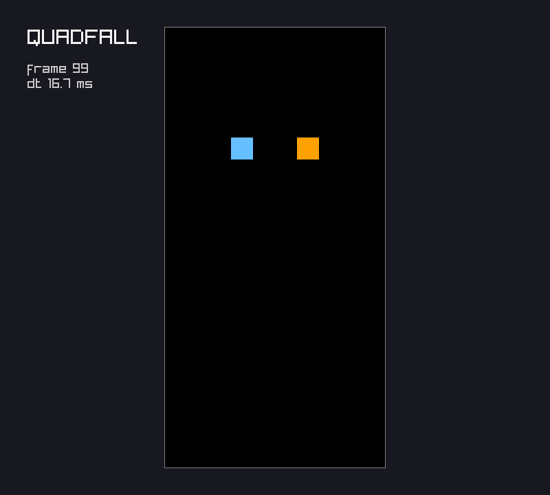

# Chapter 1 — Getting Started: Zig, raylib, and the Game Loop

To a computer, a game is a loop. About 60 times a second it reads the input, updates the state
of the world, and draws a new picture. Everything else in Part I hangs off that loop. This
chapter sets up a Zig project that depends on raylib 6.2 and opens a window. It then measures
frame time, draws rectangles and text, and moves things in two ways: smoothly, and in whole
steps. The project, `quadfall`, starts here. It gains a well to play in, two moving blocks, and
a command-line interface with `--frames` and `--screenshot`. With those two options every later
chapter can be checked without a person at the keyboard.

Next: [Chapter 2](02-the-board.md).

This course assumes you can read basic Zig: structs, slices, error unions, `defer` and
`zig build`. New to Zig? Read [learn-zig](https://github.com/sipak-gh/learn-zig) first.
Everything about graphics and games is explained here.

## What we are building

Part I builds **`quadfall`**, a falling-block game inspired by Tetris. Seven pieces made of four
squares fall into a well. You move and turn them, and a full row disappears. This is where it
ends up in Chapter 6:



Each chapter adds one layer:

| # | Chapter | `quadfall` gains |
|---|---|---|
| 1 | Getting Started | a window, the game loop, `--frames` and `--screenshot` |
| 2 | The Board | the playfield as data, drawn; a `core` module with tests |
| 3 | Tetrominoes | the seven pieces and their rotations, as compile-time tables |
| 4 | Input and Movement | keyboard input, auto-repeat, scripted input for tests |
| 5 | Time | gravity, locking, line clears, game over, a fixed timestep |
| 6 | Rules and Progression | the 7-bag, hold, ghost, scoring, levels |
| 7 | Scenes and UI | title, pause and game-over screens, a saved high score |
| 8 | Organizing a Game | sound, effects, replays, release builds, a review of the design |

Part II ([Chapter 9](09-framebuffers.md) onward) leaves raylib's shapes behind and writes a 3D
renderer from scratch. It reuses three habits from Part I: the fixed-timestep loop, game rules
that never touch the graphics library, and the headless `--frames N --screenshot PATH` run that
you build in this chapter.

### Why not call it Tetris?

"Tetris" is a trademark of The Tetris Company, which enforces it. The rules of a falling-block
game are not owned by anyone, but the name and the look are protected. So the game here has its
own name: *quad* for the four squares in each piece, *fall* for what they do. The community's
[Tetris Wiki](https://tetris.wiki/) documents the modern rules.

## Setting up

### The tools

Every program in this book was built and run with exactly these versions:

- **Zig 0.17.1.** Zig has not reached 1.0, and its standard library and build system change
  between releases. Another version *will* break some of the code.
- **raylib 6.2**, a small C library for games: a window, input, 2D and 3D drawing, sound. You
  do not install it; Zig downloads it and builds it as part of your project.
- **On Linux, the X11 and OpenGL development libraries**, because raylib links against them. On
  Debian or Ubuntu they are the packages `libgl-dev libx11-dev libxrandr-dev libxinerama-dev
  libxi-dev libxcursor-dev`.
- **`xvfb`** (optional), a virtual X server, for running the game with no screen. Every
  screenshot in this book was made with it.

Put Zig on your `PATH` (`~/opt/zig` is where it is unpacked on the book's machine):

```console
$ export PATH=~/opt/zig:$PATH
$ zig version
0.17.1
```

### Creating the project with `zig init`

`zig init` creates a new project in the current directory. Plain `zig init` writes a library
*and* an executable with tests: four files, 243 lines, mostly comments that explain the build
system. They are worth reading once, but we would replace them all, so use the minimal
template:

```console
$ mkdir quadfall && cd quadfall
$ zig init --minimal
info: successfully populated "build.zig.zon" and "build.zig"
$ cat build.zig.zon
.{
    .name = .quadfall,
    .version = "0.0.1",
    .minimum_zig_version = "0.17.1",
    .paths = .{""},
    .fingerprint = 0xce86bc89a91ba5b7,
}
```

`build.zig.zon` is the package manifest. It is written in ZON, Zig Object Notation: a Zig
anonymous struct literal used as a data format.

- `.name` comes from the directory name. It is an enum literal (`.quadfall`), not a string.
- `.minimum_zig_version` is the Zig that created the file.
- `.paths` lists the files that belong to the package. `""` means "the whole directory".
- `.fingerprint` identifies this package for as long as it exists. Zig generates it once.

**The fingerprint.** This run gave `0xce86bc89a91ba5b7`; the book's project has
`0xce86bc89d1e8ab4f`. The upper half, `ce86bc89`, is a checksum of the name `quadfall`, so it
is always the same. The lower half is random, so two packages that share a name can be told
apart. Your fingerprint will differ from the book's, and that is correct. Keep yours, and never
copy it into another project.

### Adding raylib with `zig fetch`

`zig fetch --save URL` downloads a package, computes its hash, and adds it to the
`dependencies` of `build.zig.zon`. raylib publishes each release as a git tag, so the natural
command names the tag `6.2`:

```console
$ zig fetch --save "git+https://github.com/raysan5/raylib?ref=6.2"
info: resolved to commit 41b7da8139b564451a699e2f6072847e77e80b16
```

Read that `info` line before going on. Is `41b7da8` really the 6.2 release? `git ls-remote`
asks GitHub what the names point to:

```console
$ git ls-remote https://github.com/raysan5/raylib | grep -E '6\.2|HEAD'
41b7da8139b564451a699e2f6072847e77e80b16	HEAD
02566453880e06bec97f5b8160fa6fe1e98397ca	refs/tags/6.2
```

It is not. When this book was checked, Zig 0.17.1 resolved `?ref=6.2` to `HEAD`, raylib's
development branch, instead of the tag. (`?ref=refs/tags/6.2` gave the same commit.) The
download worked and later builds would have worked too, but with whatever raylib's master
branch held that day. Without `--save`, `zig fetch` only prints the hash, and the two hashes
differ:

```console
$ zig fetch "git+https://github.com/raysan5/raylib?ref=6.2"
raylib-6.0.0-whq8uMmEOAUblQBmJJy2VYAtrHZxhE_-tOLs143QpWUU
$ zig fetch "git+https://github.com/raysan5/raylib#02566453880e06bec97f5b8160fa6fe1e98397ca"
raylib-6.0.0-whq8uDpYOAVcH_KyOZ0--nYF1dEsjdQ5r4e9R24UkQOi
```

The fix is to name the commit. A URL fragment, `#commit`, pins it exactly:

```console
$ zig fetch --save "git+https://github.com/raysan5/raylib?ref=6.2#02566453880e06bec97f5b8160fa6fe1e98397ca"
```

It prints nothing and adds a `.dependencies` field with `.raylib = .{ .url = ..., .hash = ... }`
to `build.zig.zon` (the final file is shown below). The release tarball works too. Its hash is identical, because the hash depends only on the
files, not on where they came from: `zig fetch` of
`https://github.com/raysan5/raylib/archive/refs/tags/6.2.tar.gz` prints
`raylib-6.0.0-whq8uDpYOAVcH_KyOZ0--nYF1dEsjdQ5r4e9R24UkQOi`.

### Reading the hash

`raylib-6.0.0-whq8uDpYOAVcH_KyOZ0--nYF1dEsjdQ5r4e9R24UkQOi` has three parts:

- `raylib` is the package's name, from raylib's own `build.zig.zon`.
- `6.0.0` is the package's version, from the same file.
- The last 44 characters are 33 bytes in URL-safe base64: the random half of raylib's
  fingerprint (4 bytes), the unpacked size of the package (4 bytes), and the first 25 bytes of
  a SHA-256 over its files. That is why the master-branch fetch above got a hash that starts
  the same way, `raylib-6.0.0-whq8u`, and then differs.

The **hash is the truth**; the URL is only one place to get the files. `zig build` looks for
the hash in its caches first and downloads only if it is missing. If the files at the URL ever
change, the hash no longer matches, and Zig refuses them.

**Why `6.0.0` for raylib 6.2?** raylib's `build.zig.zon` at the 6.2 tag still says
`.version = "6.0.0"`; nobody bumped it. The C header, `zig-pkg/raylib-*/src/raylib.h`, says
`#define RAYLIB_VERSION "6.2"`, and the first example below prints that from Zig.

### Tidying `build.zig.zon`

Change two fields by hand. `.version` becomes `"0.1.0"`, and `.paths` names the three things
that make up the package, so that stray files (screenshots, notes) never become part of it.
The order of the fields does not matter. The book's file:

`project/ch01/build.zig.zon`

```zig
.{
    .name = .quadfall,
    .version = "0.1.0",
    .fingerprint = 0xce86bc89d1e8ab4f, // Changing this has security and trust implications.
    .minimum_zig_version = "0.17.1",
    .dependencies = .{
        .raylib = .{
            .url = "git+https://github.com/raysan5/raylib?ref=6.2#02566453880e06bec97f5b8160fa6fe1e98397ca",
            .hash = "raylib-6.0.0-whq8uDpYOAVcH_KyOZ0--nYF1dEsjdQ5r4e9R24UkQOi",
        },
    },
    .paths = .{
        "build.zig",
        "build.zig.zon",
        "src",
    },
}
```

This file does not change again in Part I.

### `zig-pkg/` and `.gitignore`

`zig init --minimal` wrote a `build.zig` whose `build` function does nothing. Run it anyway,
and two directories appear, `zig-pkg/` (87 MB) and `.zig-cache/`:

- **`zig-pkg/`** holds the unpacked source of every dependency, raylib's C code and its own
  `build.zig` included. Zig 0.17 keeps it inside the project, so you can read the code you
  depend on. It can always be made again from `build.zig.zon`.
- **`.zig-cache/`** holds compiled objects, which make later builds fast.

A third, `zig-out/`, appears once something is installed. All three are build products, so the
course repository's `.gitignore` holds three lines, `.zig-cache/`, `zig-out/` and `zig-pkg/`.
Put the same in yours.

## build.zig for a raylib game

`build.zig` is a Zig program that describes the build. `zig build` compiles it and calls its
`build` function, which does not build anything itself: it adds *steps* to a graph. Zig then
runs the steps the command asked for, in dependency order, and skips the ones whose inputs have
not changed. This is `quadfall`'s:

`project/ch01/build.zig`

```zig
const std = @import("std");

pub fn build(b: *std.Build) void {
    const target = b.standardTargetOptions(.{});
    const optimize = b.standardOptimizeOption(.{});

    // raylib's own build.zig compiles its C sources into a static library.
    const raylib_dep = b.dependency("raylib", .{ .target = target, .optimize = optimize });
    const raylib = raylib_dep.artifact("raylib");

    // Translate raylib.h into a Zig module. The game imports it as "rl".
    const rl = b.addTranslateC(.{
        .root_source_file = raylib_dep.path("src/raylib.h"),
        .target = target,
        .optimize = optimize,
    });

    const exe = b.addExecutable(.{
        .name = "quadfall",
        .root_module = b.createModule(.{
            .root_source_file = b.path("src/main.zig"),
            .target = target,
            .optimize = optimize,
            .imports = &.{.{ .name = "rl", .module = rl.createModule() }},
        }),
    });
    exe.root_module.linkLibrary(raylib);
    b.installArtifact(exe);

    // `zig build run -- ARGS` builds, installs, and runs quadfall with ARGS.
    const run_cmd = b.addRunArtifact(exe);
    run_cmd.step.dependOn(b.getInstallStep());
    run_cmd.addPassthruArgs();
    const run_step = b.step("run", "Run quadfall");
    run_step.dependOn(&run_cmd.step);
}
```

### Target, optimize and the dependency

`standardTargetOptions` and `standardOptimizeOption` add `-Dtarget=...` and `-Doptimize=...`.
Without them you get the machine you are on and `Debug`. Every module and the dependency get
the same two values.

`b.dependency("raylib", ...)` looks up `.raylib` in `build.zig.zon`, finds the package by its
hash, and runs *raylib's* `build.zig` with those options. It defines a static library named
`raylib`, and `.artifact("raylib")` hands us that compile step. Nothing is compiled yet; we
only hold a node of the graph.

### `addTranslateC`: raylib.h as a Zig module

Zig calls C functions directly, but needs Zig declarations for them. **Zig 0.17 has no
`@cImport`**; translation is a build step. `b.addTranslateC` runs Zig's C translator on the
header and writes a `raylib.zig` into the cache, `.createModule()` wraps it as a module, and
`.imports` makes it `@import("rl")` in `main.zig`. The names stay the C names: `rl.InitWindow`,
`rl.KEY_LEFT`, `rl.RAYWHITE`. That keeps the
[raylib cheatsheet](https://www.raylib.com/cheatsheet/cheatsheet.html) directly usable.

### Linking, installing, running

- `exe.root_module.linkLibrary(raylib)` links the static `libraylib.a` and the system
  libraries raylib's build script asked for. raylib opens its window through GLFW, which talks
  to the X server, and draws with OpenGL, so on Linux the link line ends in
  `-lGL -lX11 -lXrandr -lXinerama -lXi -lXcursor -lc`. A missing development package fails here.
- `b.installArtifact(exe)` adds the executable to the default `install` step: plain `zig build`
  copies it to `zig-out/bin/quadfall`.
- `b.addRunArtifact(exe)` makes a step that runs the program, after the install step.
  `addPassthruArgs()` hands it everything after `--`: `zig build run -- --frames 10`.
- `b.step("run", ...)` names the step for the command line. `zig build --help` lists it.

## How the examples are built

Each section below has small example programs in `examples/chNN/`. The ones that use raylib
share one build script, `examples/build.zig`. It works like the project's, but builds the one
example you name with `-Dexample=ch01/window` (without it, the build stops with
`error: choose an example`). Every example may `@import("rl")` and `@import("demo")`, a small
helper for headless runs explained with the first window. Examples that need neither are plain
Zig, run with `zig run` or `zig test` from the repository root.

### What `rl` contains

`examples/ch01/version.zig`

```zig
//! What `@import("rl")` gives you: raylib.h translated into Zig declarations.
//! No window is opened.
const std = @import("std");
const rl = @import("rl");

pub fn main() void {
    // #define RAYLIB_VERSION "6.2" becomes a Zig string constant.
    std.debug.print("RAYLIB_VERSION   = {s}\n", .{rl.RAYLIB_VERSION});
    std.debug.print("version numbers  = {d}.{d}.{d}\n", .{
        rl.RAYLIB_VERSION_MAJOR, rl.RAYLIB_VERSION_MINOR, rl.RAYLIB_VERSION_PATCH,
    });

    // typedef struct Color { unsigned char r, g, b, a; } Color;
    std.debug.print("@sizeOf(rl.Color) = {d} bytes\n", .{@sizeOf(rl.Color)});
    const red = rl.RED; // #define RED CLITERAL(Color){ 230, 41, 55, 255 }
    std.debug.print("rl.RED           = {d} {d} {d} {d}\n", .{ red.r, red.g, red.b, red.a });

    // The KeyboardKey enum's values become plain integer constants.
    std.debug.print("KEY_SPACE={d} KEY_ESCAPE={d} KEY_LEFT={d} KEY_A={d}\n", .{
        rl.KEY_SPACE, rl.KEY_ESCAPE, rl.KEY_LEFT, rl.KEY_A,
    });

    // Functions keep their C names and C types.
    std.debug.print("InitWindow : {s}\n", .{@typeName(@TypeOf(rl.InitWindow))});
    std.debug.print("DrawText   : {s}\n", .{@typeName(@TypeOf(rl.DrawText))});
}
```

```console
$ cd examples
$ zig build run -Dexample=ch01/version
RAYLIB_VERSION   = 6.2
version numbers  = 6.2.0
@sizeOf(rl.Color) = 4 bytes
rl.RED           = 230 41 55 255
KEY_SPACE=32 KEY_ESCAPE=256 KEY_LEFT=263 KEY_A=65
InitWindow : fn (c_int, c_int, [*c]const u8) callconv(.c) void
DrawText   : fn ([*c]const u8, c_int, c_int, c_int, raylib.struct_Color) callconv(.c) void
```

- The version is `6.2`, whatever the package hash says.
- `rl.Color` is four bytes, red, green, blue and alpha, each 0 to 255. `rl.RED` is a value of it.
- Key codes are plain integers. `KEY_A` is 65, the ASCII code of the capital letter.
- `c_int` is C's `int`. Every position and size in raylib's 2D API is a `c_int` (32 bits here).
- `[*c]const u8` is a *C pointer*: bytes of unknown length that C reads up to a 0 byte. More on
  that in [Drawing primitives and text](#drawing-primitives-and-text).
- `callconv(.c)` is the C calling convention. Zig handles that for you.

## Opening a window

`examples/ch01/window.zig`

```zig
const std = @import("std");
const rl = @import("rl");
const Demo = @import("demo").Demo;

pub fn main(init: std.process.Init) !void {
    var demo: Demo = .init(try init.minimal.args.toSlice(init.arena.allocator()));

    rl.SetTraceLogLevel(rl.LOG_WARNING);
    rl.InitWindow(640, 360, "window");
    defer rl.CloseWindow();
    rl.SetTargetFPS(60);

    while (demo.running()) {
        rl.BeginDrawing();
        defer rl.EndDrawing();
        rl.ClearBackground(rl.DARKBLUE);
        rl.DrawText("Hello, raylib!", 200, 160, 30, rl.RAYWHITE);
    }
    std.debug.print("ran {d} frames\n", .{demo.frame});
}
```

On a desktop, `zig build run -Dexample=ch01/window` opens a 640×360 window until you press Esc.
The book's machine has no screen, so it ran the example inside `xvfb-run`, a throwaway virtual
X server, and let `Demo` stop after 30 frames and save the last one:

```console
$ xvfb-run -a -s "-screen 0 1280x720x24" zig build run -Dexample=ch01/window -- --frames 30 --screenshot ../images/ch01-window.png
ran 30 frames
```



- **`InitWindow(width, height, title)`** creates the window and an OpenGL context, which every
  other call needs. **`defer rl.CloseWindow()`** releases both when `main` returns.
- **`SetTraceLogLevel(rl.LOG_WARNING)`** comes *before* `InitWindow`, to silence about 40
  `INFO:` lines at startup. Warnings and errors still appear.
- **`SetTargetFPS(60)`** asks for at most 60 frames per second.
- **`BeginDrawing()` / `defer rl.EndDrawing()`** bracket one frame. The `defer` is inside the
  loop body, so it runs at the end of *each* iteration.
- **`ClearBackground(color)`** paints the whole frame; **`DrawText(text, x, y, size, color)`**
  uses raylib's built-in pixel font.

### Double buffering

raylib draws into a hidden image, the **back buffer**, while the monitor shows the **front
buffer**. `EndDrawing` swaps the two, so the player only sees finished frames. That is why each
frame redraws *everything*: the back buffer holds a picture from two frames ago. After the swap,
`EndDrawing` waits if the frame was faster than the target, then polls the operating system
for input events, so the keyboard state read in the next iteration is fresh.

### The `Demo` helper

`examples/demo.zig` gives the examples `--frames N` (stop after N frames) and
`--screenshot PATH` (save the last frame). Its core, called once per frame:

```zig
    /// Call once per frame, before drawing. False when it is time to stop.
    pub fn running(d: *Demo) bool {
        if (d.frames) |n| if (d.frame == n) {
            if (d.screenshot) |path| rl.TakeScreenshot(path);
            return false;
        };
        d.frame += 1;
        return !rl.WindowShouldClose();
    }
```

`rl.WindowShouldClose()` is true once the user presses Esc or closes the window.

## The game loop

Every real-time game has this shape:

```text
initialize
while the game is running:
    read input        (what did the player press since last time?)
    update            (move things, apply the rules)
    draw              (make a picture of the current state)
shut down
```

One trip through the loop is a **frame**. A frame does not wait for the player: if nobody
presses anything, the update still moves the falling piece and the draw still makes a picture.
In raylib, input is `IsKeyPressed`/`IsKeyDown` (Chapter 4) and `WindowShouldClose`, drawing is
`BeginDrawing` … `Draw*` … `EndDrawing`, and the update in the middle is plain Zig. That part
is where the game lives, and it needs no raylib at all. Chapter 2 makes this the main design
rule of the project.

### How fast does it go?

A loop with nothing to slow it down runs as fast as the computer allows: hundreds or thousands
of frames per second, using a whole CPU core to draw pictures no screen can show.
`SetTargetFPS(60)` makes `EndDrawing` measure how long the frame took and *sleep* for the rest
of the 1/60 s. `GetFrameTime()` returns the total: work plus sleep.

`examples/ch01/frame_time.zig`

```zig
//! GetFrameTime: how long the previous frame took, in seconds.
const std = @import("std");
const rl = @import("rl");

pub fn main() void {
    rl.SetTraceLogLevel(rl.LOG_WARNING);
    rl.InitWindow(320, 180, "frame time");
    defer rl.CloseWindow();
    rl.SetTargetFPS(60); // EndDrawing now waits until 1/60 s has passed

    var frame: u32 = 0;
    while (!rl.WindowShouldClose() and frame < 10) : (frame += 1) {
        const dt = rl.GetFrameTime();
        std.debug.print("frame {d}: dt = {d:.3} ms, time = {d:.4} s\n", .{
            frame, dt * 1000, rl.GetTime(),
        });

        rl.BeginDrawing();
        defer rl.EndDrawing();
        rl.ClearBackground(rl.BLACK);
    }
}
```

```console
$ xvfb-run -a -s "-screen 0 1280x720x24" zig build run -Dexample=ch01/frame_time
frame 0: dt = 0.000 ms, time = 0.1468 s
frame 1: dt = 19.796 ms, time = 0.1552 s
frame 2: dt = 16.673 ms, time = 0.1718 s
frame 3: dt = 16.667 ms, time = 0.1885 s
frame 4: dt = 16.668 ms, time = 0.2051 s
frame 5: dt = 16.667 ms, time = 0.2218 s
frame 6: dt = 16.668 ms, time = 0.2385 s
frame 7: dt = 16.668 ms, time = 0.2551 s
frame 8: dt = 16.667 ms, time = 0.2718 s
frame 9: dt = 16.667 ms, time = 0.2885 s
```

- **Frame 0** reports 0: no frame has ended yet. **Frame 1** includes the time from
  `InitWindow` to the first `EndDrawing`. First frames are often odd; do not let rules depend
  on them.
- **After that**, dt is 16.667 ms (1/60 s), give or take microseconds; a second run gives
  slightly different digits. On a busy machine a frame can take much longer.
- `GetTime()` is the time since `InitWindow`, in seconds, as an `f64`.

`dt`, *delta time*, the time between this frame and the last, is a name you will see in all
game code.

## Frame time

If the game moves a block 2 pixels every frame, how fast does the block move? It depends on the
frame rate. That is a bug: the game would run twice as fast on a 120 Hz monitor as on a 60 Hz
one. The fix is to give speeds per *second* and multiply by dt.

`examples/ch01/per_frame_vs_dt.zig`

```zig
//! Simulates one second of a moving block at three frame rates.
//! Moving a fixed amount per frame depends on the frame rate;
//! moving speed * dt does not.
const std = @import("std");

const pixels_per_frame: f32 = 2; // looks like 120 px/s, but only at 60 FPS
const pixels_per_second: f32 = 120;

pub fn main() void {
    const rates = [_]u32{ 30, 60, 144 };
    std.debug.print("{s:>4}  {s:>15}  {s:>15}\n", .{ "fps", "2 px per frame", "120 px/s * dt" });
    for (rates) |fps| {
        const dt = 1.0 / @as(f32, @floatFromInt(fps));
        var per_frame: f32 = 0;
        var per_second: f32 = 0;
        for (0..fps) |_| { // one second of frames
            per_frame += pixels_per_frame;
            per_second += pixels_per_second * dt;
        }
        std.debug.print("{d:>4}  {d:>15.4}  {d:>15.4}\n", .{ fps, per_frame, per_second });
    }
}
```

```console
$ zig run examples/ch01/per_frame_vs_dt.zig
 fps   2 px per frame    120 px/s * dt
  30          60.0000         120.0000
  60         120.0000         120.0000
 144         288.0000         120.0001
```

Per frame, the block covers 60, 120 or 288 pixels in the same second. Speed × dt covers 120 at
every rate, so anything that moves *continuously* changes by `speed * dt`. Look at `120.0001`:
1/144 has no exact `f32` value, and 144 slightly wrong additions give a slightly wrong total.
Nobody can see that in a moving block, but for game *rules* (did the piece fall a row or not?)
it matters, and [Chapter 5](05-time.md) replaces floats with integers there.

### Smooth and stepped motion

A falling-block game has both kinds of motion. An animation slides *smoothly* by `speed * dt`
and can be at any pixel. A piece falls in *steps*, one whole row at a time; its position is an
integer row, never "row 4.3". Stepped motion uses a timer: add dt every frame, and whenever it
holds a whole step's worth of time, take a step and subtract the step's length:

```zig
step_timer += dt;
while (step_timer >= 1.0 / 3.0) {
    step_timer -= 1.0 / 3.0;
    step_row = @mod(step_row + 1, 20);
}
```

Why `while` and not `if`? If one frame takes a whole second (the window was dragged), the timer
holds three steps' worth, and the block must take all three to catch up. And why subtract
instead of setting the timer to 0? The leftover is real time that has passed; throwing it away
makes every step a little late. Accumulate time, step in fixed amounts: this is the seed of the
fixed-timestep loop in Chapter 5. The project below runs both motions side by side.

## Drawing primitives and text

raylib's 2D drawing functions take integer pixel positions. The origin is the **top-left**
corner of the window, x grows to the right, and **y grows downward**, the usual convention for
screens, which are scanned in rows from the top.

`examples/ch01/shapes.zig`

```zig
//! raylib's basic shapes and text. x grows to the right and y grows DOWN.
const std = @import("std");
const rl = @import("rl");
const Demo = @import("demo").Demo;

pub fn main(init: std.process.Init) !void {
    var demo: Demo = .init(try init.minimal.args.toSlice(init.arena.allocator()));

    rl.SetTraceLogLevel(rl.LOG_WARNING);
    rl.InitWindow(640, 360, "shapes");
    defer rl.CloseWindow();
    rl.SetTargetFPS(60);

    const title = "y grows down";
    const title_width = rl.MeasureText(title, 20);
    std.debug.print("MeasureText(\"{s}\", 20) = {d} px\n", .{ title, title_width });

    while (demo.running()) {
        rl.BeginDrawing();
        defer rl.EndDrawing();
        rl.ClearBackground(rl.RAYWHITE);

        // The axes: (0,0) is the top-left pixel of the window.
        rl.DrawLine(10, 10, 200, 10, rl.RED); // +x
        rl.DrawLine(10, 10, 10, 200, rl.BLUE); // +y
        rl.DrawText("(0,0)", 16, 16, 10, rl.DARKGRAY);
        rl.DrawText("+x", 205, 4, 10, rl.RED);
        rl.DrawText("+y", 6, 205, 10, rl.BLUE);

        // Filled and outlined rectangles: x, y of the top-left corner, then size.
        rl.DrawRectangle(60, 60, 120, 80, rl.SKYBLUE);
        rl.DrawRectangleLines(60, 160, 120, 80, rl.DARKBLUE);

        // A circle takes its center; a triangle takes points in
        // counter-clockwise order on screen.
        rl.DrawCircle(300, 100, 40, rl.ORANGE);
        rl.DrawTriangle(
            .{ .x = 300, .y = 160 },
            .{ .x = 260, .y = 240 },
            .{ .x = 340, .y = 240 },
            rl.LIME,
        );

        // Center text by measuring it first.
        rl.DrawText(title, @divTrunc(640 - title_width, 2), 300, 20, rl.BLACK);
        rl.DrawText("y = 300", 520, 300, 20, rl.GRAY);
        rl.DrawText("y = 60", 520, 60, 20, rl.GRAY);
    }
}
```

```console
$ xvfb-run -a -s "-screen 0 1280x720x24" zig build run -Dexample=ch01/shapes -- --frames 2 --screenshot ../images/ch01-shapes.png
MeasureText("y grows down", 20) = 134 px
```



- **`DrawRectangle(x, y, w, h, color)`** fills; **`DrawRectangleLines`** draws a 1-pixel outline
  of the same box. `x, y` is the top-left corner, so a larger y is *lower* on the screen: the
  label "y = 300" is below "y = 60".
- **`DrawCircle(cx, cy, radius, color)`** takes the center. Its radius is an `f32`. An integer
  literal such as `40` coerces to it.
- **`DrawTriangle`** takes three `rl.Vector2` points, **counter-clockwise as seen on screen**.
  Clockwise points draw nothing at all, with no error (tried).
- **`MeasureText(text, size)`** returns the width in pixels, for centering:
  `(window_width - text_width) / 2`. `@divTrunc` is needed because plain `/` refuses signed
  operands that might be negative.

A common mistake is to pass a float position. raylib's 2D functions take `c_int`, and Zig does
not convert floats to integers silently:

```zig
    var y: f32 = 0;
    y += 96 * rl.GetFrameTime();
    rl.DrawRectangle(10, y, 32, 32, rl.SKYBLUE);
```

```console
$ zig build -Dexample=err/float
err/float.zig:8:26: error: expected type 'c_int', found 'f32'
    rl.DrawRectangle(10, y, 32, 32, rl.SKYBLUE);
                         ^
.zig-cache/o/a9ae57c7369056164608b2d33f96161c/raylib.zig:1187:48: note: parameter type declared here
pub extern fn DrawRectangle(posX: c_int, posY: c_int, width: c_int, height: c_int, color: Color) void;
```

(From a scratch copy of `examples/`; the rest of the output is trimmed.) The note points into
the translated `raylib.zig` in the cache, a handy way to see any function's Zig signature. The
fix states the conversion:
`@as(i32, @intFromFloat(y))`. `@intFromFloat` truncates toward zero and panics in safe builds
if the value does not fit.

### Colors

`examples/ch01/colors.zig`

```zig
//! rl.Color: four bytes, red, green, blue and alpha (opacity).
const std = @import("std");
const rl = @import("rl");
const Demo = @import("demo").Demo;

const background: rl.Color = .{ .r = 24, .g = 24, .b = 32, .a = 255 };
const teal: rl.Color = .{ .r = 0, .g = 160, .b = 160, .a = 255 };

fn swatch(x: i32, y: i32, color: rl.Color, label: [:0]const u8) void {
    rl.DrawRectangle(x, y, 80, 60, color);
    rl.DrawText(label, x, y + 66, 10, rl.LIGHTGRAY);
}

pub fn main(init: std.process.Init) !void {
    var demo: Demo = .init(try init.minimal.args.toSlice(init.arena.allocator()));

    rl.SetTraceLogLevel(rl.LOG_WARNING);
    rl.InitWindow(640, 360, "colors");
    defer rl.CloseWindow();
    rl.SetTargetFPS(60);

    const darker = rl.ColorBrightness(teal, -0.35);
    const lighter = rl.ColorBrightness(teal, 0.35);
    const faded = rl.Fade(teal, 0.5);
    std.debug.print("teal    {d:>3} {d:>3} {d:>3} {d:>3}\n", .{ teal.r, teal.g, teal.b, teal.a });
    std.debug.print("darker  {d:>3} {d:>3} {d:>3} {d:>3}\n", .{ darker.r, darker.g, darker.b, darker.a });
    std.debug.print("lighter {d:>3} {d:>3} {d:>3} {d:>3}\n", .{ lighter.r, lighter.g, lighter.b, lighter.a });
    std.debug.print("faded   {d:>3} {d:>3} {d:>3} {d:>3}\n", .{ faded.r, faded.g, faded.b, faded.a });

    while (demo.running()) {
        rl.BeginDrawing();
        defer rl.EndDrawing();
        rl.ClearBackground(background);

        // Named colors from raylib.h.
        swatch(20, 20, rl.RED, "RED");
        swatch(120, 20, rl.ORANGE, "ORANGE");
        swatch(220, 20, rl.GOLD, "GOLD");
        swatch(320, 20, rl.LIME, "LIME");
        swatch(420, 20, rl.SKYBLUE, "SKYBLUE");
        swatch(520, 20, rl.PURPLE, "PURPLE");

        // Our own color and three variations of it.
        swatch(20, 140, teal, "teal (literal)");
        swatch(120, 140, darker, "ColorBrightness -0.35");
        swatch(270, 140, lighter, "ColorBrightness +0.35");
        swatch(420, 140, faded, "Fade 0.5");

        // Alpha blends with what is already drawn: half-transparent white
        // over a maroon bar and over the background.
        rl.DrawRectangle(20, 260, 600, 60, rl.MAROON);
        rl.DrawRectangle(320, 250, 300, 80, rl.Fade(rl.WHITE, 0.5));
    }
}
```

```console
$ xvfb-run -a -s "-screen 0 1280x720x24" zig build run -Dexample=ch01/colors -- --frames 2 --screenshot ../images/ch01-colors.png
teal      0 160 160 255
darker    0 104 104 255
lighter  89 193 193 255
faded     0 160 160 127
```



- **A literal** gets its type from the declaration, `const teal: rl.Color = .{ ... }`. All four
  fields are required, because C structs have no default values.
- **`a` is alpha**: 255 is opaque, 0 is invisible. Lower alpha blends over what is already in
  the back buffer, so the *order* of drawing calls matters.
- **`ColorBrightness(color, factor)`** with a negative factor scales toward black (0.65 × 160 =
  104). With a positive factor it moves toward white (160 + 0.35 × (255 − 160) ≈ 193). Chapter 2
  uses exactly these two to give blocks a bevelled edge.
- **`Fade(color, alpha)`** keeps the color and sets alpha (0.5 × 255 = 127).

### Text needs a 0 at the end

C strings have no length. A C function reads bytes until it finds a 0 byte. Zig slices have a
length and no 0. So passing text from Zig to raylib needs a type that has both, a **sentinel
slice**: `[:0]const u8`, "a slice of bytes, followed by a 0 that is not counted in `len`".

`examples/ch01/sentinel.zig`

```zig
//! C strings end with a 0 byte. Zig writes that in the type: [:0]const u8.
const std = @import("std");

pub fn main() void {
    // A string literal is a pointer to a 0-terminated array.
    const literal = "QUADFALL";
    std.debug.print("literal: {s}, type {s}\n", .{ literal, @typeName(@TypeOf(literal)) });

    // Coerces to a sentinel slice: the length, plus a promise of a 0 after it.
    const text: [:0]const u8 = literal;
    std.debug.print("text.len = {d}, text[text.len] = {d}\n", .{ text.len, text[text.len] });

    // Formatting into a stack buffer, with a 0 written after the text.
    var buf: [32]u8 = undefined;
    const frame: u32 = 99;
    const dt: f32 = 1.0 / 60.0;
    const info = std.mem.printSentinel(&buf, "frame {d} dt {d:.1} ms", .{ frame, dt * 1000 }, 0) catch unreachable;
    std.debug.print("info: \"{s}\" ({d} bytes + the 0), type {s}\n", .{ info, info.len, @typeName(@TypeOf(info)) });

    // If the buffer is too small, printSentinel fails instead of overflowing it.
    var small: [8]u8 = undefined;
    if (std.mem.printSentinel(&small, "frame {d}", .{frame}, 0)) |s| {
        std.debug.print("fits: {s}\n", .{s});
    } else |err| {
        std.debug.print("8-byte buffer: {t}\n", .{err});
    }
}
```

```console
$ zig run examples/ch01/sentinel.zig
literal: QUADFALL, type *const [8:0]u8
text.len = 8, text[text.len] = 0
info: "frame 99 dt 16.7 ms" (19 bytes + the 0), type [:0]u8
8-byte buffer: NoSpaceLeft
```

- **String literals** are already 0-terminated (`*const [8:0]u8`), so
  `rl.DrawText("QUADFALL", ...)` just works. `text[text.len]` is always the sentinel, 0.
- **Text built at run time** needs room for the 0. `std.mem.printSentinel(buffer, format, args,
  0)` formats into `buffer`, writes the 0, and returns a `[:0]u8` view of it. No allocation:
  the buffer is on the stack and reused every frame. (It replaces `std.fmt.bufPrintSentinel`,
  deprecated in 0.17.)
- **`error.NoSpaceLeft`** is the only way it fails. When the buffer fits every possible value,
  `catch unreachable` says so; in a safe build a wrong guess panics instead of corrupting
  memory.

Here is the mistake this protects you from: formatting with `bufPrint`, which returns a plain
`[]u8`, and passing that to raylib.

```zig
    var buf: [32]u8 = undefined;
    const info = std.fmt.bufPrint(&buf, "frame {d}", .{7}) catch unreachable;
    rl.DrawText(info, 10, 10, 20, rl.WHITE);
```

```console
$ zig build -Dexample=err/text
err/text.zig:9:17: error: expected type '[*c]const u8', found '[]u8'
    rl.DrawText(info, 10, 10, 20, rl.WHITE);
                ^~~~
```

A `[]u8` might not have a 0 after it, so Zig will not hand it to a function
that reads until one. In C, this program would compile and then print garbage after
"frame 7", or crash.

## A command-line interface

A game needs a command line too. `quadfall` uses one for testing: run 100 frames, save a
picture, quit. Later chapters add a random seed, scripted input, a save file and replays.

In Zig 0.17, `main` can take a `std.process.Init`. It carries the arguments, an allocator, and
the `Io` interface for files:

`examples/ch01/args.zig`

```zig
//! The command-line arguments, through `std.process.Init`.
const std = @import("std");

pub fn main(init: std.process.Init) !u8 {
    // The arena is freed when main returns, so nothing here needs a free.
    const args = try init.minimal.args.toSlice(init.arena.allocator());
    std.debug.print("{d} arguments\n", .{args.len});
    for (args, 0..) |arg, i| {
        std.debug.print("  [{d}] {s} ({d} bytes)\n", .{ i, arg, arg.len });
    }
    if (args.len < 2) {
        std.log.err("expected at least one argument", .{});
        return 2;
    }
    return 0;
}
```

```console
$ zig run examples/ch01/args.zig -- --frames 3 --screenshot "a b.png"
5 arguments
  [0] /home/tbangma/.cache/zig/o/db8e2b3fb27b7e6c0c530df22d2d3641/args (64 bytes)
  [1] --frames (8 bytes)
  [2] 3 (1 bytes)
  [3] --screenshot (12 bytes)
  [4] a b.png (7 bytes)
$ echo $?
0
$ zig run examples/ch01/args.zig
1 arguments
  [0] /home/tbangma/.cache/zig/o/db8e2b3fb27b7e6c0c530df22d2d3641/args (64 bytes)
error: expected at least one argument
$ echo $?
2
```

- **`init.minimal.args.toSlice(allocator)`** returns `[]const [:0]const u8`, 0-terminated
  strings, so a screenshot path can go straight to `rl.TakeScreenshot`.
- **`init.arena`** is an arena allocator freed all at once when `main` returns: a good fit for
  arguments, which are needed for the whole run.
- **`args[0]`** is the program's path (here, in `zig run`'s cache). Options start at `args[1]`.
  The shell already split the line: `"a b.png"` is one argument.
- **`main` returning `u8`** sets the exit status: 0 for success, 2 for a usage error, and 1 for
  a failure at run time (later chapters).
- **`std.log.err`** prints `error: ...` to stderr. `std.debug.print` also goes to stderr. stdout
  stays free for output a script might want to read.

The project's `options.zig` turns these strings into a struct. It is plain Zig with no raylib:
parsing is pure logic, so it can be read and tested on its own.

## Running without a screen

A game normally needs a person: someone to watch the screen and someone to press keys. That
makes it hard to test. This book needs to check every chapter's game automatically, on a
machine that has no monitor, and to produce every screenshot with a command anyone can run
again. So the game gets two options:

- **`--frames N`** runs exactly N frames and then exits.
- **`--screenshot PATH`** saves the last frame as a PNG before exiting.

Two details make this work.

**A fixed dt.** In a `--frames` run, the game does not call `SetTargetFPS`. It runs as fast as
it can, and it *pretends* every frame took exactly 1/60 s:

```zig
const dt: f32 = if (opts.frames != null) 1.0 / 60.0 else rl.GetFrameTime();
```

With the real `GetFrameTime`, frame 100 would differ on every run, because real frame times
vary. With a fixed dt, the same N always gives the same picture, to the byte (checked with
`cmp` while writing this chapter).

**The screenshot is taken after the loop.** `rl.TakeScreenshot(path)` reads the pixels from
the OpenGL framebuffer and writes a PNG. `quadfall` calls it once the loop has ended, after the
last `EndDrawing` has swapped the buffers, so it reads the *back* buffer, which still holds
the last frame drawn. That worked every time under Xvfb with Mesa, the OpenGL used for this
book. But OpenGL does not promise what the back buffer holds after a swap, so another driver
might give a black or stale image. Chapter 9 builds pictures in memory and avoids the question.

`TakeScreenshot` resolves a relative path against the working directory. It refuses any name
containing `'` (a guard against shell injection): raylib logs `WARNING: SYSTEM: Provided
fileName could be potentially malicious` and saves nothing, while `quadfall` still logs
`info: saved it's.png`.

**`xvfb-run`** starts Xvfb, a virtual X server that draws into memory, runs one command with
`DISPLAY` pointing at it, and shuts it down. `-a` picks a free display number, and `-s "-screen
0 1280x720x24"` makes the virtual screen 1280×720 with 24-bit color, big enough for an 800×720
window. raylib cannot tell the difference: it gets a real X display and a real (software)
OpenGL context.

This pays off far beyond screenshots. From Chapter 4 a `--script` option feeds the game key
presses, so a headless run can play a few seconds and check the result. A CI server has no
monitor either. Every image in `images/` comes from a command shown next to it. And Part II's
renderer uses the same `--frames N --screenshot PATH` habit from its first day.

## Cross-compiling, first taste

Zig can build for another operating system from the one you are on, C code included. raylib's
build script knows how to target Windows, and Zig ships the Windows import libraries, so this
just works from Linux:

```console
$ zig build -Dtarget=x86_64-windows -Doptimize=ReleaseSmall
$ ls -l zig-out/bin
total 29256
-rwxr-xr-x 1 tbangma tbangma 28669197 Nov  7 20:51 quadfall
-rwxr-xr-x 1 tbangma tbangma  1285632 Nov  7 20:51 quadfall.exe
$ file zig-out/bin/quadfall.exe
zig-out/bin/quadfall.exe: PE32+ executable (console) x86-64, for MS Windows
```

The two `-D` options are the ones `standardTargetOptions` and `standardOptimizeOption` added.
The Windows build is 1.3 MB because `ReleaseSmall` optimizes for size and drops safety checks;
the Linux file next to it is a 28.7 MB `Debug` build with debug information. It is a *console*
program, so it can print `--help`. It was not run: there is no Windows or Wine on the machine
used for this book. [Chapter 8](08-organizing-a-game.md) returns to release builds.

## Building quadfall

Time to put it together. At the end of this section, `project/ch01/` holds four files:
`build.zig` and `build.zig.zon` from above, `src/main.zig` (window, loop, two moving blocks,
screenshot) and `src/options.zig` (command-line parsing, no raylib).

### Step 1: the project and raylib

If you followed [Setting up](#setting-up), you already have it:

```console
$ mkdir quadfall && cd quadfall
$ zig init --minimal
$ zig fetch --save "git+https://github.com/raysan5/raylib?ref=6.2#02566453880e06bec97f5b8160fa6fe1e98397ca"
```

Then tidy `.version` and `.paths`, and add the `.gitignore`.

### Step 2: build.zig, and a missing file

Replace the empty `build.zig` with the one from [build.zig for a raylib game](#buildzig-for-a-raylib-game)
and build before any source exists:

```console
$ zig build
install
+- install quadfall
   +- compile exe quadfall debug native 1 errors
src/main.zig:1:1: error: unable to load "main.zig": FileNotFound
...
failed command: .../zig build-exe .zig-cache/o/e9f2e7a855da15c55d9a7d53c816bfd9/libraylib.a -Odebug ... -lGL -lX11 -lXrandr -lXinerama -lXi -lXcursor -lc ...

Build Summary: 3/6 steps succeeded (1 failed)
...
```

(Trimmed.) Three steps succeeded: raylib was compiled into `libraylib.a` and `raylib.h` was
translated. Only our own program failed. The command line shows the link libraries.

### Step 3: a first window

`src/main.zig`, first version:

```zig
const rl = @import("rl");

pub fn main() void {
    rl.SetTraceLogLevel(rl.LOG_WARNING);
    rl.InitWindow(800, 720, "quadfall");
    defer rl.CloseWindow();
    rl.SetTargetFPS(60);

    while (!rl.WindowShouldClose()) {
        rl.BeginDrawing();
        defer rl.EndDrawing();
        rl.ClearBackground(.{ .r = 24, .g = 24, .b = 32, .a = 255 });
        rl.DrawText("QUADFALL", 40, 40, 30, rl.RAYWHITE);
    }
}
```

```console
$ zig build
$ zig build run
```

Both commands print nothing. `zig build run` opens an 800×720 window with "QUADFALL" in the
corner and runs until you press Esc. Comment out the `SetTraceLogLevel` line once to see what
raylib says at startup: about 40 lines. On the book's machine (WSL2, OpenGL through Mesa's
Direct3D 12 driver) these were the most useful:

```text
INFO: Initializing raylib 6.2
...
INFO:     > Renderer: D3D12 (Intel(R) UHD Graphics)
INFO:     > Version:  4.1 (Core Profile) Mesa 23.2.1-1ubuntu3.1~22.04.4
...
INFO: TIMER: Target time per frame: 16.667 milliseconds
```

When raylib misbehaves, read these first: which OpenGL version, which display, which size.

### Step 4: options.zig

`src/options.zig` turns the argument strings into a struct. It is complete for this chapter:

`project/ch01/src/options.zig`

```zig
//! Command-line options. Plain Zig, no raylib: easy to read and to test.
const std = @import("std");

pub const usage =
    \\usage: quadfall [OPTIONS]
    \\
    \\options:
    \\  --frames N         run N frames with a fixed 1/60 s frame time, then exit
    \\  --screenshot PATH  save the last frame as a PNG before exiting
    \\  --help             show this help
    \\
;

pub const Options = struct {
    /// Stop after this many frames. Used for scripted, headless runs.
    frames: ?u32 = null,
    /// Save a PNG of the last frame here before exiting.
    screenshot: ?[:0]const u8 = null,
    help: bool = false,
};

pub const Error = error{ UnknownOption, MissingValue, InvalidValue };

/// Parses the arguments after the program name. On error, `bad` is set to
/// the argument that caused it.
pub fn parse(args: []const [:0]const u8, bad: *[]const u8) Error!Options {
    var opts: Options = .{};
    var i: usize = 0;
    while (i < args.len) : (i += 1) {
        const arg = args[i];
        bad.* = arg;
        if (std.mem.eql(u8, arg, "--frames")) {
            const value = try nextValue(args, &i);
            opts.frames = std.fmt.parseInt(u32, value, 10) catch return error.InvalidValue;
        } else if (std.mem.eql(u8, arg, "--screenshot")) {
            opts.screenshot = try nextValue(args, &i);
        } else if (std.mem.eql(u8, arg, "--help")) {
            opts.help = true;
        } else {
            return error.UnknownOption;
        }
    }
    return opts;
}

fn nextValue(args: []const [:0]const u8, i: *usize) Error![:0]const u8 {
    i.* += 1;
    if (i.* == args.len) return error.MissingValue;
    return args[i.*];
}
```

- **`usage`** is a multi-line string literal; the trailing empty `\\` line adds a final newline.
- **`Options`** has a default for every field, so `.{}` is "no options given". `frames: ?u32`
  is `null` for "run until the window closes". `screenshot` is an optional 0-terminated string,
  so it can go to raylib unchanged.
- **`Error`** names the three ways a command line can be wrong. Zig errors carry no data, so
  *which* argument was wrong comes back through `bad`, a pointer that `parse` keeps aimed at the
  argument it is working on. This "out parameter for diagnostics" is a common Zig pattern.
- **`nextValue`** takes `i` by pointer to advance past the option's value. `parseInt` fails on
  `ten`, `-1` or anything above 4294967295; all become `error.InvalidValue`.

### Step 5: main.zig

The final version of `main.zig` for this chapter:

`project/ch01/src/main.zig`

```zig
const std = @import("std");
const rl = @import("rl");
const options = @import("options.zig");

const screen_width = 800;
const screen_height = 720;

// The playfield: 10 columns by 20 rows of 32-pixel cells.
const cell_size = 32;
const board_x = 240;
const board_y = 40;
const board_width = 10 * cell_size;
const board_height = 20 * cell_size;

const background: rl.Color = .{ .r = 24, .g = 24, .b = 32, .a = 255 };

pub fn main(init: std.process.Init) !u8 {
    const args = try init.minimal.args.toSlice(init.arena.allocator());
    var bad: []const u8 = "";
    const opts = options.parse(args[1..], &bad) catch |err| {
        std.log.err("{t}: {s}", .{ err, bad });
        std.debug.print("{s}", .{options.usage});
        return 2;
    };
    if (opts.help) {
        std.debug.print("{s}", .{options.usage});
        return 0;
    }

    rl.SetTraceLogLevel(rl.LOG_WARNING);
    rl.InitWindow(screen_width, screen_height, "quadfall");
    defer rl.CloseWindow();
    // A scripted run (--frames) goes as fast as it can and pretends that
    // every frame took exactly 1/60 s, so it gives the same result every time.
    if (opts.frames == null) rl.SetTargetFPS(60);

    var smooth_y: f32 = 0; // pixels below the board top
    var step_row: i32 = 0; // whole rows below the board top
    var step_timer: f32 = 0;
    var frame: u32 = 0;

    while (!rl.WindowShouldClose()) : (frame += 1) {
        if (opts.frames) |n| if (frame == n) break;
        const dt: f32 = if (opts.frames != null) 1.0 / 60.0 else rl.GetFrameTime();

        // Smooth motion: speed times elapsed time, 96 pixels per second.
        smooth_y += 96 * dt;
        if (smooth_y >= board_height) smooth_y -= board_height;

        // Stepped motion: one whole row every 1/3 s, like a falling piece.
        step_timer += dt;
        while (step_timer >= 1.0 / 3.0) {
            step_timer -= 1.0 / 3.0;
            step_row = @mod(step_row + 1, 20);
        }

        rl.BeginDrawing();
        defer rl.EndDrawing();
        rl.ClearBackground(background);

        rl.DrawRectangle(board_x, board_y, board_width, board_height, rl.BLACK);
        rl.DrawRectangleLines(board_x - 1, board_y - 1, board_width + 2, board_height + 2, rl.GRAY);
        rl.DrawRectangle(board_x + 3 * cell_size, board_y + @as(i32, @intFromFloat(smooth_y)), cell_size, cell_size, rl.SKYBLUE);
        rl.DrawRectangle(board_x + 6 * cell_size, board_y + step_row * cell_size, cell_size, cell_size, rl.ORANGE);

        rl.DrawText("QUADFALL", 40, 40, 30, rl.RAYWHITE);
        var buf: [64]u8 = undefined;
        const info = std.mem.printSentinel(&buf, "frame {d}\ndt {d:.1} ms", .{ frame, dt * 1000 }, 0) catch unreachable;
        rl.DrawText(info, 40, 90, 20, rl.LIGHTGRAY);
    }

    if (opts.screenshot) |path| {
        rl.TakeScreenshot(path);
        std.log.info("saved {s}", .{path});
    }
    return 0;
}
```

Walking through it:

- **Layout constants.** The well is 10 × 20 cells of 32 pixels, 320×640, at (240, 40) in an
  800×720 window. Chapter 2 makes it real data. Untyped constants are `comptime_int` and fit
  any integer parameter, `c_int` included.
- **Options first, window second.** `--help` and a bad command line are answered before
  `InitWindow`, so they work with no display at all. `{t}` prints an error's name.
- **`while (...) : (frame += 1)`** counts frames. The frames drawn are 0 to N−1, so
  `--frames 100` ends on "frame 99".
- **The smooth block** moves 96 pixels (3 cells) per second and wraps to the top. The state
  stays an `f32`; only the drawing rounds, with `@intFromFloat`.
- **The stepped block** moves one row every 1/3 s. `@mod` wraps it after row 19 (for signed
  integers Zig makes you choose `@mod` or `@rem`, which differ for negative numbers).
- **Drawing is painter's order**: background, well, outline, blocks, text, each over the last.
- **The info text** is rebuilt every frame in a 64-byte stack buffer; `DrawText` handles `\n`.
- **The screenshot** comes after the loop, while the window still exists: the deferred
  `CloseWindow` runs when `main` returns.

### Step 6: try it

```console
$ zig build
$ ./zig-out/bin/quadfall --help
usage: quadfall [OPTIONS]

options:
  --frames N         run N frames with a fixed 1/60 s frame time, then exit
  --screenshot PATH  save the last frame as a PNG before exiting
  --help             show this help
$ echo $?
0
$ ./zig-out/bin/quadfall --frames ten
error: InvalidValue: --frames
usage: quadfall [OPTIONS]
...
$ echo $?
2
$ ./zig-out/bin/quadfall --frames 2>&1 | head -1
error: MissingValue: --frames
$ ./zig-out/bin/quadfall --fullscreen 2>&1 | head -1
error: UnknownOption: --fullscreen
```

Every error exits with status 2. For `--frames ten` the culprit is `--frames`, not `ten`: `bad`
was set when the loop reached the option, and `nextValue` does not move it. That is the more
useful name to show. From a clean checkout the first build took 5.2 s, almost all of it
raylib's C code; later builds reuse `.zig-cache/`.

Now the headless run that made this chapter's screenshot:

```console
$ xvfb-run -a -s "-screen 0 1280x720x24" ./zig-out/bin/quadfall --frames 100 --screenshot ../../images/ch01-game-loop.png
info: saved ../../images/ch01-game-loop.png
```



Both blocks are five rows down, and that is no coincidence. 100 frames of 1/60 s are 1.667 s.
The smooth block moved 96 × 1.667 = 160 pixels, exactly 5 cells. The stepped block took one
step per 1/3 s: 5 steps. Run it with `--frames 110` and they separate. The smooth block is 16
pixels further, halfway into the next cell, while the stepped block waits for its next step.
Run it without options to watch the two motions side by side.

`zig build run -- --frames 100 --screenshot shot.png` does the same through the build system.
The run step's working directory is the project directory, so `shot.png` lands next to
`build.zig`.

## Summary

- A game is a loop: read input, update, draw, about 60 times a second, without waiting.
- `zig init --minimal` creates the manifest; `zig fetch --save URL#commit` adds a pinned
  dependency. Read the `resolved to commit` line: in Zig 0.17.1, `?ref=6.2` alone gave master.
- The hash is the identity of a package (raylib 6.2's says `6.0.0`). `zig-pkg/`, `.zig-cache/`
  and `zig-out/` belong in `.gitignore`.
- `b.dependency(...).artifact("raylib")` gives the static library, `addTranslateC` on
  `raylib.h` gives the `rl` module (no `@cImport` in 0.17), and `linkLibrary` links GL and X11.
- `EndDrawing` swaps the back buffer in, waits for the target frame rate, and polls input. Each
  frame redraws everything.
- Continuous motion is `speed * dt`. Stepped motion accumulates dt and steps in a `while` loop,
  keeping the remainder.
- Screen y points down. raylib's 2D API takes `c_int` pixels and `[:0]const u8` text, built
  with `std.mem.printSentinel` into a stack buffer.
- `main(init: std.process.Init) !u8` reads arguments and returns 0 or 2. An out parameter
  (`bad`) names the argument behind an error.
- `--frames N` with a fixed dt and `--screenshot PATH` after the loop make the game
  reproducible without a screen, to the byte, under `xvfb-run`.
- `zig build -Dtarget=x86_64-windows` cross-compiles the game, raylib included.

## Exercises

1. **Pause key.** Make P freeze both blocks, and P again resume them.

<details><summary>Solution</summary>

Keep a flag outside the loop and toggle it on `IsKeyPressed`, which is true only in the frame
the key goes down. A paused frame uses dt = 0, so nothing moves, but the loop still runs and
still draws:

```zig
    var frame: u32 = 0;
    var paused = false;

    while (!rl.WindowShouldClose()) : (frame += 1) {
        if (opts.frames) |n| if (frame == n) break;
        if (rl.IsKeyPressed(rl.KEY_P)) paused = !paused;
        const dt: f32 = if (paused) 0 else if (opts.frames != null) 1.0 / 60.0 else rl.GetFrameTime();
```

Nobody presses P in a headless run, so `--frames 100 --screenshot e1.png` still gives a PNG
identical to `images/ch01-game-loop.png` (checked with `cmp`). Use `IsKeyPressed`, not
`IsKeyDown`: the latter is true in *every* frame while the key is held, so the game would
toggle 60 times a second. Chapter 4 is about this difference.

</details>

2. **FPS counter.** Show the measured frame rate under the `dt` line.

<details><summary>Solution</summary>

raylib has one built in. Add one line after the info text:

```zig
        rl.DrawText(info, 40, 90, 20, rl.LIGHTGRAY);
        rl.DrawFPS(40, 150);
```

`DrawFPS` averages the real frame times over the last half second: about 60 in a normal run.
A headless `--frames 100 --screenshot e2.png` run has no target, and its PNG showed `208 FPS`
in green, a number that changes every run, so reproducible screenshots must not draw it. To
compute it yourself, keep the last 30 values of `rl.GetFrameTime()` in a `[30]f32` ring (index
`frame % 30`) and show 30 divided by their sum.

</details>

3. **`--fps N` option.** Let the user choose the target frame rate, and check that the smooth
   block moves at the same speed at 20 and at 120 FPS.

<details><summary>Solution</summary>

In `options.zig`, add a usage line
(`\\  --fps N            target frame rate of a normal run (default 60)`), a field
`fps: u32 = 60,` in `Options`, and a branch. Reject 0 (raylib treats it as "no limit") and
absurd values:

```zig
        } else if (std.mem.eql(u8, arg, "--fps")) {
            const value = try nextValue(args, &i);
            opts.fps = std.fmt.parseInt(u32, value, 10) catch return error.InvalidValue;
            if (opts.fps == 0 or opts.fps > 1000) return error.InvalidValue;
        } else if (std.mem.eql(u8, arg, "--help")) {
```

In `main.zig`, `SetTargetFPS` takes a `c_int`, so convert the `u32` with `@intCast` (safe:
the value is at most 1000):

```zig
    if (opts.frames == null) rl.SetTargetFPS(@intCast(opts.fps));
```

`quadfall --fps 0` now prints `error: InvalidValue: --fps` and the usage. To check the speed,
a temporary copy stopped each run once `rl.GetTime() > 3.0` and printed the frame count and
`smooth_y`:

```console
$ xvfb-run -a -s "-screen 0 1280x720x24" ./zig-out/bin/quadfall --fps 20
fps 20: 58 frames, smooth_y 273.6
$ xvfb-run -a -s "-screen 0 1280x720x24" ./zig-out/bin/quadfall --fps 60
fps 60: 174 frames, smooth_y 278.7
$ xvfb-run -a -s "-screen 0 1280x720x24" ./zig-out/bin/quadfall --fps 120
fps 120: 345 frames, smooth_y 277.7
```

Six times as many frames, but the same distance, within a few pixels. The difference comes
from the first frames and from where exactly the 3-second mark falls. Without `* dt`, the
120 FPS run would have gone six times as far.

</details>

4. **A bouncing block.** Make the smooth block bounce between the top and the bottom of the
   well instead of wrapping around.

<details><summary>Solution</summary>

Give it a velocity whose sign is the direction. When the block passes an edge, put it back on
the edge and reverse the velocity. The lowest position is one cell above the bottom, because
`smooth_y` is the block's *top* edge:

```zig
    var smooth_y: f32 = 0; // pixels below the board top
    var velocity: f32 = 96; // pixels per second; negative means up
```

```zig
        // Smooth motion that bounces off the top and bottom of the well.
        smooth_y += velocity * dt;
        const lowest: f32 = board_height - cell_size;
        if (smooth_y > lowest) {
            smooth_y = lowest;
            velocity = -velocity;
        } else if (smooth_y < 0) {
            smooth_y = 0;
            velocity = -velocity;
        }
```

After `--frames 500 --screenshot e4.png` (8.33 s, 800 pixels of travel) the block went down
608 pixels, bounced, and came back up 192: its top edge is at 416, y = 456 on screen. The
screenshot shows it there, under the orange block, which is at row 5 again after 25 steps.

</details>

Sources for this chapter: [REFERENCES.md](REFERENCES.md#chapter-1--getting-started-zig-raylib-and-the-game-loop)
