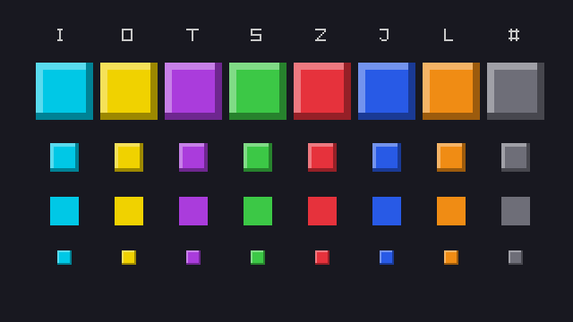
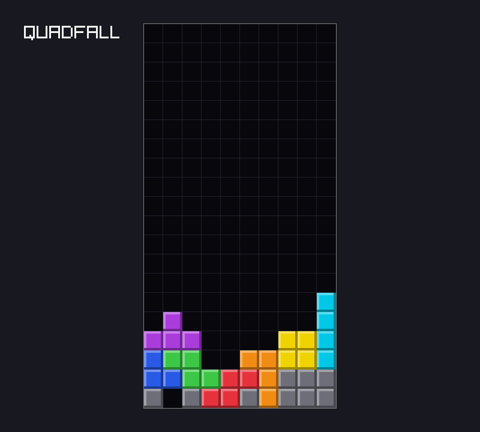

# Chapter 2 — The Board

The playfield is the heart of a falling-block game, and it is just data: a grid of 10 columns
and 22 rows, each cell empty or filled. This chapter designs that data before drawing any of
it. A cell is an enum, a position is a pair of signed integers, and row 0 is the *bottom* row,
because pieces fall down and rows are cleared from the bottom. Boards can be written as small
text pictures, which makes them easy to build and easy to test. The chapter also makes the most
important structural decision of Part I: the game rules go into a `core` module that cannot see
raylib, with tests that run without a window. At the end, `quadfall` draws a demo board with
bevelled, colored blocks, and `zig build test` checks the board code in a third of a second.

Previous: [Chapter 1](01-getting-started.md). Next: [Chapter 3](03-tetrominoes.md).

## Data first

Chapter 1 drew two blocks straight from `main`, with pixel positions mixed into the motion
code. That cannot grow into a game. The rules (which cells are full, whether a piece fits,
which rows are complete) have nothing to do with pixels. So before drawing anything, decide what
the game *is*:

- **The board is 10 columns wide.** Almost every falling-block game uses 10.
- **20 rows are visible.** That is the height the [Tetris Wiki](https://tetris.wiki/Playfield)
  reports for most Guideline games.
- **2 more rows are hidden above the visible ones.** New pieces appear there and fall into
  view. The Guideline's buffer zone above the field is 20 rows tall, with pieces spawning in its
  bottom two rows; `quadfall` keeps only those two. Chapter 3 places pieces in them.
- **Each cell is empty or holds one block.** A block remembers which piece it came from, so a
  locked piece keeps its color.
- **Row 0 is the bottom row.** Columns count from the left wall, rows from the floor. That is
  the community's convention too ("columns are conventionally numbered from left to right, and
  rows from bottom to top").

Every one of these decisions lives in one file, `src/core/board.zig`, and none of them
mentions raylib. The sections below build that file part by part, each part after an example
that teaches the Zig behind it. Drawing comes last.

## Cells as an enum

A cell is one of nine things: empty, a block from one of the seven pieces (named I, O, T, S, Z,
J and L after their shapes), or garbage, a gray block that was never part of a piece. (Garbage
appears in Chapter 6's tests and in the demo board below.) Nine values, known when the program
is written: that is an enum.

`examples/ch02/cell_enum.zig`

```zig
//! What a board cell holds, as an enum with a fixed integer type.
const std = @import("std");

/// What fills one cell. A locked piece keeps its letter, so it keeps its color.
pub const Cell = enum(u8) {
    empty,
    i,
    o,
    t,
    s,
    z,
    j,
    l,
    garbage,

    /// The character for this cell in a board picture.
    pub fn char(cell: Cell) u8 {
        return ".IOTSZJL#"[@backingInt(cell)];
    }

    pub fn fromChar(c: u8) ?Cell {
        const index = std.mem.findScalar(u8, ".IOTSZJL#", c) orelse return null;
        return @fromBackingInt(@intCast(index));
    }
};

/// An exhaustive switch: add a tag and the compiler finds every switch
/// that does not handle it.
fn describe(cell: Cell) []const u8 {
    return switch (cell) {
        .empty => "nothing",
        .i, .o, .t, .s, .z, .j, .l => "part of a piece",
        .garbage => "garbage",
    };
}

pub fn main() void {
    std.debug.print("@sizeOf(Cell) = {d}\n", .{@sizeOf(Cell)});
    for (std.enums.values(Cell)) |cell| {
        std.debug.print("{d}  {c}  .{t:<8} {s}\n", .{ @backingInt(cell), cell.char(), cell, describe(cell) });
    }
    std.debug.print("fromChar('T') = {?}\n", .{Cell.fromChar('T')});
    std.debug.print("fromChar('x') = {?}\n", .{Cell.fromChar('x')});
}
```

```console
$ zig run examples/ch02/cell_enum.zig
@sizeOf(Cell) = 1
0  .  .empty    nothing
1  I  .i        part of a piece
2  O  .o        part of a piece
3  T  .t        part of a piece
4  S  .s        part of a piece
5  Z  .z        part of a piece
6  J  .j        part of a piece
7  L  .l        part of a piece
8  #  .garbage  garbage
fromChar('T') = .t
fromChar('x') = null
```

- **`enum(u8)`** fixes the integer type behind the tags. Tags are numbered from 0 in the order
  they are written, so `.empty` is 0. A cell is one byte, and a 10×22 board is 220 bytes.
- **`@backingInt(cell)`** gives that number, and **`@fromBackingInt(n)`** turns a number back
  into a tag. They are new names in Zig 0.17; the older `@intFromEnum` and `@enumFromInt` still
  work. `@fromBackingInt` takes its type from the result: here the return type `?Cell`. The
  `@intCast` narrows `usize` to `u8`, which is safe because the index is at most 8.
- **`char`** indexes a string with the tag's number. The string `".IOTSZJL#"` and the tag list
  must stay in the same order. These nine characters are the alphabet of the board pictures in
  this chapter: `.` for empty, a letter for a piece, `#` for garbage.
- **`fromChar`** goes the other way. `std.mem.findScalar` returns the index of the first match or
  `null`. It is the new name of `indexOfScalar`, which 0.17 keeps as a deprecated alias. `orelse
  return null` passes the `null` on, so `fromChar('x')` is `null` and the caller must deal with it.
- **`std.enums.values(Cell)`** is an array of all tags, in order. `{t}` prints a tag's name,
  and `{?}` prints an optional.

The real gain is the exhaustive `switch`. Delete the `.garbage` line from `describe` and the
program no longer compiles:

```console
$ zig run cell_enum.zig
cell_enum.zig:30:12: error: switch must handle all possibilities
    return switch (cell) {
           ^~~~~~
cell_enum.zig:14:5: note: unhandled enumeration value: 'garbage'
    garbage,
    ^~~~~~~
cell_enum.zig:5:18: note: enum 'cell_enum.Cell' declared here
pub const Cell = enum(u8) {
                 ^~~~
...
```

(Run on a copy; the reference trace is trimmed.) This is why the switches in `quadfall` avoid
`else`. When a later chapter adds a tag to an enum, the compiler lists every place that must
decide what to do with it.

**Why not store a color?** A cell could hold an `rl.Color` directly, and drawing would be one
step shorter. But then the rules would depend on raylib, and two pieces with the same color
could not be told apart. The core says *what* a cell is. The drawing code decides how each kind
looks, in one `switch` (see [Drawing the board](#drawing-the-board)). A different front end,
a terminal version say, could draw the same board with letters.

`board.zig` starts with the board's size and this same enum, `Cell`, exactly as in the
example (without `describe`, which the game does not need):

`project/ch02/src/core/board.zig` (part 1)

```zig
//! The playfield: a grid of cells, 10 columns wide.
const std = @import("std");

pub const cols = 10;
/// Rows the player sees.
pub const visible_rows = 20;
/// Two hidden rows above the visible ones give new pieces room to appear.
pub const rows = visible_rows + 2;

// ... the Cell enum from cell_enum.zig, lines 4 to 25 ...
```

`cols`, `visible_rows` and `rows` have no type annotation. They are `comptime_int`, so they mix
with `i32`, `usize` and `c_int` alike.

## Coordinates

### A grid is an array of arrays

The board's cells go in a two-dimensional array. In Zig that is an array whose elements are
arrays: `[rows][cols]Cell` is `rows` rows, each `cols` cells long.

`examples/ch02/grid.zig`

```zig
//! A grid as an array of arrays: grid[row][col].
const std = @import("std");

const rows = 4;
const cols = 6;

pub fn main() void {
    // @splat fills an array with one value. The inner @splat makes a row,
    // the outer one makes `rows` copies of that row.
    var grid: [rows][cols]u8 = @splat(@splat('.'));

    grid[0][0] = 'A'; // row 0, column 0
    grid[1][4] = 'B'; // row 1, column 4
    grid[rows - 1][cols - 1] = 'C'; // the last cell

    // Fill column 2 from top to bottom.
    for (&grid) |*row| row[2] = '|';

    for (grid, 0..) |row, r| {
        std.debug.print("row {d}: {s}\n", .{ r, &row });
    }

    std.debug.print("@sizeOf = {d} bytes ({d} x {d})\n", .{ @sizeOf(@TypeOf(grid)), rows, cols });

    // Row-major: each row is stored whole, one after another, so grid[r][c]
    // is byte number r * cols + c of the grid's memory.
    const flat: *const [rows * cols]u8 = @ptrCast(&grid);
    std.debug.print("flat: {s}\n", .{flat});
    std.debug.print("grid[1][4] = {c}, flat[1 * cols + 4] = {c}\n", .{ grid[1][4], flat[1 * cols + 4] });
}
```

```console
$ zig run examples/ch02/grid.zig
row 0: A.|...
row 1: ..|.B.
row 2: ..|...
row 3: ..|..C
@sizeOf = 24 bytes (4 x 6)
flat: A.|.....|.B...|.....|..C
grid[1][4] = B, flat[1 * cols + 4] = B
```

- **`@splat(value)`** makes an array with every element equal to `value`. Its length and
  element type come from the result type. For `[4][6]u8`, the outer `@splat` must produce four
  `[6]u8` rows, so the inner `@splat('.')` is given the type `[6]u8`. Two `@splat`s, one per
  dimension.
- **`grid[row][col]`**: the first index picks a row, the second a cell in it. Keep that order
  everywhere. Mixing up `[col][row]` is the classic grid bug. It compiles, and then either reads
  the wrong cell or, if the swapped index is too large, stops at a bounds check.
- **`for (&grid) |*row|`** loops over pointers to the rows, so `row[2] = '|'` changes the
  grid. Without the `&` and `*`, each `row` would be a copy.
- **No padding, no pointers.** The array is 24 bytes, exactly 4 × 6. Arrays are values in Zig:
  assigning a grid copies all of it, and a board can be returned from a function, compared, or
  built at compile time.
- **Row-major order.** Rows lie one after another in memory, so `grid[r][c]` is element
  `r * cols + c` of the flat bytes. The `@ptrCast` to a flat array is only here to show that;
  the game always uses two indices.

### Positions are signed

A position on the board is a column and a row:

`project/ch02/src/core/board.zig` (part 2)

```zig
/// A cell position. Column 0 is the left wall and row 0 is the bottom row,
/// so "up" means a larger row. Signed, because a position may be off the board.
pub const Pos = struct {
    col: i32,
    row: i32,

    pub fn add(a: Pos, b: Pos) Pos {
        return .{ .col = a.col + b.col, .row = a.row + b.row };
    }
};
```

Why `i32` when array indices are `usize`? Because the game constantly asks about positions that
are *not* on the board. A piece moved one step left of column 0 is at column −1, and the answer
to "does it fit there?" must be "no", not an integer overflow. With signed coordinates, any
position can be represented, and one function decides whether it is on the board. Chapter 3
also gives pieces offsets such as "one row down" (`.{ .col = 0, .row = -1 }`), which `add`
applies.

### Row 0 is the bottom

Screens count y *down* from the top, as Chapter 1 showed. The board counts rows *up* from the
floor. Each choice suits its job. Pieces fall toward row 0. When a row is cleared, everything
above it moves down one row, to a smaller number. Rows 20 and 21 are the hidden ones, above the
visible field, whatever the size of the window.

The drawing code converts. A column becomes a pixel x by scaling. A row must be flipped first:
row 19, the top visible row, is drawn at the top of the board, and row 0 at the bottom.

`examples/ch02/y_up.zig`

```zig
//! Board rows count up from the floor; screen pixels count down from the top.
const std = @import("std");

const visible_rows = 20;
const cell_size = 32;
const board_x = 240; // pixel position of the board's top-left corner
const board_y = 40;

/// Pixel x of the left edge of a column.
fn cellX(col: i32) i32 {
    return board_x + col * cell_size;
}

/// Pixel y of the top edge of a row: flip the row, then scale.
fn cellY(row: i32) i32 {
    return board_y + (visible_rows - 1 - row) * cell_size;
}

pub fn main() void {
    std.debug.print("{s:>4}  {s:>6}  {s}\n", .{ "row", "flip", "pixel y (top edge)" });
    const sample_rows = [_]i32{ 0, 1, 2, 18, 19, 20, 21 };
    for (sample_rows) |row| {
        const note = if (row >= visible_rows) "  hidden: above the window's board" else "";
        std.debug.print("{d:>4}  {d:>6}  {d:>4}{s}\n", .{ row, visible_rows - 1 - row, cellY(row), note });
    }
    std.debug.print("col 0 -> x {d}, col 9 -> x {d}\n", .{ cellX(0), cellX(9) });
    std.debug.print("bottom edge of the board: y {d}\n", .{board_y + visible_rows * cell_size});
}
```

```console
$ zig run examples/ch02/y_up.zig
 row    flip  pixel y (top edge)
  +0     +19  +648
  +1     +18  +616
  +2     +17  +584
 +18      +1   +72
 +19      +0   +40
 +20      -1    +8  hidden: above the window's board
 +21      -2   -24  hidden: above the window's board
col 0 -> x 240, col 9 -> x 528
bottom edge of the board: y 680
```

- **Row 0** is drawn at y = 648: its top edge is one cell above the board's bottom edge, 680.
- **Row 19** is drawn at y = 40, the top of the board.
- **Rows 20 and 21** come out at y = 8 and y = −24: above the board, and row 21 partly
  outside the window. That is why the drawing code only loops over the visible rows.
- `cellY` names the *top* edge of the cell, because `DrawRectangle` takes the top-left corner.
- **The `+` signs** are a formatting surprise worth knowing. In Zig 0.17, a signed integer
  printed with a width, such as `{d:>4}` with an `i32`, always gets a sign. Unsigned integers,
  and signed ones printed without a width, do not; that is why the last two lines have none.
  Use an unsigned type or no width if the `+` is unwanted.

### The Board struct

Now the board itself:

`project/ch02/src/core/board.zig` (part 3)

```zig
pub const Board = struct {
    /// cells[row][col]; cells[0] is the bottom row.
    cells: [rows][cols]Cell = @splat(@splat(.empty)),

    pub const empty: Board = .{};

    pub fn inside(pos: Pos) bool {
        return pos.col >= 0 and pos.col < cols and pos.row >= 0 and pos.row < rows;
    }

    pub fn get(board: *const Board, pos: Pos) Cell {
        std.debug.assert(inside(pos));
        return board.cells[@intCast(pos.row)][@intCast(pos.col)];
    }

    pub fn set(board: *Board, pos: Pos, cell: Cell) void {
        std.debug.assert(inside(pos));
        board.cells[@intCast(pos.row)][@intCast(pos.col)] = cell;
    }
```

- **The default value** `@splat(@splat(.empty))` fills all 220 cells with `.empty`. The
  `.empty` is an enum literal; its type, `Cell`, comes from the field's type.
- **`pub const empty: Board = .{};`** is a *declaration* inside the struct: a ready-made empty
  board. Because it has the type `Board`, it can be used as a **decl literal**. Wherever the
  type `Board` is known, `.empty` means `Board.empty`:

  ```zig
  var board: Board = .empty;
  ```

  That reads as plainly as it should. `std.ArrayList` and many other standard types use the
  same pattern. Note the two different `.empty`s in this code: the field default's `.empty` is
  a `Cell` tag, the variable's `.empty` is the `Board` declaration. The result type decides.
- **`inside`** takes no board, only a position, because every board has the same size. Call it
  as `Board.inside(pos)`.
- **`get` and `set`** assert that the position is inside, then convert the signed coordinates
  to indices with `@intCast` (the index type, `usize`, comes from the array). In a Debug or
  ReleaseSafe build, a bad position stops the program at the `assert` with a stack trace that
  names the caller. Asking "is this position free?" for positions off the board is a separate,
  legitimate question; Chapter 3 answers it with `inside` first and `get` second.
- `get` takes `*const Board`: a 220-byte board is not copied for each call. Zig may pass a
  plain `Board` parameter by reference anyway, but the pointer makes the intent explicit, and
  `set` needs one regardless.

## Pictures: boards as strings

A test that builds a board with twenty `set` calls is hard to read and easy to get wrong. A
picture is better:

```text
....T.....
...TTT..OO
#########.
```

That is three rows, top row first, sitting on the floor. Anyone can see a T piece on top of a
row of garbage with a gap at the right. `Board.parse` turns such a picture into a `Board`, and
`Board.format` turns a board back into one.

### Parsing at compile time

`examples/ch02/picture.zig` does the same thing on a 5-wide grid, to show two Zig features at
once: multi-line string literals, and running a function while compiling.

`examples/ch02/picture.zig`

```zig
//! A small grid built from a picture at compile time.
const std = @import("std");

const cols = 5;
const max_rows = 4;

const Grid = struct {
    /// cells[0] is the BOTTOM row.
    cells: [max_rows][cols]u8 = @splat(@splat('.')),

    /// The picture's first line is the top row; its last line is row 0.
    fn parse(picture: []const u8) Grid {
        var grid: Grid = .{};
        const height = std.mem.countScalar(u8, picture, '\n') + 1;
        if (height > max_rows) @panic("picture has too many rows");
        var lines = std.mem.splitScalar(u8, picture, '\n');
        var row = height;
        while (lines.next()) |line| {
            row -= 1;
            if (line.len != cols) @panic("picture rows must be 5 characters wide");
            for (line, 0..) |c, col| grid.cells[row][col] = c;
        }
        return grid;
    }
};

// A multi-line string literal: each line starts with \\ and the final
// newline is not included.
const pyramid =
    \\..#..
    \\.###.
    \\#####
;

// A container-level constant is computed while compiling, so parse runs
// inside the compiler and the program only contains the finished grid.
const pyramid_grid = Grid.parse(pyramid);

pub fn main() void {
    std.debug.print("picture is {d} bytes, {d} lines\n", .{ pyramid.len, std.mem.countScalar(u8, pyramid, '\n') + 1 });
    for (pyramid_grid.cells, 0..) |row, r| {
        std.debug.print("cells[{d}] = {s}\n", .{ r, &row });
    }
}
```

```console
$ zig run examples/ch02/picture.zig
picture is 17 bytes, 3 lines
cells[0] = #####
cells[1] = .###.
cells[2] = ..#..
cells[3] = .....
```

- **A multi-line string literal** is a run of lines that each start with `\\`. The lines are
  joined with `\n`, and there is no newline after the last one: three lines of 5 characters
  plus two newlines is 17 bytes. No escaping is needed inside, which makes pictures easy to
  type.
- **`countScalar`** counts the newlines (lines = newlines + 1), and **`splitScalar`** returns an
  iterator over the lines. Both are in `std.mem`.
- **Top row first.** The first line of the picture is the highest row, so `row` counts *down*
  from `height - 1`. `cells[0]`, the bottom row, is the picture's last line, `#####`. Row 3 was
  not in the picture and stays empty.
- **`pyramid_grid` is computed at compile time.** Every container-level `const` (one outside any
  function) is evaluated by the compiler. `Grid.parse` is an ordinary function, and it runs
  inside the compiler. The program contains only the finished 20-byte grid.

**A bad picture is a compile error.** `@panic` at run time stops the program. At compile time
it stops the *compiler*, with the panic message as the error. Make the last line of the pyramid
one character short:

```console
$ zig run picture.zig
picture.zig:20:35: error: encountered @panic at comptime: picture rows must be 5 characters wide
            if (line.len != cols) @panic("picture rows must be 5 characters wide");
                                  ^~~~~~~~~~~~~~~~~~~~~~~~~~~~~~~~~~~~~~~~~~~~~~~
picture.zig:37:32: note: called at comptime here
const pyramid_grid = Grid.parse(pyramid);
                     ~~~~~~~~~~^~~~~~~~~
...
```

(A copy of the example; the reference trace is trimmed.) The note names the line that called
`parse`. For board pictures in tests, that is exactly right: a typo in a picture is caught
before any test runs.

You might think the call needs the `comptime` keyword. At container level it does not, and Zig
says so:

```console
$ zig run picture.zig
picture.zig:37:22: error: redundant comptime keyword in already comptime scope
const pyramid_grid = comptime Grid.parse(pyramid);
                     ^~~~~~~~
```

*Inside* a function, `comptime` is needed and allowed: `const board: Board = comptime
.parse(picture);` in a test forces the parse to run at compile time. Without it, the parse runs
when the test runs, and a bad picture panics then instead.

### Board.parse

The real `parse` is the same idea with `Cell`s and signed rows:

`project/ch02/src/core/board.zig` (part 4)

```zig
    /// Builds a board from a picture such as "..IIII....\n#########.".
    /// The picture is drawn top row first and sits on the floor: its last
    /// line is row 0. Meant for tests and demos, so a bad picture panics
    /// (a compile error when called at comptime).
    pub fn parse(picture: []const u8) Board {
        var board: Board = .empty;
        const height = std.mem.countScalar(u8, picture, '\n') + 1;
        if (height > rows) @panic("board picture has too many rows");
        var lines = std.mem.splitScalar(u8, picture, '\n');
        var row: i32 = @intCast(height - 1);
        while (lines.next()) |line| : (row -= 1) {
            if (line.len != cols) @panic("board picture rows must be 10 characters wide");
            for (line, 0..) |c, col| {
                const cell = Cell.fromChar(c) orelse @panic("unknown character in board picture");
                board.set(.{ .col = @intCast(col), .row = row }, cell);
            }
        }
        return board;
    }
```

- Three checks, three panics: too many rows, a row of the wrong width, a character that is not
  in `.IOTSZJL#`. `Cell.fromChar(c) orelse @panic(...)` turns the `null` into the panic.
- `parse` panics instead of returning an error because it is for pictures written by the
  programmer, in tests and demos. A wrong picture is a bug in the program, not a condition to
  handle. Input from a user or a file would get an error set instead.
- `board.set` asserts that each position is inside, so `parse` reuses the same checks as the
  rest of the game.

### Printing with a format method

Going the other way, from a board to a picture, uses Zig's formatting. A type that has a method
named `format` with the right signature can print itself with the `{f}` specifier.

`examples/ch02/format_method.zig`

```zig
//! A `format` method lets a type print itself with `{f}`.
const std = @import("std");

const Pos = struct {
    col: i32,
    row: i32,

    /// Called by `{f}`. It writes to any std.Io.Writer: a terminal, a
    /// buffer, a file. It may only fail with the writer's own error.
    pub fn format(pos: Pos, w: *std.Io.Writer) std.Io.Writer.Error!void {
        try w.print("({d},{d})", .{ pos.col, pos.row });
    }
};

/// A 3x3 grid that prints as three lines, top row first, with no
/// newline after the last one.
const Tiny = struct {
    cells: [3][3]u8 = @splat(@splat('.')),

    pub fn format(t: Tiny, w: *std.Io.Writer) std.Io.Writer.Error!void {
        var row: usize = 3;
        while (row > 0) {
            row -= 1;
            try w.writeAll(&t.cells[row]);
            if (row > 0) try w.writeByte('\n');
        }
    }
};

test "Pos prints as (col,row)" {
    const p: Pos = .{ .col = 4, .row = -1 };
    try std.testing.expectFmt("(4,-1)", "{f}", .{p});
    try std.testing.expectFmt("at (4,-1)!", "at {f}!", .{p});
}

test "Tiny prints the top row first" {
    var t: Tiny = .{};
    t.cells[0][0] = '#'; // bottom-left
    t.cells[2][2] = '#'; // top-right
    try std.testing.expectFmt(
        \\..#
        \\...
        \\#..
    , "{f}", .{t});
}

test "formatting into a buffer" {
    var buf: [32]u8 = undefined;
    var w: std.Io.Writer = .fixed(&buf);
    try w.print("{f} {f}", .{ Pos{ .col = 0, .row = 0 }, Pos{ .col = 9, .row = 21 } });
    try std.testing.expectEqualStrings("(0,0) (9,21)", w.buffered());
}
```

```console
$ zig test examples/ch02/format_method.zig
1/3 format_method.test.Pos prints as (col,row)...OK
2/3 format_method.test.Tiny prints the top row first...OK
3/3 format_method.test.formatting into a buffer...OK
All 3 tests passed.
```

This example is all tests, so it runs with `zig test` (the next section explains test blocks).

- **The signature** is `pub fn format(self, w: *std.Io.Writer) std.Io.Writer.Error!void`.
  `std.Io.Writer` is Zig 0.17's general output interface. The same method writes to stderr, to
  a stack buffer, or to a file, because it only talks to the writer.
- **The error set** is `std.Io.Writer.Error`, the writer's own. A format method cannot fail for
  reasons of its own, only because writing failed.
- **`{f}`** calls the method. `"at {f}!"` shows that it fits into any surrounding text.
- **`std.testing.expectFmt(expected, format, args)`** formats and compares the result with a
  string. With a multi-line literal as the expected value, a test can compare whole pictures.
- **`std.Io.Writer.fixed(&buf)`** is a writer into a fixed buffer; `w.buffered()` is what has
  been written so far.

**Forgetting the `f`.** With `{}` instead of `{f}`, Zig does not call the method. It prints the
struct's fields in its default style, and this is not a compile error. The test catches it:

```console
$ zig test format_method.zig
1/3 format_method.test.Pos prints as (col,row)...
====== expected this output: =========
(4,-1)␃

======== instead found this: =========
.{ .col = 4, .row = -1 }␃

======================================
...
FAIL (TestExpectedEqual)
...
2 passed; 0 skipped; 1 failed.
```

(Trimmed: the line-by-line comparison, the stack trace and the other tests.) `␃` marks the end of each string, so trailing
spaces and newlines are visible. Without the test, the mistake would show up as odd output in
some log, much later.

### Board.format

`project/ch02/src/core/board.zig` (part 5)

```zig
    /// Writes the board as a picture (the format `parse` reads), from the
    /// highest non-empty row down to row 0. Use it with `{f}`.
    pub fn format(board: Board, w: *std.Io.Writer) std.Io.Writer.Error!void {
        var top: usize = rows;
        while (top > 0 and board.rowIsEmpty(top - 1)) top -= 1;
        var row = top;
        while (row > 0) {
            row -= 1;
            for (board.cells[row]) |cell| try w.writeByte(cell.char());
            if (row > 0) try w.writeByte('\n');
        }
    }

    fn rowIsEmpty(board: *const Board, row: usize) bool {
        for (board.cells[row]) |cell| {
            if (cell != .empty) return false;
        }
        return true;
    }
};
```

Two choices make `format` the exact inverse of `parse`:

- **It trims empty rows at the top.** A board with three filled rows prints as three lines, not
  22. `top` starts at 22 and moves down past empty rows. An empty board prints as nothing.
- **It writes no newline after the last row,** just as a multi-line string literal has none.

So for any picture with no empty top rows, `parse` then `format` gives back the same string.
A test can say "the board should look like this" and compare pictures. The `};` at the end
closes `Board`.

## Tests

Zig has testing built into the language. A `test` block is a function with a name and no
parameters. `zig test file.zig` compiles the file in test mode and runs every test block;
`zig run` and `zig build` leave them out of the program.

`examples/ch02/tests.zig`

```zig
//! Test blocks. `zig test tests.zig` compiles the file in test mode and
//! runs every `test` block; `zig run` and `zig build` skip them.
const std = @import("std");
const expect = std.testing.expect;
const expectEqual = std.testing.expectEqual;
const expectError = std.testing.expectError;

const cols = 10;

/// Counts the filled cells in one row picture such as "##..#.....".
fn countFilled(line: []const u8) error{ WrongWidth, BadChar }!u32 {
    if (line.len != cols) return error.WrongWidth;
    var n: u32 = 0;
    for (line) |c| switch (c) {
        '.' => {},
        '#' => n += 1,
        else => return error.BadChar,
    };
    return n;
}

test "an empty row has no filled cells" {
    try expectEqual(0, try countFilled(".........."));
}

test "counts every #" {
    try expectEqual(3, try countFilled("##..#....."));
    try expectEqual(10, try countFilled("##########"));
}

test "rejects a row of the wrong width" {
    try expectError(error.WrongWidth, countFilled("###"));
    try expectError(error.WrongWidth, countFilled(""));
}

test "rejects unknown characters" {
    try expectError(error.BadChar, countFilled("#x........"));
}

test "a full row is full" {
    const full = try countFilled("##########") == cols;
    try expect(full);
}
```

```console
$ zig test examples/ch02/tests.zig
1/5 tests.test.an empty row has no filled cells...OK
2/5 tests.test.counts every #...OK
3/5 tests.test.rejects a row of the wrong width...OK
4/5 tests.test.rejects unknown characters...OK
5/5 tests.test.a full row is full...OK
All 5 tests passed.
$ zig test examples/ch02/tests.zig --test-filter rejects
1/2 tests.test.rejects a row of the wrong width...OK
2/2 tests.test.rejects unknown characters...OK
All 2 tests passed.
```

- **A test passes if it returns without an error.** The `expect` functions return
  `error.TestUnexpectedResult` or `error.TestExpectedEqual` when the check fails, and `try`
  passes that out of the test.
- **`expectEqual(expected, actual)`**: expected first. The two are converted to a common type
  (peer type resolution), so a `comptime_int` such as `3` compares fine with a `u32`.
- **`expectError(error.X, expr)`** passes only if `expr` returns exactly that error. Note there
  is no `try` on `countFilled` inside it: the error union itself is what is being checked.
- **`expect(bool)`** is the general case, for anything else.
- **`--test-filter rejects`** runs only the tests whose names contain `rejects`.

A failing test says where and why. Change the expected count in the second test from 3 to 2:

```console
$ zig test tests.zig
1/5 tests.test.an empty row has no filled cells...OK
2/5 tests.test.counts every #...expected 2, found 3
FAIL (TestExpectedEqual)
...
.../tests.zig:27:5: 0x1256469 in test.counts every # (tests.zig)
    try expectEqual(2, try countFilled("##..#....."));
    ^
3/5 tests.test.rejects a row of the wrong width...OK
4/5 tests.test.rejects unknown characters...OK
5/5 tests.test.a full row is full...OK
4 passed; 0 skipped; 1 failed.
error: the following test command failed with exit code 1:
.../test --seed=0x820d46fc
```

(Two frames inside `std.testing` and part of the path are trimmed.) The other tests still run,
the last frame of the trace is the failing line,
and the exit code is 1, so a script or CI job notices.

### The board's tests

`board.zig` ends with four tests:

`project/ch02/src/core/board.zig` (part 6)

```zig
test "a new board is empty" {
    const board: Board = .empty;
    try std.testing.expectEqual(Cell.empty, board.get(.{ .col = 0, .row = 0 }));
    try std.testing.expectFmt("", "{f}", .{board});
}

test "inside" {
    try std.testing.expect(Board.inside(.{ .col = 0, .row = 0 }));
    try std.testing.expect(Board.inside(.{ .col = 9, .row = 21 }));
    try std.testing.expect(!Board.inside(.{ .col = -1, .row = 0 }));
    try std.testing.expect(!Board.inside(.{ .col = 10, .row = 0 }));
    try std.testing.expect(!Board.inside(.{ .col = 0, .row = -1 }));
    try std.testing.expect(!Board.inside(.{ .col = 0, .row = 22 }));
}

test "row 0 is the bottom row" {
    var board: Board = .empty;
    board.set(.{ .col = 0, .row = 0 }, .j);
    board.set(.{ .col = 9, .row = 1 }, .l);
    try std.testing.expectFmt(
        \\.........L
        \\J.........
    , "{f}", .{board});
}

test "parse and format round-trip" {
    const picture =
        \\....T.....
        \\...TTT..OO
        \\#########.
    ;
    const board: Board = comptime .parse(picture);
    try std.testing.expectEqual(Cell.t, board.get(.{ .col = 4, .row = 2 }));
    try std.testing.expectEqual(Cell.garbage, board.get(.{ .col = 0, .row = 0 }));
    try std.testing.expectEqual(Cell.empty, board.get(.{ .col = 9, .row = 0 }));
    try std.testing.expectFmt(picture, "{f}", .{board});
}
```

- **"a new board is empty"** checks one cell and that the whole board prints as nothing.
- **"inside"** tests the edges: the corners that are inside, and one step past each of the
  four sides. Off-by-one mistakes live at edges.
- **"row 0 is the bottom row"** pins down the coordinate convention. A J block set at row 0
  must print on the *last* line. If anyone ever flips the convention, this test fails.
- **"parse and format round-trip"** parses a picture at compile time, checks three cells (the
  T at the top, a garbage block, the gap), and checks that printing gives the picture back.
- `board.get(.{ .col = 4, .row = 2 })` needs no `Pos` name, and `board.set(..., .j)` no `Cell`:
  the parameter types give the literals their types.

## Modules: a line between rules and platform

The board code does not use raylib, and it must stay that way. That makes it testable without
a window, readable on its own, and reusable: Part II's renderer could draw the same board in 3D.
A comment saying "do not import raylib here" would last until the first hurried change. The
build system can enforce it instead.

In Zig's build system, a **module** is a root source file plus a table of named imports. A file
can `@import` another file of its own module by path, as in `@import("board.zig")`, and a
*name* only if `build.zig` gave its module that name. `@import("std")` always works. Chapter 1's
executable module was given one name, `rl`. The game logic gets a module of its own, given none.

### The core module

The game logic gets its own directory, `src/core/`, with a root file that lists what the rest
of the game may use:

`project/ch02/src/core/root.zig`

```zig
//! The game logic of quadfall. Nothing under src/core/ may use raylib: this
//! module is built without the "rl" import, so the compiler enforces it.

pub const board = @import("board.zig");
pub const Board = board.Board;
pub const Cell = board.Cell;
pub const Pos = board.Pos;

test {
    @import("std").testing.refAllDecls(@This());
}
```

- **The `pub const`s** are the module's public surface. `main.zig` writes `core.Board` and
  `core.Cell`; the drawing code also uses `core.board.cols` and `core.board.visible_rows`.
- **The unnamed `test` block** makes the tests in `board.zig` part of the test build. Zig
  analyzes declarations *lazily*: a declaration that nothing uses is never compiled, and a file
  nothing reaches contributes no tests. `refAllDecls(@This())` refers to every public
  declaration of `root.zig`, which pulls in `board.zig`, and its tests with it. In a copy of the
  project without this block, `zig build test` still "succeeded", with no test count: it ran
  nothing.

In `build.zig`, the core becomes a module with no imports, the executable imports both `rl` and
`core`, and a new `test` step runs the core's tests:

`project/ch02/build.zig` (changes from Chapter 1)

```diff
@@ -15,13 +15,23 @@
         .optimize = optimize,
     });
 
+    // The game logic. It gets no "rl" import, so it cannot use raylib.
+    const core = b.createModule(.{
+        .root_source_file = b.path("src/core/root.zig"),
+        .target = target,
+        .optimize = optimize,
+    });
+
     const exe = b.addExecutable(.{
         .name = "quadfall",
         .root_module = b.createModule(.{
             .root_source_file = b.path("src/main.zig"),
             .target = target,
             .optimize = optimize,
-            .imports = &.{.{ .name = "rl", .module = rl.createModule() }},
+            .imports = &.{
+                .{ .name = "rl", .module = rl.createModule() },
+                .{ .name = "core", .module = core },
+            },
         }),
     });
     exe.root_module.linkLibrary(raylib);
@@ -33,4 +43,10 @@
     run_cmd.addPassthruArgs();
     const run_step = b.step("run", "Run quadfall");
     run_step.dependOn(&run_cmd.step);
+
+    // `zig build test` runs the tests in the core module. It never compiles
+    // or links raylib and never opens a window.
+    const core_tests = b.addTest(.{ .root_module = core });
+    const test_step = b.step("test", "Run the game logic tests");
+    test_step.dependOn(&b.addRunArtifact(core_tests).step);
 }
```

`b.addTest(.{ .root_module = core })` builds a test program from the `core` module alone;
`main.zig`, `draw.zig` and raylib are not part of it. `zig build --help` now lists
`test   Run the game logic tests` under `Steps:`, next to `run`.

### Testing the boundary

What happens when someone puts raylib into the core anyway? This was tried in a scratch copy of
`project/ch02`. First, only the import, at the top of `board.zig`:

```zig
const rl = @import("rl");
```

Both `zig build` and `zig build test` still succeeded: an unused declaration is never analyzed, so
its import is never resolved. Then a use, the tempting kind: a color in the core, used by the
drawing code.

```zig
/// Tempting, but wrong: a color in the core.
pub const well_color = rl.BLACK;
```

```console
$ zig build
install
+- install quadfall
   +- compile exe quadfall debug native 1 errors
src/core/board.zig:3:20: error: no module named 'rl' available within module 'core'
const rl = @import("rl");
                   ^~~~
referenced by:
    well_color: src/core/board.zig:46:24
    drawBoard: src/draw.zig:54:72
    5 reference(s) hidden; use '-freference-trace=7' to see all references
...
```

The boundary holds: the core has no `rl`, so the build fails and names the file, the use and
the user. But `zig build test` at that point still *passed*, 5/5. The test build never touched
`well_color`, because `refAllDecls` is not recursive. It refers to `root.zig`'s declarations,
such as `board`, but not to the declarations inside `board.zig`. Adding the same block to
`board.zig` closes that gap:

```zig
test {
    std.testing.refAllDecls(@This());
}
```

```console
$ zig build test
test
+- run test
   +- compile test debug native 1 errors
src/core/board.zig:3:20: error: no module named 'rl' available within module 'root'
const rl = @import("rl");
                   ^~~~
referenced by:
    well_color: src/core/board.zig:46:24
    refAllDecls__func_963: .../lib/std/testing.zig:1267:14
...
```

The same mistake, but the module is now called `root`, not `core`. In the test build, `core`'s
root file is the root of the whole program, and a program's root module is always named `root`.
Worth knowing when you search for the message.

The lesson is not "add more `refAllDecls`". It is that Zig checks what is *used*. The
executable uses every part of the core that matters, so `zig build` is the build that enforces
the boundary. Run both.

**Why this matters.** `zig build test` builds three steps and never compiles raylib's C code,
never links against X11 or OpenGL, never opens a window. It runs in a third of a second, works
on a server with no display, and tests exactly the code that decides whether the game is right.
Every later chapter adds its rules to `core` and its tests to `zig build test`.

## Drawing the board

The platform side gets one new file, `src/draw.zig`. It knows pixels and colors, and it reads
the board through `core`.

### A bevelled block

A flat square looks like a sticker. Light along the top and left edges and shadow along the
bottom and right make it look raised, as if lit from the top-left. Three rectangles are
enough: a dark square, a light square that leaves a dark rim at the bottom and right, and the
color itself in the middle.

`examples/ch02/blocks.zig`

```zig
//! The quadfall palette drawn as bevelled blocks, at three sizes.
const std = @import("std");
const rl = @import("rl");
const Demo = @import("demo").Demo;

const background: rl.Color = .{ .r = 24, .g = 24, .b = 32, .a = 255 };

const palette = [_]struct { name: [:0]const u8, color: rl.Color }{
    .{ .name = "I", .color = .{ .r = 0, .g = 200, .b = 230, .a = 255 } },
    .{ .name = "O", .color = .{ .r = 240, .g = 210, .b = 0, .a = 255 } },
    .{ .name = "T", .color = .{ .r = 170, .g = 60, .b = 220, .a = 255 } },
    .{ .name = "S", .color = .{ .r = 60, .g = 200, .b = 70, .a = 255 } },
    .{ .name = "Z", .color = .{ .r = 230, .g = 50, .b = 60, .a = 255 } },
    .{ .name = "J", .color = .{ .r = 40, .g = 90, .b = 230, .a = 255 } },
    .{ .name = "L", .color = .{ .r = 240, .g = 140, .b = 20, .a = 255 } },
    .{ .name = "#", .color = .{ .r = 110, .g = 110, .b = 120, .a = 255 } },
};

/// A dark square, a light square 1/8 smaller, then the color in the middle:
/// a light top-left edge and a dark bottom-right edge.
fn block(x: i32, y: i32, size: i32, color: rl.Color) void {
    const edge = @divTrunc(size, 8);
    rl.DrawRectangle(x, y, size, size, rl.ColorBrightness(color, -0.35));
    rl.DrawRectangle(x, y, size - edge, size - edge, rl.ColorBrightness(color, 0.35));
    rl.DrawRectangle(x + edge, y + edge, size - 2 * edge, size - 2 * edge, color);
}

pub fn main(init: std.process.Init) !void {
    var demo: Demo = .init(try init.minimal.args.toSlice(init.arena.allocator()));

    rl.SetTraceLogLevel(rl.LOG_WARNING);
    rl.InitWindow(640, 360, "blocks");
    defer rl.CloseWindow();
    rl.SetTargetFPS(60);

    while (demo.running()) {
        rl.BeginDrawing();
        defer rl.EndDrawing();
        rl.ClearBackground(background);

        for (palette, 0..) |entry, i| {
            const x: i32 = 40 + @as(i32, @intCast(i)) * 72;
            rl.DrawText(entry.name, x + 24, 30, 20, rl.LIGHTGRAY);
            block(x, 70, 64, entry.color); // large, to see the bevel
            block(x + 16, 160, 32, entry.color); // the game's cell size
            rl.DrawRectangle(x + 16, 220, 32, 32, entry.color); // flat, for comparison
            block(x + 24, 280, 16, entry.color);
        }
    }
}
```

```console
$ cd examples
$ xvfb-run -a -s "-screen 0 1280x720x24" zig build run -Dexample=ch02/blocks -- --frames 2 --screenshot ../images/ch02-blocks.png
```

It prints nothing. The screenshot:



- **`edge = size / 8`**: 8 pixels on a 64-pixel block, 4 on the game's 32-pixel cells, 2 on a
  16-pixel one. The bevel scales with the block. `@divTrunc` because `size` is signed.
- **Painter's order** does the work. The light square covers the dark one except for an
  `edge`-wide strip at the right and bottom. The color square covers the light one except for a
  strip at the left and top. Compare the bevelled row with the flat row under it.
- **`ColorBrightness(color, ∓0.35)`** derives both shades from the one color, as Chapter 1
  showed. A palette needs one color per kind, not three.
- **The palette** follows the colors the
  [Tetris Guideline](https://tetris.wiki/Tetris_Guideline) gives the pieces: I cyan, O yellow,
  T purple, S green, Z red, J blue, L orange. Garbage is gray.
- **`[_]struct { ... }{ ... }`** is an array of an anonymous struct type, declared where it is
  used. `name` is `[:0]const u8` so it can go to `DrawText`.

### draw.zig

`project/ch02/src/draw.zig`

```zig
//! Drawing the game with raylib. Positions and colors live here, not in core.
const rl = @import("rl");
const core = @import("core");
const board = core.board;

pub const screen_width = 800;
pub const screen_height = 720;

pub const cell_size = 32;
/// Top-left corner of the visible playfield, in pixels.
pub const board_x = 240;
pub const board_y = 40;
pub const board_width = board.cols * cell_size;
pub const board_height = board.visible_rows * cell_size;

pub const background: rl.Color = .{ .r = 24, .g = 24, .b = 32, .a = 255 };
const well: rl.Color = .{ .r = 8, .g = 8, .b = 12, .a = 255 };
const grid_line: rl.Color = .{ .r = 32, .g = 32, .b = 44, .a = 255 };

pub fn cellColor(cell: core.Cell) rl.Color {
    return switch (cell) {
        .empty => well,
        .i => .{ .r = 0, .g = 200, .b = 230, .a = 255 },
        .o => .{ .r = 240, .g = 210, .b = 0, .a = 255 },
        .t => .{ .r = 170, .g = 60, .b = 220, .a = 255 },
        .s => .{ .r = 60, .g = 200, .b = 70, .a = 255 },
        .z => .{ .r = 230, .g = 50, .b = 60, .a = 255 },
        .j => .{ .r = 40, .g = 90, .b = 230, .a = 255 },
        .l => .{ .r = 240, .g = 140, .b = 20, .a = 255 },
        .garbage => .{ .r = 110, .g = 110, .b = 120, .a = 255 },
    };
}

/// Pixel x of the left edge of a board column.
pub fn cellX(col: i32) i32 {
    return board_x + col * cell_size;
}

/// Pixel y of the top edge of a board row. Board rows count up from the
/// floor but screen y counts down from the top, so the row is flipped.
pub fn cellY(row: i32) i32 {
    return board_y + (board.visible_rows - 1 - row) * cell_size;
}

/// One block with a light top-left edge and a dark bottom-right edge.
pub fn block(x: i32, y: i32, size: i32, color: rl.Color) void {
    const edge = @divTrunc(size, 8);
    rl.DrawRectangle(x, y, size, size, rl.ColorBrightness(color, -0.35));
    rl.DrawRectangle(x, y, size - edge, size - edge, rl.ColorBrightness(color, 0.35));
    rl.DrawRectangle(x + edge, y + edge, size - 2 * edge, size - 2 * edge, color);
}

pub fn drawBoard(b: *const core.Board) void {
    rl.DrawRectangle(board_x, board_y, board_width, board_height, well);
    for (1..board.cols) |col| {
        const x = cellX(@intCast(col));
        rl.DrawLine(x, board_y, x, board_y + board_height, grid_line);
    }
    for (1..board.visible_rows) |row| {
        const y = board_y + @as(i32, @intCast(row)) * cell_size;
        rl.DrawLine(board_x, y, board_x + board_width, y, grid_line);
    }
    rl.DrawRectangleLines(board_x - 1, board_y - 1, board_width + 2, board_height + 2, rl.GRAY);

    for (0..board.visible_rows) |row| {
        for (0..board.cols) |col| {
            const pos: core.Pos = .{ .col = @intCast(col), .row = @intCast(row) };
            const cell = b.get(pos);
            if (cell != .empty) block(cellX(pos.col), cellY(pos.row), cell_size, cellColor(cell));
        }
    }
}
```

- **Layout constants moved here** from `main.zig`, and `board_width` and `board_height` now
  derive from the core's `cols` and `visible_rows`. Change `cell_size` and the whole layout
  follows (that is exercise 4).
- **`cellColor`** is the one place that maps a `Cell` to a color, with an exhaustive `switch`.
- **`cellX` and `cellY`** are the functions from `y_up.zig`, now with the core's constants.
- **`drawBoard`** draws in layers: the near-black well; 9 vertical and 19 horizontal grid
  lines, only a little lighter than the well; the gray outline, 1 pixel outside; then the
  blocks, covering the grid lines under them. Only rows 0 to 19 are drawn, and empty cells are
  skipped, since the well already shows through.
- **`for (0..n) |i|`** gives `usize` values; `@intCast` turns them into the `i32`s of `Pos`,
  taking the target type from the result.
- `main.zig` imports `draw.zig` by path, so it is part of the executable's module, which has
  both `rl` and `core`.

## Building quadfall

At the end of this chapter, `project/ch02/` holds:

```text
build.zig            + the core module and a test step
build.zig.zon        unchanged
src/main.zig         draws a demo board instead of the two moving blocks
src/options.zig      unchanged
src/draw.zig         new: layout, palette, blocks, the board
src/core/root.zig    new: the core's public surface
src/core/board.zig   new: Cell, Pos, Board, and four tests
```

### Step 1: the core

Create `src/core/` and put `root.zig` in it, as listed in [The core module](#the-core-module).
Then create `src/core/board.zig` from the six parts shown in this chapter, in order:

1. the header, the size constants and `Cell` ([part 1](#cells-as-an-enum)),
2. `Pos` ([part 2](#positions-are-signed)),
3. the start of `Board`: `cells`, `empty`, `inside`, `get`, `set`
   ([part 3](#the-board-struct)),
4. `parse` ([part 4](#boardparse)),
5. `format`, `rowIsEmpty` and the `};` that closes `Board` ([part 5](#boardformat)),
6. the four tests ([part 6](#the-boards-tests)).

That is 141 lines. Apply the `build.zig` diff from [The core module](#the-core-module) and run
the tests. The executable is not touched yet, so this works before any drawing code exists:

```console
$ zig build test --summary all
Build Summary: 3/3 steps succeeded; 5/5 tests passed
test success
+- run test 5 pass (5 total) 3ms MaxRSS:4M
   +- compile test debug native success 311ms MaxRSS:155M
```

- **3 steps**: compile the test program, run it, and the `test` step itself. Not one of them is
  raylib.
- **5 tests, not 4.** The four tests in `board.zig` and the unnamed `test` block in `root.zig`,
  which is a test like any other (it just has nothing to check).
- **Run it again** without changing anything and the counts disappear: the summary says
  `+- run test cached`. Nothing changed, so the build system does not run the tests again. The
  counts above come from a fresh `.zig-cache/`; change any file in `src/core/` and the tests
  run again.

### Step 2: drawing

Add `src/draw.zig` as listed in [draw.zig](#drawzig). Then rewrite `main.zig`. The layout
constants move to `draw.zig`, and the two moving blocks, their timers and the frame-time text
are gone. In their place comes a board parsed from a picture, and one call to draw it.
Argument parsing and the screenshot code are unchanged from Chapter 1:

`project/ch02/src/main.zig`

```zig
const std = @import("std");
const rl = @import("rl");
const core = @import("core");
const draw = @import("draw.zig");
const options = @import("options.zig");

/// A board to look at until pieces can fall (Chapter 3).
const demo_board: core.Board = .parse(
    \\.........I
    \\.T.......I
    \\TTT....OOI
    \\JSS..LLOOI
    \\JJSSZZL###
    \\#.#ZZ#L###
);

pub fn main(init: std.process.Init) !u8 {
    const args = try init.minimal.args.toSlice(init.arena.allocator());
    var bad: []const u8 = "";
    const opts = options.parse(args[1..], &bad) catch |err| {
        std.log.err("{t}: {s}", .{ err, bad });
        std.debug.print("{s}", .{options.usage});
        return 2;
    };
    if (opts.help) {
        std.debug.print("{s}", .{options.usage});
        return 0;
    }

    rl.SetTraceLogLevel(rl.LOG_WARNING);
    rl.InitWindow(draw.screen_width, draw.screen_height, "quadfall");
    defer rl.CloseWindow();
    // A scripted run (--frames) goes as fast as it can and pretends that
    // every frame took exactly 1/60 s, so it gives the same result every time.
    if (opts.frames == null) rl.SetTargetFPS(60);

    var frame: u32 = 0;
    while (!rl.WindowShouldClose()) : (frame += 1) {
        if (opts.frames) |n| if (frame == n) break;

        rl.BeginDrawing();
        defer rl.EndDrawing();
        rl.ClearBackground(draw.background);
        draw.drawBoard(&demo_board);
        rl.DrawText("QUADFALL", 40, 40, 30, rl.RAYWHITE);
    }

    if (opts.screenshot) |path| {
        rl.TakeScreenshot(path);
        std.log.info("saved {s}", .{path});
    }
    return 0;
}
```

- **`demo_board`** is a container-level constant, so `.parse` runs at compile time, and a typo
  in the picture is a compile error. `.parse(...)` is a decl literal again, this time calling a
  function: with the result type `core.Board` known, `.parse` means `core.Board.parse`.  Chapter 3
  keeps the picture, and Chapter 4 starts the first real game on top of it.
- **The picture** has every kind of cell: an upright I at the right wall, a T, an S, a Z, a J,
  an L, an O, garbage, and holes. It is 6 rows, so it fills rows 0 to 5.
- **`draw.drawBoard(&demo_board)`** passes a pointer to a constant, which matches the
  `*const core.Board` parameter.
- The frame loop is now almost empty. Nothing changes from frame to frame yet; the game has
  data but no rules. `--frames` and `--screenshot` work as before, and `frame` still counts.

### Step 3: run it

```console
$ cd project/ch02
$ zig build
$ xvfb-run -a -s "-screen 0 1280x720x24" ./zig-out/bin/quadfall --frames 1 --screenshot ../../images/ch02-board.png
info: saved ../../images/ch02-board.png
```



One frame is enough, since nothing moves. Compare the picture in `main.zig` with the
screenshot, line by line: the top line of the picture, `.........I`, is the highest row drawn,
and the last line, `#.#ZZ#L###`, sits on the floor with its hole in column 1. Rows count up,
pixels count down, and `cellY` reconciled them. The rebuilt screenshot was compared with `cmp`
against the one in `images/` and was identical.

The board is drawn but empty of life. [Chapter 3](03-tetrominoes.md) adds the seven pieces,
as compile-time tables in the core, and makes them appear in the hidden rows.

## Summary

- The rules are data first: a 10×22 board, of which 20 rows are visible and 2 are hidden above
  for spawning. Columns count from the left, rows from the floor.
- `Cell = enum(u8)` says *what* a cell holds. `@backingInt`/`@fromBackingInt` convert to and
  from numbers. Exhaustive `switch`es without `else` make the compiler find every place a new
  tag must be handled.
- The grid is `[rows][cols]Cell`, indexed `[row][col]`, filled with `@splat(@splat(.empty))`.
  `Pos` uses `i32`, so positions off the board can be represented and rejected by `inside`.
- Screen y points down and board rows point up. `cellY` flips:
  `board_y + (visible_rows - 1 - row) * cell_size`.
- `pub const empty: Board = .{}` makes `.empty` a decl literal; `.parse(...)` works the same way.
- Multi-line string literals make board pictures. A container-level `const` is evaluated at
  compile time, and `@panic` there is a compile error. `comptime` forces evaluation inside a
  function and is an error where it is redundant.
- A `format(self, *std.Io.Writer) std.Io.Writer.Error!void` method prints with `{f}`. `{}`
  silently prints the fields instead. `expectFmt` compares output with a string or a picture.
- `test` blocks, `expect`, `expectEqual`, `expectError`, `--test-filter`. A cached test run
  prints no counts.
- A module can import only what `build.zig` gives it. `core` gets no `rl`, so the rules cannot
  use raylib. Zig checks lazily: the error appears when an import is *used*, and it names the
  module (`core`, or `root` in a test build). `refAllDecls` pulls files into a test build but is
  not recursive.
- `zig build test` builds the core alone: no C code, no window, a third of a second.

## Exercises

1. **Checkerboard well.** Make the empty well a faint checkerboard: fill every cell where
   `(row + col) % 2 == 0` with a color slightly lighter than the well.

<details><summary>Solution</summary>

In `draw.zig`, add a color next to `well`, and a loop in `drawBoard` right after the well
rectangle, before the grid lines:

```zig
const well_light: rl.Color = .{ .r = 16, .g = 16, .b = 24, .a = 255 };
```

```zig
    for (0..board.visible_rows) |row| {
        for (0..board.cols) |col| {
            if ((row + col) % 2 != 0) continue;
            rl.DrawRectangle(cellX(@intCast(col)), cellY(@intCast(row)), cell_size, cell_size, well_light);
        }
    }
```

`row` and `col` are `usize`, so `%` is allowed (Zig refuses it on signed operands that might be
negative). Going through `cellX` and `cellY` ties the pattern to board coordinates: cell (0, 0),
bottom-left, is light. A `--frames 1 --screenshot` run showed the checkerboard behind the demo
stack. The pattern belongs in `draw.zig`, not the core: it is how the board *looks*.

</details>

2. **`Board.count()`.** Add a method that returns the number of non-empty cells, with a test
   that uses a picture with 7 blocks.

<details><summary>Solution</summary>

In `board.zig`, inside `Board`, and a test at the end of the file:

```zig
    /// The number of cells that are not empty, hidden rows included.
    pub fn count(board: *const Board) u32 {
        var n: u32 = 0;
        for (board.cells) |row| {
            for (row) |cell| {
                if (cell != .empty) n += 1;
            }
        }
        return n;
    }
```

```zig
test "count" {
    try std.testing.expectEqual(0, Board.empty.count());
    const board: Board = comptime .parse(
        \\I.........
        \\I......OO.
        \\#......OO.
    );
    try std.testing.expectEqual(7, board.count());
}
```

`zig build test --summary all` then reports `6/6 tests passed`. `Board.empty.count()` calls the
method on the declaration directly. The first version of this picture had `#.#....OO.` on its
last line, 8 blocks, and the run said `5 pass, 1 fail (6 total)`: count the blocks in a picture
as carefully as the code does.

</details>

3. **Too tall at compile time.** Write a test that parses, at compile time, a picture of 23
   rows. What happens? What happens without `comptime`?

<details><summary>Solution</summary>

Use 22 lines of `..........` and one of `#.........` in
`const board: Board = comptime .parse(...)`. The first check in `parse` panics, and at compile
time that stops the build:

```console
$ zig build test
...
src/core/board.zig:71:28: error: encountered @panic at comptime: board picture has too many rows
        if (height > rows) @panic("board picture has too many rows");
                           ^~~~~~~~~~~~~~~~~~~~~~~~~~~~~~~~~~~~~~~~~
src/core/board.zig:144:41: note: called at comptime here
    const board: Board = comptime .parse(
                                  ~~~~~~^
...
```

Without `comptime`, the test compiles and the panic happens when it runs:

```console
$ zig build test
test
+- run test 5 pass, 1 crash (6 total)
error: 'board.test.a picture taller than the board' terminated with signal ABRT with stderr:
       thread 160928 panic: board picture has too many rows
...
```

Both catch the mistake, but the compile-time version does it before any test runs, and points
at the picture. That is why the round-trip test in `board.zig` uses `comptime`.

</details>

4. **Smaller cells.** Draw the board with 24-pixel cells, centered in the window.

<details><summary>Solution</summary>

Everything in `draw.zig` derives from `cell_size`, so only the layout constants change:

```zig
pub const cell_size = 24;
pub const board_x = (screen_width - board_width) / 2;
pub const board_y = (screen_height - board_height) / 2;
```

The board is now 240×480, at (280, 120). Container-level declarations may be in any order, so
`board_x` can use `board_width` even though it is declared further down. The bevel shrinks
with the block (`edge` is 3 pixels). A `--frames 1 --screenshot` run showed the smaller board
centered, and `main.zig` needed no change.

</details>

Sources for this chapter: [REFERENCES.md](REFERENCES.md#chapter-2--the-board)
