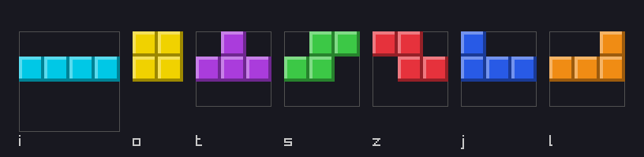
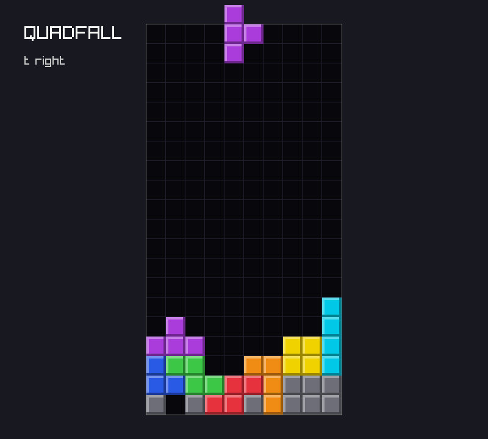

# Chapter 3 — Tetrominoes

[Chapter 2](02-the-board.md) gave `quadfall` a board: a grid of cells that the core module owns
and the platform draws. This chapter adds the things that fall onto it: the seven tetrominoes.
Each one is written down once, as a small picture of its spawn state. A function turns a shape a
quarter turn inside a fixed box, the way the Super Rotation System (SRS) does, and `comptime`
runs that function while the program compiles, so the finished game holds a table of all 28
shapes and spends nothing to compute them. You will also see where pieces appear, why some of
them start half hidden above the well, and how board pictures make the shape tests easy to read.
At the end, the project shows each piece in turn, spinning through its four states above the
demo stack.

Previous: [Chapter 2](02-the-board.md). Next: [Chapter 4](04-input-and-movement.md).

## Seven pieces

A tetromino is four squares joined edge to edge. Up to rotation there are exactly seven of them,
and modern falling-block games, from the original Tetris on, use all seven. Each has a
one-letter name taken from its shape:

| Name | Shape (spawn state) | Box | Guideline color |
|---|---|---|---|
| I | four in a row | 4×4 | cyan |
| O | a 2×2 square | 2×2 | yellow |
| T | three in a row with a bump on top | 3×3 | purple |
| S | two steps rising to the right | 3×3 | green |
| Z | two steps rising to the left | 3×3 | red |
| J | three in a row with a bump top-left | 3×3 | blue |
| L | three in a row with a bump top-right | 3×3 | orange |

The colors are the ones the Tetris Guideline asks for, and `draw.zig` already has them from
Chapter 2, keyed by `Cell`. The "box" column needs a section of its own; for now, read it as the
square the piece turns inside.

Here they are in a row, drawn by `examples/ch03/draw_pieces.zig` (listed later in this chapter),
each with its box outlined:



In the core, a piece kind is an enum:

```zig
pub const Kind = enum {
    i,
    o,
    t,
    s,
    z,
    j,
    l,

    /// The cell a locked piece of this kind leaves on the board.
    pub fn cell(kind: Kind) Cell {
        return switch (kind) {
            inline else => |k| @field(Cell, @tagName(k)),
        };
    }

    /// Width and height of the square box the piece rotates in.
    pub fn boxSize(kind: Kind) i32 {
        return switch (kind) {
            .i => 4,
            .o => 2,
            .t, .s, .z, .j, .l => 3,
        };
    }
};
```

`Kind` is not `Cell`. A `Cell` is what a square of the board holds: empty, one of seven letters,
or garbage. A `Kind` is what a falling piece is, and it is never empty or garbage. Two types mean
the compiler stops you from spawning a "garbage piece" or locking an "empty" one.

`cell()` maps one to the other by name. Its `switch` uses `inline else`, which the next example
explains along with the other ways to walk over an enum's tags.

### Looping over an enum

`examples/ch03/meta_tags.zig`

```zig
//! Looping over every tag of an enum: `for` versus `inline for`.
const std = @import("std");

const Kind = enum { i, o, t, s, z, j, l };
const Cell = enum(u8) { empty, i, o, t, s, z, j, l, garbage };

/// The same name in another enum. `inline else` makes `k` comptime-known
/// in each prong, so @tagName(k) can pick a field.
fn cellOf(kind: Kind) Cell {
    return switch (kind) {
        inline else => |k| @field(Cell, @tagName(k)),
    };
}

pub fn main() void {
    // std.meta.tags returns a pointer to a comptime array of every tag.
    const all = std.meta.tags(Kind);
    std.debug.print("{d} kinds: {any}\n", .{ all.len, all.* });

    // A plain for loop runs at run time; `kind` is an ordinary value.
    for (all) |kind| {
        std.debug.print("{t}->{t} ", .{ kind, cellOf(kind) });
    }
    std.debug.print("\n", .{});

    // `inline for` unrolls the loop: each copy has a comptime-known `kind`,
    // so it can go where only comptime values are allowed, such as into a
    // format string, which must be known at compile time.
    inline for (comptime std.meta.tags(Kind)) |kind| {
        std.debug.print(@tagName(kind) ++ "! ", .{});
    }
    std.debug.print("\n", .{});
}
```

```console
$ zig run examples/ch03/meta_tags.zig
7 kinds: { .i, .o, .t, .s, .z, .j, .l }
i->i o->o t->t s->s z->z j->j l->l
i! o! t! s! z! j! l!
```

- `std.meta.tags(Kind)` is every tag in declaration order. quadfall uses it whenever something
  must happen "for each kind": building the shape table, and the spawn test.
- `switch` with `inline else` makes the compiler write one prong per tag. Inside each prong `k`
  is comptime-known, so `@tagName(k)` is a comptime string and `@field(Cell, "t")` is just
  `Cell.t`. The result is the same as writing seven prongs by hand, but it cannot get out of
  step when a tag is renamed. If a `Kind` ever had no matching `Cell`, this would be a compile
  error, not a wrong color.
- `inline for` unrolls a loop over a comptime-known list. The format string of
  `std.debug.print` must be known at compile time, so `@tagName(kind) ++ "! "` only works when
  `kind` is comptime-known.

With a plain `for`, `kind` is a run-time value and the format string cannot be built:

```console
$ zig run not_inline.zig
not_inline.zig:30:25: error: unable to evaluate comptime expression
        std.debug.print(@tagName(kind) ++ "! ", .{});
                        ^~~~~~~~~~~~~~
not_inline.zig:30:34: note: operation is runtime due to this operand
        std.debug.print(@tagName(kind) ++ "! ", .{});
                                 ^~~~
not_inline.zig:30:40: note: argument to comptime parameter must be comptime-known
        std.debug.print(@tagName(kind) ++ "! ", .{});
                        ~~~~~~~~~~~~~~~^~~~~~~
```

(The rest of the message, a note pointing into `std/debug.zig` and a reference trace, is
trimmed.)

The `comptime` in `inline for (comptime std.meta.tags(Kind))` matters too. A function call is a
run-time call unless you ask otherwise, even when the function's body is a `comptime` block.
Without the keyword you get exactly the error above. Prefer a plain `for` when it is enough; the
unrolled copies of an `inline for` all end up in the binary.

## Shapes as pictures

Each piece could be written as four coordinates. That is how the program will store it, but it
is not how a person checks it. A picture is easier to read and harder to get wrong:

```text
.X.
XXX
...
```

is a T in its spawn state, pointing up, inside its 3×3 box. The empty bottom row matters: it is
part of the box, and the next section shows why.

quadfall keeps one picture per kind in an `EnumArray`, an array that is indexed by an enum
instead of a number.

### `std.enums.EnumArray`

`examples/ch03/enum_array.zig`

```zig
//! std.enums.EnumArray: a fixed-size array indexed by an enum instead of a number.
const std = @import("std");

const Kind = enum { i, o, t, s, z, j, l };

pub fn main() void {
    // init takes a struct with one field per tag, so none can be forgotten.
    var box_size: std.enums.EnumArray(Kind, u8) = .init(.{
        .i = 4,
        .o = 2,
        .t = 3,
        .s = 3,
        .z = 3,
        .j = 3,
        .l = 3,
    });
    std.debug.print("len {d}, {d} bytes\n", .{ @TypeOf(box_size).len, @sizeOf(@TypeOf(box_size)) });
    std.debug.print("get(.i) = {d}, get(.o) = {d}\n", .{ box_size.get(.i), box_size.get(.o) });

    // getPtr gives a pointer into the array; set does the same in one call.
    box_size.getPtr(.o).* += 1;
    box_size.set(.t, 9);
    std.debug.print("after: o = {d}, t = {d}\n", .{ box_size.get(.o), box_size.get(.t) });

    // The iterator yields entries in declaration order: a key and a value pointer.
    var it = box_size.iterator();
    while (it.next()) |entry| {
        std.debug.print("{t}={d} ", .{ entry.key, entry.value.* });
    }
    std.debug.print("\n", .{});

    // initFill sets every slot to one value.
    const zeros: std.enums.EnumArray(Kind, u8) = .initFill(0);
    std.debug.print("values: {any}\n", .{zeros.values});
}
```

```console
$ zig run examples/ch03/enum_array.zig
len 7, 7 bytes
get(.i) = 4, get(.o) = 2
after: o = 3, t = 9
i=4 o=3 t=9 s=3 z=3 j=3 l=3
values: { 0, 0, 0, 0, 0, 0, 0 }
```

- `EnumArray(Kind, u8)` is a struct around a plain `[7]u8`. It costs nothing over the bare
  array: 7 bytes.
- `.init(.{ ... })` takes a struct with one field per tag. Leave one out and it does not compile
  (reference trace trimmed):

```console
$ zig run missing_kind.zig
missing_kind.zig:6:60: error: missing struct field: l
    const box_size: std.enums.EnumArray(Kind, u8) = .init(.{
                                                          ~^
.../lib/std/enums.zig:37:12: note: struct declared here
    return @Struct(.auto, null, field_names, &@splat(Data), &@splat(.{ .default_value_ptr = default_ptr }));
           ^~~~~~~~~~~~~~~~~~~~~~~~~~~~~~~~~~~~~~~~~~~~~~~~~~~~~~~~~~~~~~~~~~~~~~~~~~~~~~~~~~~~~~~~~~~~~~~~
```

  That is the reason to use it. A plain `[7]u8` indexed with `@backingInt(kind)` would also
  work, but nothing would tie position 3 to `.s`, and adding a kind would silently shift the
  rest.
- `get` reads by value. `getPtr` returns a pointer into the array, for changing a slot in place
  or, later, for filling a slot that is itself an array. `set` writes a whole slot.
- `iterator()` yields each key with a pointer to its value. `initFill` and `initUndefined` build
  an array without listing every key; quadfall fills an `initUndefined` table in a loop.

### Parsing a shape

The pictures, in `src/core/piece.zig`:

```zig
/// The four cells of a piece, relative to the bottom-left corner of its box.
pub const Shape = [4]Pos;

/// Each piece in its spawn state, drawn inside its box, top row first.
const spawn_pictures: std.enums.EnumArray(Kind, []const u8) = .init(.{
    .i = "....\nXXXX\n....\n....",
    .o = "XX\nXX",
    .t = ".X.\nXXX\n...",
    .s = ".XX\nXX.\n...",
    .z = "XX.\n.XX\n...",
    .j = "X..\nXXX\n...",
    .l = "..X\nXXX\n...",
});
```

They are one-line strings with `\n` rather than multi-line `\\` literals, because seven small
multi-line literals would take 30 lines to say the same thing. Each is still a picture, read top
row first.

`Shape` is `[4]Pos`: exactly four cells, no more, no less. `Pos` is the board's position type
from Chapter 2, with `col` growing to the right and `row` growing *up*. Inside a shape, the
positions are relative to the bottom-left corner of the box.

`parseShape` turns a picture into a `Shape`. It reads lines from the top, so it starts at the
highest row of the box and counts down, exactly like `Board.parse`:

```zig
fn parseShape(kind: Kind) Shape {
    const size = kind.boxSize();
    var shape: Shape = undefined;
    var n: usize = 0;
    var lines = std.mem.splitScalar(u8, spawn_pictures.get(kind), '\n');
    var row: i32 = size - 1;
    while (lines.next()) |line| : (row -= 1) {
        for (line, 0..) |c, col| {
            if (c == 'X') {
                shape[n] = .{ .col = @intCast(col), .row = row };
                n += 1;
            }
        }
    }
    if (n != 4) @compileError("a tetromino has exactly four cells");
    return shape;
}
```

For the T, the first line `.X.` is row 2 and gives `(1,2)`; the second line `XXX` is row 1 and
gives `(0,1)`, `(1,1)`, `(2,1)`; the last line is empty.

`parseShape` is only ever called at compile time (see "Comptime tables" below), so a bad picture
is a compile error rather than a crash. Draw a T with three cells and the `@compileError` fires
(output from a scratch copy of `piece.zig`, run with `zig test`):

```console
$ zig test piece.zig
piece.zig:78:17: error: a tetromino has exactly four cells
    if (n != 4) @compileError("a tetromino has exactly four cells");
                ^~~~~~~~~~~~~~~~~~~~~~~~~~~~~~~~~~~~~~~~~~~~~~~~~~~
piece.zig:93:31: note: called at comptime here
        var shape = parseShape(kind);
                    ~~~~~~~~~~^~~~~~
referenced by:
    shapeOf: piece.zig:103:18
    cells: piece.zig:129:21
    1 reference(s) hidden; use '-freference-trace=3' to see all references
```

Draw one with five cells and Zig stops even earlier, at the fifth write into a four-element
array:

```console
$ zig test piece.zig
piece.zig:73:23: error: index 4 outside array of length 4
                shape[n] = .{ .col = @intCast(col), .row = row };
                      ^
piece.zig:93:31: note: called at comptime here
        var shape = parseShape(kind);
                    ~~~~~~~~~~^~~~~~
```

(The reference trace, the same as above, is trimmed.) This works only because the call happens at
compile time, where `n` is a known number and the `if` is decided by the compiler. If `parseShape`
were called at run time, `n` would not be known while compiling, the compiler would have to analyze
the `@compileError` branch, and every build would fail. A `@compileError` inside a function is a
promise that the function only runs at compile time.

## Rotation in a box

Turning a piece sounds like geometry with sines and cosines. It is not: a quarter turn of a grid
is a swap of coordinates.

Take an n×n box with `(col, row)` coordinates, row 0 at the bottom. Turn it a quarter turn
clockwise:

```text
  before (n = 3)           after
  row 2  a b c             g d a
  row 1  d e f             h e b
  row 0  g h i             i f c
         0 1 2
```

Follow single cells:

- `a` at `(0,2)`, the top-left corner, goes to the top-right corner `(2,2)`.
- `c` at `(2,2)`, top-right, goes to bottom-right `(2,0)`.
- `d` at `(0,1)`, middle of the left edge, goes to middle of the top edge `(1,2)`.
- `e` at `(1,1)`, the center, stays.

The old row becomes the new column: whatever was high ends up on the right. The old column
becomes the new row, flipped: whatever was on the left ends up high. In symbols:

```text
(col, row)  ->  (row, n - 1 - col)
```

Check `a`: `(0,2)` → `(2, 3-1-0)` = `(2,2)`. Check `d`: `(0,1)` → `(1, 2)`. It holds.

### The rule in code

`examples/ch03/rotate_box.zig`

```zig
//! Turning a shape a quarter turn clockwise inside an n-by-n box:
//! the cell at (col, row) moves to (row, n-1-col). Row 0 is the bottom.
const std = @import("std");

const Pos = struct { col: i32, row: i32 };
const Shape = [4]Pos;

fn rotateCw(shape: Shape, n: i32) Shape {
    var out: Shape = undefined;
    for (shape, &out) |p, *q| q.* = .{ .col = p.row, .row = n - 1 - p.col };
    return out;
}

/// Prints the box top row first, so that "up" is up on the screen.
fn show(shape: Shape, n: i32) void {
    var row = n - 1;
    while (row >= 0) : (row -= 1) {
        var col: i32 = 0;
        while (col < n) : (col += 1) {
            var filled = false;
            for (shape) |p| filled = filled or (p.col == col and p.row == row);
            std.debug.print("{c}", .{@as(u8, if (filled) '#' else '.')});
        }
        std.debug.print("\n", .{});
    }
}

pub fn main() void {
    // The T in its spawn state, pointing up, in a 3x3 box.
    var t: Shape = .{
        .{ .col = 1, .row = 2 },
        .{ .col = 0, .row = 1 },
        .{ .col = 1, .row = 1 },
        .{ .col = 2, .row = 1 },
    };
    const next = rotateCw(t, 3);
    for (t, next) |from, to| {
        std.debug.print("({d},{d}) -> ({d},{d})\n", .{ from.col, from.row, to.col, to.row });
    }
    for (0..5) |turn| {
        std.debug.print("turn {d}:\n", .{turn});
        show(t, 3);
        t = rotateCw(t, 3);
    }
}
```

```console
$ zig run examples/ch03/rotate_box.zig
(1,2) -> (2,1)
(0,1) -> (1,2)
(1,1) -> (1,1)
(2,1) -> (1,0)
turn 0:
.#.
###
...
turn 1:
.#.
.##
.#.
turn 2:
...
###
.#.
turn 3:
.#.
##.
.#.
turn 4:
.#.
###
...
```

- `for (shape, &out) |p, *q|` walks two arrays of the same length in step: `p` reads the input
  and `q` points into the output.
- The top of the T, `(1,2)`, moves to `(2,1)`, the middle of the right edge: the T now points
  right. The center `(1,1)` never moves.
- After four turns the shape is back where it started, cell for cell. That is a property worth
  testing, and the project does.

### Why a fixed box

There are other ways to turn a piece. You could pick one of its cells as a pivot, or turn about
the middle of its bounding rectangle. SRS instead turns every piece inside a fixed square box
and never moves the box. That has two good consequences.

- **No drift.** Turning four times in a row puts the piece back exactly where it was. With a
  pivot that is not at the center of a cell, an implementation has to round, and the rounding can
  walk the piece sideways over repeated turns.
- **Symmetric states.** S, Z and I have two horizontal and two vertical states. In a box they
  are distinct: the vertical I sits in column 2 of its box in state `right` and in column 1 in
  state `left`. A player who turns clockwise and a player who turns counter-clockwise end up in
  predictable, mirror-image places.

The box is also why the shapes have empty rows. The T's empty bottom row means its spawn state
"floats" one row above the bottom of its box. The I sits in the second row of a 4×4 box. The
O's box is 2×2, exactly its own size, so it never appears to move when it turns. The SRS article
on the Tetris Wiki draws all 28 states; the table that quadfall computes, printed further down,
matches it.

### Rotation states

A piece is in one of four states, which SRS calls 0, R, 2 and L. quadfall names them `spawn`,
`right`, `flip` and `left`, in an `enum(u2)`: the enum is stored in a 2-bit integer. Four states,
four values of a `u2`, so every value is a valid state and turning is plain arithmetic that
wraps around. The example below has the same `Rotation` as `piece.zig`, minus the `pub`s.

`examples/ch03/wrapping_enum.zig`

```zig
//! An enum with a 2-bit backing integer, turned with wrapping arithmetic.
const std = @import("std");

/// The four rotation states in clockwise order.
const Rotation = enum(u2) {
    spawn,
    right,
    flip,
    left,

    fn cw(r: Rotation) Rotation {
        return @fromBackingInt(@backingInt(r) +% 1);
    }

    fn ccw(r: Rotation) Rotation {
        return @fromBackingInt(@backingInt(r) -% 1);
    }
};

pub fn main() void {
    std.debug.print("@sizeOf(Rotation) = {d}, @bitSizeOf = {d}\n", .{ @sizeOf(Rotation), @bitSizeOf(Rotation) });

    var r: Rotation = .spawn;
    for (0..5) |_| {
        std.debug.print("{t}({d}) ", .{ r, @backingInt(r) });
        r = r.cw();
    }
    std.debug.print("\n", .{});
    for (0..5) |_| {
        std.debug.print("{t}({d}) ", .{ r, @backingInt(r) });
        r = r.ccw();
    }
    std.debug.print("\n", .{});

    // Wrapping operators on plain integers: they never trap.
    const top: u2 = 3;
    const bottom: u2 = 0;
    std.debug.print("3 +% 1 = {d}, 0 -% 1 = {d}, 3 +% 2 = {d}\n", .{ top +% 1, bottom -% 1, top +% 2 });
}
```

```console
$ zig run examples/ch03/wrapping_enum.zig
@sizeOf(Rotation) = 1, @bitSizeOf = 2
spawn(0) right(1) flip(2) left(3) spawn(0)
right(1) spawn(0) left(3) flip(2) right(1)
3 +% 1 = 0, 0 -% 1 = 3, 3 +% 2 = 1
```

- `@backingInt(r)` is the state's number, a `u2`. `@fromBackingInt` goes back. Both were in
  Chapter 2's `Cell`.
- `+%` and `-%` are the wrapping operators: they compute modulo 2^bits and never fail. `3 +% 1`
  in a `u2` is 0, so `left.cw()` is `spawn`. No `if`, no `% 4`.
- A `u2` takes 2 bits but `@sizeOf` rounds up to a whole byte. Inside a `packed struct` (Chapter
  4) it would take exactly 2 bits.

With the ordinary `+`, the fourth turn overflows. In a Debug build that is a panic, not a silent
wrap (output from a copy of the example with `+% 1` changed to `+ 1`; the long path is
shortened):

```console
$ zig run no_wrap.zig
@sizeOf(Rotation) = 1, @bitSizeOf = 2
spawn(0) right(1) flip(2) left(3) thread 97572 panic: integer overflow
.../no_wrap.zig:12:47: 0x11ebe54 in cw (no_wrap.zig)
        return @fromBackingInt(@backingInt(r) + 1);
                                              ^
.../no_wrap.zig:26:17: 0x11ea5fa in main (no_wrap.zig)
        r = r.cw();
                ^
```

(Two more stack frames inside `std/start.zig` are trimmed.) Zig treats overflow on `+` as a bug,
because it usually is one. When wrapping is the point, say so with `+%`, and the reader of the
code knows it is on purpose.

The name `flip` is quadfall's; SRS writes "2". A Zig identifier cannot be `2`, and `two` reads
oddly next to `right` and `left`.

## Comptime tables

We now have seven spawn shapes and a function that turns a shape. The game needs all 28 states,
and it needs them every time a piece moves, which is many times per frame once collision tests
arrive. Writing all 28 by hand means 112 coordinates to type and check; computing them on every
move is pointless, because the answer never changes. The third way is to compute them once,
while compiling, and store the result in the program as data. Zig makes that the easy option.

### A table in a labelled block

`examples/ch03/comptime_table.zig`

```zig
//! Building a lookup table while the program compiles. The table ends up
//! in the executable as plain data; nothing is computed when it runs.
const std = @import("std");

const Pos = struct { col: i32, row: i32 };
const Shape = [4]Pos;

fn rotateCw(shape: Shape, n: i32) Shape {
    var out: Shape = undefined;
    for (shape, &out) |p, *q| q.* = .{ .col = p.row, .row = n - 1 - p.col };
    return out;
}

const t_spawn: Shape = .{
    .{ .col = 1, .row = 2 }, .{ .col = 0, .row = 1 },
    .{ .col = 1, .row = 1 }, .{ .col = 2, .row = 1 },
};

/// Container-level constants are always evaluated at compile time, so the
/// labelled block below runs inside the compiler.
const t_shapes: [4]Shape = blk: {
    var table: [4]Shape = undefined;
    var shape = t_spawn;
    for (&table) |*slot| {
        slot.* = shape;
        shape = rotateCw(shape, 3);
    }
    break :blk table;
};

fn squares(comptime n: usize) [n]u32 {
    var out: [n]u32 = undefined;
    for (&out, 0..) |*s, i| s.* = @intCast(i * i);
    return out;
}

pub fn main() void {
    // Using the table is an index, nothing more.
    for (t_shapes, 0..) |shape, r| {
        std.debug.print("rotation {d}:", .{r});
        for (shape) |p| std.debug.print(" ({d},{d})", .{ p.col, p.row });
        std.debug.print("\n", .{});
    }
    // Inside a function, `comptime` forces compile-time evaluation.
    const sq = comptime squares(6);
    std.debug.print("squares: {any}\n", .{sq});
    std.debug.print("table size: {d} bytes\n", .{@sizeOf(@TypeOf(t_shapes))});
}
```

```console
$ zig run examples/ch03/comptime_table.zig
rotation 0: (1,2) (0,1) (1,1) (2,1)
rotation 1: (2,1) (1,2) (1,1) (1,0)
rotation 2: (1,0) (2,1) (1,1) (0,1)
rotation 3: (0,1) (1,0) (1,1) (1,2)
squares: { 0, 1, 4, 9, 16, 25 }
table size: 128 bytes
```

- A `const` at file (container) level is always initialized at compile time. Its initializer can
  be any expression, including a block with loops and `var`s.
- `blk: { ... break :blk table; }` is a labelled block: an expression whose value is whatever
  `break :blk` hands out. It lets a constant be built step by step without a helper function.
- The `var`s inside the block are compile-time variables. They exist only in the compiler; the
  program gets the final `table`, 4 × 4 × 8 = 128 bytes of data.
- `rotateCw` is an ordinary function. It needs no special marking to be run at compile time.
  The same function could also be called at run time.
- Inside a function body, code runs at run time unless you write `comptime` in front of it, as
  in `comptime squares(6)`. A `comptime` parameter (`comptime n: usize`) must be known at
  compile time because it is used in a type, `[n]u32`.

### Peeking with `@compileLog`

Values computed at compile time cannot be printed with `std.debug.print`, which runs later. To
look at one while it is being computed, put `@compileLog` next to it. Adding
`@compileLog(table[1]);` before `break :blk table;` gives:

```console
$ zig run peek.zig
peek.zig:28:5: error: found compile log statement
    @compileLog(table[1]);
    ^~~~~~~~~~~~~~~~~~~~~
referenced by:
    main: peek.zig:40:10

Compile Log Output:
@as([4]peek.Pos, .{ .{ .col = 2, .row = 1 }, .{ .col = 1, .row = 2 }, .{ .col = 1, .row = 1 }, .{ .col = 1, .row = 0 } })
```

(The rest of the reference trace, which points into `std/start.zig`, is trimmed.) `@compileLog`
always makes the build fail, so it can never be left in by accident.

### What comptime can and cannot do

Compile-time code is real Zig: loops, `var`s, function calls, arrays, structs, slices, string
handling. Most pure functions in the standard library work, which is why `parseShape` can call
`std.mem.splitScalar`. What it cannot do:

- **Touch the outside world.** There is no file system, clock, network or user input at compile
  time. Anything that depends on them is a run-time value.
- **Use run-time values.** The compiler cannot know `args.len` while it compiles, so it cannot
  pass it to a `comptime` parameter:

```console
$ zig run runtime_n.zig
runtime_n.zig:11:28: error: unable to evaluate comptime expression
    const sq = squares(args.len);
                       ~~~~^~~~
runtime_n.zig:11:28: note: argument to comptime parameter must be comptime-known
runtime_n.zig:3:12: note: parameter declared comptime here
fn squares(comptime n: usize) [n]u32 {
           ^~~~~~~~
```

(reference trace trimmed)

- **Run forever.** The compiler counts backward branches (loop iterations and calls) and stops
  at 1000 by default. A loop that really needs more raises the limit with
  `@setEvalBranchQuota`. Chapter 6 hits this limit and shows the error.
- **Hide bugs.** Out-of-bounds indexing, overflow and `unreachable` are compile errors at compile
  time, as the five-cell T showed. Comptime code is checked at least as strictly as Debug code.

### All 28 shapes

`examples/ch03/all_pieces.zig` puts it together. Its top half is the project's code, already
shown above: `Pos`, `Shape`, `Kind`, `boxSize`, `spawn_pictures`, `parseShape` and `rotateCw`
(with `boxSize` as a free function). The rest builds the table and prints it:

```zig
const shapes: std.enums.EnumArray(Kind, [4]Shape) = blk: {
    var table: std.enums.EnumArray(Kind, [4]Shape) = .initUndefined();
    for (std.meta.tags(Kind)) |kind| {
        var shape = parseShape(kind);
        for (0..4) |r| {
            table.getPtr(kind)[r] = shape;
            shape = rotateCw(shape, boxSize(kind));
        }
    }
    break :blk table;
};

pub fn main() void {
    std.debug.print("     spawn right flip  left\n", .{});
    for (std.meta.tags(Kind)) |kind| {
        const n = boxSize(kind);
        var row = n - 1;
        while (row >= 0) : (row -= 1) {
            const label: u8 = if (row == n - 1) std.ascii.toUpper(@tagName(kind)[0]) else ' ';
            std.debug.print("{c}    ", .{label});
            for (shapes.get(kind), 0..) |shape, r| {
                if (r > 0) for (0..6 - @as(usize, @intCast(n))) |_| std.debug.print(" ", .{});
                var col: i32 = 0;
                while (col < n) : (col += 1) {
                    var filled = false;
                    for (shape) |p| filled = filled or (p.col == col and p.row == row);
                    std.debug.print("{c}", .{@as(u8, if (filled) '#' else '.')});
                }
            }
            std.debug.print("\n", .{});
        }
    }
}
```

```console
$ zig run examples/ch03/all_pieces.zig
     spawn right flip  left
I    ....  ..#.  ....  .#..
     ####  ..#.  ....  .#..
     ....  ..#.  ####  .#..
     ....  ..#.  ....  .#..
O    ##    ##    ##    ##
     ##    ##    ##    ##
T    .#.   .#.   ...   .#.
     ###   .##   ###   ##.
     ...   .#.   .#.   .#.
S    .##   .#.   ...   #..
     ##.   .##   .##   ##.
     ...   ..#   ##.   .#.
Z    ##.   ..#   ...   .#.
     .##   .##   ##.   ##.
     ...   .#.   .##   #..
J    #..   .##   ...   .#.
     ###   .#.   ###   .#.
     ...   .#.   ..#   ##.
L    ..#   .#.   ...   ##.
     ###   .#.   ###   .#.
     ...   .##   #..   .#.
```

Compare it with the SRS diagram: the I's vertical states sit in different columns of its box,
the horizontal S and Z states sit in different rows, and the O never changes. Seven short
pictures and a three-line function produced all of it.

In the table block, `table.getPtr(kind)[r] = shape;` writes through a `*[4]Shape` into the table
itself, not into a copy. A plain `for` over `std.meta.tags(Kind)` is fine there, because the
whole block already runs at compile time.

## A piece on the board

A shape says which cells of the box are filled. A piece in play also needs to know where its box
is. In `src/core/piece.zig`:

```zig
pub fn shapeOf(kind: Kind, rot: Rotation) Shape {
    return shapes.get(kind)[@backingInt(rot)];
}

/// A piece in play: what it is, how it is turned, and where its box is.
pub const Piece = struct {
    kind: Kind,
    rot: Rotation = .spawn,
    /// Board position of the bottom-left corner of the piece's box.
    pos: Pos,

    // spawn() is shown in the next section.

    /// The four board positions the piece covers.
    pub fn cells(p: Piece) [4]Pos {
        var out: [4]Pos = undefined;
        for (shapeOf(p.kind, p.rot), &out) |offset, *cell| cell.* = p.pos.add(offset);
        return out;
    }
};
```

- `shapeOf` is the entire run-time cost of rotation: one table lookup. `@backingInt(rot)` turns
  the state into an index 0–3.
- `Piece` is three small values: 1 byte of kind, 2 bits of rotation, two `i32`s of position. It
  is cheap to copy, so the game passes it by value. Chapter 4 makes that a strength: "move left"
  becomes "make a copy one column to the left and see if it fits".
- `pos` is the bottom-left corner of the *box*, not of the piece. The box can hang off the board
  while the piece is on it. A vertical I against the left wall in state `right` has its cells in
  column 0 and its box starting at column −2. That is why `Pos` is signed (Chapter 2 chose `i32`
  for this moment).
- `cells()` adds `pos` to each offset with `Pos.add` from Chapter 2. It returns an array, not a
  slice: four positions on the stack, no allocation.

Only `rot` has a default, so `.{ .kind = .t, .pos = .{ .col = 0, .row = 0 } }` is a T in its
spawn state with its box in the corner. The tests use that.

### Drawing pieces

`examples/ch03/draw_pieces.zig` drew the picture at the top of this chapter. It parses the same
pictures and draws the bevelled block from Chapter 2 (two long constant tables are left out
below; the file has them in full):

```zig
//! The seven pieces in their spawn state, in a row, each in its color.
const std = @import("std");
const rl = @import("rl");
const Demo = @import("demo").Demo;

const Kind = enum { i, o, t, s, z, j, l };

// `pictures` is spawn_pictures from above under a shorter name, and `colors`
// is an EnumArray(Kind, rl.Color) with the RGB values of draw.zig's cellColor.
// Both are left out of this listing.

const cell = 32;

fn block(x: i32, y: i32, color: rl.Color) void {
    const edge = cell / 8;
    rl.DrawRectangle(x, y, cell, cell, rl.ColorBrightness(color, -0.35));
    rl.DrawRectangle(x, y, cell - edge, cell - edge, rl.ColorBrightness(color, 0.35));
    rl.DrawRectangle(x + edge, y + edge, cell - 2 * edge, cell - 2 * edge, color);
}

pub fn main(init: std.process.Init) !void {
    var demo: Demo = .init(try init.minimal.args.toSlice(init.arena.allocator()));

    rl.SetTraceLogLevel(rl.LOG_WARNING);
    rl.InitWindow(816, 200, "draw_pieces");
    defer rl.CloseWindow();
    rl.SetTargetFPS(60);

    while (demo.running()) {
        rl.BeginDrawing();
        defer rl.EndDrawing();
        rl.ClearBackground(.{ .r = 24, .g = 24, .b = 32, .a = 255 });

        var x: i32 = 24;
        for (std.meta.tags(Kind)) |kind| {
            const picture = pictures.get(kind);
            const size: i32 = @intCast(std.mem.findScalar(u8, picture, '\n').?);
            // The box outline: every piece turns inside this square.
            rl.DrawRectangleLines(x, 40, size * cell, size * cell, rl.DARKGRAY);
            var lines = std.mem.splitScalar(u8, picture, '\n');
            var y: i32 = 40;
            while (lines.next()) |line| : (y += cell) {
                for (line, 0..) |c, col| {
                    if (c == 'X') block(x + @as(i32, @intCast(col)) * cell, y, colors.get(kind));
                }
            }
            rl.DrawText(@tagName(kind), x, 170, 20, rl.LIGHTGRAY);
            x += size * cell + 16;
        }
    }
    std.debug.print("ran {d} frames\n", .{demo.frame});
}
```

```console
$ cd examples
$ xvfb-run -a -s "-screen 0 1280x720x24" zig build run -Dexample=ch03/draw_pieces -- --frames 10 --screenshot ../images/ch03-pieces.png
ran 10 frames
```

- Here the colors are keyed by `Kind` in an `EnumArray`. The project keys them by `Cell` in a
  `switch` instead, because the board stores cells, and `Kind.cell()` connects the two.
- The box size is the length of the first line of the picture, found with
  `std.mem.findScalar`. The project asks `boxSize()` instead; the example shows that the picture
  alone already knows it.
- The picture is drawn straight onto the screen, top line at the top, so no row flipping is
  needed. On the board the project goes through `cellY`, which flips rows (Chapter 2).
- `@tagName(kind)` returns a 0-terminated string, so it can go straight to `DrawText`.

## Spawning

Where does a new piece appear? The guideline answers: in the 21st and 22nd rows of the playfield
(counting from 1), centered and rounded to the left, flat side down, and it moves down one row
immediately after appearing. It adds that recent games spawn one or two rows lower. quadfall
spawns one row lower and skips the first move:

```zig
    /// A new piece at the top of the board: centered (rounding left), with
    /// its top row in the first hidden row, just above the visible field.
    pub fn spawn(kind: Kind) Piece {
        const size = kind.boxSize();
        return .{
            .kind = kind,
            .pos = .{
                .col = if (kind == .o) 4 else 3,
                .row = board.visible_rows + 1 - size,
            },
        };
    }
```

- **Columns.** The board is 10 wide. The I's box is 4 wide; at column 3 it covers columns 3–6,
  exactly centered. A 3-wide box cannot be centered in 10 columns, so it rounds left: columns
  3–5. The O's 2-wide box at column 4 covers 4–5, centered.
- **Rows.** `visible_rows + 1 - size` puts the top of the box in row 20, the first hidden row.
  Every spawn shape's lowest cells are in the second row from the top of its box, so every piece
  has its lowest cells in row 19, the top visible row. The flat I lies entirely in row 19; the
  other six also reach into row 20, which is hidden.

The two hidden rows from Chapter 2 exist for this. A piece needs somewhere to be before it
enters the visible field, and a stack that reaches the top must still be able to accept a new
piece above it. Chapter 5 uses them for the game-over rules.

### Drawing a piece

`src/draw.zig` gains one function:

```zig
/// Draws a piece on the board. Cells in the first hidden row show above the
/// playfield; higher ones are not drawn.
pub fn drawPiece(p: core.Piece) void {
    for (p.cells()) |pos| {
        if (pos.row > board.visible_rows) continue;
        block(cellX(pos.col), cellY(pos.row), cell_size, cellColor(p.kind.cell()));
    }
}
```

`cellY` flips the row, so row 20 lands one cell *above* the top edge of the well, at y = 8.
quadfall draws it there on purpose; the guideline also suggests showing a sliver of that row when
the hardware allows, to help players handle a piece up there. Row 21 would be at y = −24, off the
window, so it is skipped. Drawing never decides anything about the game; it only shows `p.cells()`.

## Testing shapes with pictures

Chapter 2 made `Board` print itself as a picture with `{f}`. That turns shape tests into
pictures too. A helper in `piece.zig` places a piece on an empty board and compares the result
with the expected drawing:

```zig
fn expectCells(p: Piece, expected: []const u8) !void {
    var b: board.Board = .empty;
    for (p.cells()) |pos| b.set(pos, p.kind.cell());
    try std.testing.expectFmt(expected, "{f}", .{b});
}
```

Then a T, its box in the bottom-left corner, can be checked in every state:

```zig
test "T rotates clockwise through all four states" {
    var t: Piece = .{ .kind = .t, .pos = .{ .col = 0, .row = 0 } };
    try expectCells(t,
        \\.T........
        \\TTT.......
        \\..........
    );
    t.rot = t.rot.cw();
    try expectCells(t,
        \\.T........
        \\.TT.......
        \\.T........
    );
    t.rot = t.rot.cw();
    try expectCells(t,
        \\TTT.......
        \\.T........
    );
    t.rot = t.rot.cw();
    try expectCells(t,
        \\.T........
        \\TT........
        \\.T........
    );
    try std.testing.expectEqual(Rotation.spawn, t.rot.cw());
    try std.testing.expectEqual(Rotation.left, Rotation.spawn.ccw());
}
```

Notice the third picture has only two lines. `format` trims empty rows from the top, and in the
`flip` state the T fills only the bottom two rows of its box. In the spawn state the bottom row
of the box is empty but row 0 is still printed, because `format` always prints down to row 0.
The pictures show exactly where the box is.

A second test does the same for the I in states `spawn` and `right`, because its 4×4 box is the
one most often implemented wrong. In state `right` the expected picture is `..I.......` four rows
high: the bar is in column 2 of its box, not column 1, and a version that turned about a cell
would fail it.

The spawn rule is tested for every kind:

```zig
test "pieces spawn in the middle, touching the top of the visible field" {
    for (std.meta.tags(Kind)) |kind| {
        const cells = Piece.spawn(kind).cells();
        var lowest: i32 = board.rows;
        var left: i32 = board.cols;
        var right: i32 = 0;
        for (cells) |c| {
            lowest = @min(lowest, c.row);
            left = @min(left, c.col);
            right = @max(right, c.col);
        }
        try std.testing.expectEqual(board.visible_rows - 1, lowest);
        try std.testing.expect(left == 3 or left == 4);
        try std.testing.expect(right == 5 or right == 6);
    }
}
```

It checks the rule ("lowest cell in row 19, roughly centered"), not the numbers in `spawn`.
Change the spawn column of one kind by mistake, and the test names the rule that broke.

The fourth test checks `Kind.i.cell()` and `Kind.l.cell()`. Four tests in `piece.zig`, four from
Chapter 2 in `board.zig`, and the `refAllDecls` block in `root.zig` make 9.

## Building quadfall: pieces on the board

The changes from `project/ch02`:

- new: `src/core/piece.zig` (`Kind`, `Rotation`, `Shape`, the pictures, `parseShape`,
  `rotateCw`, the `shapes` table, `shapeOf`, `Piece` with `spawn` and `cells`, and the four
  tests). Everything in it was shown above; the complete file is
  `project/ch03/src/core/piece.zig`.
- modified: `src/core/root.zig`, `src/draw.zig`, `src/main.zig`.
- unchanged: `build.zig`, `build.zig.zon`, `src/options.zig`, `src/core/board.zig`.

`piece.zig` imports `board.zig` for `Pos`, `Cell` and the board sizes. It imports nothing from
the platform, and it could not: the core module still has no `rl` import (Chapter 2).

### The core's public surface

`src/core/root.zig` exports the new file and its three main types:

```diff
 pub const Board = board.Board;
 pub const Cell = board.Cell;
 pub const Pos = board.Pos;
+pub const piece = @import("piece.zig");
+pub const Kind = piece.Kind;
+pub const Rotation = piece.Rotation;
+pub const Piece = piece.Piece;
```

The `test { refAllDecls }` block below these lines now reaches `piece.zig` as well, so its tests
run with `zig build test` without being listed anywhere.

`src/draw.zig` gains only `drawPiece`, shown in "Spawning" above: the colors were already keyed
by `Cell`, and `Kind.cell()` supplies one.

### A showcase in main

There is no input yet (that is Chapter 4), so `main.zig` puts on a show. A piece turns clockwise
every 30 frames (twice a second). After a full turn, the next kind spawns. A label names the
current kind and state. (The demo board's doc comment also changes, to "until pieces can move
(Chapter 4)".)

```diff
     if (opts.frames == null) rl.SetTargetFPS(60);
 
+    // A showcase: each piece turns clockwise twice a second, then the next
+    // kind spawns after a full turn.
+    var piece: core.Piece = .spawn(.i);
     var frame: u32 = 0;
     while (!rl.WindowShouldClose()) : (frame += 1) {
         if (opts.frames) |n| if (frame == n) break;
+        if (frame > 0 and frame % 30 == 0) {
+            piece.rot = piece.rot.cw();
+            if (piece.rot == .spawn) {
+                const next: core.Kind = @fromBackingInt((@backingInt(piece.kind) + 1) % 7);
+                piece = .spawn(next);
+            }
+        }
 
         rl.BeginDrawing();
         defer rl.EndDrawing();
         rl.ClearBackground(draw.background);
         draw.drawBoard(&demo_board);
+        draw.drawPiece(piece);
         rl.DrawText("QUADFALL", 40, 40, 30, rl.RAYWHITE);
+        var buf: [32]u8 = undefined;
+        const label = std.mem.printSentinel(&buf, "{t} {t}", .{ piece.kind, piece.rot }, 0) catch unreachable;
+        rl.DrawText(label, 40, 90, 20, rl.LIGHTGRAY);
     }
```

- `piece.rot.cw()` wraps from `left` back to `spawn`, and that is the signal to move on to the
  next kind.
- `Kind` has seven tags, so its backing integer is a `u3` (0–7). `@backingInt(.l) + 1` is 7,
  which still fits in a `u3` but is not a valid `Kind`, so `% 7` brings it back to 0.
- `{t}` prints a tag name, so the label reads `t right`. `printSentinel` writes it into a stack
  buffer with a 0 at the end for raylib (Chapter 1). The longest label, `i spawn`, is 7 bytes;
  32 is plenty, so the `catch unreachable` is safe.
- The piece is drawn over the demo stack, not placed into it. It can overlap the stack, and
  nothing stops it, because there are no rules yet.

### Checkpoint

Run the tests from `project/ch03` (the counts appear on a fresh build; a cached run prints
`run test cached` and no count):

```console
$ zig build test --summary all
Build Summary: 3/3 steps succeeded; 9/9 tests passed
test success
+- run test 9 pass (9 total) 4ms MaxRSS:4M
   +- compile test debug native success 403ms MaxRSS:156M
```

Run the showcase with `zig build run` and watch the pieces turn. Then take the screenshot
headless. The I takes frames 0–119, the O 120–239, and the T spawns at frame 240; frame 279, the
last one drawn before the loop stops at 280, shows the T in state `right`:

```console
$ zig build
$ xvfb-run -a -s "-screen 0 1280x720x24" ./zig-out/bin/quadfall --frames 280 --screenshot ../../images/ch03-rotation.png
info: saved ../../images/ch03-rotation.png
```



The T's box is at column 3, row 18. In state `right` it fills column 4 from row 18 to row 20 and
column 5 in row 19. Row 20 is the first hidden row, so its block is drawn above the top edge of
the well, as `drawPiece` intends.

## Summary

- The seven tetrominoes are a `Kind` enum. `Kind.cell()` maps a kind to the board cell it
  leaves, by name, with `switch` and `inline else`.
- Shapes are written once, as pictures of the spawn state inside a fixed square box: 4×4 for I,
  2×2 for O, 3×3 for the rest. `parseShape` turns a picture into `[4]Pos`, row 0 at the bottom.
- A quarter turn clockwise in an n×n box is `(col, row) → (row, n-1-col)`. Turning in a fixed
  box (SRS) avoids drift and gives distinct, symmetric states.
- `Rotation = enum(u2)` with `+%`/`-%` turns by wrapping arithmetic. Plain `+` would panic on
  overflow in a Debug build.
- `std.enums.EnumArray(K, V)` is an array indexed by an enum. `.init` requires every key.
- A container-level `const` is computed at compile time. A labelled block (`blk: { ... break
  :blk x; }`) builds the 28-shape table there; at run time `shapeOf` is a single lookup.
  `@compileLog` peeks at comptime values; `@compileError` rejects bad data. Comptime code cannot
  do I/O or use run-time values.
- `Piece` is `{ kind, rot, pos }`, where `pos` is the box's bottom-left corner and may be off the
  board. `cells()` gives the four board positions.
- Pieces spawn at column 3 (O: 4) with their lowest cells in row 19, so part of each piece sits
  in hidden row 20, drawn above the well.
- Board pictures and `expectFmt` make shape tests readable. The project has 9 tests.

## Exercises

1. **Counter-clockwise test.** Add a test to `piece.zig` showing that four counter-clockwise
   turns bring every kind back to its starting cells, that `ccw` undoes `cw` from every state, and
   what a T looks like after one counter-clockwise turn.

<details><summary>Solution</summary>

Append to `src/core/piece.zig`:

```zig
test "four counter-clockwise turns return to the start" {
    for (std.meta.tags(Kind)) |kind| {
        const start: Piece = .spawn(kind);
        var p = start;
        for (0..4) |_| {
            p.rot = p.rot.ccw();
            // ccw undoes cw from every state.
            try std.testing.expectEqual(p.rot, p.rot.cw().ccw());
        }
        try std.testing.expectEqual(start.cells(), p.cells());
    }
    var t: Piece = .{ .kind = .t, .pos = .{ .col = 0, .row = 0 } };
    t.rot = t.rot.ccw();
    try expectCells(t,
        \\.T........
        \\TT........
        \\.T........
    );
}
```

```console
$ zig build test --summary all
Build Summary: 3/3 steps succeeded; 10/10 tests passed
test success
+- run test 10 pass (10 total) 5ms MaxRSS:4M
   +- compile test debug native success 471ms MaxRSS:156M
```

`expectEqual` compares the two `[4]Pos` arrays element by element. One counter-clockwise turn
from spawn is state `left`: the T points left.

</details>

2. **Print the shape table at build time.** Use `@compileLog` to print the four S shapes while
   `shapes` is being built. Read the output, then remove the line.

<details><summary>Solution</summary>

In `src/core/piece.zig`, just before `break :blk table;`:

```zig
    @compileLog(table.get(.s));
```

```console
$ zig build test
test
+- run test
   +- compile test debug native 1 errors
src/core/piece.zig:99:5: error: found compile log statement
    @compileLog(table.get(.s));
    ^~~~~~~~~~~~~~~~~~~~~~~~~~
referenced by:
    shapeOf: src/core/piece.zig:104:18
    cells: src/core/piece.zig:130:21
    4 reference(s) hidden; use '-freference-trace=6' to see all references

Compile Log Output:
@as([4][4]board.Pos, .{ .{ .{ .col = 1, .row = 2 }, .{ .col = 2, .row = 2 }, .{ .col = 0, .row = 1 }, .{ .col = 1, .row = 1 } }, .{ .{ .col = 2, .row = 1 }, .{ .col = 2, .row = 0 }, .{ .col = 1, .row = 2 }, .{ .col = 1, .row = 1 } }, .{ .{ .col = 1, .row = 0 }, .{ .col = 0, .row = 0 }, .{ .col = 2, .row = 1 }, .{ .col = 1, .row = 1 } }, .{ .{ .col = 0, .row = 1 }, .{ .col = 0, .row = 2 }, .{ .col = 1, .row = 0 }, .{ .col = 1, .row = 1 } } })
```

(The `failed command` line and the build summary after the log are trimmed.) The output is a Zig
literal, typed with `@as`: four shapes of four positions each. The first is the spawn S, `(1,2)
(2,2) (0,1) (1,1)`: the top row filled in columns 1 and 2, the middle row in columns 0 and 1. The
build fails while the line is there, so delete it before going on.

</details>

3. **Pentominoes?** A pentomino has five cells; there are 12 of them (18 counting mirror
   images). What would have to change in `piece.zig` to play with pentominoes instead? What
   would not change?

<details><summary>Solution</summary>

- `Shape = [4]Pos` becomes `[5]Pos`, and so does the result of `cells()`. The compiler finds
  every other use, because the length is part of the type.
- `Kind` gets 12 (or 18) tags, and `Cell` and the palette get matching entries. `Kind.cell()`
  needs no change: `inline else` maps by name and turns a missing `Cell` into a compile error.
- The pictures change, boxes grow to 5×5 for the long bar, and `parseShape` checks `n != 5`.
- The board probably widens; 10 columns is narrow for pieces up to 5 wide.

Unchanged: `rotateCw`, `Rotation`, the comptime table, `shapeOf`, `spawn`'s formula and
`drawPiece`. The rotation rule works for any n×n box. "Four cells" is stated in the *types*, not
in a scattered constant, so every loop over a shape knows its length at compile time.

</details>

4. **Draw the piece's box.** Make `drawPiece` outline the piece's SRS box in yellow, so the
   showcase shows how each piece turns inside its box.

<details><summary>Solution</summary>

In `src/draw.zig`:

```zig
pub fn drawPiece(p: core.Piece) void {
    // The SRS box: its bottom-left corner is p.pos, so its top edge is
    // the top of row pos.row + size - 1.
    const size = p.kind.boxSize();
    const top = cellY(p.pos.row + size - 1);
    rl.DrawRectangleLines(cellX(p.pos.col), top, size * cell_size, size * cell_size, rl.YELLOW);
    for (p.cells()) |pos| {
        if (pos.row > board.visible_rows) continue;
        block(cellX(pos.col), cellY(pos.row), cell_size, cellColor(p.kind.cell()));
    }
}
```

```console
$ zig build
$ xvfb-run -a -s "-screen 0 1280x720x24" ./zig-out/bin/quadfall --frames 280 --screenshot box.png
info: saved box.png
```

The screenshot shows the T in state `right` inside a yellow 3×3 square whose top row is above
the well. `cellY` gives the *top* edge of a row, and y grows downward, so the rectangle starts
at the box's highest row. Run it in a window and watch the I: its box stays put while the bar
moves between the second and third rows and columns.

</details>

Sources for this chapter: [REFERENCES.md](REFERENCES.md#chapter-3--tetrominoes)
