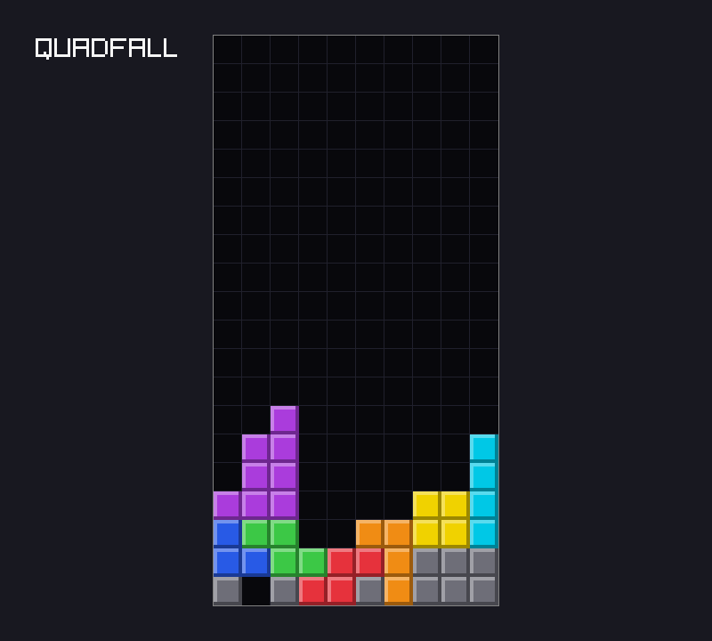

# Chapter 4 — Input and Movement

At the end of [Chapter 3](03-tetrominoes.md), pieces could turn, but only for show. Now the
player takes control. Keys become a small `Input` value, five bools packed into one byte, and the
game sees only that. Then come the rules that make movement feel right: collision, *delayed auto
shift* so that a held key waits and then slides the piece, and the SRS *wall kicks* that let a
piece turn against a wall. Last, a tiny scripting language plays input without a person, for
tests and headless screenshots. The project gains a `Game` struct with a `tick` function.

Previous: [Chapter 3](03-tetrominoes.md). Next: [Chapter 5](05-time.md).

## Keys are a platform detail

raylib answers questions about a key every frame: `IsKeyDown` (held now), `IsKeyPressed` (went
down since the last frame), `IsKeyReleased` (went up), and `IsKeyPressedRepeat` (the operating
system's key repeat fired).

`examples/ch04/keys.zig` shows the first three for the arrow keys:

```zig
//! Which arrow keys are down, pressed or released this frame. Run it with a
//! window and press the arrows; a headless run shows every key idle.
const std = @import("std");
const rl = @import("rl");
const Demo = @import("demo").Demo;

const Key = struct { name: [:0]const u8, code: c_int, presses: u32 = 0 };

pub fn main(init: std.process.Init) !void {
    var demo: Demo = .init(try init.minimal.args.toSlice(init.arena.allocator()));

    rl.SetTraceLogLevel(rl.LOG_WARNING);
    rl.InitWindow(640, 240, "keys");
    defer rl.CloseWindow();
    rl.SetTargetFPS(60);

    var keys = [_]Key{
        .{ .name = "LEFT", .code = rl.KEY_LEFT },
        .{ .name = "RIGHT", .code = rl.KEY_RIGHT },
        .{ .name = "UP", .code = rl.KEY_UP },
        .{ .name = "DOWN", .code = rl.KEY_DOWN },
    };

    while (demo.running()) {
        rl.BeginDrawing();
        defer rl.EndDrawing();
        rl.ClearBackground(rl.BLACK);
        for (&keys, 0..) |*key, i| {
            const x: i32 = 40 + @as(i32, @intCast(i)) * 150;
            // Down: held now. Pressed: down now, up last frame. Released: the reverse.
            const down = rl.IsKeyDown(key.code);
            const pressed = rl.IsKeyPressed(key.code);
            const released = rl.IsKeyReleased(key.code);
            if (pressed) key.presses += 1;
            rl.DrawRectangle(x, 40, 120, 80, if (down) rl.GREEN else rl.DARKGRAY);
            rl.DrawText(key.name, x + 10, 70, 20, rl.BLACK);
            if (pressed) rl.DrawText("pressed", x, 140, 20, rl.YELLOW);
            if (released) rl.DrawText("released", x, 140, 20, rl.ORANGE);
            var buf: [32]u8 = undefined;
            const text = try std.mem.printSentinel(&buf, "{d} presses", .{key.presses}, 0);
            rl.DrawText(text, x, 180, 20, rl.LIGHTGRAY);
        }
    }
    for (keys) |key| std.debug.print("{s}: {d} presses\n", .{ key.name, key.presses });
}
```

Run it with `zig build run -Dexample=ch04/keys` (from `examples/`) and press the arrows: a box
turns green while its key is held. Headless, nobody presses anything:

```console
$ cd examples
$ xvfb-run -a -s "-screen 0 1280x720x24" zig build run -Dexample=ch04/keys -- --frames 30
LEFT: 0 presses
RIGHT: 0 presses
UP: 0 presses
DOWN: 0 presses
```

- `rl.KEY_LEFT` and friends are `c_int` constants from raylib's C header.
- "Pressed" and "released" are *edges*: changes between two frames. raylib finds them by
  remembering last frame's keys; the core will do the same, below.

### Why the core never sees a key

It would be easy to call `IsKeyDown` from the game rules. quadfall does not. A test cannot press
a key, but it can build a value. If the rules depend only on "which buttons were held this
tick", then recording that value per tick and feeding it back replays the game exactly; Chapter
8 does that, and this chapter's `--script` already relies on it. And which key turns the piece
is a platform choice; the rules only know "turn clockwise". Turning input into data before the
game acts on it is the *Command* pattern from Game Programming Patterns, in its simplest form.

The core receives *states* ("Left is held"), not *events* ("Left went down"): one fixed-size
value per tick, easy to record and compare. It works out the events itself. The operating
system's key repeat (`IsKeyPressedRepeat`) is not used either: its timing depends on the machine
and the user's settings, so a replay would play differently elsewhere. quadfall repeats in ticks.

In `src/main.zig`, reading the keyboard is one small function:

```zig
/// The buttons held right now. Keys are a platform detail: the game only
/// ever sees `core.Input`.
fn readKeyboard() core.Input {
    return .{
        .left = rl.IsKeyDown(rl.KEY_LEFT),
        .right = rl.IsKeyDown(rl.KEY_RIGHT),
        .down = rl.IsKeyDown(rl.KEY_DOWN),
        .cw = rl.IsKeyDown(rl.KEY_UP) or rl.IsKeyDown(rl.KEY_X),
        .ccw = rl.IsKeyDown(rl.KEY_Z) or rl.IsKeyDown(rl.KEY_LEFT_CONTROL),
    };
}
```

Up or X turns clockwise, Z or Left Ctrl counter-clockwise. Only `IsKeyDown` is used.

## `Input` as a packed struct

`src/core/input.zig` defines what the game can be told: the same `Input` as in the example
below (only the comments differ). A `packed struct` has no padding and a guaranteed layout:
fields are laid out bit by bit, first field in the lowest bit, and the whole struct *is* an
integer.

`examples/ch04/packed_input.zig`

```zig
//! A packed struct of bools: five buttons in one byte.
const std = @import("std");

const Input = packed struct {
    left: bool = false,
    right: bool = false,
    down: bool = false,
    cw: bool = false,
    ccw: bool = false,

    /// No buttons held. Used as a decl literal: `.none`.
    pub const none: Input = .{};
};

pub fn main() void {
    std.debug.print("@sizeOf = {d} byte, @bitSizeOf = {d} bits\n", .{ @sizeOf(Input), @bitSizeOf(Input) });
    std.debug.print("backing integer: {s}\n", .{@typeName(@typeInfo(Input).@"struct".backing_integer.?)});

    const a: Input = .{ .left = true, .cw = true };
    const b: Input = .{ .cw = true, .left = true };
    const c: Input = .none;

    // The first field is the lowest bit.
    const bits: u5 = @bitCast(a);
    std.debug.print("a as bits: 0b{b:0>5}\n", .{bits});
    std.debug.print("a == b: {}, a == none: {}, c == none: {}\n", .{ a == b, a == Input.none, c == Input.none });

    // Any 5-bit pattern is a valid Input.
    const all: Input = @bitCast(@as(u5, 0b11111));
    std.debug.print("all: {any}\n", .{all});
}
```

```console
$ zig run examples/ch04/packed_input.zig
@sizeOf = 1 byte, @bitSizeOf = 5 bits
backing integer: u5
a as bits: 0b01001
a == b: true, a == none: false, c == none: true
all: .{ .left = true, .right = true, .down = true, .cw = true, .ccw = true }
```

- Five `bool`s take 5 bits: the backing integer is a `u5`, stored in one byte. An ordinary
  `struct` of five bools takes 5 bytes.
- `@bitCast` reinterprets the bits: `left` (bit 0) and `cw` (bit 3) give `0b01001`. Every 5-bit
  pattern is a valid `Input`, so casting the other way is always safe.
- Packed structs compare with `==`, like the integers they are. Ordinary structs cannot.
- `pub const none: Input = .{};` is a declaration inside the struct. Where an `Input` is
  expected, `.none` finds it, just as `.empty` found `Board.empty` in Chapter 2: a *decl
  literal*.

A decl literal needs a known result type. In `c == .none`, neither side gives the other a type,
so the compiler sees an `Input` and an untyped literal:

```console
$ zig run eq_literal.zig
eq_literal.zig:12:33: error: incompatible types: 'eq_literal.Input' and '@EnumLiteral()'
    std.debug.print("{}\n", .{c == .none});
                              ~~^~~~~~~~
```

(notes and reference trace trimmed) The fix is to name it: `c == Input.none`. The same error
appears in the project's `main.zig` later in this chapter, in a less obvious place.

### Presses and holds

The core gets "held this tick". A press is "held this tick but not last tick", so the game keeps
last tick's input and compares.

`examples/ch04/edges.zig`

```zig
//! Telling a press from a hold: compare this tick's buttons with last tick's.
const std = @import("std");

const Input = packed struct {
    left: bool = false,
    cw: bool = false,

    pub const none: Input = .{};
};

pub fn main() void {
    // Who is holding what, tick by tick: L = left, C = cw, . = nothing.
    const ticks = "..LLLL.CCC.L.L..";
    var inputs: [ticks.len]Input = undefined;
    for (ticks, &inputs) |c, *in| in.* = .{ .left = c == 'L', .cw = c == 'C' };

    var held: [ticks.len]u8 = undefined;
    var pressed: [ticks.len]u8 = undefined;
    var released: [ticks.len]u8 = undefined;
    var before: Input = .none;
    for (inputs, 0..) |now, t| {
        held[t] = if (now.left) 'L' else if (now.cw) 'C' else '.';
        // An edge: the button is down now but was up last tick, or the reverse.
        pressed[t] = if (now.left and !before.left) 'L' else if (now.cw and !before.cw) 'C' else '.';
        released[t] = if (!now.left and before.left) 'L' else if (!now.cw and before.cw) 'C' else '.';
        before = now;
    }
    std.debug.print("tick      0123456789012345\n", .{});
    std.debug.print("held      {s}\n", .{&held});
    std.debug.print("pressed   {s}\n", .{&pressed});
    std.debug.print("released  {s}\n", .{&released});
}
```

```console
$ zig run examples/ch04/edges.zig
tick      0123456789012345
held      ..LLLL.CCC.L.L..
pressed   ..L....C...L.L..
released  ......L...C.L.L.
```

- Left is held for four ticks (2–5) but pressed once, at tick 2, and released at tick 6.
- At ticks 11 and 13 Left is tapped twice; one tick of "up" in between makes two presses.
- `before` starts as `.none`, so a button held from the very first tick counts as a press.

Turning uses exactly this test, `input.cw and !g.before.cw`: holding Up turns the piece once, not
60 times a second.

## Collision

Every move is a question: *if the piece were there, would it fit?* A piece fits when each of its
four cells is on the board and empty. On a grid, that is all of collision.

`examples/ch04/collision.zig`

```zig
//! Collision is one question: are all of these cells on the board and empty?
const std = @import("std");

const cols = 10;
const rows = 6;
const Pos = struct { col: i32, row: i32 };

const Board = struct {
    /// cells[row][col], row 0 at the bottom; '.' is empty.
    cells: [rows][cols]u8 = @splat(@splat('.')),

    /// Top line first, sitting on the floor (like quadfall's Board.parse).
    fn parse(picture: []const u8) Board {
        var b: Board = .{};
        var lines = std.mem.splitBackwardsScalar(u8, picture, '\n');
        var row: usize = 0;
        while (lines.next()) |line| : (row += 1) @memcpy(&b.cells[row], line);
        return b;
    }

    fn inside(pos: Pos) bool {
        return pos.col >= 0 and pos.col < cols and pos.row >= 0 and pos.row < rows;
    }

    fn fits(b: *const Board, positions: []const Pos) bool {
        for (positions) |pos| {
            // `or` stops early, so cells[...] is only read for positions inside.
            if (!inside(pos) or b.cells[@intCast(pos.row)][@intCast(pos.col)] != '.') return false;
        }
        return true;
    }
};

/// A T pointing up, with the bottom-left corner of its 3x3 box at (col, row).
fn tAt(col: i32, row: i32) [4]Pos {
    return .{
        .{ .col = col + 1, .row = row + 2 }, .{ .col = col, .row = row + 1 },
        .{ .col = col + 1, .row = row + 1 }, .{ .col = col + 2, .row = row + 1 },
    };
}

const board: Board = .parse(
    \\..........
    \\..........
    \\..........
    \\.....#....
    \\....###...
    \\##.#######
);

test "open space fits" {
    try std.testing.expect(board.fits(&tAt(0, 0)));
    try std.testing.expect(board.fits(&tAt(5, 2)));
}

test "walls and floor do not fit" {
    try std.testing.expect(!board.fits(&tAt(-1, 2))); // left wall
    try std.testing.expect(!board.fits(&tAt(8, 2))); // right wall
    try std.testing.expect(!board.fits(&tAt(0, -2))); // below the floor
    try std.testing.expect(!board.fits(&tAt(0, 5))); // above the top
}

test "locked cells do not fit" {
    try std.testing.expect(!board.fits(&tAt(4, 1)));
    try std.testing.expect(!board.fits(&tAt(0, -1)));
}

test "a move is kept only if it fits" {
    // Push left until the next step would overlap: the block stops it...
    var col: i32 = 7;
    while (board.fits(&tAt(col - 1, 1))) col -= 1;
    try std.testing.expectEqual(6, col);
    // ...and one row higher, only the wall does.
    while (board.fits(&tAt(col - 1, 2))) col -= 1;
    try std.testing.expectEqual(0, col);
}
```

```console
$ zig test examples/ch04/collision.zig
1/4 collision.test.open space fits...OK
2/4 collision.test.walls and floor do not fit...OK
3/4 collision.test.locked cells do not fit...OK
4/4 collision.test.a move is kept only if it fits...OK
All 4 tests passed.
```

- `tAt(0, 0)` fits even though its box's bottom row is row 0. The box is not checked, only the
  four cells, and the T's spawn state leaves the bottom row of its box empty.
- `fits` takes a slice. `&tAt(...)` is a pointer to the returned `[4]Pos`, which coerces to
  `[]const Pos`. The project's `Board.fits` has the same signature.
- `@splat(@splat('.'))` fills a 2D array: the inner splat makes a row, the outer one the rows.

### The order of the check matters

`!inside(pos) or cells[...] != '.'` relies on `or` stopping at the first true operand. Swap the
two sides and the array is indexed *before* anyone checks that the position is on the board.
`@intCast` of a −1 into an index is caught at run time (paths shortened, more frames trimmed):

```console
$ zig test swapped.zig
1/4 swapped.test.open space fits...OK
2/4 swapped.test.walls and floor do not fit...thread 114798 panic: integer does not fit in destination type
.../swapped.zig:28:44: 0x12552bc in fits (swapped.zig)
            if (b.cells[@intCast(pos.row)][@intCast(pos.col)] != '.' or !inside(pos)) return false;
                                           ^
.../swapped.zig:57:39: 0x12560d8 in test.walls and floor do not fit (swapped.zig)
    try std.testing.expect(!board.fits(&tAt(-1, 2))); // left wall
                                      ^
error: the following test command terminated with signal ABRT:
```

In C this would read memory outside the array and probably return garbage. In a Debug or
ReleaseSafe Zig build it stops, with the line and the call that led there.

### `Board.fits` and pure moves

The project's `Board.fits`, in `src/core/board.zig`, is the same loop with the board's own
`inside` and `get`: `if (!inside(pos) or board.get(pos) != .empty) return false;`.

Its test parses a two-row board with one block and checks one case each: free cells fit, and
the block, the left wall (column −1) and the floor (row −1) do not.

`Piece` gains two functions in `src/core/piece.zig`. Both return a *new* piece and change
nothing:

```zig
    pub fn moved(p: Piece, dcol: i32, drow: i32) Piece {
        var out = p;
        out.pos = p.pos.add(.{ .col = dcol, .row = drow });
        return out;
    }

    /// The piece turned a quarter turn, before any kick.
    pub fn turned(p: Piece, turn: Turn) Piece {
        var out = p;
        out.rot = switch (turn) {
            .cw => p.rot.cw(),
            .ccw => p.rot.ccw(),
        };
        return out;
    }
```

with `pub const Turn = enum { cw, ccw };`. A `Piece` is a few bytes, so copying it is free, and
"try a move" is: compute the moved piece, ask `fits`, keep it or drop it. Nothing is undone.

## Auto-repeat: DAS and ARR

Press Left once and the piece moves one column. Hold Left and the piece should move once, *wait*,
and then slide quickly. The wait lets a player who meant one step let go in time; the slide gets
a piece across the board fast. The Tetris Wiki calls this *delayed auto shift* (DAS): "The game
will shift the falling piece sideways, wait, and then shift it repeatedly if the player continues
to hold the key." The wait is the *DAS delay*; the speed of the slide is the *auto-repeat rate*
(ARR).

quadfall uses a delay of 10 ticks and a rate of one move every 2 ticks: about 167 ms and 30
columns per second. Games count such numbers differently (the Tetris Wiki counts the DAS delay
including both the first-move and first-repeat frames, which would call ours 11), so compare
games by trying them. One more rule: when both directions are held, *the newest one wins*.

`examples/ch04/auto_repeat.zig` has the same `AutoRepeat` as the project, minus doc comments, and
prints a timeline:

```zig
//! Delayed auto shift (DAS) and auto repeat rate (ARR), as in quadfall's
//! core/input.zig. Prints when a held direction actually moves the piece.
const std = @import("std");

const Input = packed struct { left: bool = false, right: bool = false };

const AutoRepeat = struct {
    const delay = 10;
    const rate = 2;

    dir: i32 = 0,
    held: u32 = 0,

    fn update(r: *AutoRepeat, now: Input, before: Input) i32 {
        if (now.left and !before.left) return r.start(-1);
        if (now.right and !before.right) return r.start(1);
        const still_held = (r.dir < 0 and now.left) or (r.dir > 0 and now.right);
        if (!still_held) {
            if (now.left) return r.start(-1);
            if (now.right) return r.start(1);
            r.dir = 0;
            return 0;
        }
        r.held += 1;
        if (r.held >= delay and (r.held - delay) % rate == 0) return r.dir;
        return 0;
    }

    fn start(r: *AutoRepeat, dir: i32) i32 {
        r.* = .{ .dir = dir };
        return dir;
    }
};

/// `keys` has one character per tick: L, R, B (both) or '.'.
/// Prints '<' or '>' on ticks that move, '.' on ticks that do not.
fn timeline(label: []const u8, keys: []const u8) void {
    var r: AutoRepeat = .{};
    var before: Input = .{};
    std.debug.print("{s}\n  keys  {s}\n  moves ", .{ label, keys });
    for (keys) |k| {
        const now: Input = .{ .left = k == 'L' or k == 'B', .right = k == 'R' or k == 'B' };
        const c: u8 = switch (r.update(now, before)) {
            -1 => '<',
            1 => '>',
            else => '.',
        };
        std.debug.print("{c}", .{c});
        before = now;
    }
    std.debug.print("\n", .{});
}

pub fn main() void {
    timeline("hold Right for 20 ticks:", "RRRRRRRRRRRRRRRRRRRR");
    timeline("tap Right four times:", "R.R.R.R.");
    timeline("hold Left, press Right too, let go of Right:", "LLLLLLBBBBBBBBBBLLLLLLLLLLLLL");
}
```

```console
$ zig run examples/ch04/auto_repeat.zig
hold Right for 20 ticks:
  keys  RRRRRRRRRRRRRRRRRRRR
  moves >.........>.>.>.>.>.
tap Right four times:
  keys  R.R.R.R.
  moves >.>.>.>.
hold Left, press Right too, let go of Right:
  keys  LLLLLLBBBBBBBBBBLLLLLLLLLLLLL
  moves <.....>.........<.........<.<
```

Read the timelines one tick per column:

- **Hold.** Tick 0 moves at once. Ticks 1–9 wait. Tick 10 is the first repeat, then every second
  tick: 12, 14, 16, 18.
- **Tap.** Each press moves at once, with no delay. A quick player can tap faster than the delay,
  and that is fine: four taps, four moves.
- **Both.** Left moves at tick 0. At tick 6 Right goes down too, and the new press wins: `>`. At
  tick 16 Right is let go; Left is still held, so the piece moves left at once and Left starts a
  fresh delay, repeating at ticks 26 and 28.

The state is two numbers: `dir`, the direction being repeated (−1, 0 or +1), and `held`, ticks
since it started. `update` first lets a new press start its direction (Left is checked first, so
pressing both on one tick goes left). If the repeating direction is no longer held, it falls
back to the other one or stops. Otherwise it counts the tick and moves when the delay has passed
and the tick is on the rate. `start` assigns a struct literal through the pointer; unmentioned
fields get their defaults, so `held` goes back to 0.

### `AutoRepeat` in the project

`src/core/input.zig` holds the same code, with doc comments and with `pub` on the struct and on
`delay` and `rate`. Those two are declarations, not fields: they belong to the type, take no
space in an `AutoRepeat` value, and are read as `AutoRepeat.delay`. Exercise 2 turns them into
fields so that they can be options.

The three tests mirror the timelines. "holding waits for the delay, then repeats at the rate"
feeds `delay` ticks of Right and expects 1 (the first move only), `delay + 1` and expects 2, and
`delay + 2 * rate + 1` and expects 4. Written with `AutoRepeat.delay` and `AutoRepeat.rate`
instead of 10 and 2, the tests keep passing if the numbers are tuned.

The soft drop (Down) wants the same behavior, one row at once and then a quick fall, so `Game`
reuses `AutoRepeat` for it and tells it that Down is "right" (see `tick` below).

## Wall kicks

Chapter 3 turned pieces inside a fixed box. Near a wall the turned shape may not fit: a
vertical I in state `left` against the left wall has its box hanging off the board, and turned
to `spawn` it needs the columns the box covers. A plain "fits or not" rule would make the player
step away from the wall first. SRS instead tries a short list of *kicks*: "5 positions are
sequentially tested (inclusive of basic rotation); if none are available, the rotation fails
completely" (Tetris Wiki). Each test is an offset (x right, y up) applied to the turned piece,
chosen by the piece and by the two states. The O never kicks, the I has its own table, and J, L,
S, T and Z share one.

`examples/ch04/kicks.zig` turns a T clockwise in four situations and reports each test:

```zig
//! Wall kicks: when a turned piece does not fit, try a few offsets in a
//! fixed order and keep the first one that fits.
const std = @import("std");

const Pos = struct { col: i32, row: i32 };
const Shape = [4]Pos;

fn rotateCw(shape: Shape) Shape {
    var out: Shape = undefined;
    for (shape, &out) |p, *q| q.* = .{ .col = p.row, .row = 2 - p.col };
    return out;
}

/// The T in its four states (spawn, right, flip, left), in a 3x3 box.
const t_shapes: [4]Shape = blk: {
    var s: Shape = .{ .{ .col = 1, .row = 2 }, .{ .col = 0, .row = 1 }, .{ .col = 1, .row = 1 }, .{ .col = 2, .row = 1 } };
    var table: [4]Shape = undefined;
    for (&table) |*t| {
        t.* = s;
        s = rotateCw(s);
    }
    break :blk table;
};

/// SRS offsets (columns right, rows up) for a clockwise turn of J, L, S, T, Z,
/// indexed by the state the piece turns from.
const cw_kicks: [4][5][2]i32 = .{
    .{ .{ 0, 0 }, .{ -1, 0 }, .{ -1, 1 }, .{ 0, -2 }, .{ -1, -2 } }, // 0->R
    .{ .{ 0, 0 }, .{ 1, 0 }, .{ 1, -1 }, .{ 0, 2 }, .{ 1, 2 } }, // R->2
    .{ .{ 0, 0 }, .{ 1, 0 }, .{ 1, 1 }, .{ 0, -2 }, .{ 1, -2 } }, // 2->L
    .{ .{ 0, 0 }, .{ -1, 0 }, .{ -1, -1 }, .{ 0, 2 }, .{ -1, 2 } }, // L->0
};

/// A 10x5 board; row 0 is the last line of the picture.
fn fits(picture: *const [5][10]u8, rot: usize, box: Pos) bool {
    for (t_shapes[rot]) |p| {
        const col = box.col + p.col;
        const row = box.row + p.row;
        if (col < 0 or col >= 10 or row < 0 or row >= 5) return false;
        if (picture[@intCast(4 - row)][@intCast(col)] != '.') return false;
    }
    return true;
}

fn turnCw(name: []const u8, picture: *const [5][10]u8, rot: usize, box: Pos) void {
    std.debug.print("{s}:", .{name});
    for (cw_kicks[rot], 0..) |k, i| {
        const moved: Pos = .{ .col = box.col + k[0], .row = box.row + k[1] };
        if (fits(picture, (rot + 1) % 4, moved)) {
            std.debug.print(" test {d} ({d},{d}) fits, box -> ({d},{d})\n", .{ i + 1, k[0], k[1], moved.col, moved.row });
            return;
        }
        std.debug.print(" test {d} ({d},{d}) no;", .{ i + 1, k[0], k[1] });
    }
    std.debug.print(" the turn is refused\n", .{});
}

pub fn main() void {
    const open: [5][10]u8 = .{ "..........".*, "..........".*, "..........".*, "..........".*, "..........".* };
    const shaft: [5][10]u8 = .{ "###.######".*, "###.######".*, "###..#####".*, "###.######".*, "###.######".* };
    turnCw("open field, spawn -> right", &open, 0, .{ .col = 3, .row = 1 });
    turnCw("left state at the right wall", &open, 3, .{ .col = 8, .row = 1 });
    // The box may hang below the floor: only the four cells must fit.
    turnCw("spawn state lying on the floor", &open, 0, .{ .col = 3, .row = -1 });
    turnCw("right state in a shaft", &shaft, 1, .{ .col = 2, .row = 1 });
}
```

```console
$ zig run examples/ch04/kicks.zig
open field, spawn -> right: test 1 (0,0) fits, box -> (3,1)
left state at the right wall: test 1 (0,0) no; test 2 (-1,0) fits, box -> (7,1)
spawn state lying on the floor: test 1 (0,0) no; test 2 (-1,0) no; test 3 (-1,1) fits, box -> (2,0)
right state in a shaft: test 1 (0,0) no; test 2 (1,0) no; test 3 (1,-1) no; test 4 (0,2) no; test 5 (1,2) no; the turn is refused
```

- **Open field.** Test 1 is always (0,0), the plain turn. When it fits, nothing else happens.
- **Right wall.** In state `left` the stem is the middle column of the box, so with the stem in
  column 9 the box covers columns 8–10, and `spawn` needs column 10. Test 2 moves the piece one
  column away from the wall: the wall kick.
- **Floor.** The spawn shape leaves the bottom row of its box empty, so a flat T on the floor has
  its box one row below it. Turned to `right`, the stem needs that row; test 3 moves it left and
  up, a *floor kick*. The SRS article names this "floating" spawn state as the reason floor kicks
  exist.
- **Shaft.** Nothing fits, so the turn is refused and the piece stays as it was.

The `.*` in `"..........".*` dereferences a string literal, giving the array itself.

### The tables in the project

`src/core/piece.zig` writes both SRS tables out literally, copied from the SRS article (the order
of the tests matters, so they are kept as published). They are indexed `[from][turn]`: the state
the piece turns from, then clockwise or counter-clockwise.

```zig
/// SRS wall kicks: the offsets (columns right, rows up) to try, in order,
/// when a piece turns. The first that fits wins. Indexed [from][turn].
const jlstz_kicks: [4][2][5][2]i32 = .{
    .{ // from spawn
        .{ .{ 0, 0 }, .{ -1, 0 }, .{ -1, 1 }, .{ 0, -2 }, .{ -1, -2 } }, // 0->R
        .{ .{ 0, 0 }, .{ 1, 0 }, .{ 1, 1 }, .{ 0, -2 }, .{ 1, -2 } }, // 0->L
    },
    .{ // from right
        .{ .{ 0, 0 }, .{ 1, 0 }, .{ 1, -1 }, .{ 0, 2 }, .{ 1, 2 } }, // R->2
        .{ .{ 0, 0 }, .{ 1, 0 }, .{ 1, -1 }, .{ 0, 2 }, .{ 1, 2 } }, // R->0
    },
    .{ // from flip
        .{ .{ 0, 0 }, .{ 1, 0 }, .{ 1, 1 }, .{ 0, -2 }, .{ 1, -2 } }, // 2->L
        .{ .{ 0, 0 }, .{ -1, 0 }, .{ -1, 1 }, .{ 0, -2 }, .{ -1, -2 } }, // 2->R
    },
    .{ // from left
        .{ .{ 0, 0 }, .{ -1, 0 }, .{ -1, -1 }, .{ 0, 2 }, .{ -1, 2 } }, // L->0
        .{ .{ 0, 0 }, .{ -1, 0 }, .{ -1, -1 }, .{ 0, 2 }, .{ -1, 2 } }, // L->2
    },
};
```

`i_kicks` has the same type with the I's values (first row `0->R: (0,0) (-2,0) (1,0) (-2,-1)
(1,2)`). The SRS article also uses y *up*, like quadfall's `Pos`, so the values copy over without
flipping signs. From `right` or `left` the turn direction does not change the list; the table
still lists every pair, so that `kicks()` is one lookup:

```zig
/// The kick offsets to try when `kind` turns from rotation `from`.
pub fn kicks(kind: Kind, from: Rotation, turn: Turn) [5]Pos {
    const table = switch (kind) {
        .i => &i_kicks,
        .o => return @splat(.{ .col = 0, .row = 0 }),
        .t, .s, .z, .j, .l => &jlstz_kicks,
    };
    var out: [5]Pos = undefined;
    for (table[@backingInt(from)][@backingInt(turn)], &out) |k, *p| p.* = .{ .col = k[0], .row = k[1] };
    return out;
}
```

- The `switch` produces a *pointer* to one of the two tables. Both have the type
  `*const [4][2][5][2]i32`, so `table` has one type, and indexing reads the table in place.
- The `.o` prong `return`s instead of producing a value. That is allowed inside an expression,
  because `return` has type `noreturn`, which fits anywhere. Five (0,0) tests are harmless, and
  the loop that uses them needs no special case.
- `@backingInt(turn)` works on `Turn`, a plain `enum { cw, ccw }`: `cw` is 0 and `ccw` is 1.

The test loops over every kind, rotation and turn with `std.meta.tags` and checks that test 1 is
always (0,0). It also checks that the O's last test is (0,0) and that the I's last test from
spawn, clockwise, is (1,2).

## A game that ticks

`Game`, in the new file `src/core/game.zig`, owns the board and the piece and applies the rules:

```zig
//! One game: the board, the falling piece, and the rules that move it.
//! The game advances in fixed steps called ticks, 60 per second.
const std = @import("std");
const Board = @import("board.zig").Board;
const piece = @import("piece.zig");
const Piece = piece.Piece;
const input_ = @import("input.zig");
const Input = input_.Input;
const AutoRepeat = input_.AutoRepeat;

pub const ticks_per_second = 60;

pub const Game = struct {
    board: Board,
    piece: Piece,
    /// Last tick's input, to tell a new press from a held button.
    before: Input = .none,
    shift: AutoRepeat = .{},
    down: AutoRepeat = .{},

    pub fn init(board: Board, kind: piece.Kind) Game {
        return .{ .board = board, .piece = .spawn(kind) };
    }

    /// Advances the game by one tick.
    pub fn tick(g: *Game, input: Input) void {
        if (input.cw and !g.before.cw) _ = g.turn(.cw);
        if (input.ccw and !g.before.ccw) _ = g.turn(.ccw);

        const dx = g.shift.update(input, g.before);
        if (dx != 0) _ = g.move(dx, 0);

        // Down auto-repeats too; it reuses AutoRepeat with Down as "right".
        const dy = g.down.update(.{ .right = input.down }, .{ .right = g.before.down });
        if (dy != 0) _ = g.move(0, -1);

        g.before = input;
    }
```

A *tick* is one step of the game's rules. Everything the game does happens inside `tick`, and
it depends on nothing but the game's state and the input: the same inputs give the same game.
For now `main` calls `tick` once per frame; Chapter 5 separates ticks from frames. The order
inside is turn, then shift, then down. `_ =` discards the result of `turn` and `move` (whether
they worked) on purpose: Zig refuses to ignore a non-`void` value silently.

`input_` has a trailing underscore because Zig does not allow shadowing: naming the import
`input` fails with `error: function parameter shadows declaration of 'input'` at `tick`'s
parameter. The import, not the parameter, gets the worse name.

Three private helpers hold the rules: `fits(p)` asks `g.board.fits(&p.cells())`, `move` stores
`g.piece.moved(...)` if it fits, and `turn` is the kick loop:

```zig
    /// Turns the piece, trying each SRS kick in order. Returns whether it turned.
    fn turn(g: *Game, t: piece.Turn) bool {
        const turned = g.piece.turned(t);
        for (piece.kicks(g.piece.kind, g.piece.rot, t)) |kick| {
            const kicked = turned.moved(kick.col, kick.row);
            if (g.fits(kicked)) {
                g.piece = kicked;
                return true;
            }
        }
        return false;
    }
```

`kicks` gets `g.piece.rot`, the state *before* the turn, because the tables are indexed by the
state the piece turns from.

### Tests that play the game

With `tick` taking plain values, a test can play. A tap is a press tick followed by a release
tick, so that the next press is an edge again:

```zig
test "a turn against the wall kicks the piece away from it" {
    var g: Game = .init(.empty, .t);
    // T pointing left against the right wall: its box hangs outside.
    g.tick(.{ .ccw = true });
    g.tick(.none);
    for (0..5) |_| {
        g.tick(.{ .right = true });
        g.tick(.none);
    }
    try testing.expectEqual(piece.Rotation.left, g.piece.rot);
    try testing.expectEqual(8, g.piece.pos.col);
    // Turning to spawn would cover column 10, so the kick (-1, 0) moves it left.
    g.tick(.{ .cw = true });
    try testing.expectEqual(piece.Rotation.spawn, g.piece.rot);
    try testing.expectEqual(7, g.piece.pos.col);
}
```

This is the "right wall" case of `kicks.zig`, now through `tick`; `pos` is the box, so the stem
in column 9 means `pos.col == 8`. The other two tests:

- "the piece stops at the walls": an O tapped left ten times ends at column 0, right at 8.
- "a turn that no kick can fix does nothing": the board is `.parse`d with a one-column well
  (`####.#####`, four rows), and the test puts an I in state `right` straight into it by
  assigning `g.piece`. A test can set up any state; it calls the private `fits` (allowed in the
  same file) to confirm the setup is legal. A `cw` tick leaves the piece unchanged.

## Scripted input

Tests drive `tick` directly, but screenshots of real movement come from headless runs where
nobody presses anything. So quadfall gets a tiny input language, given on the command line:

```text
left        hold Left for one tick
left:20     hold Left for 20 ticks
left*3      tap Left three times (one tick down, one tick up, each)
right+cw:2  hold Right and Rotate-clockwise for two ticks
_:30        hold nothing for 30 ticks
```

Steps are separated by spaces. The button names are the field names of `Input`, which means the
parser does not need its own list of names: it can ask the compiler.

### Field names at compile time

`examples/ch04/field_names.zig`

```zig
//! Reflection: turn a button name typed by a person into a struct field.
const std = @import("std");

const Input = packed struct {
    left: bool = false,
    right: bool = false,
    down: bool = false,
    cw: bool = false,
    ccw: bool = false,
};

/// Sets the field called `name`. The names exist only at compile time, so
/// `inline for` unrolls one comparison per field.
fn press(input: *Input, name: []const u8) bool {
    inline for (@typeInfo(Input).@"struct".field_names) |field| {
        if (std.mem.eql(u8, name, field)) {
            @field(input, field) = true;
            return true;
        }
    }
    return false;
}

pub fn main() void {
    const names = @typeInfo(Input).@"struct".field_names;
    std.debug.print("{d} fields:", .{names.len});
    for (names) |name| std.debug.print(" {s}", .{name});
    std.debug.print("\n", .{});

    var input: Input = .{};
    for ([_][]const u8{ "left", "cw", "jump" }) |name| {
        std.debug.print("press {s}: {}\n", .{ name, press(&input, name) });
    }
    std.debug.print("{any}\n", .{input});

    // A labelled continue skips to the next word from inside the inner loop.
    var unknown: u32 = 0;
    next_word: for ([_][]const u8{ "down", "up", "ccw", "fire" }) |word| {
        inline for (names) |field| {
            if (std.mem.eql(u8, word, field)) continue :next_word;
        }
        std.debug.print("not a button: {s}\n", .{word});
        unknown += 1;
    }
    std.debug.print("{d} unknown\n", .{unknown});
}
```

```console
$ zig run examples/ch04/field_names.zig
5 fields: left right down cw ccw
press left: true
press cw: true
press jump: false
.{ .left = true, .right = false, .down = false, .cw = true, .ccw = false }
not a button: up
not a button: fire
2 unknown
```

- `@typeInfo(Input)` describes the type at compile time. For a struct, `.@"struct"` holds its
  details (`@"struct"` is how Zig writes a field whose name is a keyword), and `field_names` is
  the list of names, in order.
- `@field(input, field)` is the field named `field`. The name must be comptime-known, so the
  loop is an `inline for` (Chapter 3): it unrolls into five `if`s. `name` is a run-time value;
  the comparisons run at run time.
- `continue :next_word` continues the *outer* loop from inside the inner one.

### Splitting a script

`examples/ch04/tokenize.zig` takes a script apart into steps, button names and counts:

```zig
//! Splitting a script like "left:3 cw*2" into steps, names and counts.
const std = @import("std");

const Error = error{ BadCount, MissingCount };

const Step = struct {
    names: []const u8,
    count: u32,
    tap: bool,
};

fn parseStep(step: []const u8) Error!Step {
    // findAny returns the index of the first ':' or '*', or null.
    const end = std.mem.findAny(u8, step, ":*") orelse
        return .{ .names = step, .count = 1, .tap = false };
    const digits = step[end + 1 ..];
    if (digits.len == 0) return error.MissingCount;
    const count = std.fmt.parseInt(u32, digits, 10) catch return error.BadCount;
    return .{ .names = step[0..end], .count = count, .tap = step[end] == '*' };
}

pub fn main() void {
    // tokenizeScalar skips empty tokens, so repeated spaces do not matter.
    var steps = std.mem.tokenizeScalar(u8, "  left:3 cw*2   right+down _:30 left:x cw* ", ' ');
    while (steps.next()) |text| {
        if (parseStep(text)) |step| {
            std.debug.print("{s:<12} names={s} count={d} tap={}\n", .{ text, step.names, step.count, step.tap });
            var names = std.mem.splitScalar(u8, step.names, '+');
            while (names.next()) |name| std.debug.print("{s:<12}   button {s}\n", .{ "", name });
        } else |err| {
            std.debug.print("{s:<12} error.{t}\n", .{ text, err });
        }
    }
    // parseInt reports its own errors too.
    std.debug.print("{any} {any} {any}\n", .{
        std.fmt.parseInt(u32, "30", 10),
        std.fmt.parseInt(u32, "-1", 10),
        std.fmt.parseInt(u32, "99999999999", 10),
    });
}
```

```console
$ zig run examples/ch04/tokenize.zig
left:3       names=left count=3 tap=false
               button left
cw*2         names=cw count=2 tap=true
               button cw
right+down   names=right+down count=1 tap=false
               button right
               button down
_:30         names=_ count=30 tap=false
               button _
left:x       error.BadCount
cw*          error.MissingCount
30 error.Overflow error.Overflow
```

- `tokenizeScalar` splits on a byte and *skips empty pieces*, so leading, trailing and repeated
  spaces vanish. `splitScalar` keeps them: `"a++b"` split on `+` gives `a`, an empty string, and
  `b`. Use tokenize for separators people type loosely, split when every field counts.
- `findAny(u8, step, ":*")` gives the index of the first `:` or `*`, or `null`.
- `if (parseStep(text)) |step| { ... } else |err| { ... }` takes an error union apart: the first
  branch gets the value, the second the error.
- `parseInt(u32, "-1", 10)` is `error.Overflow`: the minus sign is understood, but −1 does not
  fit in a `u32`. The project turns any bad count into `error.BadCount`.

### `core/script.zig`

The project's `Script` plays a script one tick at a time. Its doc comment is the grammar above.
It keeps the iterator that `tokenizeScalar` returns (`steps: std.mem.TokenIterator(u8, .scalar)`),
the current step's `input`, how many of its ticks are `left`, and whether it is `tapping`. It
never builds a list of steps, so it allocates nothing. The heart of it:

```zig
    /// The input for the next tick, or null at the end of the script.
    pub fn next(s: *Script) Error!?Input {
        while (s.left == 0) {
            const step = s.steps.next() orelse return null;
            try s.begin(step);
        }
        s.left -= 1;
        // While tapping, odd ticks (counting down to 0) release the buttons.
        if (s.tapping and s.left % 2 == 0) return .none;
        return s.input;
    }

    fn begin(s: *Script, step: []const u8) Error!void {
        const end = std.mem.findAny(u8, step, ":*") orelse step.len;
        s.input = try parseButtons(step[0..end]);
        s.tapping = end < step.len and step[end] == '*';
        const count: u32 = if (end == step.len)
            1
        else
            std.fmt.parseInt(u32, step[end + 1 ..], 10) catch return error.BadCount;
        s.left = if (s.tapping) 2 * count else count;
    }
```

- `next` returns `Error!?Input`: it can fail (a bad step) or succeed with `null` (the end).
- A tap of `count` presses takes `2 * count` ticks. `left` counts down; after the decrement, odd
  values play the buttons and even values play `.none`. For `left*2` that is 3, 2, 1, 0: Left,
  nothing, Left, nothing. `while (s.left == 0)` also skips steps of zero ticks, like `left:0`.
- `parseButtons` returns `.none` for `_`, and otherwise splits on `+` and matches each name with
  the `inline for` and `continue :next_name` of `field_names.zig`, setting `@field(input, field)`.
  Falling out of the `inline for` means no field matched: `error.UnknownButton`. Add a field to
  `Input` and the script language learns it with no other change.

`Script.validate(text)` plays a whole copy of the script and throws the inputs away:

```zig
        var s: Script = .init(text);
        while (try s.next()) |_| {}
```

`try` peels off the error and `while (opt) |_|` loops until `null`. A typo at the end of a long
script is reported before the window opens, not 30 seconds into a run.

The two tests play scripts through a helper, `expectTicks(text, expected)`, that compares each
tick: `left*2` must give `&.{ l, .none, l, .none }` and `_:2 right+cw` two empty ticks, then
Right with cw. `left jump` must fail with `UnknownButton`, and `left:x` and `left*` with
`BadCount`. In `&.{ l, .none, l, .none }` the element type comes from the parameter,
`[]const Input`, so `.none` is `Input.none`.

## Building quadfall: the player takes control

The changes from `project/ch03`:

- new: `src/core/input.zig` (`Input`, `AutoRepeat`, 3 tests), `src/core/script.zig` (`Script`,
  2 tests), `src/core/game.zig` (`Game`, 3 tests), all walked through above.
- modified: `src/core/piece.zig` (`moved`, `turned`, `Turn`, the kick tables, `kicks`, 1 test),
  `src/core/board.zig` (`fits`, 1 test), `src/core/root.zig`, `src/main.zig`, `src/options.zig`;
  everything else is unchanged.

`src/core/root.zig` exports the new files and their main types: `input` and `Input`, `script`
and `Script`, `game` and `Game`.

`src/options.zig` learns `--script` the way it learned `--screenshot` in Chapter 1: a usage line
(`--script STEPS     play scripted input instead of the keyboard`), a field
`script: ?[]const u8 = null`, and an `else if` branch that stores `try nextValue(args, &i)`.

### `main.zig`

The showcase from Chapter 3 goes. In its place, `main` validates the script, if there is one,
before opening the window, and exits with status 2 (a usage error) if it is bad:

```diff
+    var script: ?core.Script = null;
+    if (opts.script) |text| {
+        core.Script.validate(text) catch |err| {
+            std.log.err("--script: {t}", .{err});
+            return 2;
+        };
+        script = .init(text);
+    }
```

The loop builds a `Game` around the demo stack and ticks it once per frame:

```diff
-    // A showcase: each piece turns clockwise twice a second, then the next
-    // kind spawns after a full turn.
-    var piece: core.Piece = .spawn(.i);
+    var game: core.Game = .init(demo_board, .t);
     var frame: u32 = 0;
     while (!rl.WindowShouldClose()) : (frame += 1) {
         if (opts.frames) |n| if (frame == n) break;
-        if (frame > 0 and frame % 30 == 0) {
-            ...
-        }
+        // One game tick per frame, at 60 frames per second (until Chapter 5).
+        // The script was validated above, so next() cannot fail here.
+        const input: core.Input = if (script) |*s| (s.next() catch unreachable) orelse .none else readKeyboard();
+        game.tick(input);
 
         rl.BeginDrawing();
         defer rl.EndDrawing();
         rl.ClearBackground(draw.background);
-        draw.drawBoard(&demo_board);
-        draw.drawPiece(piece);
+        draw.drawBoard(&game.board);
+        draw.drawPiece(game.piece);
         rl.DrawText("QUADFALL", 40, 40, 30, rl.RAYWHITE);
-        var buf: [32]u8 = undefined;
-        ...
     }
```

(The diff shortens the removed showcase lines with `...`.) The doc comment of `demo_board` also
changes, to "A stack to move pieces around until they can fall and lock (Chapter 5)", and
`readKeyboard`, shown at the start of the chapter, is added at the end of the file.

The `input` line packs a lot in. `if (script) |*s|` unwraps the optional by pointer, because
`next` changes the script. `catch unreachable` is safe because validation already ran the whole
script; in a Debug build `unreachable` panics if it is ever reached. `orelse .none` lets go of
everything when the script runs out, and the game keeps running until `--frames` ends it.
Without a script, `readKeyboard()` plays.

The `: core.Input` on `const input` is not decoration. Without it, the `orelse` has an `Input` on
one side and a decl literal on the other, and nothing says what `.none` is. It is the same
mistake as `c == .none`, hidden inside a longer line:

```console
$ zig build
install
+- install quadfall
   +- compile exe quadfall debug native 1 errors
src/main.zig:51:69: error: incompatible types: 'input.Input' and '@EnumLiteral()'
        const input = if (script) |*s| (s.next() catch unreachable) orelse .none else readKeyboard();
                                       ~~~~~~~~~~~~~~~~~~~~~~~~~~~~~^~~~~~~~~~~~
src/main.zig:51:69: note: type 'input.Input' here
src/main.zig:51:77: note: type '@EnumLiteral()' here
        const input = if (script) |*s| (s.next() catch unreachable) orelse .none else readKeyboard();
                                                                           ~^~~~
```

(reference trace and build summary trimmed) With the annotation, every branch gets `core.Input`
as its result type and `.none` resolves. When a decl literal stops working, look for a missing
result type.

### Checkpoint

From `project/ch04` (fresh cache; a cached run prints `run test cached` and no count):

```console
$ zig build test --summary all
Build Summary: 3/3 steps succeeded; 19/19 tests passed
test success
+- run test 19 pass (19 total) 6ms MaxRSS:4M
   +- compile test debug native success 416ms MaxRSS:156M
```

19 is 5 in `board.zig`, 5 in `piece.zig`, 3 each in `input.zig` and `game.zig`, 2 in
`script.zig`, and the `refAllDecls` block.

A bad script is caught before any window opens:

```console
$ zig build
$ ./zig-out/bin/quadfall --script "left*3 jump"
error: --script: UnknownButton
$ echo $?
2
$ ./zig-out/bin/quadfall --script "left:x"
error: --script: BadCount
$ ./zig-out/bin/quadfall --help
usage: quadfall [OPTIONS]

options:
  --frames N         run N frames with a fixed 1/60 s frame time, then exit
  --screenshot PATH  save the last frame as a PNG before exiting
  --script STEPS     play scripted input instead of the keyboard
  --help             show this help
```

Run `zig build run` and play: the arrows move the T, Up and Z turn it, Down pushes it toward the
stack. There is no gravity yet and nothing locks. The screenshot is a script: two taps left,
Down held for 100 ticks, then one counter-clockwise turn.

```console
$ xvfb-run -a -s "-screen 0 1280x720x24" ./zig-out/bin/quadfall --frames 120 --script "left*2 down:100 ccw" --screenshot ../../images/ch04-move.png
info: saved ../../images/ch04-move.png
```



The T spawned with its box at column 3; two taps put the box at column 1. Holding Down for 100
ticks wants 46 rows (one at once, then every second tick from tick 10), far more than needed:
the T lands with its flat side on the nub of the old purple T, box at row 4. The ccw turn to
`left` fits with test 1, and the T now stands upright on the old one. The remaining 15 frames
play `.none`.

## Summary

- The platform reads keys and builds a `core.Input`; the core never sees a key, so tests,
  scripts and replays can drive it.
- `Input` is a `packed struct`: five bools in one byte, comparable with `==`. A decl literal like
  `.none` needs a result type, or you get "incompatible types: ... '@EnumLiteral()'".
- A press is an edge, `now.cw and !before.cw`. Collision is `Board.fits`: every cell inside and
  empty, checking `inside` first. Moves build a new piece and keep it only if it fits.
- DAS/ARR: move at once, wait 10 ticks, then move every 2; the newest direction wins.
- SRS kicks: try 5 offsets in order from literal tables indexed `[from][turn]`; the O never kicks.
- `Game.tick(input)` turns, shifts, then drops. `--script` plays parsed input
  (`tokenizeScalar`, `@typeInfo`, `inline for`, `@field`), validated up front. 19 tests.

## Exercises

1. **180° turn.** Add a `turn180` button (key A) that turns the piece half a turn, without kicks.
   Add a test.

<details><summary>Solution</summary>

Add `turn180: bool = false,` to `Input`, `.turn180 = rl.IsKeyDown(rl.KEY_A),` to `readKeyboard`,
and `if (input.turn180 and !g.before.turn180) _ = g.turn(.half);` to `tick`. In `piece.zig`,
`Turn` becomes `enum { cw, ccw, half }`, `turned` gets `.half => p.rot.cw().cw(),`, and `kicks`
starts with:

```zig
    // No kicks for a half turn: it works in place or not at all.
    if (turn == .half) return @splat(.{ .col = 0, .row = 0 });
```

Without it, `@backingInt(.half)` is 2 and indexes past the two turn columns of the tables. The
script language learns `turn180` with no change. The test, in `game.zig`:

```zig
test "a half turn flips the piece in place" {
    var g: Game = .init(.empty, .t);
    const start = g.piece.pos;
    g.tick(.{ .turn180 = true });
    try testing.expectEqual(piece.Rotation.flip, g.piece.rot);
    try testing.expectEqual(start, g.piece.pos);
    g.tick(.{ .turn180 = true }); // still held: no second turn
    try testing.expectEqual(piece.Rotation.flip, g.piece.rot);
}
```

</details>

2. **DAS and ARR as options.** Add `--das N` and `--arr N`. With `--arr 0` a held direction
   should slide to the wall in one tick once the delay has passed.

<details><summary>Solution</summary>

In `AutoRepeat`, the constants become fields `delay: u32 = 10,` and `rate: u32 = 2,`, and:

```zig
        r.held += 1;
        if (r.held < r.delay) return 0;
        if (r.rate == 0) return r.dir * 100; // more than any board is wide
        if ((r.held - r.delay) % r.rate == 0) return r.dir;
        return 0;
    }

    fn start(r: *AutoRepeat, dir: i32) i32 {
        // Not `r.* = .{ .dir = dir }`: that would reset delay and rate too.
        r.dir = dir;
        r.held = 0;
        return dir;
    }
```

The tests read `r.delay` instead of `AutoRepeat.delay`. In `tick`, a big shift goes one column at
a time, `for (0..@abs(dx)) |_| { if (!g.move(std.math.sign(dx), 0)) break; }`, so it stops at
the first obstacle. `options.zig` gets fields `das` and `arr`, two usage lines and two branches
like `opts.das = std.fmt.parseInt(u32, try nextValue(args, &i), 10) catch return error.InvalidValue;`;
`main` sets `game.shift = .{ .delay = opts.das, .rate = opts.arr };`. The test:

```zig
test "with ARR 0 a held direction goes straight to the wall" {
    var g: Game = .init(.empty, .o);
    g.shift = .{ .delay = 3, .rate = 0 };
    g.tick(.{ .left = true });
    try testing.expectEqual(3, g.piece.pos.col);
    for (0..3) |_| g.tick(.{ .left = true });
    try testing.expectEqual(0, g.piece.pos.col);
}
```

`zig build test --summary all` reports `20/20 tests passed`, and `quadfall --das x` prints
`error: InvalidValue: --das` and the usage, and exits with 2.

</details>

3. **Comments in scripts.** Make a step that starts with `#` a comment, so that
   `left #then-turn cw` plays Left, then cw. Why can a comment not contain spaces?

<details><summary>Solution</summary>

In `Script.next`, after `const step = ...`, add `if (step[0] == '#') continue; // a comment`
(`tokenizeScalar` never returns an empty token). Test it with
`try expectTicks("left #then-turn cw", &.{ l, .{ .cw = true } });` and
`try expectTicks("#only-a-comment", &.{});`. The tokenizer splits on spaces before anyone looks
at `#`, so `# then turn` is three steps. The grammar is one line on purpose: it lives inside a
shell argument, where newlines and nested quotes are easy to get wrong.

</details>

4. **Catch a kick in a test.** Write a `Game` test in which a T turned clockwise against the
   *left* wall needs the second kick test.

<details><summary>Solution</summary>

Clockwise from `right` goes to `flip`, which uses the left column of the box. With the stem of
a `right` T in column 0, the box is at −1, so `R->2` test 2, (+1, 0), is needed:

```zig
test "a T turned clockwise at the left wall uses the second kick" {
    var g: Game = .init(.empty, .t);
    g.tick(.{ .cw = true });
    g.tick(.none);
    for (0..5) |_| {
        g.tick(.{ .left = true });
        g.tick(.none);
    }
    // State right, stem in column 0: the box hangs one column outside.
    try testing.expectEqual(piece.Rotation.right, g.piece.rot);
    try testing.expectEqual(-1, g.piece.pos.col);
    // Flip would cover column -1; test 2, (+1, 0), moves it right.
    g.tick(.{ .cw = true });
    try testing.expectEqual(piece.Rotation.flip, g.piece.rot);
    try testing.expectEqual(0, g.piece.pos.col);
    try testing.expectEqual(18, g.piece.pos.row); // the row did not change
}
```

A first try that expected row 17 failed with `expected 17, found 18`. State `left` at the left
wall is a tempting wrong setup: from `left` the turn goes to `spawn`, which fits without a kick.

</details>

Sources for this chapter: [REFERENCES.md](REFERENCES.md#chapter-4--input-and-movement)
