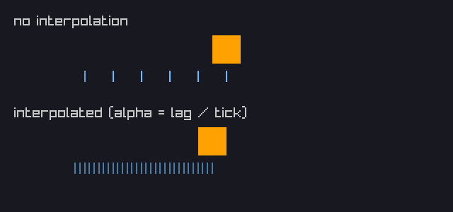
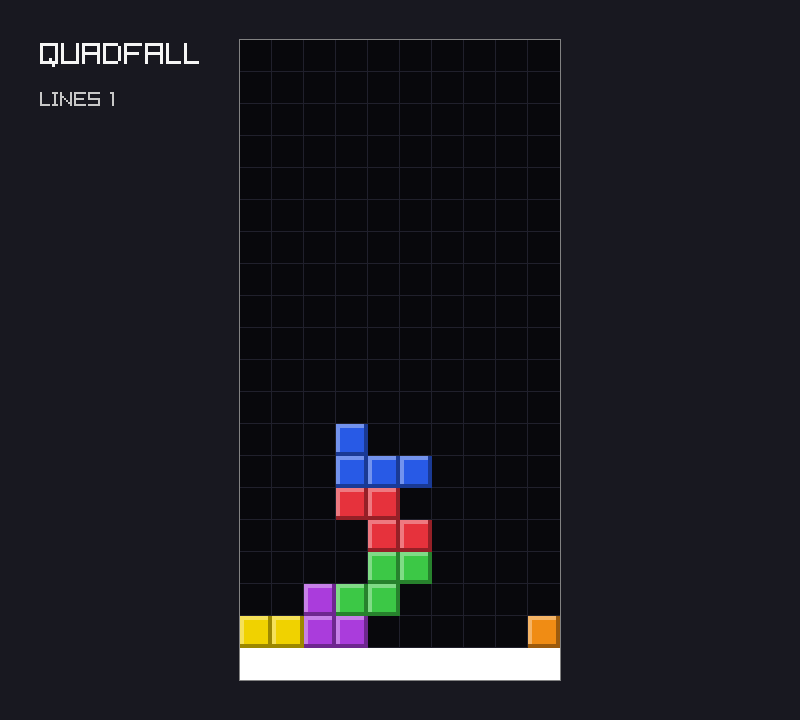
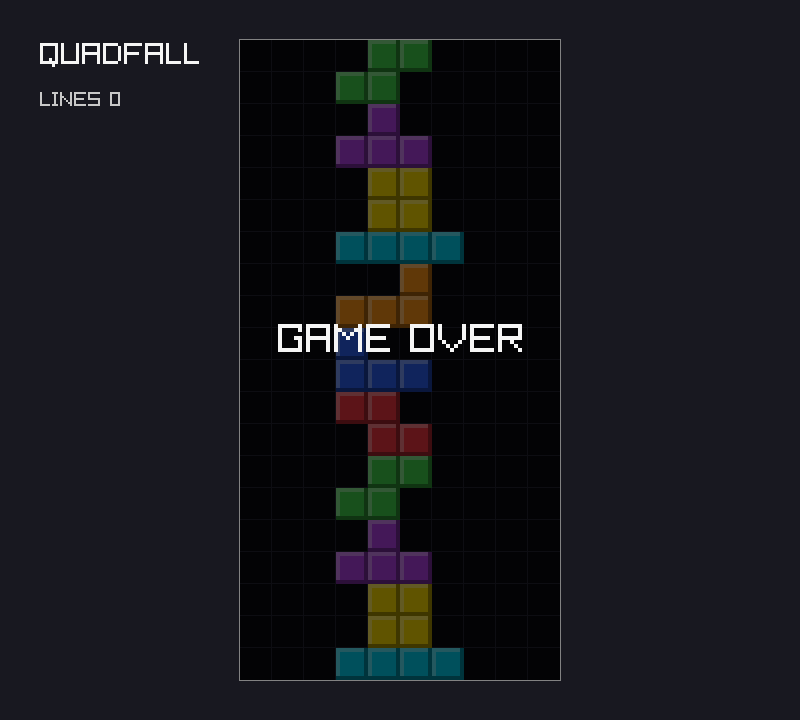

# Chapter 5 — Time

Until now one game tick has been one frame. On a 60 Hz screen that is fine; on a 144 Hz screen
every rule runs 2.4 times too fast, and on a slow machine everything crawls. This chapter
separates *simulation time* from *frame time* with a fixed timestep, the most important loop
in game programming. Then it builds the rules that depend on time: gravity counted in
fixed-point fractions of a row, soft and hard drop, lock delay with a limited number of resets,
line clears that flash before they vanish, and game over. Along the way you meet tagged unions,
bit sets, and in-place array compaction. At the end, `quadfall` is a game you can lose.

Previous: [Chapter 4 — Input and Movement](04-input-and-movement.md). Next:
[Chapter 6 — Rules and Progression](06-rules-and-progression.md).

## The problem with one tick per frame

In [Chapter 4](04-input-and-movement.md) the main loop called `game.tick(input)` once per frame
and relied on `SetTargetFPS(60)` to make that 60 ticks per second. Nothing checks that
assumption. A monitor that refreshes at 144 Hz with vsync, a laptop on battery that cannot keep
up, or a run with `--frames` that skips the frame limit all break it.

[Chapter 1](01-getting-started.md) gave the usual answer for *motion*: multiply a speed by the
frame time `dt`. That works for a block gliding across the screen. It does not work as well
for *rules* that cross a threshold, such as "the piece drops one whole row". This program
tries both approaches for one second of real time at three frame rates:

`examples/ch05/variable_step.zig`

```zig
//! A piece that should fall one row per second, simulated for one second
//! of real time on screens with different refresh rates.
const std = @import("std");

pub fn main() void {
    const rates = [_]u32{ 30, 60, 144 };

    std.debug.print("one tick per frame, 1/60 row per tick:\n", .{});
    for (rates) |fps| {
        // The rule assumes 60 frames per second; nothing checks that.
        var rows: f32 = 0;
        for (0..fps) |_| rows += 1.0 / 60.0;
        std.debug.print("  {d:>3} FPS: fell {d:.2} rows\n", .{ fps, rows });
    }

    std.debug.print("variable dt, speed * dt per frame:\n", .{});
    for (rates) |fps| {
        const dt: f32 = 1.0 / @as(f32, @floatFromInt(fps));
        var y: f32 = 0;
        for (0..fps) |_| y += 1.0 * dt;
        // The board moves in whole rows: did the piece reach row 1?
        const whole: i32 = @intFromFloat(@floor(y));
        std.debug.print("  {d:>3} FPS: y = {d:.9}, whole rows = {d}\n", .{ fps, y, whole });
    }
}
```

```console
$ zig run examples/ch05/variable_step.zig
one tick per frame, 1/60 row per tick:
   30 FPS: fell 0.50 rows
   60 FPS: fell 1.00 rows
  144 FPS: fell 2.40 rows
variable dt, speed * dt per frame:
   30 FPS: y = 1.000000400, whole rows = 1
   60 FPS: y = 0.999999700, whole rows = 0
  144 FPS: y = 0.999998300, whole rows = 0
```

- With one tick per frame, the fall speed is tied to the frame rate: half a row at 30 FPS, 2.4
  rows at 144 FPS. A player with a faster screen gets a harder game.
- With `speed * dt`, the *average* speed is right everywhere, but the sum of many `f32` steps
  is not exactly 1. At 30 FPS it lands a little above 1.0, so the piece has dropped a row after
  one second; at 60 and 144 FPS it lands a little below, so it has not. The rounding errors
  differ because the number and size of the steps differ.
- A one-row difference after one second is small, but every rule built on it inherits it: when
  a piece locks, whether a line clears in time, the score. Two players with the same input get
  different games, a recorded replay drifts apart from the original, and a test passes on one
  machine and fails on another.

What we want is a simulation that always takes the same steps, whatever the screen does.

## A fixed timestep

The answer, made popular by Glenn Fiedler's article "Fix Your Timestep!", is to keep two clocks.
Real time arrives in frames of whatever length the machine manages. Game time advances only in
**ticks** of exactly 1/60 s. A variable called `lag` (or "accumulator") holds the real time
that has passed but has not yet been simulated:

```zig
lag += frame_seconds;
while (lag >= tick_seconds) : (lag -= tick_seconds) {
    game.tick(input);
}
draw(game);
```

A frame of 1/30 s runs two ticks. A frame of 1/144 s usually runs none, and every few frames
runs one. A frame of 1/60 s runs exactly one. Whatever is left over stays in `lag` for the next
frame, so no time is lost.

This example feeds the same loop the frame times of four different machines for one second of
real time:

`examples/ch05/fixed_step.zig`

```zig
//! The fixed-timestep accumulator: whatever the frame times are, the game
//! advances in ticks of exactly 1/60 s, so one second is always 60 ticks.
const std = @import("std");

const tick_seconds = 1.0 / 60.0;

/// Runs frames until `seconds` of real time have passed. Returns the number
/// of ticks simulated and the time left over in `lag`.
fn simulate(frame_times: []const f64, seconds: f64) struct { ticks: u32, frames: u32, lag: f64 } {
    var lag: f64 = 0;
    var ticks: u32 = 0;
    var frames: u32 = 0;
    var clock: f64 = 0;
    while (clock < seconds - 1e-9) : (frames += 1) {
        const frame_seconds = frame_times[frames % frame_times.len];
        clock += frame_seconds;
        lag += frame_seconds;
        while (lag >= tick_seconds) : (lag -= tick_seconds) ticks += 1;
    }
    return .{ .ticks = ticks, .frames = frames, .lag = lag };
}

pub fn main() void {
    const machines = [_]struct { name: []const u8, times: []const f64 }{
        .{ .name = "30 Hz", .times = &.{1.0 / 30.0} },
        .{ .name = "60 Hz", .times = &.{1.0 / 60.0} },
        .{ .name = "144 Hz", .times = &.{1.0 / 144.0} },
        // An uneven machine: frames of 5, 30, 12 and 3 ms (50 ms in total).
        .{ .name = "jittery", .times = &.{ 0.005, 0.030, 0.012, 0.003 } },
    };
    for (machines) |m| {
        const r = simulate(m.times, 1.0);
        std.debug.print("{s:>7}: {d:>3} frames, {d} ticks, lag {d:.6} s", .{ m.name, r.frames, r.ticks, r.lag });
        if (r.lag > 0) std.debug.print(" ({e} s short of a tick)", .{tick_seconds - r.lag});
        std.debug.print("\n", .{});
    }
}
```

```console
$ zig run examples/ch05/fixed_step.zig
  30 Hz:  30 frames, 60 ticks, lag 0.000000 s
  60 Hz:  60 frames, 60 ticks, lag 0.000000 s
 144 Hz: 144 frames, 59 ticks, lag 0.016667 s (4.163336342344337e-17 s short of a tick)
jittery:  80 frames, 59 ticks, lag 0.016667 s (3.469446951953614e-18 s short of a tick)
```

- Every machine runs (almost) exactly 60 ticks per second, no matter how many frames it drew.
  The 80 frames of the jittery machine had four different lengths, and the ticks did not care.
- Two of the runs show 59 ticks with a full tick's worth of `lag` left over. This is the same
  floating-point rounding as before: 144 additions of 1/144 end up 4 × 10⁻¹⁷ s short of the 60th
  tick. Here it is harmless. The time is not lost; the 60th tick runs at the start of the next
  frame. The *game* still steps in whole ticks, and a tick always does the same thing.
- The important change is where floats appear. In the variable-step version, floats were *in
  the rules* (the piece's position). Here they are only in the clock that decides *when* to run
  a tick. The rules themselves can use integers, as the next section does.

### The spiral of death

There is one trap. Suppose the game stalls for two seconds: the player drags the window, the
OS swaps, or you stop in a debugger. The next frame sees `frame_seconds = 2.0` and has to run
120 ticks to catch up. If those ticks take real time, the frame after that is long too, and has
even more ticks to run. If a tick costs more real time than it simulates, this never ends: the
game spends all its time catching up and never draws. That is called the *spiral of death*.

The cure is to cap how much time one frame may add to `lag`. `quadfall` uses 0.25 s, which is at
most 15 ticks per frame:

`examples/ch05/spiral.zig`

```zig
//! A 2-second stall, then normal frames. Each tick costs real time, so a
//! frame that runs many ticks takes long, and the next frame has to catch
//! up even more. The 0.25 s cap stops that "spiral of death".
const std = @import("std");

const tick_seconds = 1.0 / 60.0;
const draw_seconds = 0.004;

fn run(tick_cost: f64, cap: f64) void {
    var lag: f64 = 0;
    var frame_seconds: f64 = 2.0; // the stall: a dragged window, a debugger
    for (0..8) |_| {
        lag += @min(frame_seconds, cap);
        var ticks: u32 = 0;
        while (lag >= tick_seconds) : (lag -= tick_seconds) ticks += 1;
        std.debug.print(" {d:>3}", .{ticks});
        // Running the ticks and drawing is what the next frame has to cover.
        frame_seconds = draw_seconds + @as(f64, @floatFromInt(ticks)) * tick_cost;
    }
    std.debug.print("\n", .{});
}

pub fn main() void {
    const inf = std.math.inf(f64);
    for ([_]f64{ 0.012, 0.020 }) |cost| {
        std.debug.print("a tick costs {d} ms; ticks in each frame after the stall:\n", .{cost * 1000});
        std.debug.print("  no cap:   ", .{});
        run(cost, inf);
        std.debug.print("  0.25 cap: ", .{});
        run(cost, 0.25);
    }
}
```

```console
$ zig run examples/ch05/spiral.zig
a tick costs 12 ms; ticks in each frame after the stall:
  no cap:    120  86  62  45  33  24  17  13
  0.25 cap:   15  11   8   6   4   3   3   2
a tick costs 20 ms; ticks in each frame after the stall:
  no cap:    120 144 173 208 249 300 360 432
  0.25 cap:   15  15  15  15  15  15  15  15
```

- With cheap ticks (12 ms each, still less than the 16.7 ms they simulate) and no cap, the game
  recovers, but slowly: 120 ticks in one frame means a 1.4 s frame, then 86 ticks, and so on.
  The player sees a frozen screen for several seconds.
- With expensive ticks (20 ms) and no cap, every frame is longer than the one before. That is
  the spiral; the program would never recover.
- With the cap, a frame never runs more than 15 ticks. When ticks are too expensive the game
  runs in slow motion instead of freezing, and it stays responsive. The time beyond the cap is
  simply dropped: the game "skips ahead" over the stall.

`quadfall`'s ticks cost microseconds, so the spiral will not happen to it. The cap still
matters for the long stalls: without it, letting go of a dragged window would replay two
seconds of gravity in a single frame.

### Interpolation, and why quadfall does not need it

A fixed timestep has one visible cost. If the game ticks at 10 Hz and draws at 60 Hz, each tick
is shown for six frames, and motion jumps. The usual fix is to draw the state *between* the last
two ticks: keep the previous position, compute `alpha = lag / tick_seconds` (how far we are
into the next tick, from 0 to 1), and draw `prev + (current - prev) * alpha`.

`examples/ch05/interpolation.zig` shows both, with a box simulated at 10 ticks per second. Here
is the part that matters; the rest of the file opens a 640×300 window and draws each box with a
trail of marks where it was drawn in the last 30 frames:

```zig
    var x: f32 = 20; // position after the last tick
    var prev_x: f32 = 20; // position after the tick before
    var lag: f32 = 0;
    var trail: [2][30]f32 = @splat(@splat(-100));
    var frame: usize = 0;
    while (demo.running()) : (frame += 1) {
        lag += demo.frameTime();
        while (lag >= tick_seconds) : (lag -= tick_seconds) {
            prev_x = x;
            x += speed;
            if (x > 580) { // wrap around
                x = 20;
                prev_x = 20;
            }
        }
        const alpha = lag / tick_seconds;
        const drawn = [2]f32{ x, prev_x + (x - prev_x) * alpha };
        for (&trail, drawn) |*t, d| t[frame % t.len] = d;
```

- `prev_x` is saved before every tick, so the drawing code always has the last two states.
- Wrapping around sets both to 20, so the box does not slide back across the screen.
- `drawn[0]` is the plain position; `drawn[1]` is the interpolated one.

It uses the `Demo` helper from [Chapter 1](01-getting-started.md), so it runs from `examples/`
with `zig build run`:

```console
$ cd examples
$ xvfb-run -a -s "-screen 0 1280x720x24" zig build run -Dexample=ch05/interpolation -- --frames 45 --screenshot ../images/ch05-interpolation.png
```

The program prints nothing; it writes the screenshot. In a real window (`zig build run
-Dexample=ch05/interpolation`) the top box hops and the bottom box glides.



- The marks under the top box are where it was drawn in the last 30 frames: only six distinct
  places, 40 pixels apart, each drawn about five times. That is what "stutter" looks like.
- The marks under the bottom box are evenly spaced: every frame drew it in a new place.
- The interpolated box is *behind* the other one, here by half a tick (20 pixels). It is drawn
  between the previous tick and the current one, so it always shows the past by up to one tick. That is the price of smoothness,
  and why interpolation is done in the drawing code, never in the rules.

`quadfall` ticks at 60 Hz, as often as most screens draw, and its pieces snap from cell to cell
by design. A block drawn halfway between two rows would look wrong. So `quadfall` does not
interpolate. Part II will revisit this when the camera moves smoothly through a 3D world.

## Gravity in fixed point

With fixed ticks, "fall one row per second" becomes "fall 1/60 of a row per tick". A row is a
whole number; 1/60 is not. Floats would bring back exactly the rounding problems from the first
section, and you would have to reason about rounding every time you wanted to know whether two
runs give the same game.

**Fixed point** is the old answer: pick a small unit and count in whole units. `quadfall`
counts falling in 1/65536ths of a row, so `one_row = 1 << 16 = 65536`. This is called 16.16
fixed point: 16 bits of whole rows and 16 bits of fraction. Adding integers is exact and gives
the same answer on every machine, in Debug and in Release builds.

`examples/ch05/fixed_point.zig`

```zig
//! 16.16 fixed point: a whole number of 1/65536ths. Integers add exactly,
//! so the same steps give the same result on every machine.
const std = @import("std");

const one: u32 = 1 << 16; // 1.0 in 16.16

/// Ticks until `per_tick` (in 1/65536ths) adds up to one whole row.
fn ticksToFall(per_tick: u32) u32 {
    var fall: u32 = 0;
    var ticks: u32 = 0;
    while (fall < one) : (ticks += 1) fall += per_tick;
    return ticks;
}

pub fn main() !void {
    // Ten steps of 0.1 in floating point.
    var f: f32 = 0;
    for (0..10) |_| f += 0.1;
    std.debug.print("f32: 0.1 * 10 = {d:.9}, == 1.0? {}\n", .{ f, f == 1.0 });

    // The same in 16.16: 0.1 is 6554/65536 (rounded), and the sum is exact.
    const tenth: u32 = (one + 5) / 10;
    var x: u32 = 0;
    for (0..10) |_| x += tenth;
    std.debug.print("16.16: tenth = {d}, sum = {d} = {d} + {d}/65536\n", .{ tenth, x, x >> 16, x & 0xffff });

    // One row per second at 60 ticks per second.
    const down = one / 60;
    const up = try std.math.divCeil(u32, one, 60);
    std.debug.print("65536 / 60 = {d}: {d} ticks to fall a row\n", .{ down, ticksToFall(down) });
    std.debug.print("divCeil    = {d}: {d} ticks to fall a row\n", .{ up, ticksToFall(up) });
}
```

```console
$ zig run examples/ch05/fixed_point.zig
f32: 0.1 * 10 = 1.000000100, == 1.0? false
16.16: tenth = 6554, sum = 65540 = 1 + 4/65536
65536 / 60 = 1092: 61 ticks to fall a row
divCeil    = 1093: 60 ticks to fall a row
```

- `0.1` has no exact `f32` representation, so ten of them add up to `1.0000001`, and `== 1.0`
  is false. In 16.16 a tenth is rounded once, to 6554, and from then on every sum is exact and
  predictable: `65540`, which is one row plus 4/65536.
- `x >> 16` is the whole part and `x & 0xffff` is the fraction. Shifts and masks are why the
  unit is a power of two.
- The last two lines are a real bug from building this chapter. `65536 / 60` is integer
  division and rounds *down* to 1092. Sixty ticks then add up to 65520, which is 16/65536 short
  of a row, so the first row takes 61 ticks. Rounding *up* with `std.math.divCeil` gives 1093,
  and 60 ticks are enough. You will see the failing test this caused in the project section.

`divCeil` returns an error union, because dividing by zero (or a negative overflow) is
possible in general. With constant arguments that cannot fail, the project writes
`std.math.divCeil(u32, one_row, ticks_per_second) catch unreachable`, which the compiler
evaluates at compile time.

## Tagged unions: one phase at a time

A game is in different *phases*: a piece is falling and the player steers it, or full rows are
flashing and input is ignored, or the game is over. A first attempt often uses booleans:
`is_clearing`, `is_over`, `clear_timer`, `rows_to_clear`. Then nothing stops `is_clearing` and
`is_over` from both being true, and `clear_timer` keeps a stale value when nothing is clearing.

A **tagged union** says "exactly one of these, and the data that goes with it":

`examples/ch05/tagged_union.zig`

```zig
//! A tagged union holds exactly one of its fields, and knows which one.
//! The game's phase is one: falling, clearing (with a timer), or over.
const std = @import("std");

const Phase = union(enum) {
    falling,
    clearing: struct { rows: u32, timer: u32 },
    over,
};

/// One tick of a tiny state machine: a clear lasts 3 ticks.
fn tick(phase: *Phase) void {
    switch (phase.*) {
        .falling => phase.* = .{ .clearing = .{ .rows = 2, .timer = 3 } },
        // |*c| captures a pointer to the payload, so it can be changed.
        .clearing => |*c| {
            c.timer -= 1;
            if (c.timer == 0) phase.* = .over;
        },
        .over => {},
    }
}

pub fn main() void {
    var phase: Phase = .falling;
    for (0..6) |i| {
        switch (phase) {
            .clearing => |c| std.debug.print("tick {d}: clearing {d} rows, timer {d}\n", .{ i, c.rows, c.timer }),
            else => std.debug.print("tick {d}: {t}\n", .{ i, phase }),
        }
        tick(&phase);
    }
    // Comparing with a tag ignores the payload.
    std.debug.print("phase == .over: {}\n", .{phase == .over});
    std.debug.print("@sizeOf(Phase) = {d}\n", .{@sizeOf(Phase)});
}
```

```console
$ zig run examples/ch05/tagged_union.zig
tick 0: falling
tick 1: clearing 2 rows, timer 3
tick 2: clearing 2 rows, timer 2
tick 3: clearing 2 rows, timer 1
tick 4: over
tick 5: over
phase == .over: true
@sizeOf(Phase) = 12
```

- `union(enum)` creates a hidden enum of the field names (the *tag*) and stores it next to the
  payload. `falling` and `over` have no payload (their type is `void`); `clearing` carries a
  small struct.
- `phase.* = .{ .clearing = .{ ... } }` switches to a new phase *and* gives its data in one
  assignment. There is no way to be "clearing" without a timer.
- `switch` on a union branches on the tag. `|c|` captures the payload by value, `|*c|` by
  pointer, so `c.timer -= 1` changes the union itself.
- `phase == .over` compares only the tag. You can do that even when the active field has a
  payload.
- `{t}` prints the tag name, which is handy in logs.
- The size is 12 bytes: two `u32` for the largest payload plus the tag, rounded up for
  alignment. A union is as big as its largest member, not the sum of all of them.

Two mistakes the compiler catches. Capturing by value and then assigning:

```console
$ zig run union_bad.zig
union_bad.zig:17:14: error: cannot assign to constant
            c.timer -= 1;
            ~^~~~~~
```

And forgetting a phase (here `.over` was deleted from the `switch` in `tick`):

```console
$ zig run union_bad2.zig
union_bad2.zig:13:5: error: switch must handle all possibilities
    switch (phase.*) {
    ^~~~~~
union_bad2.zig:8:5: note: unhandled enumeration value: 'over'
    over,
    ^~~~
union_bad2.zig:5:15: note: enum '@typeInfo(union_bad2.Phase).@"union".tag_type.?' declared here
const Phase = union(enum) {
              ^~~~~
```

(Each error is followed by a "referenced by" list of the functions that led to it; it is trimmed
here.) The second error is the real benefit: the day you add a phase, every `switch` that does
not handle it stops compiling, and the compiler gives you the list of places to update. The
last note shows that the hidden tag enum has no name of its own; Zig describes it by how you
would reach it with `@typeInfo`. To name it, use `std.meta.Tag(Phase)`.

## Bit sets: which rows are full?

When a piece locks, the game needs to know which rows are now full, remember that set while
they flash, and then remove them. The board has 22 rows, so a set of row numbers fits in 22
bits. `std.bit_set.IntegerBitSet(n)` is exactly that: a set of integers below `n`, stored in one
integer with one bit per member.

`examples/ch05/bit_set.zig`

```zig
//! std.bit_set.IntegerBitSet(n): a set of numbers below n, one bit each,
//! stored in a single integer. Ideal for "which rows are full?".
const std = @import("std");

const rows = 22;
const RowSet = std.bit_set.IntegerBitSet(rows);

pub fn main() void {
    var full: RowSet = .empty;
    full.set(0);
    full.set(2);
    full.set(3);

    std.debug.print("size: {d} bytes, mask: 0b{b}\n", .{ @sizeOf(RowSet), full.mask });
    std.debug.print("count: {d}\n", .{full.count()});
    std.debug.print("row 1 set? {}  row 2 set? {}\n", .{ full.isSet(1), full.isSet(2) });

    std.debug.print("rows:", .{});
    var it = full.iterator(.{});
    while (it.next()) |row| std.debug.print(" {d}", .{row});
    std.debug.print("\n", .{});

    full.unset(2);
    full.toggle(21);
    std.debug.print("after unset(2), toggle(21): count {d}, first {?d}\n", .{ full.count(), full.findFirstSet() });
}
```

```console
$ zig run examples/ch05/bit_set.zig
size: 4 bytes, mask: 0b1101
count: 3
row 1 set? false  row 2 set? true
rows: 0 2 3
after unset(2), toggle(21): count 3, first 0
```

- `IntegerBitSet(22)` stores a `u22` in its `mask` field; `@sizeOf` rounds it up to 4 bytes.
  The mask `0b1101` is bit 0, bit 2 and bit 3.
- `.empty` is a decl literal, like `Board.empty` and `Input.none` in earlier chapters. `.full`
  exists too.
- `iterator(.{})` yields the set members from low to high. The options struct can ask for unset
  bits or reverse order instead.
- Because it is a plain value with no pointers, a `RowSet` can sit inside the `clearing` phase's
  payload and be copied around freely.

## Removing rows in place

Removing rows is a classic array problem: delete some elements and close the gaps, without a
second array. Two indices do it. `from` walks every row from the bottom; `to` is where the next
*kept* row goes. Kept rows are copied down; removed rows are skipped. When `from` reaches the top,
everything from `to` upward is filled with empty rows.

`examples/ch05/compact_rows.zig`

```zig
//! Removing marked rows from an array in place, with two indices: `from`
//! reads every row, `to` writes the rows that are kept. Row 0 is the bottom.
const std = @import("std");

const rows = 6;

fn removeRows(grid: *[rows][]const u8, remove: std.bit_set.IntegerBitSet(rows)) void {
    var to: usize = 0;
    for (0..rows) |from| {
        if (remove.isSet(from)) continue;
        grid[to] = grid[from]; // to <= from, so nothing is overwritten unread
        to += 1;
    }
    // The top fills with empty rows.
    while (to < rows) : (to += 1) grid[to] = "....";
}

test "the rows above each removed row fall into the gap" {
    var grid: [rows][]const u8 = .{ "####", "#.##", "####", ".#..", "####", "...." };
    var remove: std.bit_set.IntegerBitSet(rows) = .empty;
    remove.set(0);
    remove.set(2);
    remove.set(4);
    removeRows(&grid, remove);
    const expected: [rows][]const u8 = .{ "#.##", ".#..", "....", "....", "....", "...." };
    for (expected, grid) |e, g| try std.testing.expectEqualStrings(e, g);
}

test "removing nothing changes nothing" {
    var grid: [rows][]const u8 = .{ "a...", "b...", "c...", "d...", "e...", "f..." };
    const before = grid;
    removeRows(&grid, .empty);
    for (before, grid) |b, g| try std.testing.expectEqualStrings(b, g);
}

test "removing every row empties the grid" {
    var grid: [rows][]const u8 = @splat("####");
    removeRows(&grid, .full);
    for (grid) |g| try std.testing.expectEqualStrings("....", g);
}
```

```console
$ zig test examples/ch05/compact_rows.zig
1/3 compact_rows.test.the rows above each removed row fall into the gap...OK
2/3 compact_rows.test.removing nothing changes nothing...OK
3/3 compact_rows.test.removing every row empties the grid...OK
All 3 tests passed.
```

- `to` never passes `from`, so a row is always read before anything overwrites it. That is why
  one pass with no temporary copy is enough.
- Every row above a removed row falls by the number of removed rows below it, which is exactly
  how line clears behave: in the first test, `.#..` falls two rows (rows 0 and 2 were removed
  below it).
- Rows that keep "floating" over a gap stay floating. Guideline games work this way ("naive
  gravity"): the stack does not collapse into holes.

## Building quadfall: the game gets time

Now the project. At the end of [Chapter 4](04-input-and-movement.md), `quadfall` showed one T
on a fixed demo stack. It moved and turned, but it never fell, and nothing ever locked. This
chapter turns it into a game.

The files that change:

| File | Change |
|---|---|
| `src/main.zig` | fixed-timestep loop; starts on an empty board with an I; Space is hard drop; `demo_board` removed |
| `src/core/input.zig` | a `drop` button |
| `src/core/board.zig` | `RowSet`, `fullRows`, `removeRows`, and a test |
| `src/core/game.zig` | rewritten `tick`: rule constants, `Phase`, gravity, lock delay, `lock`, `spawn`, `dropped`, `lines`, six new tests |
| `src/draw.zig` | `drawGame`: the piece, the flashing rows, the GAME OVER overlay, and `LINES n` |

The complete project is in `project/ch05/`.

### The fixed-timestep loop

`src/main.zig` gets the accumulator from the first section:

```zig
    var game: core.Game = .init(.empty, .i);
    // Fixed timestep: the game always advances in ticks of exactly 1/60 s,
    // however long a frame took. `lag` is real time not yet simulated.
    const tick_seconds = 1.0 / @as(f64, core.game.ticks_per_second);
    var lag: f64 = 0;
    var frame: u32 = 0;
    while (!rl.WindowShouldClose()) : (frame += 1) {
        if (opts.frames) |n| if (frame == n) break;
        const frame_seconds: f64 = if (opts.frames != null) tick_seconds else rl.GetFrameTime();
        // After a long stall (a dragged window, a debugger), skip ahead
        // rather than run hundreds of ticks to catch up.
        lag += @min(frame_seconds, 0.25);
        while (lag >= tick_seconds) : (lag -= tick_seconds) {
            // The script was validated above, so next() cannot fail here.
            const input: core.Input = if (script) |*s| (s.next() catch unreachable) orelse .none else readKeyboard();
            game.tick(input);
        }

        rl.BeginDrawing();
        defer rl.EndDrawing();
        rl.ClearBackground(draw.background);
        draw.drawGame(&game);
        rl.DrawText("QUADFALL", 40, 40, 30, rl.RAYWHITE);
    }
```

- The input is read *inside* the tick loop. Each tick gets its own `Input`, which is what makes a
  script (one entry per tick) and a live keyboard behave the same.
- In a `--frames` run, `frame_seconds` is exactly one tick. Every frame then runs exactly one
  tick, and `--frames 34` always means 34 ticks. That is what keeps the screenshots in this book
  byte-for-byte reproducible.
- `lag` is `f64`: only the scheduler uses floating point. Nothing in `core` does.
- The demo stack from Chapter 4 is gone. The game starts on `.empty` with an I piece.
- `readKeyboard` gains one line, `.drop = rl.IsKeyDown(rl.KEY_SPACE)`: Space is hard drop.

`src/core/input.zig` gets the matching field, `drop: bool = false`, after `ccw`. Because `Input`
is a packed struct of bools, the new button costs one bit, and the script language from Chapter
4 picks it up with no changes: button names are the field names, so `drop` and `drop*3` just
work.

### The rules as named constants

`src/core/game.zig` starts with every number the rules use, each with a comment. Tuning the
game means changing these and nothing else:

```zig
pub const ticks_per_second = 60;

/// Falling speed is counted in 1/65536ths of a row per tick (fixed point),
/// so the game uses integers only and every run gives the same result.
pub const one_row = 1 << 16;
/// One row per second. Rounded up: 65536 / 60 rounded down would need 61
/// ticks to fall the first row.
pub const gravity = std.math.divCeil(u32, one_row, ticks_per_second) catch unreachable;
/// Holding Down makes the piece fall this many times faster.
pub const soft_drop_factor = 20;
/// Ticks a piece may rest on the stack before it locks.
pub const lock_delay = 30;
/// Moves and turns that restart the lock delay, per row reached.
pub const max_lock_resets = 15;
/// Ticks the full rows flash before they disappear.
pub const clear_delay = 20;
```

All durations are in ticks, not seconds: 30 ticks is 0.5 s, 20 ticks is 1/3 s. The rules never
see a float or a clock. They count.

### A failing test: the rounding bug

The comment on `gravity` comes from a real failure. The first version of the line was:

```zig
pub const gravity = one_row / ticks_per_second;
```

and the test that checks one row per second said:

```zig
test "gravity pulls the piece down one row per second" {
    var g: Game = .init(.empty, .t);
    const start = g.piece.pos.row;
    run(&g, .none, ticks_per_second - 1);
    try testing.expectEqual(start, g.piece.pos.row);
    g.tick(.none);
    try testing.expectEqual(start - 1, g.piece.pos.row);
    // Soft drop is 20 times faster: 20 rows per second, one every 3 ticks.
    run(&g, .{ .down = true }, 3);
    try testing.expectEqual(start - 2, g.piece.pos.row);
}
```

To see the failure yourself, change the `gravity` line back and run the tests:

```console
$ zig build test
test
+- run test 25 pass, 1 fail (26 total)
error: 'game.test.gravity pulls the piece down one row per second' failed:
       expected 17, found 18
       .../lib/std/testing.zig:93:17: 0x1261774 in expectEqualInner__func_1019 (std.zig)
                       return error.TestExpectedEqual;
                       ^
       .../lib/std/testing.zig:57:5: 0x1263303 in expectEqual (root.zig)
           return expectEqualInner(T, expected, actual);
           ^
       .../src/core/game.zig:246:5: 0x126335c in test.gravity pulls the piece down one row per second (root.zig)
           try testing.expectEqual(start - 1, g.piece.pos.row);
           ^
failed command: ./.zig-cache/o/1825f5afde2b4dd9b978bceff792a8de/test --cache-dir=./.zig-cache --seed=0x2f9d5158 --listen=-

Build Summary: 1/3 steps succeeded (1 failed); 25/26 tests passed (1 failed)
test transitive failure
+- run test 25 pass, 1 fail (26 total)
```

(The paths to Zig's library and to the project are shortened. The `--seed` is the test
runner's own random seed and changes every run; our tests do not use it.) The T spawns with its
box at row 18, so after 60 ticks it should be at 17; it is still at 18, because 60 × 1092 is 65520, less than 65536. A player
would never notice one tick in sixty. A test notices at once, and that is the point of writing
it: the rule says "one row per second", so the test says exactly that. Put the `divCeil` line
back before going on.

### Phases

`game.zig` declares the `Phase` union from the tagged-union section, with one change: the
clearing payload is `struct { rows: board_.RowSet, timer: u32 }`, the set of full rows and the
ticks left. `board_` is the `board.zig` file. It got a trailing underscore because `init` already has a
parameter called `board`, and Zig does not allow a local name to shadow a declaration in an
outer scope.

`Game` gains the phase, the line count, and the state for gravity and locking. Chapter 4's
`down: AutoRepeat` field is gone: soft drop is now a faster gravity, not a repeated key.

```zig
pub const Game = struct {
    board: Board,
    piece: Piece,
    phase: Phase = .falling,
    next_kind: Kind,
    lines: u32 = 0,

    /// Last tick's input, to tell a new press from a held button.
    before: Input = .none,
    shift: AutoRepeat = .{},
    /// Fraction of a row fallen so far, in 1/65536ths.
    fall: u32 = 0,
    /// Ticks spent resting on the stack.
    lock_timer: u32 = 0,
    lock_resets: u32 = 0,
    /// The lowest row the piece's box has reached.
    lowest: i32,

    pub fn init(board: Board, first: Kind) Game {
        const p: Piece = .spawn(first);
        return .{ .board = board, .piece = p, .next_kind = nextInCycle(first), .lowest = p.pos.row };
    }
```

`lowest` and `next_kind` have no defaults, so `init` must set them; forgetting one is a compile
error, not a bug.

### The new tick

`tick` now starts by asking which phase it is in:

```zig
    /// Advances the game by one tick.
    pub fn tick(g: *Game, input: Input) void {
        defer g.before = input;
        switch (g.phase) {
            .over => return,
            .clearing => |*c| {
                c.timer -= 1;
                if (c.timer == 0) {
                    g.board.removeRows(c.rows);
                    g.phase = .falling;
                    g.spawn();
                }
                return;
            },
            .falling => {},
        }
```

- `defer g.before = input;` runs on *every* way out of the function. `tick` now has several
  early `return`s, and each must remember this tick's input, or the next tick would see a held
  button as a new press. One `defer` at the top replaces a line before every `return`.
- In `.clearing`, `c` points into `g.phase`. `removeRows(c.rows)` must run *before*
  `g.phase = .falling`, because that assignment replaces the payload `c` points to. Reading `c`
  afterwards would read garbage. The order in the code is the safe one.
- During a clear the player's input is ignored, but `before` is still updated, so a key held
  through the flash does not count as a new press when the next piece arrives.

The rest of `tick` is the falling phase. Moving and turning work as in Chapter 4, except that a
successful move now also restarts the lock delay:

```zig
        if (input.cw and !g.before.cw and g.turn(.cw)) g.restartLockDelay();
        if (input.ccw and !g.before.ccw and g.turn(.ccw)) g.restartLockDelay();
        const dx = g.shift.update(input, g.before);
        if (dx != 0 and g.move(dx, 0)) g.restartLockDelay();
```

`and` short-circuits: `g.turn(.cw)` runs only on a new press, and `restartLockDelay` only if the
turn succeeded.

### Hard drop

```zig
        if (input.drop and !g.before.drop) {
            while (g.move(0, -1)) {}
            g.lock();
            return;
        }
```

Fall while it fits, then lock at once, with no lock delay. It reacts to a *press*, not a hold:
holding Space must not drop the next piece too. The same "fall while it fits" idea, without
changing the game, gives the landing position:

```zig
    /// The piece as far down as it can fall from where it is.
    pub fn dropped(g: *const Game) Piece {
        var p = g.piece;
        while (g.fits(p.moved(0, -1))) p = p.moved(0, -1);
        return p;
    }
```

Nothing calls `dropped` yet. Chapter 6 draws it as the ghost piece. It is `pub` and takes
`*const Game` because the drawing code may look at the game but never change it.

### Gravity and soft drop

```zig
        g.fall += if (input.down) gravity * soft_drop_factor else gravity;
        while (g.fall >= one_row) {
            g.fall -= one_row;
            if (!g.move(0, -1)) {
                g.fall = 0;
                break;
            }
            g.lock_timer = 0;
            if (g.piece.pos.row < g.lowest) {
                g.lowest = g.piece.pos.row;
                g.lock_resets = 0;
            }
        }
```

This is the accumulator pattern again, one level down. `fall` collects fractions of a row; each
time it holds a whole row, the piece moves one row. With plain gravity that is once every 60
ticks. With Down held it is 1093 × 20 = 21860 per tick, a row every 3 ticks (20 rows per
second). At high levels in Chapter 6, gravity passes one row per tick, and the `while` moves
the piece several rows in a single tick.

When the piece cannot move down, `fall` is reset to 0. Otherwise the leftover would carry over:
at speeds above one row per tick (Chapter 6) it would pile up while the piece rests, and the
moment the player slid it off a ledge it would drop several rows at once.

### Lock delay

A piece that lands does not lock at once. It rests for `lock_delay` ticks (0.5 s), so the
player can still slide it into place:

```zig
        if (!g.fits(g.piece.moved(0, -1))) {
            g.lock_timer += 1;
            if (g.lock_timer >= lock_delay) g.lock();
        }
    }
```

"Resting" means "one row lower would not fit": the piece is touching the floor or the stack.
Each tick it rests, the timer grows. Falling a row (in the gravity loop) sets it back to 0.

Moving and turning restart the timer too, which is called **move reset**. Without a limit, a
player could tap left and right forever and never let the piece lock. The guideline allows 15
resets:

```zig
    /// A move or turn gives a resting piece more time, a limited number of
    /// times, so that it cannot stay up forever.
    fn restartLockDelay(g: *Game) void {
        if (g.lock_resets < max_lock_resets) {
            g.lock_timer = 0;
            g.lock_resets += 1;
        }
    }
```

The count of 15 is per *row reached*. `lowest` remembers the lowest row the piece's box has
reached. Only when gravity carries the piece lower than ever before does `lock_resets` go back
to 0 (see the gravity loop). Turning in place, or being kicked up a step and falling back to the
same row, earns nothing, so the counter cannot be refilled by going up and down one step.

`restartLockDelay` is called for every successful move, even while the piece is still in the
air. That uses up resets early, and an exercise looks at what happens without the limit. The
counter is cleared every time the piece reaches a new lowest row, and that happens all the way
down, so in practice a falling piece arrives with nearly all of its resets.

### Locking, clearing, spawning

```zig
    /// Writes the piece into the board, then clears rows or spawns the next.
    fn lock(g: *Game) void {
        var above_field = true;
        for (g.piece.cells()) |pos| {
            g.board.set(pos, g.piece.kind.cell());
            if (pos.row < board_.visible_rows) above_field = false;
        }
        if (above_field) {
            g.phase = .over;
            return;
        }
        const full = g.board.fullRows();
        if (full.count() > 0) {
            g.lines += @intCast(full.count());
            g.phase = .{ .clearing = .{ .rows = full, .timer = clear_delay } };
        } else {
            g.spawn();
        }
    }

    fn spawn(g: *Game) void {
        g.piece = .spawn(g.next_kind);
        g.next_kind = nextInCycle(g.next_kind);
        g.fall = 0;
        g.lock_timer = 0;
        g.lock_resets = 0;
        g.lowest = g.piece.pos.row;
        if (!g.fits(g.piece)) g.phase = .over;
    }
};
```

- `lock` writes the four cells into the board. The piece's kind becomes a `Cell`, so a locked
  piece keeps its color.
- Full rows do not disappear here. The phase becomes `.clearing` with the set of rows and a
  20-tick timer, and `tick` removes them when the timer runs out. The rules decide *how long*
  the flash lasts; the drawing code decides what it looks like.
- `full.count()` returns a `usize`. `@intCast` turns it into the `u32` of `lines`; in Debug and
  ReleaseSafe builds it panics if the value would not fit (it always fits: at most 22).
- There are two ways to lose, both from the guideline:
  - **lock out:** the piece locked entirely in the two hidden rows above the visible field;
  - **block out:** a new piece does not fit where it spawns.

  Both set `.over`, and from then on `tick` returns at once.

For now, pieces come in a fixed order. `Kind` is an enum with backing integers 0 to 6, so the
next kind is one more, wrapping around:

```zig
/// I, O, T, S, Z, J, L, then I again. Chapter 6 replaces this with a bag.
fn nextInCycle(kind: Kind) Kind {
    return @fromBackingInt((@backingInt(kind) + 1) % 7);
}
```

A predictable order is useful right now: the tests and the screenshots below know exactly which
piece comes next.

### Full rows on the board

`src/core/board.zig` gets the two functions from the examples, now on the real `Board`:

```zig
/// A set of row numbers, one bit per row.
pub const RowSet = std.bit_set.IntegerBitSet(rows);
```

```zig
    /// The rows with no empty cell.
    pub fn fullRows(board: *const Board) RowSet {
        var full: RowSet = .empty;
        for (board.cells, 0..) |row, r| {
            if (std.mem.findScalar(Cell, &row, .empty) == null) full.set(r);
        }
        return full;
    }

    /// Removes the given rows. The rows above each one move down to fill
    /// the gap, and empty rows come in at the top.
    pub fn removeRows(board: *Board, remove: RowSet) void {
        var to: usize = 0;
        for (0..rows) |from| {
            if (remove.isSet(from)) continue;
            board.cells[to] = board.cells[from];
            to += 1;
        }
        while (to < rows) : (to += 1) board.cells[to] = @splat(.empty);
    }
```

- A row is full when `findScalar` finds no `.empty` cell in it. `findScalar` is the 0.17 name
  of what older Zig called `indexOfScalar`.
- `board.cells[to] = board.cells[from]` copies a whole row (an array of 10 cells) at once:
  arrays are values in Zig.
- `@splat(.empty)` makes a row of 10 empty cells; the result type tells it how long.

A new test in `board.zig`, "full rows are found and removed; the rows above fall", checks both
with board pictures, as in Chapter 2: four rows in, two of them full, two rows out.

### Drawing the phases

`src/draw.zig` gets one entry point for the whole game, so `main` no longer needs to know what
to draw in which phase:

```zig
pub fn drawGame(g: *const core.Game) void {
    drawBoard(&g.board);
    switch (g.phase) {
        .falling => drawPiece(g.piece),
        .clearing => |c| {
            // The full rows flash white, fading as the timer runs out.
            const alpha = @as(f32, @floatFromInt(c.timer)) / core.game.clear_delay;
            var it = c.rows.iterator(.{});
            while (it.next()) |row| {
                const y = cellY(@intCast(row));
                rl.DrawRectangle(board_x, y, board_width, cell_size, rl.Fade(rl.WHITE, alpha));
            }
        },
        .over => {
            rl.DrawRectangle(board_x, board_y, board_width, board_height, rl.Fade(rl.BLACK, 0.6));
            const text = "GAME OVER";
            const width = rl.MeasureText(text, 40);
            rl.DrawText(text, board_x + @divTrunc(board_width - width, 2), board_y + 280, 40, rl.RAYWHITE);
        },
    }

    var buf: [32]u8 = undefined;
    const lines = std.mem.printSentinel(&buf, "LINES {d}", .{g.lines}, 0) catch unreachable;
    rl.DrawText(lines, 40, 90, 20, rl.LIGHTGRAY);
}
```

- The same `switch` over the same union, in a different module. The core owns the phases; the
  platform decides how each one looks.
- `alpha` goes from 1 to 0 as the timer counts down, so the white flash fades out. `Fade`
  returns the color with its alpha scaled.
- While clearing, the piece is not drawn: it has just locked and is part of the board.
- The GAME OVER overlay is a translucent black rectangle over the well, then centered text.
  `MeasureText` gives the width of a string in pixels at a font size.
- `printSentinel` writes a 0-terminated string into a stack buffer for raylib, as in Chapter 1.
  `catch unreachable` is safe because "LINES " plus a `u32` always fits in 32 bytes.

### The new tests

`game.zig` gets six tests and a helper, `run(g, input, n)`, which runs `n` ticks of the same
input. You saw the gravity test above. Two more:

```zig
test "moving restarts the lock delay, but only so many times" {
    var g: Game = .init(.empty, .o);
    run(&g, .{ .down = true }, 60);
    // Tap left and right forever: each tap restarts the delay until the
    // resets run out, then the piece locks.
    var ticks: u32 = 0;
    while (g.board.get(.{ .col = 4, .row = 0 }) == .empty and g.piece.kind == .o) : (ticks += 2) {
        g.tick(if (ticks % 4 == 0) .{ .left = true } else .{ .right = true });
        g.tick(.none);
        if (ticks > 1000) return error.NeverLocked;
    }
    try testing.expect(ticks > lock_delay);
    try testing.expectEqual(Kind.t, g.piece.kind);
}

test "a full row flashes, then disappears" {
    var g: Game = .init(.parse(
        \\###....###
    ), .i);
    g.tick(.{ .drop = true });
    try testing.expect(g.phase == .clearing);
    try testing.expectEqual(1, g.lines);
    run(&g, .none, clear_delay);
    try testing.expect(g.phase == .falling);
    try testing.expectFmt("", "{f}", .{g.board});
}
```

- Each test describes a rule in one sentence, then checks it with ticks and board pictures.
  None of them opens a window, waits for real time, or depends on the frame rate. One second of
  game time runs in microseconds.
- The move-reset test needs `error.NeverLocked` as a guard. If the limit were broken, the loop
  would run forever; with the guard the test fails with a clear name instead. Its loop
  condition checks the board *and* the piece kind, so it stops however the lock shows up.
- `g.phase == .clearing` compares the tag only, as in the example.
- The other three new tests are just as short. "hard drop locks at once and the next piece
  spawns" drops an I and expects `...IIII...` and an O (the fixed order makes that
  predictable). "a resting piece locks after the lock delay" holds Down for 60 ticks, checks
  that the board is still empty, then waits exactly `lock_delay` ticks and expects the O on
  the board. "the game is over when a new piece has no room" hard-drops 20 times and expects
  `.over`; it does not care which of the two ways ends the game.

### Running it

```console
$ zig build test --summary all
Build Summary: 3/3 steps succeeded; 26/26 tests passed
test success
+- run test 26 pass (26 total) 8ms MaxRSS:4M
   +- compile test debug native success 522ms MaxRSS:158M
```

The 26 tests are Chapter 4's 19, the board test, and the six new game tests. (If you run the
command a second time with nothing changed, Zig prints `run test cached` and no counts, because
the result is cached. Change a file, or delete `.zig-cache`, to see the counts again.)

`zig build run` starts a real game: Left and Right move, Down soft-drops, Space hard-drops, Up
or X turns clockwise, Z or Left Ctrl turns counter-clockwise. Pieces come in the order I, O, T,
S, Z, J, L.

For the book, two scripted runs. The first one builds a line clear. In the script language from
Chapter 4, `drop*1` is a tap of the drop button and `left*4` four taps to the left:

```console
$ xvfb-run -a -s "-screen 0 1280x720x24" ./zig-out/bin/quadfall --frames 34 --script "drop*1 left*4 drop*1 cw left*2 drop*1 drop*1 drop*1 drop*1 right*4 drop*1 _:4" --screenshot ../../images/ch05-line-clear.png
info: saved ../../images/ch05-line-clear.png
```

1. The I drops flat in the middle (columns 3 to 6).
2. The O moves to the left wall and drops (columns 0 and 1).
3. The T turns to point right, moves left twice, and drops. Its upright part fills column 2,
   down to the floor.
4. The S, Z and J drop where they spawn, onto the middle of the stack.
5. The L moves right four times and drops into columns 7 to 9. Row 0 is now full.

The L locks on tick 34, the last tick of the run, so the screenshot shows the very first frame
of the flash, at full strength. (The script's final `_:4` never plays; a `--frames` run simply
stops when its frames are done.) All of this happens well within the 60 ticks it takes gravity
to move a piece one row, so every piece lands exactly where the script put it.



The second run hard-drops 40 times and loses:

```console
$ xvfb-run -a -s "-screen 0 1280x720x24" ./zig-out/bin/quadfall --frames 100 --script "drop*40" --screenshot ../../images/ch05-game-over.png
info: saved ../../images/ch05-game-over.png
```



The pieces pile up in the middle of the well, one or two rows each. On tick 21 the eleventh
piece, an S, locks in the top two visible rows. The twelfth, a Z, has no room at its spawn
position: a block out. Tapping drop 29 more times changes nothing, because `tick` returns at
once in `.over`. Both runs give the same PNG, byte for byte, every time they run.

## Summary

- One tick per frame ties the game's speed to the screen. Scaling by `dt` fixes the average
  speed but lets floating-point rounding into the rules.
- A fixed timestep keeps a `lag` of unsimulated real time and runs whole ticks of exactly 1/60 s
  from it. Floats stay in the scheduler; the rules count ticks.
- Cap the time one frame may add (0.25 s) to avoid the spiral of death after a stall.
- Interpolation (`alpha = lag / tick`) smooths drawing between ticks at the cost of showing the
  past; a game whose pieces snap to cells does not need it.
- 16.16 fixed point counts fractions of a row as integers: exact, and the same on every machine
  and in every optimize mode. Watch integer division: `divCeil` when you need to round up.
- A tagged union (`union(enum)`) makes impossible combinations of state unrepresentable;
  `switch` with `|*payload|` changes the payload in place, and a missing case is a compile
  error.
- `std.bit_set.IntegerBitSet` is a set of small integers in one machine word.
- Compacting an array in place takes two indices, `from` and `to`.
- `defer` at the top of a function with several `return`s runs its cleanup on every path.
- `quadfall` now has gravity, soft and hard drop, lock delay with move reset, line clears with a
  flash, and game over, all in `core`, all covered by tests.

## Exercises

1. **Tune the feel.** Make the lock delay and the soft-drop factor command-line options
   (`--lock-delay N`, `--soft-drop N`). Keep the tests unchanged.

   <details><summary>Solution</summary>

   Put the tunable numbers in a struct whose defaults are the existing constants, and give
   `Game` a field of that type with a default. Tests that never touch it get the guideline
   values, so they need no changes. In `src/core/game.zig`:

   ```zig
   /// The timings a player may tune. The defaults are the constants above.
   pub const Rules = struct {
       lock_delay: u32 = lock_delay,
       soft_drop_factor: u32 = soft_drop_factor,
       max_lock_resets: u32 = max_lock_resets,
   };
   ```

   Add `rules: Rules = .{},` to `Game`, then use the fields instead of the constants in the
   three places that read them: `gravity * g.rules.soft_drop_factor` in the gravity line,
   `g.lock_timer >= g.rules.lock_delay` in `tick`, and `g.lock_resets < g.rules.max_lock_resets`
   in `restartLockDelay`.

   In `src/options.zig`, add `lock_delay: ?u32 = null` and `soft_drop: ?u32 = null` to
   `Options`, two lines to `usage`, and two branches like the one for `--frames`:

   ```zig
           } else if (std.mem.eql(u8, arg, "--lock-delay")) {
               const value = try nextValue(args, &i);
               opts.lock_delay = std.fmt.parseInt(u32, value, 10) catch return error.InvalidValue;
   ```

   In `src/main.zig`, after `var game: core.Game = .init(.empty, .i);`:

   ```zig
       if (opts.lock_delay) |n| game.rules.lock_delay = n;
       if (opts.soft_drop) |n| game.rules.soft_drop_factor = n;
   ```

   All 26 tests still pass, and a run with
   `--frames 60 --lock-delay 5 --soft-drop 60 --script "down:40"` shows the I already locked on
   the floor and the O just above it: with a factor of 60, 1093 × 60 is a little more than one
   row per tick, and a resting piece locks after only 5 ticks.
   </details>

2. **Infinite move reset.** Show why `max_lock_resets` matters: write a test in which a piece
   with unlimited resets never locks.

   <details><summary>Solution</summary>

   With the `Rules` struct from exercise 1, a test can lift the limit:

   ```zig
   test "with unlimited lock resets a piece never locks" {
       var g: Game = .init(.empty, .o);
       g.rules.max_lock_resets = std.math.maxInt(u32);
       run(&g, .{ .down = true }, 60); // reach the floor
       for (0..2500) |_| {
           // Left, nothing, right, nothing: 4 ticks, two resets.
           g.tick(.{ .left = true });
           g.tick(.none);
           g.tick(.{ .right = true });
           g.tick(.none);
       }
       try testing.expectEqual(Kind.o, g.piece.kind);
       try testing.expectFmt("", "{f}", .{g.board});
   }
   ```

   ```console
   $ zig build test --summary all
   Build Summary: 3/3 steps succeeded; 27/27 tests passed
   test success
   +- run test 27 pass (27 total) 8ms MaxRSS:4M
      +- compile test debug native success 422ms MaxRSS:159M
   ```

   After 10 000 ticks (almost three minutes of game time) the O is still the current piece and
   the board is empty. Older guideline games really had this "infinity" rule, and players used
   it to stall forever. The limit of 15 per row ends that.
   </details>

3. **Animate the clear.** Instead of a white flash, make each block in the full rows shrink
   toward its center as the timer runs out.

   <details><summary>Solution</summary>

   Replace the `.clearing` branch of `drawGame` in `src/draw.zig`:

   ```zig
           .clearing => |c| {
               // Each block of the full rows shrinks toward its center.
               const size = @divTrunc(cell_size * @as(i32, @intCast(c.timer)), core.game.clear_delay);
               const inset = @divTrunc(cell_size - size, 2);
               var it = c.rows.iterator(.{});
               while (it.next()) |row| {
                   const y = cellY(@intCast(row));
                   rl.DrawRectangle(board_x, y, board_width, cell_size, well);
                   for (g.board.cells[row], 0..) |cell, col| {
                       block(cellX(@intCast(col)) + inset, y + inset, size, cellColor(cell));
                   }
               }
           },
   ```

   `drawBoard` has already drawn the full rows at full size, so the branch first paints them
   over with the well color, then draws each block smaller. The cells are still on the board
   during `.clearing` (they are removed when the timer reaches 0), so their colors are still
   there to draw. Running the line-clear script with `--frames 38` shows the bottom row as a
   line of small blocks: four ticks into the clear the timer is 16, so each block is
   `32 * 16 / 20 = 25` pixels wide instead of 32. The rules did not change at all.
   </details>

4. **A slow-motion key.** While F is held, the game runs at a quarter of its speed. Do not
   change `core`.

   <details><summary>Solution</summary>

   In `src/main.zig`, scale the time each frame feeds into `lag`:

   ```zig
           // Slow motion: while F is held, a frame feeds a quarter of its time.
           const speed: f64 = if (rl.IsKeyDown(rl.KEY_F)) 0.25 else 1.0;
           lag += @min(frame_seconds * speed, 0.25);
   ```

   The accumulator does the rest: with a quarter of the time coming in, a tick runs every
   fourth frame. Gravity, lock delay and the flash all slow down together, because they all
   count ticks. Input is read per tick, so DAS and ARR slow down too. A game whose rules
   used `dt` directly would have to pass the scale to every rule. (This was checked by building
   it; a key press cannot be scripted in a headless run, so the slow motion itself was tried
   by hand only.)
   </details>

Sources for this chapter: [REFERENCES.md](REFERENCES.md#chapter-5--time)
