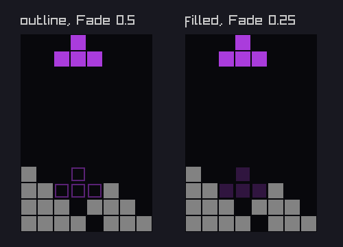
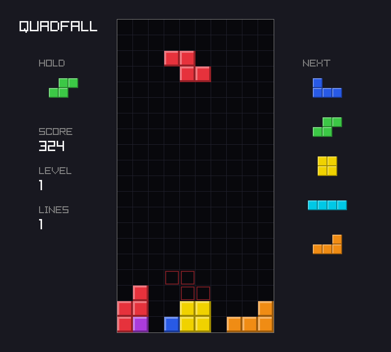

# Chapter 6 — Rules and Progression

At the end of [Chapter 5](05-time.md), `quadfall` could be played and lost, but every game was
the same game: I, O, T, S, Z, J, L, forever, at one row per second. This chapter adds what makes
a falling-block game worth a second try. Pieces come from a shuffled *bag*, fair but
unpredictable, and the player sees the next five. Hold lets the player put one piece aside.
Clearing rows scores points, every ten lines raise the level, and the pieces fall faster along
a speed curve the compiler works out before the program runs. A faint *ghost* shows where the
piece will land. And because the randomness comes from a seed, `--seed 7` replays the same game
every time.

On the Zig side you will meet seeded random number generators, optionals, overlapping copies,
and `comptime` code that is heavy enough to hit the compiler's evaluation limit.

Previous: [Chapter 5 — Time](05-time.md). Next: [Chapter 7 — Scenes and UI](07-scenes-and-ui.md).

## Randomness you can reproduce

Computers do not roll dice. A **pseudo-random number generator** (PRNG) is a small state and a
function that scrambles it: each call mixes the state and returns some of its bits. The output
looks random, but it is completely determined by where the state started, the **seed**. That
sounds like a weakness. For a game it is the most useful property there is.

`examples/ch06/prng.zig`

```zig
//! A pseudo-random number generator (PRNG) is a function of its state. Seed
//! it with the same number and it produces the same sequence, every time.
const std = @import("std");

fn rolls(seed: u64) [8]u8 {
    var prng: std.Random.DefaultPrng = .init(seed);
    const random = prng.random();
    var out: [8]u8 = undefined;
    for (&out) |*r| r.* = random.intRangeLessThan(u8, 0, 7);
    return out;
}

pub fn main() void {
    std.debug.print("seed 7:  {any}\n", .{rolls(7)});
    std.debug.print("seed 7:  {any}\n", .{rolls(7)});
    std.debug.print("seed 8:  {any}\n", .{rolls(8)});

    // random() is a small interface (a pointer and a function) over the
    // generator's state, which lives in `prng`.
    var prng: std.Random.DefaultPrng = .init(7);
    const random = prng.random();
    std.debug.print("state: {d} bytes; float {d:.4}; bool {}; u64 0x{x}\n", .{
        @sizeOf(std.Random.DefaultPrng), random.float(f32), random.boolean(), random.int(u64),
    });
}
```

```console
$ zig run examples/ch06/prng.zig
seed 7:  { 1, 0, 3, 1, 3, 3, 3, 1 }
seed 7:  { 1, 0, 3, 1, 3, 3, 3, 1 }
seed 8:  { 5, 6, 0, 1, 6, 0, 2, 0 }
state: 32 bytes; float 0.0426; bool false; u64 0xb7b311b3b0d45872
```

- `std.Random.DefaultPrng` is Xoshiro256, a fast, small, well-studied generator. Its whole
  state is the 32 bytes printed on the last line. It is not suitable for cryptography, and a
  game does not need that.
- `.init(seed)` takes a `u64` and expands it into the full state.
- `prng.random()` returns a `std.Random`: a small interface value (a pointer to `prng` plus a
  function) with all the useful methods: `intRangeLessThan`, `float`, `boolean`, `int`,
  `shuffle`, and more. Any generator can sit behind it.
- Seed 7 gives the same eight numbers twice. Seed 8 gives others.

Why a game wants this:

- **Bug reports.** "The game crashed with seed 15969984406174618660" is a bug you can reproduce.
- **Replays.** A seed plus the player's inputs *is* the whole game. Chapter 8 records replays
  exactly that way.
- **Tests.** A test can name a seed and know which pieces come.
- **Fair races.** Two players with the same seed get the same pieces.

`random()` needs a *mutable* generator, because each call changes the state. Declaring it with
`const` fails:

```console
$ zig run prng_bad.zig
prng_bad.zig:5:24: error: expected type '*Random.Xoshiro256', found '*const Random.Xoshiro256'
    const random = prng.random();
                   ~~~~^~~~~~~
prng_bad.zig:5:24: note: cast discards const qualifier
.../lib/std/Random/Xoshiro256.zig:20:21: note: parameter type declared here
pub fn random(self: *Xoshiro256) std.Random {
                    ^~~~~~~~~~~
```

(Here and below, the "referenced by" list after a compile error is trimmed, and paths into
Zig's library are shortened to `.../lib`.) The error names the real type behind `DefaultPrng`
and points at the declaration that wants `*Xoshiro256`. The fix is `var prng`.

### A seed from the operating system

When the player does not ask for a seed, the game should pick a new one every time. In Zig 0.17
a program gets its I/O interface from `main`'s `std.process.Init` argument, and
`init.io.random(&bytes)` fills a buffer with random bytes. The documentation describes them as
coming from a cryptographically secure generator seeded by the operating system:

`examples/ch06/os_seed.zig`

```zig
//! A seed from the operating system: different on every run. The program
//! prints it, so a run worth repeating can be repeated with that seed.
const std = @import("std");

pub fn main(init: std.process.Init) void {
    var bytes: [8]u8 = undefined;
    init.io.random(&bytes);
    const seed = std.mem.readInt(u64, &bytes, .little);
    std.debug.print("bytes: {x}\n", .{&bytes});
    std.debug.print("seed:  {d}\n", .{seed});

    var prng: std.Random.DefaultPrng = .init(seed);
    std.debug.print("first roll: {d}\n", .{prng.random().intRangeLessThan(u8, 0, 7)});
}
```

```console
$ zig run examples/ch06/os_seed.zig
bytes: e2fcf0c2dacc0306
seed:  433415229103209698
first roll: 2
$ zig run examples/ch06/os_seed.zig
bytes: ff884a003320250f
seed:  1091313888127518975
first roll: 0
```

- Eight random bytes become one `u64` with `std.mem.readInt`. The byte order has to be named
  (`.little`); with random bytes either order would do, but Zig makes you say which.
- `{x}` on a pointer to a byte array prints the bytes as hex.
- Your numbers will differ from these, and from run to run. That is the point.
- OS randomness is for picking the *seed*, once. Everything after that comes from the seeded
  PRNG, so it can be repeated.

## The 7-bag

The obvious way to choose a piece is a random number from 0 to 6, every time. Real games
stopped doing that long ago, because pure randomness is streaky: the same piece three times in
a row, or no I piece for a minute while the player keeps a column open for one.

The guideline answer is the **7-bag** ("Random Generator"): put one of each of the seven pieces
in a bag, shuffle it, deal all seven, then refill and shuffle again. Every group of seven has
each piece exactly once. The order inside a bag is a surprise; the long-term fairness is
guaranteed.

### Shuffling, the same everywhere

`std.Random` has `shuffle`, an implementation of the Fisher–Yates shuffle: for each position
`i`, swap the item with one chosen at random from positions `i` and later. It is quick, and every
order is equally likely. But it chooses those random positions as `usize`, and the size of
`usize` depends on the target. The same seed then shuffles differently on a 32-bit machine:

`examples/ch06/shuffle.zig`

```zig
//! Shuffling seven pieces with a seeded generator. `shuffle` draws its
//! random indices as usize, whose size depends on the target; with
//! `shuffleWithIndex(..., u32)` the same seed gives the same order everywhere.
const std = @import("std");

const Kind = enum { i, o, t, s, z, j, l };

fn printKinds(label: []const u8, kinds: []const Kind) void {
    std.debug.print("{s}", .{label});
    for (kinds) |k| std.debug.print(" {t}", .{k});
    std.debug.print("\n", .{});
}

pub fn main() void {
    std.debug.print("usize is {d} bits\n", .{@bitSizeOf(usize)});

    var a: std.Random.DefaultPrng = .init(7);
    var kinds = std.meta.tags(Kind).*; // a copy we may reorder
    a.random().shuffle(Kind, &kinds);
    printKinds("shuffle:               ", &kinds);

    var b: std.Random.DefaultPrng = .init(7);
    kinds = std.meta.tags(Kind).*;
    b.random().shuffleWithIndex(Kind, &kinds, u32);
    printKinds("shuffleWithIndex(u32): ", &kinds);
}
```

```console
$ zig run examples/ch06/shuffle.zig
usize is 64 bits
shuffle:                i t j z l o s
shuffleWithIndex(u32):  o l j z i t s
$ zig run -target x86-linux examples/ch06/shuffle.zig
usize is 32 bits
shuffle:                o l j z i t s
shuffleWithIndex(u32):  o l j z i t s
```

- On this 64-bit machine, `shuffle` and `shuffleWithIndex(u32)` give different orders from the
  same seed. On 32-bit x86 they agree, because there `usize` *is* 32 bits.
- `shuffleWithIndex(Kind, &kinds, u32)` always draws `u32` indices, so seed 7 shuffles the same
  way on every target. A replay recorded on a phone plays the same on a desktop. Seven items
  need far fewer than 32 bits, so nothing is lost.
- `std.meta.tags(Kind)` is a pointer to a comptime array of all the enum's values in order.
  `.*` copies it into a variable we are allowed to reorder.
- The `-target x86-linux` run is a real 32-bit program. Zig cross-compiles it, and this 64-bit
  Linux can run 32-bit x86 code directly.

### Droughts

How much does the bag help? This program deals 100 000 pieces both ways and measures the longest
run without an I piece, which players call a *drought*:

`examples/ch06/droughts.zig` (its `Bag` is the project's bag, listed later in this chapter)

```zig
// ...
const Stats = struct {
    /// The longest run of pieces without an I.
    longest: u32 = 0,
    /// Pieces dealt since the last I.
    since: u32 = 0,
    /// I pieces dealt.
    total: u32 = 0,

    fn add(s: *Stats, k: Kind) void {
        if (k == .i) {
            s.total += 1;
            s.since = 0;
        } else {
            s.since += 1;
            s.longest = @max(s.longest, s.since);
        }
    }
};

pub fn main() void {
    var prng: std.Random.DefaultPrng = .init(1);
    const random = prng.random();
    var bag: Bag = .{ .prng = .init(1) };

    var pure: Stats = .{};
    var bagged: Stats = .{};
    for (0..count) |_| {
        pure.add(random.enumValueWithIndex(Kind, u32));
        bagged.add(bag.next());
    }
    std.debug.print("{d} pieces dealt\n", .{count});
    std.debug.print("pure random: {d} I pieces, longest wait {d} pieces\n", .{ pure.total, pure.longest });
    std.debug.print("7-bag:       {d} I pieces, longest wait {d} pieces\n", .{ bagged.total, bagged.longest });
}
```

```console
$ zig run examples/ch06/droughts.zig
100000 pieces dealt
pure random: 14319 I pieces, longest wait 60 pieces
7-bag:       14286 I pieces, longest wait 12 pieces
```

- Both deal about one I in seven (100 000 / 7 is 14 285.7). The averages are the same.
- The worst case is not. Pure random once went 60 pieces without an I. With the bag the worst
  is 12, and it can never be more: an I first in one bag and last in the next has six pieces
  on each side.
- `enumValueWithIndex(Kind, u32)` is the enum version of `intRangeLessThan`, with the same `u32`
  rule as `shuffleWithIndex`.

## The next queue

Players plan ahead, so guideline games show the next few pieces. `quadfall` shows five. The
queue is an array of five kinds, soonest first. Taking a piece removes the first and appends one
from the bag. With five items there are two classic ways to do that: shift everything along by
one, or keep a ring buffer with a moving start index.

`examples/ch06/queue.zig`

```zig
//! A five-piece preview queue, two ways. Shifting moves four items per
//! take; a ring buffer moves none but needs a start index and modulo math.
//! For five items the shift is simpler, and just as fast in practice.
const std = @import("std");

const n = 5;

const ShiftQueue = struct {
    items: [n]u8,

    fn take(q: *ShiftQueue, refill: u8) u8 {
        const first = q.items[0];
        // The ranges overlap; copyForwards copies from the front, which is
        // safe when the destination starts before the source.
        std.mem.copyForwards(u8, q.items[0 .. n - 1], q.items[1..]);
        q.items[n - 1] = refill;
        return first;
    }
};

const RingQueue = struct {
    items: [n]u8,
    start: usize = 0,

    fn take(q: *RingQueue, refill: u8) u8 {
        const first = q.items[q.start];
        q.items[q.start] = refill; // the old front slot becomes the back
        q.start = (q.start + 1) % n;
        return first;
    }

    /// The i-th upcoming item, for drawing the preview.
    fn peek(q: *const RingQueue, i: usize) u8 {
        return q.items[(q.start + i) % n];
    }
};

test "both queues deal in order and show the same preview" {
    var shift: ShiftQueue = .{ .items = "ABCDE".* };
    var ring: RingQueue = .{ .items = "ABCDE".* };
    const refills = "FGHIJKL";
    for (refills) |r| {
        try std.testing.expectEqual(shift.take(r), ring.take(r));
        for (0..n) |i| try std.testing.expectEqual(shift.items[i], ring.peek(i));
    }
    try std.testing.expectEqualStrings("HIJKL", &shift.items);
}

test "the preview of a shift queue is just the array" {
    var q: ShiftQueue = .{ .items = "STIZJ".* };
    try std.testing.expectEqual('S', q.take('L'));
    try std.testing.expectEqualStrings("TIZJL", &q.items);
}
```

```console
$ zig test examples/ch06/queue.zig
1/2 queue.test.both queues deal in order and show the same preview...OK
2/2 queue.test.the preview of a shift queue is just the array...OK
All 2 tests passed.
```

- The ring buffer moves no data, but every reader needs `(start + i) % n` to find item `i`, and
  the drawing code would need `peek` instead of a plain loop over the array.
- The shift queue moves four bytes per piece, a few times per second. You could not measure the
  difference. Its preview is simply `items`, in order. For five items, simple wins.

The shift copies `items[1..5]` onto `items[0..4]`. Those two ranges *overlap*, which matters.
`@memcpy` requires that source and destination do not overlap, so that it can copy in any order
and as fast as possible. Replace `copyForwards` with `@memcpy` and a Debug build catches it:

```console
$ zig test queue.zig
1/2 queue.test.both queues deal in order and show the same preview...thread 120137 panic: @memcpy arguments alias
.../queue.zig:15:45: 0x1254f8d in take (queue.zig)
        @memcpy(q.items[0 .. n - 1], q.items[1..]);
                                            ^
.../queue.zig:43:47: 0x125918c in test.both queues deal in order and show the same preview (queue.zig)
        try std.testing.expectEqual(shift.take(r), ring.take(r));
                                              ^
...
error: the following test command terminated with signal ABRT:
.../test --seed=0xb836de0f
```

(Shortened; the trace continues through the test runner.) "Alias" means the two slices share
memory. In a ReleaseFast build there is no such check, and the result would be undefined.
`std.mem.copyForwards` copies one element at a time from the front, which is correct whenever
the destination starts at or before the source, as it does here. Its twin `copyBackwards` covers
the other direction.

## Hold and optionals

**Hold** lets the player put the current piece aside and take it back later. The first time,
the slot is empty and the next piece from the queue comes in. After that, hold swaps the
current piece with the held one. To stop players from swapping back and forth forever, hold
works once per piece: after using it, you must lock a piece before you can hold again.

"The slot is empty, or holds a kind" is exactly what an **optional** is. `?Kind` is either a
`Kind` or `null`:

`examples/ch06/optionals.zig`

```zig
//! An optional `?T` is either a T or null. Hold is one: the slot is empty
//! until the player first holds a piece.
const std = @import("std");

const Kind = enum { i, o, t, s, z, j, l };

const Hold = struct {
    held: ?Kind = null,

    /// Puts `current` aside and returns the piece to play instead: the
    /// held one if there is one, otherwise null (take the next piece).
    fn swap(h: *Hold, current: Kind) ?Kind {
        const out = h.held;
        h.held = current;
        return out;
    }
};

pub fn main() void {
    var hold: Hold = .{};

    // `if (x) |v|` runs only when x is not null, with v unwrapped.
    if (hold.held) |k| std.debug.print("holding {t}\n", .{k}) else std.debug.print("hold is empty\n", .{});

    // `orelse` gives a value for the null case.
    const first = hold.swap(.t) orelse .i;
    std.debug.print("held t, now playing {t}\n", .{first});

    const second = hold.swap(.s) orelse .i;
    std.debug.print("held s, now playing {t}\n", .{second});

    // `.?` unwraps when you know it is not null; null would panic.
    std.debug.print("held is {t}; == .s? {}\n", .{ hold.held.?, hold.held == .s });

    // Comparing with null, and the size an optional costs.
    hold.held = null;
    std.debug.print("held == null: {}; @sizeOf(Kind) = {d}, @sizeOf(?Kind) = {d}\n", .{
        hold.held == null, @sizeOf(Kind), @sizeOf(?Kind),
    });
}
```

```console
$ zig run examples/ch06/optionals.zig
hold is empty
held t, now playing i
held s, now playing t
held is s; == .s? true
held == null: true; @sizeOf(Kind) = 1, @sizeOf(?Kind) = 2
```

- `if (hold.held) |k|` takes the branch only when there is a value, and `k` is the plain
  `Kind`. This is the usual way to look inside an optional.
- `x orelse y` is `x`'s value, or `y` if `x` is null. Here: play the held piece, or else the
  next one (`.i` stands in for the queue).
- `x.?` unwraps when you *know* it is not null. It is short for `x orelse unreachable`.
- `hold.held == .s` compares an optional with a plain value: false if it is null.
- `?Kind` is one byte bigger than `Kind`: the extra byte says whether there is a value.

An optional cannot be used where its payload type is expected. The compiler even suggests the
three ways out:

```console
$ zig run opt_bad.zig
opt_bad.zig:8:21: error: expected type 'opt_bad.Kind', found '?opt_bad.Kind'
    const k: Kind = held;
                    ^~~~
opt_bad.zig:8:21: note: cannot convert optional to payload type
opt_bad.zig:8:21: note: consider using '.?', 'orelse', or 'if'
opt_bad.zig:3:14: note: enum declared here
const Kind = enum { i, o, t, s, z, j, l };
             ^~~~~~~~~~~~~~~~~~~~~~~~~~~~
```

And `.?` on a null is caught at run time in Debug and ReleaseSafe builds:

```console
$ zig run opt_panic.zig
thread 120098 panic: attempt to use null value
.../opt_panic.zig:8:36: 0x11ea5e3 in main (opt_panic.zig)
    std.debug.print("{t}\n", .{held.?});
                                   ^
...
```

Use `.?` only when null really is impossible, and prefer `if` or `orelse` otherwise.

## Scoring

The guideline scores a line clear by how many rows it clears, times the current level:

| Rows | Name | Points |
|---|---|---|
| 1 | single | 100 × level |
| 2 | double | 300 × level |
| 3 | triple | 500 × level |
| 4 | four ("tetris") | 800 × level |

Clearing four rows at once is worth twice as much as four singles, which is the risk and reward
at the heart of the game: keep a column open and wait for an I. On top of that, a soft drop earns
1 point for every row the piece falls while Down is held, and a hard drop earns 2 per row.

The guideline has more: a *back-to-back* bonus for consecutive hard clears, and *T-spins*,
clears made by twisting a T into a tight slot. `quadfall` leaves T-spins out (detecting them
takes rules about corners and kicks that would fill a chapter of their own). Back-to-back is
exercise 1.

## Levels and the gravity curve

Every 10 lines the level goes up by one: `level = 1 + lines / 10`. The level multiplies the
score, and it sets the speed. The guideline's "Marathon" mode gives the time a piece takes to
fall one row at each level:

> seconds per row = (0.8 − (level − 1) × 0.007) ^ (level − 1)

Level 1 is 1 second per row, level 10 about 0.064 s, level 15 about 0.007 s. Our gravity is in
1/65536ths of a row per tick, so each level needs the conversion `65536 / (seconds_per_row × 60)`.
That uses `pow`, floats and rounding, none of which belongs in a tick. But it only depends on
the level, and there are only 20 levels. So the program computes all 20 values **at compile
time**, and at run time the table is just 20 integers:

`examples/ch06/comptime_curve.zig`

```zig
//! The guideline gravity curve, (0.8 - (level-1) * 0.007) ^ (level-1)
//! seconds per row, turned into a table of 16.16 rows per tick while the
//! program compiles. At run time it is just 20 numbers.
const std = @import("std");

const ticks_per_second = 60;
const one_row = 1 << 16;

const gravity_table: [20]u32 = blk: {
    // std.math.pow loops a lot; comptime code gets 1000 backward branches
    // unless it asks for more.
    @setEvalBranchQuota(10_000);
    var table: [20]u32 = undefined;
    for (&table, 1..) |*g, level| {
        const n: f64 = @floatFromInt(level - 1);
        const seconds_per_row = std.math.pow(f64, 0.8 - n * 0.007, n);
        const rows_per_tick = 1.0 / (seconds_per_row * ticks_per_second);
        g.* = @intFromFloat(@ceil(@min(rows_per_tick, 20.0) * one_row));
    }
    break :blk table;
};

pub fn main() void {
    std.debug.print("level  16.16/tick   rows/tick\n", .{});
    for (gravity_table, 1..) |g, level| {
        const rows: f64 = @as(f64, @floatFromInt(g)) / one_row;
        std.debug.print("{d:>5}  {d:>10}  {d:>10.4}\n", .{ level, g, rows });
    }
}
```

```console
$ zig run examples/ch06/comptime_curve.zig
level  16.16/tick   rows/tick
    1        1093      0.0167
    2        1378      0.0210
    3        1769      0.0270
    4        2311      0.0353
    5        3076      0.0469
    6        4169      0.0636
    7        5759      0.0879
    8        8107      0.1237
    9       11635      0.1775
   10       17027      0.2598
   11       25416      0.3878
   12       38709      0.5907
   13       60169      0.9181
   14       95484      1.4570
   15      154743      2.3612
   16      256187      3.9091
   17      433425      6.6135
   18      749597     11.4379
   19     1310720     20.0000
   20     1310720     20.0000
```

- `const gravity_table: [20]u32 = blk: { ... break :blk table; };` is a labeled block used as an
  expression. At container level, the initializer of a `const` is always evaluated at compile
  time, so the whole loop, including `std.math.pow` on `f64`, runs inside the compiler.
- Level 1 is 1093, the same value Chapter 5 computed with `divCeil`. `@ceil` rounds up here for
  the same reason: so that level 1 takes exactly 60 ticks for its first row.
- At level 13 a piece falls almost a row per tick, and from level 14 it falls more than a
  row every tick. The gravity loop from Chapter 5 already handles that: it moves the piece one
  row at a time, checking each.
- From level 19 the formula asks for more than 20 rows per tick. The field is only 20 rows tall,
  so the table caps it there. Guideline players call this "20G": the piece appears already on
  the stack.
- The table has no floats left in it, and neither does the game. Only the compiler used them,
  once.

### The evaluation limit

The compiler runs comptime code in an interpreter, and it guards against infinite loops: by
default a comptime evaluation may take only 1000 *backward branches* (loop iterations and the
like). Twenty calls to `pow` need more. Delete the `@setEvalBranchQuota` line and:

```console
$ zig run comptime_curve.zig
.../lib/std/math/isinf.zig:10:81: error: evaluation exceeded 1000 backwards branches
    return @as(TBits, @bitCast(x)) & remove_sign == @as(TBits, @bitCast(math.inf(T)));
                                                                        ~~~~~~~~^~~
.../lib/std/math/isinf.zig:10:81: note: use @setEvalBranchQuota() to raise the branch limit from 1000
.../lib/std/math/pow.zig:79:19: note: called at comptime here
    if (math.isInf(y)) {
        ~~~~~~~~~~^~~
comptime_curve.zig:15:45: note: called at comptime here
        const seconds_per_row = std.math.pow(f64, 0.8 - n * 0.007, n);
                                ~~~~~~~~~~~~^~~~~~~~~~~~~~~~~~~~~~~~~
```

The error is reported deep in the standard library, where the budget happened to run out, and
then the notes walk back out to our line. The note says what to do. `@setEvalBranchQuota(10_000)`
at the start of the block raises the limit for this evaluation. The number is not precious; it
just has to be enough, and the compiler tells you if it is not.

## The ghost piece

The ghost is an outline at the bottom of the well that shows where the piece will land if you
hard-drop it. Chapter 5 already computes that place: `Game.dropped()`. What is left is drawing
a piece faintly, and `examples/ch06/ghost.zig` tries two looks side by side:

`examples/ch06/ghost.zig`

```zig
// ...
fn fits(dy: i32) bool {
    for (t_cells) |c| {
        const r = c[1] + dy;
        if (r >= rows or stack[@intCast(r)][@intCast(c[0])] == '#') return false;
    }
    return true;
}

fn drawWell(x: i32, title: [:0]const u8, landing: i32, outline: bool) void {
    // ... `purple`, the title, the well and the stack ...
    for (t_cells) |c| {
        const px = x + c[0] * cell;
        // The ghost first, so the real piece covers it where they overlap.
        const gy = 50 + (c[1] + landing) * cell;
        const rect: rl.Rectangle = .{ .x = @floatFromInt(px + 2), .y = @floatFromInt(gy + 2), .width = cell - 4, .height = cell - 4 };
        if (outline) rl.DrawRectangleLinesEx(rect, 2, rl.Fade(purple, 0.5)) else rl.DrawRectangleRec(rect, rl.Fade(purple, 0.25));
        rl.DrawRectangle(px + 1, 50 + c[1] * cell + 1, cell - 2, cell - 2, purple);
    }
}
// ...
```

```console
$ cd examples
$ xvfb-run -a -s "-screen 0 1280x720x24" zig build run -Dexample=ch06/ghost -- --frames 2 --screenshot ../images/ch06-ghost.png
the T lands 8 rows down
info: saved ../images/ch06-ghost.png
```



- The landing spot is logic: `main` runs `while (fits(landing + 1)) landing += 1;` once.
  Drawing it is two raylib calls.
- `DrawRectangleLinesEx(rect, thickness, color)` draws only the border of a rectangle, here 2
  pixels thick, inset 2 pixels so neighbouring outlines do not touch.
- `Fade(color, alpha)` returns the color with its alpha scaled; 0.5 is half transparent.
- The filled version is easy to mistake for a real piece at a glance, especially in a busy
  stack. The outline reads as "not really there". `quadfall` uses the outline.
- The ghost is drawn *before* the piece. When the piece is already resting, the two overlap and
  the solid piece covers the outline.
- The full file also holds the stack, written as strings top row first, and a `main` that opens
  the window with Chapter 1's `Demo` helper.

## Building quadfall: a real game

Now the project. The files that change:

| File | Change |
|---|---|
| `src/core/bag.zig` | new: the 7-bag and two tests |
| `src/core/game.zig` | the gravity table; `bag`, `queue`, `held`, `can_hold`, `score`, `level`; `init(board, seed)`; hold, scoring, `takeNext`; three new tests |
| `src/core/input.zig` | a `hold` button |
| `src/core/root.zig` | exports `Bag` |
| `src/draw.zig` | the ghost, the hold and next panels, the score, level and lines |
| `src/main.zig` | the seed (from `--seed` or the OS); C or Left Shift is hold |
| `src/options.zig` | `--seed N` |

The complete project is in `project/ch06/`.

### The bag

`src/core/bag.zig` is the example's bag with its tests:

```zig
//! The 7-bag randomizer: deal the seven pieces in a shuffled order, then
//! shuffle a fresh set. Random enough to surprise, fair enough that no piece
//! is ever missing for long.
const std = @import("std");
const Kind = @import("piece.zig").Kind;

pub const Bag = struct {
    prng: std.Random.DefaultPrng,
    kinds: [7]Kind = undefined,
    /// Pieces not yet dealt from `kinds`.
    left: usize = 0,

    /// The same seed deals the same pieces, on every machine.
    pub fn init(seed: u64) Bag {
        return .{ .prng = .init(seed) };
    }

    pub fn next(bag: *Bag) Kind {
        if (bag.left == 0) {
            bag.kinds = std.meta.tags(Kind).*;
            // A u32 index (rather than usize) makes the shuffle the same
            // on 32-bit and 64-bit targets.
            bag.prng.random().shuffleWithIndex(Kind, &bag.kinds, u32);
            bag.left = bag.kinds.len;
        }
        bag.left -= 1;
        return bag.kinds[bag.left];
    }
};

test "every group of seven holds each piece once" {
    var bag: Bag = .init(1234);
    for (0..100) |_| {
        var seen: std.enums.EnumSet(Kind) = .empty;
        for (0..7) |_| seen.insert(bag.next());
        try std.testing.expectEqual(7, seen.count());
    }
}

test "the same seed deals the same pieces" {
    var a: Bag = .init(42);
    var b: Bag = .init(42);
    var c: Bag = .init(43);
    var differs = false;
    for (0..70) |_| {
        const k = a.next();
        try std.testing.expectEqual(k, b.next());
        if (k != c.next()) differs = true;
    }
    try std.testing.expect(differs);
}
```

- `kinds` starts `undefined`: `left = 0` means nothing in it is dealt yet, so the first `next`
  fills it before reading.
- Dealing from the end (`left -= 1`, then `kinds[left]`) needs no second index. Seed 7's first
  shuffle is `o l j z i t s`, so it deals `s t i z j l o`.
- `std.enums.EnumSet(Kind)` is a set of enum values, a bit set indexed by the enum. Inserting
  seven pieces and counting seven proves there were no repeats. The test checks 100 bags.
- The second test checks both halves of "a seed decides everything": the same seed deals the
  same 70 pieces, and a different one deals something else.

### Gravity by level

In `src/core/game.zig`, the single `gravity` constant becomes the table from the example, plus
a function that looks up a level:

```zig
/// Gravity for levels 1 to 20, computed at compile time from the guideline
/// curve: (0.8 - (level - 1) * 0.007) ^ (level - 1) seconds per row.
/// Rounded up, so level 1 falls its first row in exactly 60 ticks.
pub const gravity_table: [20]u32 = blk: {
    @setEvalBranchQuota(10_000);
    var table: [20]u32 = undefined;
    for (&table, 1..) |*g, level| {
        const n: f64 = @floatFromInt(level - 1);
        const seconds_per_row = std.math.pow(f64, 0.8 - n * 0.007, n);
        const rows_per_tick = 1.0 / (seconds_per_row * ticks_per_second);
        // Never more than 20 rows per tick ("20G"): the height of the field.
        g.* = @intFromFloat(@ceil(@min(rows_per_tick, 20.0) * one_row));
    }
    break :blk table;
};

pub fn gravityAt(level: u32) u32 {
    return gravity_table[@min(level, gravity_table.len) - 1];
}
```

`gravityAt` clamps: level 25 plays like level 20. Without the clamp, level 21 would index past
the end of the array, which Debug builds catch as a panic. Level 0 would still underflow; the
game never has one.

Three more constants join the rules:

```zig
/// How many upcoming pieces the player can see.
pub const preview = 5;
pub const lines_per_level = 10;
/// Points for clearing 1, 2, 3 or 4 rows at once, times the level.
const line_points = [_]u32{ 0, 100, 300, 500, 800 };
```

`line_points[0]` is never used for scoring; it is there so that `line_points[cleared]` reads
naturally.

### New state

`Game`'s first fields now read:

```zig
pub const Game = struct {
    board: Board,
    piece: Piece,
    phase: Phase = .falling,
    bag: Bag,
    /// The next pieces, soonest first.
    queue: [preview]Kind,
    /// The piece put aside with Hold, if any.
    held: ?Kind = null,
    /// Hold works once per piece: false until the current piece locks.
    can_hold: bool = true,
    score: u32 = 0,
    lines: u32 = 0,
    level: u32 = 1,
```

`next_kind` and `nextInCycle` are gone. `init` takes a seed instead of a first piece, deals the
first piece from the bag, and fills the queue:

```zig
    pub fn init(board: Board, seed: u64) Game {
        var bag: Bag = .init(seed);
        const p: Piece = .spawn(bag.next());
        var queue: [preview]Kind = undefined;
        for (&queue) |*k| k.* = bag.next();
        return .{ .board = board, .piece = p, .bag = bag, .queue = queue, .lowest = p.pos.row };
    }
```

`spawn` now takes the kind to spawn, and a new function takes it from the queue:

```zig
    /// Takes the first piece from the queue and refills it from the bag.
    fn takeNext(g: *Game) Kind {
        const kind = g.queue[0];
        std.mem.copyForwards(Kind, g.queue[0 .. preview - 1], g.queue[1..]);
        g.queue[preview - 1] = g.bag.next();
        return kind;
    }
```

The two places that spawned the next piece (after a clear, and after a lock without one) now
say `g.spawn(g.takeNext())`.

### Hold, in the tick

Hold goes after the moves and turns, before hard drop:

```zig
        if (input.hold and !g.before.hold and g.can_hold) {
            g.can_hold = false;
            const kind = g.piece.kind;
            if (g.held) |h| g.spawn(h) else g.spawn(g.takeNext());
            g.held = kind;
            return;
        }
```

- `if (g.held) |h| ... else ...` is the optional unwrap from the example, choosing between the
  two kinds of hold.
- `spawn` puts the new piece at the top in spawn orientation, with fresh gravity and lock
  state, as the guideline says.
- `kind` is saved *before* spawning, because `spawn` replaces `g.piece`.
- The tick ends there. The new piece starts falling on the next tick.

`lock` sets `g.can_hold = true` once the piece is safely written into the board, so hold works
again for the next piece.

### Points, in the tick and in lock

Hard drop counts rows as it goes, and gravity pays for soft drop:

```zig
        if (input.drop and !g.before.drop) {
            while (g.move(0, -1)) g.score += 2;
            g.lock();
            return;
        }

        const speed = gravityAt(g.level);
        g.fall += if (input.down) speed * soft_drop_factor else speed;
        while (g.fall >= one_row) {
            g.fall -= one_row;
            if (!g.move(0, -1)) {
                g.fall = 0;
                break;
            }
            if (input.down) g.score += 1;
```

The soft-drop point is paid only for a row the piece really moved, not for holding Down on the
floor. And in `lock`:

```zig
        const cleared: u32 = @intCast(full.count());
        if (cleared > 0) {
            g.score += line_points[cleared] * g.level;
            g.lines += cleared;
            g.level = 1 + g.lines / lines_per_level;
            g.phase = .{ .clearing = .{ .rows = full, .timer = clear_delay } };
        } else {
            g.spawn(g.takeNext());
        }
```

The order matters: the points use the level *before* this clear, as in the guideline. A four
that takes you from 9 lines to 13 scores 800 × 1, and then the level becomes 2.

### Tests

The tests from earlier chapters used `Game.init(board, first)` to choose the first piece. That
choice is gone, so a helper restores it:

```zig
/// A game on `board` whose current piece is `first`.
fn startWith(board: Board, first: Kind) Game {
    var g: Game = .init(board, 0);
    g.spawn(first);
    return g;
}
```

Old tests that relied on the fixed order now ask the queue instead. The hard-drop test says
`const next = g.queue[0];` before dropping and expects that kind afterwards, plus
`2 * 19` points for the 19 rows the I fell. The move-reset test no longer checks which piece
comes next. Three new tests:

```zig
test "the gravity curve speeds up with the level" {
    try testing.expectEqual(1093, gravityAt(1)); // 1 row per second
    for (1..18) |level| {
        try testing.expect(gravityAt(@intCast(level + 1)) > gravityAt(@intCast(level)));
    }
    // From level 19 the curve passes 20 rows per tick and is capped.
    try testing.expectEqual(20 * one_row, gravityAt(19));
    try testing.expectEqual(20 * one_row, gravityAt(20));
    try testing.expectEqual(gravityAt(20), gravityAt(99));
}

test "hold puts the piece aside once per piece" {
    var g = startWith(.empty, .t);
    const next = g.queue[0];
    g.tick(.{ .hold = true });
    try testing.expectEqual(Kind.t, g.held.?);
    try testing.expectEqual(next, g.piece.kind);
    // A second hold before the piece locks does nothing.
    g.tick(.none);
    g.tick(.{ .hold = true });
    try testing.expectEqual(next, g.piece.kind);
    // After a lock, hold swaps the new piece with the T.
    g.tick(.{ .drop = true });
    g.tick(.{ .hold = true });
    try testing.expectEqual(Kind.t, g.piece.kind);
}

test "clearing rows scores points and raises the level" {
    var g = startWith(.parse(
        \\####.#####
        \\####.#####
        \\####.#####
        \\####.#####
    ), .i);
    g.lines = 9;
    g.piece = .{ .kind = .i, .rot = .right, .pos = .{ .col = 2, .row = 10 } };
    g.tick(.{ .drop = true });
    try testing.expectEqual(4, g.phase.clearing.rows.count());
    // 800 for four rows at level 1, plus 2 for each of the 10 rows dropped.
    try testing.expectEqual(800 + 20, g.score);
    try testing.expectEqual(13, g.lines);
    try testing.expectEqual(2, g.level);
}
```

- `g.held.?` is fine in a test: if hold were broken and `held` null, the test would panic, which
  still fails it, loudly.
- `g.phase.clearing.rows` reads a union field directly. That is checked: if the phase were not
  `.clearing`, a Debug build would panic with "access of union field 'clearing' while field
  'falling' is active".
- The scoring test starts at 9 lines, so the four takes the game to 13 lines and level 2 while
  still scoring at level 1.

The curve test was first written as "strictly faster at every level", with `for (1..20)`. It
failed:

```console
$ zig build test
test
+- run test 30 pass, 1 fail (31 total)
error: 'game.test.the gravity curve speeds up with the level' failed:
       .../lib/std/testing.zig:584:14: 0x1255c29 in expect (std.zig)
           if (!ok) return error.TestUnexpectedResult;
                    ^
       .../src/core/game.zig:347:9: 0x1265994 in test.the gravity curve speeds up with the level (root.zig)
               try testing.expect(gravityAt(@intCast(level + 1)) > gravityAt(@intCast(level)));
               ^
failed command: ./.zig-cache/o/c2dc2618b4c06bbb548706f8e0c50e00/test --cache-dir=./.zig-cache --seed=0x5766bfcb --listen=-

Build Summary: 1/3 steps succeeded (1 failed); 30/31 tests passed (1 failed)
```

`expect` only says "false", not which level. The table answers it: levels 19 and 20 are both
capped at 1310720. The test was wrong, not the game: the curve rises strictly up to level 19 and
is flat after that. So the loop stops at 18 (comparing up to levels 18 and 19 would also pass),
and the cap gets its own two lines.

### Drawing the ghost and the panels

`src/draw.zig` gets the ghost from the example, adapted to real pieces:

```zig
/// The ghost: where the piece would land, as a faint outline.
fn drawGhost(p: core.Piece) void {
    const color = rl.Fade(cellColor(p.kind.cell()), 0.5);
    for (p.cells()) |pos| {
        if (pos.row >= board.visible_rows) continue;
        const rect: rl.Rectangle = .{
            .x = @floatFromInt(cellX(pos.col) + 2),
            .y = @floatFromInt(cellY(pos.row) + 2),
            .width = cell_size - 4,
            .height = cell_size - 4,
        };
        rl.DrawRectangleLinesEx(rect, 2, color);
    }
}
```

`drawGame`'s falling branch draws it first: `drawGhost(g.dropped()); drawPiece(g.piece);`.
Ghost cells in the hidden rows are skipped. `drawPiece` shows the first hidden row above the
well so the player sees a piece arrive, but a ghost up there would only be clutter. `.width = cell_size - 4` needs
no cast: `cell_size` is a comptime integer, and the compiler turns it into the `f32` the field
wants.

The hold and next panels draw small pieces with `drawPreview(kind, x, y, color)`. It finds the
piece's bounding box in spawn orientation and centers it in a slot 5 cells wide and 3 high, with
20-pixel cells. The rows are flipped on the way (`max_row - pos.row`), because in the core row
0 is at the bottom and on screen y grows downward. It is a page of arithmetic; read it in
`project/ch06/src/draw.zig`.

Two small helpers keep the HUD readable:

```zig
fn label(text: [:0]const u8, x: i32, y: i32) void {
    rl.DrawText(text, x, y, 20, rl.GRAY);
}

/// Formats `fmt` into a small buffer for raylib, which wants a 0-terminated string.
fn value(buf: []u8, comptime fmt: []const u8, args: anytype) [:0]const u8 {
    return std.mem.printSentinel(buf, fmt, args, 0) catch "?";
}
```

`value` prints `?` if the text does not fit, instead of crashing the game over a label. A string
literal is already 0-terminated, so `"?"` is a valid `[:0]const u8`. `fmt` is `comptime` because
Zig checks format strings against their arguments at compile time.

The end of `drawGame` replaces Chapter 5's `LINES n`:

```zig
    // Left of the board: hold and the numbers. Right of it: the queue.
    const left_x = 80;
    const right_x = board_x + board_width + 60;
    label("HOLD", left_x, 120);
    if (g.held) |kind| {
        const color = if (g.can_hold) cellColor(kind.cell()) else rl.GRAY;
        drawPreview(kind, left_x, 150, color);
    }
    var buf: [32]u8 = undefined;
    label("SCORE", left_x, 260);
    rl.DrawText(value(&buf, "{d}", .{g.score}), left_x, 285, 30, rl.RAYWHITE);
    label("LEVEL", left_x, 340);
    rl.DrawText(value(&buf, "{d}", .{g.level}), left_x, 365, 30, rl.RAYWHITE);
    label("LINES", left_x, 420);
    rl.DrawText(value(&buf, "{d}", .{g.lines}), left_x, 445, 30, rl.RAYWHITE);

    label("NEXT", right_x, 120);
    for (g.queue, 0..) |kind, i| {
        drawPreview(kind, right_x, 150 + @as(i32, @intCast(i)) * (panel_height + 20), cellColor(kind.cell()));
    }
```

- The held piece turns gray while hold is used up, so the player can see that C will do nothing.
- One buffer serves all three numbers. Each `value` result is drawn before the next call
  overwrites the buffer, so that is safe. Keeping two results alive at once would not be.

### The seed

`src/options.zig` gets `--seed N`, parsed like `--frames` but as a `u64`, and `main` uses it,
or asks the OS:

```zig
    const seed = opts.seed orelse blk: {
        var bytes: [8]u8 = undefined;
        init.io.random(&bytes);
        break :blk std.mem.readInt(u64, &bytes, .little);
    };
    var game: core.Game = .init(.empty, seed);
```

`orelse` takes a block on its right, so the random seed is computed only when no seed was
given. `readKeyboard` gains `.hold = rl.IsKeyDown(rl.KEY_C) or rl.IsKeyDown(rl.KEY_LEFT_SHIFT)`,
and `input.zig` the matching `hold: bool = false`.

### Running it

```console
$ zig build test --summary all
Build Summary: 3/3 steps succeeded; 31/31 tests passed
test success
+- run test 31 pass (31 total) 5ms MaxRSS:4M
   +- compile test debug native success 366ms MaxRSS:157M
```

That is Chapter 5's 26, the two bag tests, and the three new game tests.

```console
$ ./zig-out/bin/quadfall --help
usage: quadfall [OPTIONS]

options:
  --frames N         run N frames with a fixed 1/60 s frame time, then exit
  --screenshot PATH  save the last frame as a PNG before exiting
  --script STEPS     play scripted input instead of the keyboard
  --seed N           deal pieces from seed N instead of a random seed
  --help             show this help
$ ./zig-out/bin/quadfall --seed abc
error: InvalidValue: --seed
usage: quadfall [OPTIONS]
...
$ echo $?
2
```

Is the game really decided by its seed? Run the same script three ways and compare the PNGs
byte for byte with `cmp`, which prints nothing when files are identical:

```console
$ xvfb-run -a -s "-screen 0 1280x720x24" ./zig-out/bin/quadfall --seed 7 --frames 200 --script "drop _ drop _ drop _ hold" --screenshot a.png
info: saved a.png
$ xvfb-run -a -s "-screen 0 1280x720x24" ./zig-out/bin/quadfall --seed 7 --frames 200 --script "drop _ drop _ drop _ hold" --screenshot b.png
info: saved b.png
$ xvfb-run -a -s "-screen 0 1280x720x24" ./zig-out/bin/quadfall --seed 8 --frames 200 --script "drop _ drop _ drop _ hold" --screenshot c.png
info: saved c.png
$ cmp a.png b.png
$ cmp a.png c.png
a.png c.png differ: byte 37, line 3
```

Without `--seed`, two runs differ too, because each picks its own seed from the OS.

Finally, a planned game for the book. Seed 7 deals `s t i z j l o`, then `z j s o i l t`:

```console
$ xvfb-run -a -s "-screen 0 1280x720x24" ./zig-out/bin/quadfall --seed 7 --frames 286 --script "hold left*3 drop _ right*3 drop _ cw left*4 drop _ drop _:25 right*4 drop _ drop _:220" --screenshot ../../images/ch06-midgame.png
info: saved ../../images/ch06-midgame.png
```

1. `hold`: the S goes into hold, and the T comes from the queue.
2. `left*3 drop`: the T drops flat at the left.
3. `right*3 drop`: the I drops flat at the right.
4. `cw left*4 drop`: the Z turns upright and drops onto the T at the left wall.
5. `drop _:25`: the J drops where it spawns and completes row 0. The 25 ticks of waiting cover
   the 20-tick flash.
6. `right*4 drop`: the L drops at the right wall.
7. `drop`: the O drops in the middle.
8. `_:220`: the next Z (the first piece of the second bag) falls on its own for 220 ticks, at
   level 1's one row per second.



The score is 100 for the single, plus 2 points for each of the 112 rows the six pieces were
hard-dropped: 100 + 224 = 324. The held S is in color, because pieces have locked since it was
held. The next five, J S O I L, are the rest of the second bag. Run the command again and you
get the same PNG, byte for byte.

## Summary

- A seeded PRNG (`std.Random.DefaultPrng`) gives a sequence decided by its seed; the same seed
  reproduces a whole game. `init.io.random` provides a fresh seed when none is given.
- `random()` needs a `var` generator; the `std.Random` it returns is an interface over it.
- The 7-bag deals each piece once per seven: no long droughts (at most 12 pieces between I's).
- Use `shuffleWithIndex(T, items, u32)`, not `shuffle`, when results must match across
  targets.
- `@memcpy` forbids overlapping slices; `std.mem.copyForwards` handles a shift to the left.
- Optionals (`?T`) hold a value or `null`; unwrap with `if (x) |v|`, `orelse`, or `.?` when null
  is impossible.
- Guideline scoring: 100/300/500/800 × level, 1 per soft-dropped row, 2 per hard-dropped row,
  using the level before the clear.
- A container-level `const` is evaluated at compile time, floats and all.
  `@setEvalBranchQuota` raises the 1000-branch limit when it is needed.
- A test that fails is not always a bug in the code: the curve test assumed something the curve
  does not do.
- The ghost is `dropped()` drawn with `DrawRectangleLinesEx` and `Fade`; the core decides, the
  platform draws.

## Exercises

1. **Back-to-back bonus.** In the guideline, a four right after another four (with no smaller
   clear between them) scores half as much again. Add it, with a test.

   <details><summary>Solution</summary>

   Add `last_was_four: bool = false` to `Game`, and in `lock`:

   ```zig
           if (cleared > 0) {
               var points = line_points[cleared] * g.level;
               // Four rows right after four rows: half as much again.
               if (cleared == 4 and g.last_was_four) points += points / 2;
               g.last_was_four = cleared == 4;
               g.score += points;
   ```

   A placement that clears nothing does not change `last_was_four`, so a four, some
   non-clearing pieces, and another four still counts. A single, double or triple between them
   resets it. The test needs eight rows with a one-column well, and drops two upright I's into
   it:

   ```zig
   test "four rows right after four rows score half as much again" {
       var g = startWith(.parse(
           \\####.#####
           \\####.#####
           \\####.#####
           \\####.#####
           \\####.#####
           \\####.#####
           \\####.#####
           \\####.#####
       ), .i);
       // An upright I over the well: its cells are column 4, rows 4 to 7.
       g.piece = .{ .kind = .i, .rot = .right, .pos = .{ .col = 2, .row = 4 } };
       g.tick(.{ .drop = true });
       try testing.expectEqual(8 + 800, g.score); // 4 rows dropped, 4 cleared
       run(&g, .none, clear_delay);
       g.piece = .{ .kind = .i, .rot = .right, .pos = .{ .col = 2, .row = 4 } };
       g.tick(.{ .drop = true });
       try testing.expectEqual(8 + 800 + 8 + 1200, g.score);
   }
   ```

   All tests pass. The second four scores 1200, 800 × 1.5.
   </details>

2. **Show the seed.** Draw the seed in the HUD, so a player can report it.

   <details><summary>Solution</summary>

   Add `seed: u64,` to `Game` (no default, so `init` must set it) and set `.seed = seed` in
   `init`'s return. Then, in `drawGame`, after LINES:

   ```zig
       label(value(&buf, "SEED {d}", .{g.seed}), left_x, 640);
   ```

   `value` returns a `[:0]const u8`, which is what `label` takes, so the two compose. With
   `--seed 7` the bottom left of the screen reads `SEED 7`. A random 20-digit seed fits in the
   32-byte buffer.
   </details>

3. **A 14-bag.** Some games use a bag with two of each piece. Add a 14-bag to `droughts.zig`
   and compare.

   <details><summary>Solution</summary>

   The same struct with a bigger array, filled by concatenating the tags twice with `++` (which
   works on comptime arrays):

   ```zig
   /// Two of each piece per bag: more surprise, longer droughts.
   const Bag14 = struct {
       prng: std.Random.DefaultPrng,
       kinds: [14]Kind = undefined,
       left: usize = 0,

       fn next(bag: *Bag14) Kind {
           if (bag.left == 0) {
               const tags = std.meta.tags(Kind);
               bag.kinds = tags.* ++ tags.*;
               bag.prng.random().shuffleWithIndex(Kind, &bag.kinds, u32);
               bag.left = bag.kinds.len;
           }
           bag.left -= 1;
           return bag.kinds[bag.left];
       }
   };
   ```

   Add `var bag14: Bag14 = .{ .prng = .init(1) };` and a third `Stats`, feed it in the loop, and
   print it:

   ```console
   $ zig run droughts14.zig
   100000 pieces dealt
   pure random: 14319 I pieces, longest wait 60 pieces
   7-bag:       14286 I pieces, longest wait 12 pieces
   14-bag:      14286 I pieces, longest wait 23 pieces
   ```

   The theoretical worst for a 14-bag is 24: both I's first in one bag and last in the next.
   It is twice the 7-bag's worst, and still far from pure random. The 14-bag can also deal the
   same piece four times in a row (twice at the end of one bag, twice at the start of the next);
   a 7-bag deals it at most twice in a row.
   </details>

4. **Level select.** Add `--level N` to start at a higher level. Clearing lines must not lower
   it.

   <details><summary>Solution</summary>

   Add `start_level: u32 = 1` to `Game`, and in `lock`:

   ```zig
               g.level = @max(g.start_level, 1 + g.lines / lines_per_level);
   ```

   In `src/options.zig`, a `level: ?u32 = null` field, a usage line
   (`--level N          start at level N (1 or more)`) and a branch that rejects 0, since
   `gravityAt(0)` would underflow:

   ```zig
           } else if (std.mem.eql(u8, arg, "--level")) {
               const value = try nextValue(args, &i);
               const n = std.fmt.parseInt(u32, value, 10) catch return error.InvalidValue;
               if (n == 0) return error.InvalidValue;
               opts.level = n;
   ```

   And in `main`, after `init`:

   ```zig
       if (opts.level) |n| {
           game.start_level = n;
           game.level = n;
       }
   ```

   `quadfall --level 0` prints `error: InvalidValue: --level` and the usage, and exits with 2.
   `--seed 7 --level 15 --frames 20` shows LEVEL 15 and the first S already on the floor after
   a third of a second. A test can check that a single at level 5 scores `100 * 5` and leaves
   the level at 5; with all four exercises the suite has 33 tests, all passing.
   </details>

Sources for this chapter: [REFERENCES.md](REFERENCES.md#chapter-6--rules-and-progression)
