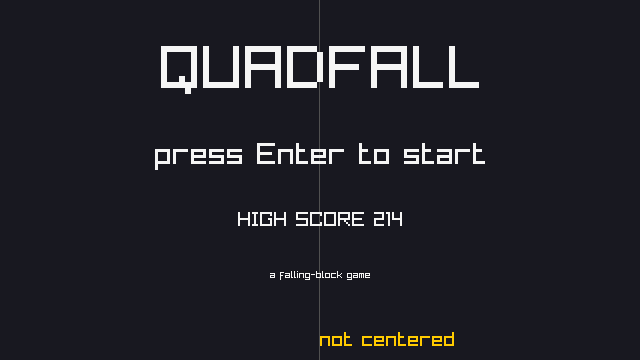
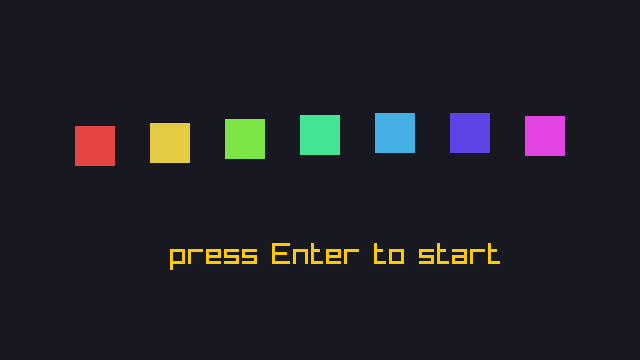
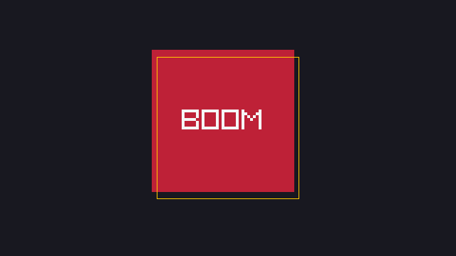
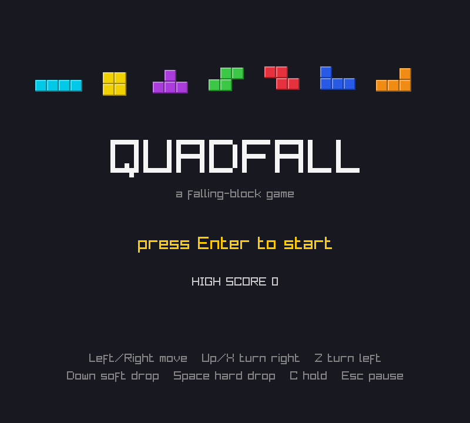
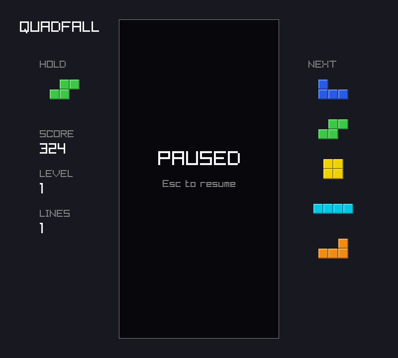
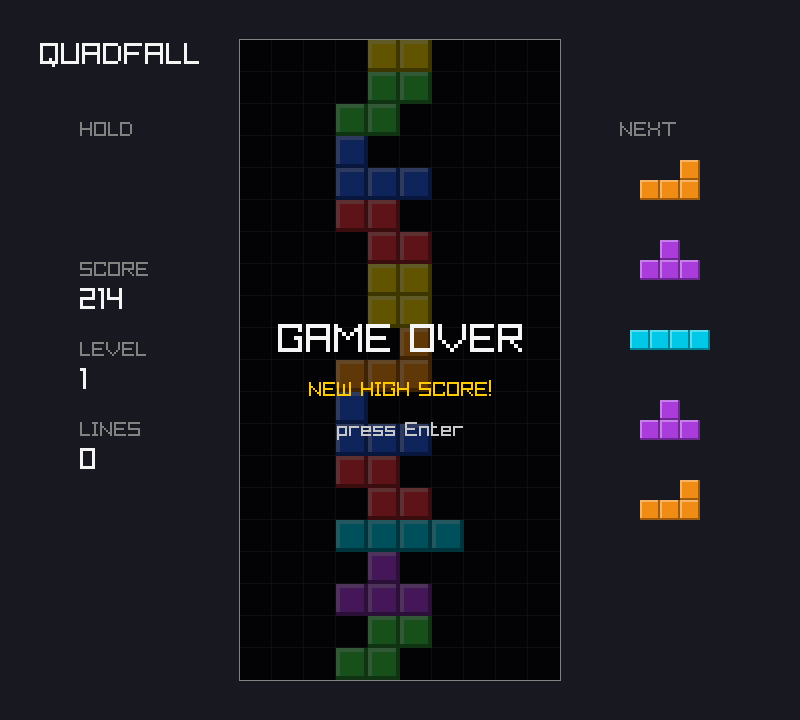

# Chapter 7 — Scenes and UI

At the end of [Chapter 6](06-rules-and-progression.md) `quadfall` has every rule it needs. It is
still not quite a game: it starts playing the moment the window opens, it cannot pause, it ends
on a frozen board, and it makes no sound. This chapter adds the parts around the rules: scenes
(title, play, pause, game over) as a state machine in the core; **events** that tell the
platform what just happened; centered text, blinking, bobbing and screen shake driven by the
tick counter; a high score saved as ZON; and square-wave sound effects computed at startup,
which fall silent gracefully on a machine with no audio device.

Previous: [Chapter 6](06-rules-and-progression.md). Next: [Chapter 8](08-organizing-a-game.md).

## Scenes as a state machine

A finished game shows different screens at different times. First a title screen, then the game,
perhaps a pause screen, then a game-over screen, then the game again. Each of these is a
**scene**. At any moment exactly one scene is active, and input moves the program from one
scene to another:

```text
            Enter                 Esc / P
  title  ---------->  play  <---------------->  pause
                      |  ^          (Esc, P or Enter)
            stack     |  |  Enter
            tops out  v  |
                      over
```

This is a **state machine**: the scenes are its states, and each arrow is a transition with the
input that triggers it (see "State" in *Game Programming Patterns*). Without one, a program
tracks its mode with booleans such as `paused` and `game_over`, and nothing stops two of them
from being true at once. One enum with one value at a time makes impossible states impossible.

In Zig a state machine is an `enum` and a `switch`. `examples/ch07/scenes.zig` is the smallest
version of quadfall's scenes. It drives the machine with a fixed list of inputs, one per tick,
and prints the scene after each tick:

`examples/ch07/scenes.zig`

```zig
//! Scenes as a state machine: one enum, one switch, driven by one input
//! per tick. Prints the scene after every tick.
const std = @import("std");

const Scene = enum { title, play, pause, over };

const Input = packed struct {
    start: bool = false,
    pause: bool = false,
    /// Stands in for "the stack reached the top".
    lose: bool = false,
};

const App = struct {
    scene: Scene = .title,
    before: Input = .{},

    fn tick(app: *App, input: Input) void {
        defer app.before = input;
        // A button counts once, on the tick it goes down.
        const start = input.start and !app.before.start;
        const pause = input.pause and !app.before.pause;
        app.scene = switch (app.scene) {
            .title, .over => if (start) .play else app.scene,
            .play => if (pause) .pause else if (input.lose) .over else .play,
            .pause => if (pause or start) .play else .pause,
        };
    }
};

pub fn main() void {
    const ticks = [_]Input{
        .{},                .{ .start = true }, .{ .start = true }, .{},
        .{ .pause = true }, .{ .pause = true }, .{ .pause = true }, .{},
        .{ .pause = true }, .{ .lose = true },  .{ .start = true },
    };
    var app: App = .{};
    for (ticks, 0..) |input, i| {
        const was = app.scene;
        app.tick(input);
        const mark = if (app.scene != was) "*" else " ";
        std.debug.print("tick {d:>2}  start={d} pause={d} lose={d}  {s} {t}\n", .{
            i, @intFromBool(input.start), @intFromBool(input.pause), @intFromBool(input.lose), mark, app.scene,
        });
    }
}
```

```console
$ zig run examples/ch07/scenes.zig
tick  0  start=0 pause=0 lose=0    title
tick  1  start=1 pause=0 lose=0  * play
tick  2  start=1 pause=0 lose=0    play
tick  3  start=0 pause=0 lose=0    play
tick  4  start=0 pause=1 lose=0  * pause
tick  5  start=0 pause=1 lose=0    pause
tick  6  start=0 pause=1 lose=0    pause
tick  7  start=0 pause=0 lose=0    pause
tick  8  start=0 pause=1 lose=0  * play
tick  9  start=0 pause=0 lose=1  * over
tick 10  start=1 pause=0 lose=0  * play
```

- The `switch` produces the next scene; each branch says where its scene can go.
- **Edge detection.** `input` holds the buttons that are down *now*, and a held key stays down
  for many ticks (ticks 4 to 6). Without the check against `app.before`, holding Esc would
  pause and resume 60 times a second. `input.pause and !app.before.pause` is true only on the
  tick the button goes down, so tick 2 (Enter still held) does nothing, and tick 8 resumes only
  because tick 7 released the button. Rotation used the same trick in
  [Chapter 4](04-input-and-movement.md).
- `defer app.before = input;` records the input at the end of `tick`, whatever path it takes.

The `switch` has one more benefit, and it is the main reason to use an enum. Zig requires a
`switch` on an enum to handle every value. Forget a scene, and the program does not compile:

```zig
const std = @import("std");

const Scene = enum { title, play, pause, over };

pub fn main() void {
    const scene: Scene = .pause;
    switch (scene) {
        .title => std.debug.print("title\n", .{}),
        .play => std.debug.print("play\n", .{}),
        .over => std.debug.print("over\n", .{}),
    }
}
```

```console
$ zig run missing_scene.zig
missing_scene.zig:7:5: error: switch must handle all possibilities
    switch (scene) {
    ^~~~~~
missing_scene.zig:3:35: note: unhandled enumeration value: 'pause'
const Scene = enum { title, play, pause, over };
                                  ^~~~~
```

(Trimmed here and in later listings: a note pointing at the enum, and the "referenced by" trace.)
Avoid `else =>` in switches like this one: it would silence exactly this error.

In quadfall the scene machine goes in the **core**. Drawing a scene is the platform's job, but
*choosing* the scene is logic. With the machine in the core, a script such as `--script "start
drop*40"` can press Enter on the title screen, and a test can check that pausing freezes the
game.

## Events: telling the platform what happened

Sound and effects need to know what just happened: a hard drop should thud and shake the screen,
a four-row clear should play a fanfare. The rules know these things; the platform plays sounds.
How does the news get across?

The classic answer is the **Observer** pattern: the game keeps a list of listeners and calls
each one when something happens. That needs callbacks, registration and storage, and a
callback runs in the middle of a rule, while the game is half-updated.

quadfall's ticks give a simpler option. Everything that happens, happens inside one call to
`tick`. So the game can just *write down* what happened in a small struct. After `tick` returns,
anyone who cares reads the struct. Nobody registers, nothing is allocated, and the rules never
call out. *Game Programming Patterns* calls a queued version of this the "Event Queue". Ours is
even simpler than a queue: a set of flags, valid for one tick.

`examples/ch07/events.zig` has a producer (a pretend game) and two consumers (a sound picker and
a screen-shake counter):

`examples/ch07/events.zig`

```zig
//! Events as a packed struct: the producer sets flags during a tick, and
//! any number of consumers read them afterwards. No callbacks, no queue.
const std = @import("std");

const Events = packed struct {
    moved: bool = false,
    locked: bool = false,
    /// Rows cleared, 0 to 4. A u3 holds 0 to 7.
    cleared: u3 = 0,
    game_over: bool = false,
};

const Action = union(enum) { idle, move, lock: usize, top_out };

/// The producer: a pretend game that reports what each action did.
const Game = struct {
    events: Events = .{},
    lines: usize = 0,

    fn tick(g: *Game, action: Action) void {
        g.events = .{}; // forget the last tick
        switch (action) {
            .idle => {},
            .move => g.events.moved = true,
            .lock => |rows| {
                g.events.locked = true;
                g.events.cleared = @intCast(rows);
                g.lines += rows;
            },
            .top_out => g.events.game_over = true,
        }
    }
};

/// Consumer 1: picks one sound per tick, the most important first.
fn sound(e: Events) []const u8 {
    if (e.game_over) return "game-over";
    if (e.cleared == 4) return "four";
    if (e.cleared > 0) return "clear";
    if (e.locked) return "lock";
    if (e.moved) return "move";
    return "-";
}

pub fn main() void {
    std.debug.print("Events: {d} bits, {d} byte(s)\n", .{ @bitSizeOf(Events), @sizeOf(Events) });
    const actions = [_]Action{ .idle, .move, .{ .lock = 0 }, .{ .lock = 1 }, .{ .lock = 4 }, .top_out };
    var g: Game = .{};
    var shake: u32 = 0;
    for (actions) |action| {
        g.tick(action);
        // Consumer 2: screen shake on a four-line clear, dying down.
        shake -|= 1;
        if (g.events.cleared == 4) shake = 20;
        const quiet = g.events == Events{};
        std.debug.print("{t:<8} bits={b:0>6} quiet={} sound={s} shake={d}\n", .{
            action, @as(u6, @bitCast(g.events)), quiet, sound(g.events), shake,
        });
    }
    std.debug.print("lines: {d}\n", .{g.lines});
}
```

```console
$ zig run examples/ch07/events.zig
Events: 6 bits, 1 byte(s)
idle     bits=000000 quiet=true sound=- shake=0
move     bits=000001 quiet=false sound=move shake=0
lock     bits=000010 quiet=false sound=lock shake=0
lock     bits=000110 quiet=false sound=clear shake=0
lock     bits=010010 quiet=false sound=four shake=20
top_out  bits=100000 quiet=false sound=game-over shake=19
lines: 5
```

- **A `packed struct` is an integer in disguise.** Its fields are laid out bit by bit, first
  field in the lowest bit: `moved` is bit 0 (the rightmost digit), `locked` bit 1, `cleared`
  bits 2 to 4, `game_over` bit 5. Six bits in all, stored in one byte. `@bitCast` to `u6` shows
  the raw bits. `bits=010010` is `locked` plus `cleared = 4` (binary `100` in bits 2 to 4).
- **`cleared: u3`.** A clear removes 0 to 4 rows, and a `u3` (0 to 7) is the smallest type
  that fits. It documents the range.
- **Packed structs support `==`.** `g.events == Events{}` asks "did nothing happen?" in one
  comparison. A plain `struct` does not allow `==`, as [Chapter 8](08-organizing-a-game.md)
  shows. A packed struct is compared as the integer it really is.
- **Reset, then report.** The first line of `tick` clears last tick's flags. Without it, one
  lock would play the lock sound on every later tick.
- **Consumers choose what they need.** `sound` picks one sound per tick, so a four-line clear
  plays the fanfare, not a thud *and* a fanfare. The producer knows neither consumer.
- `shake -|= 1` is **saturating** subtraction: at 0 it stays 0 instead of overflowing.

The `@intCast` in the `.lock` branch matters. `rows` is a `usize`, and the field is a `u3`. Zig
does not narrow integers silently. Leave the cast out, and the compiler explains:

```console
$ zig run events_cast.zig
events_cast.zig:27:36: error: expected type 'u3', found 'usize'
                g.events.cleared = rows;
                                   ^~~~
events_cast.zig:27:36: note: unsigned 3-bit int cannot represent all possible unsigned 64-bit values
```

`@intCast` says "I know this fits". In a Debug or ReleaseSafe build it also *checks* that it
fits, and panics if a bug ever passes 8 or more.

## Text and layout

The title screen and the overlays are mostly text. raylib's `DrawText(text, x, y, size, color)`
draws with a built-in pixel font, and `x` is the *left* edge. To center a line of text you need
its width first. `MeasureText(text, size)` returns it in pixels:

`examples/ch07/center_text.zig`

```zig
//! Centering text with MeasureText: the width in pixels of a string drawn
//! with raylib's default font at a given size.
const std = @import("std");
const rl = @import("rl");
const Demo = @import("demo").Demo;

const width = 640;
const height = 360;

/// Draws `text` so that its middle is at `cx`.
fn centered(text: [:0]const u8, cx: i32, y: i32, size: i32, color: rl.Color) void {
    rl.DrawText(text, cx - @divTrunc(rl.MeasureText(text, size), 2), y, size, color);
}

const lines = [_]struct { text: [:0]const u8, size: i32 }{
    .{ .text = "QUADFALL", .size = 60 },
    .{ .text = "press Enter to start", .size = 30 },
    .{ .text = "HIGH SCORE 214", .size = 20 },
    .{ .text = "a falling-block game", .size = 10 },
};

pub fn main(init: std.process.Init) !void {
    var demo: Demo = .init(try init.minimal.args.toSlice(init.arena.allocator()));
    rl.SetTraceLogLevel(rl.LOG_WARNING);
    rl.InitWindow(width, height, "center_text");
    defer rl.CloseWindow();
    rl.SetTargetFPS(60);

    // MeasureText needs the font, so call it after InitWindow.
    for (lines) |line| {
        std.debug.print("{s:<22} size {d}: {d} px wide\n", .{ line.text, line.size, rl.MeasureText(line.text, line.size) });
    }

    while (demo.running()) {
        rl.BeginDrawing();
        defer rl.EndDrawing();
        rl.ClearBackground(.{ .r = 24, .g = 24, .b = 32, .a = 255 });
        // The center line: every string is balanced around it.
        rl.DrawLine(width / 2, 0, width / 2, height, rl.DARKGRAY);
        var y: i32 = 40;
        for (lines) |line| {
            centered(line.text, width / 2, y, line.size, rl.RAYWHITE);
            y += line.size + 40;
        }
        // Left-aligned at the same x, for comparison.
        rl.DrawText("not centered", width / 2, height - 30, 20, rl.GOLD);
    }
}
```

```console
$ cd examples
$ xvfb-run -a -s "-screen 0 1280x720x24" zig build run -Dexample=ch07/center_text -- --frames 1 --screenshot ../images/ch07-center-text.png
QUADFALL               size 60: 318 px wide
press Enter to start   size 30: 330 px wide
HIGH SCORE 214         size 20: 164 px wide
a falling-block game   size 10: 100 px wide
```



- `centered` subtracts half the width from the center. Every string in the picture is balanced
  around the gray line. The gold "not centered" starts at the line instead.
- `MeasureText` returns a C `int`, which is `i32` here. Zig does not allow `/` on signed
  integers whose values are only known at run time, because "divide and round" has more than one
  meaning for negative numbers. `@divTrunc` rounds toward zero, like C. For widths, which are
  never negative, every choice gives the same answer.
- `MeasureText` needs the font, which raylib loads in `InitWindow`. Call it after that.

### Animating from the tick counter

The title screen has two small animations. "press Enter to start" blinks, and the seven pieces
bob up and down in a wave. Both are functions of a **tick counter**, not of the clock:

`examples/ch07/blink_bob.zig`

```zig
//! Animation from a tick counter: blinking and bobbing. The same tick
//! always gives the same picture, so a screenshot at frame N is repeatable.
const std = @import("std");
const rl = @import("rl");
const Demo = @import("demo").Demo;

/// On for 30 ticks (half a second), off for 30.
fn blink(ticks: u32) bool {
    return ticks / 30 % 2 == 0;
}

/// Up to 8 px up or down; box `i` runs a little behind box `i - 1`.
fn bob(ticks: u32, i: usize) i32 {
    const phase = @as(f32, @floatFromInt(ticks)) / 20 - @as(f32, @floatFromInt(i)) * 0.6;
    return @intFromFloat(@sin(phase) * 8);
}

pub fn main(init: std.process.Init) !void {
    var demo: Demo = .init(try init.minimal.args.toSlice(init.arena.allocator()));
    rl.SetTraceLogLevel(rl.LOG_WARNING);
    rl.InitWindow(640, 360, "blink_bob");
    defer rl.CloseWindow();
    rl.SetTargetFPS(60);

    for ([_]u32{ 0, 29, 30, 59, 60 }) |t| std.debug.print("tick {d:>2}: blink {}\n", .{ t, blink(t) });
    std.debug.print("bob at tick 20:", .{});
    for (0..7) |i| std.debug.print(" {d}", .{bob(20, i)});
    std.debug.print("\n", .{});

    var ticks: u32 = 0;
    while (demo.running()) : (ticks += 1) {
        rl.BeginDrawing();
        defer rl.EndDrawing();
        rl.ClearBackground(.{ .r = 24, .g = 24, .b = 32, .a = 255 });
        for (0..7) |i| {
            const x = 75 + @as(i32, @intCast(i)) * 75;
            const hue = @as(f32, @floatFromInt(i)) * 50;
            rl.DrawRectangle(x, 120 + bob(ticks, i), 40, 40, rl.ColorFromHSV(hue, 0.7, 0.9));
        }
        if (blink(ticks)) rl.DrawText("press Enter to start", 170, 240, 30, rl.GOLD);
    }
    std.debug.print("drew {d} frames\n", .{ticks});
}
```

```console
$ xvfb-run -a -s "-screen 0 1280x720x24" zig build run -Dexample=ch07/blink_bob -- --frames 21 --screenshot ../images/ch07-blink-bob.png
tick  0: blink true
tick 29: blink true
tick 30: blink false
tick 59: blink false
tick 60: blink true
bob at tick 20: 6 3 -1 -5 -7 -7 -4
drew 21 frames
```



- **Blinking** is integer arithmetic. `ticks / 30` counts half-seconds, and `% 2` alternates
  0, 1, 0, 1. The table shows the switch exactly at ticks 30 and 60.
- **Bobbing** uses `@sin` of the tick count. `- i * 0.6` puts each box a little later in the
  wave, so the row ripples. The screenshot is frame 20, at the printed offsets 6, 3, ..., -4.
- **Why ticks, not time.** With `rl.GetTime()`, frame 20 would look different on every run,
  depending on how fast the machine drew. With a counter it is always the same picture, which
  the headless screenshots in this course depend on. quadfall's counter is `App.ticks`.

`@sin` insists on a float. Hand it an integer division, and the compiler stops you:

```console
$ zig run sin_int.zig
sin_int.zig:5:28: error: expected vector of floats or float type, found 'u32'
    const bob = @sin(ticks / 20) * 8;
                     ~~~~~~^~~~
```

The fix is `@as(f32, @floatFromInt(ticks)) / 20`: convert, *then* divide. `@floatFromInt(ticks /
20)` would compile, but the integer division would turn the smooth wave into a staircase.

## Juice

Good games react to the player: a hard drop lands with a thud and the screen jolts. None of this
changes the rules, yet it changes how the game feels. Designers call it **juice**. Two talks
made the idea famous: "Juice it or lose it" (Martin Jonasson and Petri Purho, 2012) and "The art
of screenshake" (Jan Willem Nijman). Screen shake shows up in both.

Shake is easy with raylib's 2D camera. Everything drawn between `BeginMode2D(camera)` and
`EndMode2D()` is moved by `camera.offset`. Wobble the offset for a few frames, let it die
down, and the whole scene shakes:

`examples/ch07/shake.zig`

```zig
//! Screen shake: move the whole picture with a Camera2D offset that
//! wobbles and dies down. The outline is drawn outside the camera, so it
//! stays put and shows how far the scene moved.
const std = @import("std");
const rl = @import("rl");
const Demo = @import("demo").Demo;

/// The same formula as quadfall's effects.zig: `t` ticks of shake left.
fn offset(t_left: u32) rl.Vector2 {
    const t: f32 = @floatFromInt(t_left);
    return .{ .x = @sin(t * 2.1) * t * 0.4, .y = @cos(t * 1.7) * t * 0.6 };
}

pub fn main(init: std.process.Init) !void {
    var demo: Demo = .init(try init.minimal.args.toSlice(init.arena.allocator()));
    rl.SetTraceLogLevel(rl.LOG_WARNING);
    rl.InitWindow(640, 360, "shake");
    defer rl.CloseWindow();
    rl.SetTargetFPS(60);

    var shake: u32 = 0;
    var tick: u32 = 0;
    while (demo.running()) : (tick += 1) {
        // A "hard drop" every 60 ticks starts 20 ticks of shake.
        shake -|= 1;
        if (tick % 60 == 0) shake = 20;
        const o = offset(shake);
        if (tick < 21 and tick % 4 == 0) std.debug.print("tick {d:>2}: shake {d:>2}, offset ({d:.1}, {d:.1})\n", .{ tick, shake, o.x, o.y });

        rl.BeginDrawing();
        defer rl.EndDrawing();
        rl.ClearBackground(.{ .r = 24, .g = 24, .b = 32, .a = 255 });
        {
            const camera: rl.Camera2D = .{ .offset = o, .target = .{}, .rotation = 0, .zoom = 1 };
            rl.BeginMode2D(camera);
            defer rl.EndMode2D();
            rl.DrawRectangle(220, 80, 200, 200, rl.MAROON);
            rl.DrawText("BOOM", 262, 160, 40, rl.RAYWHITE);
        }
        rl.DrawRectangleLines(220, 80, 200, 200, rl.GOLD);
    }
}
```

```console
$ xvfb-run -a -s "-screen 0 1280x720x24" zig build run -Dexample=ch07/shake -- --frames 21
tick  0: shake 20, offset (-7.3, -10.2)
tick  4: shake 16, offset (5.2, -4.6)
tick  8: shake 12, offset (0.3, 0.1)
tick 12: shake  8, offset (-2.8, 2.5)
tick 16: shake  4, offset (1.4, 2.1)
tick 20: shake  0, offset (0.0, 0.0)
$ xvfb-run -a -s "-screen 0 1280x720x24" zig build run -Dexample=ch07/shake -- --frames 1 --screenshot ../images/ch07-shake.png
tick  0: shake 20, offset (-7.3, -10.2)
```



- The screenshot is tick 0, the moment of impact. The red square is 7 pixels left and 10 up
  from the gold outline, which is drawn outside the camera and so does not move.
- **The formula.** `@sin(t * 2.1)` and `@cos(t * 1.7)` swing at two unrelated rates, so the
  motion looks random rather than circular. Multiplying by `t`, the ticks left, makes the
  swings shrink; at `t = 0` the picture is back where it started. The larger y amplitude suits
  a drop, which is a vertical event.
- `.target = .{}` and `.zoom = 1` leave coordinates alone apart from the offset. The braces
  end `defer rl.EndMode2D()`'s scope before the outline is drawn.

Use shake with restraint; some players find it uncomfortable. quadfall's lasts 8 ticks for a
hard drop and 20 for a four-line clear.

## Saving the high score as ZON

A high score means something only if it outlives the program, so it has to go into a file.
What format? We need something small, readable by people, and easy to parse. Zig has one
built in: **ZON**, the "Zig Object Notation". It is Zig's own syntax for literals. You have
already read ZON in every `build.zig.zon`. `std.zon` turns a Zig value into ZON text and back,
and the type of the value acts as the schema.

`examples/ch07/zon_file.zig` saves a two-field struct, reads it back, and then tries three files
that are not quite right:

`examples/ch07/zon_file.zig`

```zig
//! A struct saved as ZON and read back: a first run (no file), a normal
//! run, and two broken files. Writes and deletes zon-demo.zon in the
//! current directory.
const std = @import("std");

const Save = struct {
    high_score: u32 = 0,
    games: u32 = 0,
};

const path = "zon-demo.zon";

fn load(io: std.Io, gpa: std.mem.Allocator) Save {
    const source = std.Io.Dir.cwd().readFileAllocOptions(io, path, gpa, .limited(4096), .of(u8), 0) catch |err| {
        if (err != error.FileNotFound) std.log.warn("cannot read {s}: {t}", .{ path, err });
        return .{};
    };
    defer gpa.free(source);
    var arena: std.heap.ArenaAllocator = .init(gpa);
    defer arena.deinit();
    var diagnostics: std.zon.parse.Diagnostics = undefined;
    return std.zon.parse.fromSlice(Save, .{
        .gpa = gpa,
        .arena = arena.allocator(),
        .source = source,
        .diagnostics = &diagnostics,
    }) catch |err| switch (err) {
        error.OutOfMemory => .{},
        error.ParseZon => {
            diagnostics.log(path);
            return .{};
        },
    };
}

fn store(io: std.Io, save: Save) !void {
    var buf: [256]u8 = undefined;
    var w: std.Io.Writer = .fixed(&buf);
    try std.zon.stringify.serialize(save, .{}, &w);
    try w.writeByte('\n');
    try std.Io.Dir.cwd().writeFile(io, .{ .sub_path = path, .data = w.buffered() });
}

fn show(label: []const u8, s: Save) void {
    std.debug.print("{s}: high_score={d} games={d}\n", .{ label, s.high_score, s.games });
}

pub fn main(init: std.process.Init) !void {
    const io = init.io;
    const cwd = std.Io.Dir.cwd();
    cwd.deleteFile(io, path) catch {};

    show("first run", load(io, init.gpa));

    try store(io, .{ .high_score = 214, .games = 3 });
    var buf: [256]u8 = undefined;
    std.debug.print("file: {s}", .{try cwd.readFile(io, path, &buf)});
    show("loaded", load(io, init.gpa));

    // A file from an older version, before `games` existed: the default fills in.
    try cwd.writeFile(io, .{ .sub_path = path, .data = ".{ .high_score = 9 }\n" });
    show("old file", load(io, init.gpa));

    try cwd.writeFile(io, .{ .sub_path = path, .data = ".{ .high_score = \"lots\" }\n" });
    show("wrong type", load(io, init.gpa));

    try cwd.writeFile(io, .{ .sub_path = path, .data = ".{ .high_score = 9, .level = 3 }\n" });
    show("unknown field", load(io, init.gpa));

    try cwd.deleteFile(io, path);
}
```

```console
$ zig run ch07/zon_file.zig
first run: high_score=0 games=0
file: .{ .high_score = 214, .games = 3 }
loaded: high_score=214 games=3
old file: high_score=9 games=0
error: zon-demo.zon:1:18: error: expected type 'u32'
wrong type: high_score=0 games=0
error: zon-demo.zon:1:22: error: unexpected field 'level'
zon-demo.zon:1:22: note: supported: 'high_score', 'games'
unknown field: high_score=0 games=0
```

Walk through `load` from the top:

- **Reading.** `readFileAllocOptions` reads the whole file. `.limited(4096)` caps the size,
  `.of(u8)` is the alignment, and the final `0` asks for a **sentinel**, a zero byte after the
  data (type `[:0]u8`). The ZON parser uses the compiler's tokenizer, which stops at a zero.
- **A missing file is not an error.** The first run has no save file: `error.FileNotFound`
  gives the default `Save{}` silently. Other read errors get a warning.
- **Parsing.** `std.zon.parse.fromSlice(Save, ...)` reads the text as a `Save`; the type is
  the schema. `gpa` is for the parser's temporary memory, `arena` holds any strings or slices
  in the result, and `diagnostics.log(path)` prints a parse error as `path:line:col`.
- **Defaults fill gaps.** The old file has no `games`, so `games` gets its default, 0. A save
  format grows this way: every new field gets a default, and old files still load.
- **Unknown fields are errors** unless you set `.ignore_unknown_fields = true`.
- **Broken files give defaults.** A bad save must never stop the game from starting.

`std.zon.stringify.serialize` writes a value as ZON to any `std.Io.Writer`. `.fixed(&buf)` is a
writer into a stack array that never allocates, and `w.buffered()` is the part written so far.
`writeFile` is not *atomic*: a power cut could leave a cut-short file, which the next `load`
would report and ignore. For a high score that is fine; for real progress, write a new file and
rename it over the old one.

## Sound from nothing

A sound, to a computer, is a list of numbers called **samples**. Each sample is the position of
the speaker cone at one instant. Play 22050 of them per second (the **sample rate**), and the
speaker follows them and pushes the air. A sample is commonly a 16-bit signed integer, `i16`,
from -32768 to 32767.

The simplest interesting sound is a **square wave**. The samples are high for half a cycle, then
low for half a cycle, over and over. How many cycles per second (the **frequency**, in hertz)
sets the pitch. The result sounds like an old video game, because old consoles made sound
exactly this way. It suits quadfall, and computing it at startup means we ship no sound files.

`examples/ch07/square_wave.zig` makes the samples, without playing them. A note can slide from
one frequency to another, and its volume fades to zero:

`examples/ch07/square_wave.zig`

```zig
//! Synthesizing a square wave into 16-bit samples: a pitch that may slide
//! from one frequency to another, and a volume that fades to zero.
const std = @import("std");

const sample_rate = 22050;

const Note = struct { from_hz: f32, to_hz: f32, seconds: f32, volume: f32 = 0.25 };

/// Writes the note's samples into `out`; returns how many.
fn synth(note: Note, out: []i16) usize {
    const count: usize = @min(out.len, @as(usize, @intFromFloat(note.seconds * sample_rate)));
    var phase: f32 = 0; // where we are in one cycle, 0 to 1
    for (out[0..count], 0..) |*sample, i| {
        const t = @as(f32, @floatFromInt(i)) / @as(f32, @floatFromInt(count));
        phase += std.math.lerp(note.from_hz, note.to_hz, t) / sample_rate;
        phase -= @floor(phase);
        const square: f32 = if (phase < 0.5) 1 else -1;
        sample.* = @intFromFloat(square * note.volume * (1 - t) * std.math.maxInt(i16));
    }
    return count;
}

/// Counts the cycles by counting the jumps from low to high.
fn cycles(samples: []const i16) usize {
    var n: usize = 0;
    for (samples[1..], samples[0 .. samples.len - 1]) |now, before| {
        if (before <= 0 and now > 0) n += 1;
    }
    return n;
}

pub fn main() void {
    var buf: [sample_rate]i16 = undefined;

    // 441 Hz: one cycle is 22050 / 441 = 50 samples, half high, half low.
    const n = synth(.{ .from_hz = 441, .to_hz = 441, .seconds = 0.1 }, &buf);
    const s = buf[0..n];
    std.debug.print("{d} samples ({d} ms)\n", .{ n, n * 1000 / sample_rate });
    std.debug.print("samples 20..30: {any}\n", .{s[20..30]});
    std.debug.print("peak {d}, last {d}, cycles {d}\n", .{ std.mem.max(i16, s), s[n - 1], cycles(s) });

    // A slide from 300 Hz down to 80 Hz: fewer cycles in the same time.
    const m = synth(.{ .from_hz = 300, .to_hz = 80, .seconds = 0.1 }, &buf);
    std.debug.print("slide: {d} samples, cycles {d}\n", .{ m, cycles(buf[0..m]) });
}
```

```console
$ zig run ch07/square_wave.zig
2205 samples (100 ms)
samples 20..30: { 8117, 8113, 8110, 8106, -8102, -8098, -8095, -8091, -8087, -8084 }
peak 8191, last 3, cycles 44
slide: 2205 samples, cycles 19
```

- **Phase.** `phase` is how far we are through the cycle, 0 to 1. Each sample adds
  `frequency / sample_rate` (0.02 at 441 Hz, so 50 samples per cycle), and `@floor` wraps it.
  The first half is high, the second low. The jump to low comes at sample 24, not 25, because
  `phase` moves *before* the test.
- **Volume and fade.** A volume of 0.25 scales `maxInt(i16)` (32767) to 8191, the printed peak.
  `(1 - t)` fades each sample a little (8117, 8113, ...) down to 3 at the end; without a fade
  the note would stop with a click. 441 Hz for 0.1 s is 44.1 cycles, and `cycles` counts 44.
- **Slides.** `std.math.lerp(from, to, t)` moves the frequency from `from_hz` to `to_hz` as `t`
  goes from 0 to 1. The slide from 300 Hz to 80 Hz averages 190 Hz, so 0.1 s holds 19 cycles. A
  falling pitch sounds like something dropping. quadfall's hard drop uses exactly this note.

To *hear* samples, hand them to raylib. raylib's audio module, `raudio`, describes raw samples
with a `Wave` struct. `LoadSoundFromWave` copies them into a `Sound` that the audio device can
play. `examples/ch07/beep.zig` plays a quarter second of 440 Hz, the A that orchestras tune to:

`examples/ch07/beep.zig`

```zig
//! Playing a synthesized sound with raylib, and carrying on without one
//! when there is no audio device.
const std = @import("std");
const rl = @import("rl");
const Demo = @import("demo").Demo;

const sample_rate = 22050;

pub fn main(init: std.process.Init) !void {
    var demo: Demo = .init(try init.minimal.args.toSlice(init.arena.allocator()));
    rl.SetTraceLogLevel(rl.LOG_WARNING);
    rl.InitWindow(320, 180, "beep");
    defer rl.CloseWindow();
    rl.SetTargetFPS(60);

    rl.InitAudioDevice();
    const audio = rl.IsAudioDeviceReady();
    defer if (audio) rl.CloseAudioDevice();
    std.debug.print("audio device ready: {}\n", .{audio});

    // A quarter second of 440 Hz square wave, fading out.
    var samples: [sample_rate / 4]i16 = undefined;
    for (&samples, 0..) |*s, i| {
        const fade = 1 - @as(f32, @floatFromInt(i)) / samples.len;
        // Two half-cycles per cycle: the level flips 880 times a second.
        const high = (i * 2 * 440 / sample_rate) % 2 == 0;
        s.* = @intFromFloat((if (high) @as(f32, 0.2) else -0.2) * fade * std.math.maxInt(i16));
    }
    const sound: ?rl.Sound = if (audio) rl.LoadSoundFromWave(.{
        .frameCount = samples.len,
        .sampleRate = sample_rate,
        .sampleSize = 16,
        .channels = 1,
        .data = &samples,
    }) else null;
    defer if (sound) |s| rl.UnloadSound(s);

    if (sound) |s| rl.PlaySound(s);
    while (demo.running()) {
        if (demo.frame == 2) {
            const playing = if (sound) |s| rl.IsSoundPlaying(s) else false;
            std.debug.print("frame 2: playing {}\n", .{playing});
        }
        rl.BeginDrawing();
        defer rl.EndDrawing();
        rl.ClearBackground(rl.DARKBLUE);
        rl.DrawText(if (audio) "beep" else "no sound", 20, 20, 30, rl.RAYWHITE);
    }
    std.debug.print("done after {d} frames\n", .{demo.frame});
}
```

```console
$ xvfb-run -a -s "-screen 0 1280x720x24" zig build run -Dexample=ch07/beep -- --frames 5
audio device ready: true
frame 2: playing true
done after 5 frames
```

- `InitAudioDevice` opens the sound card through **miniaudio**, raylib's audio library.
- The `Wave` describes the samples: `frameCount` per channel, 22050 per second, 16 bits, one
  channel. raylib copies the data, so `samples` may go away after loading.
- This beep computes its square wave with integers instead of a phase. That works because its
  frequency never changes. `i * 2 * 440 / sample_rate` counts half-cycles; `% 2` picks high or
  low.
- `IsSoundPlaying` is true at frame 2: the sound plays in the background while the loop keeps
  drawing. `PlaySound` never waits.

**Not every machine has a sound card**, and the game must still run. `IsAudioDeviceReady`
reports whether `InitAudioDevice` worked, and the `Sound` is a `?rl.Sound`, `null` without a
device. Try it on Linux by pointing PulseAudio at a server that does not exist:

```console
$ PULSE_SERVER=unix:/nonexistent xvfb-run -a -s "-screen 0 1280x720x24" zig build run -Dexample=ch07/beep -- --frames 5
ALSA lib confmisc.c:855:(parse_card) cannot find card '0'
ALSA lib conf.c:5182:(_snd_config_evaluate) function snd_func_card_inum returned error: No such file or directory
... (33 more ALSA lines) ...
WARNING: AUDIO: Failed to initialize playback device
audio device ready: false
frame 2: playing false
done after 5 frames
```

The ALSA lines are the Linux sound library's noise as miniaudio tries each device. The program
carries on in silence. Headless quadfall commands in this course pass `--mute`, so the game
never opens the audio device.

## Project: title, pause, game over, sound and a saved high score

The snapshot is `project/ch07`. New files: `core/app.zig` (the scene machine), `effects.zig`,
`save.zig` and `sound.zig`. Changed: `input.zig` and `game.zig` (buttons and events), `root.zig`
(exports `App`), `draw.zig` (`drawApp`, the title screen), `main.zig` (runs an `App`, plays
sounds, saves) and `options.zig` (`--save PATH` and `--mute`).

### Two new buttons

`Input` gains the two menu buttons. Like every other button, they are plain booleans that say
"held down this tick":

`project/ch07/src/core/input.zig` (diff)

```diff
     drop: bool = false,
     hold: bool = false,
+    /// Menu buttons: start a game, pause and resume.
+    start: bool = false,
+    pause: bool = false,
 
     pub const none: Input = .{};
```

Scripts from [Chapter 4](04-input-and-movement.md) know every field of `Input` by name, so
`start` and `pause` work in `--script` strings at once, with no change to `script.zig`.

### The scene machine: `core/app.zig`

`App` wraps a `Game` with everything that lives *between* games: the scene, the next seed, the
high score, and a tick counter for animations. It is the `scenes.zig` example grown up:

`project/ch07/src/core/app.zig` (excerpt)

```zig
//! The program as a whole: which scene is showing, and how input moves
//! between them. Still no raylib: scenes are rules too, and scripts can
//! drive the menus the same way they drive the game.
const std = @import("std");
const Game = @import("game.zig").Game;
const Input = @import("input.zig").Input;

pub const Scene = enum { title, play, pause, over };

pub const App = struct {
    scene: Scene = .title,
    game: Game,
    /// Seed for the next game. Each new game takes the next seed.
    seed: u64,
    high_score: u32,
    /// True once the last game beat the old high score.
    new_high_score: bool = false,
    /// Ticks since the program started, for animations.
    ticks: u32 = 0,
    before: Input = .none,

    pub fn init(seed: u64, high_score: u32) App {
        return .{ .game = .init(.empty, seed), .seed = seed, .high_score = high_score };
    }

    pub fn tick(app: *App, input: Input) void {
        defer app.before = input;
        app.ticks +%= 1;
        app.game.events = .{};
        const start = input.start and !app.before.start;
        const pause = input.pause and !app.before.pause;
        switch (app.scene) {
            .title, .over => if (start) app.newGame(),
            .play => if (pause) {
                app.scene = .pause;
            } else {
                app.game.tick(input);
                if (app.game.phase == .over) app.gameOver();
            },
            .pause => if (pause or start) {
                app.scene = .play;
            },
        }
    }

    fn newGame(app: *App) void {
        app.game = .init(.empty, app.seed);
        app.seed +%= 1;
        app.new_high_score = false;
        app.scene = .play;
    }
    // gameOver sets .over and updates high_score and new_high_score.
};
```

- `tick` is the only way in, exactly as for `Game`. The platform calls `app.tick(input)` 60
  times a second, and `App` decides whether the game runs.
- **Pause freezes the game by not calling it.** In `.pause` the `Game` gets no ticks, so no
  timer moves and the piece cannot fall. Nothing in `game.zig` knows that pausing exists.
- `app.game.events = .{}` at the top of `tick` clears the events even when the game does not
  tick. Without it, the hard drop that ended a game would stay in `events` through the whole
  game-over screen, and the platform would play its thud 60 times a second.
- **Each new game takes the next seed** (`app.seed +%= 1`). A run started with `--seed 7` deals
  seed 7, then 8, then 9, so a whole session of several games is repeatable. `+%=` wraps
  around instead of overflowing, in case someone passes the largest `u64`.
- The file's two tests drive `App` like a player: one holds pause for 100 ticks and checks that
  the piece did not move, the other hard-drops until game over and checks the high score.

### Events from the rules: `core/game.zig`

`Game` gets an `events: Events` field. `Events` is the packed struct from the example with all
of quadfall's flags: `moved`, `turned`, `held`, `hard_drop`, `locked`, `cleared: u3`,
`level_up` and `game_over`, ten bits in all. `tick` resets it first thing, and each rule sets
its flag where it already does its work. The hard drop and the line clear look like this:

`project/ch07/src/core/game.zig` (diff, excerpt)

```diff
         if (input.drop and !g.before.drop) {
             while (g.move(0, -1)) g.score += 2;
+            g.events.hard_drop = true;
             g.lock();
             return;
         }
```

```diff
-            g.level = 1 + g.lines / lines_per_level;
+            const level = 1 + g.lines / lines_per_level;
+            g.events.cleared = @intCast(cleared);
+            g.events.level_up = level > g.level;
+            g.level = level;
```

The other flags follow the same pattern: `turned` and `moved` are set only when the turn or move
*succeeded*, so pressing against a wall makes no sound. `locked` is set in `lock`, and
`game_over` in both places where the game can end. The scoring test from Chapter 6 gains one
line, which checks that a four-line clear reports `Events{ .hard_drop = true, .locked = true,
.cleared = 4, .level_up = true }`.

### Juice: `effects.zig`

The effects live in the platform, because they are only about looks. `Effects` holds two
counters, `shake` and `banner`. `react(events)` sets `shake = @max(shake, 8)` on a hard drop (so
it does not cut a longer shake short), `shake = 20` on a four-line clear, and `banner = 90` on a
level-up. `tick` counts both down with `-|=`, and `offset` is the formula from `shake.zig`.
`tick` runs once per *game* tick, not per frame, so a shake lasts a third of a second on any
screen. `drawApp` draws the "LEVEL n" banner rising and fading while `banner` runs down.

### The save file and the sounds

`save.zig` is the `load` and `store` from `zon_file.zig`, with the path as a parameter and a
`Save` that holds only `high_score: u32 = 0`. Its `default_path` is `"quadfall-save.zon"` in
the current directory. Exercise 1 moves it to a better place.

`sound.zig` names the nine sounds with an `enum`, and describes each one as a short list of
`Note`s. The drop slides from 300 Hz down to 80 Hz, as in the example; a four-line clear is a
rising chord of four notes:

`project/ch07/src/sound.zig` (excerpt)

```zig
pub const Effect = enum { move, turn, hold, drop, lock, clear, four, level_up, game_over };

/// One beep that slides from one pitch to another and fades out.
const Note = struct { from_hz: f32, to_hz: f32, seconds: f32, volume: f32 = 0.25 };
```

Its `synth` is the example's, playing a list of notes one after another. At startup
`Sounds.init` turns every effect into a `rl.Sound`:

```zig
pub const Sounds = struct {
    /// Empty when there is no audio: then `play` does nothing.
    loaded: ?std.EnumArray(Effect, rl.Sound) = null,

    /// Opens the audio device and makes every sound. Call after InitWindow.
    pub fn init() Sounds {
        rl.InitAudioDevice();
        if (!rl.IsAudioDeviceReady()) {
            std.log.warn("no audio device: sound is off", .{});
            return .{};
        }
```

- `std.EnumArray(Effect, rl.Sound)` is an array with one slot per enum value, indexed by the
  enum: `list.get(.drop)`. `std.meta.tags(Effect)` lists the values for the loop.
- `loaded` is optional, like `sound` in `beep.zig`. `deinit` and `play` do nothing when it is
  null (`if (s.loaded) |list| rl.PlaySound(list.get(effect));`), so the rest of the program
  never has to ask whether there is audio.
- The loop after this excerpt calls `synth` for each effect, wraps the samples in an
  `rl.Wave` exactly as `beep.zig` does, and stores `rl.LoadSoundFromWave(wave)`.
- One `buf` of 22050 samples (one second) serves every sound, because `LoadSoundFromWave`
  copies. The longest sound, game over, is 0.9 s.

### Putting it together: `main.zig` and `draw.zig`

`main` creates the sounds (unless `--mute`), the effects and the `App`, and loads the save:

`project/ch07/src/main.zig` (excerpt)

```zig
    // Esc pauses the game instead of closing the window.
    rl.SetExitKey(rl.KEY_NULL);

    var sounds: Sounds = if (opts.mute) .{} else .init();
    defer sounds.deinit();
    var effects: Effects = .{};
    const save_path = opts.save orelse save.default_path;
    const saved = save.load(init.io, init.gpa, save_path);
    // ...
    var app: core.App = .init(seed, saved.high_score);
```

`rl.SetExitKey(rl.KEY_NULL)` matters. By default raylib closes the window when Esc is pressed,
and Esc is our pause key. `KEY_NULL` means "no exit key".

Each tick now runs the app, then lets the platform react to what happened:

```zig
        while (lag >= tick_seconds) : (lag -= tick_seconds) {
            // The script was validated above, so next() cannot fail here.
            const input: core.Input = if (script) |*s| (s.next() catch unreachable) orelse .none else readKeyboard();
            const scene = app.scene;
            app.tick(input);
            effects.tick();
            effects.react(app.game.events);
            playSounds(&sounds, app.game.events);
            if (scene == .play and app.scene == .over and app.new_high_score) {
                save.store(init.io, save_path, .{ .high_score = app.high_score }) catch |err| {
                    std.log.warn("cannot save {s}: {t}", .{ save_path, err });
                };
            }
        }
```

The game is saved exactly once per game: on the tick when the scene changes from `.play` to
`.over`, and only if the score beat the old record. A failed save is a warning, not a crash.

`playSounds` picks the most important of the "big" sounds, so a game-ending lock does not
also play the lock thud. The small sounds (hold, turn, move) can play alongside:

```zig
fn playSounds(sounds: *const Sounds, events: core.game.Events) void {
    if (events.game_over) sounds.play(.game_over) else if (events.level_up) sounds.play(.level_up) else if (events.cleared == 4) sounds.play(.four) else if (events.cleared > 0) sounds.play(.clear) else if (events.hard_drop) sounds.play(.drop) else if (events.locked) sounds.play(.lock);
    if (events.held) sounds.play(.hold);
    if (events.turned) sounds.play(.turn);
    if (events.moved) sounds.play(.move);
}
```

`draw.zig` gets `centered` from the example and a new entry point, `drawApp`. For the three
scenes that show the board, it draws inside a `Camera2D` shifted by `fx.offset()`, so the whole
picture shakes. Then it draws the overlay for the scene:

`project/ch07/src/draw.zig` (excerpt)

```zig
    switch (app.scene) {
        .title, .play => {},
        .pause => {
            // Hide the stack: no planning moves while the clock is stopped.
            rl.DrawRectangle(board_x, board_y, board_width, board_height, well);
            centered("PAUSED", board_cx, board_y + 260, 40, rl.RAYWHITE);
            centered("Esc to resume", board_cx, board_y + 320, 20, rl.GRAY);
        },
        .over => {
            if (app.new_high_score) centered("NEW HIGH SCORE!", board_cx, board_y + 340, 20, rl.GOLD);
            if (blink(app)) centered("press Enter", board_cx, board_y + 380, 20, rl.LIGHTGRAY);
        },
    }
```

The pause overlay covers the stack with the well's color. A player who could pause and study
the board at leisure would have an unfair advantage, so many falling-block games hide it.
`drawTitle` draws the seven pieces with the bobbing formula from `blink_bob.zig`, and the
text with `centered`. The old "QUADFALL" label in the corner moved inside `drawApp`, so it
shakes with the rest.

### Running it

From `project/ch07`. The test count comes from a fresh `.zig-cache`; a cached run prints no
counts. Every run passes `--mute` and `--save save.zon`, so nothing is played or written
outside the project directory:

```console
$ zig build test --summary all
Build Summary: 3/3 steps succeeded; 33/33 tests passed
test success
+- run test 33 pass (33 total) 7ms MaxRSS:4M
   +- compile test debug native success 336ms MaxRSS:158M
$ zig build
$ xvfb-run -a -s "-screen 0 1280x720x24" ./zig-out/bin/quadfall --mute --save save.zon --seed 7 --frames 20 --screenshot ../../images/ch07-title.png
info: saved ../../images/ch07-title.png
$ xvfb-run -a -s "-screen 0 1280x720x24" ./zig-out/bin/quadfall --mute --save save.zon --seed 7 --frames 300 --script "start hold left*3 drop _ right*3 drop _ cw left*4 drop _ drop _:25 right*4 drop _ drop _:220 pause" --screenshot ../../images/ch07-pause.png
info: saved ../../images/ch07-pause.png
$ xvfb-run -a -s "-screen 0 1280x720x24" ./zig-out/bin/quadfall --mute --save save.zon --seed 7 --frames 300 --script "start drop*40" --screenshot ../../images/ch07-game-over.png
info: saved ../../images/ch07-game-over.png
$ cat save.zon
.{ .high_score = 214 }
```



The title shows `HIGH SCORE 0` (no `save.zon` yet). Later scripts get past it with `start`.





The game-over run hard-drops 40 times in a row and tops out with 214 points, a new record, so
the game saved it. A broken save file, and a machine without sound, both only cost a warning:

```console
$ printf '.{ .high_score = -5 }\n' > save.zon
$ xvfb-run -a -s "-screen 0 1280x720x24" ./zig-out/bin/quadfall --mute --save save.zon --seed 7 --frames 5
error: save.zon:1:18: error: type 'u32' cannot represent value
$ rm save.zon
$ PULSE_SERVER=unix:/nonexistent xvfb-run -a -s "-screen 0 1280x720x24" ./zig-out/bin/quadfall --seed 7 --save save.zon --frames 30 --script "start drop*3"
ALSA lib confmisc.c:855:(parse_card) cannot find card '0'
ALSA lib conf.c:5182:(_snd_config_evaluate) function snd_func_card_inum returned error: No such file or directory
... (33 more ALSA lines) ...
WARNING: AUDIO: Failed to initialize playback device
warning: no audio device: sound is off
```

Both runs exit with status 0. To play for real, run `zig build run` and press Enter.

## Summary

- A **state machine** is an enum plus a `switch`. Zig's exhaustive switch catches a forgotten
  state at compile time. Edge detection (`now and !before`) makes held buttons act once.
- quadfall's scenes live in the core (`App`); pausing just stops calling `Game.tick`.
- **Events** are a packed struct of flags, reset every tick and read by anyone afterwards. The
  rules never call the platform.
- `MeasureText` and `@divTrunc` center text. Animations computed from a tick counter give the
  same picture at the same tick, so screenshots are repeatable.
- **Juice** such as screen shake is a `Camera2D` offset that dies down with the ticks.
- `std.zon` saves and loads a struct as ZON. Defaults let old files load; a broken file is
  reported and ignored.
- A **square wave** is samples that flip between high and low at the note's frequency.
  `LoadSoundFromWave` turns samples into a `Sound`. An optional `Sound` handles machines with no
  audio device.

[Chapter 8](08-organizing-a-game.md) uses the code's organization to record and replay games,
test them byte for byte, and build releases.

## Exercises

1. **Save in the user's data directory.** A file in the current directory gets lost, or
   clutters whatever directory the player started the game from. Put it in
   `$XDG_DATA_HOME/quadfall/` (default `~/.local/share/quadfall/`) on Linux and in
   `%APPDATA%\quadfall\` on Windows, creating the directory. Fall back to the current
   directory. `std.process.Init` has `environ_map`, with `get(name) ?[]const u8`.

<details><summary>Solution</summary>

In `save.zig`:

```zig
/// Where the save file belongs: in quadfall/ under the user's data
/// directory. Falls back to the current directory.
pub fn dataPath(io: std.Io, arena: std.mem.Allocator, env: *const std.process.Environ.Map) []const u8 {
    const join = std.fs.path.join;
    const base = if (@import("builtin").os.tag == .windows)
        env.get("APPDATA") orelse return default_path
    else if (nonEmpty(env.get("XDG_DATA_HOME"))) |dir|
        dir
    else if (env.get("HOME")) |home|
        join(arena, &.{ home, ".local", "share" }) catch return default_path
    else
        return default_path;
    const dir = join(arena, &.{ base, "quadfall" }) catch return default_path;
    std.Io.Dir.cwd().createDirPath(io, dir) catch |err| {
        std.log.warn("cannot create {s}: {t}", .{ dir, err });
        return default_path;
    };
    return join(arena, &.{ dir, default_path }) catch default_path;
}

/// The XDG rules say an empty variable counts as unset.
fn nonEmpty(value: ?[]const u8) ?[]const u8 {
    return if (value) |v| if (v.len > 0) v else null else null;
}
```

In `main.zig`: `const save_path = opts.save orelse save.dataPath(init.io,
init.arena.allocator(), init.environ_map);`. The path lives as long as the program, so the
arena is the right allocator. A first version without `nonEmpty` wrote into `./quadfall/` when
`XDG_DATA_HOME` was set but empty. Checked with `HOME=$PWD/home` (the file appeared in
`home/.local/share/quadfall/quadfall-save.zon`), with `XDG_DATA_HOME=$PWD/xdg`, and with
`zig build -Dtarget=x86_64-windows`, which compiles the `APPDATA` branch.

</details>

2. **A top-5 table.** Keep the five best scores instead of one, best first, and list them on
   the title screen. Files written by this chapter's version hold `.{ .high_score = 214 }`;
   they should still load, with 214 as the first entry.

<details><summary>Solution</summary>

`Save` becomes a table with an `insert` that finds the place and shifts the rest down:

```zig
pub const Save = struct {
    /// The five best scores, best first. Unused places are 0.
    scores: [5]u32 = @splat(0),

    /// Puts `score` in its place, pushing lower scores down. Returns false
    /// if it is not good enough for the table.
    pub fn insert(s: *Save, score: u32) bool {
        const at = for (s.scores, 0..) |old, i| {
            if (score > old) break i;
        } else return false;
        std.mem.copyBackwards(u32, s.scores[at + 1 ..], s.scores[at .. s.scores.len - 1]);
        s.scores[at] = score;
        return true;
    }
};
```

`load` parses a `File` struct, which has both `scores` and the old `high_score` (each with a
default), and migrates it: `var save: Save = .{ .scores = file.scores };` then
`if (file.high_score > 0) _ = save.insert(file.high_score);`. `store` needs a 512-byte buffer,
because ZON prints arrays one value per line. In `main`, `saved` becomes `var`, `App.init`
gets `saved.scores[0]`, and the save condition becomes `scene == .play and app.scene == .over
and saved.insert(app.game.score)`. `drawTitle` takes `scores: *const [5]u32` and prints
`"{d}. {d:>6}"` for each non-zero entry at `y = 450 + i * 24`. `copyBackwards` (not
`@memcpy`) is needed because the two slices overlap. Two tests in `save.zig` pass (`zig test
src/save.zig`). Starting from an old `.{ .high_score = 214 }` file and playing two scripted
games (214 and 212 points) left `.{ .scores = .{ 214, 214, 212, 0, 0 } }` in the file,
printed one number per line.

</details>

3. **Mute key.** Make M toggle all sound on and off. Should it be a `core.Input` button?

<details><summary>Solution</summary>

No: muting is not part of the game, and a recorded game should not depend on it. Read the key
in the platform, once per frame, in `main.zig`'s loop:

```zig
        // M mutes and unmutes. Not a core.Input: it is not part of the game.
        if (rl.IsKeyPressed(rl.KEY_M)) {
            muted = !muted;
            rl.SetMasterVolume(if (muted) 0 else 1);
        }
```

with `var muted = false;` before the loop. `IsKeyPressed` does raylib's own edge detection.
This compiles and runs, but a headless run cannot press M, so the toggle itself was not tested.

</details>

4. **Sparks on a line clear.** Throw 16 gold particles up out of each cleared row. They fall
   under gravity and fade over 40 ticks. Keep them in a fixed `[64]Particle` array.

<details><summary>Solution</summary>

In `effects.zig` (importing `draw.zig` for the board's position):

```zig
const Particle = struct { pos: rl.Vector2, vel: rl.Vector2, life: u32 };
// New fields in Effects:
    particles: [64]Particle = undefined,
    len: usize = 0,
    prng: std.Random.DefaultPrng = .init(1),
```

`burst(e, rows: core.board.RowSet)` loops over `rows.iterator(.{})` and adds 16 particles per
row at a random x across the board, `y = draw.cellY(row) + draw.cell_size / 2`, with velocity
`((rand - 0.5) * 6, -2 - rand * 6)` and `life = 40`. `tick` moves each particle, adds `0.4` to
`vel.y` for gravity, and removes dead ones by moving the last particle into their place. In
`main`, after `effects.react`: `if (app.game.events.cleared > 0)
effects.burst(app.game.phase.clearing.rows);`. Inside `drawApp`'s camera block:
`rl.DrawCircleV(p.pos, 3, rl.Fade(rl.GOLD, life / 40))` for each live particle. With `--seed 7
--script "_:30 start hold left*3 drop _ right*3 drop _ cw left*4 drop _ drop"`, a row clears
at tick 59 and the frame-70 screenshot shows gold sparks above the board. A fixed seed is fine
for looks, and keeps screenshots repeatable.

</details>

Sources for this chapter: [REFERENCES.md](REFERENCES.md#chapter-7--scenes-and-ui)
