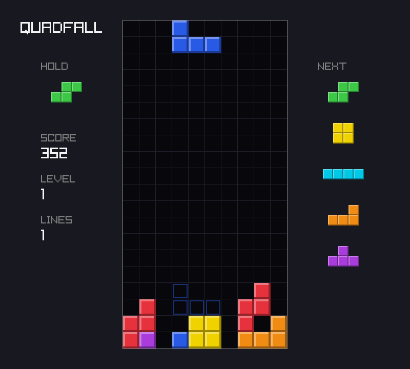

# Chapter 8 — Organizing a Game

At the end of [Chapter 7](07-scenes-and-ui.md) `quadfall` is a finished game: a title screen,
the rules, a pause screen, a high score, sound. This chapter adds almost no gameplay. Instead it
looks at how the program is shaped, and then uses that shape. The rules live in a core that knows
nothing about windows, keyboards or clocks. Because of that, a whole session can be recorded as a
seed plus a list of inputs and played back exactly. One test can pin a whole game down, so that any
change to the rules shows up. The plain-Zig parts of the platform can be tested too. And one
`zig build release` command builds the game for this machine and for Windows. At the end we look
at what carries over into Part II, where we write a 3D renderer.

Previous: [Chapter 7](07-scenes-and-ui.md). Next: [Chapter 9](09-framebuffers.md).

## The architecture, reviewed

Here is the whole project at the end of Part I:

```text
build.zig            addGame(target, optimize); run, test, release steps
build.zig.zon
src/main.zig         platform: options → app loop (fixed timestep) → draw; keyboard → core.Input
src/options.zig      command-line parsing (plain Zig, tested)
src/draw.zig         all raylib drawing: board, pieces, ghost, panels, HUD, scenes
src/effects.zig      juice: screen shake and level banner, reacting to core events
src/sound.zig        procedural square-wave sounds; silent without an audio device
src/save.zig         high score as ZON (quadfall-save.zon)
src/replay.zig       replay files as ZON: seed + recorded script
src/core/root.zig    the core module's public surface (no raylib)
src/core/board.zig   Board, Cell, Pos, fits, fullRows/removeRows, parse/format
src/core/piece.zig   Kind, Rotation, comptime shape tables, SRS kick tables, Piece
src/core/input.zig   Input (packed struct of buttons), AutoRepeat (DAS/ARR)
src/core/script.zig  Script (scripted input) and Recorder (the inverse)
src/core/bag.zig     7-bag randomizer over std.Random.DefaultPrng
src/core/game.zig    Game: gravity, lock delay, hold, drop, clears, scoring, levels, events
src/core/app.zig     App: scenes title/play/pause/over, high score, seeds per game
```

Data flows through it in one direction, once per tick:

```text
  keyboard ──┐                                       ┌──> draw.zig    (raylib: pixels)
  --script ──┼──> core.Input ──> App.tick(input) ──> │    state: App, Game, Board
  --replay ──┘    (9 bools)      (the rules)         └──> events ──> effects.zig, sound.zig
```

`main.zig` makes one `core.Input` per tick. It reads that input from the keyboard, from a script,
or (new in this chapter) from a recording. It hands the input to `App.tick`, and afterwards it
reads the results: the state, to draw, and the events, to shake the screen and play sounds.
Nothing flows back. The core never asks the platform for anything.

The core follows five rules. Each was set in an earlier chapter, for its own reason, and this
chapter relies on all of them:

- **No raylib.** `build.zig` gives the core module no `rl` import, so a raylib call in
  `src/core/` does not compile (Chapter 2).
- **No I/O.** The core never reads the keyboard, files or the clock. Its input arrives as an
  argument (Chapter 4).
- **No allocation.** The board is a fixed array, the bag holds seven pieces and the next queue
  five. `App` is a plain value that can be copied (Chapters 2 and 6).
- **No floats in the rules.** Gravity is counted in 1/65536ths of a row (Chapter 5). The only
  floats are in the gravity table, which is computed at compile time.
- **No time source.** Time is a tick count, and one tick is 1/60 s by definition (Chapter 5).

The platform is the opposite: it does all the I/O, and it is kept simple. `main.zig` has no game
rules in it, and `draw.zig` only reads state. Here is how the 2138 lines are split (`wc -l`):

| Part | Files | Lines |
|---|---|---|
| core | `app` 134, `bag` 51, `board` 202, `game` 443, `input` 92, `piece` 288, `root` 25, `script` 148 | 1383 |
| platform | `draw` 244, `effects` 30, `main` 133, `options` 108, `replay` 33, `save` 42, `sound` 87 | 677 |
| build | `build.zig` | 78 |

About 440 of the core's lines are tests. The core is twice as big as the platform. That is the
right way round: the platform code is the part that cannot be tested without a window.

## What the split bought us

We added each rule above to solve one small problem. Together they give us four things that we
never had to build separately:

- **Fast tests.** `zig build test` compiles the core without raylib and runs 37 tests in a few
  milliseconds. It never opens a window.
- **Scripts.** Since Chapter 4, a string like `"_:30 start left*3 drop"` can stand in for the
  keyboard. Every screenshot in Part I was made by a command, and anyone can make it again.
- **Screenshots without a person.** `--frames N --screenshot PATH` runs a fixed number of
  frames, each pretending to take exactly 1/60 s, and saves the last one. Together with a
  script and a seed, that makes a picture a function of its command line.
- **The same picture from any build.** Integer rules give the same answer whatever the optimize
  mode. Later in this chapter, a release build replays a session and saves a PNG that is
  byte-identical to the one from the debug build.

## Determinism

A program is **deterministic** if the same inputs always produce the same outputs. For `quadfall`
the inputs are the seed and the `Input` of each tick, nothing else. Two runs with the same seed
and the same inputs must give the same game, on every tick, down to the last cell.

Many things can break that:

- **Wall time.** The core gets no clock. It counts ticks. Time between frames is the
  platform's concern, and the fixed-timestep loop turns it into a whole number of ticks.
- **Unseeded randomness.** The bag uses a `DefaultPrng` built from the seed. The seed itself
  comes from the OS only when you do not give one, and it is recorded.
- **Input read inside the rules.** If the rules called `IsKeyDown`, a recording could never
  capture what they saw. Here, every input passes through one `core.Input` value.
- **Containers with no fixed order.** A hash map's order can depend on its history. The
  core does not use one.
- **Floats.** Float arithmetic is deterministic on one machine and one build. But a small
  change in the order of operations changes the result, and a different compiler, CPU or
  optimize mode may change that order.

Floats need a closer look:

`examples/ch08/float_order.zig`

```zig
//! Float addition is not associative: the same numbers summed in another
//! order can give another answer. Integer addition always agrees.
const std = @import("std");

pub fn main() void {
    // Three numbers, two groupings.
    const a: f32 = 1e8;
    const b: f32 = -1e8;
    const c: f32 = 0.5;
    std.debug.print("(a + b) + c = {d}\n", .{(a + b) + c});
    std.debug.print("a + (b + c) = {d}\n", .{a + (b + c)});

    // Ten thousand small steps, summed forwards and backwards.
    var steps: [10_000]f32 = undefined;
    for (&steps, 0..) |*s, i| s.* = 1.0 / @as(f32, @floatFromInt(i + 1));
    var forwards: f32 = 0;
    for (steps) |s| forwards += s;
    var backwards: f32 = 0;
    var i = steps.len;
    while (i > 0) : (i -= 1) backwards += steps[i - 1];
    std.debug.print("f32 forwards  = {d}\nf32 backwards = {d}\n", .{ forwards, backwards });

    // The same steps in 16.16 fixed point: integers, so the order does not matter.
    var fwd: u64 = 0;
    var bwd: u64 = 0;
    for (steps) |s| fwd += @intFromFloat(s * 65536);
    i = steps.len;
    while (i > 0) : (i -= 1) bwd += @intFromFloat(steps[i - 1] * 65536);
    std.debug.print("fixed forwards = {d}, backwards = {d}, equal: {}\n", .{ fwd, bwd, fwd == bwd });
}
```

```console
$ zig run examples/ch08/float_order.zig
(a + b) + c = 0.5
a + (b + c) = 0
f32 forwards  = 9.787613
f32 backwards = 9.787604
fixed forwards = 636412, backwards = 636412, equal: true
```

The first pair is the same three numbers grouped two ways. In `(a + b) + c`, the two large
numbers cancel first and the `0.5` survives. In `a + (b + c)`, the `0.5` is added to `-1e8`
first. An `f32` has only 24 bits of precision, and at 100 million the gap between neighboring
`f32` values is 8, so `-1e8 + 0.5` rounds back to `-1e8` and the half is lost. The second pair
adds the same 10,000 numbers forwards and backwards and gets two different answers. Neither
answer is wrong; floats round after every step, so the result depends on the order of the steps.

On one machine with one build, the order is fixed, so `quadfall` would be repeatable even with
float gravity. Problems start when the order changes. An optimizer may reorder or fuse
operations, and a replay recorded on one machine may be played back on another. Then an
`f32` position can differ in its last bit, and a piece that touched the floor on one machine
floats one tick longer on the other. From that tick on the two games differ. Integer addition
cannot round, so the fixed-point sums agree in either order. They are also a little less
accurate, since each step lost its fraction below 1/65536. For game rules, giving the same
answer every time matters more than the last digit.

### Comparing whole values in tests

To check that two runs gave the same game, a test compares two whole `App` values. Zig gives
three ways to compare values, and they differ on pointers:

`examples/ch08/expect_deep.zig`

```zig
//! Comparing whole values in tests: expectEqual, expectEqualDeep, and
//! std.meta.eql. They differ on what they do with pointers and slices.
const std = @import("std");
const testing = std.testing;

const Board = struct { cells: [3][4]u8 };

const Replay = struct {
    seed: u64,
    script: []const u8,
};

test "arrays inside structs compare by value" {
    var a: Board = .{ .cells = @splat(@splat('.')) };
    var b = a; // a copy
    try testing.expectEqual(a, b);
    try testing.expect(std.meta.eql(a, b));
    b.cells[2][1] = '#';
    try testing.expect(!std.meta.eql(a, b));
    a.cells[2][1] = '#';
    try testing.expect(std.meta.eql(a, b));
}

test "slices: expectEqualDeep looks at the bytes" {
    var buf: [11]u8 = "left:3 drop".*;
    const a: Replay = .{ .seed = 7, .script = "left:3 drop" };
    const b: Replay = .{ .seed = 7, .script = &buf }; // same text, other memory
    try testing.expectEqualDeep(a, b);
    // std.meta.eql compares the slices' pointers, not their contents.
    try testing.expect(!std.meta.eql(a, b));
}

test "expectEqualDeep shows where two values differ" {
    const a: Replay = .{ .seed = 7, .script = "left:3 drop" };
    const b: Replay = .{ .seed = 8, .script = "left:3 drop" };
    try testing.expectError(error.TestExpectedEqual, testing.expectEqualDeep(a, b));
}
```

```console
$ zig test examples/ch08/expect_deep.zig
1/3 expect_deep.test.arrays inside structs compare by value...OK
2/3 expect_deep.test.slices: expectEqualDeep looks at the bytes...OK
3/3 expect_deep.test.expectEqualDeep shows where two values differ...expected 7, found 8
Field seed incorrect. expected 7, found 8
OK
All 3 tests passed.
```

- **`std.testing.expectEqual(expected, actual)`** compares field by field and array element by
  element. A slice or pointer counts as equal only if it points to the same place.
- **`std.testing.expectEqualDeep(expected, actual)`** follows slices and pointers and compares
  what they point to. Two `Replay`s with the same text in different memory are equal.
- **`std.meta.eql(a, b)`** returns a `bool` instead of failing a test, so it works outside tests
  too. Like `expectEqual`, it compares slices by pointer and length only.

The third test shows that a failed `expectEqualDeep` names the field that differs (the test
catches the error to show the message and still pass). Note that `==` does not work on a
plain struct at all:

```console
$ zig test board_eq.zig
board_eq.zig:8:30: error: operator == not allowed for type 'board_eq.Board'
    try std.testing.expect(a == b);
                           ~~^~~~
board_eq.zig:3:15: note: struct declared here
const Board = struct { cells: [4][3]u8 };
              ^~~~~~~~~~~~~~~~~~~~~~~~~~
```

`core.Input` *can* use `==` because it is a `packed struct`, which is stored as a single
integer. Regular structs may have padding and fields of any type, so Zig makes you say which
kind of equality you mean. And when you pick the shallow one by mistake, the message tells you:

```console
$ zig test shallow.zig
1/1 shallow.test.expectEqual on a struct with a slice...expected slice ptr u8@12e77b3, found u8@7fffcd5bd8c8
FAIL (TestExpectedEqual)
```

(The stack trace after it is trimmed. `shallow.zig` is the second test above, rewritten with
`expectEqual`.)

### The determinism test

`App` holds the board, the bag with its PRNG state, the piece, the timers, the scene and the high
score, all by value, so one comparison covers everything. (With no pointers, `expectEqual`
would do; `expectEqualDeep` stays right if a slice is added.) The new test in
`src/core/app.zig` runs the same script twice from the title screen:

`project/ch08/src/core/app.zig` (end of the file)

```zig
/// Plays `script` from the title screen on a fresh app.
fn replay(seed: u64, text: []const u8) !App {
    const Script = @import("script.zig").Script;
    var app: App = .init(seed, 0);
    var s: Script = .init(text);
    while (try s.next()) |input| app.tick(input);
    return app;
}

test "the same seed and input always give the same game" {
    const text = "_:20 start right*2 drop _:30 cw left:15 drop down:200 hold left*4 drop _:300";
    const a = try replay(7, text);
    const b = try replay(7, text);
    try testing.expectEqualDeep(a, b);
    // A golden value: if a change to the rules alters this game, this fails.
    try testing.expectEqual(153, a.game.score);
    try testing.expectFmt(
        \\..LZZ.....
        \\LLL.ZZ....
        \\T..IIII...
        \\TT....SS..
        \\T....SS...
    , "{f}", .{a.game.board});
    // A different seed deals different pieces, so the stack differs.
    const c = try replay(8, text);
    try testing.expect(!std.meta.eql(a.game.board, c.game.board));
}
```

`replay` is a three-line loop: make an `App`, then feed it the script one tick at a time. This
is what the game does, minus the window. The test makes three checks. The two runs are equal
in every field. The score and the board are pinned to known values: this is a
**golden test**, covered below. And a different seed gives a different board, which shows the
test can tell games apart. A test that passed for any two games would prove nothing.

## Recording and replaying

Since the core is deterministic, a whole session is fully described by two things: the seed,
and the `Input` of every tick. Store those, feed them back in, and the game plays out exactly
as before. Each frame is drawn from the state, so even the pixels come out the same. This is
how many games do replays, and how lockstep multiplayer games keep players in sync: they send
only inputs and run the same rules on every machine (see "Deterministic Lockstep" on Gaffer On
Games).

A session at 60 ticks per second is a long list. Most of it repeats: nothing pressed for 300
ticks, then Left held for 8. So we store **runs**: a value plus how many times in a row it
appears. This is **run-length encoding**. The script language from Chapter 4 already has runs
built in: `_:300 left:8`. So a recording can be a script, and the existing `Script` parser can
play it back.

`examples/ch08/run_length.zig`

```zig
//! Run-length encoding: a stream of values becomes (value, count) runs,
//! and decoding the runs gives the stream back. The replay recorder uses
//! the same idea on one Input per tick.
const std = @import("std");

const Run = struct { value: u8, count: u32 };

/// Encodes `values` into `out`; returns the runs written.
fn encode(values: []const u8, out: []Run) []Run {
    var n: usize = 0;
    for (values) |v| {
        if (n > 0 and out[n - 1].value == v) {
            out[n - 1].count += 1;
        } else {
            out[n] = .{ .value = v, .count = 1 };
            n += 1;
        }
    }
    return out[0..n];
}

fn decode(runs: []const Run, out: []u8) []u8 {
    var n: usize = 0;
    for (runs) |r| {
        @memset(out[n..][0..r.count], r.value);
        n += r.count;
    }
    return out[0..n];
}

test "repeats become one run" {
    var runs: [16]Run = undefined;
    const got = encode("___LLc__", &runs);
    try std.testing.expectEqual(4, got.len);
    try std.testing.expectEqual(Run{ .value = '_', .count = 3 }, got[0]);
    try std.testing.expectEqual(Run{ .value = 'L', .count = 2 }, got[1]);
    try std.testing.expectEqual(Run{ .value = 'c', .count = 1 }, got[2]);
    try std.testing.expectEqual(Run{ .value = '_', .count = 2 }, got[3]);
}

test "decoding gives the stream back" {
    // 300 ticks of nothing, Left for 4, nothing for 60, then a drop.
    var stream: [365]u8 = undefined;
    @memset(stream[0..300], '_');
    @memset(stream[300..304], 'L');
    @memset(stream[304..364], '_');
    stream[364] = 'd';
    var runs: [16]Run = undefined;
    var back: [stream.len]u8 = undefined;
    const encoded = encode(&stream, &runs);
    try std.testing.expectEqual(4, encoded.len); // 365 values, 4 runs
    try std.testing.expectEqualStrings(&stream, decode(encoded, &back));
}

test "a stream that never repeats does not shrink" {
    var runs: [16]Run = undefined;
    try std.testing.expectEqual(6, encode("LRLRLR", &runs).len);
}
```

```console
$ zig test examples/ch08/run_length.zig
1/3 run_length.test.repeats become one run...OK
2/3 run_length.test.decoding gives the stream back...OK
3/3 run_length.test.a stream that never repeats does not shrink...OK
All 3 tests passed.
```

`encode` looks only at the last run. If the new value matches it, the count goes up.
Otherwise a new run starts. The second test turns 365 values into 4 runs, and decoding gives
the same 365 values back. The third test shows the weak spot: a stream that changes every
step does not get any shorter. We will run into that in the recordings below.

### Writing to memory that grows

The recorder writes text, and we do not know in advance how long a session will be. A fixed
buffer would fill up. `std.Io.Writer.Allocating` is a writer that grows its buffer on the heap
as needed:

`examples/ch08/allocating_writer.zig`

```zig
//! std.Io.Writer.Allocating: a writer that grows a buffer on the heap, for
//! output whose size you do not know in advance.
const std = @import("std");

/// Writes to any writer: a file, a fixed buffer, or a growing one.
fn writeSteps(w: *std.Io.Writer, n: usize) std.Io.Writer.Error!void {
    for (0..n) |i| {
        if (i > 0) try w.writeByte(' ');
        try w.print("left:{d}", .{i + 1});
    }
}

pub fn main(init: std.process.Init) !void {
    // A fixed buffer is fine while the output is small...
    var small: [32]u8 = undefined;
    var fixed: std.Io.Writer = .fixed(&small);
    try writeSteps(&fixed, 3);
    std.debug.print("fixed:      \"{s}\"\n", .{fixed.buffered()});
    // ...and fails once it is full.
    fixed = .fixed(&small);
    writeSteps(&fixed, 100) catch |err| std.debug.print("fixed:      {t} after {d} bytes\n", .{ err, fixed.buffered().len });

    // The allocating writer just grows.
    var out: std.Io.Writer.Allocating = .init(init.gpa);
    defer out.deinit();
    try writeSteps(&out.writer, 100);
    const text = out.written();
    std.debug.print("allocating: {d} bytes, ends with \"{s}\"\n", .{ text.len, text[text.len - 9 ..] });

    // Take the bytes away from the writer; now they are ours to free.
    const owned = try out.toOwnedSlice();
    defer init.gpa.free(owned);
    std.debug.print("owned:      {d} bytes; writer now holds {d}\n", .{ owned.len, out.written().len });
}
```

```console
$ zig run examples/ch08/allocating_writer.zig
fixed:      "left:1 left:2 left:3"
fixed:      WriteFailed after 32 bytes
allocating: 791 bytes, ends with " left:100"
owned:      791 bytes; writer now holds 0
```

`writeSteps` takes a `*std.Io.Writer`, the interface every writer in the standard library
offers, so the same function can write into a fixed buffer, a growing one, or a file. The
`Allocating` writer keeps its interface in the `.writer` field, so we pass `&out.writer`.
`written()` returns the bytes so far without copying them. `toOwnedSlice()` hands the buffer to
the caller and leaves the writer empty. Forget the `defer out.deinit()`, and the debug
allocator reports the leak when the program exits:

```console
$ zig run leak.zig
left:3
error(SafeAllocator): leaked [addr: 7671d99cce38, len: 137 (0x89) align: 1] allocated at: 
~/opt/zig-x86_64-linux-0.17.1/lib/std/Io/Writer.zig:2767:42: 0x1224de3 in ensureTotalCapacity (std.zig)
        return ensureTotalCapacityPrecise(a, better_capacity);
                                         ^
...
~/.../leak.zig:6:25: 0x11e99e0 in main (leak.zig)
    try out.writer.print("left:{d}", .{3});
                        ^
```

`leak.zig` is eight lines: `init`, one `print`, and no `deinit`. (Five frames inside
`Writer.zig` and part of the path are trimmed.) The trace ends at the line that first wrote to the
writer, which is where the buffer was allocated. The program still exits with status 0. The
report is a warning, not a crash, so read your stderr.

### The Recorder

The inverse of `Script` goes next to it in `src/core/script.zig`. `Script` turns text into one
`Input` per tick, and `Recorder` turns one `Input` per tick back into text:

`project/ch08/src/core/script.zig` (new, after `parseButtons`)

```zig
/// The other direction: writes inputs, one per tick, as a script. Runs of
/// the same input become one step, so a long game stays short.
pub const Recorder = struct {
    out: *std.Io.Writer,
    input: Input = .none,
    /// Ticks of `input` not yet written.
    count: u32 = 0,
    started: bool = false,

    pub fn add(r: *Recorder, input: Input) std.Io.Writer.Error!void {
        if (r.count > 0 and input == r.input) {
            r.count += 1;
            return;
        }
        try r.flush();
        r.input = input;
        r.count = 1;
    }

    /// Writes the last step. Call once, after the last `add`.
    pub fn flush(r: *Recorder) std.Io.Writer.Error!void {
        if (r.count == 0) return;
        if (r.started) try r.out.writeByte(' ');
        r.started = true;
        try writeButtons(r.out, r.input);
        if (r.count > 1) try r.out.print(":{d}", .{r.count});
        r.count = 0;
    }
};

fn writeButtons(out: *std.Io.Writer, input: Input) std.Io.Writer.Error!void {
    if (input == Input.none) return out.writeByte('_');
    var first = true;
    inline for (@typeInfo(Input).@"struct".field_names) |field| {
        if (@field(input, field)) {
            if (!first) try out.writeByte('+');
            try out.writeAll(field);
            first = false;
        }
    }
}
```

`add` is `encode` from the example, with a run kept in two fields (`input` and `count`)
instead of an array. The comparison `input == r.input` works because `Input` is a packed
struct. `flush` writes one step: a space if this is not the first one, then the buttons, then
`:N` if the run is longer than one tick. `writeButtons` is `parseButtons` backwards. It loops
over the field names of `Input` at compile time, just like the parser, so a button added to
`Input` is recorded and parsed with no other change. Like `writeSteps`, the Recorder writes to
any `*std.Io.Writer` and allocates nothing itself, so it can stay in the core. Its test
records six ticks and plays the text back through `Script`:

```zig
test "recording merges repeats and plays back the same ticks" {
    const ticks = [_]Input{ .none, .none, .none, .{ .left = true }, .{ .left = true, .cw = true }, .{ .drop = true } };
    var buf: [100]u8 = undefined;
    var out: std.Io.Writer = .fixed(&buf);
    var r: Recorder = .{ .out = &out };
    for (ticks) |input| try r.add(input);
    try r.flush();
    try std.testing.expectEqualStrings("_:3 left left+cw drop", out.buffered());
    try expectTicks(out.buffered(), &ticks);
}
```

`src/core/root.zig` gains one line, `pub const Recorder = script.Recorder;`.

### Replay files

A replay file needs the seed as well as the script. ZON (Chapter 7's save format) fits: a
struct with two fields. The new file `src/replay.zig` is a slightly bigger cousin of `save.zig`:

`project/ch08/src/replay.zig`

```zig
//! Replay files: a seed and every tick's input, as ZON. Because the core is
//! deterministic, that is all it takes to play a whole session again.
const std = @import("std");

pub const Replay = struct {
    seed: u64,
    /// The inputs, in the script language of core/script.zig.
    script: []const u8,
};

/// Reads a replay. Its script is allocated in `arena`.
pub fn load(io: std.Io, gpa: std.mem.Allocator, arena: std.mem.Allocator, path: []const u8) !Replay {
    const source = try std.Io.Dir.cwd().readFileAllocOptions(io, path, gpa, .limited(16 << 20), .of(u8), 0);
    defer gpa.free(source);
    var diagnostics: std.zon.parse.Diagnostics = undefined;
    return std.zon.parse.fromSlice(Replay, .{
        .gpa = gpa,
        .arena = arena,
        .source = source,
        .diagnostics = &diagnostics,
    }) catch |err| {
        if (err == error.ParseZon) diagnostics.log(path);
        return err;
    };
}

pub fn store(io: std.Io, gpa: std.mem.Allocator, path: []const u8, replay: Replay) !void {
    var out: std.Io.Writer.Allocating = .init(gpa);
    defer out.deinit();
    try std.zon.stringify.serialize(replay, .{}, &out.writer);
    try out.writer.writeByte('\n');
    try std.Io.Dir.cwd().writeFile(io, .{ .sub_path = path, .data = out.written() });
}
```

Two things differ from `save.zig`. First, a `Replay` has a slice, so parsing it must allocate.
`fromSlice` takes `gpa` for scratch memory and `arena` for the result. Main passes its
process-lifetime arena, so the script stays valid until the program exits and nobody has to
free it. Second, the script can be long, so `store` writes into an `Allocating` writer instead
of a fixed buffer. `load` limits the file to 16 MiB. Even if the input changed every tick,
at about four bytes per step, that is over 19 hours of play.

### `--record` and `--replay`

`src/options.zig` gets two `?[]const u8` fields, `record` and `replay`, two usage lines, and a
new error, `Conflict`. A replay brings its own seed and script, so `--replay` together with
`--seed` or `--script` is a mistake. Each of the three branches checks for the other options,
so the conflict is found whichever comes first. The `--replay` branch, for example:

```zig
            opts.replay = try nextValue(args, &i);
            // A replay brings its own input and seed.
            if (opts.script != null or opts.seed != null) return error.Conflict;
```

In `src/main.zig`, the replay is loaded right after the options. Its script and seed fill in
the places where `--script` and `--seed` used to be the only sources:

`project/ch08/src/main.zig` (changes)

```diff
+    const recorded: ?replay.Replay = if (opts.replay) |path|
+        replay.load(init.io, init.gpa, init.arena.allocator(), path) catch |err| {
+            std.log.err("--replay {s}: {t}", .{ path, err });
+            return 1;
+        }
+    else
+        null;
     var script: ?core.Script = null;
-    if (opts.script) |text| {
+    if (opts.script orelse if (recorded) |r| r.script else null) |text| {
@@
-    const seed = opts.seed orelse blk: {
+    const seed = opts.seed orelse if (recorded) |r| r.seed else blk: {
@@
+    // Recording keeps every tick's input in memory until the program exits.
+    var record_out: std.Io.Writer.Allocating = .init(init.gpa);
+    defer record_out.deinit();
+    var recorder: core.Recorder = .{ .out = &record_out.writer };
@@
             const input: core.Input = if (script) |*s| (s.next() catch unreachable) orelse .none else readKeyboard();
+            if (opts.record != null) try recorder.add(input);
@@
+    if (opts.record) |path| {
+        try recorder.flush();
+        replay.store(init.io, init.gpa, path, .{ .seed = seed, .script = record_out.written() }) catch |err| {
+            std.log.err("--record {s}: {t}", .{ path, err });
+            return 1;
+        };
+        std.log.info("recorded {s}", .{path});
+    }
```

The recorder sits inside the tick loop, after the input is chosen and before `App.tick`, so it
sees exactly what the rules see, wherever the input came from. Recording works the same during
keyboard play, a script or a replay. The seed is recorded even when it came from the OS. That
is what makes a random game replayable afterwards.

### Record, then replay

Record a scripted game, then replay the file and take a screenshot of each at frame 400:

```console
$ xvfb-run -a -s "-screen 0 1280x720x24" ./zig-out/bin/quadfall --mute --save save.zon --seed 7 --frames 400 --script "_:30 start hold left*3 drop _ right*3 drop _ cw left*4 drop _ drop _:25 right*4 drop _ drop _:220 cw right*3 drop _:60" --record r.zon --screenshot live.png
info: recorded r.zon
info: saved live.png
$ cat r.zon
.{ .seed = 7, .script = "_:30 start hold left _ left _ left _ drop _ right _ right _ right _ drop _ cw left _ left _ left _ left _ drop _ drop _:25 right _ right _ right _ right _ drop _ drop _:220 cw right _ right _ right _ drop _:76" }
$ xvfb-run -a -s "-screen 0 1280x720x24" ./zig-out/bin/quadfall --mute --save save.zon --replay r.zon --frames 400 --screenshot ../../images/ch08-replay.png
info: saved ../../images/ch08-replay.png
$ cmp live.png ../../images/ch08-replay.png && echo IDENTICAL
IDENTICAL
```



The two PNGs are byte for byte the same. Note two details in the recording. The script is 384
ticks long and ends with `_:60`; the 16 ticks after it also had no input, so the recording
ends with `_:76`.
And `left*3` became `left _ left _ left _`. The Recorder only merges *equal* neighbors, and a
tap is a press followed by a release, so taps never repeat back to back. This is the
`"LRLRLR"` case from the example. Writing them as `left*3` again is exercise 1.

When something goes wrong, the program says so and exits with an error status:

```console
$ ./zig-out/bin/quadfall --seed 1 --replay x.zon
error: Conflict: --replay
usage: quadfall [OPTIONS]
...
$ ./zig-out/bin/quadfall --replay nope.zon
error: --replay nope.zon: FileNotFound
$ echo $?
1
$ cat bad.zon
.{ .seed = 7 }
$ ./zig-out/bin/quadfall --mute --replay bad.zon
error: bad.zon:1:2: error: missing required field script
error: --replay bad.zon: ParseZon
```

(The usage text is trimmed; it now lists `--record PATH` and `--replay PATH`.) A replay
whose script names an unknown button fails like a bad `--script` does, with
`error: --script: UnknownButton` and status 2. That message names the wrong option, a small
wart left in. Both checks happen before the window opens.

## Golden tests

Most tests check one rule: a hard drop scores 2 points per row, a full row is removed. A
**golden test** (also called a snapshot test) works differently. It runs something big and
compares the entire result with a stored copy, the "golden" output, that a person once checked
by hand. It does not say *why* the result should be what it is. It says that the result has not
changed. That catches changes nobody meant to make, including ones in places no small test
looks at.

Golden outputs are usually too big to work out by hand, so the technique is:

1. Write the test with an empty expectation.
2. Run it. It fails, and the failure prints the actual output.
3. **Check that output by eye.** Is it really right?
4. Paste it into the test.

Here is step 1 for a toy: ten blocks dropped into random columns of a pile 6 wide and 4 high.

```zig
test "seed 7 builds this pile" {
    try std.testing.expectFmt(
        \\
    , "{f}", .{play(7)});
}
```

```console
$ zig test golden.zig
1/1 golden.test.seed 7 builds this pile...
====== expected this output: =========
␃

======== instead found this: =========
.....#
..#..#
..#..#
###.##␃

======================================
First difference occurs on line 1:
expected:

^ (end of string)
found:
.....#
^ ('\x2e')
FAIL (TestExpectedEqual)
```

(Stack trace trimmed. The `␃` marks the end of each string, so trailing spaces and newlines
are visible.) Step 3: count the blocks. Columns of heights 1, 1, 3, 0, 1 and 4 hold ten blocks,
so none was lost and none appeared from nowhere. No column is over 4. It looks right, so we paste
it in:

`examples/ch08/golden.zig`

```zig
//! A golden test pins down a whole result, here a picture of a pile of
//! blocks built from a seed. Write the test with an empty expectation, run
//! it, check the actual output by eye, then paste it in.
const std = @import("std");

const cols = 6;
const rows = 4;

const Pile = struct {
    heights: [cols]u8 = @splat(0),

    /// Top row first, like the board pictures in quadfall's tests.
    pub fn format(p: Pile, w: *std.Io.Writer) std.Io.Writer.Error!void {
        var row: u8 = rows;
        while (row > 0) : (row -= 1) {
            for (p.heights) |h| try w.writeByte(if (h >= row) '#' else '.');
            if (row > 1) try w.writeByte('\n');
        }
    }
};

/// Drops ten blocks into random columns; a full column takes no more.
fn play(seed: u64) Pile {
    var prng: std.Random.DefaultPrng = .init(seed);
    const random = prng.random();
    var p: Pile = .{};
    for (0..10) |_| {
        const col = random.uintLessThan(u32, cols);
        if (p.heights[col] < rows) p.heights[col] += 1;
    }
    return p;
}

test "seed 7 builds this pile" {
    try std.testing.expectFmt(
        \\.....#
        \\..#..#
        \\..#..#
        \\###.##
    , "{f}", .{play(7)});
}
```

```console
$ zig test examples/ch08/golden.zig
1/1 golden.test.seed 7 builds this pile...OK
All 1 tests passed.
```

Step 3 matters most. Skip it, and the test pins down whatever the code does today, bugs
included. Then a later fix makes the test fail, and someone "fixes" the test.

### Pinning down quadfall

The determinism test above is `quadfall`'s golden test. It plays 583 ticks from seed 7 and
checks the score (153) and the picture of the stack (`Board`'s `format` from Chapter 2).
These were checked like the pile was: the same script and seed, run with `--frames 583
--screenshot`, show score 153 and exactly this stack.

To see what it catches, change one rule at a time in a copy of the project. First, make a hard
drop score 1 point per row instead of 2 (`g.score += 1` in `Game.tick`):

```console
$ zig build test --summary all
error: 'game.test.hard drop locks at once and the next piece spawns' failed:
       expected 38, found 19
error: 'game.test.clearing rows scores points and raises the level' failed:
       expected 820, found 810
error: 'app.test.the same seed and input always give the same game' failed:
       expected 153, found 100
Build Summary: 3/5 steps succeeded (1 failed); 32/35 tests passed (3 failed)
```

(Trimmed to the failures. The options tests were cached, so they are not counted.) The small
scoring tests catch this too, as they should. Now a change no small test checks: lock delay
30 ticks becomes 20 (`lock_delay = 20` in `game.zig`):

```console
$ zig build test --summary all
error: 'app.test.the same seed and input always give the same game' failed:
       ====== expected this output: =========
       ..LZZ.....
       LLL.ZZ....
       T..IIII...
       TT....SS..
       T....SS...␃
       
       ======== instead found this: =========
       ...J......
       ...JJJ....
       OO.ZZ.....
       OO..ZZ....
       T..IIII...
       TT....SS..
       T....SS...␃
...
Build Summary: 3/5 steps succeeded (1 failed); 34/35 tests passed (1 failed)
```

Only the golden test fails. Pieces now lock sooner, so later inputs reach different pieces: an O
lies where the L was, and a J sits on top. The score is still 153, so a test that checked only
the score would pass. The board shows the difference.

### When to update a golden test

A golden test fails for one of two reasons:

- **The change was a mistake.** Fix the code. This is the case the test exists for.
- **The change was meant.** You did want lock delay 20. Then the golden output is out of date.
  Read the new output, check it the way you checked the first one, and paste it in. Mention it
  in the commit: "lock delay 20; golden board updated."

Keep golden tests few and readable: a 583-tick game with a 5-row picture is easy to check
again; a 10,000-tick game would not be.

## Testing the platform's plain parts

Not all platform code needs a window. `src/options.zig` is plain Zig: a list of strings in, an
`Options` value out. Its two new tests use small helpers, so each case takes one line:

`project/ch08/src/options.zig` (end of the file)

```zig
fn expectParse(args: []const [:0]const u8, expected: Options) !void {
    var bad: []const u8 = "";
    try std.testing.expectEqualDeep(expected, try parse(args, &bad));
}

fn expectFail(args: []const [:0]const u8, err: Error, culprit: []const u8) !void {
    var bad: []const u8 = "";
    try std.testing.expectError(err, parse(args, &bad));
    try std.testing.expectEqualStrings(culprit, bad);
}

test "options" {
    try expectParse(&.{}, .{});
    try expectParse(&.{ "--frames", "60", "--seed", "7", "--mute" }, .{ .frames = 60, .seed = 7, .mute = true });
    try expectParse(&.{ "--replay", "a.zon", "--screenshot", "a.png" }, .{ .replay = "a.zon", .screenshot = "a.png" });
}

test "bad options name the culprit" {
    try expectFail(&.{"--fast"}, error.UnknownOption, "--fast");
    try expectFail(&.{ "--mute", "--frames" }, error.MissingValue, "--frames");
    try expectFail(&.{ "--frames", "-1" }, error.InvalidValue, "--frames");
    try expectFail(&.{ "--seed", "1", "--replay", "a.zon" }, error.Conflict, "--replay");
}
```

`expectEqualDeep` is needed here because `Options` holds slices: in the third case, the
`replay` path from the arguments and the `"a.zon"` in the test are different pointers to the
same text. `expectFail` also checks `bad`, the argument that the error message will print. The
last case is the conflict from the previous section.

`build.zig` used to test only the core module. Now it loops over a list of root files, and
builds a test for each:

`project/ch08/build.zig` (test step)

```zig
    // `zig build test` runs the tests of the plain-Zig parts: the core and
    // the command-line options. It never compiles raylib or opens a window.
    const test_step = b.step("test", "Run the game logic tests");
    const tested = [_][]const u8{ "src/core/root.zig", "src/options.zig" };
    for (tested) |path| {
        const tests = b.addTest(.{ .root_module = b.createModule(.{
            .root_source_file = b.path(path),
            .target = target,
            .optimize = optimize,
        }) });
        test_step.dependOn(&b.addRunArtifact(tests).step);
    }
```

`options.zig` imports only `std`, so it compiles without raylib, just like the core. With a
fresh cache:

```console
$ zig build test --summary all
Build Summary: 5/5 steps succeeded; 37/37 tests passed
test success
+- run test 35 pass (35 total) 6ms MaxRSS:4M
|  +- compile test debug native success 478ms MaxRSS:161M
+- run test 2 pass (2 total) 3ms MaxRSS:4M
   +- compile test debug native success 396ms MaxRSS:153M
```

Running the 37 tests takes 9 ms. (A second run with nothing changed prints `cached` and no
counts.) The files left untested, `main.zig`, `draw.zig`, `effects.zig`, `sound.zig`,
`save.zig` and `replay.zig`, call raylib or do file I/O. The scripted runs cover them.

## Release builds

So far every build was a Debug build for this machine. To give the game to someone, we want an
optimized build, and maybe one for another OS. Zig cross-compiles out of the box. raylib is C,
and Zig compiles it too, for whatever target we ask for.

### What the compiler is building for

`@import("builtin")` describes the target and the optimize mode as compile-time constants:

`examples/ch08/target_info.zig`

```zig
//! What the compiler is building for: @import("builtin") describes the
//! target and the optimize mode, at compile time.
const std = @import("std");
const builtin = @import("builtin");

pub fn main() void {
    const t = builtin.target;
    std.debug.print("arch {t}, os {t}, abi {t}\n", .{ t.cpu.arch, t.os.tag, t.abi });
    std.debug.print("pointer size {d} bytes, {t} endian\n", .{ @sizeOf(usize), t.cpu.arch.endian() });
    std.debug.print("optimize mode {t}\n", .{builtin.mode});
    // Comptime-known, so the other branch is not even compiled.
    const save_dir = if (t.os.tag == .windows) "%APPDATA%" else "$HOME/.local/share";
    std.debug.print("a save file would go under {s}\n", .{save_dir});
}
```

```console
$ zig run examples/ch08/target_info.zig
arch x86_64, os linux, abi gnu
pointer size 8 bytes, little endian
optimize mode debug
a save file would go under $HOME/.local/share
$ zig build-exe -target x86_64-windows examples/ch08/target_info.zig
$ file target_info.exe target_info.pdb
target_info.exe: PE32+ executable (console) x86-64, for MS Windows
target_info.pdb: MSVC program database ver 7.00, 4096*722 bytes
```

The second command builds a Windows program on Linux with no extra tools. The `.pdb` file
holds the debug info, which Windows keeps separate from the program. Because `t.os.tag` is
known at compile time, the `if` picks one branch while compiling, and the Windows `.exe`
contains only the `%APPDATA%` string. Chapter 7's save path exercise used the same trick.

### Optimize modes

Zig has four optimize modes. They differ in speed, size, and what happens when the program
breaks a rule such as integer overflow:

`examples/ch08/optimize_modes.zig`

```zig
//! The same code in each optimize mode. Safe modes stop at an integer
//! overflow; fast and small modes assume it never happens.
const std = @import("std");
const builtin = @import("builtin");

/// Adds up `n` scores of 100 in a u16, which holds at most 65535.
fn total(n: u32) u16 {
    var sum: u16 = 0;
    for (0..n) |_| sum += 100;
    return sum;
}

pub fn main(init: std.process.Init) !void {
    const args = try init.minimal.args.toSlice(init.arena.allocator());
    // Read n at run time, so the compiler cannot work out the answer itself.
    const n = try std.fmt.parseInt(u32, args[1], 10);
    std.debug.print("mode {t}: total({d}) = {d}\n", .{ builtin.mode, n, total(n) });
}
```

600 scores of 100 fit in a `u16`; 700 do not (70,000 > 65,535):

```console
$ zig run -O debug examples/ch08/optimize_modes.zig -- 600
mode debug: total(600) = 60000
$ zig run -O debug examples/ch08/optimize_modes.zig -- 700
thread 177303 panic: integer overflow
~/learn-game-graphics/examples/ch08/optimize_modes.zig:9:24: 0x11f5b7e in total (optimize_modes.zig)
    for (0..n) |_| sum += 100;
                       ^
...
$ zig run -O safe examples/ch08/optimize_modes.zig -- 700
thread 177310 panic: integer overflow
~/opt/zig-x86_64-linux-0.17.1/lib/std/Io/Writer.zig:1667:19: 0x1027a4a in posixCallMainAndExit (optimize_modes)
            index -= 2;
                  ^
...
$ zig run -O fast examples/ch08/optimize_modes.zig -- 700
mode fast: total(700) = 4464
$ zig run -O small examples/ch08/optimize_modes.zig -- 700
mode small: total(700) = 4464
```

With 600, all four modes print 60000. With 700:

| Mode | Overflow | Notes |
|---|---|---|
| `debug` | panic, exit 134 | slow; exact stack trace (trimmed above to its first frame) |
| `safe` | panic, exit 134 | fast; the trace can point to the wrong place |
| `fast` | wrong answer, exit 0 | fastest; checks off, overflow is undefined behavior |
| `small` | wrong answer, exit 0 | like `fast`, but optimized for size |

The ReleaseSafe trace is wrong: it points into the standard library's `Writer.zig`. The
optimizer inlined `total` into `main`, and the debug info no longer matches the code exactly.
You still learn *that* there was an overflow, but you need a Debug build to learn *where*. The
fast modes print 4464, which is 70,000 − 65,536. Here that is wrapping arithmetic, but in
ReleaseFast overflow is undefined behavior, so the compiler is allowed to do anything at all.

`zig build -Doptimize=ReleaseSafe` picks the mode for the whole build. In `build.zig` it is
`.ReleaseSafe`, while `builtin.mode` prints its tag in short form, `safe`.

### `zig build release`

Building two targets means making the executable twice, each time with a different target.
So the body of `build()` that made the executable moves into a function,
`addGame(b, target, optimize)`, which returns it. The `build()` function calls it once for the
normal build and once per release target:

`project/ch08/build.zig` (release step, and the start of `addGame`)

```zig
    // `zig build release` builds an optimized game for this machine and one
    // for 64-bit Windows, into zig-out/release/<arch>-<os>/.
    const release_step = b.step("release", "Build release games for this machine and Windows");
    const release_targets = [_]std.Target.Query{ .{}, .{ .cpu_arch = .x86_64, .os_tag = .windows } };
    for (release_targets) |query| {
        const t = b.resolveTargetQuery(query);
        const install = b.addInstallArtifact(addGame(b, t, .ReleaseSafe), .{
            .dest_dir = .{ .override = .{ .custom = b.fmt("release/{t}-{t}", .{ t.result.cpu.arch, t.result.os.tag }) } },
        });
        release_step.dependOn(&install.step);
    }
}

/// The quadfall executable for one target: raylib, the "rl" bindings, the
/// core module, and the platform code in src/.
fn addGame(b: *std.Build, target: std.Build.ResolvedTarget, optimize: std.builtin.OptimizeMode) *std.Build.Step.Compile {
    // raylib's own build.zig compiles its C sources into a static library.
    const raylib_dep = b.dependency("raylib", .{ .target = target, .optimize = optimize });
```

The rest of `addGame` is the old body of `build()`, unchanged, ending in `return exe;`.
`.{}` is a target query with every field left at its default: this machine. The release mode
is **ReleaseSafe**. For `quadfall`, the safety checks cost nothing you could notice: the game
does very little work per tick, and drawing is raylib's job. In exchange, an overflow or a
bad index in a player's copy stops the game with a message instead of quietly corrupting it.
The output directory is named from the resolved target, using `{t}` for the enum tags.

```console
$ time zig build release
real    0m36.603s
$ file zig-out/release/*/quadfall*
zig-out/release/x86_64-linux/quadfall:       ELF 64-bit LSB executable, x86-64, version 1 (SYSV), dynamically linked, interpreter /lib64/ld-linux-x86-64.so.2, for GNU/Linux 3.2.0, with debug_info, not stripped
zig-out/release/x86_64-windows/quadfall.exe: PE32+ executable (console) x86-64, for MS Windows
zig-out/release/x86_64-windows/quadfall.pdb: MSVC program database ver 7.00, 4096*2007 bytes
```

(From an empty `zig-out/release`, on a 32-core machine.) The Linux file is 11,921,688 bytes,
the Windows `quadfall.exe` 3,035,136 and its `quadfall.pdb` 8,220,672. Most of the Linux file
is debug info, which the stack traces need. Exercise 4 strips it. We could not run the Windows `.exe` here (there is no Windows
or Wine on this machine), so it is only built, not tested. The `console` in its `file` line
means Windows opens a console window next to the game. That is useful for `--help` and the
log, but a released game would rather not have one; exercise 3 changes it.

Now the claim from the start of the chapter. Replay the recording with the release build:

```console
$ xvfb-run -a -s "-screen 0 1280x720x24" zig-out/release/x86_64-linux/quadfall --mute --save save.zon --replay r.zon --frames 400 --screenshot rel.png
info: saved rel.png
$ cmp rel.png ../../images/ch08-replay.png && echo IDENTICAL
IDENTICAL
```

A different optimize mode reorders and inlines code, but integer rules have one right answer, so
the release game gives the same picture as the Debug game.

## Toward Part II

Part I used raylib to draw: rectangles, text, and the GPU fills in the pixels. Part II, starting
with [Chapter 9](09-framebuffers.md), builds `delve`, a 3D renderer that computes every pixel
itself, in plain Zig, into an array of colors. raylib only opens the window, reads input, and
copies the finished array to the screen. Drawing becomes the interesting part, and most of
Part I's structure carries over:

- **The fixed-timestep loop.** Chapter 5's `lag` accumulator runs the simulation in steps of
  1/60 s, whatever the frame rate. Moving through a maze needs exactly the same loop.
- **The core/platform split.** `delve` keeps its state and its canvas in plain Zig and does
  all its drawing there. Only one small platform file talks to raylib. Rendering then becomes
  a function from state to pixels, and it can be tested without a window.
- **`--frames` and `--screenshot`.** Every picture in Part II is also made by a command, so
  you can make it again and compare it with yours.
- **Golden tests, of pixels.** A renderer's output is an image. Render a small scene, check it
  by eye once, and pin it down: if a change to the triangle filler moves one pixel, a test
  tells you.

The lesson from this chapter carries over too: keep the part you care about free of the
outside world, and everything else becomes easy to test.

## Summary

- The core has no raylib, no I/O, no allocation, no floats in its rules and no clock. Its input
  is one `core.Input` per tick, and its outputs are state and events. The platform is thin.
- So the game is **deterministic**: a seed plus the inputs decide everything. Floats would make
  that fragile, because their results depend on the order of operations.
- `expectEqual` and `std.meta.eql` compare slices by pointer; `expectEqualDeep` compares what
  they point to. Plain structs have no `==`; packed structs do.
- `Recorder` run-length encodes inputs into the script language and writes to any
  `*std.Io.Writer`. `std.Io.Writer.Allocating` grows as needed; `deinit` it.
- `--record`/`--replay` store a seed and a script as ZON. A replay's screenshot is
  byte-identical to the original, in Debug and in ReleaseSafe.
- A **golden test** pins down a whole result. Start empty, read the failure, check it by eye,
  paste it in. Update it only after reading the new output.
- `zig build test` also covers `options.zig`: 37 tests, no window.
- `addGame` builds the game for any target; `zig build release` makes ReleaseSafe builds for
  this machine and Windows. Debug and ReleaseSafe panic on overflow; ReleaseFast and
  ReleaseSmall do not check.

## Exercises

1. **Compress taps.** Make the Recorder write `left*3` instead of `left _ left _ left _`. The
   round-trip test must still pass.

<details><summary>Solution</summary>

A one-tick press might be the first half of a tap, so the Recorder holds it back in a new
field, `press: ?Input = null`. Taps in a row are counted in `taps: u32 = 0` and
`tap: Input = .none`. `add` now hands each finished run to `step` instead of writing it, and
the old body of `flush` becomes `write(input, count, sep)`, which prints `{c}{d}` with `:` or
`*`:

```zig
    /// Takes one finished run: `count` ticks of `input`.
    fn step(r: *Recorder, input: Input, count: u32) std.Io.Writer.Error!void {
        if (r.press) |p| {
            r.press = null;
            if (input == Input.none and count == 1) {
                // One tick of `p`, then one of nothing: a tap.
                if (r.taps > 0 and p != r.tap) try r.writeTaps();
                r.tap = p;
                r.taps += 1;
                return;
            }
            try r.writeTaps();
            try r.write(p, 1, ':');
        }
        if (input != Input.none and count == 1) {
            r.press = input;
        } else {
            try r.writeTaps();
            try r.write(input, count, ':');
        }
    }

    fn writeTaps(r: *Recorder) std.Io.Writer.Error!void {
        switch (r.taps) {
            0 => {},
            // One tap reads better as itself.
            1 => {
                try r.write(r.tap, 1, ':');
                try r.write(.none, 1, ':');
            },
            else => try r.write(r.tap, r.taps, '*'),
        }
        r.taps = 0;
    }
```

`flush` passes the last run to `step`, then calls `writeTaps`, then writes a press that is
still held back. A new test records the ticks of `"_:30 start hold left*3 drop _ right*3 drop
_ cw left*4 drop _ drop _:25"` and expects exactly that text back. All 38 tests pass.
Recording the session from this chapter now gives `"_:30 start hold left*3 drop _ right*3 drop
_ cw left*4 drop _ drop _:25 right*4 drop _ drop _:220 cw right*3 drop _:76"`, and its replay
is still identical.

</details>

2. **Fast-forward.** Add `--speed N`, which runs N ticks per frame, so that a replay plays N
   times faster. `--speed 0` is an error.

<details><summary>Solution</summary>

In `options.zig`, add a field `speed: u32 = 1`, a usage line, and:

```zig
        } else if (std.mem.eql(u8, arg, "--speed")) {
            const value = try nextValue(args, &i);
            opts.speed = std.fmt.parseInt(u32, value, 10) catch return error.InvalidValue;
            if (opts.speed == 0) return error.InvalidValue;
```

plus `try expectFail(&.{ "--speed", "0" }, error.InvalidValue, "--speed");` in the tests. In
`main.zig`, wrap the body of the tick loop (from `const input` to the save) in
`for (0..opts.speed) |_| { ... }`. The rules do not change; only fewer frames are drawn. A
replay with `--speed 4 --frames 100` gives a PNG identical to `--frames 400` at normal speed,
and `--speed 0` prints `error: InvalidValue: --speed` and the usage, with status 2.

</details>

3. **No console on Windows.** Build the Windows release as a GUI program, so that no console
   window opens. What do you lose?

<details><summary>Solution</summary>

In the release loop of `build.zig`:

```zig
        const game = addGame(b, t, .ReleaseSafe);
        // A GUI program: Windows opens no console window for it.
        if (t.result.os.tag == .windows) game.subsystem = .windows;
        const install = b.addInstallArtifact(game, .{
```

`file` now reports `PE32+ executable (GUI) x86-64, for MS Windows`. Calling the variable
`exe` does not compile: `build()` already has an `exe`, and Zig does not allow one name to
hide another. A GUI program has no console, so `--help`, the `error:` messages and the
`info:` lines are lost when the game is started from Explorer. One way out is to write the log
to a file next to the save file, with your own `logFn` in `std_options`. (Neither build was run
on Windows.)

</details>

4. **Strip.** Build the release without debug info and compare the sizes. What do you give up?

<details><summary>Solution</summary>

Add `game.root_module.strip = true;` next to the line from exercise 3. From an empty
`zig-out/release`:

| Build | Linux | Windows |
|---|---|---|
| ReleaseSafe | 11,921,688 | 3,035,136 + 8,220,672 `.pdb` |
| ReleaseSafe, stripped | 2,443,272 | 2,744,832, no `.pdb` |
| ReleaseSmall, stripped | 1,488,928 | 1,801,728 |

`file` now says `stripped`. Four fifths of the Linux file was debug info. What you give up:
a stripped program still panics on overflow, but prints only `Cannot print stack trace: stack
tracing is disabled` (tried with `zig run -O safe -fstrip` on `optimize_modes.zig`). Strip the
builds you give away if size matters, and keep debug info in the builds you test.

</details>

Sources for this chapter: [REFERENCES.md](REFERENCES.md#chapter-8--organizing-a-game)
