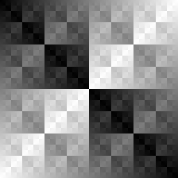
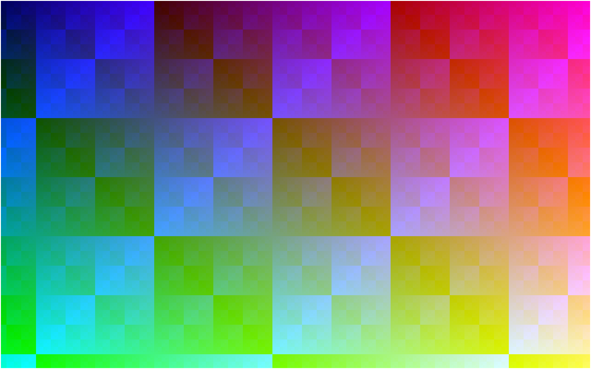

# Chapter 9 — Framebuffers: Pixels in Memory

A picture on a screen is an array of colors in memory. This chapter builds that array, fills
it with code, saves it as PPM and PNG files written by hand, and shows it in a raylib window by
copying it to a texture once per frame. It also starts Part II and its project, `delve`. Its
rendering never calls a raylib drawing function: raylib opens the window, reads input, and copies
our pixels to the screen, and that is all. The structure from Part I carries over: a pure core,
a thin platform layer, a fixed timestep, and scripted runs. `delve` adds a `--headless` mode
that renders straight to an image file, with no window at all.

Previous: [Chapter 8 — Organizing a Game](08-organizing-a-game.md). Next:
[Chapter 10 — Drawing in 2D by Hand](10-drawing-in-2d.md).

## From quadfall to delve

Part I ended with `quadfall`, a finished falling-block game. Look at how it puts something on
the screen. Every cell of the board is a call like `rl.DrawRectangle(x, y, w, h, color)`, every
score is `rl.DrawText`, and raylib hands the work to the GPU. You never decided which pixels a
rectangle covers. That was the right choice for a 2D game: rectangles are easy, and the game
rules were the interesting part.

Part II turns this around. The interesting part is now the drawing itself: how a line becomes
pixels, how a triangle is filled, how a 3D corridor turns into a flat image. So we do it all
ourselves, in Zig, into an array we own. raylib keeps three jobs: open a window, read the
keyboard and mouse, and copy our finished array to the screen.

Much of Part I's structure comes along unchanged, because it was not about rectangles:

- **A pure core.** `quadfall` kept its rules in `src/core/` with no raylib in sight, so the
  rules could be tested without a window. `delve` does the same with `app.zig`: it updates
  state and renders pixels into a canvas, and knows nothing about windows.
- **A thin platform layer.** One file talks to raylib. In `delve` it is `platform.zig`.
- **A fixed timestep.** Chapter 5's lag accumulator runs the simulation in steps of 1/60 s,
  whatever the frame rate.
- **Scripted runs.** `--frames N` and `--screenshot FILE` make a windowed run reproducible, so
  every picture in this book can be made again by a command.
- **Tests.** `zig build test` checks every piece that can be checked without a screen.

One thing is looser than in `quadfall`. There, `build.zig` built the core as a separate module
without an `rl` import, so the compiler itself refused raylib calls in game logic. `delve` is a
single module, which keeps its build file short, and "only `platform.zig` imports `rl`" is a
rule we keep by hand. It is easy to check, and the chapter does check it. The test step also
compiles and links raylib, because the tests are collected through `main.zig`. That costs a few
hundred milliseconds per test build and nothing else.

One thing is new. A renderer that writes into an array does not need a window to produce a
picture. `delve --headless --out pic.png` renders frames and saves the last one, with no X
server and no GPU. Most images in Part II were made that way.

## What Part II builds

The end of Part II is a first-person maze client: textured walls and floors, sprites, lighting
and fog, all drawn by code you wrote. The path there goes through the same steps that
real rendering went through:

- **Pixels** (this chapter): a framebuffer, image files, a window.
- **2D drawing** (Chapter 10): lines, circles, filled triangles, a bitmap font.
- **Vectors and matrices** (Chapters 11 and 12): the math every later chapter speaks.
- **Ray casting** (Chapters 13 and 14): a maze in 2.5D, the way 1990s shooters did it.
- **A 3D pipeline** (Chapter 15 on): transforms, clipping, a real triangle rasterizer, depth,
  textures, and lighting.

Why render in software when every computer has a GPU? Because a GPU hides each of those steps
behind an API call. When you write them yourself, every step is code you can read, test, print,
and step through in a debugger. A wrong pixel is a bug in a function you can find. The ideas
transfer directly to GPU programming later: a shader is a function that runs for every pixel,
and you will have written that function by hand.

The rule for the whole of Part II: **raylib never draws anything for `delve`.** It does not
draw lines, text, or rectangles. It only shows the finished canvas.

## A framebuffer is an array

A *framebuffer* is the memory that holds one picture: a color for every pixel. The screen is a
grid, but memory is a line of bytes, so the grid is stored one row after another, starting at
the top-left corner. This is *row-major* order. Pixel (x, y) is element `y * width + x`.

`examples/ch09/pixels.zig`

```zig
//! A framebuffer is one flat array: pixel (x, y) is element y * width + x.
const std = @import("std");

const width = 4;
const height = 3;

pub fn main(init: std.process.Init) !void {
    // Three bytes per pixel (red, green, blue), all zero: black.
    const pixels = try init.gpa.alloc(u8, width * height * 3);
    defer init.gpa.free(pixels);
    @memset(pixels, 0);

    setPixel(pixels, 0, 0, .{ 0xff, 0x00, 0x00 }); // top-left: red
    setPixel(pixels, 3, 0, .{ 0x00, 0xff, 0x00 }); // top-right: green
    setPixel(pixels, 1, 2, .{ 0x00, 0x00, 0xff }); // bottom row, second pixel: blue

    for (0..height) |y| {
        std.debug.print("row {d}:", .{y});
        for (0..width) |x| {
            const i = (y * width + x) * 3;
            std.debug.print(" {x:0>2}{x:0>2}{x:0>2}", .{ pixels[i], pixels[i + 1], pixels[i + 2] });
        }
        std.debug.print("\n", .{});
    }
    std.debug.print("pixel (1, 2) starts at byte {d} of {d}\n", .{ (2 * width + 1) * 3, pixels.len });
}

fn setPixel(pixels: []u8, x: usize, y: usize, rgb: [3]u8) void {
    const i = (y * width + x) * 3;
    pixels[i..][0..3].* = rgb;
}
```

```console
$ zig run examples/ch09/pixels.zig
row 0: ff0000 000000 000000 00ff00
row 1: 000000 000000 000000 000000
row 2: 000000 0000ff 000000 000000
pixel (1, 2) starts at byte 27 of 36
```

- The buffer is 4 x 3 pixels x 3 bytes = 36 bytes. Pixel (1, 2) is pixel number
  `2 * 4 + 1 = 9`, so its bytes start at `9 * 3 = 27`.
- Each pixel is printed as `rrggbb`, the way colors are written in CSS. `{x:0>2}` prints a byte
  as two hex digits, padded with `0`.
- `pixels[i..][0..3]` is a slice with a length known at compile time, so it has the type
  `*[3]u8`, and `.* = rgb` copies all three bytes at once.

**Why y grows downward.** In math class y grows upward. On screens it grows downward, because
a CRT drew the picture the way you read a page: rows from the top, each from left to right. The
memory order followed the beam, and every graphics API since has kept it. Row 0 is the top row.
Chapter 10 meets this when it draws with angles: an angle that grows "counter-clockwise" in
math turns clockwise on a y-down screen.

**How big is a framebuffer?** `delve` draws into a 640 x 400 canvas with 4 bytes per pixel:
640 · 400 · 4 = 1,024,000 bytes, a little under 1 MB. A modern CPU fills that in well under a
millisecond, which is why a software renderer at this size is fast enough to play.

### Pixels with a fixed layout

`delve` stores a pixel as a struct with four `u8` fields: red, green, blue, and alpha (opacity).
raylib can upload such an array straight to a GPU texture, but only if the bytes are in exactly
the order its `PIXELFORMAT_UNCOMPRESSED_R8G8B8A8` format expects: r, g, b, a. A plain Zig
`struct` does not promise any field order. An `extern struct` does: it follows the C rules,
which keep fields in declaration order.

`examples/ch09/extern_layout.zig`

```zig
//! `extern struct` fixes the field order in memory; a plain struct does not.
const std = @import("std");

/// The layout raylib's R8G8B8A8 textures expect: r, g, b, a, one byte each.
const Color = extern struct { r: u8, g: u8, b: u8, a: u8 = 255 };

/// Mixed sizes show the difference: Zig may reorder a plain struct's fields
/// to save padding; an extern struct keeps the C rules.
const Plain = struct { tag: u8, value: u32, flag: u8 };
const Extern = extern struct { tag: u8, value: u32, flag: u8 };

pub fn main() void {
    std.debug.print("Color: size {d}, offsets r={d} g={d} b={d} a={d}\n", .{
        @sizeOf(Color),        @offsetOf(Color, "r"), @offsetOf(Color, "g"),
        @offsetOf(Color, "b"), @offsetOf(Color, "a"),
    });
    const orange: Color = .{ .r = 0xff, .g = 0x80, .b = 0x00 };
    std.debug.print("orange as bytes: {any}\n", .{std.mem.asBytes(&orange)});

    inline for (.{ Plain, Extern }) |T| {
        std.debug.print("{s}: size {d}, offsets tag={d} value={d} flag={d}\n", .{
            @typeName(T),          @sizeOf(T),           @offsetOf(T, "tag"),
            @offsetOf(T, "value"), @offsetOf(T, "flag"),
        });
    }
}
```

```console
$ zig run examples/ch09/extern_layout.zig
Color: size 4, offsets r=0 g=1 b=2 a=3
orange as bytes: { 255, 128, 0, 255 }
extern_layout.Plain: size 8, offsets tag=4 value=0 flag=5
extern_layout.Extern: size 12, offsets tag=0 value=4 flag=8
```

- `Color` is 4 bytes with the fields in order. `std.mem.asBytes(&orange)` views the struct as
  its raw bytes: `{ 255, 128, 0, 255 }`. The `a` field has a default of 255 (opaque), so the
  literal did not need to set it.
- `Plain` shows why the guarantee matters. Zig moved `value`, the `u32`, to offset 0 and packed
  the two bytes after it: 8 bytes. With `Color`'s four bytes Zig happens to keep the order
  today, but nothing promises it, and a texture upload must not depend on luck.
- `Extern` keeps declaration order, so the `u32` needs 3 bytes of padding before it (a `u32`
  must start at a multiple of 4) and the struct needs 3 more at the end: 12 bytes.
- `@offsetOf` and `@sizeOf` are evaluated at compile time. `inline for` over a tuple of types
  runs the loop body once per type.

So `Color` is an `extern struct`, and a test in the project checks its size and byte order.
Then an array of `Color` *is* an RGBA8 image, byte for byte, and can be uploaded as it is.

## The simplest image file: PPM

Before a window, a file. If a program can write its framebuffer to a file, you can look at the
result in any image viewer, compare two runs byte for byte, and put the picture in a book.

The simplest image format in common use is PPM, from the Netpbm tools. A binary PPM is a short
text header followed by the raw pixels:

```text
P6
256 256
255
<256 * 256 * 3 bytes: red, green, blue for each pixel, row by row>
```

`P6` names the format (binary RGB). Then come the width and height, and the largest value of a
channel. No compression, no metadata: the file is the framebuffer with a label on it.

`examples/ch09/gradient_ppm.zig`

```zig
//! Writes gradient.ppm: 256x256 pixels, red grows to the right and green
//! grows downward. PPM is a tiny text header followed by raw RGB bytes.
const std = @import("std");

const size = 256;

pub fn main(init: std.process.Init) !void {
    const io = init.io;
    const file = try std.Io.Dir.cwd().createFile(io, "gradient.ppm", .{});
    defer file.close(io);
    var buffer: [4096]u8 = undefined;
    var file_writer = file.writer(io, &buffer);
    const w = &file_writer.interface;

    try w.print("P6\n{d} {d}\n255\n", .{ size, size });
    for (0..size) |y| {
        for (0..size) |x| {
            // x and y run 0..255, exactly the range of one byte.
            try w.writeAll(&.{ @intCast(x), @intCast(y), 0 });
        }
    }
    try w.flush();

    const stat = try file.stat(io);
    std.debug.print("wrote gradient.ppm: {d} bytes = {d} header + {d} x {d} x 3\n", .{
        stat.size, stat.size - size * size * 3, size, size,
    });
}
```

```console
$ zig run examples/ch09/gradient_ppm.zig
wrote gradient.ppm: 196623 bytes = 15 header + 256 x 256 x 3
$ head -c 15 gradient.ppm | od -c
0000000   P   6  \n   2   5   6       2   5   6  \n   2   5   5  \n
0000017
$ file gradient.ppm
gradient.ppm: Netpbm image data, size = 256 x 256, rawbits, pixmap
```


- Files go through `std.Io`, Zig 0.17's I/O interface. `init.io` comes with `main`'s `Init`
  argument. `createFile` makes (or truncates) the file in the current directory.
- `file.writer(io, &buffer)` returns a file writer with a 4 KiB buffer, and its `.interface`
  field is the generic `*std.Io.Writer` with `print`, `writeAll`, `writeByte` and `writeInt`.
  Writes collect in the buffer, so 65,536 tiny `writeAll` calls become a few dozen system calls.
- **`flush()` is required.** Without it, the last partly filled buffer is never written, and
  the file is silently short. `defer file.close(io)` closes the file but does not flush the
  writer.
- `od -c` shows the 15 header bytes: `P6`, a newline, `256 256`, a newline, `255`, a newline.
  The offset `0000017` is octal for 15. Then come 196,608 bytes of pixels.
- `@intCast(x)` turns the `usize` loop counter into a `u8`. Here `x` never passes 255, and in
  Debug builds `@intCast` checks that at runtime.

To look at a PPM, open it in an image viewer (most on Linux understand it, as do GIMP and
ImageMagick's `display`), or convert it: `convert gradient.ppm gradient.png`. That is how the
picture above was made.

### Integer gradients

The gradient above was easy because the image is 256 pixels wide, exactly the range of a byte.
`delve`'s canvas is 640 wide, so red must be scaled: 0 at the left edge, 255 at the right.
The order of operations matters with integers, because integer division throws away the
remainder at once. A throwaway file, `ramp.zig` (not in `examples/`), compares the two obvious
spellings for a few columns of a 640-pixel row:

```console
$ zig run ramp.zig
x=  0  x / (width - 1) * 255 =   0   x * 255 / (width - 1) =   0
x=  1  x / (width - 1) * 255 =   0   x * 255 / (width - 1) =   0
x=320  x / (width - 1) * 255 =   0   x * 255 / (width - 1) = 127
x=638  x / (width - 1) * 255 =   0   x * 255 / (width - 1) = 254
x=639  x / (width - 1) * 255 = 255   x * 255 / (width - 1) = 255
```

`x / (width - 1)` is 0 for every pixel but the last, so the first form gives a black image
with one red column. Multiply first, divide last: `x * 255 / (width - 1)`. The largest product,
639 · 255 = 162,945, fits easily in a `usize`. Dividing by `width - 1` (not `width`) makes the
last column exactly 255.

### Patterns: the XOR texture

The second classic test pattern costs one operator. Take the bitwise XOR of x and y and use it
as a brightness:

`examples/ch09/xor_pattern.zig`

```zig
//! The XOR pattern: the brightness of pixel (x, y) is x ^ y. Writes xor.ppm.
const std = @import("std");

const size = 256;

pub fn main(init: std.process.Init) !void {
    std.debug.print("x ^ y for the top-left 8x8 pixels:\n", .{});
    for (0..8) |y| {
        for (0..8) |x| std.debug.print("{d:>3}", .{x ^ y});
        std.debug.print("\n", .{});
    }

    const io = init.io;
    const file = try std.Io.Dir.cwd().createFile(io, "xor.ppm", .{});
    defer file.close(io);
    var buffer: [4096]u8 = undefined;
    var file_writer = file.writer(io, &buffer);
    const w = &file_writer.interface;
    try w.print("P6\n{d} {d}\n255\n", .{ size, size });
    for (0..size) |y| {
        for (0..size) |x| {
            const v: u8 = @intCast(x ^ y); // both < 256, so the XOR is too
            try w.writeAll(&.{ v, v, v }); // equal red, green, blue: gray
        }
    }
    try w.flush();
    std.debug.print("wrote xor.ppm\n", .{});
}
```

```console
$ zig run examples/ch09/xor_pattern.zig
x ^ y for the top-left 8x8 pixels:
  0  1  2  3  4  5  6  7
  1  0  3  2  5  4  7  6
  2  3  0  1  6  7  4  5
  3  2  1  0  7  6  5  4
  4  5  6  7  0  1  2  3
  5  4  7  6  1  0  3  2
  6  7  4  5  2  3  0  1
  7  6  5  4  3  2  1  0
wrote xor.ppm
```



- The diagonal is all zeros, since `x ^ x = 0`. Each 2x2, 4x4 and 8x8 block repeats a smaller
  block with its values flipped, which is where the nested squares in the picture come from.
- `{d:>3}` right-aligns each number in 3 columns. (Careful with signed integers: Zig 0.17 puts
  a `+` before a non-negative signed number when a width is given, so `{d:>3}` on an `i32` 6
  prints ` +6`. The loop variables here are `usize`, so there is no sign.)
- The pattern looks busy but costs one instruction per pixel. It is the oldest procedural
  texture in graphics, and a useful test image: any off-by-one in the indexing breaks its
  symmetry in a way the eye spots at once.

What if the XOR result does not fit a byte? Assign it to a `u8` field without a cast, as in
this throwaway `blue.zig`, and Zig refuses:

```console
$ zig run blue.zig
blue.zig:6:45: error: expected type 'u8', found 'usize'
        pixel.* = .{ .r = 0, .g = 0, .b = x ^ 3 };
                                          ~~^~~
blue.zig:6:45: note: unsigned 8-bit int cannot represent all possible unsigned 64-bit values
referenced by:
...
```

(The reference trace is trimmed.) Zig never narrows an integer silently. You choose what
should happen to the high bits: `@intCast` says "this always fits, check it in Debug";
`@truncate` says "keep the low 8 bits on purpose". For a repeating pattern, `@truncate` is the
right one: `x ^ y` on a 640 x 400 canvas reaches 1023, and keeping the low 8 bits makes the
pattern repeat every 256 pixels. Pick `@intCast` there instead and the program stops at the
first big value; the project shows that panic later in the chapter.

## Writing a real PNG

PPM is perfect for a program and poor for people: browsers do not show it, and a 640 x 400
picture takes 768 KB. PNG fixes both. It is lossless (every pixel comes back exactly), every
browser and viewer reads it, and it compresses. It is also simple enough to write by hand,
because Zig's standard library already contains the hard part, the compressor.

A PNG file is an 8-byte *signature* followed by *chunks*. Every chunk has the same shape:

| Field | Size | Contents |
|---|---|---|
| length | 4 bytes | the number of data bytes, big-endian |
| type | 4 bytes | four ASCII letters, such as `IHDR` |
| data | length bytes | depends on the type |
| CRC | 4 bytes | CRC-32 of the type and data, big-endian |

A minimal PNG needs three chunks: `IHDR` (the header: size and pixel format), `IDAT` (the
compressed pixels), and `IEND` (an empty chunk that marks the end). Viewers skip chunk types
they do not know, which is how PNG has grown for thirty years without breaking old files.

The signature is `\x89PNG\r\n\x1a\n`. Each byte is there to catch a broken transfer: `\x89` has
the high bit set (a 7-bit channel would clear it), `\r\n` and `\n` are damaged by line-ending
conversion, and `\x1a` stops the old DOS `type` command from printing binary garbage.

### Chunks and CRCs

`examples/ch09/png_chunks.zig`

```zig
//! A PNG chunk is: length (u32, big-endian), a 4-letter type, the data,
//! and a CRC-32 of the type and data. Builds IEND and IHDR and prints them.
const std = @import("std");

/// Writes one chunk into `out` and returns the bytes written.
fn chunk(out: []u8, kind: *const [4]u8, data: []const u8) []u8 {
    std.mem.writeInt(u32, out[0..4], @intCast(data.len), .big);
    out[4..8].* = kind.*;
    @memcpy(out[8..][0..data.len], data);
    var crc: std.hash.Crc32 = .init();
    crc.update(kind);
    crc.update(data);
    std.mem.writeInt(u32, out[8 + data.len ..][0..4], crc.final(), .big);
    return out[0 .. 12 + data.len];
}

fn ihdr(width: u32, height: u32) [13]u8 {
    var data: [13]u8 = undefined;
    std.mem.writeInt(u32, data[0..4], width, .big);
    std.mem.writeInt(u32, data[4..8], height, .big);
    data[8..13].* = .{ 8, 2, 0, 0, 0 }; // 8 bits, RGB, zlib, filter set 0, no interlace
    return data;
}

pub fn main() void {
    std.debug.print("crc32(\"IEND\") = 0x{X:0>8}\n", .{std.hash.Crc32.hash("IEND")});

    var buffer: [64]u8 = undefined;
    const iend = chunk(&buffer, "IEND", "");
    std.debug.print("IEND chunk ({d} bytes): {x}\n", .{ iend.len, iend });

    const data = ihdr(640, 400);
    const header = chunk(&buffer, "IHDR", &data);
    std.debug.print("IHDR chunk ({d} bytes):\n", .{header.len});
    std.debug.print("  length {x}\n  type   {x} ({s})\n  data   {x}\n  crc    {x}\n", .{
        header[0..4], header[4..8], header[4..8], header[8..21], header[21..25],
    });
}

test "the CRC of IEND is the well-known constant" {
    try std.testing.expectEqual(0xAE426082, std.hash.Crc32.hash("IEND"));
}

test "a chunk is 12 bytes plus its data" {
    var buffer: [64]u8 = undefined;
    const data = ihdr(2, 2);
    const c = chunk(&buffer, "IHDR", &data);
    try std.testing.expectEqual(25, c.len);
    try std.testing.expectEqualSlices(u8, &.{ 0, 0, 0, 13 }, c[0..4]);
    try std.testing.expectEqualStrings("IHDR", c[4..8]);
}
```

```console
$ zig run examples/ch09/png_chunks.zig
crc32("IEND") = 0xAE426082
IEND chunk (12 bytes): 0000000049454e44ae426082
IHDR chunk (25 bytes):
  length 0000000d
  type   49484452 (IHDR)
  data   00000280000001900802000000
  crc    b1914672
$ zig test examples/ch09/png_chunks.zig
1/2 png_chunks.test.the CRC of IEND is the well-known constant...OK
2/2 png_chunks.test.a chunk is 12 bytes plus its data...OK
All 2 tests passed.
```

- Every PNG in the world ends with the same 12 bytes, `00000000 49454e44 ae426082`: length 0,
  the letters `IEND`, and the CRC of those letters. Open any PNG in a hex viewer and you will
  find `AE 42 60 82` as its last four bytes.
- **Big-endian.** PNG stores numbers most significant byte first, the "network byte order" of
  1990s file formats. x86 and ARM are little-endian, so the order must be stated:
  `std.mem.writeInt(u32, dest, value, .big)` writes the 4 bytes of `value` into `dest` (a
  `*[4]u8`) in big-endian order, whatever the CPU.
- The IHDR data reads `00000280` (640), `00000190` (400), then five single bytes: bit depth 8,
  color type 2 (RGB, no alpha), compression method 0 (zlib), filter method 0, interlace 0.
- `{x}` on a byte slice prints every byte as two hex digits, with no separators. `{X:0>8}`
  prints an integer in uppercase hex, padded to 8 digits with zeros.
- `std.hash.Crc32` can hash in pieces: `init`, `update` as often as needed, `final`. The
  one-shot `Crc32.hash(bytes)` does all three. The CRC covers the type and the data, not the
  length.

### Compressing with zlib

The `IDAT` chunk holds the pixels as a *zlib stream*: a 2-byte header, the data compressed with
DEFLATE (the algorithm of `.zip` and `.gz` files), and a 4-byte checksum. Zig's standard
library has both directions in `std.compress.flate`:

`examples/ch09/zlib_roundtrip.zig`

```zig
//! Compresses bytes into a zlib stream with std.compress.flate and
//! decompresses them again: the API the PNG writer uses for IDAT.
const std = @import("std");
const flate = std.compress.flate;

pub fn main(init: std.process.Init) !void {
    const gpa = init.gpa;

    // Two inputs of 64 KiB: a smooth ramp and the XOR pattern.
    var ramp: [256 * 256]u8 = undefined;
    var xor: [256 * 256]u8 = undefined;
    for (0..256) |y| for (0..256) |x| {
        ramp[y * 256 + x] = @intCast(x);
        xor[y * 256 + x] = @intCast(x ^ y);
    };

    for ([_][]const u8{ &ramp, &xor }, [_][]const u8{ "ramp", "xor" }) |input, name| {
        // Compress. The output writer needs a buffer bigger than 8 bytes.
        var out: std.Io.Writer.Allocating = try .initCapacity(gpa, 1024);
        defer out.deinit();
        const window = try gpa.alloc(u8, flate.max_window_len);
        defer gpa.free(window);
        var zlib: flate.Compress = try .init(&out.writer, window, .zlib, .level_4);
        try zlib.writer.writeAll(input);
        try zlib.finish();
        const compressed = out.written();

        // Decompress and compare.
        var in: std.Io.Reader = .fixed(compressed);
        var unzip_window: [flate.max_window_len]u8 = undefined;
        var unzip: flate.Decompress = .init(&in, .zlib, &unzip_window);
        const back = try unzip.reader.allocRemaining(gpa, .unlimited);
        defer gpa.free(back);

        const ok = std.mem.eql(u8, back, input);
        std.debug.print("{s:<4}: {d} bytes -> {d} compressed, header {x}, round trip {s}\n", .{
            name, input.len, compressed.len, compressed[0..2], if (ok) "ok" else "BROKEN",
        });
    }
}
```

```console
$ zig run examples/ch09/zlib_roundtrip.zig
ramp: 65536 bytes -> 584 compressed, header 789c, round trip ok
xor : 65536 bytes -> 9127 compressed, header 789c, round trip ok
```

- `flate.Compress.init(writer, window, container, level)` writes compressed bytes to any
  `*std.Io.Writer`, here a `std.Io.Writer.Allocating`, which collects its output in a growing
  heap buffer (`.written()` returns it). `.zlib` selects the container PNG requires; `.level_4`
  trades a little size for speed.
- The *window* buffer, `flate.max_window_len` bytes, holds recent input. DEFLATE's whole idea
  is "this run of bytes appeared N bytes ago, copy it", plus Huffman coding of what is left.
- Write through `zlib.writer`, then call `zlib.finish()`, which flushes the last block and
  writes the checksum. Without it the stream is incomplete.
- **Gotcha:** the compressor asserts that the output writer's buffer is larger than 8 bytes. A
  fresh `Writer.Allocating` from `.init(gpa)` has no buffer yet, so give it one with
  `.initCapacity(gpa, n)`.
- The `78 9c` header is the zlib header for DEFLATE with a 32 KiB window. Its two bytes, read
  as one big-endian number, are divisible by 31; that is the header's check.
- Decompression mirrors it: a `std.Io.Reader` over the bytes (`.fixed(slice)`), a
  `flate.Decompress`, and `allocRemaining` to read everything into a new slice.

The ramp, `0, 1, 2, ..., 255` on every row, shrinks 112 times: each row is an exact copy of the
one before, 256 bytes back. The XOR pattern shrinks only 7 times. Its rows differ from each
other, and DEFLATE has no idea that `x ^ y` is simple. That matters for the project's PNG
below, and exercise 3 does something about it.

### The smallest useful PNG writer

Now the pieces fit together. Before compression, PNG adds one byte in front of every row: the
*filter type*. Filters turn pixels into differences from their neighbours, which often
compress better. Filter type 0 means "none": the row's bytes as they are. A minimal writer uses
type 0 on every row.

`examples/ch09/tiny_png.zig` (with `writeChunk` left out)

```zig
//! The smallest useful PNG writer: a 2x2 RGB image, filter type 0 on every
//! row. Writes tiny.png, then reads its IHDR back.
const std = @import("std");
const flate = std.compress.flate;

const width = 2;
const height = 2;
const pixels = [height][width][3]u8{
    .{ .{ 255, 0, 0 }, .{ 0, 255, 0 } }, // red, green
    .{ .{ 0, 0, 255 }, .{ 255, 255, 255 } }, // blue, white
};

// writeChunk(w, kind, data) is png_chunks.zig's `chunk`, written with
// w.writeInt(u32, value, .big) straight to a *std.Io.Writer.

pub fn main(init: std.process.Init) !void {
    const gpa = init.gpa;
    const io = init.io;

    // IDAT: every row is a filter byte (0 = none) and then its RGB bytes.
    var idat: std.Io.Writer.Allocating = try .initCapacity(gpa, 256);
    defer idat.deinit();
    const window = try gpa.alloc(u8, flate.max_window_len);
    defer gpa.free(window);
    var zlib: flate.Compress = try .init(&idat.writer, window, .zlib, .level_4);
    for (pixels) |row| {
        try zlib.writer.writeByte(0);
        for (row) |rgb| try zlib.writer.writeAll(&rgb);
    }
    try zlib.finish();

    var ihdr: [13]u8 = undefined;
    std.mem.writeInt(u32, ihdr[0..4], width, .big);
    std.mem.writeInt(u32, ihdr[4..8], height, .big);
    ihdr[8..13].* = .{ 8, 2, 0, 0, 0 };

    var png: std.Io.Writer.Allocating = .init(gpa);
    defer png.deinit();
    const w = &png.writer;
    try w.writeAll("\x89PNG\r\n\x1a\n");
    try writeChunk(w, "IHDR", &ihdr);
    try writeChunk(w, "IDAT", idat.written());
    try writeChunk(w, "IEND", "");

    try std.Io.Dir.cwd().writeFile(io, .{ .sub_path = "tiny.png", .data = png.written() });
    std.debug.print("wrote tiny.png: {d} bytes (IDAT {d})\n", .{ png.written().len, idat.written().len });

    // Read the header back from the bytes we wrote.
    const bytes = png.written();
    const w_read = std.mem.readInt(u32, bytes[16..20], .big);
    const h_read = std.mem.readInt(u32, bytes[20..24], .big);
    std.debug.print("{s}: {d} x {d}, {d}-bit, color type {d}\n", .{ bytes[12..16], w_read, h_read, bytes[24], bytes[25] });
}
```

```console
$ zig run examples/ch09/tiny_png.zig
wrote tiny.png: 74 bytes (IDAT 17)
IHDR: 2 x 2, 8-bit, color type 2
$ file tiny.png
tiny.png: PNG image data, 2 x 2, 8-bit/color RGB, non-interlaced
$ convert tiny.png txt:-
# ImageMagick pixel enumeration: 2,2,255,srgb
0,0: (255,0,0)  #FF0000  red
1,0: (0,255,0)  #00FF00  lime
0,1: (0,0,255)  #0000FF  blue
1,1: (255,255,255)  #FFFFFF  white
```

- 74 bytes = 8 (signature) + 25 (IHDR chunk) + 12 + 17 (IDAT chunk) + 12 (IEND chunk). The
  raw image data is 2 rows of 1 + 6 bytes; zlib's header and checksum make it bigger, not
  smaller, at this size.
- The `file` tool reads the signature and IHDR, and ImageMagick decodes every pixel: red,
  green, blue, white, exactly as written. Two independent decoders agree with us, which is the
  test that matters for a file format.
- `std.mem.readInt(u32, bytes[16..20], .big)` reads a number back: byte 16 is past the
  signature (8), the length (4) and the type (4). `Dir.writeFile` creates, writes, and closes
  a file in one call, handy when the whole file is already in memory.

## Showing pixels in a window

Files are for checking. A game needs a window, and the canvas must reach the screen 60 times a
second. raylib could draw our pixels one by one with `DrawPixel`, but for a 640 x 400 canvas
that is 256,000 calls per frame, each adding a one-pixel rectangle to raylib's batch of things
to draw.

The right tool is a *texture*: an image that lives in GPU memory. Create it once, the size of
the canvas. Each frame, copy the whole canvas into it with one call, `UpdateTexture`, and draw
it with one more. That is one bulk memory copy and one textured rectangle per frame, which is
what a GPU is built for.

This example is the whole idea in one file. It needs raylib, so it runs through the shared
examples build (`examples/build.zig`, introduced in Chapter 1), whose `demo` helper adds
`--frames` and `--screenshot`:

`examples/ch09/window_blit.zig`

```zig
//! The smallest "canvas to window" program: our own pixel array, copied
//! into a GPU texture every frame and drawn once. No other raylib drawing.
const std = @import("std");
const rl = @import("rl");
const Demo = @import("demo").Demo;

const width = 320;
const height = 200;
const scale = 2;

/// One pixel, laid out as raylib's PIXELFORMAT_UNCOMPRESSED_R8G8B8A8.
const Color = extern struct { r: u8, g: u8, b: u8, a: u8 = 255 };

pub fn main(init: std.process.Init) !void {
    var demo: Demo = .init(try init.minimal.args.toSlice(init.arena.allocator()));
    const pixels = try init.gpa.alloc(Color, width * height);
    defer init.gpa.free(pixels);

    rl.SetTraceLogLevel(rl.LOG_WARNING);
    rl.InitWindow(width * scale, height * scale, "window blit");
    defer rl.CloseWindow();
    rl.SetTargetFPS(60);

    // A texture the size of the canvas, created from an Image that points
    // at our pixels. After this, only UpdateTexture moves pixels to the GPU.
    const image: rl.Image = .{
        .data = pixels.ptr,
        .width = width,
        .height = height,
        .mipmaps = 1,
        .format = rl.PIXELFORMAT_UNCOMPRESSED_R8G8B8A8,
    };
    const texture = rl.LoadTextureFromImage(image);
    defer rl.UnloadTexture(texture);
    rl.SetTextureFilter(texture, rl.TEXTURE_FILTER_POINT);

    var frame: usize = 0;
    while (demo.running()) : (frame += 1) {
        // Software rendering: compute every pixel ourselves.
        for (pixels, 0..) |*p, i| {
            const x = i % width;
            const y = i / width;
            p.* = .{ .r = @truncate((x + frame) ^ y), .g = @truncate(y), .b = 96 };
        }
        rl.UpdateTexture(texture, pixels.ptr);

        rl.BeginDrawing();
        defer rl.EndDrawing();
        // Draw the 320x200 texture scaled up to fill the 640x400 window.
        rl.DrawTextureEx(texture, .{ .x = 0, .y = 0 }, 0, scale, rl.WHITE);
    }
    std.debug.print("ran {d} frames, {d} bytes uploaded per frame\n", .{ frame, @sizeOf(Color) * pixels.len });
}
```

```console
$ cd examples
$ xvfb-run -a -s "-screen 0 1280x720x24" zig build run -Dexample=ch09/window_blit -- --frames 60 --screenshot window_blit.png
ran 60 frames, 256000 bytes uploaded per frame
```


- `rl.Image` is raylib's description of pixels in CPU memory. Ours points `.data` at our own
  array; `LoadTextureFromImage` creates a GPU texture of that size and format and copies the
  pixels once. After that, the image struct is not needed.
- `UpdateTexture(texture, pixels.ptr)` copies the whole array to the GPU again: 320 · 200 · 4 =
  256,000 bytes. It reads exactly as many bytes as the texture holds, so the array must have
  exactly that size and format. A wrong `Color` layout would show wrong colors, not crash; the
  `extern struct` is what keeps it right.
- `TEXTURE_FILTER_POINT` makes the 2x scaling copy each pixel into a 2 x 2 block. The default
  (bilinear) filter would blur the edges between pixels, which suits photos and not a pixel
  canvas.
- The loop is software rendering in miniature: compute every pixel, upload, draw one
  rectangle. The rest of Part II keeps this shape; only "compute every pixel" grows.
- `xvfb-run` starts a virtual X server for machines without a display. On a desktop, leave it
  off and a real window opens.

## Creating delve

`delve` is a new project, created the way Chapter 1 created `quadfall`. Make an empty
directory named `delve` and let Zig write the two build files:

```console
$ mkdir delve && cd delve
$ zig init --minimal
info: successfully populated "build.zig.zon" and "build.zig"
$ cat build.zig.zon
.{
    .name = .delve,
    .version = "0.0.1",
    .minimum_zig_version = "0.17.1",
    .paths = .{""},
    .fingerprint = 0xa318584266037b1a,
}
```

The fingerprint's upper half, `a3185842`, comes from the name `delve`; the lower half is
random. The book's project has `0xa318584247d34c6c`, from the run that created it. Keep your
own. If you write `build.zig.zon` by hand instead, Zig refuses it and suggests a value:

```console
$ zig build
build.zig.zon:1:2: error: missing top-level 'fingerprint' field; suggested value: 0xa318584275ed0b91
```

Add raylib with `zig fetch --save`, pinned to the 6.2 release commit. Chapter 1 showed why the
`#commit` part is needed: Zig 0.17.1 resolves `?ref=6.2` alone to raylib's development branch.
The command prints nothing when it succeeds; the download takes a few seconds:

```console
$ zig fetch --save "git+https://github.com/raysan5/raylib?ref=6.2#02566453880e06bec97f5b8160fa6fe1e98397ca"
```

Then tidy the manifest as in Chapter 1: version `0.1.0`, and `.paths` naming the three things
that make up the package.

`project/ch09/build.zig.zon`

```zig
.{
    .name = .delve,
    .version = "0.1.0",
    .fingerprint = 0xa318584247d34c6c, // Changing this has security and trust implications.
    .minimum_zig_version = "0.17.1",
    .dependencies = .{
        .raylib = .{
            .url = "git+https://github.com/raysan5/raylib?ref=6.2#02566453880e06bec97f5b8160fa6fe1e98397ca",
            .hash = "raylib-6.0.0-whq8uDpYOAVcH_KyOZ0--nYF1dEsjdQ5r4e9R24UkQOi",
        },
    },
    .paths = .{
        "build.zig",
        "build.zig.zon",
        "src",
    },
}
```

The hash is the same one `quadfall` uses, because it is the same raylib. Zig unpacks it into
the project's own `zig-pkg/` directory; add `.zig-cache/`, `zig-out/` and `zig-pkg/` to
`.gitignore` as before.

### build.zig

`project/ch09/build.zig`

```zig
const std = @import("std");

pub fn build(b: *std.Build) void {
    const target = b.standardTargetOptions(.{});
    // A software renderer is slow without optimizations, so plain
    // `zig build --release` means `fast`.
    const optimize = b.standardOptimizeOption(.{ .preferred_optimize_mode = .fast });

    // raylib is only the platform layer: a window, input, and a texture
    // that shows our pixels. It is compiled from source as a dependency.
    const raylib_dep = b.dependency("raylib", .{ .target = target, .optimize = optimize });

    // Zig 0.17 has no @cImport: translate raylib.h into a Zig module.
    const rl = b.addTranslateC(.{
        .root_source_file = raylib_dep.path("src/raylib.h"),
        .target = target,
        .optimize = optimize,
    });

    const mod = b.createModule(.{
        .root_source_file = b.path("src/main.zig"),
        .target = target,
        .optimize = optimize,
        .imports = &.{.{ .name = "rl", .module = rl.createModule() }},
    });
    mod.linkLibrary(raylib_dep.artifact("raylib"));

    const exe = b.addExecutable(.{ .name = "delve", .root_module = mod });
    b.installArtifact(exe);

    // `zig build run -- ARGS` passes ARGS to delve.
    const run_cmd = b.addRunArtifact(exe);
    run_cmd.step.dependOn(b.getInstallStep());
    run_cmd.addPassthruArgs();
    b.step("run", "Run delve").dependOn(&run_cmd.step);

    const tests = b.addTest(.{ .root_module = mod });
    b.step("test", "Run unit tests").dependOn(&b.addRunArtifact(tests).step);
}
```

Most of this is `quadfall`'s build file, simplified, and it does not change again until
Chapter 14. The differences:

- **One module.** `mod` is `src/main.zig` with the `rl` import, and both the executable and the
  tests use it. `addTest(.{ .root_module = mod })` runs every test reachable from `main.zig`.
- **`preferred_optimize_mode = .fast`.** A renderer computes every pixel in loops, and Debug
  builds are slow at loops. With a preferred mode, `zig build --release` means ReleaseFast. The
  catch: with this option set, `standardOptimizeOption` offers `-Drelease` instead of
  `-Doptimize`, so the old spelling fails (shown in the checkpoint below).
- No `release` step for other platforms. Part I showed how; `delve` does not need it yet.

### The canvas

`canvas.zig` holds the two types every later file uses: `Color` and `Canvas`.

`project/ch09/src/canvas.zig` (without its two tests)

```zig
const std = @import("std");

/// One pixel. The field order matches the bytes of raylib's
/// PIXELFORMAT_UNCOMPRESSED_R8G8B8A8, so a `[]Color` can be uploaded to a
/// texture as it is. `extern` guarantees that order in memory.
pub const Color = extern struct {
    r: u8,
    g: u8,
    b: u8,
    a: u8 = 255,

    pub const black: Color = .{ .r = 0, .g = 0, .b = 0 };
    pub const white: Color = .{ .r = 255, .g = 255, .b = 255 };

    /// A color from a 0xRRGGBB literal, like in CSS: `Color.hex(0xff8000)`.
    pub fn hex(rgb: u24) Color {
        return .{ .r = @truncate(rgb >> 16), .g = @truncate(rgb >> 8), .b = @truncate(rgb) };
    }
};

/// A software framebuffer: `width * height` pixels, stored row by row
/// from the top-left corner. Everything delve draws ends up here.
pub const Canvas = struct {
    width: usize,
    height: usize,
    pixels: []Color,

    pub fn init(gpa: std.mem.Allocator, width: usize, height: usize) !Canvas {
        const pixels = try gpa.alloc(Color, width * height);
        @memset(pixels, Color.black);
        return .{ .width = width, .height = height, .pixels = pixels };
    }

    pub fn deinit(canvas: *Canvas, gpa: std.mem.Allocator) void {
        gpa.free(canvas.pixels);
        canvas.* = undefined;
    }

    pub fn clear(canvas: Canvas, color: Color) void {
        @memset(canvas.pixels, color);
    }

    /// The pixels of row `y`, left to right.
    pub fn row(canvas: Canvas, y: usize) []Color {
        return canvas.pixels[y * canvas.width ..][0..canvas.width];
    }

    /// Sets one pixel. Coordinates outside the canvas are ignored, so
    /// callers can draw shapes that are partly off-screen.
    pub fn set(canvas: Canvas, x: i32, y: i32, color: Color) void {
        if (x < 0 or y < 0) return;
        const ux: usize = @intCast(x);
        const uy: usize = @intCast(y);
        if (ux >= canvas.width or uy >= canvas.height) return;
        canvas.pixels[uy * canvas.width + ux] = color;
    }

    pub fn get(canvas: Canvas, x: usize, y: usize) Color {
        return canvas.pixels[y * canvas.width + x];
    }
};
```

- `Color.hex(0xff8000)` reads like a CSS color. The argument is a `u24`, so a seven-digit
  literal is a compile error, and `@truncate` keeps the low 8 bits of each shifted value. Since
  `hex` returns `Color`, call sites can write the shorter `.hex(0x303040)` wherever a `Color`
  is expected.
- A `Canvas` is a small value: two sizes and a slice. It does not own an allocator; `init` and
  `deinit` take one, as Zig's standard library does. Passing `canvas` by value copies the
  slice, not the pixels, so `clear` and `set` take `Canvas` and still write to the same memory.
- **`set` takes `i32` and clips.** Drawing code computes positions with signed math, and shapes
  hang off the edges all the time. Rejecting those pixels here, in one place, means a line or a
  circle never needs its own bounds checks. `get` takes `usize` and does not clip: reading
  outside the canvas is a bug, and the slice's bounds check catches it in Debug builds.
- `row(y)` returns one row as a slice. Loops over rows are the fast path for filling: no
  multiplication per pixel, and the compiler can see the whole row.
- The tests come in two parts. `"Color has the memory layout of an RGBA texture"` checks
  `@sizeOf(Color) == 4` and that `.hex(0x112233)` is the bytes `11 22 33 ff`. If anyone turns
  `Color` into a plain `struct` or reorders its fields, the test fails before the window shows
  wrong colors. `"set ignores pixels outside the canvas"` sets four pixels, three of them off
  the edges, and counts exactly one lit pixel.

### The app: state and rendering

`app.zig` is the pure core. `main.zig` calls `update` once per tick and `render` once per
frame. For now the state is a clock, and `render` draws the gradient and the XOR pattern from
the examples, with the pattern scrolling:

`project/ch09/src/app.zig`

```zig
//! The program's state and drawing, independent of any window. main.zig
//! calls `update` once per tick and `render` once per frame.
const Canvas = @import("canvas.zig").Canvas;
const Color = @import("canvas.zig").Color;

pub const App = struct {
    /// Seconds of simulated time.
    time: f32 = 0,

    pub fn update(app: *App, dt: f32) void {
        app.time += dt;
    }

    /// Fills every pixel: red grows to the right, green grows downward, and
    /// blue is an XOR pattern that scrolls left at 60 pixels per second.
    pub fn render(app: App, canvas: Canvas) void {
        const shift: usize = @intFromFloat(app.time * 60);
        for (0..canvas.height) |y| {
            for (canvas.row(y), 0..) |*pixel, x| {
                pixel.* = .{
                    .r = @intCast(x * 255 / (canvas.width - 1)),
                    .g = @intCast(y * 255 / (canvas.height - 1)),
                    .b = @truncate((x + shift) ^ y),
                };
            }
        }
        // A one-pixel frame shows that the canvas edges land on the window edges.
        const w: i32 = @intCast(canvas.width);
        const h: i32 = @intCast(canvas.height);
        var i: i32 = 0;
        while (i < w) : (i += 1) {
            canvas.set(i, 0, Color.white);
            canvas.set(i, h - 1, Color.white);
        }
        i = 0;
        while (i < h) : (i += 1) {
            canvas.set(0, i, Color.white);
            canvas.set(w - 1, i, Color.white);
        }
    }
};
```

- `render` takes `app: App` by value, so it cannot change the state; only `update` gets a
  pointer. That is Part I's rule: rendering looks, updating changes.
- `for (canvas.row(y), 0..) |*pixel, x|` loops over a row and an index together. `*pixel`
  captures a pointer, so `pixel.* = ...` writes into the canvas.
- Red and green use the multiply-first gradient. The values never pass 255, so `@intCast` is
  right; blue is `@truncate`, because the XOR deliberately wraps.
- The pattern scrolls because `x + shift` moves the pattern one pixel left for each 1/60 s tick.
- The white frame is a test in disguise. If the canvas were scaled or offset wrongly in the
  window, a border line would be missing or doubled.

### Saving images

`image.zig` is the PPM writer and the PNG writer from the examples, made to work on a `Canvas`,
plus `save`, which picks the format from the file name.

`writePng` and `writeChunk` are `tiny_png.zig` turned into functions. The one real change is
where the rows come from:

`project/ch09/src/image.zig` (excerpt from `writePng`)

```zig
    // Each row is one filter-type byte followed by the row's RGB bytes.
    var idat: std.Io.Writer.Allocating = try .initCapacity(gpa, 64 * 1024);
    defer idat.deinit();
    const window = try gpa.alloc(u8, std.compress.flate.max_window_len);
    defer gpa.free(window);
    var zlib: std.compress.flate.Compress = try .init(&idat.writer, window, .zlib, .level_4);
    for (0..canvas.height) |y| {
        try zlib.writer.writeByte(0);
        for (canvas.row(y)) |p| try zlib.writer.writeAll(&.{ p.r, p.g, p.b });
    }
    try zlib.finish();
```

The canvas has an alpha byte per pixel and the PNG is RGB, so each pixel writes only `r`, `g`
and `b`. The rest of the file is the PPM writer and `save`:

`project/ch09/src/image.zig` (excerpt)

```zig
/// Writes `canvas` as a binary PPM ("P6"): a text header, then three bytes
/// (red, green, blue) per pixel. The simplest image format there is.
pub fn writePpm(w: *std.Io.Writer, canvas: Canvas) !void {
    try w.print("P6\n{d} {d}\n255\n", .{ canvas.width, canvas.height });
    for (canvas.pixels) |p| try w.writeAll(&.{ p.r, p.g, p.b });
}

// ... png_signature, writePng, writeChunk ...

/// Saves `canvas` to `path`. The extension picks the format: `.ppm` or `.png`.
pub fn save(gpa: std.mem.Allocator, io: std.Io, path: []const u8, canvas: Canvas) !void {
    const Format = enum { ppm, png };
    const format: Format = if (std.mem.endsWith(u8, path, ".ppm"))
        .ppm
    else if (std.mem.endsWith(u8, path, ".png"))
        .png
    else
        return error.UnknownImageFormat;

    const file = try std.Io.Dir.cwd().createFile(io, path, .{});
    defer file.close(io);
    var buffer: [64 * 1024]u8 = undefined;
    var file_writer = file.writer(io, &buffer);
    const w = &file_writer.interface;
    switch (format) {
        .ppm => try writePpm(w, canvas),
        .png => try writePng(gpa, w, canvas),
    }
    try w.flush();
}
```

- Both writers take a `*std.Io.Writer`, not a file. `save` passes a file writer; the tests pass
  a `std.Io.Writer.Allocating` and inspect the bytes in memory. Writing to "any writer" is what
  makes the formats testable without touching the disk.
- **`save` decides the format before it creates the file.** If the extension is unknown, it
  returns `error.UnknownImageFormat` and no file appears. Created first, a typo would leave an
  empty `x.bmp` behind.
- The `Format` enum is local to the function. Nothing outside needs it, so nothing outside can
  see it.
- The test `"PPM header and pixels"` writes a 2 x 1 canvas and compares all the bytes with
  `"P6\n2 1\n255\n\x00\x00\x00\x0a\x0b\x0c"`. The test `"PNG round trip through std's zlib
  decompressor"` writes a 3 x 2 PNG, checks the signature and chunk types, decompresses the
  IDAT data with `flate.Decompress`, and checks that row 1 reads filter byte 0 and then the
  three pixels. The file `project/ch09/src/image.zig` has both in full.

### Command-line options

`options.zig` is Part I's option parser with `delve`'s flags. It is pure Zig: it takes the
argument strings and returns a struct or an error.

`project/ch09/src/options.zig` (excerpt: the usage text, shown under `--help` below, and the
tests are left out)

```zig
pub const Options = struct {
    frames: ?u32 = null,
    headless: bool = false,
    out: ?[]const u8 = null,
    screenshot: ?[:0]const u8 = null,
    scale: u32 = 2,
    help: bool = false,

    pub const Error = error{ UnknownFlag, MissingValue, InvalidValue };

    /// Parses the arguments after the program name.
    pub fn parse(args: []const [:0]const u8) Error!Options {
        var opts: Options = .{};
        var i: usize = 0;
        while (i < args.len) : (i += 1) {
            const arg = args[i];
            if (eql(arg, "--headless")) {
                opts.headless = true;
            } else if (eql(arg, "-h") or eql(arg, "--help")) {
                opts.help = true;
            } else if (eql(arg, "--frames")) {
                opts.frames = try parseInt(try value(args, &i));
            } else if (eql(arg, "--out")) {
                opts.out = try value(args, &i);
            } else if (eql(arg, "--screenshot")) {
                opts.screenshot = try value(args, &i);
            } else if (eql(arg, "--scale")) {
                opts.scale = try parseInt(try value(args, &i));
                if (opts.scale == 0) return error.InvalidValue;
            } else {
                return error.UnknownFlag;
            }
        }
        return opts;
    }
};

/// Returns the argument after flag `args[i.*]` and moves `i` past it.
fn value(args: []const [:0]const u8, i: *usize) Options.Error![:0]const u8 {
    i.* += 1;
    if (i.* >= args.len) return error.MissingValue;
    return args[i.*];
}
```

- **`screenshot` is `[:0]const u8`**, a slice with a zero byte after its last element.
  raylib's `TakeScreenshot` is a C function and wants a C string. Command-line arguments are
  already zero-terminated, so keeping that type all the way from `args` to raylib costs
  nothing. `out` is a plain `[]const u8`, because only Zig code uses it.
- An explicit error set, `Options.Error`, documents every way parsing can fail. The helper
  `parseInt` (not shown) maps all of `std.fmt.parseInt`'s errors to `InvalidValue`, and `eql`
  is `std.mem.eql(u8, a, b)`.
- The tests, `"parse flags and values"` and `"bad arguments"`, call `Options.parse` on literal
  argument lists and check the result or the error.

### main: headless or windowed

`project/ch09/src/main.zig`

```zig
const std = @import("std");
const App = @import("app.zig").App;
const Canvas = @import("canvas.zig").Canvas;
const Options = @import("options.zig").Options;
const usage = @import("options.zig").usage;
const image = @import("image.zig");
const platform = @import("platform.zig");

/// The size of the software framebuffer, in pixels.
const width = 640;
const height = 400;

/// The simulation advances in fixed steps of 1/60 s, whatever the frame rate.
const tick: f32 = 1.0 / 60.0;

pub fn main(init: std.process.Init) !u8 {
    const gpa = init.gpa;
    const args = try init.minimal.args.toSlice(init.arena.allocator());
    const opts = Options.parse(args[1..]) catch |err| {
        std.debug.print("delve: {t}\n{s}", .{ err, usage });
        return 2;
    };
    if (opts.help) {
        std.debug.print("{s}", .{usage});
        return 0;
    }

    var canvas = try Canvas.init(gpa, width, height);
    defer canvas.deinit(gpa);
    var app: App = .{};

    if (opts.headless) {
        // No window: step and render a fixed number of frames.
        for (0..opts.frames orelse 1) |_| {
            app.update(tick);
            app.render(canvas);
        }
    } else {
        runWindowed(&app, canvas, opts);
    }

    if (opts.out) |path| try image.save(gpa, init.io, path, canvas);
    return 0;
}

fn runWindowed(app: *App, canvas: Canvas, opts: Options) void {
    var window = platform.Window.open("delve", canvas, opts.scale);
    defer window.close();

    var frame: u32 = 0;
    var lag: f32 = 0;
    while (!window.shouldClose()) : (frame += 1) {
        if (opts.frames) |n| {
            if (frame == n) break;
            // Scripted runs take exactly one tick per frame, so they are
            // reproducible on any machine.
            app.update(tick);
        } else {
            // Real time: run as many ticks as the elapsed time asks for.
            lag += window.frameTime();
            while (lag >= tick) : (lag -= tick) app.update(tick);
        }
        app.render(canvas);
        window.present(canvas);
    }
    if (opts.screenshot) |path| window.screenshot(path);
}

test {
    _ = @import("canvas.zig");
    _ = @import("image.zig");
    _ = @import("options.zig");
}
```

- **The headless path** is four lines: update, render, repeat, save. It never touches
  `platform.zig`, so it needs no X server and no GPU. This is how the book's pictures are made,
  and how a CI machine could check that rendering still gives the same bytes.
- **The windowed loop** is Chapter 5's fixed timestep. Without `--frames`, the lag accumulator
  runs as many 1/60 s ticks as real time asks for, zero or several per frame. With `--frames
  N`, each frame takes exactly one tick, whatever the real frame rate. Then a windowed run and
  a headless run with the same `N` render the same picture, which the checkpoint below proves.
- `--out` works in both modes, since the canvas is ours either way. The canvas is allocated
  once, in `main`; nothing in the loop allocates.
- The `test` block names the files whose tests should run. A test build runs the tests of the
  root file and of files referenced from a test; importing a file for its code is not enough.

### The platform layer

`platform.zig` is `window_blit.zig`'s window, packaged as a type. `open` is the same sequence
of calls as the example: `SetTraceLogLevel`, `InitWindow` at `scale` times the canvas size,
`SetTargetFPS(60)`, then `LoadTextureFromImage` with an `rl.Image` that points at
`canvas.pixels`, and `SetTextureFilter` with `TEXTURE_FILTER_POINT`. The rest:

`project/ch09/src/platform.zig` (excerpt: `open` is left out)

```zig
//! The platform layer: the only file that talks to raylib. It opens a
//! window, shows the canvas on it, and (later) reads the keyboard and mouse.
const rl = @import("rl");
const Canvas = @import("canvas.zig").Canvas;

pub const Window = struct {
    texture: rl.Texture2D,

    // pub fn open(title: [:0]const u8, canvas: Canvas, scale: u32) Window { ... }

    pub fn close(window: *Window) void {
        rl.UnloadTexture(window.texture);
        rl.CloseWindow();
    }

    /// True once the user closed the window or pressed Escape.
    pub fn shouldClose(_: Window) bool {
        return rl.WindowShouldClose();
    }

    /// Seconds since the previous frame.
    pub fn frameTime(_: Window) f32 {
        return rl.GetFrameTime();
    }

    /// Uploads the canvas to the texture and draws it to fill the window.
    pub fn present(window: Window, canvas: Canvas) void {
        rl.UpdateTexture(window.texture, canvas.pixels.ptr);
        rl.BeginDrawing();
        const source: rl.Rectangle = .{
            .x = 0,
            .y = 0,
            .width = @floatFromInt(canvas.width),
            .height = @floatFromInt(canvas.height),
        };
        const dest: rl.Rectangle = .{
            .x = 0,
            .y = 0,
            .width = @floatFromInt(rl.GetScreenWidth()),
            .height = @floatFromInt(rl.GetScreenHeight()),
        };
        rl.DrawTexturePro(window.texture, source, dest, .{ .x = 0, .y = 0 }, 0, rl.WHITE);
        rl.EndDrawing();
    }

    /// Saves what is on screen (after scaling) as a PNG.
    pub fn screenshot(_: Window, path: [:0]const u8) void {
        rl.TakeScreenshot(path);
    }
};
```

- `DrawTexturePro` draws the `source` rectangle of the texture (all of it) into the `dest`
  rectangle (the whole window), so `--scale 3` just works.
- `SetTargetFPS(60)` makes `EndDrawing` wait for the next 1/60 s, so the loop does not spin a
  CPU core. It stays on in scripted runs too.
- `shouldClose`, `frameTime` and `screenshot` ignore their `Window` (the `_` parameter). They
  take one anyway, so callers write `window.shouldClose()`, and so nobody calls them before a
  window exists.
- The screenshot is of the *window*, after scaling: 1280 x 800 at the default scale. `--out`
  saves the canvas itself.

**The rule, checked.** The single-module build means nothing stops another file from writing
`@import("rl")`. A search does:

```console
$ grep -l '@import("rl")' src/*.zig
src/platform.zig
```

## Checkpoint: running delve

From `project/ch09/` (or your own `delve/`). The first build compiles raylib, which takes a
while; later builds are cached. When the test step is cached, `--summary all` shows `run test
cached` and no count, so this run came after an edit:

```console
$ zig build test --summary all
Build Summary: 6/6 steps succeeded; 7/7 tests passed
test success
+- run test 7 pass (7 total) 7ms MaxRSS:7M
...
$ zig build
$ ./zig-out/bin/delve --help
usage: delve [OPTIONS]

  --frames N         stop after N frames (each frame advances exactly one tick)
  --headless         render without opening a window
  --out FILE         save the last frame as FILE (.png or .ppm)
  --screenshot FILE  save a screenshot of the window as FILE (.png)
  --scale N          window pixels per canvas pixel (default 2)
  -h, --help         show this help
```

Seven tests: two each in `canvas.zig`, `image.zig` and `options.zig`, and the `test` block in
`main.zig`, which counts as one. Now render 90 ticks (1.5 s of simulated time) without a
window, in both formats:

```console
$ ./zig-out/bin/delve --headless --frames 90 --out pattern.ppm
$ wc -c pattern.ppm
768015 pattern.ppm
$ head -c 15 pattern.ppm | od -c
0000000   P   6  \n   6   4   0       4   0   0  \n   2   5   5  \n
0000017
$ ./zig-out/bin/delve --headless --frames 90 --out pattern.png
$ wc -c pattern.png
643782 pattern.png
$ file pattern.png
pattern.png: PNG image data, 640 x 400, 8-bit/color RGB, non-interlaced
```


- The PPM is 15 header bytes plus 640 · 400 · 3 = 768,000 pixel bytes: 768,015, as computed.
- The PNG is only 16% smaller. The gradients would compress well, but the XOR pattern in the
  blue channel looks like noise to DEFLATE with filter type 0, as the zlib example showed.
  Exercise 3 makes this file 15 times smaller with a one-line idea.

Now the same 90 ticks in a window. `xvfb-run` supplies a virtual screen; on a desktop, drop it
and drop `--frames` to watch the pattern scroll until you press Escape.

```console
$ xvfb-run -a -s "-screen 0 1920x1080x24" ./zig-out/bin/delve --frames 90 --screenshot window.png
$ file window.png
window.png: PNG image data, 1280 x 800, 8-bit/color RGBA, non-interlaced
$ convert window.png -sample 50% rgb:- | cmp - <(convert pattern.png rgb:-) && echo "same pixels"
same pixels
```



The window is twice the canvas size. Shrinking it by half with `-sample` (which picks pixels,
no blending) gives back the headless canvas exactly: the same 256,000 pixels, from a windowed
run, through a GPU texture, a scaled draw, and a screenshot. That is what the fixed ticks of
`--frames` buy.

**Speed.** A Debug build is slow at pixel loops, and it shows even here:

```console
$ time ./zig-out/bin/delve --headless --frames 600
real	0m0.827s
$ zig build --release
$ time ./zig-out/bin/delve --headless --frames 600
real	0m0.088s
```

(Only the `real` lines are shown.) Debug spends about 1.4 ms per frame on this simple pattern,
ReleaseFast about 0.15 ms. The 3D chapters do far more work per pixel; use `zig build
--release` for them. The old spelling of the option does not exist in this build:

```console
$ zig build -Doptimize=fast
error: invalid option: "optimize"
info: available option: "target": The CPU architecture, OS, and ABI to build for
...
info: available option: "release": optimize for end users
info: to access the help menu: zig build -h
...
```

`preferred_optimize_mode` replaced `-Doptimize` with `-Drelease`; `zig build --release` and
`zig build --release=fast` both work.

## When things go wrong

**A bad argument** prints the error name and the usage, and exits with status 2:

```console
$ ./zig-out/bin/delve --frames; echo "exit=$?"
delve: MissingValue
usage: delve [OPTIONS]
...
exit=2
```

**An unknown image extension** is found only after rendering, when `save` runs. `main`
returns the error, and a Debug build prints a *return trace*: the path the error took through
`try`s (paths shortened here):

```console
$ ./zig-out/bin/delve --out x.bmp --headless; echo "exit=$?"
error: UnknownImageFormat
.../project/ch09/src/image.zig:66:9: 0x121fed3 in save (main.zig)
        return error.UnknownImageFormat;
        ^
.../project/ch09/src/main.zig:42:26: 0x1220acb in main (main.zig)
    if (opts.out) |path| try image.save(gpa, init.io, path, canvas);
                         ^
exit=1
$ ls x.bmp
ls: cannot access 'x.bmp': No such file or directory
```

No `x.bmp` was created, because `save` checks the format first. A missing directory fails one
step later, inside `createFile`: `--out no/such/dir/x.png` prints `error: FileNotFound` and a
trace that goes through `std/Io/Dir.zig` and `image.zig:68:18`. Either way, a typo costs the
whole render. Exercise 4 moves the check into option parsing, before any work.

**`@intCast` where `@truncate` was meant.** Change the blue channel in `app.zig` to
`@intCast((x + shift) ^ y)` and run it:

```console
$ ./zig-out/bin/delve --headless
thread 131252 panic: integer does not fit in destination type
.../src/app.zig:23:26: 0x12454eb in render (main.zig)
                    .b = @intCast((x + shift) ^ y),
                         ^
.../src/main.zig:36:23: 0x1220925 in main (main.zig)
            app.render(canvas);
                      ^
...
```

The first pixel with `x ^ y` above 255 stops the program, with the line that did it. In a
ReleaseFast build the check is gone, and the result would be undefined. Debug builds are slow
because of checks like this one, and the checks are why you develop with them.

**Passing a Zig slice to C.** Make `screenshot` a plain `[]const u8` in `options.zig` and
`platform.zig`, and the compiler stops at the raylib call:

```console
$ zig build
...
src/platform.zig:68:27: error: expected type '[*c]const u8', found '[]const u8'
        rl.TakeScreenshot(path);
                          ^~~~
.zig-cache/o/.../raylib.zig:1052:40: note: parameter type declared here
pub extern fn TakeScreenshot(fileName: [*c]const u8) void;
                                       ^~~~~~~~~~~~
...
```

The note points into the Zig file that translate-c made from `raylib.h`. `[*c]const u8` is a C
pointer: an address with no length. A `[]const u8` has a length but no promise of a zero byte
at the end, so Zig refuses. A `[:0]const u8` has that promise and coerces.

## Summary

- A framebuffer is an array of colors in row-major order: pixel (x, y) is element
  `y * width + x`, and y grows downward.
- `Color` is an `extern struct { r, g, b, a }`, so an array of them has exactly the byte layout
  of an RGBA8 texture. A test pins that down.
- `Canvas` owns nothing but a slice and its size. `set` takes signed coordinates and clips, so
  drawing code can go past the edges.
- Integer gradients multiply before dividing. `@intCast` asserts a value fits; `@truncate`
  wraps on purpose.
- PPM is a text header and raw RGB. PNG is a signature and chunks (length, type, data, CRC-32),
  with the rows, each behind a filter byte, compressed by `std.compress.flate` in a zlib
  container. Both writers take a `*std.Io.Writer`, so tests can write to memory.
- raylib shows the canvas with one texture: `LoadTextureFromImage` once, then `UpdateTexture`
  and one `DrawTexturePro` per frame, with point filtering.
- `delve` keeps Part I's structure: pure `app.zig`, raylib only in `platform.zig`, a fixed
  timestep, and `--frames` runs that take one tick per frame. `--headless` renders to a file
  with no window, and a windowed run with the same frames gives the same pixels.
- `zig build --release` builds ReleaseFast; render with it once the work per pixel grows.

## Exercises

1. **Checkerboard.** Change `App.render` to draw an 8 x 8 checkerboard of 80 x 50 pixel
   squares that scrolls left like the XOR pattern did.

<details><summary>Solution</summary>

Replace the body of the pixel loop in `app.zig`. Keep `shift`; without it, `app` would be an
unused parameter, which is a compile error in Zig.

```zig
            for (canvas.row(y), 0..) |*pixel, x| {
                const dark = ((x + shift) / 80 + y / 50) % 2 == 1;
                pixel.* = if (dark) .hex(0x303040) else .hex(0xd0d0c0);
            }
```

A square is dark when its column number plus its row number is odd. After `--frames 20`,
`shift` is 20, so the first dark square starts at x = 60: pixel (60, 100) is dark and
(59, 100) is light, which is what the run showed.

</details>

2. **Plain-text PPM.** Add a writer for `P3`, the text version of PPM, where every channel is
   a decimal number. Use it when the file name ends in `.p3.ppm`, and compare the file sizes.

<details><summary>Solution</summary>

In `image.zig`:

```zig
/// Writes `canvas` as a plain-text PPM ("P3"): the same header, then every
/// channel as a decimal number. Easy to read in an editor, and large.
pub fn writePpmPlain(w: *std.Io.Writer, canvas: Canvas) !void {
    try w.print("P3\n{d} {d}\n255\n", .{ canvas.width, canvas.height });
    for (canvas.pixels) |p| try w.print("{d} {d} {d}\n", .{ p.r, p.g, p.b });
}
```

In `save`, add `ppm_plain` to `Format`, test for `.p3.ppm` *before* `.ppm` (otherwise `.ppm`
matches first), and add the switch arm `.ppm_plain => try writePpmPlain(w, canvas),`. The
compiler insists on the arm: a `switch` on an enum must handle every value.

```console
$ ./zig-out/bin/delve --headless --frames 90 --out raw.ppm
$ ./zig-out/bin/delve --headless --frames 90 --out plain.p3.ppm
$ wc -c raw.ppm plain.p3.ppm
 768015 raw.ppm
2691129 plain.p3.ppm
$ file plain.p3.ppm
plain.p3.ppm: Netpbm image data, size = 640 x 400, pixmap, ASCII text
```

The text version is 3.5 times larger: up to four characters per channel instead of one byte.

</details>

3. **The PNG Sub filter.** Filter type 1, "Sub", stores each byte minus the same channel of the
   pixel to its left (mod 256). Use it in `writePng` and measure the size of `pattern.png`.

<details><summary>Solution</summary>

In `writePng`, replace the row loop:

```zig
    for (0..canvas.height) |y| {
        // Filter type 1, "Sub": store each byte minus the same channel of
        // the pixel to its left (0 for the first pixel), wrapping mod 256.
        try zlib.writer.writeByte(1);
        var prev: [3]u8 = .{ 0, 0, 0 };
        for (canvas.row(y)) |p| {
            try zlib.writer.writeAll(&.{ p.r -% prev[0], p.g -% prev[1], p.b -% prev[2] });
            prev = .{ p.r, p.g, p.b };
        }
    }
```

`-%` is wrapping subtraction: `0 -% 0x30` is `0xd0`, where plain `-` would panic. Update the
round-trip test, whose row 1 now reads filter 1 and then the differences:

```zig
    try std.testing.expectEqualSlices(u8, &.{ 1, 0, 0, 0, 0x10, 0x20, 0x30, 0xf0, 0xe0, 0xd0 }, raw[10..20]);
```

```console
$ zig build test   # 7/7 pass with the updated expectation
$ ./zig-out/bin/delve --headless --frames 90 --out pattern.png
$ wc -c pattern.png
42533 pattern.png
```

From 643,782 to 42,533 bytes, with identical pixels. Along a row, red grows by 0 or 1 per
pixel and green does not change, so their differences are almost all 0 and 1. Even the XOR
pattern turns into a few repeating difference values. DEFLATE finds repeats; the filter
creates them. Real PNG encoders try all five filter types on every row and keep the best.

</details>

4. **Validate `--out` early.** Make `Options.parse` reject an `--out` name that does not end in
   `.png` or `.ppm`, with a new error `UnsupportedOutput`, so a typo fails before any
   rendering. Add a test.

<details><summary>Solution</summary>

In `options.zig`, add the error to the set and check the name in the `--out` branch:

```zig
    pub const Error = error{ UnknownFlag, MissingValue, InvalidValue, UnsupportedOutput };
```

```zig
            } else if (eql(arg, "--out")) {
                const path = try value(args, &i);
                const known = std.mem.endsWith(u8, path, ".png") or std.mem.endsWith(u8, path, ".ppm");
                if (!known) return error.UnsupportedOutput;
                opts.out = path;
```

```zig
test "--out needs a known image extension" {
    try std.testing.expectError(error.UnsupportedOutput, Options.parse(&.{ "--out", "x.bmp" }));
    const opts = try Options.parse(&.{ "--out", "x.ppm" });
    try std.testing.expectEqualStrings("x.ppm", opts.out.?);
}
```

```console
$ zig build test --summary all
Build Summary: 6/6 steps succeeded; 8/8 tests passed
...
$ ./zig-out/bin/delve --out x.bmp --headless; echo "exit=$?"
delve: UnsupportedOutput
usage: delve [OPTIONS]
...
exit=2
```

Now the mistake is reported like any other bad argument, with the usage and status 2, and no
return trace. `save` keeps its own check: it is a public function, and other callers may pass
any name.

</details>

Sources for this chapter: [REFERENCES.md](REFERENCES.md#chapter-9--framebuffers-pixels-in-memory)
