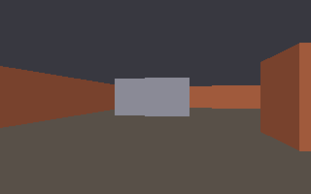
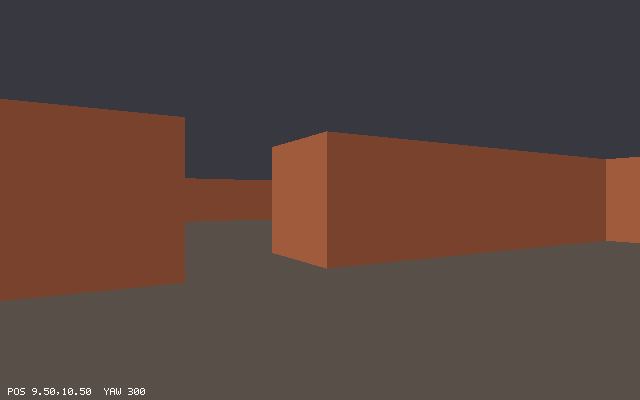
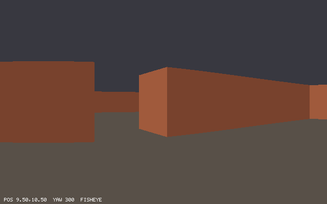

# Chapter 13 — Ray Casting: The Maze in 2.5D

In 1992 *Wolfenstein 3D* drew a first-person maze on PCs with no 3D hardware at all, using one
trick: for every column of the screen, follow a ray across the 2D map until it hits a wall, then
draw a vertical strip whose height shrinks with the distance. This chapter writes that ray
caster. It needs three pieces of math, and each one is derived here rather than copied: a DDA
that visits exactly the grid cells a ray crosses, a camera made of a direction and a plane, and
the reason walls stay straight instead of bulging like the view through a fisheye lens. At the
end, `delve` is first person for the first time. The top-down map from Chapter 12 is one key
away, and it now shows the rays.

Previous: [Chapter 12 — Matrices and Transforms](12-matrices-and-transforms.md). Next:
[Chapter 14 — Ray Casting II: Textures, Sprites, and Mouse Look](14-textures-and-sprites.md).

## From a map to a view

The maze is a grid of square cells, each one unit wide, some floor and some wall. You stand at
a point in it, facing some direction. Imagine a sheet of glass one unit in front of your eye,
and the screen painted on that glass. Each column of pixels on the screen is a thin vertical
slice of the glass. Look through one slice and you see straight ahead through it until your
line of sight meets a wall.

Seen from above, that line of sight is a *ray*: a half-line that starts at the eye and goes
through the slice. A 640-pixel-wide screen has 640 slices, so 640 rays fan out across the map:

```text
            top view                               the screen

     #################                     |                    |
     #  \    |    /  #                     |   ______           |
     #   \   |   /   #   one ray per       |  |      |____      |
     #    \  |  /    #   screen column     |  |      |    |     |
     #     \ | /     #   ------------->    |  |______|____|     |
     #      \|/      #                     |                    |
     #       ● eye   #                     |                    |
     #################
```

Each ray stops at the first wall it meets. Near walls fill a tall strip of the column, far walls
a short one. Above the strip is ceiling, below it floor. Draw all 640 strips side by side and
you have a picture of the maze.

That picture is called *2.5D*, because the world is not really three-dimensional:

- The map is a 2D grid. Every wall fills a whole cell and goes from floor to ceiling.
- All walls have the same height, one unit, and the eye is always at half that height.
- You can turn left and right, but you cannot look up or down, and nothing is above anything
  else.

With those rules, one ray per column is enough: whatever the ray hits is the only wall in that
column, and its strip is centered on the middle row of the screen. Break any rule (a balcony, a
ramp, a tilted head) and one ray per column no longer describes the picture. That is why later
chapters of this part build a real 3D pipeline. For now, the limits buy speed: 640 rays per
frame is very little work.

## Walking a ray through a grid: DDA

A ray starts at the eye, `origin`, and goes in direction `dir`. Every point on it is

```text
p(t) = origin + t · dir        for t ≥ 0
```

`t` is how far along the ray we are, measured in lengths of `dir`. The question is: what is the
smallest `t` at which `p(t)` is inside a wall cell?

The obvious answer is to walk: start at `t = 0`, add a small step, look up the cell under the
point, repeat. That is slow, and worse, it is wrong. A step of any size can jump over the corner
of a wall. There is a better way, called a DDA (digital differential analyzer, the same name as
the line-drawing method of Chapter 10), and in this form it was published for ray tracing by
Amanatides and Woo in 1987.

### The crossings of one axis

Think about the vertical grid lines only: the lines `x = 0`, `x = 1`, `x = 2`, and so on. The ray
crosses the line `x = k` when `origin.x + t · dir.x = k`, so at

```text
t = (k − origin.x) / dir.x
```

Neighboring lines are exactly 1 apart, so their `t` values are exactly `1 / |dir.x|` apart.
Call that `Δt_x`: the `t` it takes the ray to cross one whole cell in x. If `dir.x` is 0, the ray
is parallel to the vertical lines and never crosses one: `Δt_x` is infinite.

The first vertical line the ray meets depends on which way it goes. Let `cell_x` be the column
the origin is in, `floor(origin.x)`:

- Going right (`dir.x > 0`), the first line is `x = cell_x + 1`, at
  `t = (cell_x + 1 − origin.x) / dir.x = (cell_x + 1 − origin.x) · Δt_x`.
- Going left (`dir.x < 0`), it is `x = cell_x`, at
  `t = (cell_x − origin.x) / dir.x = (origin.x − cell_x) · Δt_x`.

Both are a distance to the next line, between 0 and 1, times `Δt_x`. Call the result `next_x`.
After it, the ray crosses a vertical line at `next_x + Δt_x`, `next_x + 2·Δt_x`, and so on. The
horizontal lines `y = k` work the same way, with `Δt_y = 1 / |dir.y|` and a first crossing
`next_y`.

### Merging the two sequences

Every time the ray crosses a grid line it enters a new cell, and it enters no cell any other
way. So the cells the ray visits, in order, come from merging the two sorted lists of
crossings:

1. Look at `next_x` and `next_y`. The smaller one is the next grid line the ray crosses.
2. If it is `next_x`, the ray steps into the next column: `cell_x` changes by `+1` or `−1`
   (the sign of `dir.x`), and `next_x += Δt_x`. Otherwise the same with y.
3. If the new cell is a wall, stop. The `t` just crossed is where the ray meets it, and the
   kind of line crossed tells you which face was hit.

Each step costs a comparison, an addition, and one map lookup. Nothing is approximated, and no
cell is skipped: the loop visits every cell the ray touches, and only those.

Here is the whole thing on a small grid, printing every step:

`examples/ch13/dda_trace.zig`

```zig
//! Follows one ray through a small grid with a DDA and prints every grid
//! line it crosses, until it enters a wall cell.
const std = @import("std");

const grid = [_][]const u8{
    "##########",
    "#........#",
    "#......#.#",
    "#........#",
    "#........#",
    "##########",
};

fn isWall(x: i32, y: i32) bool {
    if (x < 0 or y < 0 or y >= grid.len or x >= grid[0].len) return true;
    return grid[@intCast(y)][@intCast(x)] == '#';
}

pub fn main() void {
    const origin = [2]f32{ 1.5, 4.5 };
    const angle: f32 = std.math.degreesToRadians(-20.0);
    const dir = [2]f32{ @cos(angle), @sin(angle) };

    var cell = [2]i32{ @intFromFloat(@floor(origin[0])), @intFromFloat(@floor(origin[1])) };
    var step: [2]i32 = undefined;
    var delta: [2]f32 = undefined; // t to cross one whole cell
    var next: [2]f32 = undefined; // t of the next x line and the next y line
    for (0..2) |i| {
        delta[i] = if (dir[i] == 0) std.math.inf(f32) else @abs(1 / dir[i]);
        const fc: f32 = @floatFromInt(cell[i]);
        if (dir[i] < 0) {
            step[i] = -1;
            next[i] = (origin[i] - fc) * delta[i];
        } else {
            step[i] = 1;
            next[i] = (fc + 1 - origin[i]) * delta[i];
        }
    }
    std.debug.print("dir = ({d:.3}, {d:.3})  start cell ({d}, {d})\n", .{ dir[0], dir[1], cell[0], cell[1] });
    std.debug.print("delta = ({d:.3}, {d:.3})  first crossings next = ({d:.3}, {d:.3})\n\n", .{
        delta[0], delta[1], next[0], next[1],
    });

    var n: usize = 1;
    while (true) : (n += 1) {
        // The nearer of the two next crossings is the next grid line.
        const i: usize = if (next[0] < next[1]) 0 else 1;
        const t = next[i];
        next[i] += delta[i];
        cell[i] += step[i];
        const px = origin[0] + t * dir[0];
        const py = origin[1] + t * dir[1];
        const wall = isWall(cell[0], cell[1]);
        std.debug.print("{d}: t = {d:.3}  cross {s} line at ({d:.3}, {d:.3})  -> cell ({d}, {d}){s}\n", .{
            n,                          t, if (i == 0) "x" else "y", px, py, cell[0], cell[1],
            if (wall) "  WALL" else "",
        });
        if (wall) break;
    }
}
```

```console
$ zig run examples/ch13/dda_trace.zig
dir = (0.940, -0.342)  start cell (1, 4)
delta = (1.064, 2.924)  first crossings next = (0.532, 1.462)

1: t = 0.532  cross x line at (2.000, 4.318)  -> cell (2, 4)
2: t = 1.462  cross y line at (2.874, 4.000)  -> cell (2, 3)
3: t = 1.596  cross x line at (3.000, 3.954)  -> cell (3, 3)
4: t = 2.660  cross x line at (4.000, 3.590)  -> cell (4, 3)
5: t = 3.725  cross x line at (5.000, 3.226)  -> cell (5, 3)
6: t = 4.386  cross y line at (5.621, 3.000)  -> cell (5, 2)
7: t = 4.789  cross x line at (6.000, 2.862)  -> cell (6, 2)
8: t = 5.853  cross x line at (7.000, 2.498)  -> cell (7, 2)  WALL
```

- The ray leaves (1.5, 4.5) at −20°. On the map y grows downward, like rows of text, so a
  negative angle points up and to the right: `dir.y` is negative and `cell_y` counts down.
- `Δt_x = 1/0.940 = 1.064` and `Δt_y = 1/0.342 = 2.924`. The ray is mostly horizontal, so it
  crosses vertical lines almost three times as often as horizontal ones.
- `next_x = (1 + 1 − 1.5) · 1.064 = 0.532` and `next_y = (4.5 − 4) · 2.924 = 1.462`: half a cell
  to go in each direction.
- The two sequences, merged, are exactly the `t` column:

  ```text
  x lines:  0.532       1.596  2.660  3.725         4.789  5.853    (every 1.064)
  y lines:        1.462                      4.386                  (every 2.924)
  ```

- Every crossing point lies exactly on a grid line: `(2.000, 4.318)`, `(2.874, 4.000)`. That is
  the check that the `t` values are right.
- Step 8 enters the `#` in row 2, column 7. The ray crossed a line of constant x to get there,
  so it hit the wall's west face, at `t = 5.853`.

The two-element `for` loop runs over the axes, so x and y share one piece of code. Here `cell`,
`delta`, and `next` are arrays, and indexing an array with a runtime `i` is fine.

### Why not take small steps?

The difference between the two methods shows best on a ray that clips the corner of a wall:

`examples/ch13/dda_vs_march.zig`

```zig
//! Marching along a ray in small fixed steps can jump straight over the
//! corner of a wall. The DDA visits every cell the ray touches.
const std = @import("std");

const size = 10;

/// One wall cell, (5, 5), in an open room; the edge of the grid is wall.
fn isWall(x: i32, y: i32) bool {
    if (x <= 0 or y <= 0 or x >= size - 1 or y >= size - 1) return true;
    return x == 5 and y == 5;
}

fn cellOf(v: f32) i32 {
    return @intFromFloat(@floor(v));
}

const Result = struct { cell: [2]i32, t: f32, tests: usize };

fn dda(origin: [2]f32, dir: [2]f32) Result {
    // The loop of dda_trace.zig, counting tests and returning the hit.
    // ...
}

fn march(origin: [2]f32, dir: [2]f32, dt: f32) Result {
    var t: f32 = 0;
    var tests: usize = 0;
    while (true) : (t += dt) {
        const cell = [2]i32{ cellOf(origin[0] + t * dir[0]), cellOf(origin[1] + t * dir[1]) };
        tests += 1;
        if (isWall(cell[0], cell[1])) return .{ .cell = cell, .t = t, .tests = tests };
    }
}

pub fn main() void {
    // A 45-degree ray that clips the top-right corner of cell (5, 5): it
    // is inside that cell only from (5.97, 5.00) to (6.00, 5.03).
    const origin = [2]f32{ 2.47, 1.5 };
    const dir = [2]f32{ std.math.sqrt1_2, std.math.sqrt1_2 };

    const results = [_]struct { name: []const u8, r: Result }{
        .{ .name = "DDA       ", .r = dda(origin, dir) },
        .{ .name = "march 0.1 ", .r = march(origin, dir, 0.1) },
        .{ .name = "march 0.01", .r = march(origin, dir, 0.01) },
    };
    for (results) |e| {
        std.debug.print("{s}: wall cell ({d}, {d}) at t = {d:.3}, {d} cells tested\n", .{
            e.name, e.r.cell[0], e.r.cell[1], e.r.t, e.r.tests,
        });
    }
}
```

```console
$ zig run examples/ch13/dda_vs_march.zig
DDA       : wall cell (5, 5) at t = 4.950, 7 cells tested
march 0.1 : wall cell (9, 8) at t = 9.300, 94 cells tested
march 0.01: wall cell (5, 5) at t = 4.950, 496 cells tested
```

- The ray spends only about 0.04 units inside cell (5, 5). Steps of 0.1 jump right over it, and
  the march reports the room's far wall, (9, 8), at almost twice the real distance. In a
  game that is a wall missing from one column of the screen, flickering as you move.
- Steps of 0.01 happen to find it, after 496 lookups instead of 7. A ray clipping a corner by
  less than the step would still be missed, and any hit is up to one step too far.
- The DDA's `t = 4.950` is exact: the ray enters (5, 5) through the line y = 5 at
  x = 2.47 + 3.5 = 5.97, and `3.5 · √2 = 4.9497`.

The DDA's cost is the number of cells the ray crosses, about `|Δx| + |Δy|` for a ray that ends
`Δx` columns and `Δy` rows away. In a maze that is a handful. The cost of marching is the
distance divided by the step, whatever the walls are.

Two details make the loop safe. Every ray ends, because the map treats every cell outside the
grid as wall. And the loop never divides by zero: an axis-parallel ray has an infinite `Δt` on
one axis, `next` on that axis stays infinite, and `next[0] < next[1]` always picks the other
axis. (If the two `next` values are equal, the ray passes exactly through a grid corner; the
code takes the y step first and the x step on the next turn, at the same `t`.)

### The same loop on `@Vector`

In `delve`, points and directions are `Vec2 = @Vector(2, f32)` from Chapter 11, so the project's
DDA keeps `delta` and `next` as vectors. The shared setup loop then runs into a rule from
Chapter 11: a lane of a runtime vector can only be read or written with an index known at
compile time. Here is the setup on vectors with a plain `for`:

```zig
const std = @import("std");
const Vec2 = @Vector(2, f32);

fn firstCrossings(origin: Vec2, dir: Vec2) Vec2 {
    var next: Vec2 = undefined;
    for (0..2) |i| {
        const fc = @floor(origin[i]);
        next[i] = if (dir[i] < 0) origin[i] - fc else fc + 1 - origin[i];
    }
    return next;
}

pub fn main() void {
    var origin: Vec2 = .{ 1.25, 2.5 };
    _ = &origin;
    std.debug.print("{any}\n", .{firstCrossings(origin, .{ 1, -1 })});
}
```

```console
$ zig run runtime_index.zig
runtime_index.zig:7:34: error: vector index not comptime known
        const fc = @floor(origin[i]);
                                 ^
referenced by:
    main: runtime_index.zig:16:48
    callMain [inlined]: /home/tbangma/opt/zig-x86_64-linux-0.17.1/lib/std/start.zig:788:64
    callMainWithArgs [inlined]: /home/tbangma/opt/zig-x86_64-linux-0.17.1/lib/std/start.zig:729:20
    posixCallMainAndExit: /home/tbangma/opt/zig-x86_64-linux-0.17.1/lib/std/start.zig:681:38
    2 reference(s) hidden; use '-freference-trace=6' to see all references
```

A vector lives in a SIMD register, where lanes are picked by the instruction itself, not by an
index in another register. Write `inline for (0..2) |i|` instead. The compiler then unrolls the
loop into two copies, one with `i = 0` and one with `i = 1`, each a constant, and the program
prints `{ 0.75, 0.5 }`. The project uses exactly that.

## The camera: a direction and a plane

Now the rays themselves. The camera is three vectors:

- `pos`, where the eye is;
- `dir`, the direction it faces, length 1;
- `plane`, at right angles to `dir`, from the middle of the screen to its right edge.

Picture the glass from the first section as a line segment in the map, one unit in front of
the eye: its middle is `pos + dir`, its left end `pos + dir − plane`, its right end
`pos + dir + plane`. A point on it is `pos + dir + plane · camera_x`, where `camera_x` runs from
−1 at the left edge to 1 at the right edge. The ray from the eye through that point has the
direction

```text
ray = dir + plane · camera_x
```

```text
        pos+dir-plane      pos+dir      pos+dir+plane
              +---------------+---------------+       <- the camera plane (the screen)
               \              |              /
                \             | dir         /  ray for camera_x = 1
                 \            |            /
                  \           |           /
                   \          |          /
                    \         |         /
                     \        |        /
                              ● pos
```

The screen's columns are spread evenly over the plane. Column `x` of a `W`-pixel screen covers
`camera_x` values from `2x/W − 1` to `2(x + 1)/W − 1`; the ray goes through its middle, the
pixel center at `x + 0.5`:

```text
camera_x = 2 (x + 0.5) / W − 1
```

For `W = 640`, column 0 gets `camera_x = −0.998` and column 639 gets `0.998`. Neither edge
column is aimed at the very edge of the plane, for the same reason that pixel centers are not on
pixel borders.

The plane is `perp(dir)` scaled by 0.8, where `perp(v) = (−v.y, v.x)` is the "right of"
direction from Chapter 11. Its length sets how wide the view is. The edge rays are
`dir ± plane`, so the angle between them, the horizontal *field of view*, is

```text
FOV = 2 · atan(|plane| / |dir|) = 2 · atan(0.8) = 77.3°
```

A longer plane is a wider view: 1.0 gives 90°, and Lode Vandevenne's tutorial uses 0.66 for
about 67°. The next section shows why `delve` picks 0.8.

`examples/ch13/camera_rays.zig`

```zig
//! The camera rays of an 8-pixel-wide screen: each is the view direction
//! plus a part of the camera plane. Their lengths differ, but every one of
//! them reaches exactly 1 unit forward along the view direction.
const std = @import("std");

const Vec2 = @Vector(2, f32);

fn dot(a: Vec2, b: Vec2) f32 {
    return @reduce(.Add, a * b);
}

pub fn main() void {
    const width = 8;
    const yaw: f32 = std.math.degreesToRadians(30.0);
    const dir: Vec2 = .{ @cos(yaw), @sin(yaw) };
    const plane: Vec2 = Vec2{ -dir[1], dir[0] } * @as(Vec2, @splat(0.8)); // perp(dir) * 0.8

    std.debug.print("dir = ({d:.3}, {d:.3})  plane = ({d:.3}, {d:.3})  dot(dir, plane) = {d:.3}\n\n", .{
        dir[0], dir[1], plane[0], plane[1], dot(dir, plane),
    });
    std.debug.print(" x  camera_x  ray                dot(ray,dir)  |ray|   angle\n", .{});
    for (0..width) |x| {
        const fx: f32 = @floatFromInt(x);
        const camera_x = 2 * (fx + 0.5) / width - 1;
        const ray = dir + plane * @as(Vec2, @splat(camera_x));
        const len = @sqrt(dot(ray, ray));
        // The angle between the ray and the view direction, in degrees.
        const angle = std.math.radiansToDegrees(std.math.atan2(
            dir[0] * ray[1] - dir[1] * ray[0],
            dot(dir, ray),
        ));
        std.debug.print("{d:>2}  {d:>7.3}  ({d:>6.3}, {d:>6.3})  {d:>11.3}  {d:>6.3}  {d:>6.1}\n", .{
            x, camera_x, ray[0], ray[1], dot(ray, dir), len, angle,
        });
    }
    std.debug.print("\nhorizontal field of view: 2 * atan(0.8) = {d:.2} degrees\n", .{
        std.math.radiansToDegrees(2 * std.math.atan(@as(f32, 0.8))),
    });
}
```

```console
$ zig run examples/ch13/camera_rays.zig
dir = (0.866, 0.500)  plane = (-0.400, 0.693)  dot(dir, plane) = 0.000

 x  camera_x  ray                dot(ray,dir)  |ray|   angle
 0   -0.875  ( 1.216, -0.106)        1.000   1.221   -35.0
 1   -0.625  ( 1.116,  0.067)        1.000   1.118   -26.6
 2   -0.375  ( 1.016,  0.240)        1.000   1.044   -16.7
 3   -0.125  ( 0.916,  0.413)        1.000   1.005    -5.7
 4    0.125  ( 0.816,  0.587)        1.000   1.005     5.7
 5    0.375  ( 0.716,  0.760)        1.000   1.044    16.7
 6    0.625  ( 0.616,  0.933)        1.000   1.118    26.6
 7    0.875  ( 0.516,  1.106)        1.000   1.221    35.0

horizontal field of view: 2 * atan(0.8) = 77.32 degrees
```

- The camera faces 30° south of east (y grows downward). The plane is at right angles to it:
  their dot product is 0.
- The rays are not unit vectors. The edge rays are 22% longer than `dir`, because they reach
  the plane farther out.
- The angles are not evenly spaced: 8.4° between the two outer rays, 11.4° between the two
  middle ones. The columns are even steps along the flat plane, not even steps of angle. That
  is what a flat screen in front of a real eye sees, and it matters in the fisheye section.
- Every ray has `dot(ray, dir) = 1`. Hold on to that column; it is the most useful number in
  the chapter.

Turning the camera is turning both vectors. `delve` rebuilds them from the player's `yaw` every
frame (`dir = (cos yaw, sin yaw)`), so they can never drift. Some ray casters instead rotate
`dir` and `plane` a little every frame with a rotation matrix; after many frames, rounding
errors make them slightly shorter or no longer at right angles, and the view warps.

## How tall is a wall?

A ray from column x hits a wall. How many pixels tall is the strip?

Look at the scene from the side. The eye is at height 0.5, halfway up the walls. The camera
plane is a vertical sheet of glass one unit in front of the eye, and the wall is `d` units in
front of the eye, measured along the view direction:

```text
                                                   ┬  top of the wall
                                            .....  │
                                     .......       │
                              .......              │  0.5
                       .......                     │
        0.5/d ┬ .......                            │
   eye  ●.....┴────────────────────────────────────┴──  eye level
        |<-1->|
        |<------------------ d ------------------->|
```

The line from the eye to the top of the wall rises 0.5 over a run of `d`. At the glass, after a
run of 1, it has risen `0.5 / d`. These are similar triangles: anything of size `s` at distance
`d` looks like size `s / d` on a screen at distance 1. The whole wall, one unit tall, covers
`1 / d` units of the glass, centered on eye level.

To turn that into pixels we need to know how many pixels one unit of glass is. Across, the
answer is fixed by the camera: the half-width of the plane, 0.8 units, is spread over half the
screen, 320 pixels. That is `320 / 0.8 = 400` pixels per unit. If pixels are to be square, a unit
of glass must also be 400 pixels up. So a wall at distance `d` is `400 / d` pixels tall, and
because the canvas is 400 pixels high, that is simply

```text
wall height = H / d
```

This is where 0.8 comes from. For any screen and plane, the pixels per unit across are
`W / (2 · plane_scale)` and the pixels per unit up are `H` (for this formula). They are equal
when `plane_scale = W / (2H)`, which is 0.8 for 640 by 400.

The vertical field of view follows: half the screen, 200 pixels, is `200 / 400 = 0.5` units of
glass, so the vertical field of view is `2 · atan(0.5) = 53.13°`. Chapter 15 builds a real 3D
camera, and it uses exactly this vertical field of view so that its walls land on the same
pixels as the ray caster's.

`examples/ch13/fov.zig`

```zig
//! Field of view and pixel shape for a few camera planes and screens.
//! Walls are drawn `height / d` pixels tall, so the vertical scale is
//! `height` pixels per unit (at distance 1). The plane maps its half-width
//! to half the screen, so the horizontal scale is `width / (2 * plane)`.
//! Pixels are square when the two scales agree: plane = width / (2 * height).
const std = @import("std");

fn degrees(radians: f32) f32 {
    return std.math.radiansToDegrees(radians);
}

pub fn main() void {
    const screens = [_][2]f32{ .{ 320, 200 }, .{ 640, 400 }, .{ 640, 480 } };
    const planes = [_]f32{ 0.66, 0.8, 1.0 };

    std.debug.print("screen   plane  h-fov  v-fov  px/unit across  px/unit up  stretch\n", .{});
    for (screens) |s| {
        const w = s[0];
        const h = s[1];
        for (planes) |p| {
            const across = w / (2 * p);
            const up = h; // wallHeight = h / d
            // The screen's half-height is h/2 pixels, which is (h/2)/up
            // units at distance 1: always 0.5 with this wall height.
            const vfov = 2 * std.math.atan((h / 2) / up);
            std.debug.print("{d}x{d}  {d:>5.2}  {d:>5.1}  {d:>5.1}  {d:>14.1}  {d:>10.1}  {d:>7.3}{s}\n", .{
                w,      h,  p,           degrees(2 * std.math.atan(p)),                    degrees(vfov),
                across, up, up / across, if (@abs(across - up) < 0.01) "  square" else "",
            });
        }
    }
    std.debug.print("\nsquare-pixel plane for 640x400: {d:.3}, for 640x480: {d:.3}\n", .{
        640.0 / (2.0 * 400.0), 640.0 / (2.0 * 480.0),
    });
}
```

```console
$ zig run examples/ch13/fov.zig
screen   plane  h-fov  v-fov  px/unit across  px/unit up  stretch
320x200   0.66   66.8   53.1           242.4       200.0    0.825
320x200   0.80   77.3   53.1           200.0       200.0    1.000  square
320x200   1.00   90.0   53.1           160.0       200.0    1.250
640x400   0.66   66.8   53.1           484.8       400.0    0.825
640x400   0.80   77.3   53.1           400.0       400.0    1.000  square
640x400   1.00   90.0   53.1           320.0       400.0    1.250
640x480   0.66   66.8   53.1           484.8       480.0    0.990
640x480   0.80   77.3   53.1           400.0       480.0    1.200
640x480   1.00   90.0   53.1           320.0       480.0    1.500

square-pixel plane for 640x400: 0.800, for 640x480: 0.667
```

- `stretch` is how many pixels a unit is up for each pixel it is across. Below 1, everything
  looks squashed: a cube is drawn wider than it is tall. Above 1, it looks stretched upward.
- With `H / d` for the wall height, the vertical field of view never changes; only the plane
  changes the horizontal one. A wider plane on the same screen squeezes more world into the
  same pixels across, so it squashes.
- Lode's 0.66 is (nearly) square on a 4:3 screen such as 640x480. On `delve`'s 16:10 canvas it
  would squash the world by 17%, so `delve` uses 0.8. 320x200, the screen of 1992, has the same
  shape as 640x400.
- Exercise 2 lets you change the plane at run time and keeps pixels square by changing the wall
  height instead.

All the numbers in this file are `f32` on purpose. Here is what happens with untyped
constants, in the line that sizes the walls of the ASCII ray caster below:

```zig
const std = @import("std");

pub fn main() void {
    const cols = 80;
    const plane_scale = 0.8;
    const rows_per_unit: f32 = cols / (2 * plane_scale) / 2;
    std.debug.print("{d}\n", .{rows_per_unit});
}
```

```console
$ zig run untyped.zig
untyped.zig:6:37: error: ambiguous coercion of division operands 'comptime_int' and 'comptime_float'; non-zero remainder '1.6'
    const rows_per_unit: f32 = cols / (2 * plane_scale) / 2;
                               ~~~~~^~~~~~~~~~~~~~~~~~~
referenced by:
    callMain [inlined]: /home/tbangma/opt/zig-x86_64-linux-0.17.1/lib/std/start.zig:788:64
    callMainWithArgs [inlined]: /home/tbangma/opt/zig-x86_64-linux-0.17.1/lib/std/start.zig:729:20
    posixCallMainAndExit: /home/tbangma/opt/zig-x86_64-linux-0.17.1/lib/std/start.zig:681:38
    2 reference(s) hidden; use '-freference-trace=5' to see all references
```

`cols` is a `comptime_int` and `2 * plane_scale` a `comptime_float`. Zig evaluates the whole
expression at compile time, before the `f32` on the left has any say, and it refuses to guess
whether `/` between an integer and a fraction should be integer division or float division.
Giving `plane_scale` a type, `const plane_scale: f32 = 0.8;`, makes the division a float
division and the error goes away.

## The fisheye problem

The ray from column x hits a wall at some `t`. The strip height needs a distance `d`. The
first idea is the real distance from the eye to the hit point. The ray is `t · ray` long, so
that is `t · |ray|`. Try it on a flat wall straight ahead, 3 units away:

`examples/ch13/fisheye_numbers.zig`

```zig
//! A flat wall straight ahead, 3 units in front of the camera. Using the
//! distance from the eye makes its edges shrink (a bulge); the distance
//! along the view direction keeps it the same height everywhere.
const std = @import("std");

pub fn main() void {
    const width = 640;
    const height: f32 = 400;
    const wall_dist: f32 = 3; // the wall is the line x = 3, the camera looks along +x

    std.debug.print("column  camera_x  eye dist  perp dist  height(eye)  height(perp)\n", .{});
    for ([_]usize{ 0, 80, 160, 240, 320, 400, 480, 560, 639 }) |x| {
        const fx: f32 = @floatFromInt(x);
        const camera_x = 2 * (fx + 0.5) / width - 1;
        // ray = (1, 0.8 * camera_x); it reaches x = 3 at t = 3.
        const ray_len = @sqrt(1 + 0.64 * camera_x * camera_x);
        const t = wall_dist; // the DDA's t: ray.x is 1
        const eye = t * ray_len;
        std.debug.print("{d:>6}  {d:>8.3}  {d:>8.3}  {d:>9.3}  {d:>11.1}  {d:>12.1}\n", .{
            x, camera_x, eye, t, height / eye, height / t,
        });
    }
    // The cosine fix used by many tutorials is the same number:
    // eye distance * cos(angle) = t * |ray| * (1 / |ray|) = t.
    const camera_x: f32 = 2 * (0 + 0.5) / @as(f32, width) - 1;
    const angle = std.math.atan(0.8 * camera_x);
    std.debug.print("\ncolumn 0: eye dist * cos(angle) = {d:.3}\n", .{wall_dist * @sqrt(1 + 0.64 * camera_x * camera_x) * @cos(angle)});
}
```

```console
$ zig run examples/ch13/fisheye_numbers.zig
column  camera_x  eye dist  perp dist  height(eye)  height(perp)
     0    -0.998     3.840      3.000        104.2         133.3
    80    -0.748     3.497      3.000        114.4         133.3
   160    -0.498     3.230      3.000        123.9         133.3
   240    -0.248     3.059      3.000        130.8         133.3
   320     0.002     3.000      3.000        133.3         133.3
   400     0.252     3.060      3.000        130.7         133.3
   480     0.502     3.232      3.000        123.7         133.3
   560     0.752     3.501      3.000        114.3         133.3
   639     0.998     3.840      3.000        104.2         133.3

column 0: eye dist * cos(angle) = 3.000
```

- The edges of a flat wall really are farther from the eye than its middle: 3.84 against 3.00.
  Using that distance makes the wall 133 pixels tall in the middle and 104 at the edges, a
  barrel shape. That is the fisheye effect. A real fisheye lens does it on purpose; here it is
  a bug.
- Measured along the view direction, every point of the wall is 3 units away, and every strip
  is 133.3 pixels. The wall stays flat.

Which distance is right? The one that matches how the strips were placed. The columns are
evenly spaced on a flat plane, like the film in a pinhole camera, and a pinhole camera divides
by the distance along the view direction, its *depth*. In the side view above, `d` was exactly
that: the run from the eye to the wall, measured straight ahead. So `d` must be the depth of the
hit point, not its distance from the eye.

Now the good news: the DDA's `t` already *is* the depth. The hit point is
`pos + t · ray`, so its offset from the eye along the view direction is

```text
dot(t · ray, dir) = t · dot(dir + plane · camera_x, dir)
                  = t · (dot(dir, dir) + camera_x · dot(plane, dir))
                  = t · (1 + camera_x · 0)
                  = t
```

because `dir` has length 1 and `plane` is at right angles to it. That is the `dot(ray, dir) =
1` column of `camera_rays`. Every camera ray reaches exactly one unit forward per unit of `t`, so
`t` measures forward distance. No correction is needed; using `t · |ray|` *adds* the fisheye.

Many tutorials cast rays by angle, with unit-length directions, and then fix the fisheye by
multiplying the distance by `cos(angle)`, the angle between the ray and the view direction. It
is the same number. `cos(angle) = dot(ray, dir) / |ray| = 1 / |ray|`, so
`t · |ray| · cos(angle) = t`, which is the last line of the output.

Why does depth keep walls *straight*, not just level? Take any wall face; seen from above it
is a straight line. Measure points relative to the camera as `(side, depth)`, with `side` along
the plane and `depth` along `dir`. A straight line is `a · side + b · depth = c` for some
numbers `a`, `b`, `c` (with `c ≠ 0` unless the line goes through the eye). Divide by `depth`:

```text
a · (side / depth) + b = c / depth
```

`side / depth` is where the point lands on the screen (it is proportional to `camera_x`; the
sprites section of Chapter 14 shows this in detail), and `1 / depth` is proportional to the
strip height. So along a wall face, the height is a linear function of the screen column, and
the top and bottom edges of the face are straight lines on screen. Distance from the eye has no
such property; that is the curve in the picture.

## Pixel rows and rounding

The strip of a wall at depth `d` is `H / d` pixels tall, centered on the horizon `H / 2`. Its
top and bottom are

```text
top    = H/2 − (H/d)/2
bottom = H/2 + (H/d)/2
```

These are not whole numbers. Which rows does the strip fill? Pixel row `y` covers `y` to `y + 1`
and its center is at `y + 0.5`. The rule, as everywhere in Part II: a pixel belongs to the strip
if its center is inside it, in the half-open range `[top, bottom)`. The first such row is the
smallest `y` with `y + 0.5 ≥ top`, which is `ceil(top − 0.5)`. That is `pixelRow`:

```zig
/// The first row whose pixel center (y + 0.5) is at or below `y`, clamped
/// to the screen.
pub fn pixelRow(y: f32, height: usize) usize {
    const row = @ceil(y - 0.5);
    if (row <= 0) return 0;
    return @min(height, @as(usize, @intFromFloat(row)));
}
```

The strip fills rows `pixelRow(top)` up to, but not including, `pixelRow(bottom)`. A top of
`99.5` starts at row 99 (center 99.5 is inside); `99.6` starts at row 100. Using the same
function for both ends has two effects:

- A strip of height `h` fills `h` rows rounded up or down to a whole number, and a strip less
  than one pixel tall can fill zero rows, which is right for a wall that far away.
- Where one region ends and the next starts (wall to floor here, and textured floor to wall in
  Chapter 14), they meet on the same row boundary. No row is drawn twice, none is left empty.

The clamp matters as soon as you walk up to a wall. At `d = 0.25` the strip is 1600 pixels tall:
`top` is −600 and `bottom` is 1000, and `pixelRow` turns them into 0 and 400.

## Telling walls apart

Flat colors give a flat picture. Two walls meeting at a corner in the same color melt into one
shape. The cheapest possible lighting fixes it: draw faces of constant y (north and south faces)
at three quarters of the brightness of faces of constant x. It is as if light came from one
side.

The DDA already knows which face it hit: the kind of grid line it crossed last. That is the
`side` it returns, `.x` or `.y`, and the reason it exists. The other thing a hit needs is the
tile, so that brick and stone get different colors.

## A complete ray caster in one file

That is all the math. Here it is in under 70 lines of Zig, drawing into text: 80 columns, 24
rows, one ray per column. A text cell is about twice as tall as it is wide, so the wall height
uses half as many rows per unit as there are columns per unit:

`examples/ch13/ascii_raycaster.zig`

```zig
//! A complete ray caster that draws into text: 80 columns by 24 rows.
//! Walls are drawn with denser characters when they are closer.
const std = @import("std");

const map = [_][]const u8{
    "################",
    "#..............#",
    "#..##......%%..#",
    "#..##......%%..#",
    "#..............#",
    "#.......#......#",
    "#.......#......#",
    "#..............#",
    "################",
};

// isWall, and cast: the DDA of dda_trace.zig, returning t.
// ...

pub fn main() void {
    const cols = 80;
    const rows = 24;
    const plane_scale: f32 = 0.8;
    // A text cell is about twice as tall as it is wide. Across, the plane
    // maps to cols / (2 * 0.8) = 50 cells per unit; up, half of that.
    const rows_per_unit: f32 = cols / (2 * plane_scale) / 2;

    const pos = [2]f32{ 6.0, 4.0 };
    const yaw: f32 = std.math.degreesToRadians(-10.0);
    const dir = [2]f32{ @cos(yaw), @sin(yaw) };
    const plane = [2]f32{ -dir[1] * plane_scale, dir[0] * plane_scale };

    var screen: [rows][cols]u8 = undefined;
    for (0..cols) |x| {
        const camera_x = 2 * (@as(f32, @floatFromInt(x)) + 0.5) / cols - 1;
        const t = cast(pos, .{ dir[0] + plane[0] * camera_x, dir[1] + plane[1] * camera_x });
        const half = rows_per_unit / t / 2;
        const char: u8 = if (t < 2.5) '#' else if (t < 5) '+' else ':';
        for (0..rows) |y| {
            const center = @as(f32, @floatFromInt(y)) + 0.5 - rows / 2.0;
            screen[y][x] = if (@abs(center) < half) char else if (center > 0) '.' else ' ';
        }
    }
    for (screen) |line| std.debug.print("{s}\n", .{&line});
}
```

```console
$ zig run examples/ch13/ascii_raycaster.zig
                                                                                
                                                                                
                                                                                
                                                                                
                                                                                
                                                                           #####
                                                                       #########
                                                                   ++###########
++++++                                                             ++###########
++++++++++++++++++                          +++++                  ++###########
++++++++++++++++++::::::::::::::::::::::::::+++++                  ++###########
++++++++++++++++++::::::::::::::::::::::::::+++++::::::::::::::::::++###########
++++++++++++++++++::::::::::::::::::::::::::+++++::::::::::::::::::++###########
++++++++++++++++++::::::::::::::::::::::::::+++++..................++###########
++++++++++++++++++..........................+++++..................++###########
++++++.............................................................++###########
...................................................................++###########
.......................................................................#########
...........................................................................#####
................................................................................
................................................................................
................................................................................
................................................................................
................................................................................
```

- The camera stands at (6, 4), in the middle of the room, looking 10° north of east. The first
  five rows are ceiling (spaces) and the last five are floor (dots).
- Each character is a distance band, not a material: `#` under 2.5 units, `+` under 5, `:`
  farther. Printing which cell each column's ray stops in gives the scene:

  ```text
  columns  cell hit          face  t              what it is
   0..29   (8..13, 0)        y     3.15 .. 7.89   the room's north wall
  30..48   (11, 2), (11, 3)  x     5.25 .. 4.93   the west face of the %% block
  49..66   (15, 4..6)        x     8.84 .. 8.36   the far east wall
  67..76   (8, 5)            y     2.72 .. 1.83   the north face of the # pillar
  77..79   (8, 5)            x     1.79 .. 1.78   the west face of the # pillar
  ```

- The north wall's strips grow shorter toward the middle, because it runs away from the
  camera. The `%%` block is a little nearer than 5 units only at its right end, the `+` columns
  44 to 48. The `##` block at columns 3 and 4 is behind the camera and appears nowhere.
- The edges are straight lines made of steps, the "straight on screen" property from the
  fisheye section, at text resolution.

The same program with pixels instead of characters, writing a PPM image (the format from
Chapter 9):

`examples/ch13/raycast_ppm.zig`

```zig
// The map and cast are as before; cast now also returns the tile and
// whether the last line crossed was a y line.
// ...
pub fn main(init: std.process.Init) !void {
    const w = 320;
    const h = 200;
    var pixels: [w * h][3]u8 = undefined;
    // ... the same camera at (6, 4), yaw -10 degrees, plane 0.8 ...
    for (0..w) |x| {
        const camera_x = 2 * (@as(f32, @floatFromInt(x)) + 0.5) / w - 1;
        const hit = cast(pos, .{ dir[0] + plane[0] * camera_x, dir[1] + plane[1] * camera_x });
        const half = h / hit.t / 2;
        var wall: [3]u8 = if (hit.tile == '#') .{ 0xa0, 0x5a, 0x3c } else .{ 0x8a, 0x8a, 0x96 };
        if (hit.y_side) for (&wall) |*c| {
            c.* = c.* / 4 * 3;
        };
        for (0..h) |y| {
            const center = @as(f32, @floatFromInt(y)) + 0.5 - h / 2.0;
            pixels[y * w + x] = if (@abs(center) < half) wall else if (center > 0) .{ 0x58, 0x50, 0x48 } else .{ 0x38, 0x38, 0x40 };
        }
    }

    // PPM: a text header, then the RGB bytes row by row.
    const io = init.io;
    const file = try std.Io.Dir.cwd().createFile(io, "raycast.ppm", .{});
    defer file.close(io);
    var buffer: [4096]u8 = undefined;
    var writer = file.writer(io, &buffer);
    try writer.interface.print("P6\n{d} {d}\n255\n", .{ w, h });
    try writer.interface.writeAll(std.mem.sliceAsBytes(&pixels));
    try writer.interface.flush();
    std.debug.print("wrote raycast.ppm, {d}x{d}\n", .{ w, h });
}
```

```console
$ zig run examples/ch13/raycast_ppm.zig
wrote raycast.ppm, 320x200
$ ls -l raycast.ppm
-rw-r--r-- 1 tbangma tbangma 192015 Nov  7 21:19 raycast.ppm
```

The file is the 15-byte header plus `320 · 200 · 3 = 192000` bytes of pixels. Converted to PNG
and scaled up 2x, it looks like this:



- It is the same view as the text version. From left to right: the north wall (darker, a
  y face), the stone block's west face (lighter, an x face), the far east wall (an x face), and
  the pillar, whose north face is darker than the sliver of its west face at the right edge.
- The canvas is 320x200 and the plane is 0.8, so `320 / (2 · 0.8) = 200 = H`: square pixels, the
  first row of the `fov` table.
- The `/ 4 * 3` darkening is done in integers. Dividing first loses up to 3 levels of 255, which
  no one can see, and it cannot overflow a `u8`.

## Building delve: first person

At the end of [Chapter 12](12-matrices-and-transforms.md), `delve` drew the cellar from above
through a matrix, either the whole map or a view that turned with the player. This chapter adds
the first-person view and makes it the default. The map views stay, one key away, and they now
show the rays.

The files that change:

| File | Change |
|---|---|
| `src/raycast.zig` | new: `cast` (the DDA), `Camera`, `render`, `pixelRow`, three tests |
| `src/mapview.zig` | new: the map drawing, moved out of `app.zig`, plus the rays and the camera plane |
| `src/app.zig` | a `View` (first person, fixed map, following map) and the fisheye option |
| `src/input.zig` | the action `toggle_map` becomes `next_view`; a new action `toggle_fisheye` |
| `src/platform.zig` | Tab is `next_view`, F is `toggle_fisheye` |
| `src/options.zig` | the help text and a test name `next_view` |
| `src/main.zig` | the test block imports `raycast.zig` |

The complete project is in `project/ch13/`.

### The DDA on vectors

`src/raycast.zig` starts with what a hit is, and the cast itself:

```zig
/// Which kind of grid line a ray crossed into the wall: `.x` is a line of
/// constant x (an east or west face), `.y` a line of constant y.
pub const Side = enum { x, y };

pub const Hit = struct {
    /// How far along the ray the wall is, in units of the ray's length.
    /// For camera rays this is the distance measured along the view
    /// direction (see `Camera.ray`).
    t: f32,
    /// The wall cell that was hit.
    cell: [2]i32,
    side: Side,
    tile: Tile,
};

/// Follows the ray `origin + t * dir` through the grid with a DDA (digital
/// differential analyzer): step to whichever grid line, x or y, comes next,
/// until the cell entered is a wall. Outside the map counts as wall, so
/// every ray ends.
pub fn cast(map: Map, origin: Vec2, dir: Vec2) Hit {
    // t needed to cross one whole cell in x, and in y. A ray parallel to an
    // axis never crosses that axis's lines: infinity.
    const inf = std.math.inf(f32);
    const delta: Vec2 = .{
        if (dir[0] == 0) inf else @abs(1 / dir[0]),
        if (dir[1] == 0) inf else @abs(1 / dir[1]),
    };
    var cell: [2]i32 = .{ @intFromFloat(@floor(origin[0])), @intFromFloat(@floor(origin[1])) };
    var step: [2]i32 = undefined;
    // t at which the ray crosses the next x line and the next y line.
    var next: Vec2 = undefined;
    inline for (0..2) |i| {
        const fc: f32 = @floatFromInt(cell[i]);
        if (dir[i] < 0) {
            step[i] = -1;
            next[i] = (origin[i] - fc) * delta[i];
        } else {
            step[i] = 1;
            next[i] = (fc + 1 - origin[i]) * delta[i];
        }
    }

    while (true) {
        var side: Side = undefined;
        var t: f32 = undefined;
        if (next[0] < next[1]) {
            t = next[0];
            next[0] += delta[0];
            cell[0] += step[0];
            side = .x;
        } else {
            t = next[1];
            next[1] += delta[1];
            cell[1] += step[1];
            side = .y;
        }
        const tile = map.at(cell[0], cell[1]);
        if (tile.isWall()) return .{ .t = t, .cell = cell, .side = side, .tile = tile };
    }
}
```

- It is `dda_trace`'s loop with `delta` and `next` as `Vec2`, so the setup is an `inline for`.
- The main loop spells out both branches instead of indexing with a runtime `i`, for the same
  reason, and because each branch also sets `side`.
- `cell` and `step` stay plain `[2]i32` arrays. They are never used in vector arithmetic, and
  `map.at` takes two integers.
- `map.at` returns `.brick` for any cell outside the map. That is the guarantee
  that the loop ends, even with an `--pos` outside the walls.
- The `Hit` keeps `cell` although the renderer does not use it yet. The tests use it, and so do
  the exercises.

### The camera

```zig
/// The camera plane's half-width, relative to the view direction's length
/// of 1. It sets the field of view: 2 atan(0.8) = 77.3 degrees across. With
/// 640x400 pixels it also makes pixels square (see `wallHeight`).
pub const plane_scale = 0.8;

pub const Camera = struct {
    pos: Vec2,
    /// The view direction, length 1.
    dir: Vec2,
    /// From the center of the screen to its right edge, in the plane one
    /// unit in front of the camera.
    plane: Vec2,

    pub fn init(pos: Vec2, yaw: f32) Camera {
        const dir = math.fromAngle(yaw);
        return .{ .pos = pos, .dir = dir, .plane = math.scale(math.perp(dir), plane_scale) };
    }

    /// The ray through the center of column `x` of a `width`-pixel screen.
    /// Its component along `dir` is always 1, so the `t` of a hit is the
    /// hit's distance in front of the camera plane, not from the eye.
    pub fn ray(cam: Camera, x: usize, width: usize) Vec2 {
        const fx: f32 = @floatFromInt(x);
        const fw: f32 = @floatFromInt(width);
        const camera_x = 2 * (fx + 0.5) / fw - 1; // -1 at the left edge, 1 at the right
        return cam.dir + math.scale(cam.plane, camera_x);
    }
};
```

`math.fromAngle`, `math.perp`, and `math.scale` are from Chapter 11. `plane_scale` is untyped on
purpose here: it is only ever passed to `math.scale`, which takes an `f32`, so it never meets an
integer in a division.

The doc comment on `ray` is the fisheye section in two lines: since `dot(ray, dir) = 1`, `t` is
how far in front of the eye the hit is, measured straight ahead, not along the ray. The second
test below checks exactly that.

### Drawing the columns

```zig
const ceiling_color: Color = .hex(0x383840);
const floor_color: Color = .hex(0x585048);

fn wallColor(tile: Tile, side: Side) Color {
    const c: Color = switch (tile) {
        .floor => unreachable,
        .brick => .hex(0xa05a3c),
        .stone => .hex(0x8a8a96),
    };
    // Faces of constant y are darker: a cheap way to tell walls apart.
    if (side == .y) return .{ .r = c.r / 4 * 3, .g = c.g / 4 * 3, .b = c.b / 4 * 3 };
    return c;
}

/// The height in pixels of a wall one unit tall at distance `dist`, on a
/// screen `height` pixels tall. The wall's middle is at eye level.
pub fn wallHeight(height: usize, dist: f32) f32 {
    return @as(f32, @floatFromInt(height)) / dist;
}

/// Draws the first-person view: ceiling, floor, and one wall strip per column.
pub fn render(canvas: Canvas, map: Map, cam: Camera, opts: Options) void {
    const h: f32 = @floatFromInt(canvas.height);
    for (0..canvas.width) |x| {
        const ray = cam.ray(x, canvas.width);
        const hit = cast(map, cam.pos, ray);
        const dist = if (opts.fisheye) hit.t * math.length(ray) else hit.t;
        const half = wallHeight(canvas.height, dist) / 2;
        // Fill the rows whose pixel centers lie between top and bottom.
        const top = pixelRow(h / 2 - half, canvas.height);
        const bottom = pixelRow(h / 2 + half, canvas.height);
        for (0..canvas.height) |y| {
            const color = if (y < top) ceiling_color else if (y < bottom) wallColor(hit.tile, hit.side) else floor_color;
            canvas.pixels[y * canvas.width + x] = color;
        }
    }
}
```

- `.floor => unreachable`: `cast` only returns walls. If a new kind of tile is added to `Tile`,
  this `switch` stops compiling until it gets a color, which is what Exercise 3 runs into.
- `Options` has one field, `fisheye: bool = false`. Turning it on multiplies by `|ray|`, which
  is the "distance from the eye" of `fisheye_numbers`. It is in the program so that you can see
  the bug, not only read about it.
- Every pixel of the canvas is written once per frame, so the renderer never has to clear it.
- The column loop writes pixels down a column, `width` pixels apart in memory, not along a row
  as Chapter 9's row-major layout would suggest. A ray caster works one column at a time, so
  that is the natural order, and at 640x400 it is fast enough (see below).

### Views and keys

`src/app.zig` replaces Chapter 12's `map_view` with three views that Tab cycles through:

```zig
/// What fills the screen. Tab cycles through them.
pub const View = enum { first_person, map_fixed, map_follow };
```

`update` steps `app.view` on `next_view` and flips `app.raycast_options.fisheye` on
`toggle_fisheye`; `render` picks what to draw:

```zig
    pub fn render(app: App, canvas: Canvas) void {
        const p = app.player;
        switch (app.view) {
            .first_person => raycast.render(canvas, app.map, .init(p.pos, p.yaw), app.raycast_options),
            .map_fixed, .map_follow => {
                canvas.clear(.hex(0x101018));
                const style: mapview.Style = if (app.view == .map_fixed) .fixed else .follow;
                _ = mapview.drawMap(canvas, app.map, p, mapview.transform(style, p, canvas));
            },
        }

        var buffer: [96]u8 = undefined;
        const status = std.fmt.bufPrint(&buffer, "pos {d:.2},{d:.2}  yaw {d:.0}{s}", .{
            p.pos[0],
            p.pos[1],
            std.math.radiansToDegrees(p.yaw),
            if (app.raycast_options.fisheye) "  fisheye" else "",
        }) catch unreachable;
        const h: i32 = @intCast(canvas.height);
        _ = font.drawText(canvas, 8, h - 12, status, 1, Color.white);
    }
```

- To step the view, `update` does
  `app.view = views[(@backingInt(app.view) + 1) % views.len]` with
  `const views = std.enums.values(View)`, the array of all values in declaration order.
  `@backingInt` gives the current value's integer, 0 to 2. A fourth view added to the enum
  joins the cycle with no other change.
- `.init(p.pos, p.yaw)` is `raycast.Camera.init`: the parameter type of `raycast.render` tells
  Zig which `init` is meant.
- The camera is built fresh from the player every frame. The player is the game state; the
  camera is just a way of looking at it.
- The HUD's font draws lowercase letters with the uppercase glyphs, so `pos` shows as `POS`.

In `src/input.zig`, `toggle_map` becomes `next_view` and `toggle_fisheye` is new, and
`src/platform.zig` binds them:

```zig
/// Which key triggers which action.
const bindings = [_]struct { key: c_int, action: Action }{
    .{ .key = rl.KEY_TAB, .action = .next_view },
    .{ .key = rl.KEY_F, .action = .toggle_fisheye },
};
```

Because the actions are an enum, `--press` (Chapter 12) accepts the new names with no change to
the parser: `--press toggle_fisheye` works, and `--press toggle_map` is now an error.

### Seeing the rays

The map drawing moved from `app.zig` to a file of its own, `src/mapview.zig`, unchanged except
for the end of `drawMap`, which now draws what the camera sees:

```zig
    // Every 16th camera ray, from the eye to the wall it hits.
    const cam = raycast.Camera.init(player.pos, player.yaw);
    const eye = toScreen(to_screen, player.pos);
    var x: usize = 8;
    while (x < canvas.width) : (x += 16) {
        const ray = cam.ray(x, canvas.width);
        const hit = raycast.cast(map, cam.pos, ray);
        draw.line(canvas, eye, toScreen(to_screen, cam.pos + math.scale(ray, hit.t)), .hex(0x908040));
    }
    // The camera plane, one unit in front of the eye.
    const plane_left = toScreen(to_screen, cam.pos + cam.dir - cam.plane);
    const plane_right = toScreen(to_screen, cam.pos + cam.dir + cam.plane);
    draw.line(canvas, plane_left, plane_right, .hex(0x60c0ff));
    draw.line(canvas, eye, toScreen(to_screen, player.pos + cam.dir), .hex(0xffe060));
    draw.fillCircle(canvas, eye, 4, .hex(0xffe060));
```

The 40 rays are columns 8, 24, 40, ... 632 of the first-person view, the middle of each group
of 16. Each one ends at `pos + ray · t`, the exact point the DDA returned. If the DDA were wrong,
you would see it here first: a ray stopping short of a wall, or going through one.

### Tests

Three tests in `raycast.zig` pin down the parts that are easy to get subtly wrong. The first,
"a ray down a corridor hits the far wall", casts along `#>...%` and checks all four fields of
the hit: an x side, cell (5, 1), stone, `t = 3.5`; then straight up, a y side at `t = 0.5`. The
other two:

```zig
test "t measures distance along the view direction" {
    const gpa = testing.allocator;
    var map = try Map.parse(gpa,
        \\#######
        \\#.....#
        \\#..>..#
        \\#.....#
        \\#######
    );
    defer map.deinit(gpa);
    const cam = Camera.init(map.start, 0);
    // Every ray hits the east wall (x = 6), 2.5 units ahead of the camera,
    // whatever its angle: that is what makes walls straight.
    for ([_]usize{ 200, 320, 440 }) |x| {
        const hit = cast(map, cam.pos, cam.ray(x, 640));
        try testing.expectApproxEqAbs(2.5, hit.t, 1e-5);
    }
}

test "pixelRow rounds to pixel centers and clamps" {
    try testing.expectEqual(0, pixelRow(-10, 400));
    try testing.expectEqual(99, pixelRow(99.5, 400));
    try testing.expectEqual(100, pixelRow(99.6, 400));
    try testing.expectEqual(400, pixelRow(1000, 400));
}
```

- The first of these is the fisheye proof as a test: three rays at different angles, one depth.
  If `Camera.ray` normalized its rays, as tutorials that cast by angle do, it would fail.
- The second is the rounding rule: `99.5` is exactly on row 99's center and counts as
  inside.

### Running it

```console
$ zig build test --summary all
Build Summary: 6/6 steps succeeded; 26/26 tests passed
test success
+- run test 26 pass (26 total) 8ms MaxRSS:7M
   +- compile test debug native success 438ms MaxRSS:183M
      +- WriteFile raylib.h success
      +- compile lib raylib debug native success 2s MaxRSS:455M
      +- compile lib raylib debug native (reused)
      +- translate-c success 17ms MaxRSS:41M
```

The 26 tests are Chapter 12's 23 and the three new ones. (Run it a second time and Zig prints
`cached` and no counts; delete `.zig-cache` to see them again.)

`zig build run` opens the window in first person. W and S walk, A and D strafe, the arrow keys
turn, as in Chapter 11. Tab cycles first person, the whole map, and the following map. F turns
the fisheye on and off.

For the book, three headless runs from the same spot: the middle of the room in the cellar's
lower left quarter, at (9.5, 10.5), facing −60°, up and to the right on the map:

```console
$ ./zig-out/bin/delve --headless --pos 9.5,10.5 --yaw -60 --out ../../images/ch13-raycast.png
$ ./zig-out/bin/delve --headless --pos 9.5,10.5 --yaw -60 --press toggle_fisheye --out ../../images/ch13-fisheye.png
$ ./zig-out/bin/delve --headless --pos 9.5,10.5 --yaw -60 --press next_view --out ../../images/ch13-rays.png
```

They print nothing. Without `--frames`, `--headless` renders a single frame, and `--press`
performs its action on that frame's tick. The old name, `--press toggle_map`, is now rejected
with `delve: InvalidValue`, the help text, and exit code 2.

The first image is the first-person view:



- The HUD shows `YAW 300`: the player stores the yaw wrapped into 0° to 360°, and −60° is 300°.
- Ahead, the cellar's row 7 is a wall with two doorways. The left part of the wall is a y face
  (its south side), so it is drawn darker. Through the doorway at (10, 7) is a far wall,
  short and thin.
- Right of the doorway, the wall begins again with its end, a west face (an x face, lighter),
  and continues to the right with its south face, darker, growing taller as it comes closer.
- Every edge is a straight line: the tops and bottoms of the faces, and the corner where the
  two faces of the wall meet.

The second is the same frame with the fisheye on:



- Strips toward the screen's edges are shorter than they should be, by the factor `1/|ray|`
  from `fisheye_numbers`. The long wall on the right bends. The left wall happens to be seen at
  an angle that almost cancels its perspective, so it looks level, which is just as wrong.
- The middle of the picture is nearly unchanged: there `|ray|` is close to 1.

The third is the map, with the rays:


- The blue line is the camera plane, one unit in front of the player, as long as the screen is
  wide. The rays fan out through evenly spaced points on it.
- Most rays stop at row 7. The ones through the doorway at (10, 7) cross the room above it and
  stop at the cellar's top wall, about nine units away: those are the short strips in the
  doorway of the first image.
- The rightmost rays end on the south face of row 7 close to the player, where the first image
  shows the wall at its tallest.

## How fast is it?

Every frame casts 640 rays and writes all 256,000 pixels. Here is how long 600 frames take on
this machine (an Intel Core i9-13950HX), headless, so no window and no waiting for the screen,
in a Debug build and then in a ReleaseFast build:

```console
$ zig build
$ time ./zig-out/bin/delve --headless --frames 600

real	0m2.726s
user	0m2.717s
sys	0m0.008s
$ zig build --release=fast
$ time ./zig-out/bin/delve --headless --frames 600

real	0m0.541s
user	0m0.537s
sys	0m0.004s
```

- Debug: 4.5 ms per frame. ReleaseFast: 0.9 ms per frame, five times faster. A frame at 60 Hz
  has 16.7 ms, so either is plenty, but Debug has used a quarter of its budget on flat colors.
- The time includes starting the program and building the map, but 600 frames make that small.
- Counted in steps, most of the work is writing pixels, not casting rays: each ray tests about
  five cells (Exercise 4 measures it), while each column writes 400 pixels.

Chapter 14 adds textures, floors, and sprites, and the Debug number grows.

## Summary

- A ray caster draws one vertical strip per screen column. That works because the world is a
  2D grid of full-height walls seen from eye level: 2.5D.
- The DDA follows a ray through a grid exactly. Crossings of vertical lines are `Δt_x = 1/|dir.x|`
  apart, horizontal ones `1/|dir.y|`; the first ones are the fractions of a cell to the next
  line times those. Merging the two sorted sequences visits every cell the ray touches, in
  order, at the cost of one comparison and one lookup per cell. Fixed steps miss corners.
- The camera is a unit direction `dir` and a plane `0.8 · perp(dir)`. The ray of column `x` is
  `dir + plane · camera_x` with `camera_x = 2(x + 0.5)/W − 1`. The plane's length sets the field
  of view: `2 · atan(0.8) = 77.3°`.
- By similar triangles, a wall at depth `d` is `H / d` pixels tall. That makes pixels square
  when `plane = W / (2H)`, 0.8 at 640x400, and the vertical field of view `2 · atan(0.5) = 53.13°`.
- Use depth, not distance from the eye, or walls bulge. Because `dot(ray, dir) = 1`, the DDA's
  `t` already is the depth: no cosine correction is needed. Depth makes `1/d` linear across
  a wall face, so wall edges are straight.
- A pixel belongs to a strip when its center is inside: rows `ceil(top − 0.5)` up to
  `ceil(bottom − 0.5)`.
- On a runtime `@Vector`, lanes need comptime indices: `inline for (0..2)`. Untyped constants
  mixing `comptime_int` and `comptime_float` in a division are an error; give one a type.
- `delve` is first person, with the map and its rays one Tab away and the fisheye one F away.

## Exercises

1. **Distance shading.** Make walls darker the farther away they are, so the cellar gets
   gloomy toward the back. Use the factor `1 / (1 + 0.15 · t)`.

   <details><summary>Solution</summary>

   Add a helper to `src/raycast.zig` that scales a color:

   ```zig
   /// `c` with each channel multiplied by `f` (0 to 1).
   fn shade(c: Color, f: f32) Color {
       return .{
           .r = @intFromFloat(@as(f32, @floatFromInt(c.r)) * f),
           .g = @intFromFloat(@as(f32, @floatFromInt(c.g)) * f),
           .b = @intFromFloat(@as(f32, @floatFromInt(c.b)) * f),
       };
   }
   ```

   In `render`, compute the wall color once per column, before the row loop, and use it there:

   ```zig
           const wall = shade(wallColor(hit.tile, hit.side), 1 / (1 + 0.15 * hit.t));
           for (0..canvas.height) |y| {
               const color = if (y < top) ceiling_color else if (y < bottom) wall else floor_color;
               canvas.pixels[y * canvas.width + x] = color;
           }
   ```

   The factor is 1 at the eye, 0.6 at 4.4 units, and 0.4 at 10. It never reaches 0, so the far
   wall through the doorway is dim but visible. `@intFromFloat` truncates toward zero, and the
   product never exceeds the channel, so it always fits a `u8`. Use `t`, the depth, for the
   factor too: with the distance from the eye, a flat wall gets darker toward the screen's
   edges, a fisheye in brightness. Chapter 19 turns this idea into fog.

   </details>

2. **Field of view keys.** Make `]` widen the view and `[` narrow it, in steps of 0.2 of
   `plane_scale` between 0.2 and 2.0, and show the field of view on the HUD. Pixels must stay
   square. What must the wall height become?

   <details><summary>Solution</summary>

   The derivation first. Across, the plane's half-width `p` covers half the screen, so one unit
   at distance 1 is `W / (2p)` pixels. For square pixels, a unit up must be the same, so a wall
   one unit tall at depth `d` is

   ```text
   height = W / (2p) / d
   ```

   For `p = 0.8` and `W = 640` that is `400 / d = H / d`, the formula from the chapter. A
   wider plane makes everything smaller in both directions: the vertical field of view widens
   along with the horizontal one.

   In `src/raycast.zig`, let a camera have any plane:

   ```zig
       pub fn init(pos: Vec2, yaw: f32) Camera {
           return initFov(pos, yaw, plane_scale);
       }

       /// A camera whose plane is `half_width` long instead of 0.8.
       pub fn initFov(pos: Vec2, yaw: f32, half_width: f32) Camera {
           const dir = math.fromAngle(yaw);
           return .{ .pos = pos, .dir = dir, .plane = math.scale(math.perp(dir), half_width) };
       }
   ```

   and in `render`, take the scale from the camera instead of `wallHeight`:

   ```zig
       const w: f32 = @floatFromInt(canvas.width);
       // Pixels per unit across, at distance 1. Used up the screen too, it
       // keeps pixels square: 400 for 640 pixels and a plane of 0.8.
       const px_per_unit = w / (2 * math.length(cam.plane));
   ```

   ```zig
           const half = px_per_unit / dist / 2;
   ```

   Add `fov_wider` and `fov_narrower` to `Action` in `src/input.zig`, bind them to
   `rl.KEY_RIGHT_BRACKET` and `rl.KEY_LEFT_BRACKET` in `src/platform.zig`, and keep the plane
   in the app (`plane_scale: f32 = raycast.plane_scale`), changed in `update`:

   ```zig
           if (input.pressed.contains(.fov_wider)) app.plane_scale = @min(2.0, app.plane_scale + 0.2);
           if (input.pressed.contains(.fov_narrower)) app.plane_scale = @max(0.2, app.plane_scale - 0.2);
   ```

   Build the camera with `.initFov(p.pos, p.yaw, app.plane_scale)` in `render`,
   and add `fov {d:.0}` to the HUD with the value
   `std.math.radiansToDegrees(2 * std.math.atan(app.plane_scale))`. Running with
   `--press fov_narrower`, without, and with `--press fov_wider` shows `FOV 62`, `FOV 77`, and
   `FOV 90` on the HUD, and the walls shrink in both directions as the view widens. The map's
   plane line still uses `Camera.init`; pass the plane to `drawMap` too if you want it to match.

   </details>

3. **Thin walls.** Let a `|` in the map be a thin wall running north to south through the
   middle of its cell, the way *Wolfenstein 3D* draws its doors. Rays that pass through the
   cell without reaching the middle line must go on.

   <details><summary>Solution</summary>

   In `src/map.zig`, add the tile and parse it:

   ```zig
       /// A thin wall down the middle of its cell, from north to south.
       panel,
   ```

   ```zig
                       '|' => .panel,
   ```

   The compiler now points at both `switch`es on `Tile` that have no case for `.panel`:
   `wallColor` in `raycast.zig` (give it `.hex(0x6a8a50)`) and `tileColor` in `mapview.zig`
   (`.hex(0x4e6a3a)`).

   In `cast`, right after `map.at`, handle the panel before the normal wall test:

   ```zig
           if (tile == .panel) {
               // The panel is the line x = cell + 0.5. The ray is inside this
               // cell from t, where it came in, to the nearer next crossing.
               const mid = (@as(f32, @floatFromInt(cell[0])) + 0.5 - origin[0]) / dir[0];
               if (mid >= t and mid < @min(next[0], next[1])) {
                   return .{ .t = mid, .cell = cell, .side = .x, .tile = tile };
               }
               continue;
           }
   ```

   The ray reaches the line `x = cell + 0.5` at `mid`, the same formula as any grid line. The
   ray is inside the cell from `t`, the crossing it came in by, to the next crossing of either
   kind, which `next` already holds after the step. If `mid` falls in between, the panel is hit;
   otherwise the ray goes on. A ray parallel to the panel has `dir[0] = 0`, so `mid` is
   infinite (or NaN, if the ray lies exactly on the line), the comparison is false, and the ray
   goes on: right. The hit is an x side, so the panel is lit like an east or west face.

   A test in `raycast.zig`:

   ```zig
   test "a panel stops a ray only inside its own cell" {
       const gpa = testing.allocator;
       var map = try Map.parse(gpa,
           \\######
           \\#>...#
           \\#..|.#
           \\#....#
           \\######
       );
       defer map.deinit(gpa);
       // Enters the panel's cell at (3.1, 2) and meets x = 3.5 at y = 2.2.
       const hit = cast(map, .{ 1.5, 1.2 }, .{ 1, 0.5 });
       try testing.expectEqual(.panel, hit.tile);
       try testing.expectApproxEqAbs(2, hit.t, 1e-6);
       // Leaves the cell at (3.3, 3) before reaching x = 3.5: on to the wall below.
       const miss = cast(map, .{ 1.5, 1.2 }, .{ 1, 1 });
       try testing.expectEqual(.brick, miss.tile);
       try testing.expectEqual(.y, miss.side);
       try testing.expectApproxEqAbs(2.8, miss.t, 1e-6);
   }
   ```

   With it, `zig build test` passes 27 of 27. Put a `|` in the cellar at (11, 9), a little
   ahead and to the right of (9.5, 10.5), and the view from there at −60° shows a green
   panel. You still cannot walk through the cell: `isWall` is `tile != .floor`, so collision
   treats the whole cell as solid. Exercise 3 of Chapter 14 turns the panel into a door: a
   panel that slides, plus a rule for when the cell is passable.

   </details>

4. **Count the cells.** Count how many cells each ray looks at and show the average per ray on
   the HUD. Where in the cellar is it highest?

   <details><summary>Solution</summary>

   In `src/raycast.zig`, add a field to `Hit`:

   ```zig
       /// How many cells the DDA looked at, the wall cell included.
       cells: u32,
   ```

   In `cast`, declare `var cells: u32 = 0;` before the loop, put `cells += 1;` first in the
   loop, and return `.cells = cells` in the hit. `render` sums them and returns the total:

   ```zig
   pub fn render(canvas: Canvas, map: Map, cam: Camera, opts: Options) usize {
       var cells: usize = 0;
       // ...
           const hit = cast(map, cam.pos, ray);
           cells += hit.cells;
       // ...
       return cells;
   }
   ```

   In `App.render`, keep the count, `var cells: usize = 0;` and
   `.first_person => cells = raycast.render(...)`, and add `cells/ray {d:.1}` to the HUD with
   `@as(f32, @floatFromInt(cells)) / @as(f32, @floatFromInt(canvas.width))`. Some readings:

   | position and yaw | where | cells per ray |
   |---|---|---|
   | 26.5,18.5 yaw 180 | a small room, facing its wall | 4.0 |
   | 9.5,10.5 yaw 300 | the default view of this chapter | 5.1 |
   | 2.5,22.5 yaw 0 | down the long bottom corridor | 6.1 |
   | 16.5,13.5 yaw 310 | across the big open hall | 11.8 |

   The count grows with how far the rays go: about `|Δx| + |Δy|` of the cells between eye and
   wall, as in the DDA section. Even the open hall needs only a dozen lookups per ray, against
   400 pixel writes per column, which is why the pixels dominate the frame time.

   </details>

Sources for this chapter: [REFERENCES.md](REFERENCES.md#chapter-13--ray-casting-the-maze-in-25d)
