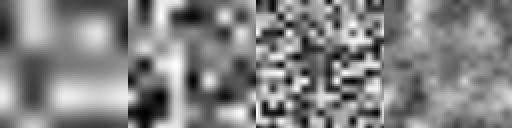
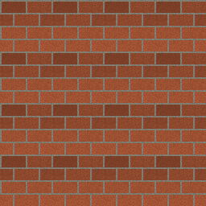
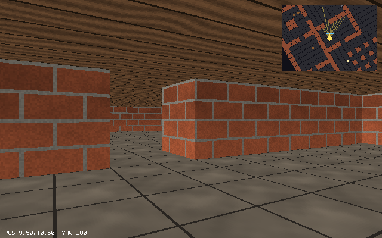
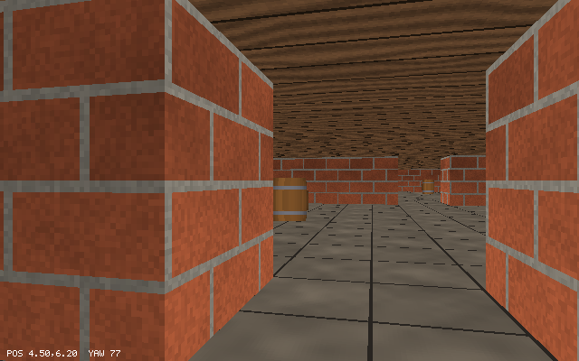
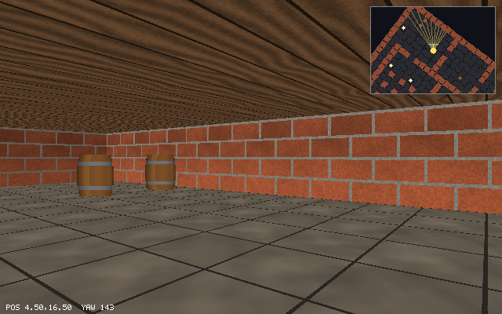
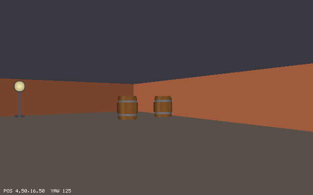
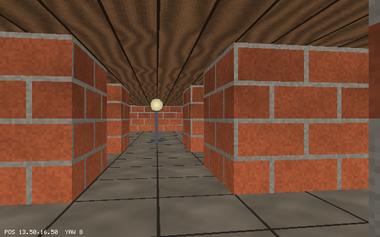

# Chapter 14 — Ray Casting II: Textures, Sprites, and Mouse Look

At the end of Chapter 13 the cellar was made of flat colors: one color per wall type, gray
above, brown below. This chapter makes it look like a cellar. Brick and stone go on the walls,
flagstones on the floor, and wooden planks on the ceiling. Lamps and barrels stand in the rooms.
Every texture is computed by code from hashed noise when the program starts, so `delve` still
has no image files. The barrels and lamps are *sprites*: flat pictures that always face you. A
wall in front of a sprite hides it because the renderer stores one depth value for every screen
column. That array is the book's first depth buffer, and it grows into the z-buffer of Chapter 18.
Finally, the mouse turns the view, and a small map sits in the corner of the screen.

Previous: [Chapter 13 — Ray Casting: The Maze in 2.5D](13-ray-casting.md). Next:
[Chapter 15 — Cameras and Projection](15-cameras-and-projection.md).

## Textures from noise

A *texture* is a small image that gets painted onto a surface. In `delve` every texture is
64x64 *texels* (texture pixels) and is stored in a `Canvas`, the same pixel grid the screen
uses. The size is a power of two on purpose. A texture repeats across a wall, so texel column
65 is column 1 again. That wrap is `x % 64`, and for a power of two the remainder is just the
low bits: `x & 63`. The bitwise version also works for negative coordinates in two's complement:
`-1 & 63` is 63, the last column, which is exactly what wrapping should give.

We could load the textures from PNG files. Instead they are made by code, for two reasons: the
project stays a set of source files with nothing to download, and building them teaches the
basic tool of *procedural* textures, which is noise.

### A hash: randomness you can repeat

Bricks should not all be the same color, and a stone wall needs speckles. That calls for random
numbers, but with a catch: texel (12, 40) must get the same random number every time the
program runs, and every time the code asks for it. A random number generator with a running
state does not give that. A *hash function* does: it turns its inputs into a number that looks
random, and the same inputs always give the same number.

`examples/ch14/hash_noise.zig` starts with the hash:

```zig
fn hash(x: u32, y: u32, seed: u32) u32 {
    var h = x *% 0x8da6b343 +% y *% 0xd8163841 +% seed *% 0xcb1ab31f;
    h ^= h >> 15;
    h *%= 0x2c1b3c6d;
    h ^= h >> 12;
    h *%= 0x297a2d39;
    h ^= h >> 15;
    return h;
}

fn random(x: u32, y: u32, seed: u32) f32 {
    return @as(f32, @floatFromInt(hash(x, y, seed) & 0xffff)) / 65535.0;
}
```

The first line folds the three inputs into one 32-bit number, each multiplied by a different
large odd constant. The five lines after it are `prospector32`, a hash Chris Wellons found by
searching for good combinations of shifts and multipliers (see his article "Prospecting for
Hash Functions"). Each step does one simple job:

- `h ^= h >> 15` mixes high bits into low bits. A shift right moves the top bits down, and the
  XOR combines them with what is there.
- `h *%= constant` mixes low bits into high bits. In a multiplication every bit of the result
  depends on the bits of `h` at and below it.

Alternating the two spreads a change in any input bit over the whole result. `random` keeps
the low 16 bits and divides by 65535 to get a number from 0 to 1.

The `%` in `*%`, `+%` and `*%=` is not decoration. Zig's ordinary `*` and `+` treat overflow as
a bug: in a Debug build they check every operation and stop the program when the result does
not fit. A hash overflows on purpose all the time. The wrapping operators say "keep the low 32
bits and go on", which is what the C version does silently. To see the difference, copy the
example to `hash_bad.zig` and replace each wrapping operator with the plain one:

```console
$ zig run examples/ch14/hash_bad.zig
hash(0, 0, 0) = 0x00000000
thread 211374 panic: integer overflow
.../examples/ch14/hash_bad.zig:12:7: 0x1203542 in hash (hash_bad.zig)
    h *= 0x2c1b3c6d;
      ^
.../examples/ch14/hash_bad.zig:46:87: 0x11e9acb in main (hash_bad.zig)
        std.debug.print("hash({d}, {d}, {d}) = 0x{x:0>8}\n", .{ a[0], a[1], a[2], hash(a[0], a[1], a[2]) });
                                                                                      ^
```

- The first call works because every product with 0 is 0. The second, `hash(1, 0, 0)`, gets
  past the first line (`1 * 0x8da6b343` fits) and overflows on the first real mixing step.
- The constants are `comptime_int` values, and they fit in a `u32`, so the compiler accepts
  them. The overflow happens at run time, so only the safety check catches it.
- In a ReleaseFast build the check is gone and overflow is undefined behavior. Use the wrapping
  operators whenever wrapping is what you mean.

The real example prints a few hashes:

```console
$ zig run examples/ch14/hash_noise.zig
hash(0, 0, 0) = 0x00000000
hash(1, 0, 0) = 0xe9e294b5
hash(0, 1, 0) = 0xb0354bb3
hash(0, 0, 1) = 0xeeb450e3
hash(1, 0, 0) = 0xe9e294b5
```

- Neighboring inputs give unrelated outputs: changing x by one changes about half the bits.
- The same input gives the same output (the second `hash(1, 0, 0)`).
- `hash(0, 0, 0)` is 0. A shift-XOR leaves 0 at 0 and so does a multiply, so 0 can never escape.
  For textures that is harmless: one lattice point out of thousands is black.

### Value noise

Random numbers per texel give *white noise*: every texel unrelated to its neighbors, like
static on an old TV. Real materials vary smoothly: a stain spreads over many texels. *Value
noise* gets that by putting random values only on a coarse lattice, say every 16 texels, and
blending them in between.

Take the texel (x, y) and a lattice of cells `cell` texels wide. It lies in lattice square
`(x0, y0) = (x / cell, y / cell)`, at fractions `fx = (x % cell) / cell` and
`fy = (y % cell) / cell` across it. The four corners carry random values `a`, `b` (top) and
`c`, `d` (bottom). Blend along x on the top edge and on the bottom edge, then blend the two
results along y:

```text
   a ------- top ------- b         top    = lerp(a, b, fx)
   |          |          |         bottom = lerp(c, d, fx)
   |          * (x, y)   |         value  = lerp(top, bottom, fy)
   |          |          |
   c ------ bottom ----- d
```

That is *bilinear* interpolation. With straight `fx` and `fy` it has a flaw: inside one square
the value changes at a constant rate along x, and at the lattice line it switches to the next
square's rate. The slope jumps, and the eye sees the lattice as a grid of creases. The fix is
to bend the fractions with *smoothstep*, `s(t) = t²(3 − 2t)`, before blending.

Why that polynomial? We want `s(0) = 0` and `s(1) = 1`, so the blend still starts at one corner
and ends at the other, and we want the slope to be 0 at both ends, `s′(0) = s′(1) = 0`, so that
every square arrives at its lattice lines flat and the slopes on the two sides match (both 0).
Four conditions fit a cubic `s(t) = p t³ + q t² + r t + k`. `s(0) = 0` gives `k = 0`;
`s′(0) = 0` gives `r = 0`. That leaves `s(t) = p t³ + q t²` with `s(1) = p + q = 1` and
`s′(1) = 3p + 2q = 0`, so `p = −2` and `q = 3`: `s(t) = 3t² − 2t³ = t²(3 − 2t)`.

`examples/ch14/smoothstep.zig` blends three lattice values, 0.2, 0.9 and 0.4 at x = 0, 1 and 2,
both ways, and measures the slope on each side of x = 1:

```zig
fn smooth(t: f32) f32 {
    return t * t * (3 - 2 * t);
}

fn blend(values: [3]f32, x: f32, comptime f: fn (f32) f32) f32 {
    const i: usize = @min(1, @as(usize, @intFromFloat(@floor(x))));
    const t = x - @as(f32, @floatFromInt(i));
    return std.math.lerp(values[i], values[i + 1], f(t));
}
```

```console
$ zig run examples/ch14/smoothstep.zig
   x   linear  smooth
0.00   0.200   0.200
0.25   0.375   0.309
0.50   0.550   0.550
0.75   0.725   0.791
1.00   0.900   0.900
1.25   0.775   0.822
1.50   0.650   0.650
1.75   0.525   0.478
2.00   0.400   0.400
linear: slope left of x=1  0.700, right of x=1 -0.500
smooth: slope left of x=1  0.002, right of x=1 -0.001
```

- Both curves pass through the lattice values and agree at the halfway points (smoothstep of
  0.5 is 0.5).
- The linear blend climbs at 0.7 and then falls at 0.5 the moment it crosses x = 1: a sharp
  corner. The smooth one arrives flat and leaves flat. The measured slopes are not exactly 0
  only because the example measures them over a step of 0.001.
- `blend` takes the shaping function as a `comptime` parameter, so each call gets its own
  copy of `blend` with `f` known. The `inline for` over the two pairs is needed for the same
  reason: a function type is a comptime-only value.

### Noise that tiles

Here is value noise in code, from `hash_noise.zig`:

```zig
fn noise(x: u32, y: u32, cell: u32, seed: u32) f32 {
    const cells = size / cell; // lattice points per row; wrapping makes it tile
    const x0 = x / cell;
    const y0 = y / cell;
    const fx = smooth(@as(f32, @floatFromInt(x % cell)) / @as(f32, @floatFromInt(cell)));
    const fy = smooth(@as(f32, @floatFromInt(y % cell)) / @as(f32, @floatFromInt(cell)));
    const a = random(x0 % cells, y0 % cells, seed);
    const b = random((x0 + 1) % cells, y0 % cells, seed);
    const c = random(x0 % cells, (y0 + 1) % cells, seed);
    const d = random((x0 + 1) % cells, (y0 + 1) % cells, seed);
    return std.math.lerp(std.math.lerp(a, b, fx), std.math.lerp(c, d, fx), fy);
}
```

The `% cells` makes the texture tile. With `cell = 16` there are 4 lattice squares across the
64 texels, with corners at lattice x = 0, 1, 2, 3, and the right edge of the last square would be
lattice x = 4. `4 % 4` is 0, so the last square blends toward the values on the *left* edge. The
texel to the right of x = 63 is x = 0 of the next copy, and the values match exactly: no seam.
This only works because `cell` divides 64 evenly.

One layer of noise looks like blurry blobs. Real surfaces have big variations and small ones
at the same time, so `fractal` adds three *octaves*, each with cells half the size and less
weight:

```zig
fn fractal(x: u32, y: u32, seed: u32) f32 {
    return 0.5 * noise(x, y, 16, seed) + 0.3 * noise(x, y, 8, seed + 1) + 0.2 * noise(x, y, 4, seed + 2);
}
```

The weights add up to 1, so the result stays between 0 and 1. Each octave gets its own seed;
with the same seed the octaves would share lattice values at the points where their lattices
line up.

The example prints a grid of noise values and writes the octaves to an image:

```console
$ zig run examples/ch14/hash_noise.zig
...
noise(x, y, cell 16) every 4 texels:
 0.32 0.39 0.56 0.73 0.80 0.72 0.54 0.36
 0.28 0.37 0.55 0.72 0.81 0.73 0.57 0.40
 0.21 0.31 0.51 0.72 0.82 0.75 0.61 0.48
 0.14 0.25 0.48 0.72 0.83 0.78 0.66 0.55
 0.11 0.22 0.47 0.72 0.83 0.79 0.69 0.59
 0.18 0.27 0.46 0.66 0.74 0.71 0.64 0.57
 0.34 0.37 0.45 0.52 0.55 0.55 0.53 0.52
 0.50 0.48 0.43 0.39 0.37 0.38 0.43 0.47

wrote noise.ppm, 256x64
```

- Neighboring values differ by about 0.1 at most: the noise is smooth, unlike the raw hashes.
- Each row covers 32 texels, two lattice squares. The fourth column is x = 12, the eighth is
  x = 28.



From left to right: cells of 16, 8 and 4 texels, then `fractal`, all scaled up 2x. The
coarse octave still shows its lattice as faint horizontal and vertical bands; value noise does
that, and the finer octaves break it up in the sum on the right.

### Bricks

A texture is a function from texel coordinates to a color. Bricks are the clearest example:
`examples/ch14/brick_texture.zig` lays 32x16 bricks in rows, with every other row shifted by
half a brick, and two texels of mortar around each:

```zig
fn isMortar(x: u32, y: u32) bool {
    const row = y / 16; // bricks are 32x16 texels
    const sx = (x + (row % 2) * 16) % size; // every other row shifted by half a brick
    return y % 16 < 2 or sx % 32 < 2;
}

fn brick(x: u32, y: u32) [3]u8 {
    const grain = 0.85 + 0.15 * random(x, y, 7);
    if (isMortar(x, y)) return shade(.{ 0x9a, 0x94, 0x88 }, grain * 0.9);
    const row = y / 16;
    const sx = (x + (row % 2) * 16) % size;
    const tint = 0.75 + 0.3 * random(sx / 32, row, 3); // one tint per brick
    return shade(.{ 0xb0, 0x5a, 0x38 }, @min(1, tint * grain));
}
```

- `sx / 32` and `row` together number the bricks, so `random(sx / 32, row, 3)` is one random
  tint per brick: every texel of a brick hashes the same lattice point.
- `random(x, y, 7)` is per texel: white noise, which here is what we want, a fine grain.
- Every size divides 64 (2 brick columns, 4 brick rows), and the offset of 16 is half a brick,
  so the pattern tiles.
- In the shifted rows, one brick runs off the right edge and comes back on the left: texels
  50 to 63 and 0 to 15. The `% size` on `sx` makes both halves land in the same group:
  `sx` is 2 to 15 on the right and 16 to 31 on the left, both in group 0. Without it the right
  half would have `sx` from 66 to 79, group 2, a different tint from the left half, and every
  copy of the texture would show a brick with two colors: a seam.

The example prints the layout at one character per 2x4 texels, then writes the texture tiled
4x4:

```console
$ zig run examples/ch14/brick_texture.zig
--------------------------------
-BBBBBBBBBBBBBBB-BBBBBBBBBBBBBBB
-BBBBBBBBBBBBBBB-BBBBBBBBBBBBBBB
-BBBBBBBBBBBBBBB-BBBBBBBBBBBBBBB
--------------------------------
BBBBBBBB-BBBBBBBBBBBBBBB-BBBBBBB
BBBBBBBB-BBBBBBBBBBBBBBB-BBBBBBB
BBBBBBBB-BBBBBBBBBBBBBBB-BBBBBBB
--------------------------------
-BBBBBBBBBBBBBBB-BBBBBBBBBBBBBBB
-BBBBBBBBBBBBBBB-BBBBBBBBBBBBBBB
-BBBBBBBBBBBBBBB-BBBBBBBBBBBBBBB
--------------------------------
BBBBBBBB-BBBBBBBBBBBBBBB-BBBBBBB
BBBBBBBB-BBBBBBBBBBBBBBB-BBBBBBB
BBBBBBBB-BBBBBBBBBBBBBBB-BBBBBBB
wrote brick.ppm, 256x256
```



Sixteen copies, and no seam shows where one ends and the next begins.

### `texture.zig`

The project's textures live in a new file, `src/texture.zig`. It starts with the texture type:

```zig
/// Every texture is size x size texels. A power of two, so wrapping a
/// coordinate is a bitwise AND.
pub const size = 64;
const mask = size - 1;

pub const Texture = struct {
    canvas: Canvas,

    /// The texel at integer coordinates, wrapped so the texture repeats.
    pub fn texel(tex: Texture, x: i32, y: i32) Color {
        const ux: usize = @intCast(x & mask);
        const uy: usize = @intCast(y & mask);
        return tex.canvas.pixels[uy * size + ux];
    }

    /// Nearest-texel sampling at texture coordinates (u, v); (0, 0) is the
    /// top-left corner and (1, 1) the bottom-right. Outside 0..1 the texture
    /// repeats.
    pub fn sample(tex: Texture, u: f32, v: f32) Color {
        return tex.texel(@intFromFloat(@floor(u * size)), @intFromFloat(@floor(v * size)));
    }
};
```

- `texel` takes `i32` so that callers can pass coordinates that run past the edge in either
  direction. `x & mask` is between 0 and 63 for any `i32`, so the `@intCast` to `usize` always
  succeeds.
- `sample` works in *texture coordinates*: u across and v down, 0 to 1 over one copy of the
  texture. That is how surfaces talk about textures without knowing their size. Taking the
  texel that contains (u, v) is *nearest* sampling: fast, but blocky up close and noisy far
  away. Exercise 4 tries a smoother kind, and Chapter 20 deals with the far-away problem.
- The `@floor` matters for negative u. `@intFromFloat(-0.3 * 64)` would round toward zero and
  give texel 0 where the floor gives −20, which wraps to 44.

There are six textures, one per `Kind`, kept in an `std.EnumArray`: an array with one slot
per enum value, indexed by the enum itself.

```zig
pub const Kind = enum { brick, stone, floor, ceiling, lamp, barrel };

pub const Set = struct {
    textures: std.EnumArray(Kind, Texture),

    pub fn generate(gpa: std.mem.Allocator) !Set {
        var set: Set = .{ .textures = undefined };
        var done: usize = 0;
        errdefer for (set.textures.values[0..done]) |*t| t.canvas.deinit(gpa);
        inline for (comptime std.enums.values(Kind)) |kind| {
            var canvas = try Canvas.init(gpa, size, size);
            for (0..size) |y| {
                for (canvas.row(y), 0..) |*p, x| p.* = paint(kind, @intCast(x), @intCast(y));
            }
            set.textures.set(kind, .{ .canvas = canvas });
            done += 1;
        }
        return set;
    }

    pub fn deinit(set: *Set, gpa: std.mem.Allocator) void {
        for (&set.textures.values) |*t| t.canvas.deinit(gpa);
    }

    pub fn get(set: *const Set, kind: Kind) Texture {
        return set.textures.get(kind);
    }
};

fn paint(comptime kind: Kind, x: u32, y: u32) Color {
    return switch (kind) {
        .brick => brick(x, y),
        .stone => stone(x, y),
        .floor => flagstone(x, y),
        .ceiling => planks(x, y),
        .lamp => lamp(x, y),
        .barrel => barrel(x, y),
    };
}
```

- If the fourth allocation fails, the first three canvases must be freed. `done` counts the
  finished ones, and the `errdefer` frees exactly `values[0..done]`. Freeing all six would
  free the `undefined` ones too.
- `std.EnumArray` stores the slots in declaration order in `values`, and `std.enums.values`
  lists the enum's values in that same order, so slot `i` is filled in step `i`.
- The loop is an `inline for`, so `kind` is comptime-known in each copy of the body. `paint`
  takes `comptime kind`, so its `switch` is resolved at compile time: each copy of the inner
  loop calls one painter directly, with no `switch` per texel.

The painters are small functions like the example's `brick`. The project's version also
multiplies in `fractal` noise, so each brick is blotchy instead of evenly colored:

```zig
fn brick(x: u32, y: u32) Color {
    const row = y / 16;
    // Wrapped, so the brick across the right edge is one brick with the
    // one at the left edge: same tint, no seam when the texture repeats.
    const sx = (x + (row % 2) * 16) % size;
    const grain = 0.85 + 0.15 * random(x, y, 7);
    if (y % 16 < 2 or sx % 32 < 2) return Color.hex(0x9a9488).scale(grain * 0.9);
    const tint = 0.75 + 0.3 * random(sx / 32, row, 3); // each brick a bit different
    return Color.hex(0xb05a38).scale(@min(1, tint * grain * (0.8 + 0.3 * fractal(x, y, 11))));
}
```

The others follow the same pattern:

- `stone`: 32x32 blocks with dark seams, gray, with stronger noise. Its rows are shifted
  too, and its `sx` wraps the same way.
- `flagstone` (the floor): 32x32 tiles separated by one-texel dark lines.
- `planks` (the ceiling): boards 16 texels wide, with grain from `@sin(y * 0.9 + 6 * noise)`.
  The sine makes stripes along the board, and adding noise to its argument bends them, the
  way real wood grain bends around knots.
- `lamp` and `barrel`: the sprites. They are pictures with transparent texels around them.

Transparency uses the alpha channel that `Color` has had since Chapter 9. Wall texels have
alpha 255; around the lamp and barrel the painters return

```zig
const clear: Color = .{ .r = 0, .g = 0, .b = 0, .a = 0 };
```

and the sprite drawing will skip texels with alpha 0. The barrel shows how far a little math
goes in a painter:

```zig
/// A wooden barrel, shaded like a cylinder, with two iron bands.
fn barrel(x: u32, y: u32) Color {
    if (y < 30) return clear;
    const fy: f32 = @floatFromInt(y - 30);
    const bulge = 13 + 2 * @sin(fy / 34 * std.math.pi); // half-width
    const dx = @as(f32, @floatFromInt(x)) + 0.5 - 32;
    if (@abs(dx) > bulge) return clear;
    const light = 0.45 + 0.55 * @sqrt(1 - (dx / bulge) * (dx / bulge)); // round shading
    if ((y >= 36 and y < 39) or (y >= 56 and y < 59)) return Color.hex(0x707078).scale(light);
    const stave = 0.85 + 0.15 * random(@intFromFloat(@floor((dx + bulge) / 5)), 0, 17);
    return Color.hex(0x8a5a2c).scale(light * stave);
}
```

- The barrel fills rows 30 to 63, so it stands on the bottom edge of the picture and is about
  half as tall as a wall.
- `bulge` is the half-width: 13 texels at the top and bottom, 15 in the middle, following
  half a sine wave over the 34 rows.
- `light` treats each row as a circle seen from the front. At horizontal offset `dx` on a
  circle of radius `bulge`, the surface faces you by `sqrt(1 − (dx/bulge)²)` (the cosine of
  the angle between the surface and your line of sight), so the middle is bright and the
  edges fall off. Chapter 19 does this properly, as diffuse lighting.

`Color.scale` is new in `canvas.zig`. It multiplies red, green and blue by a factor and keeps
alpha:

```zig
    /// The color with red, green, and blue multiplied by `f` (0 to 1).
    pub fn scale(c: Color, f: f32) Color {
        return .{
            .r = @intFromFloat(@as(f32, @floatFromInt(c.r)) * f),
            .g = @intFromFloat(@as(f32, @floatFromInt(c.g)) * f),
            .b = @intFromFloat(@as(f32, @floatFromInt(c.b)) * f),
            .a = c.a,
        };
    }
```

`@intFromFloat` truncates, so `0xff * 0.5 = 127.5` becomes `0x7f`; the test "scale darkens a
color" pins that down. A factor above 1 could overflow `u8`, and a Debug build would stop
with a panic, so every painter keeps its factors at or below 1 (that is what the `@min(1, ...)`
in `brick` is for).

The test "textures wrap" checks the two properties the renderer relies on: `texel(3, 5)`
equals `texel(3 + 64, 5 − 64)`, `sample(1.0, 2.0)` equals `texel(0, 0)`, and only the sprite
textures have transparent texels.

## Texturing a wall strip

In Chapter 13 each column of the screen showed one strip of wall in one color. To texture it,
we need two numbers for every pixel of the strip: which column of the texture it shows (u)
and which row (v).

### The texture column

All pixels of a strip come from one ray, and the ray hits the wall at one point, so u is the
same for the whole strip. The DDA returns `t`, how far along the ray the wall is, so the hit
point is

```text
p = pos + ray · t
```

The hit is on a cell's face, and a face is a unit-long piece of a grid line. On an x side the
face is a line of constant x, running along y, so the position along the face is the
fractional part of `p.y`. On a y side it is the fractional part of `p.x`:

```text
along  = p.y if the side is x, p.x if the side is y
wall_x = along − floor(along)              between 0 and 1
column = floor(wall_x · 64)
```

There is one more step. Stand in front of a wall and look at it: the texture's column 0 should
be on your left and column 63 on your right, whichever face you look at. Otherwise text would
read backwards and asymmetric patterns would flip from one face to the next. `wall_x` does not
care where you stand: on a face of constant x it always grows toward +y. So look at which way
+y is for the viewer.

Your right is `perp(dir)`, the direction the camera plane points (Chapter 13). Since y grows
downward on the map, facing east (+x) puts south (+y) on your right; facing west puts north
(−y) on your right. Looking east at a west face, `wall_x` grows to your right: good. Looking west
at an east face, it grows to your left: flip it, `u = 1 − wall_x`. The same reasoning for faces
of constant y: facing south, your right is west (−x), so flip; facing north, your right is east,
so keep. The rule, from the ray's direction:

```text
flip when (side x and ray.x < 0) or (side y and ray.y > 0)
```

`examples/ch14/wall_u.zig` checks it on the four faces of the cell (5, 5). For each face it
takes three hit points in the order the viewer sees them, left to right:

```zig
    for (faces) |f| {
        std.debug.print("{s} ", .{f.name});
        for (f.hits) |p| {
            const along = if (f.side_x) p[1] else p[0];
            const wall_x = along - @floor(along);
            const flip = (f.side_x and f.ray[0] < 0) or (!f.side_x and f.ray[1] > 0);
            const u = if (flip) 1 - wall_x else wall_x;
            const column: u32 = @intFromFloat(@floor(u * 64));
            std.debug.print("  {d:.1} -> {d:.1} ({d:>2})", .{ wall_x, u, column });
        }
        std.debug.print("\n", .{});
    }
```

```console
$ zig run examples/ch14/wall_u.zig
face                   left to right: wall_x -> u (texel column)
west  (looking east)    0.2 -> 0.2 (12)  0.5 -> 0.5 (32)  0.8 -> 0.8 (51)
east  (looking west)    0.8 -> 0.2 (12)  0.5 -> 0.5 (32)  0.2 -> 0.8 (51)
north (looking south)   0.8 -> 0.2 (12)  0.5 -> 0.5 (32)  0.2 -> 0.8 (51)
south (looking north)   0.2 -> 0.2 (12)  0.5 -> 0.5 (32)  0.8 -> 0.8 (51)
```

- `wall_x` runs left to right on two faces and right to left on the other two.
- After the flip, every face shows columns 12, 32, 51 from left to right: the texture is never
  mirrored.

### The texture row

Within the strip, v goes from 0 at the top of the wall to 1 at the bottom. The strip covers
screen rows `top` to `top + wall_h`, so the pixel whose center is at `y + 0.5` shows

```text
v = (y + 0.5 − top) / wall_h
```

That is a straight-line (*affine*) map from screen rows to texture rows. It is exact here, and
it is worth seeing why, because in Chapter 20 the same idea gives warped textures. In Chapter 13
a point at height `z` (the floor is 0, the eye 0.5, the ceiling 1) at depth `d` appears at

```text
screen y = H/2 + (0.5 − z) · H / d
```

Along one strip, every point of the wall has the same depth `d`: a wall face is vertical, and
the strip is a vertical line on it. With `d` fixed, screen y is a linear function of `z`, so
equal steps down the wall are equal steps down the screen. The perspective divide happens
once per column, in `wall_h = H / d`. When the depth changes along a line on the screen, as it
does across the floor below, a straight-line map is wrong, and that needs a different method.

### In the project

`drawWall` in `src/raycast.zig` now draws one column either way, flat or textured, and returns
the wall's depth (the next sections need it):

```zig
/// Draws the wall in column `x` and returns its distance.
fn drawWall(canvas: Canvas, scene: Scene, cam: Camera, x: usize, opts: Options) f32 {
    const h: f32 = @floatFromInt(canvas.height);
    const ray = cam.ray(x, canvas.width);
    const hit = cast(scene.map, cam.pos, ray);
    const dist = if (opts.fisheye) hit.t * math.length(ray) else hit.t;
    const wall_h = wallHeight(canvas.height, dist);
    const top = h / 2 - wall_h / 2;
    // Fill the rows whose pixel centers lie between top and bottom.
    const y0 = pixelRow(top, canvas.height);
    const y1 = pixelRow(top + wall_h, canvas.height);
    const shade: f32 = if (hit.side == .y) y_side_shade else 1;

    if (!opts.textured) {
        const color = wallColor(hit.tile).scale(shade);
        for (y0..y1) |y| canvas.pixels[y * canvas.width + x] = color;
        return hit.t;
    }

    // Where along the wall face the ray hit, 0 to 1: the texture column.
    const p = cam.pos + math.scale(ray, hit.t);
    const along = if (hit.side == .x) p[1] else p[0];
    var u = along - @floor(along);
    // Flip faces seen from the other side, so no texture is mirrored.
    if ((hit.side == .x and ray[0] < 0) or (hit.side == .y and ray[1] > 0)) u = 1 - u;

    const tex = scene.textures.get(wallTexture(hit.tile));
    const tx: i32 = @intFromFloat(@floor(u * texture.size));
    for (y0..y1) |y| {
        const v = (@as(f32, @floatFromInt(y)) + 0.5 - top) / wall_h;
        const ty: i32 = @intFromFloat(@floor(v * texture.size));
        canvas.pixels[y * canvas.width + x] = tex.texel(tx, ty).scale(shade);
    }
    return hit.t;
}
```

- The strip only covers rows `y0` to `y1` now. Chapter 13's loop wrote all 400 rows of the
  column, ceiling and floor included; here the floor and ceiling are drawn before the walls,
  and the wall is drawn over them.
- `shade` keeps the y faces darker, as in Chapter 13, now with `Color.scale`, which works on
  texels and flat colors alike.
- `wallColor` and the new `wallTexture` are `switch`es on the tile: brick walls get the brick
  texture, stone walls the stone one.
- `tx` is the same for the whole strip and is computed once. `ty` changes per pixel. When the
  wall is close, `wall_h` is larger than 64, several pixels map to one texel, and the texels
  show as blocks: that is nearest sampling up close.
- In fisheye mode the strip height uses the eye distance, but the texture column still comes
  from `hit.t`, the real hit point. The function returns `hit.t` in both modes.

## Floors and ceilings

Chapter 13 painted the floor one flat color. Texturing it needs a different method from the
walls, because a floor is not a vertical strip: going down a column of the screen, the floor
gets nearer with every row.

The method is called *floor casting*, and it rests on one observation. Ask which floor point
a given screen row shows. The bottom edge of a wall at depth `d` appears `H / (2d)` pixels below
the horizon (from `screen y = H/2 + (0.5 − z) · H/d` with `z = 0`). The bottom edge of a wall is
a point on the floor, and any floor point at depth `d` appears at the same height on the screen.
So turn it around: the pixel row whose center is `below = y + 0.5 − H/2` pixels under the
horizon shows the floor at depth

```text
d = (H/2) / below
```

The whole row sees the floor at that one depth. That is the property that makes floor casting
cheap: the division happens once per row, not once per pixel.

```text
   side view
   eye o--------------------------------------------- horizon
       |  ` .                         ^
   0.5 |       ` .  row y             | below = y + 0.5 − H/2 pixels,
       |            ` .               v   on a screen 1 unit in front
 floor +-----------------` .-----------------------
       |<------- d ---------->|  the floor point row y sees
```

Which floor point does each pixel of the row show? The ray of column x is `dir + plane ·
camera_x`, and it reaches depth `d` at `t = d`, because the ray's component along `dir` is 1
(Chapter 13). So pixel x shows the floor point

```text
pos + (dir + plane · camera_x) · d,        camera_x = 2(x + 0.5)/W − 1
```

That is linear in x. At the screen's left edge, `camera_x = −1`, the point is
`pos + (dir − plane) · d`; each pixel to the right adds `2/W` to `camera_x`, which moves the
point by

```text
step = plane · 2d / W
```

The first pixel center is half a pixel in from the edge, so the walk starts at
`left + step/2` and adds `step` per pixel: one vector addition per pixel, no division, no
multiplication. The floor point's x and y, in map units, are the texture coordinates
directly: one map cell holds one copy of the texture, so the 32x32 flagstones are half a cell
wide.

The ceiling is one unit above the floor, half a unit above the eye, so it is the floor's mirror
image about the horizon: the row `H − 1 − y` is as far above the horizon as row y is below it,
and it sees the ceiling at the same depth and the same map points. One walk across the row
fills both.

`examples/ch14/floor_rows.zig` prints the depth for some rows of a 640x400 screen, and how far
the walk moves per pixel:

```zig
    for ([_]u32{ 200, 201, 202, 205, 210, 220, 240, 280, 320, 360, 399 }) |y| {
        // How far below the horizon this row's pixel center is.
        const below = @as(f32, @floatFromInt(y)) + 0.5 - h / 2;
        const d = (h / 2) / below;
        // The row covers the floor from pos + (dir - plane) d to
        // pos + (dir + plane) d: 2 * 0.8 * d units in 640 pixels.
        const step = 2 * plane_len * d / w;
        std.debug.print("{d:>3}  {d:>5.1}  {d:>8.3}  {d:>17.4}  {d:>12.2}\n", .{ y, below, d, step, step * 64 });
    }
```

```console
$ zig run examples/ch14/floor_rows.zig
row  below  distance  floor units/pixel  texels/pixel
200    0.5   400.000             1.0000         64.00
201    1.5   133.333             0.3333         21.33
202    2.5    80.000             0.2000         12.80
205    5.5    36.364             0.0909          5.82
210   10.5    19.048             0.0476          3.05
220   20.5     9.756             0.0244          1.56
240   40.5     4.938             0.0123          0.79
280   80.5     2.484             0.0062          0.40
320  120.5     1.660             0.0041          0.27
360  160.5     1.246             0.0031          0.20
399  199.5     1.003             0.0025          0.16
```

- The bottom row sees the floor 1 unit ahead: the floor right under the bottom edge of the
  screen. Half the screen (rows 300 to 399) covers depths from 2 down to 1.
- Toward the horizon the depth explodes: row 200, half a pixel under it, sees 400 units away.
  The floor never reaches the horizon; it only gets closer to it.
- The last column is the problem. Below row 240 a step moves less than one texel, and
  neighboring pixels show the same or neighboring texels. Above row 220 a step skips texels:
  12.8 per pixel at row 202. Nearest sampling picks one texel out of every 13 and ignores the
  rest. Which one depends on the exact position, so as you move the picked texels change
  from frame to frame, and the distant floor flickers. The rows skip even more in depth than
  across: row 210 sees 19.0 units away and row 211 sees 17.4.

That flicker is *aliasing*, the same effect as a fence filmed through a camera: a pattern
finer than the pixels shows up as a coarser false pattern, a *moiré*. The cure is to average
the skipped texels, and doing that fast needs precomputed smaller copies of each texture,
*mipmaps*, which come in Chapter 20.

The project's `drawFloorAndCeiling` follows the derivation line by line:

```zig
/// Floor casting: every row below the horizon shows the floor at one
/// distance, so walk across the row in equal steps over the floor.
/// The ceiling is the same picture mirrored about the horizon.
fn drawFloorAndCeiling(canvas: Canvas, textures: *const texture.Set, cam: Camera) void {
    const floor_tex = textures.get(.floor);
    const ceiling_tex = textures.get(.ceiling);
    const w: f32 = @floatFromInt(canvas.width);
    const h: f32 = @floatFromInt(canvas.height);
    for (canvas.height / 2..canvas.height) |y| {
        // The eye is half a unit above the floor. A floor point at
        // distance d appears (h / d) / 2 pixels below the horizon (like the
        // bottom of a wall), so this row's pixel center sees distance:
        const below = @as(f32, @floatFromInt(y)) + 0.5 - h / 2;
        const d = (h / 2) / below;
        // The floor points under the left and right edges of the screen,
        // and the step from one pixel center to the next.
        const left = cam.pos + math.scale(cam.dir - cam.plane, d);
        const step = math.scale(cam.plane, 2 * d / w);
        var p = left + math.scale(step, 0.5);
        const floor_row = canvas.row(y);
        const ceiling_row = canvas.row(canvas.height - 1 - y);
        for (floor_row, ceiling_row) |*f, *c| {
            f.* = floor_tex.sample(p[0], p[1]);
            c.* = ceiling_tex.sample(p[0], p[1]);
            p += step;
        }
    }
}
```

- `for (floor_row, ceiling_row) |*f, *c|` walks two slices of the same length together, a
  pixel of each per step. Both rows are whole canvas rows, so the loop writes memory in order.
- The ceiling uses the same `p` as the floor: the mirror image needs no second walk.
- `p += step` adds two `@Vector(2, f32)` values. Over 640 pixels the small rounding errors of
  repeated addition add up, but to well under a texel.



This is the view from Chapter 13's screenshot (`--pos 9.5,10.5 --yaw -60`), textured. Near
the camera the bricks show the blocks of nearest sampling, each texel several pixels wide.
Toward the horizon the floor's dark tile lines break up into dashes, and on the ceiling the
plank lines crowd together into curved bands that are not in the texture at all: moiré.

## Sprites: billboards in camera space

A lamp or a barrel is not a wall. It stands at a point in a cell, and you can walk around it.
Real 3D models would need the rest of this book. The ray caster uses the 1992 trick instead: a
*sprite* is a flat picture that always faces the camera, a *billboard*. It looks right from
every direction because it looks the same from every direction.

To draw a sprite we need its position on the screen and its size. Both come from where the
sprite is relative to the camera, so the first step is to write the sprite's position in the
camera's own coordinates.

### Two dot products

Let `rel = s − pos` be the vector from the camera to the sprite. The camera has two directions:
`dir`, straight ahead, length 1, and `plane`, to the right, length 0.8 and perpendicular to
`dir`. Any vector on the map is some amount of each:

```text
rel = a · dir + b · plane
```

`a` is the sprite's *depth*, how far in front of the camera it is, and `b` is how far to the
right, in plane lengths. To find them, take dot products and use the fact that `dir` and
`plane` are perpendicular (their dot product is 0):

```text
dot(rel, dir)   = a · dot(dir, dir)   + b · dot(plane, dir)   = a · 1 + 0       →  a = dot(rel, dir)
dot(rel, plane) = a · dot(dir, plane) + b · dot(plane, plane) = 0 + b · |plane|²  →  b = dot(rel, plane) / |plane|²
```

Dividing by `|plane|² = 0.64` is the price of `plane` not having length 1: the dot product
measures along `plane` in units of its own length, times its length, so we divide by the length
twice. (Lode Vandevenne's tutorial does the same step by inverting the 2x2 matrix whose columns
are `plane` and `dir`. Because the two are perpendicular, the inverse reduces to these two dot
products.)

### Where on the screen

The ray through screen position `camera_x` is `dir + plane · camera_x` (Chapter 13). Which
`camera_x` passes through the sprite? Points on that ray are

```text
pos + t · (dir + camera_x · plane) = pos + t · dir + (t · camera_x) · plane
```

and the sprite is `pos + a · dir + b · plane`. Matching the `dir` parts gives `t = a`; matching
the `plane` parts gives `a · camera_x = b`. So

```text
camera_x = b / a
```

This is the perspective divide, and the picture explains it as similar triangles. Draw the line
from the eye to the sprite. At depth 1, where the camera plane is, it is `camera_x` plane
lengths to the side; at depth `a` it is `b` plane lengths to the side. Both triangles share the
angle at the eye, so the sides grow in proportion: `camera_x / 1 = b / a`.

```text
   top view: dir points right, plane points down (the viewer's right)

   pos o---------+--------------------------------+-------> dir
        ` .      |                                :
            ` .  | camera_x · plane               :
                `+ .                              : b · plane
              depth 1  ` .                        :
                            ` .                   :
                                ` .               :
                                     ` .          :
                                          ` .     :
                                               ` .:
                                                  * the sprite, at depth a
```

The screen column is the inverse of `camera_x = 2(x + 0.5)/W − 1`, without the half pixel
because we want a position, not a pixel index:

```text
center_x = (camera_x + 1) / 2 · W
```

The size follows from the walls. A sprite is a 1x1 unit square standing on the floor, its
center at eye height like a wall's. A wall one unit tall at depth `a` is `H / a` pixels tall, so
the sprite is `H / a` pixels tall too, and the same number of pixels wide, because the pixels
are square (Chapter 13).

`examples/ch14/sprite_projection.zig` puts the camera at (2, 2) facing east and projects four
sprites:

```zig
    for (sprites) |s| {
        const rel = s - pos;
        const depth = dot(rel, dir); // how far in front of the camera
        const side = dot(rel, plane) / dot(plane, plane); // across the plane, in plane lengths
        std.debug.print("({d:>4.1},{d:>4.1})  {d:>5.2}  {d:>5.2}", .{ s[0], s[1], depth, side });
        if (depth < 0.1) {
            std.debug.print("  behind the camera: skipped\n", .{});
            continue;
        }
        const camera_x = side / depth; // the perspective divide
        const center_x = (camera_x + 1) / 2 * w;
        const size = h / depth; // 1 unit tall, like a wall
        std.debug.print("  {d:>8.3}  {d:>8.1}  {d:>5.1}\n", .{ camera_x, center_x, size });
    }
```

```console
$ zig run examples/ch14/sprite_projection.zig
sprite      depth   side  camera_x  center_x   size
( 5.0, 2.0)   3.00   0.00     0.000     320.0  133.3
( 4.0, 3.0)   2.00   1.25     0.625     520.0  200.0
(10.0, 0.0)   8.00  -2.50    -0.312     220.0   50.0
( 1.0, 2.5)  -1.00   0.62  behind the camera: skipped

ray at camera_x 0.625 reaches (4.000, 3.000)
```

- (5, 2) is straight ahead, 3 units away: the center of the screen, a third of its height.
- (4, 3) is 2 ahead and 1 to the right (south). One unit is 1.25 plane lengths, and at depth 2
  that becomes 0.625: right of center.
- (10, 0) is far ahead and 2 units to the left. Its side offset is large, −2.5 plane lengths,
  but depth 8 shrinks it to −0.312.
- (1, 2.5) has negative depth: it is behind the camera. Dividing by a negative depth would put
  it on the screen mirrored, so sprites with a depth under 0.1 are skipped. The 0.1, not 0,
  also skips sprites so close that they would be 4,000 pixels tall.
- The last line is the check: it builds the ray through `camera_x = 0.625` and follows it to
  depth 2, and it arrives exactly at the sprite.

### Which texel

The sprite covers the square from `left = center_x − size/2` to `left + size` across, and from
`top = H/2 − size/2` to `top + size` down. Its pixels are chosen like the wall's rows, by their
centers, and each pixel's texture coordinates are a straight-line map again:

```text
u = (x + 0.5 − left) / size        v = (y + 0.5 − top) / size
```

That is exact for the same reason as on the wall: every point of a billboard is at the same
depth `a`, since the picture is parallel to the screen. Texels with alpha 0 are skipped, so the
floor and walls behind show through around the lamp and the barrel.

## Hiding sprites behind walls: a depth per column

A sprite behind a wall must not be drawn over it. The walls are drawn first, column by column,
and each column's wall has one depth: the `hit.t` that `drawWall` returns. The renderer keeps
those 640 numbers in an array, `depth[x]`. A column of a sprite at depth `a` is drawn only if
`a < depth[x]`, the sprite being nearer than that column's wall.

This works because both numbers measure the same thing. `hit.t` is the depth along `dir`,
not the distance from the eye (Chapter 13), and the sprite's `a` is the depth along `dir` too.
Comparing a depth with a distance would hide sprites near the screen edges too early. Even in
fisheye mode `drawWall` returns `hit.t`, so hiding stays right.



Standing in the cellar's west room and looking south through a doorway, a barrel in the room
beyond is cut by the edge of the doorway on its left: those columns failed `a < depth[x]`. Its
right side, where nothing is in front, is drawn with its round edge.

`depth` is one depth value per screen column. It is a *depth buffer* in one dimension, enough
because a ray caster's walls have one depth per column. In Chapter 18, triangles can have a
different depth at every pixel, and the same idea becomes a *z-buffer* with one value per
pixel.

### Sprites in front of sprites: the painter's algorithm

Sprites also cover each other: a barrel in front of a lamp. The depth array does not help here,
because it only knows the walls. The simple fix is the way a painter works: paint the
background first and the foreground last, so near things cover far things. Sort the sprites
from far to near and draw them in that order.

`examples/ch14/painter_sort.zig` does it in one dimension, with three sprites covering parts of
a 24-column screen:

```zig
fn fartherFirst(_: void, a: Sprite, b: Sprite) bool {
    return a.dist > b.dist;
}
```

```zig
    std.mem.sort(Sprite, &sprites, {}, fartherFirst);
    const good = paint(&sprites);
```

```console
$ zig run examples/ch14/painter_sort.zig
far to near: ..LLLLBBBBBBBBBBCCCC....   order LCB
near to far: ..LLLLLLBBBBCCCCCCCC....   order BCL
```

- Far to near, the lamp L (distance 6) goes first, the crate C (4) over it, and the barrel B
  (2) last: B is whole, and it covers the parts of L and C behind it.
- Near to far, the barrel is painted first and then painted over: the farthest sprite wins.

`std.mem.sort` takes a *context* and a comparison function whose first parameter has the
context's type. Here the comparison needs nothing, so the context is `{}`, the value of type
`void`. Leave the parameter out and the compiler says exactly what it wanted:

```zig
fn fartherFirst(a: Sprite, b: Sprite) bool {
    return a.dist > b.dist;
}
```

```console
$ zig run badsort.zig
badsort.zig:11:40: error: expected type 'fn (void, T, T) bool', found 'fn (T, T) bool'
    std.mem.sort(Sprite, &sprites, {}, fartherFirst);
                                       ^~~~~~~~~~~~
badsort.zig:11:40: note: T = badsort.Sprite
badsort.zig:11:40: note: function with 2 parameters cannot cast into a function with 3 parameters
.../lib/std/mem.zig:669:26: note: parameter type declared here
    comptime lessThanFn: fn (@TypeOf(context), lhs: T, rhs: T) bool,
                         ^~~~~~~~~~~~~~~~~~~~~~~~~~~~~~~~~~~~~~~~~~
```

The project needs a real context: distances depend on where the camera is, so the camera is
the context, and the comparison receives it as its first argument.

The painter's algorithm works on whole objects, and that is its limit. It needs some order in
which each object covers only objects drawn earlier. Billboards always have one: each is at a
single depth, so for any two that overlap on the screen, one is entirely in front. In full 3D
there may be no such order. Two long beams can cross like an X, each in front of the other at
one end, and three objects can each cover the next in a cycle. No order of drawing whole
objects gets those right. Chapter 18 solves it per pixel, with the z-buffer.

### The renderer

Drawing sprites needs memory that the flat-color renderer of Chapter 13 did not: the depth
array, and a copy of the sprite list to sort (sorting the map's own list would change the map
on every frame). Allocating them on every frame would work, but the sizes never change. So
`raycast.render` becomes a `Renderer` that allocates both once and reuses them:

```zig
/// Everything the ray caster draws.
pub const Scene = struct {
    map: Map,
    textures: *const texture.Set,
};

/// Draws the first-person view. Needs scratch memory, so it is a struct
/// that is created once and reused every frame.
pub const Renderer = struct {
    /// For each column, the distance to the wall drawn there. Sprites
    /// behind the wall are hidden column by column.
    depth: []f32,
    /// The map's sprites, sorted far to near each frame.
    sprites: []Sprite,

    pub fn init(gpa: std.mem.Allocator, width: usize, sprite_count: usize) !Renderer {
        const depth = try gpa.alloc(f32, width);
        errdefer gpa.free(depth);
        return .{ .depth = depth, .sprites = try gpa.alloc(Sprite, sprite_count) };
    }

    pub fn deinit(r: *Renderer, gpa: std.mem.Allocator) void {
        gpa.free(r.depth);
        gpa.free(r.sprites);
        r.* = undefined;
    }

    pub fn render(r: Renderer, canvas: Canvas, scene: Scene, cam: Camera, opts: Options) void {
        std.debug.assert(r.depth.len == canvas.width);
        if (opts.textured) {
            drawFloorAndCeiling(canvas, scene.textures, cam);
        } else {
            const horizon = canvas.height / 2;
            for (0..canvas.height) |y| @memset(canvas.row(y), if (y < horizon) ceiling_color else floor_color);
        }
        for (0..canvas.width) |x| r.depth[x] = drawWall(canvas, scene, cam, x, opts);
        r.drawSprites(canvas, scene, cam);
    }
```

- `Scene` groups what gets drawn, so `render` does not grow a parameter for every new thing.
  The textures are passed by pointer: a `Set` is six `Canvas` values, and there is no reason to
  copy them on every call.
- `render` takes `r: Renderer` by value, yet writes into `r.depth`. That is fine: copying the
  struct copies the slice, a pointer and a length, not the floats it points to.
- The `errdefer` in `init` frees `depth` if the second allocation fails.
- The `assert` catches a renderer made for a different width than the canvas. Without it, a
  narrower `depth` would stop a Debug build with an index out of bounds in the wall loop, a
  message that says where but not why.
- The order is the order of the painter: floor and ceiling, then walls, then sprites.

And the sprites themselves:

```zig
    fn drawSprites(r: Renderer, canvas: Canvas, scene: Scene, cam: Camera) void {
        @memcpy(r.sprites, scene.map.sprites);
        std.mem.sort(Sprite, r.sprites, cam, fartherFirst);

        const w: f32 = @floatFromInt(canvas.width);
        const h: f32 = @floatFromInt(canvas.height);
        const plane_len2 = math.dot(cam.plane, cam.plane);
        for (r.sprites) |sprite| {
            // The sprite in camera coordinates: how far in front of the
            // camera (depth), and where across the camera plane (-1 at the
            // left edge, 1 at the right) its center appears.
            const rel = sprite.pos - cam.pos;
            const depth = math.dot(rel, cam.dir);
            if (depth < near) continue;
            const camera_x = math.dot(rel, cam.plane) / (plane_len2 * depth);
            const center_x = (camera_x + 1) / 2 * w;
            const size = wallHeight(canvas.height, depth);
            const left = center_x - size / 2;
            const top = h / 2 - size / 2;

            const tex = scene.textures.get(spriteTexture(sprite.thing));
            const x0 = pixelRow(left, canvas.width);
            const x1 = pixelRow(left + size, canvas.width);
            const y0 = pixelRow(top, canvas.height);
            const y1 = pixelRow(top + size, canvas.height);
            for (x0..x1) |x| {
                if (depth >= r.depth[x]) continue; // behind the wall in this column
                const u = (@as(f32, @floatFromInt(x)) + 0.5 - left) / size;
                for (y0..y1) |y| {
                    const v = (@as(f32, @floatFromInt(y)) + 0.5 - top) / size;
                    const color = tex.sample(u, v);
                    if (color.a != 0) canvas.pixels[y * canvas.width + x] = color;
                }
            }
        }
    }
};

/// Sprites closer than this are not drawn: they would fill the screen.
const near = 0.1;

fn fartherFirst(cam: Camera, a: Sprite, b: Sprite) bool {
    const da = a.pos - cam.pos;
    const db = b.pos - cam.pos;
    return math.dot(da, da) > math.dot(db, db);
}
```

- `@memcpy` requires both slices to have the same length; `init` sized `r.sprites` from
  `map.sprites.len`, so they do.
- `camera_x` folds `b / a` into one division: `dot(rel, plane) / (|plane|² · depth)`.
- `pixelRow` is Chapter 13's rounding rule, the first pixel whose center is at or past an
  edge, clamped to the screen, and it works just as well for columns. A sprite half off the
  screen gets `x0 = 0` or `x1 = 640`, and its `u` still starts at the right texel because `u`
  is computed from `left`, not from `x0`.
- `fartherFirst` sorts by the squared distance from the eye. Squaring is enough for sorting,
  since larger distances have larger squares, and it saves a square root. Strictly, depth is
  the right key for billboards; for sprites that actually overlap on the screen the two orders
  almost always agree.

## Things on the map

The sprites come from the map file. `src/map.zig` has two new types:

```zig
/// Things that stand in the maze without filling a cell. The ray caster
/// draws them as sprites.
pub const Thing = enum { lamp, barrel };

pub const Sprite = struct {
    pos: Vec2,
    thing: Thing,
};
```

In the map text, `*` is a lamp and `o` a barrel. The cell under either is floor, and the thing
stands at the cell's center. `Map.parse` collects them into a growing list and hands the list
to the map at the end:

```zig
        var sprites: std.ArrayList(Sprite) = .empty;
        defer sprites.deinit(gpa);
```

```zig
                    '*', 'o' => blk: {
                        try sprites.append(gpa, .{ .pos = center, .thing = if (char == '*') .lamp else .barrel });
                        break :blk .floor;
                    },
```

```zig
            .sprites = try sprites.toOwnedSlice(gpa),
```

- `std.ArrayList` in Zig 0.17 does not store its allocator: `append` and `deinit` take it. An
  empty list is `.empty`.
- `toOwnedSlice` hands the list's memory over as a plain slice, sized to fit, and leaves the
  list empty. The `defer sprites.deinit(gpa)` then frees nothing on success, and frees the
  list if parsing fails partway through.
- `center` is computed once per character, and the player start uses it too now.
- `Map.deinit` frees `map.sprites`, and the test "parse a small map" now has a lamp in it.

`src/maps/cellar.txt` gets 9 lamps and 7 barrels, 16 sprites in all, without moving any wall.
Most rooms get one or two, and four lamps stand around the pillars in the lower middle, at
(10, 16), (18, 16), (10, 20) and (18, 20).

## Mouse look

The arrow keys turn at a fixed rate, 2.5 radians per second, and the player update multiplies
that rate by the tick's `dt` (Chapter 11). Most first-person games turn with the mouse instead,
and the mouse is different: it does not report a rate, it reports an amount. raylib's
`GetMouseDelta` returns how many pixels the mouse moved since the previous frame. Moving the
mouse 100 pixels to the right should turn the view by the same angle whether that took one
frame or ten, so the turn is the amount times a sensitivity, with no `dt`:

```zig
pub const mouse_sensitivity = 0.003; // radians per pixel of mouse movement
```

```zig
        const turn = input.turn * turn_speed * dt + input.look * mouse_sensitivity;
```

Multiplying the mouse term by `dt` as well would be a classic bug. At 30 frames per second each
frame's delta is twice as large as at 60, and `dt` is twice as large too, so the same hand
movement would turn the view twice as far at 30 frames per second as at 60.

With 0.003 radians per pixel, a 640-pixel sweep across a mouse pad turns about 110°. Games make
the sensitivity a setting; delve keeps it a constant.

### Amounts must add up

The game updates in fixed ticks of 1/60 s, and a frame can run zero, one or several ticks
(Chapter 5's fixed timestep). Chapter 12 solved the same problem for key presses:
`Input.accumulate` collects a frame's presses until a tick takes them, so a press in a frame
that runs no tick is not lost, and `take` clears them, so a press in a frame that runs two
ticks does not act twice. Mouse movement is an amount too, so it follows the same rules,
except that amounts are added rather than combined as a set. `Input` gets a field
`look: f32 = 0`, the sideways movement in pixels, `take` sets it back to 0 along with the
presses, and `accumulate` adds it up:

```zig
    /// Merges this frame's input into `pending`. Held keys are replaced by
    /// their current state; presses and mouse movement pile up until a
    /// tick takes them, so none is lost when a frame runs no tick.
    pub fn accumulate(pending: *Input, fresh: Input) void {
        const presses = pending.pressed.unionWith(fresh.pressed);
        const look = pending.look + fresh.look;
        pending.* = fresh;
        pending.pressed = presses;
        pending.look = look;
    }
```

```zig
test "mouse movement adds up until a tick takes it" {
    var pending: Input = .{};
    pending.accumulate(.{ .look = 3 });
    pending.accumulate(.{ .look = -1 });
    try std.testing.expectEqual(2, pending.take().look);
    try std.testing.expectEqual(0, pending.take().look);
}
```

Two frames without a tick moved the mouse 3 pixels right and 1 left; the next tick turns by 2
pixels' worth, and the tick after that by nothing. `combine`, which merges the keyboard with
`--hold`, adds `look` the same way.

### Capturing the mouse

A mouse cursor stops at the screen's edge, and a view that should turn forever cannot. raylib's
`DisableCursor` hides the cursor and locks it to the window, and from then on the mouse reports
movement without limit. `platform.zig` calls it when the window opens.

There is a catch, and a small example shows it. `examples/ch14/mouse_delta.zig` opens a window,
disables the cursor, and prints the mouse position and delta in the first frames, without
anyone touching the mouse:

```zig
        const pos = rl.GetMousePosition();
        const delta = rl.GetMouseDelta();
        yaw_raw += delta.x * sensitivity;
        if (settled) yaw_settled += delta.x * sensitivity;
        settled = true;
```

```console
$ cd examples
$ xvfb-run -a -s "-screen 0 1280x720x24" zig build run -Dexample=ch14/mouse_delta -- --frames 30
frame 1: position (320, 200)  delta (320, 200)
frame 2: position (320, 200)  delta (0, 0)
frame 3: position (320, 200)  delta (0, 0)
frame 4: position (320, 200)  delta (0, 0)
frame 5: position (320, 200)  delta (0, 0)
yaw from every delta: 55.0 degrees, skipping the first: 0.0 degrees
```

- `DisableCursor` moves the mouse to the middle of the 640x400 window, (320, 200), so that it
  starts well away from the edges. In raylib's source it calls `SetMousePosition`, which sets
  the current position.
- `GetMouseDelta` is the current position minus the previous one, and the previous one is only
  updated when raylib polls for input at the end of a frame. In the first frame it is still the
  initial (0, 0). So the first delta is the jump to the center, (320, 200), although the mouse
  never moved.
- 320 pixels at 0.003 radians per pixel is 0.96 radians, 55°: the view would jump by 55° on
  the first frame. Skipping that one delta fixes it.
- `xvfb-run` gives the example a virtual screen (Chapter 1). The mouse behaves the same on a
  desktop, unless you happen to move it during the first frame.

The project skips the first delta with a flag in the `Window`:

```zig
    /// False until the first frame has passed. Hiding the cursor moves it
    /// to the window center, and raylib reports that jump as mouse
    /// movement on the first frame; it must not turn the view.
    mouse_settled: bool = false,
```

```zig
    pub fn input(window: *Window) Input {
        defer window.mouse_settled = true;
        var result: Input = .{
            .forward = axis(rl.KEY_S, rl.KEY_W),
            .strafe = axis(rl.KEY_A, rl.KEY_D),
            .turn = axis(rl.KEY_LEFT, rl.KEY_RIGHT),
            .look = if (window.mouse_settled) rl.GetMouseDelta().x else 0,
        };
        for (bindings) |binding| {
            if (rl.IsKeyPressed(binding.key)) result.pressed.insert(binding.action);
        }
        return result;
    }
```

- `input` now changes the window, so it takes `*Window` instead of `Window`.
- `defer` sets the flag after the function has built its result, whichever way it returns. It
  reads as "from now on, the mouse has settled".
- Only the sideways movement is used. Our ray caster's camera stays level: its walls are
  vertical strips only because the eye never tilts. Chapter 15 builds a camera that can look
  up and down.

To check it, the same scripted run in a window and headless. `--hold 0,0,0.3` holds the turn
axis at 0.3 for 60 ticks, which turns 0.3 · 2.5 · 1 = 0.75 radians, 43°, from the starting
yaw of 100°:

```console
$ ./zig-out/bin/delve --headless --frames 60 --pos 4.5,16.5 --yaw 100 --hold 0,0,0.3 --out window-headless.png
$ xvfb-run -a -s "-screen 0 1920x1080x24" ./zig-out/bin/delve --frames 60 --pos 4.5,16.5 --yaw 100 --hold 0,0,0.3 --scale 1 --screenshot ../../images/ch14-window.png
```



Both say `YAW 143`, and the two pictures are identical pixel for pixel (ImageMagick's
`compare -metric AE` counts 0 differing pixels). With the window's line changed to
`.look = rl.GetMouseDelta().x`, the windowed run ends at `YAW 198`: 55° more, the jump to the
center.

## A minimap

The full map views from Chapter 12 are still on Tab, but in first person it helps to see the
map while walking. A *minimap* is the following map, smaller, in a corner of the screen.

The simplest way to put one there is to draw it on its own small canvas and copy that canvas
onto the screen. Drawing into a 160x112 canvas also clips the map to the minimap's edges for
free, since `Canvas.set` ignores pixels outside the canvas. The copy is a new `Canvas` method:

```zig
    /// Copies all of `src` onto this canvas with its top-left corner at
    /// (x, y), clipped to the edges.
    pub fn blit(canvas: Canvas, src: Canvas, x: i32, y: i32) void {
        for (0..src.height) |sy| {
            const dy = y + @as(i32, @intCast(sy));
            if (dy < 0 or dy >= canvas.height) continue;
            for (src.row(sy), 0..) |color, sx| canvas.set(x + @as(i32, @intCast(sx)), dy, color);
        }
    }
```

*Blit*, from "block transfer", is the old name for copying a rectangle of pixels. Rows outside
the screen are skipped whole; columns outside are left to `set`.

The minimap is the following view of Chapter 12 with a smaller scale: 8 pixels per cell
instead of 32. The two share the matrix, and only the scale differs:

```zig
        .follow, .minimap => {
            const center: Vec3 = .{ @floatFromInt(canvas.width / 2), @floatFromInt(canvas.height / 2), 0 };
            const s: f32 = if (style == .follow) 32 else 8;
            return Mat4.translation(center)
                .mul(Mat4.scaling(.{ s, s, 1 }))
                .mul(Mat4.rotationZ(-std.math.pi / 2.0 - player.yaw))
                .mul(Mat4.translation(.{ -player.pos[0], -player.pos[1], 0 }));
        },
```

`canvas` here is the minimap's own canvas, so `center` is the middle of the minimap. `drawMap`
also draws the sprites now, as dots, on every map view:

```zig
    for (map.sprites) |sprite| {
        const color: Color = switch (sprite.thing) {
            .lamp => .hex(0xfff0b0),
            .barrel => .hex(0x8a5a2c),
        };
        draw.fillCircle(canvas, toScreen(to_screen, sprite.pos), 2, color);
    }
```

The app owns the minimap canvas and draws it after the first-person view:

```zig
    /// The map around the player, turned so the player faces up, in the
    /// top-right corner.
    fn drawMinimap(app: App, canvas: Canvas) void {
        const mini = app.minimap;
        mini.clear(.hex(0x101018));
        _ = mapview.drawMap(mini, app.map, app.player, mapview.transform(.minimap, app.player, mini));
        draw.rect(mini, 0, 0, minimap_width, minimap_height, .hex(0x808080));
        canvas.blit(mini, @intCast(canvas.width - minimap_width - 8), 8);
    }
```

- The minimap shows 20 by 14 cells around the player, turned so that up is the way the player
  faces, with the fan of rays from Chapter 13.
- The gray outline is drawn on the small canvas, so it is copied along with the rest.
- M toggles the minimap and T the textures. Each is a new `Action`, bound to its key in
  `platform.zig`, and flips a flag in `App.update` like the fisheye toggle: `show_minimap` in
  the app, `textured` in the ray caster's `Options`.

## Building delve: textures, sprites, mouse look

| File | Change |
|---|---|
| `src/texture.zig` | New: the hash, value noise, and the six generated textures |
| `src/raycast.zig` | `Renderer` with the depth array; textured walls, floor and ceiling; sprites |
| `src/map.zig` | `Thing` and `Sprite`; `*` and `o` in the map text |
| `src/maps/cellar.txt` | 9 lamps and 7 barrels |
| `src/canvas.zig` | `Color.scale` and `Canvas.blit` |
| `src/input.zig` | `look`, and the actions `toggle_textures` and `toggle_minimap` |
| `src/player.zig` | Mouse turning |
| `src/platform.zig` | Captured mouse, `mouse_settled`, keys T and M |
| `src/mapview.zig` | The `minimap` style; sprites as dots |
| `src/app.zig` | Owns the textures, the renderer and the minimap |
| `src/main.zig` | Passes the screen width to `App.init`; tests `texture.zig` |

The complete project is in `project/ch14/`.

`App.init` now builds four things that own memory: the map, the texture set, the renderer
(sized from the map's sprite count) and the minimap canvas. Each of the first three has an
`errdefer`, so a failure halfway frees the ones before it.

### Running it

```console
$ zig build test --summary all
Build Summary: 6/6 steps succeeded; 29/29 tests passed
test success
+- run test 29 pass (29 total) 14ms MaxRSS:7M
   +- compile test debug native success 592ms MaxRSS:184M
      +- WriteFile raylib.h success
      +- compile lib raylib debug native success 3s MaxRSS:456M
      +- compile lib raylib debug native (reused)
      +- translate-c success 17ms MaxRSS:41M
```

Chapter 13's 26 tests, and three new ones: the textures wrap, `Color.scale` darkens, and mouse
movement adds up.

`zig build run` opens the window with the mouse captured: move the mouse to turn, W A S D to
walk, T for flat colors, M for the minimap, Esc to quit. For the book:

```console
$ ./zig-out/bin/delve --headless --pos 4.5,16.5 --yaw 125 --out ../../images/ch14-sprites.png
$ ./zig-out/bin/delve --headless --pos 4.5,16.5 --yaw 125 --press toggle_textures --press toggle_minimap --out ../../images/ch14-flat.png
$ ./zig-out/bin/delve --headless --pos 13.5,16.5 --yaw 8 --press toggle_minimap --out ../../images/ch14-lamp.png
$ ./zig-out/bin/delve --headless --pos 4.5,6.2 --yaw 77 --press toggle_minimap --out ../../images/ch14-hidden.png
```


- The player stands at (4.5, 16.5) facing 125°, down and to the left on the map. The barrels
  are the `oo` at (1.5, 20.5) and (2.5, 20.5). The nearer one on the screen, (2.5, 20.5), is to
  the left of the other because its direction, 117°, is left of the view's 125°; the other, at
  127°, is just right of the center.
- The lamp is at (4.5, 22.5), straight south, 35° left of the view: `camera_x` =
  tan(−35°) / 0.8 ≈ −0.88, column 40, where it stands at the left edge.
- In the minimap the player faces up, and the dots are the same three sprites.



T turns the textures off for walls, floor and ceiling. Sprites are always textured: a flat
rectangle of one color would not look like a barrel.



Looking east along row 16, between the pillars of rows 15 and 17 (`#.#.#.#`). The lamp is at
(18.5, 16.5), five units ahead, just past the last pair of pillars, and the short wall behind
it is the room's east wall, nine and a half units away.

## How fast is it?

Chapter 13's renderer took 0.54 s for 600 frames in ReleaseFast. Chapter 14 does more for each
pixel: a texture lookup on walls, floor and ceiling, and a floor distance per row. Here it is,
same machine, same commands:

```console
$ zig build
$ time ./zig-out/bin/delve --headless --frames 600

real	0m3.405s
user	0m3.399s
sys	0m0.004s
$ zig build --release=fast
$ time ./zig-out/bin/delve --headless --frames 600

real	0m0.491s
user	0m0.491s
sys	0m0.000s
$ time ./zig-out/bin/delve --headless --frames 600 --press toggle_textures

real	0m0.156s
user	0m0.155s
sys	0m0.000s
```

- Debug: 5.7 ms per frame, a third of the 16.7 ms budget at 60 Hz. ReleaseFast: 0.82 ms per
  frame, seven times faster.
- ReleaseFast with textures is a little *faster* than Chapter 13 with flat colors. And
  Chapter 14 with flat colors, 0.26 ms per frame, is more than three times faster than
  Chapter 13 drawing the very same picture.

The difference is the order in which pixels are written. Chapter 13 drew the whole screen
column by column: for each `x`, every `y` from top to bottom. The canvas is stored row by row,
so going down a column jumps 640 pixels, 2,560 bytes, at every step. The processor moves
memory to and from its caches in blocks of 64 bytes, *cache lines*, so 16 pixels of a row
share one line, while every pixel of a column needs a line of its own. Chapter 14 fills the
ceiling and floor row by row, with `@memset` for flat colors or `drawFloorAndCeiling`'s row
loop for textures, walking memory in order. Only the wall strips are still written down columns, and they are a fraction of the
screen.

Same pixels, same colors, written in a different order, three times faster. It is the first
time in this book that the order of the work matters more than the amount, and it will not be
the last.

## Summary

- Textures can be made by code. A hash turns a cell's coordinates into a repeatable random
  number; value noise smooths those numbers between cells with smoothstep; adding octaves at
  halving sizes gives fractal noise. Wrapping the cell coordinates makes noise and textures
  tile.
- A wall strip's texture column is the fraction of the hit position along the wall, flipped on
  two of the four faces so that no texture is mirrored. Its texture row follows the screen row
  in a straight line, because the whole strip is at one depth.
- A floor row's distance is `(H/2) / (rows below the horizon)`, and the floor point under each
  pixel moves in equal steps across the row. Ceilings are the mirror image.
- Sampling one texel per pixel with no filtering makes magnified textures blocky and minified
  textures shimmer into moiré: aliasing, which Chapter 20 fixes with mipmaps.
- A sprite's position in camera coordinates comes from two dot products, its depth and its
  offset across the plane. Its screen column is the perspective divide, `camera_x = b / a`, and
  its size is `H / a`, the height of a wall at that depth.
- One depth per column, kept from the walls, hides sprites behind walls: a depth buffer in one
  dimension. Sprites sorted far to near hide each other: the painter's algorithm, which
  billboards cannot break but crossing 3D objects can.
- The mouse reports amounts, not rates, so mouse turning does not multiply by `dt`, and its
  movement adds up between ticks. The first delta after capturing the cursor is a jump to the
  window center and must be skipped.
- Writing pixels in memory order made the renderer three times faster for the same picture.

## Exercises

1. **Solid barrels.** The player walks straight through barrels. Make a barrel block the
   player within 0.3 units of its center, and leave lamps walkable.

   <details><summary>Solution</summary>

   In `src/player.zig`, replace both `map.isWallAt(...)` checks in `update` with a function that
   also tests the barrels:

   ```zig
           const try_x = player.pos + Vec2{ step[0], 0 };
           if (!blocked(map, try_x)) player.pos = try_x;
           const try_y = player.pos + Vec2{ 0, step[1] };
           if (!blocked(map, try_y)) player.pos = try_y;
   ```

   ```zig
   const barrel_radius = 0.3;

   /// A wall cell, or closer than `barrel_radius` to the center of a barrel.
   fn blocked(map: Map, p: Vec2) bool {
       if (map.isWallAt(p)) return true;
       for (map.sprites) |sprite| {
           if (sprite.thing != .barrel) continue;
           const d = p - sprite.pos;
           if (math.dot(d, d) < barrel_radius * barrel_radius) return true;
       }
       return false;
   }
   ```

   Comparing squared lengths saves a square root, as in `fartherFirst`. Because x and y are
   still tried separately, the player slides around a barrel like along a wall. A test in
   `player.zig` walks a player along `#>.o.*#` and checks that it stops between x = 3.1 and
   3.2, 0.3 short of the barrel at 3.5, and that from x = 4.5 it walks through the lamp.

   `zig build test` passes 30 of 30. In the cellar, `--pos 3.5,2.5 --yaw 0 --hold 1,0,0
   --frames 60` walks east toward the barrel at (5.5, 2.5): the HUD reads `POS 5.15,2.50`,
   where before it read 6.50. Every step tests every barrel, which is fine for 7; Chapter 22
   returns to collisions with round things.

   </details>

2. **Fog.** Chapter 13's first exercise darkened the walls with distance. Darken everything:
   walls, floor, ceiling and sprites, with `1 / (1 + 0.1 · d)`.

   <details><summary>Solution</summary>

   In `src/raycast.zig`:

   ```zig
   /// How much light is left after travelling `dist` units through the dark.
   fn fog(dist: f32) f32 {
       return 1 / (1 + 0.1 * dist);
   }
   ```

   The wall already scales its color by `shade`, so fold the fog into it, with the wall's
   depth:

   ```zig
       const side_shade: f32 = if (hit.side == .y) y_side_shade else 1;
       const shade = side_shade * fog(hit.t);
   ```

   On the floor and the ceiling, every pixel of a row has the same distance `d`, so the factor
   is computed once per row:

   ```zig
           const d = (h / 2) / below;
           const dim = fog(d);
   ```

   ```zig
               f.* = floor_tex.sample(p[0], p[1]).scale(dim);
               c.* = ceiling_tex.sample(p[0], p[1]).scale(dim);
   ```

   And a sprite has one depth for all its pixels:

   ```zig
                       if (color.a != 0) canvas.pixels[y * canvas.width + x] = color.scale(fog(depth));
   ```

   All four use depth, not the distance from the eye, so the fog is flat across the screen,
   just as walls stay straight. Writing the wall's line in one go fails:

   ```console
   $ zig build
   ...
   src/raycast.zig:249:20: error: value with comptime-only type 'comptime_float' depends on runtime control flow
       const shade = (if (hit.side == .y) y_side_shade else 1) * fog(hit.t);
                      ^~~~~~~~~~~~~~~~~~~~~~~~~~~~~~~~~~~~~~~
   src/raycast.zig:249:33: note: runtime control flow here
       const shade = (if (hit.side == .y) y_side_shade else 1) * fog(hit.t);
                          ~~~~~~~~~^~~~~
   ```

   `y_side_shade` is an untyped `0.75` and `1` is untyped too, so the `if` produces a
   `comptime_float`, a type that only exists while compiling, but which branch is taken is
   only known at run time. Chapter 13 had the same kind of trouble with untyped constants. The
   `: f32` on `side_shade` gives the `if` a runtime type. (`zig build test` passes even with
   the bad line: no test calls `drawWall`, and Zig only compiles functions that are used.)

   With the fog, the far wall through the doorway in `ch14-textured.png`'s view is visibly
   darker, and the distant floor and ceiling fade with it. Chapter 19 makes fog a proper part
   of shading.

   </details>

3. **Doors.** Add a `D` tile: a wooden door down the middle of its cell, north to south. When
   the player presses E facing it within 1.5 units, it slides north into the wall over one
   second, or back. Rays pass where the door is not; the player only once it is fully open.
   Put one in the cellar at (7, 4), between the first room and the room east of it.

   <details><summary>Solution</summary>

   In `src/map.zig`, a new tile and a list of door states, like the sprites:

   ```zig
       /// A sliding door down the middle of its cell, from north to south.
       door,
   ```

   ```zig
   /// A door's state. `open` goes from 0 (closed) to 1 (slid all the way
   /// north, into the wall).
   pub const Door = struct {
       cell: [2]i32,
       open: f32 = 0,
       opening: bool = false,
   };
   ```

   `Map` gets a field `doors: []Door`. In `parse`, a `'D'` appends
   `.{ .cell = .{ @intCast(x), @intCast(y) } }` to an `ArrayList(Door)`, the way the sprites
   are collected, and gives the tile `.door`. Both lists are handed over at the end:

   ```zig
           const owned_sprites = try sprites.toOwnedSlice(gpa);
           errdefer gpa.free(owned_sprites);
           return .{
               .width = width,
               .height = height,
               .tiles = tiles,
               .start = start orelse return error.NoStart,
               .start_yaw = start_yaw,
               .sprites = owned_sprites,
               .doors = try doors.toOwnedSlice(gpa),
           };
   ```

   With two lists, the first must be freed if the second fails (or the map has no start), so
   the sprites move out of the return into a constant with an `errdefer`. `deinit` frees
   `map.doors` too. A door blocks the player until it is all the way open, and a lookup finds
   a door's state from its cell:

   ```zig
       /// True if point `p` is inside a wall cell.
       pub fn isWallAt(map: Map, p: Vec2) bool {
           const cell: [2]i32 = .{ @intFromFloat(@floor(p[0])), @intFromFloat(@floor(p[1])) };
           const tile = map.at(cell[0], cell[1]);
           if (tile == .door) return map.door(cell).?.open < 1;
           return tile.isWall();
       }

       /// The door in `cell`, if there is one.
       pub fn door(map: Map, cell: [2]i32) ?*Door {
           for (map.doors) |*d| {
               if (d.cell[0] == cell[0] and d.cell[1] == cell[1]) return d;
           }
           return null;
       }
   ```

   `door` returns a pointer even though `map` is passed by value: the copy's `doors` slice
   points at the same memory, so the pointer can change the real door. A linear search is fine
   for a handful of doors.

   In `cast`, a door cell is not a wall at its edge. The door is the line `x = cell.x + 0.5`,
   reached at `t = (cell.x + 0.5 − origin.x) / dir.x` (Chapter 13's third exercise, a wall in
   the middle of a cell). It is hit if that `t` falls inside the cell, between the `t` where
   the ray entered and the next crossing, and if the hit is on the part not yet slid away.
   Otherwise the ray goes on:

   ```zig
           const tile = map.at(cell[0], cell[1]);
           if (tile == .door) {
               // The door is the line x = cell + 0.5 (Chapter 13, exercise 3),
               // minus the part that has slid north into the wall.
               const mid = (@as(f32, @floatFromInt(cell[0])) + 0.5 - origin[0]) / dir[0];
               if (mid >= t and mid < @min(next[0], next[1])) {
                   const along = origin[1] + dir[1] * mid - @as(f32, @floatFromInt(cell[1]));
                   if (along < 1 - map.door(cell).?.open) {
                       return .{ .t = mid, .cell = cell, .side = .x, .tile = tile };
                   }
               }
               continue;
           }
           if (tile.isWall()) return .{ .t = t, .cell = cell, .side = side, .tile = tile };
   ```

   A ray parallel to the door has `dir.x = 0`, `mid` is infinite, and the ray passes, as it
   should. The switches on `Tile` must handle `.door`: brown `0x7a5230` in `wallColor`, the
   planks in `wallTexture` (`.door => .ceiling`), and `0x6a4a2a` in `mapview`'s `tileColor`. In
   `drawWall`, after the flip, the door's texture moves with it:

   ```zig
       // A door's texture slides north with it.
       if (hit.tile == .door) u = along - @floor(along) + scene.map.door(hit.cell).?.open;
   ```

   The door point at `along` shows the texel that was at `along + open` before it slid.

   For E, add `use` to `Action` and `.{ .key = rl.KEY_E, .action = .use }` to the bindings. In
   `src/app.zig`, `update` toggles the door ahead and moves every door toward its goal:

   ```zig
           if (input.pressed.contains(.use)) app.useDoor();
           for (app.map.doors) |*d| {
               const speed: f32 = if (d.opening) 1 else -1; // a full slide takes 1 second
               d.open = std.math.clamp(d.open + speed * dt, 0, 1);
           }
   ```

   ```zig
       /// Opens or closes the first door within 1.5 units straight ahead.
       fn useDoor(app: *App) void {
           const dir = app.player.dir();
           for ([_]f32{ 0.5, 1, 1.5 }) |reach| {
               const p = app.player.pos + dir * @as(@Vector(2, f32), @splat(reach));
               const cell: [2]i32 = .{ @intFromFloat(@floor(p[0])), @intFromFloat(@floor(p[1])) };
               if (app.map.door(cell)) |d| {
                   d.opening = !d.opening;
                   return;
               }
           }
       }
   ```

   In `cellar.txt`, row 4 becomes `#..##..D.......%.......%.......#`. A test in
   `raycast.zig` parses `#>.D.#` and casts east: closed, the door is hit; half open, a ray at
   y = 1.2 still hits it at t = 2, while one at y = 1.8 passes and hits the far wall at 3.5;
   and `isWallAt` in the door's cell is true until `open` reaches 1.

   With it, 30 of 30 tests pass. From `--pos 5.5,4.5 --yaw 0`, facing the door, the doorway
   is filled with planks. With `--press use --frames 30`, half a second later, the planks fill
   the left (north) half of the doorway and the room beyond shows through the right half. With
   `--hold 1,0,0 --press use --frames 120` the player walks through and ends at `POS 9.95,4.50`;
   without `--press use`, at `POS 6.95,4.50`, stopped at the door's cell. The player stops at
   the edge of the cell, half a unit short of the door itself: collision only knows cells.
   Wolfenstein 3D's doors worked the same way, a slab in the middle of a cell, sliding
   sideways.

   </details>

4. **Bilinear sampling.** `sample` takes the one texel under the point. *Bilinear* sampling
   blends the four texels around it by how close the point is to each. Write
   `Texture.sampleBilinear`, use it for the floor, and compare.

   <details><summary>Solution</summary>

   Texel `k`'s center is at `k + 0.5` texels. Shift by half a texel so that centers land on
   integers; then the integer part picks the texel up and to the left, and the fractional
   parts are the weights. In `src/texture.zig`:

   ```zig
       /// Bilinear sampling: blends the four texels whose centers surround
       /// (u, v), weighted by how close (u, v) is to each.
       pub fn sampleBilinear(tex: Texture, u: f32, v: f32) Color {
           // Texel centers sit at k + 0.5; shift so they land on integers.
           const x = u * size - 0.5;
           const y = v * size - 0.5;
           const x0 = @floor(x);
           const y0 = @floor(y);
           const fx = x - x0;
           const fy = y - y0;
           const ix: i32 = @intFromFloat(x0);
           const iy: i32 = @intFromFloat(y0);
           const a = tex.texel(ix, iy);
           const b = tex.texel(ix + 1, iy);
           const c = tex.texel(ix, iy + 1);
           const d = tex.texel(ix + 1, iy + 1);
           return .{
               .r = mix(a.r, b.r, c.r, d.r, fx, fy),
               .g = mix(a.g, b.g, c.g, d.g, fx, fy),
               .b = mix(a.b, b.b, c.b, d.b, fx, fy),
               .a = mix(a.a, b.a, c.a, d.a, fx, fy),
           };
       }
   ```

   ```zig
   fn mix(a: u8, b: u8, c: u8, d: u8, fx: f32, fy: f32) u8 {
       const top = std.math.lerp(@as(f32, @floatFromInt(a)), @as(f32, @floatFromInt(b)), fx);
       const bottom = std.math.lerp(@as(f32, @floatFromInt(c)), @as(f32, @floatFromInt(d)), fx);
       return @intFromFloat(@round(std.math.lerp(top, bottom, fy)));
   }
   ```

   This is the bilinear blend from value noise, applied to texels instead of lattice values,
   and without the smoothstep. `texel` wraps, so `ix = −1` at the left edge reads column 63,
   and the floor stays seamless. A test puts one texel of 200 in a black texture and samples
   200 at its center, 100 halfway to the next center, and 50 at the corner (0, 0), where the
   four texels around are (63, 63), (0, 63), (63, 0) and (0, 0), and only one is bright. All
   30 tests pass.

   In `drawFloorAndCeiling`, the floor line becomes
   `f.* = floor_tex.sampleBilinear(p[0], p[1]);`. In the `ch14-textured.png` view, the floor
   near the camera loses its blocky texels and the dark joints become smooth lines. Far away,
   the joints are still broken into dashes. Bilinear filtering helps when a texel covers many
   pixels (magnification); when many texels fall into one pixel (minification), blending the
   four nearest still ignores all the others. That needs mipmaps, Chapter 20. Each sample also
   reads four texels instead of one: try `--frames 600` again and compare the times.

   </details>

Sources for this chapter: [REFERENCES.md](REFERENCES.md#chapter-14--ray-casting-ii-textures-sprites-and-mouse-look)
