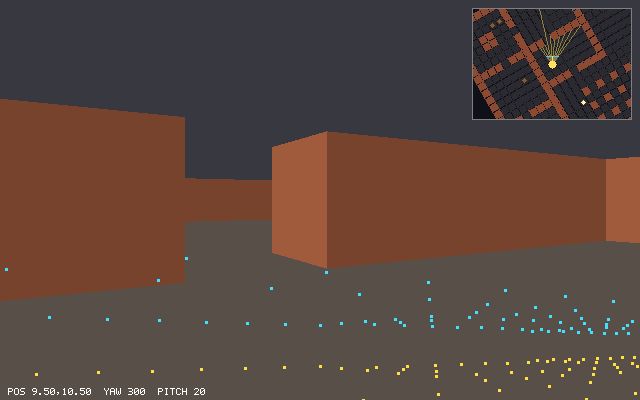

# Chapter 15 — Cameras and Projection

The ray caster of Chapters 13 and 14 has two limits. It can only draw walls that stand straight
up on a grid, and it can't look up or down. A real 3D renderer is different: it takes any point
in the world and works out where that point lands on the screen. This chapter builds that path.
It starts with a camera that has a position, a yaw, and a pitch. A *view matrix* moves the world
so that the camera sits at the origin. A *perspective matrix* puts each point's distance into
its fourth coordinate, and dividing by that coordinate makes far things small. Finally the
*viewport transform* turns the result into pixels. Nothing gets filled in yet. To test the new
math, every wall corner of the maze goes through the 3D camera and is drawn as a dot on top of
the ray caster's picture, and the dots land exactly on the wall edges. Then the camera tilts up,
and the dots move to places the ray caster can't follow.

Previous: [Chapter 14 — Ray Casting II: Textures, Sprites, and Mouse Look](14-textures-and-sprites.md).
Next: [Chapter 16 — Wireframe 3D](16-wireframe-3d.md).

## From a ray caster to a camera

The ray caster works backwards. It starts at a pixel column, sends a ray into the map, and asks
what the ray hits. That only works because the world is a flat grid of full-height walls seen
from eye level. If the eye tilts, the walls are no longer vertical strips on the screen. A
sloped roof, a table, or a staircase has no single wall height per column at all.

From here on, the book works forwards. It starts with a point in the world, such as a wall's
corner, and asks which pixel it lands on. Every 3D renderer does this, from 1990s software
renderers to the GPU in your machine, through the same chain of coordinate systems:

```text
 model ──model──▶ world ──view──▶ camera ──projection──▶ clip ──÷ w──▶ NDC ──viewport──▶ screen
 space   matrix   space   matrix  space      matrix       space          (−1..1)  transform  (pixels)
```

- **Model space**: a shape's own coordinates. A cube from (0, 0, 0) to (1, 1, 1) doesn't know
  where it stands. Chapter 16 places shapes with a model matrix. In this chapter the points are
  already in the world.
- **World space**: the maze. This is where the player walks.
- **Camera space** (also called *view space* or *eye space*): the same points, measured from
  the eye. The eye is at the origin and looks down −z.
- **Clip space**: the result of the projection matrix, four coordinates (x, y, z, w). Chapter 17
  cuts triangles here, which is where the name comes from.
- **NDC**, *normalized device coordinates*: clip space divided by w. The screen is the square
  from −1 to 1 in x and y.
- **Screen space**: pixels.

Each arrow is a matrix product except one. The divide by w is the step that makes far things
small, and a matrix can't divide. Chapter 12 promised that this divide would come. This chapter
shows where w comes from.

The 3D world needs conventions. `delve` uses these:

- **Right-handed, y up.** x and z lie flat on the floor, and +y points to the ceiling.
- **The map lies on the floor.** A map point (x, y) is the world point (x, height, y), so the
  map's y becomes the world's z. Cell (3, 7) of `cellar.txt` covers x from 3 to 4 and z from 7
  to 8.
- **Walls are one unit tall**, from height 0 to 1. The eye is at height 0.5, the middle of the
  wall, just as the ray caster assumed when it centered every wall strip on the horizon.
- **The camera looks down −z** in its own space. OpenGL chose this. It's what you get when x
  points right and y points up on the screen and the axes stay right-handed: z then points out
  of the screen, toward you.

The new file `src/camera.zig` starts with these conventions and three constants:

```zig
//! The 3D camera: where the eye is, where it looks, and the matrices that
//! take a point in the world to a pixel on the screen.
//!
//! The world is right-handed with y up. A map point (x, y) is the world
//! point (x, height, y): the map's y becomes the world's z. Walls stand
//! from height 0 to 1, and the eye is at height 0.5.
const std = @import("std");
const math = @import("math.zig");
const Vec3 = math.Vec3;
const Vec4 = math.Vec4;
const Mat4 = math.Mat4;
const Player = @import("player.zig").Player;

pub const eye_height = 0.5;
pub const world_up: Vec3 = .{ 0, 1, 0 };

/// The vertical field of view: 2 atan(0.5) = 53.13 degrees. On a 640x400
/// screen this shows exactly what the ray caster shows (1 / tan(vfov / 2)
/// is 2, and 2 / aspect = 1.25 = 1 / raycast.plane_scale).
pub const vfov = 2 * std.math.atan(@as(f32, 0.5));
/// Points closer to the eye than `near` or farther than `far` are not
/// drawn. The depth buffer's precision depends on far / near.
pub const near = 0.05;
pub const far = 64.0;
```

`vfov` (vertical field of view), `near`, and `far` are each explained below. The `@as(f32, ...)`
in `vfov` is there for a reason too, shown in the section that explains the 53.13°.

## The camera's axes

A camera is a position and two angles:

```zig
pub const Camera = struct {
    pos: Vec3,
    /// Radians from +x toward +z (the map's east toward south), as for the player.
    yaw: f32,
    /// Radians above the horizon (negative: looking down).
    pitch: f32 = 0,

    /// The camera at the player's eyes.
    pub fn fromPlayer(player: Player) Camera {
        return .{
            .pos = .{ player.pos[0], eye_height, player.pos[1] },
            .yaw = player.yaw,
            .pitch = player.pitch,
        };
    }
```

The player's yaw carries over unchanged. On the map, yaw turns +x (east) toward +y (south), and
the map's +y is the world's +z, so in the world yaw turns +x toward +z. The player gets a
`pitch` field in this chapter. It defaults to 0 and only the 3D camera uses it.

### Forward

Where does the camera look? Pitch first. Tilting up by `pitch` splits a unit vector into a
vertical part, `sin(pitch)`, and a horizontal part, `cos(pitch)`. Yaw then points the
horizontal part around the compass, `(cos yaw, sin yaw)` on the map:

```text
forward = (cos yaw · cos pitch,  sin pitch,  sin yaw · cos pitch)
```

Its length is 1: `cos²yaw·cos²pitch + sin²pitch + sin²yaw·cos²pitch = cos²pitch + sin²pitch = 1`.
At pitch 0 it is `(cos yaw, 0, sin yaw)`, which is the map's `dir` lifted into the world. As the
camera tilts, the horizontal part shrinks by `cos(pitch)`, and straight up it vanishes.

```zig
    /// The unit vector the camera looks along.
    pub fn forward(cam: Camera) Vec3 {
        const c = @cos(cam.pitch);
        return .{ @cos(cam.yaw) * c, @sin(cam.pitch), @sin(cam.yaw) * c };
    }
```

### Right

The camera's right is perpendicular to both forward and up. The cross product (Chapter 11) gives
exactly that. The only question is the order. Work it out by hand at pitch 0, with forward
`(c, 0, s)` for `c = cos yaw` and `s = sin yaw`:

```text
forward × up = (c, 0, s) × (0, 1, 0)
             = (0·0 − s·1,  s·0 − c·0,  c·1 − 0·0)
             = (−s, 0, c)
```

On the map, Chapter 11's `perp(dir) = (−dir.y, dir.x)` is `(−s, c)`, the player's right
(clockwise on a y-down map). Lifted into the world it is `(−s, 0, c)`: the same vector. So
`forward × up` is right, and `up × forward` would be left.

`examples/ch15/handedness.zig` checks both orders at two yaws, and then tilts the camera up:

```console
$ zig run examples/ch15/handedness.zig
yaw  0: forward (1, 0, 0)
  forward x up = (0, 0, 1)
  up x forward = (0, 0, -1)
  map perp(dir) = (0, 1) -> world (0, 0, 1)
yaw 90: forward (0, 0, 1)
  forward x up = (-1, 0, 0)
  up x forward = (1, 0, 0)
  map perp(dir) = (-1, 0) -> world (-1, 0, 0)
pitch 30: forward (0.866, 0.500, 0.000)  right (0, 0, 1)  camera up (-0.500, 0.866, 0.000)
```

- At yaw 0 the player faces east, and their right is south, +z. At yaw 90° they face south, and
  their right is west, −x. In both cases `forward × up` agrees with `perp(dir)`.
- With the right-hand rule: point your fingers along the first vector (forward), curl them
  toward the second (up), and your thumb points along the cross product. With forward pointing
  away from you and up pointing up, your right thumb points right.
- Tilted up 30°, right is still level, (0, 0, 1). The cross product of forward with world up is
  always horizontal, because it is perpendicular to world up. It is shorter than 1, though
  (its length is `cos(pitch)`), so `right` normalizes it:

```zig
    /// The unit vector to the camera's right, level with the floor.
    pub fn right(cam: Camera) Vec3 {
        return math.normalize(math.cross(cam.forward(), world_up));
    }
```

A test pins down that this agrees with the ray caster at several yaws:

```zig
test "right is the map's perp(dir), lifted into the world" {
    for ([_]f32{ 0, 0.5, 2, 4 }) |yaw| {
        const cam: Camera = .{ .pos = .{ 0, 0, 0 }, .yaw = yaw };
        const p = math.perp(math.fromAngle(yaw));
        try testing.expect(math.approxEq(cam.right(), Vec3{ p[0], 0, p[1] }));
    }
}
```

### Up

The camera's own up is `right × forward`. At pitch 0 it is world up. Tilted up 30°, the example
prints (−0.5, 0.866, 0): the top of the camera leans back, away from where it looks. The three
vectors right, up, and forward are each length 1 and perpendicular to each other: an
*orthonormal basis*. That basis is all the next section needs.

## The view matrix: moving the world

To project a point we want it measured from the eye, along the camera's own axes: how far right,
how far up, and how far ahead. Chapter 14 did this in 2D for sprites, with two dot products.
This section does the same in 3D with three, and then writes them as a matrix.

### Three dot products

Let `e` be the eye and `p` a point. The vector from the eye to the point is `p − e`. Because
`r` (right), `u` (up), and `f` (forward) are an orthonormal basis, any vector is some amount of
each:

```text
p − e = a·r + b·u + c·f
```

Dot both sides with `r`. `r·r = 1`, and `r·u = r·f = 0`, so only `a` survives: `a = r·(p − e)`.
In the same way, `b = u·(p − e)` and `c = f·(p − e)`. Chapter 14 had to divide by `|plane|²`
because its plane vector was 0.8 long. Here every axis has length 1, so no division is needed.

Camera space looks down −z, so a point ahead of the eye must get a *negative* z. Its camera
coordinates are therefore:

```text
x = r·(p − e)       how far right
y = u·(p − e)       how far up
z = −f·(p − e)      minus how far ahead
```

### As a matrix

A dot product with a fixed vector is one row of a matrix product. Split each one with
`r·(p − e) = r·p − r·e`, and the second part is a constant: it goes in the fourth column, where
Chapter 12 put translations. The view matrix is

```text
      ┌                         ┐
      │  r.x   r.y   r.z   −r·e │
V  =  │  u.x   u.y   u.z   −u·e │
      │ −f.x  −f.y  −f.z    f·e │
      │   0     0     0      1  │
      └                         ┘
```

The rows are the camera's axes, with the forward axis negated, and the last column is minus each
of those rows dotted with the eye.

There is a second way to read it. To place a camera in the world, you would turn it so that its
axes point along r, u, and −f, and then move it to e. That is `T(e) · R`, where R is the rotation
whose *columns* are r, u, and −f. The view matrix has to undo that placement: the world moves the
opposite way, so that the camera ends up at the origin. Undoing a product reverses the order:
`V = R⁻¹ · T(−e)`. R is orthonormal, so its inverse is its transpose (Chapter 12), the matrix
whose *rows* are r, u, and −f. Multiplying `Rᵀ` by `T(−e)` puts `Rᵀ · (−e)` in the last column,
which is `(−r·e, −u·e, f·e)`. That's the same matrix. No general inverse is needed, only a
transpose.

`Mat4.lookAt` in `src/math.zig` builds it from an eye, a target to look at, and a rough up
direction:

```zig
    /// A view matrix: the camera at `eye` looking at `target`, with `up`
    /// pointing roughly up. It moves the eye to the origin and turns the
    /// world so that the eye looks down -z, with +x to its right and +y up.
    pub fn lookAt(eye: Vec3, target: Vec3, up: Vec3) Mat4 {
        const f = normalize(target - eye);
        const r = normalize(cross(f, up));
        const u = cross(r, f);
        // The rows are the camera's axes: a dot product with each gives a
        // point's coordinates along that axis, measured from the eye.
        return fromRows(.{
            .{ r[0], r[1], r[2], -dot(r, eye) },
            .{ u[0], u[1], u[2], -dot(u, eye) },
            .{ -f[0], -f[1], -f[2], dot(f, eye) },
            .{ 0, 0, 0, 1 },
        });
    }
```

- `up` doesn't have to be perpendicular to `f`. The cross product keeps only the part of it that
  is, and normalizing fixes the length. `u = r × f` is then the camera's true up, already of
  length 1, because `r` and `f` are perpendicular unit vectors.
- This is the matrix Direct3D documents for `D3DXMatrixLookAtRH` and OpenGL's old `gluLookAt`
  builds (see the sources). Some write it transposed, because they multiply row vectors on the
  left of the matrix.

The camera uses it with a target one step along its forward vector:

```zig
    /// The world-to-camera matrix: the eye moves to the origin and looks
    /// down -z.
    pub fn view(cam: Camera) Mat4 {
        return Mat4.lookAt(cam.pos, cam.pos + cam.forward(), world_up);
    }
```

### A worked example

Put the eye at `e = (0, 1, 0)` and look at the target `(3, 1, −4)`, which is level with the eye
and five units away.

```text
f = (3, 0, −4) / 5                     = (0.6, 0, −0.8)
r = f × up = (0.6, 0, −0.8) × (0, 1, 0)
           = (0·0 − (−0.8)·1,  (−0.8)·0 − 0.6·0,  0.6·1 − 0·0)
           = (0.8, 0, 0.6)             (already length 1)
u = r × f = (0.8, 0, 0.6) × (0.6, 0, −0.8)
           = (0·(−0.8) − 0.6·0,  0.6·0.6 − 0.8·(−0.8),  0.8·0 − 0·0.6)
           = (0, 1, 0)
last column: −r·e = 0,  −u·e = −1,  f·e = 0
```

The target is `(3, 0, −4)` from the eye. Its camera coordinates are `r·(3, 0, −4) = 2.4 − 2.4 = 0`,
`u·(3, 0, −4) = 0`, and `−f·(3, 0, −4) = −(1.8 + 3.2) = −5`: straight ahead, five units down −z.

Now a point placed by hand: start at the eye, go 2 right, 1 down, and 3 ahead.
`(0, 1, 0) + 2·(0.8, 0, 0.6) − (0, 1, 0) + 3·(0.6, 0, −0.8) = (3.4, 0, −1.2)`. The view matrix
should give back exactly the steps we took, `(2, −1, −3)`. `examples/ch15/look_at.zig` builds
the matrix for this case and two others, and checks both points:

```console
$ zig run examples/ch15/look_at.zig
eye { 0, 0, 0 }  target { 0, 0, -5 }  distance 5.0000
  right    [  1.0000 -0.0000  0.0000 | -0.0000 ]
  up       [  0.0000  1.0000  0.0000 | -0.0000 ]
  -forward [ -0.0000 -0.0000  1.0000 |  0.0000 ]
           [  0.0000  0.0000  0.0000 |  1.0000 ]
  target -> (0.0000, 0.0000, -5.0000)
  eye + 2 right - up + 3 forward = (2.0000, -1.0000, -3.0000) -> (2.0000, -1.0000, -3.0000)

eye { 0, 1, 0 }  target { 3, 1, -4 }  distance 5.0000
  right    [  0.8000 -0.0000  0.6000 | -0.0000 ]
  up       [  0.0000  1.0000  0.0000 | -1.0000 ]
  -forward [ -0.6000 -0.0000  0.8000 |  0.0000 ]
           [  0.0000  0.0000  0.0000 |  1.0000 ]
  target -> (0.0000, 0.0000, -5.0000)
  eye + 2 right - up + 3 forward = (3.4000, 0.0000, -1.2000) -> (2.0000, -1.0000, -3.0000)

eye { 1, 0.5, 1 }  target { 3, 1.5, 3 }  distance 3.0000
  right    [ -0.7071  0.0000  0.7071 | -0.0000 ]
  up       [ -0.2357  0.9428 -0.2357 | -0.0000 ]
  -forward [ -0.6667 -0.3333 -0.6667 |  1.5000 ]
           [  0.0000  0.0000  0.0000 |  1.0000 ]
  target -> (0.0000, 0.0000, -3.0000)
  eye + 2 right - up + 3 forward = (1.8215, 0.5572, 4.6499) -> (2.0000, -1.0000, -3.0000)
```

- The first camera already looks down −z from the origin, so its view matrix is the identity.
- The second case is the one worked above, row for row.
- In the third case the camera looks up and to the side. `up` is no longer (0, 1, 0), and the
  third row's `f·e` is 1.5. The target still lands at `(0, 0, −distance)`, and the hand-placed
  point still comes back as `(2, −1, −3)`.
- The `-0.0000` entries are negative zero, which floats have. `0 · (−0.8)` is −0, and it prints
  with its sign. It equals +0 in every comparison.

The project's test checks the same two facts on `Mat4.lookAt`:

```zig
test "lookAt puts the eye at the origin looking down -z" {
    const eye: Vec3 = .{ 3, 0.5, 2 };
    const view = Mat4.lookAt(eye, .{ 3, 0.5, -5 }, .{ 0, 1, 0 });
    // Looking down -z already: only the translation is left.
    try expect(view.approxEq(Mat4.translation(-eye)));
    // Looking along +x: a point 4 ahead is at z = -4, one to the right at x = 1.
    const side = Mat4.lookAt(eye, eye + Vec3{ 1, 0, 0 }, .{ 0, 1, 0 });
    try expect(approxEq(side.transformPoint(eye + Vec3{ 4, 0, 0 }), Vec3{ 0, 0, -4 }));
    try expect(approxEq(side.transformPoint(eye + Vec3{ 0, 0, 1 }), Vec3{ 1, 0, 0 }));
    try expect(approxEq(side.transformPoint(eye + Vec3{ 0, 2, 0 }), Vec3{ 0, 2, 0 }));
}
```

### Why not `rotationY(yaw)`?

The camera only turns about y and tilts. Couldn't the view be built from Chapter 12's
`rotationY` and `rotationX`? It could, but the signs are a trap. `Mat4.rotationY(a)` turns z
toward x. Map yaw turns x toward z, which is the other way round, so a yaw is a *negative*
rotation about +y. On top of that, a camera with yaw 0 faces +x, while camera space looks down
−z, which is a quarter turn away. Working it through, the view matrix of a level camera at the
origin is `rotationY(yaw + π/2)`, not `rotationY(yaw)` and not `rotationY(−yaw)`. (A three-line
check against `lookAt` with yaw 0.7 prints `true false false` for those three.) Building the
matrix from the axes avoids both signs, because forward and right were already checked against
the ray caster.

### Straight up has no right

`--pitch` is limited to less than 90° either way. Straight up, forward *is* world up, their
cross product is the zero vector, and normalizing it divides by zero: there is no right vector.
Close to 90°, right still exists but swings wildly as yaw changes. Every camera built on a
fixed world up has this pole. Flight simulators avoid it by keeping their own up vector, or by
using quaternions. A first-person game simply stops the look before 90°.

## Perspective by similar triangles

After the view matrix, the eye is at the origin and looks down −z. A point in front of it has
a negative z, and its *depth* is `d = −z`: how far ahead it is, measured along the view
direction. (This is the same depth the ray caster's `t` measured in Chapter 13, not the
distance from the eye.)

Put a sheet of glass one unit in front of the eye, as Chapter 13 did, and look at it from the
side:

```text
   side view: the eye looks to the right, along −z

                                                  * the point: y above the eye, d ahead
                                              . ' |
                                          . '     |
                         glass        . '         |
                           |      . '             |  y
                           |  . '                 |
                           *     y/d above        |
                       . ' |     the eye          |
                   . '     |                      |
   eye    o  . '  ---------+----------------------+------>  ahead (−z)
          |<------ 1 ----->|                      |
          |<-------------------- d -------------->|
```

The line of sight from the eye to the point crosses the glass at some height h. The small
triangle (eye, foot of the glass, crossing) and the big one (eye, foot of the point, point)
share the angle at the eye, so their sides are in proportion: `h / 1 = y / d`. The point
appears at height `y/d` on the glass, and across at `x/d` by the same argument from above.
**Everything is divided by its depth.** Twice as far looks half as big.

Now fit the glass to the screen. The vertical field of view `vfov` is the angle from the
bottom edge of the screen to the top. Half of it lies above the horizon, so on the glass at
distance 1 the top edge is at height `tan(vfov/2)`. NDC wants the top edge at 1, so divide by
that:

```text
y_ndc = (y/d) / tan(vfov/2) = f · y / d        with  f = 1 / tan(vfov/2)
```

`f` is the *focal factor*: how much the lens magnifies. A narrow field of view has a large f.
Across, the screen is `aspect = width / height` times wider than tall. For square pixels its
right edge is at `aspect · tan(vfov/2)` on the glass, so:

```text
x_ndc = (f / aspect) · x / d
```

### Putting d into w

A matrix multiplies and adds. It can't divide by one of its inputs. The trick that makes
projection a matrix anyway is to let the matrix compute the parts and save the divide for
later. Set the fourth coordinate to the depth:

```text
x_clip = (f / aspect) · x
y_clip = f · y
w_clip = −z = d
```

Then dividing x and y by w gives exactly the NDC above. In matrix form, these are rows 1, 2,
and 4 of the projection:

```text
┌                       ┐
│ f/aspect  0   0   0   │
│    0      f   0   0   │
│    0      0   A   B   │    ← depth, the next section
│    0      0  −1   0   │
└                       ┘
```

The divide by w that follows is called the *perspective divide*. It's the step Chapter 12
pointed to: a homogeneous point (x, y, z, w) stands for (x/w, y/w, z/w). Until now every point
had w = 1 and the divide did nothing. The projection matrix is the first matrix in the book
whose bottom row isn't (0, 0, 0, 1).

`examples/ch15/similar_triangles.zig` projects five points twice: by hand with `x/d` and `y/d`,
and with the full matrix followed by the divide. It uses `delve`'s numbers, `vfov` = 53.13°,
640x400, near 0.05, far 64:

```console
$ zig run examples/ch15/similar_triangles.zig
f = 1/tan(vfov/2) = 2.0000, f/aspect = 1.2500

   point (x, y, z)       d   x/d     y/d    | by hand: ndc x, y | matrix: clip (x, y, z, w)          -> ndc x, y
(  0.0,  0.50,  -0.5)    0.5   0.000   1.000  |  0.0000,  2.0000  | ( 0.0000,  1.0000,  0.4504,   0.5) ->  0.0000,  2.0000
(  0.4,  0.50,  -1.0)    1.0   0.400   0.500  |  0.5000,  1.0000  | ( 0.5000,  1.0000,  0.9507,   1.0) ->  0.5000,  1.0000
( -1.0, -0.50,  -2.0)    2.0  -0.500  -0.250  | -0.6250, -0.5000  | (-1.2500, -1.0000,  1.9515,   2.0) -> -0.6250, -0.5000
(  2.0,  0.50,  -4.0)    4.0   0.500   0.125  |  0.6250,  0.2500  | ( 2.5000,  1.0000,  3.9531,   4.0) ->  0.6250,  0.2500
(  3.0,  0.25, -10.0)   10.0   0.300   0.025  |  0.3750,  0.0500  | ( 3.7500,  0.5000,  9.9578,  10.0) ->  0.3750,  0.0500
```

- The hand column and the matrix column agree on every point.
- `f` is exactly 2, and `f/aspect` exactly 1.25. These two numbers return in the section about
  the ray caster.
- The second point is half a unit up (a wall top, seen from eye height 0.5) and one unit ahead.
  It lands at `y_ndc = 1`, the top edge of the screen. The first point is the same height at
  half the depth, so it lands at 2, above the screen.
- w is always the depth. The clip z column is neither the depth nor NDC yet. It's the third
  row's `A·z + B`, which only means something after its own divide by w.

## Depth from 0 to 1

The third row is still open. x and y have been decided, but a renderer also needs to know how
far away each point is: in Chapter 18, to keep the nearest surface at every pixel. After the
divide, the third coordinate should be a *depth* from 0 at the near plane to 1 at the far plane.

Depth doesn't depend on x or y, so the row is `(0, 0, A, B)`, giving `z_clip = A·z + B`. After
the divide by `w = −z`:

```text
z_ndc = (A·z + B) / (−z)
```

Two conditions fix the two unknowns. At the near plane, `z = −n`, the depth must be 0:

```text
(−A·n + B) / n = 0        →   B = A·n
```

At the far plane, `z = −f`, it must be 1 (here f is the far distance, not the focal factor):

```text
(−A·f + B) / f = 1        →   −A·f + A·n = f   →   A = f / (n − f)
                                                   B = n·f / (n − f)
```

For `delve`, n = 0.05 and f = 64: `A = 64 / (−63.95) = −1.000782` and
`B = 3.2 / (−63.95) = −0.050039`. Both are negative, and that's correct: z is negative in front
of the camera, so `A·z` is positive.

What does the depth look like in between? Write it with the depth `d = −z`:

```text
z_ndc = (−A·d + B) / d = −A + B/d = f/(f − n) · (1 − n/d)
```

That isn't a straight line in d. It's a constant minus a constant over d: a `1/d` curve. Solve
it for d and you get the way back, `d = n·f / (f − z_ndc·(f − n))`. `examples/ch15/depth_table.zig`
computes the depth straight from A and B, compares it with the formula, converts it back to a
depth, and measures how far apart two neighboring f32 depth values are, in world units:

```console
$ zig run examples/ch15/depth_table.zig
A = -1.000782  B = -0.050039

     d    depth      formula     back to d  one f32 step in depth = this far
 0.050   0.000000   0.000000     0.0500  0.00e0
 0.075   0.333594   0.333594     0.0750  3.35e-9
 0.100   0.500391   0.500391     0.1000  1.19e-8
 0.200   0.750586   0.750586     0.2000  4.76e-8
 0.500   0.900704   0.900704     0.5000  2.98e-7
 1.000   0.950743   0.950743     1.0000  1.19e-6
 2.000   0.975762   0.975762     2.0000  4.76e-6
 5.000   0.990774   0.990774     5.0000  2.98e-5
10.000   0.995778   0.995778    10.0000  1.19e-4
20.000   0.998280   0.998280    20.0002  4.76e-4
32.000   0.999218   0.999218    32.0005  1.22e-3
64.000   1.000000   1.000000    64.0000  9.76e-3

half of the depth range is used by d = 0.0999
```

- **Half the depth range is used up by d = 0.1**, the first 5 cm past the near plane. By one
  unit of depth, 95% is gone. Everything from 1 to 64 units shares the last 5%.
- The last column is the cost. At depth 1, two neighboring f32 depths are a millionth of a unit
  apart, plenty. At depth 64 they are about a centimeter apart. Two surfaces closer than that,
  far away, get the same depth, and the renderer can't tell which is in front. That flicker is
  called *z-fighting*.
- Converting back is not exact either: depth 20 comes back as 20.0002, for the same reason.
- The near plane matters much more than the far one. With n = 0.05 the steps at depth 64 are
  1 cm. Make n ten times larger and they shrink about tenfold. That's why `near` isn't 0.0001:
  `near = 0` would put every depth at exactly `f/(f − n)` = 1.

Why accept a curve that wastes so much range near the eye? Two reasons.

1. **Perspective needs precision near the eye.** Things near the eye are big on the screen, so
   small depth errors there are visible. Far things are small, and their errors cover a pixel
   or two.
2. **Depth is linear on the screen.** `z_ndc = −A + B/d` is a straight-line function of `1/d`,
   and `1/d` is what changes linearly across a triangle *on the screen*. Chapter 13 used the
   same fact to show that wall edges are straight. Chapter 18 relies on it: it can step the
   depth across a triangle's pixels by adding a constant.

The 0 to 1 range is the convention of Direct3D, Vulkan, and Metal. OpenGL maps the near plane to
−1 instead, which gives a different third row (Song Ho Ahn derives it, see the sources). Nathan
Reed's "Depth Precision Visualized" shows the precision problem with pictures, and explains
*reversed Z*: mapping near to 1 and far to 0 makes the curve of f32 precision cancel the curve
of `1/d`. `delve` keeps the plain version. Its far plane is 64 units away, and its walls are
never thinner than a cell.

`Mat4.perspective` in `src/math.zig` writes down the whole matrix:

```zig
    /// A perspective projection for a camera looking down -z. `vfov` is the
    /// vertical field of view in radians, `aspect` is width / height.
    /// The result's w is -z (the distance in front of the eye); dividing by
    /// it gives x and y from -1 to 1 across the screen and a depth from 0
    /// at `near` to 1 at `far`.
    pub fn perspective(vfov: f32, aspect: f32, near: f32, far: f32) Mat4 {
        const f = 1 / @tan(vfov / 2);
        return fromRows(.{
            .{ f / aspect, 0, 0, 0 },
            .{ 0, f, 0, 0 },
            .{ 0, 0, far / (near - far), near * far / (near - far) },
            .{ 0, 0, -1, 0 },
        });
    }
```

Its test uses round numbers, a 90° field of view (so f = 1), aspect 2, near 0.5, and far 10:

```zig
test "perspective maps near to depth 0 and far to depth 1" {
    const p = Mat4.perspective(std.math.pi / 2.0, 2, 0.5, 10);
    const at_near = p.mulVec(.{ 0, 0, -0.5, 1 });
    const at_far = p.mulVec(.{ 0, 0, -10, 1 });
    try expectApprox(0.5, at_near[3], 1e-6); // w is the distance
    try expectApprox(0, at_near[2] / at_near[3], 1e-6);
    try expectApprox(1, at_far[2] / at_far[3], 1e-6);
    // With a 90 degree view, a point as far up as it is ahead is at the
    // top edge (y = 1); across, the screen is twice as wide (aspect 2).
    const corner = p.mulVec(.{ 6, 3, -3, 1 });
    try expect(approxEq(Vec2{ corner[0], corner[1] } / @as(Vec2, @splat(corner[3])), Vec2{ 1, 1 }));
}
```

The point (6, 3, −3) is 3 up and 3 ahead: 45° up, the top edge of a 90° view. It's 6 to the
right, but the screen is twice as wide as tall, so it lands on the right edge too.

The camera builds its projection from the canvas size, and multiplies the two matrices once per
frame:

```zig
    /// The camera-to-clip matrix for a screen `width` x `height` pixels.
    pub fn projection(width: usize, height: usize) Mat4 {
        const aspect = @as(f32, @floatFromInt(width)) / @as(f32, @floatFromInt(height));
        return Mat4.perspective(vfov, aspect, near, far);
    }

    /// World to clip space in one matrix: view first, then projection.
    pub fn viewProjection(cam: Camera, width: usize, height: usize) Mat4 {
        return projection(width, height).mul(cam.view());
    }
};
```

`projection.mul(view)` applied to a point applies `view` first (Chapter 12: the rightmost
matrix acts first). One matrix per frame, then one matrix-vector product per point.

### Vertical and horizontal field of view

`delve` gives the projection a *vertical* field of view, and the horizontal one follows from
the aspect ratio. On the glass at distance 1, the screen's half-height is `tan(vfov/2)` and its
half-width `aspect · tan(vfov/2)`, so:

```text
hfov = 2 · atan(aspect · tan(vfov/2))
```

`examples/ch15/fov.zig` applies it to `delve`'s numbers and a few others:

```console
$ zig run examples/ch15/fov.zig
delve: vfov = 2 atan(0.5) = 53.13 deg, aspect 1.6
  hfov = 2 atan(aspect tan(vfov/2)) = 77.32 deg
  ray caster: 2 atan(plane_scale 0.8) = 77.32 deg

vfov    f = 1/tan(vfov/2)   hfov at 16:10   hfov at 16:9
 53.13    2.0000              77.32           83.27
 60.00    1.7321              85.46           91.49
 90.00    1.0000             115.99          121.28
120.00    0.5774             140.32          144.02
```

- `delve`'s 53.13° vertical is 77.32° across: the ray caster's field of view from Chapter 13.
- Fixing the vertical angle means that a wider window shows more at the sides and the same
  amount up and down. This is called *Hor+*, and most games do it. With a fixed horizontal
  angle, a wide window would cut off the top and bottom instead.
- A 90° vertical field of view is a fisheye-like 116° across. Games that offer a "90° FOV"
  setting usually mean the horizontal angle.

## Clip space, NDC, and the viewport

The projection matrix produces a point in *clip space*: four coordinates (x, y, z, w). A point
is inside the view exactly when

```text
−w ≤ x ≤ w,    −w ≤ y ≤ w,    0 ≤ z ≤ w
```

These six inequalities are the six planes of the *view frustum*: a pyramid with its tip at the
eye, cut off at the near and far planes. Each plane is a single comparison in clip space, which
is why Chapter 17 does its clipping there. After the divide by w the frustum becomes a box,
−1 to 1 in x and y and 0 to 1 in z: normalized device coordinates.

The *viewport transform* stretches NDC over the canvas. x goes from −1 to 1 across the
`width` pixels. y goes from 1 at the top to −1 at the bottom, because NDC's y points up and
the canvas's y points down (Chapter 9), so it is flipped:

```text
sx = (x_ndc + 1) / 2 · width
sy = (1 − y_ndc) / 2 · height
```

`toScreen` in `src/camera.zig` does the divide and the viewport in one step, and keeps the depth:

```zig
/// The viewport transform: a clip-space point to screen pixels. Dividing by
/// w gives normalized device coordinates (NDC), -1 to 1 across the screen
/// with y up; the screen's y grows down, so y is flipped. z is the depth,
/// 0 at the near plane and 1 at the far plane.
pub fn toScreen(clip: Vec4, width: usize, height: usize) Vec3 {
    const ndc = math.xyz(clip) / @as(Vec3, @splat(clip[3]));
    const w: f32 = @floatFromInt(width);
    const h: f32 = @floatFromInt(height);
    return .{ (ndc[0] + 1) / 2 * w, (1 - ndc[1]) / 2 * h, ndc[2] };
}
```

The result is still a float. Think of pixel coordinates as continuous: pixel (x, y)
covers the square from (x, y) to (x + 1, y + 1), and its center is at (x + 0.5, y + 0.5).
`examples/ch15/viewport.zig` maps the corners of NDC, and goes back from two pixel centers:

```console
$ zig run examples/ch15/viewport.zig
top left      ndc (-1.00,  1.00) -> pixels (   0.0,    0.0)
top right     ndc ( 1.00,  1.00) -> pixels ( 640.0,    0.0)
bottom left   ndc (-1.00, -1.00) -> pixels (   0.0,  400.0)
bottom right  ndc ( 1.00, -1.00) -> pixels ( 640.0,  400.0)
center        ndc ( 0.00,  0.00) -> pixels ( 320.0,  200.0)
halfway up    ndc ( 0.00,  0.50) -> pixels ( 320.0,  100.0)
center of pixel (0, 0) is ndc (-0.9984375, 0.9975000)
center of pixel (639, 399) is ndc (0.9984375, -0.9974999)
ndc (0.5, 0.5) is pixel (480, 100)
```

- NDC (1, −1) maps to (640, 400), the outer corner of the last pixel, not its center.
- Pixel (0, 0)'s center is half a pixel inside the edge: 1/640 of the NDC width of 2.
- The last digit of −0.9974999 is f32 rounding.
- To find the pixel that contains a point, take the floor of each coordinate, as `drawCorners`
  will below.

### Behind the eye

`project` puts the whole chain together for one world point:

```zig
/// Projects the world point `p` to the screen, or returns null if it is
/// not in front of the near plane (dividing by its w would be wrong).
pub fn project(view_proj: Mat4, p: Vec3, width: usize, height: usize) ?Vec3 {
    const clip = view_proj.mulVec(math.vec4(p, 1));
    if (clip[3] < near) return null;
    return toScreen(clip, width, height);
}
```

What does "dividing by its w would be wrong" mean? `examples/ch15/behind_the_eye.zig` follows a
point half a unit to the right of the eye as it moves from 2 units in front of the eye to 2
behind:

```console
$ zig run examples/ch15/behind_the_eye.zig
     z      w    ndc x      screen x   project
 -2.00   2.00      0.31       420.0   on screen
 -1.00   1.00      0.63       520.0   on screen
 -0.50   0.50      1.25       720.0   off screen
 -0.20   0.20      3.13      1320.0   off screen
 -0.10   0.10      6.25      2320.0   off screen
 -0.05   0.05     12.50      4320.0   off screen
 -0.01   0.01     62.50     20320.0   null (behind the near plane)
  0.01  -0.01    -62.50    -19680.0   null (behind the near plane)
  0.10  -0.10     -6.25     -1680.0   null (behind the near plane)
  0.50  -0.50     -1.25       -80.0   null (behind the near plane)
  1.00  -1.00     -0.63       120.0   null (behind the near plane)
  2.00  -2.00     -0.31       220.0   null (behind the near plane)
```

- As the point comes closer, it slides out to the right: 420, 520, then off the screen. That's
  correct. A point beside your head is outside your view.
- As w gets close to 0, the screen position races toward infinity: 4320 at the near plane, 20320
  just before the eye.
- Once the point passes the eye, w turns negative and the divide flips the sign. The point
  reappears on the **left**, and walks back toward the center: at z = 1 it lands at x = 120,
  on the screen, as if it were in front of the camera on the other side. That's a lie. The
  matrix can't see it, because a point behind the eye and its mirror image in front give the
  same x/w.
- At w = 0 exactly, the divide gives infinity or NaN.

So `project` refuses any point whose w is below the near distance. That's enough for single
dots. For a line or a triangle with one end in front and one behind, refusing the whole shape
is wrong too: Chapter 16 tries it and shows what goes missing, and Chapter 17 cuts the shape at
the near plane instead.

## The same picture as the ray caster

The ray caster and the 3D camera should agree. They see the same maze from the same eye, so a
wall corner projected by the camera should land exactly where the ray caster drew it. That only
works if the field of view matches, and that is where 53.13° comes from.

The ray caster's camera plane is `plane_scale = 0.8` long on each side, one unit ahead
(Chapter 13), and its walls are `height / d` pixels tall. Compare each part with the projection:

**Across.** The ray caster's right screen edge looks along `dir + plane`, 0.8 to the right for
each unit ahead. The projection puts a point at `x_ndc = (f/aspect) · x/d`. For `x/d = 0.8` to
land on the edge, `x_ndc = 1`, we need `f/aspect = 1/0.8 = 1.25`. On a 640x400 screen the
aspect is 1.6, so `f = 2`.

**Up and down.** With `f = 2`, a wall top 0.5 above the eye at depth d lands at
`y_ndc = 2 · 0.5/d = 1/d`, which is row `(1 − 1/d)/2 · 400 = 200 − 200/d`. The ray caster draws
the wall strip `400/d` tall, centered on row 200, so its top is at `200 − 200/d`. The same row.

**The field of view.** `f = 1/tan(vfov/2) = 2` means `tan(vfov/2) = 0.5`:

```text
vfov = 2 · atan(0.5) = 53.13°
```

That's the constant at the top of `camera.zig`. It's written as an exact expression instead of
`53.13`, so the constant is as close to the exact angle as an f32 can get, not rounded to four
digits.

The same match explains the ray caster's numbers from Chapter 13. Its `wallHeight = height/d`
has no field of view in it, because the vertical field of view was fixed by the plane and the
aspect ratio all along. Chapter 13 got the 400 pixels per unit from the plane's width and then
asked for square pixels. Square pixels on a 640x400 screen with a plane of 0.8 mean exactly
53.13° from top to bottom.

### A compile error in the constant

Why `std.math.atan(@as(f32, 0.5))` and not `std.math.atan(0.5)`? Try it in a small file:

```zig
const std = @import("std");
pub const vfov = 2 * std.math.atan(0.5);
pub fn main() void {
    std.debug.print("{d}\n", .{vfov});
}
```

```console
$ zig run atan.zig
.../lib/std/math/atan.zig:41:26: error: reached unreachable code
        else => comptime unreachable,
                         ^~~~~~~~~~~
atan.zig:2:35: note: called at comptime here
pub const vfov = 2 * std.math.atan(0.5);
                     ~~~~~~~~~~~~~^~~~~
```

(The list of "referenced by" lines that follows is cut here.) The literal `0.5` has the type
`comptime_float`, Zig's exact compile-time number. `std.math.atan` picks its implementation by
the type of its argument: one for each float size, one for vectors. `comptime_float` is none of
these, so it falls through to the `else`, which is marked unreachable. Unlike `@tan` and
`@sqrt`, which are built into the compiler, `atan` is ordinary Zig code that needs a concrete
float type. Giving it an `f32` picks the 32-bit version, and the call still runs at compile time,
because the argument is known then. With `@as(f32, 0.5)` the same file prints `0.9272952`,
53.13° in radians.

### A test that the two renderers agree

`camera.zig` tests the match. It projects wall tops at four depths ahead of a player, and floor
points at the end of the camera plane, and compares them with the ray caster's own functions:

```zig
test "the projection agrees with the ray caster" {
    const player: Player = .{ .pos = .{ 2.5, 3.5 }, .yaw = 0.7 };
    const vp = Camera.fromPlayer(player).viewProjection(640, 400);
    const dir = player.dir();
    const plane = math.scale(math.perp(dir), raycast.plane_scale);
    for ([_]f32{ 0.5, 1, 3, 10 }) |d| {
        // The top of a wall d units ahead is at the ray caster's wall top.
        const ahead = player.pos + math.scale(dir, d);
        const top = project(vp, .{ ahead[0], 1, ahead[1] }, 640, 400).?;
        const wall_h = raycast.wallHeight(400, d);
        try testing.expectApproxEqAbs(200 - wall_h / 2, top[1], 1e-3);
        // A floor point at the end of the camera plane, scaled by d, is at
        // the right edge of the screen.
        const edge = player.pos + math.scale(dir + plane, d);
        const s = project(vp, .{ edge[0], 0, edge[1] }, 640, 400).?;
        try testing.expectApproxEqAbs(640, s[0], 1e-2);
        try testing.expectApproxEqAbs(200 + wall_h / 2, s[1], 1e-3);
    }
}
```

- The player turns 0.7 radians, so the check isn't only along an axis.
- At d = 0.5 the wall top is at row −200, above the screen. `project` doesn't care: it computes
  where the point is, on the screen or not.
- The floor point is half a unit below the eye, so it lands where the ray caster drew the wall's
  bottom: `200 + wall_h/2`.

A second test checks a tilted camera: a point straight ahead along `forward` lands on the
center of the screen, and a point behind gives null:

```zig
test "the point straight ahead lands at the screen center" {
    const cam: Camera = .{ .pos = .{ 3.5, 0.5, 7.5 }, .yaw = 1.2, .pitch = 0.3 };
    const vp = cam.viewProjection(640, 400);
    const s = project(vp, cam.pos + math.scale(cam.forward(), 5), 640, 400).?;
    try testing.expectApproxEqAbs(320, s[0], 1e-3);
    try testing.expectApproxEqAbs(200, s[1], 1e-3);
    // Behind the eye: nothing to draw.
    try testing.expectEqual(null, project(vp, cam.pos - cam.forward(), 640, 400));
}
```

## Seeing it: projected corners over the ray caster

Tests compare numbers. A picture shows the whole maze at once. `app.zig` gets a new function
that runs every wall corner through the camera and draws it as a dot on top of the ray caster's
frame. A grid corner is where four cells meet. If some of them are walls and some aren't, a
wall edge stands there. Its bottom is at height 0, and its top at height 1:

```zig
/// Projects every grid corner where wall meets floor through the 3D camera,
/// at floor height (yellow) and ceiling height (cyan). Where the ray caster
/// drew the walls right, the dots sit exactly on their edges. Corners
/// hidden behind walls are drawn too: projecting a point says where it is
/// on screen, not whether something is in front of it.
fn drawCorners(canvas: Canvas, map: Map, view_proj: Mat4) void {
    for (0..map.height + 1) |y| {
        for (0..map.width + 1) |x| {
            const cx: i32 = @intCast(x);
            const cy: i32 = @intCast(y);
            // The four cells that meet at this corner.
            var walls: u32 = 0;
            for ([_][2]i32{ .{ -1, -1 }, .{ 0, -1 }, .{ -1, 0 }, .{ 0, 0 } }) |d| {
                walls += @intFromBool(map.at(cx + d[0], cy + d[1]).isWall());
            }
            if (walls == 0 or walls == 4) continue;
            const fx: f32 = @floatFromInt(x);
            const fz: f32 = @floatFromInt(y);
            for ([_]f32{ 0, 1 }, [_]Color{ .hex(0xffe040), .hex(0x40e0ff) }) |height, color| {
                const s = camera.project(view_proj, .{ fx, height, fz }, canvas.width, canvas.height) orelse continue;
                // Skip points far off screen before converting to integers.
                if (@abs(s[0]) > 4096 or @abs(s[1]) > 4096) continue;
                // The pixel that contains the point, as a 3x3 dot.
                const px: i32 = @intFromFloat(@floor(s[0]));
                const py: i32 = @intFromFloat(@floor(s[1]));
                draw.fillRect(canvas, px - 1, py - 1, 3, 3, color);
            }
        }
    }
}
```

- The corner (x, y) of the map is the world point (x, height, y), so the map's y is the
  world's z, as promised at the start.
- `map.at` treats everything outside the map as wall, so corners on the map's border count.
- `orelse continue` skips points behind the near plane.
- The 4096 check matters. The previous section showed that a point just in front of the near
  plane can land at x = 20000 and more. `@intFromFloat` on a float that doesn't fit in an `i32`
  is undefined behavior (a panic in a debug build). 4096 keeps the numbers small, and a dot that
  far out is off the canvas anyway.

The frame draws the dots after the ray caster, when the overlay is on:

```zig
                if (app.show_overlay) {
                    const view_proj = camera.Camera.fromPlayer(p).viewProjection(canvas.width, canvas.height);
                    drawCorners(canvas, app.map, view_proj);
                }
```

The O key toggles `show_overlay` through a new `toggle_overlay` action, which works with
`--press` too. Here it is, with textures off so the dots are easy to see:

```console
$ ./zig-out/bin/delve --headless --pos 9.5,10.5 --yaw -60 --press toggle_textures --press toggle_overlay --out ../../images/ch15-overlay.png
```


- Every visible corner of a wall has a cyan dot on its top end and a yellow dot on its bottom
  end, on the exact pixel where the ray caster's strips end. Two renderers, one walking rays
  through a grid, the other multiplying matrices, agree.
- The rows of dots that cover the long wall on the right are corners *behind* that wall, in the
  maze beyond it. Projecting a point says where it lands on the screen, not whether anything is
  in front of it. Hiding what is behind something is a separate problem, the subject of
  Chapter 18.
- The dots get closer together toward the vanishing point on the right, where the far corridor
  ends: the divide by w at work.
- The status line at the bottom has a new field, `PITCH 0`.

## Looking up and down

The overlay matches because the camera has the same pose as the ray caster. Now give it one the
ray caster can't have. `--pitch 20` starts the player looking 20° up:

```console
$ ./zig-out/bin/delve --headless --pos 9.5,10.5 --yaw -60 --pitch 20 --press toggle_textures --press toggle_overlay --out ../../images/ch15-pitch.png
```



- The ray caster's walls didn't move. It has no pitch, and there is no way to give it one:
  tilting the view makes vertical walls slant on the screen, and its one-strip-per-column method
  can't draw that.
- The dots all moved down. When the camera tilts up, the world moves down in the picture.
- The far dots moved about 140 rows. A point far away straight ahead is now 20° below the view
  direction, at `y_ndc = −f · tan(20°) = −0.73`, which is 146 rows below the center.
- The dots stay correct. They are where a camera tilted 20° up would see those corners.

For now only `--pitch` sets the pitch: the player struct gets the field, and the mouse still
only turns. Looking up and down with the mouse waits for Chapter 22, when the polygon renderer
of Chapters 16 to 18 has replaced the ray caster and the walls can follow the dots. The option
rejects 90° and beyond, for the reason given in "Straight up has no right":

```console
$ ./zig-out/bin/delve --pitch 90
delve: InvalidValue
usage: delve [OPTIONS]

  --frames N         stop after N frames (each frame advances exactly one tick)
  --headless         render without opening a window
  --out FILE         save the last frame as FILE (.png or .ppm)
  --screenshot FILE  save a screenshot of the window as FILE (.png)
  --scale N          window pixels per canvas pixel (default 2)
  --pos X,Y          start at map position X,Y instead of the map's start
  --yaw DEG          start facing DEG degrees (0 east, 90 south)
  --pitch DEG        start looking DEG degrees up (negative: down), -89 to 89
  --hold F,S,T       hold forward, strafe, and turn input (-1 to 1) all run long
  --press ACTION     perform ACTION (for example next_view) on the first tick
  -h, --help         show this help
```

The check is `if (!(@abs(pitch) < 90)) return error.InvalidValue;`, written with a `!` around a
`<` instead of as `>= 90`. The difference is NaN: `parseFloat` accepts "nan", and every
comparison with NaN is false, so `@abs(pitch) >= 90` would let it through. `!(... < 90)` rejects
it.

## Building delve: a 3D camera

| File | Change |
|---|---|
| `src/camera.zig` | New: `Camera` (`forward`, `right`, `view`, `projection`, `viewProjection`), `toScreen`, `project`; 3 tests |
| `src/math.zig` | `Mat4.lookAt` and `Mat4.perspective`, with a test each |
| `src/player.zig` | The `pitch` field |
| `src/options.zig` | `--pitch DEG`, rejected unless below 90° either way |
| `src/main.zig` | Applies `--pitch`; tests `camera.zig` |
| `src/input.zig` | The action `toggle_overlay` |
| `src/platform.zig` | The O key |
| `src/app.zig` | `show_overlay`, `drawCorners`, and the pitch in the status line |

The complete project is in `project/ch15/`.

The ray caster itself doesn't change at all. The new code is a second path from the world to
the screen, used for now only to check the first. `cat src/*.zig | wc -l` counts 2457 lines,
up from 2213.

### Tests

```console
$ zig build test --summary all
Build Summary: 6/6 steps succeeded; 34/34 tests passed
test success
+- run test 34 pass (34 total) 15ms MaxRSS:7M
   +- compile test debug native success 634ms MaxRSS:183M
      +- WriteFile raylib.h cached
      +- compile lib raylib debug native cached 14ms MaxRSS:40M
      +- compile lib raylib debug native (reused)
      +- translate-c cached 11ms MaxRSS:39M
```

Chapter 14's 29 tests and five new ones:

- `lookAt` puts the eye at the origin looking down −z.
- `perspective` maps the near plane to depth 0 and the far plane to depth 1.
- `right` is the map's `perp(dir)`, lifted into the world.
- The point straight ahead lands at the screen center, and a point behind gives null.
- The projection agrees with the ray caster.

The options test also gained `--pitch -20` and the rejected `--pitch 90`.

### Running it

`zig build run` opens the window as before. O toggles the corner overlay, T the textures (the
dots are easier to see on flat colors), M the minimap. The two pictures in this chapter come
from:

```console
$ ./zig-out/bin/delve --headless --pos 9.5,10.5 --yaw -60 --press toggle_textures --press toggle_overlay --out ../../images/ch15-overlay.png
$ ./zig-out/bin/delve --headless --pos 9.5,10.5 --yaw -60 --pitch 20 --press toggle_textures --press toggle_overlay --out ../../images/ch15-pitch.png
```

## How fast is it?

The overlay projects every wall corner twice, at floor and ceiling height, every frame. The
cellar has 372 such corners, so that's 744 matrix-vector products and divides per frame. In
ReleaseFast at the overlay's pose, without and with it:

```console
$ zig build --release=fast
$ time ./zig-out/bin/delve --headless --frames 600 --pos 9.5,10.5 --yaw -60

real	0m0.373s
user	0m0.373s
sys	0m0.000s
$ time ./zig-out/bin/delve --headless --frames 600 --pos 9.5,10.5 --yaw -60 --press toggle_overlay

real	0m0.368s
user	0m0.366s
sys	0m0.000s
```

No difference. Running each twice more gave 0.367 and 0.361 s without, 0.366 and 0.365 s with,
so the overlay is lost in the noise. 744 points cost about 16 multiplications each, roughly
12,000 per frame. The ray caster touches each of the 256,000 pixels at least once. Projecting
points is cheap. What will cost something, starting next chapter, is drawing everything
between them.

## Summary

- A 3D renderer works forwards, from points to pixels, through model, world, camera, clip,
  NDC, and screen space.
- The camera's axes are `forward = (cos yaw·cos pitch, sin pitch, sin yaw·cos pitch)`,
  `right = normalize(forward × world_up)`, and `up = right × forward`. In right-handed
  coordinates, `forward × up` points right; at pitch 0 it is the map's `perp(dir)`.
- The view matrix has the camera's axes as rows (forward negated, because camera space looks
  down −z) and `−axis·eye` in the last column. It is the inverse of placing the camera,
  `Rᵀ · T(−eye)`, and needs no general inverse.
- Perspective is similar triangles: a point appears at `y/d` and `x/d`. The projection matrix
  scales x and y by `f/aspect` and `f`, with `f = 1/tan(vfov/2)`, and copies the depth `−z`
  into w. Dividing by w does the rest.
- The third row maps depth to 0 at the near plane and 1 at the far plane. In between it follows
  `1/d`, so most of the precision is near the eye: half of `delve`'s depth range is used by
  d = 0.1.
- After the divide, NDC runs from −1 to 1. The viewport transform stretches it over the canvas
  and flips y.
- A point behind the eye has a negative w, and the divide mirrors it onto the screen. `project`
  refuses points with w below the near distance.
- `vfov = 2·atan(0.5)` = 53.13° on a 640x400 screen is the ray caster's camera plane of 0.8.
  The projected wall corners land exactly on the ray caster's wall edges. With pitch, only the
  dots move.

## Exercises

1. **Zoom.** Add a key that narrows the field of view to 25°, as through binoculars. What does
   the overlay do, and what does the ray caster do?

   <details><summary>Solution</summary>

   Give `Camera` its own field of view, and let `viewProjection` use it:

   ```zig
       pitch: f32 = 0,
       /// The vertical field of view in radians.
       fov: f32 = vfov,
   ```

   ```zig
       pub fn viewProjection(cam: Camera, width: usize, height: usize) Mat4 {
           const aspect = @as(f32, @floatFromInt(width)) / @as(f32, @floatFromInt(height));
           return Mat4.perspective(cam.fov, aspect, near, far).mul(cam.view());
       }
   ```

   Add a `toggle_zoom` action to `input.zig`, bind it to `rl.KEY_Z` in `platform.zig`, and give
   `App` a `zoom: bool = false` that the action flips, as `toggle_overlay` does. The overlay
   then builds its camera like this:

   ```zig
                   if (app.show_overlay) {
                       var cam = camera.Camera.fromPlayer(p);
                       if (app.zoom) cam.fov = std.math.degreesToRadians(25.0);
                       const view_proj = cam.viewProjection(canvas.width, canvas.height);
                       drawCorners(canvas, app.map, view_proj);
                   }
   ```

   With Z pressed, the dots spread out from the center of the screen, more than twice as far
   apart: `f` grows from 2 to `1/tan(12.5°)` = 4.51. The ray caster doesn't zoom at all, so
   the dots no longer sit on the walls. To make it follow, scale its camera plane by
   `k = tan(fov/2) / tan(vfov/2)` and its wall heights by `1/k` (`height / (k·d)`). Its floor
   and ceiling casting depend on the wall height as well, through the row distance, and need
   the same factor.

   </details>

2. **Orthographic projection.** Write `Mat4.orthographic(l, r, b, t, n, f)`, which maps the box
   from `l` to `r` in x, `b` to `t` in y, and depth `n` to `f` in front of the camera, to NDC.
   Use it for the overlay with a box 16 by 10 units. What happens to the dots?

   <details><summary>Solution</summary>

   Every coordinate is a straight-line map: `l..r` to −1..1 is `2x/(r − l) − (r + l)/(r − l)`,
   the same for y, and the depth `−z` from `n..f` to 0..1 is `(−z − n)/(f − n)`. w stays 1, so
   the divide does nothing:

   ```zig
       /// An orthographic projection of the box from (l, b, -n) to (r, t, -f)
       /// in camera space: x and y from -1 to 1, depth from 0 to 1, w = 1.
       pub fn orthographic(l: f32, r: f32, b: f32, t: f32, n: f32, f: f32) Mat4 {
           return fromRows(.{
               .{ 2 / (r - l), 0, 0, -(r + l) / (r - l) },
               .{ 0, 2 / (t - b), 0, -(t + b) / (t - b) },
               .{ 0, 0, -1 / (f - n), -n / (f - n) },
               .{ 0, 0, 0, 1 },
           });
       }
   ```

   ```zig
   test "orthographic maps the box to the unit cube" {
       const o = Mat4.orthographic(-8, 8, -5, 5, 0.05, 64);
       try expect(approxEq(o.mulVec(.{ -8, -5, -0.05, 1 }), Vec4{ -1, -1, 0, 1 }));
       try expect(approxEq(o.mulVec(.{ 8, 5, -64, 1 }), Vec4{ 1, 1, 1, 1 }));
       // Distance does not shrink anything: the same x near and far.
       try expectApprox(o.mulVec(.{ 4, 0, -1, 1 })[0], o.mulVec(.{ 4, 0, -50, 1 })[0], 1e-6);
   }
   ```

   In `app.zig`, replace the view-projection of the overlay with
   `Mat4.orthographic(-8, 8, -5, 5, camera.near, camera.far).mul(cam.view())`, where `cam` is
   `camera.Camera.fromPlayer(p)`. The dots collapse onto two horizontal lines: all the cyan dots
   on row 180 and all the yellow ones on row 220. With no divide, a point's height on the screen
   depends only on its height in the world, 0.5 above or below the eye, which is `±0.5/5` in NDC
   and 20 rows from the center. Nothing shrinks with distance, so there is no vanishing point.
   And because w is always 1, `project`'s check never fires: the corners *behind* the player
   are drawn as well. An orthographic camera only makes sense with clipping against the near
   plane in z, which Chapter 17 adds.

   </details>

3. **Color the dots by depth.** Draw each dot in a color from white (near) to red (far), using
   the depth `s[2]` that `project` returns. Why does almost every dot come out red? Fix it.

   <details><summary>Solution</summary>

   A color ramp, at the end of `app.zig`:

   ```zig
   /// White near the eye, red far away.
   fn depthColor(depth: f32) Color {
       const t = depth;
       const gb: u8 = @intFromFloat(255 * (1 - t));
       return .{ .r = 255, .g = gb, .b = gb };
   }
   ```

   In `drawCorners`, the loop over the two heights no longer needs its own colors:

   ```zig
               for ([_]f32{ 0, 1 }) |height| {
                   const s = camera.project(view_proj, .{ fx, height, fz }, canvas.width, canvas.height) orelse continue;
                   const color = depthColor(s[2]);
   ```

   Nearly every dot is red. As the depth table showed, depth reaches 0.95 at one unit, and every
   corner in view is farther than that. The depth is right for comparing (Chapter 18), but it is
   no measure of distance. Recover the distance with the inverse from that section,
   `d = n·f / (f − z·(f − n))`, and spread it over 16 units:

   ```zig
   /// White near the eye, red far away.
   fn depthColor(depth: f32) Color {
       const t = @min(distance(depth) / 16, 1);
       const gb: u8 = @intFromFloat(255 * (1 - t));
       return .{ .r = 255, .g = gb, .b = gb };
   }

   /// The distance in front of the eye that has this depth.
   fn distance(depth: f32) f32 {
       return camera.near * camera.far / (camera.far - depth * (camera.far - camera.near));
   }
   ```

   Now the near corners are white, and the color turns pink and then red down the corridor.

   </details>

4. **Unproject.** Write `unproject`, the inverse of `project`: given a pixel position and a
   depth, return the world point. Test that it gives back the points that `project` produced.

   <details><summary>Solution</summary>

   Undo each step in reverse order: the viewport, then the matrix, then the divide. The divide
   can't be undone directly, because w is lost. But multiplying NDC with w = 1 by the inverse
   matrix gives a point whose own w is `1/w`, so dividing by it again restores the original:

   ```zig
   /// The inverse of `project`: the world point at pixel (s[0], s[1]) with
   /// depth s[2]. `inv_view_proj` is the inverse of the view-projection matrix.
   pub fn unproject(inv_view_proj: Mat4, s: Vec3, width: usize, height: usize) Vec3 {
       const w: f32 = @floatFromInt(width);
       const h: f32 = @floatFromInt(height);
       // Undo the viewport: pixels back to NDC.
       const ndc: Vec4 = .{ s[0] / w * 2 - 1, 1 - s[1] / h * 2, s[2], 1 };
       // Undo the matrix; the result's w undoes the divide.
       const p = inv_view_proj.mulVec(ndc);
       return math.xyz(p) / @as(Vec3, @splat(p[3]));
   }

   test "unproject undoes project" {
       const cam: Camera = .{ .pos = .{ 3.5, 0.5, 7.5 }, .yaw = 1.2, .pitch = 0.3 };
       const vp = cam.viewProjection(640, 400);
       const inv = vp.inverse().?;
       for ([_]Vec3{ .{ 4, 0, 9 }, .{ 2, 1, 12 }, .{ 3.5, 0.7, 20 } }) |p| {
           const s = project(vp, p, 640, 400).?;
           const back = unproject(inv, s, 640, 400);
           std.debug.print("{any} -> ({d:.2}, {d:.2}, {d:.6}) -> {any}\n", .{ p, s[0], s[1], s[2], back });
           // The depth is a 1/d curve stored in an f32: far points come back
           // less exactly than near ones.
           try testing.expect(math.length(back - p) < 1e-3);
       }
   }
   ```

   The test prints the round trips:

   ```console
   { 4, 0, 9 } -> (342.78, 477.56, 0.964013) -> { 4, -0.000003893717, 8.9999895 }
   { 2, 1, 12 } -> (653.25, 266.15, 0.987017) -> { 2, 0.99999654, 11.999945 }
   { 3.5, 0.7, 20 } -> (481.92, 316.25, 0.996310) -> { 3.4999785, 0.7000043, 20.000683 }
   ```

   The error grows with distance, to 0.0007 at 20 units. That's the depth precision again: near
   0.996, one f32 step of depth is several ten-thousandths of a unit. A tolerance of 1e-5 fails;
   1e-3 passes, and the suite reports 36 tests with the orthographic test or 35 without.

   Unprojecting the same pixel at depth 0 and depth 1 gives two points on the ray through that
   pixel, from the near plane to the far plane. That ray is how a game finds what the mouse is
   pointing at (*picking*).

   </details>

Sources for this chapter: [REFERENCES.md](REFERENCES.md#chapter-15--cameras-and-projection)
