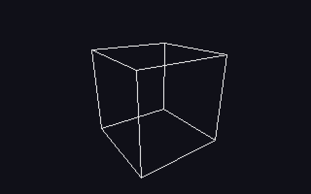
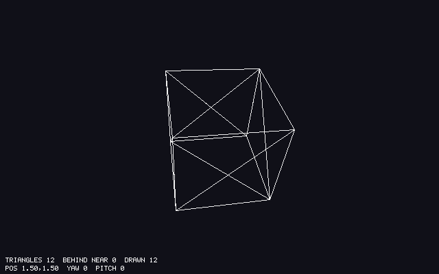

# Chapter 16 — Wireframe 3D

Chapter 15 projected single points. This chapter projects shapes. A shape in a 3D renderer is
a *mesh*: a list of vertices and a list of triangles that connect them, and every surface in
the rest of this book is one. We build a unit cube at compile time, with its triangles wound
counter-clockwise seen from outside, and a small pipeline in a new file, `render3d.zig`. It
transforms each vertex once, projects each triangle, and draws its three edges with Chapter
10's line routine. The maze becomes 218 wall cubes in wireframe, and a spinning cube gets a
view of its own. To keep things simple, a triangle with a corner behind the eye is dropped
whole. That rule loses walls right next to the camera, and, less obviously, it makes the
renderer draw lines tens of thousands of pixels long that land nowhere on the screen. Both
problems are the reason for Chapter 17.

Previous: [Chapter 15 — Cameras and Projection](15-cameras-and-projection.md).
Next: [Chapter 17 — Clipping](17-clipping.md).

## Meshes: vertices and indices

Why triangles? Three points always lie in one plane, so a triangle is always flat, and it is
never concave or twisted. A square, a wall, or a barrel can all be cut into triangles, and a
renderer that can draw a triangle can draw them all. Chapter 10 filled triangles in 2D.
Chapter 18 will fill them in 3D. Here we only draw their edges.

The obvious way to store triangles is three corners each. But neighboring triangles share
corners: a square is two triangles that share a diagonal, so two of its four corners would be
stored twice. A mesh therefore stores each corner once, in a *vertex* list, and lists the
triangles as numbers into it, three *indices* per triangle. The new file `src/mesh.zig`:

```zig
//! Meshes: shapes made of triangles. A mesh is a list of vertices and a
//! list of indices into it, three per triangle, so a vertex shared by
//! several triangles is stored (and later transformed) once.
const std = @import("std");
const math = @import("math.zig");
const Vec3 = math.Vec3;

pub const Vertex = struct {
    pos: Vec3,
    /// The direction the surface faces at this vertex, length 1.
    normal: Vec3,
};

pub const Mesh = struct {
    vertices: []const Vertex,
    /// Three per triangle. Seen from the side the normals point to (the
    /// outside), every triangle's corners go counter-clockwise.
    indices: []const u16,

    pub fn triangleCount(mesh: Mesh) usize {
        return mesh.indices.len / 3;
    }
};
```

- A vertex is more than a position. The `normal` is the direction the surface faces. This
  chapter doesn't use it, except in a test. Chapter 19 lights surfaces with it, and Chapter 20
  adds texture coordinates to the vertex.
- The indices are `u16`, two bytes each, so one mesh can have up to 65,536 vertices. That's
  plenty for a cube. Chapter 21 merges the whole maze into one mesh and has to check this limit.
- Both lists are slices of `const`. A mesh doesn't own its memory: the cube's lives in the
  program's read-only data, as the next section shows.

`examples/ch16/index_buffer.zig` counts what the index list saves. A `Vertex` is two `Vec3`s,
and a `@Vector(3, f32)` takes 16 bytes, not 12, because vectors are aligned to a power of two:

```console
$ zig run examples/ch16/index_buffer.zig
@sizeOf(Vec3) = 16, @sizeOf(Vertex) = 32, @sizeOf(u16) = 2

square                    2 triangles | plain:     6 vertices    192 bytes | indexed:     4 vertices +     6 indices =    140 bytes
cube, 8 corners          12 triangles | plain:    36 vertices   1152 bytes | indexed:     8 vertices +    36 indices =    328 bytes
cube, with normals       12 triangles | plain:    36 vertices   1152 bytes | indexed:    24 vertices +    36 indices =    840 bytes
maze (218 cubes)       2616 triangles | plain:  7848 vertices 251136 bytes | indexed:  5232 vertices +  7848 indices = 183120 bytes
triangle 0: { 0, 0, 0 } { 1, 0, 0 } { 1, 1, 0 }
triangle 1: { 0, 0, 0 } { 1, 1, 0 } { 0, 1, 0 }
largest u16 index: 65535
```

- The square: four corners, and the triangles (0, 1, 2) and (0, 2, 3). Corners 0 and 2, the
  ends of the diagonal, are used by both.
- A cube has 8 corners, used 36 times by its 12 triangles. With an index list, 8 vertices would
  be enough, and that's a big saving. But the next section shows why the cube needs 24.
- The bytes matter less than the work. Every vertex in the list is transformed by a matrix
  once per frame. Without indices, each corner would be transformed once for every triangle
  that uses it: 36 times per cube instead of 24, and 7848 times for the maze instead of 5232.

This is how every GPU API takes geometry, too: a *vertex buffer* and an *index buffer*. The
most common file format for meshes, Wavefront OBJ, stores the same two lists as text. A line
`v x y z` is a vertex, and a line `f a b c` is a triangle, with indices counted from 1.
`examples/ch16/obj_parse.zig` reads a tetrahedron written in that format:

```zig
const tetrahedron =
    \\# a tetrahedron: four corners, four faces, counter-clockwise from outside
    \\v 0 0 0
    \\v 1 0 0
    \\v 0 1 0
    \\v 0 0 1
    \\f 1 3 2
    \\f 1 2 4
    \\f 1 4 3
    \\f 2 3 4
;
```

Its loop splits the text into lines and words, parses `v` lines with `std.fmt.parseFloat`, and
`f` lines with `std.fmt.parseInt`, subtracting 1 from each index. An index of 0 or past the
last vertex is an error:

```zig
        } else if (std.mem.eql(u8, kind, "f")) {
            for (0..3) |_| {
                const n = try std.fmt.parseInt(u16, words.next() orelse return error.BadObj, 10);
                if (n == 0 or n > vertices.items.len) return error.BadObj;
                try indices.append(gpa, n - 1); // OBJ counts from 1
            }
        }
```

```console
$ zig run examples/ch16/obj_parse.zig
4 vertices, 12 indices, 4 triangles
triangle { 0, 2, 1 }: cross product { 0, 0, -1 }
triangle { 0, 1, 3 }: cross product { 0, -1, 0 }
triangle { 0, 3, 2 }: cross product { -1, 0, 0 }
triangle { 1, 2, 3 }: cross product { 1, 1, 1 }
```

Every cross product points away from the tetrahedron: −z for the face on the floor, −y and −x
for the faces on the walls, and (1, 1, 1) for the slanted one. That is no accident. The section
on winding explains why, and Exercise 1 loads a shape from OBJ text into `delve`.

## A cube built at compile time

A cube has 8 corners, but `delve`'s cube has 24 vertices. A corner of a cube touches three
faces, and those faces point three different ways. A vertex has one normal. To light the faces
differently in Chapter 19, each face needs its own four vertices with its own normal: 6 faces
times 4 corners. The positions repeat, the normals don't.

Writing 24 vertices and 36 indices by hand invites mistakes, and a mistake in a hand-typed
table is hard to see. Instead, `mesh.zig` describes each face by three vectors and computes the
rest. For each face:

- `n` is the outward normal, for example (1, 0, 0) for the face at x = 1.
- `u` and `v` are two directions across the face, chosen so that `u × v = n`.

Then the face's center is the cube's center plus half the normal, and its corners are the
center plus or minus half of `u` and half of `v`. Going around in the order −u−v, +u−v, +u+v,
−u+v is counter-clockwise when seen with `n` pointing at you, for the same reason that
(1, 0), (0, 1) turn counter-clockwise in a math-class plane with x right and y up: u plays x,
v plays y, and `u × v = n` makes `n` play the z that points toward the viewer.

```zig
/// The unit cube from (0, 0, 0) to (1, 1, 1): six faces of two triangles.
/// A corner is shared by three faces that face different ways, so each
/// face has its own four vertices: 24 vertices, not 8.
pub const cube: Mesh = blk: {
    // Each face: its outward normal n, and two directions u and v across
    // it, chosen so that u x v = n. Going -u-v, +u-v, +u+v, -u+v around
    // the face center is then counter-clockwise seen from outside.
    const faces = [6][3]Vec3{
        .{ .{ 1, 0, 0 }, .{ 0, 0, -1 }, .{ 0, 1, 0 } },
        .{ .{ -1, 0, 0 }, .{ 0, 0, 1 }, .{ 0, 1, 0 } },
        .{ .{ 0, 1, 0 }, .{ 1, 0, 0 }, .{ 0, 0, -1 } },
        .{ .{ 0, -1, 0 }, .{ 1, 0, 0 }, .{ 0, 0, 1 } },
        .{ .{ 0, 0, 1 }, .{ 1, 0, 0 }, .{ 0, 1, 0 } },
        .{ .{ 0, 0, -1 }, .{ -1, 0, 0 }, .{ 0, 1, 0 } },
    };
    const corners = [4][2]f32{ .{ -1, -1 }, .{ 1, -1 }, .{ 1, 1 }, .{ -1, 1 } };
    var vertices: [24]Vertex = undefined;
    var indices: [36]u16 = undefined;
    for (faces, 0..) |face, f| {
        const n, const u, const v = face;
        const center = Vec3{ 0.5, 0.5, 0.5 } + math.scale(n, 0.5);
        for (corners, 0..) |c, k| {
            const pos = center + math.scale(u, c[0] / 2) + math.scale(v, c[1] / 2);
            vertices[f * 4 + k] = .{ .pos = pos, .normal = n };
        }
        const first: u16 = f * 4;
        indices[f * 6 ..][0..6].* = .{ first, first + 1, first + 2, first, first + 2, first + 3 };
    }
    const final_vertices = vertices;
    const final_indices = indices;
    break :blk .{ .vertices = &final_vertices, .indices = &final_indices };
};
```

- `cube` is a global `const`, so the block after `=` runs at compile time. The loops, the vector
  math, and the writes into `vertices` all happen in the compiler. The program contains the
  finished 24 vertices and 36 indices, as if they had been typed in.
- `const n, const u, const v = face;` is a *destructuring* declaration: one name for each
  element of the three-element array.
- Each face becomes two triangles, (first, first + 1, first + 2) and (first, first + 2,
  first + 3), the same split as the square in the previous section. Both keep the
  counter-clockwise order of the four corners.
- `indices[f * 6 ..][0..6].*` takes six elements starting at `f * 6` as an array, so one
  assignment fills them all.

How do you pick `u` and `v` so that `u × v = n`? Choose any `u` along the face, and `v = n × u`.
For the face at +x, take `v` up, (0, 1, 0); then `u` must be (0, 0, −1), since
`(0, 0, −1) × (0, 1, 0) = (0·0 − (−1)·1, (−1)·0 − 0·0, 0·1 − 0·0) = (1, 0, 0)`. Rather than
trust six of these, `examples/ch16/cube_mesh.zig` builds the same cube and checks every row:

```console
$ zig run examples/ch16/cube_mesh.zig
24 vertices, 36 indices, 12 triangles
face 0: n = {  1,  0,  0 }  u x v = n: true  corners: { 1, 0, 1 } { 1, 0, 0 } { 1, 1, 0 } { 1, 1, 1 }
        triangles { 0, 1, 2, 0, 2, 3 }
face 1: n = { -1,  0,  0 }  u x v = n: true  corners: { 0, 0, 0 } { 0, 0, 1 } { 0, 1, 1 } { 0, 1, 0 }
        triangles { 4, 5, 6, 4, 6, 7 }
face 2: n = {  0,  1,  0 }  u x v = n: true  corners: { 0, 1, 1 } { 1, 1, 1 } { 1, 1, 0 } { 0, 1, 0 }
        triangles { 8, 9, 10, 8, 10, 11 }
face 3: n = {  0, -1,  0 }  u x v = n: true  corners: { 0, 0, 0 } { 1, 0, 0 } { 1, 0, 1 } { 0, 0, 1 }
        triangles { 12, 13, 14, 12, 14, 15 }
face 4: n = {  0,  0,  1 }  u x v = n: true  corners: { 0, 0, 1 } { 1, 0, 1 } { 1, 1, 1 } { 0, 1, 1 }
        triangles { 16, 17, 18, 16, 18, 19 }
face 5: n = {  0,  0, -1 }  u x v = n: true  corners: { 1, 0, 0 } { 0, 0, 0 } { 0, 1, 0 } { 1, 1, 0 }
        triangles { 20, 21, 22, 20, 22, 23 }
```

Take face 4, the one at z = 1, facing +z. Stand outside it, at z = 2, and look back toward the
cube: x points to your right and y up. Its corners (0, 0), (1, 0), (1, 1), (0, 1) in x and y go
counter-clockwise. Each corner of the cube appears three times in the list, once per face.

### Why the copies at the end

The last three lines of the block copy the finished arrays into `const`s before taking their
addresses. That looks redundant. `examples/ch16/comptime_escape.zig` shows why it isn't. It
builds the index list of a strip of squares in the same way, inside a function that runs at
compile time:

```zig
fn stripIndices(comptime quads: u16) []const u16 {
    return comptime blk: {
        var indices: [quads * 6]u16 = undefined;
        for (0..quads) |q| {
            const b: u16 = @intCast(q); // bottom left
            const t: u16 = b + quads + 1; // top left
            indices[q * 6 ..][0..6].* = .{ b, b + 1, t + 1, b, t + 1, t };
        }
        const final = indices;
        break :blk &final;
    };
}

const strip = stripIndices(3);
```

```console
$ zig run examples/ch16/comptime_escape.zig
18 indices, 6 triangles
{ 0, 1, 5 }
{ 0, 5, 4 }
{ 1, 2, 6 }
{ 1, 6, 5 }
{ 2, 3, 7 }
{ 2, 7, 6 }
```

Now replace the last two lines of the block with `break :blk &indices;`, a pointer straight to
the `var`:

```console
$ zig run comptime_escape.zig
comptime_escape.zig:21:27: error: global variable contains reference to comptime var
const strip = stripIndices(3);
              ~~~~~~~~~~~~^~~
comptime_escape.zig:11:9: note: 'strip.ptr' points to comptime var declared here
        var indices: [quads * 6]u16 = undefined;
        ^~~~~~~~~~~~~~~~~~~~~~~~~~~~~~~~~~~~~~~
```

(The "referenced by" lines that follow are cut here.) A `var` at compile time is a value the
compiler is still changing. If a global could point at it, the program would contain a pointer
to something that has no final value. Zig rejects that. Copying it into a `const` freezes the
contents: `final` can't change any more, so the compiler can put it in the program's read-only
data, and a pointer to it is a pointer to that data. The same applies to `final_vertices` and
`final_indices` in `mesh.zig`.

## Winding and the right-hand rule

The order of a triangle's corners is called its *winding*. Seen from one side, a, b, c go
counter-clockwise. Seen from the other side, the same order is clockwise. `delve`'s convention,
which most of the graphics world shares:

**Seen from outside, the side the normal points to, a triangle's corners go counter-clockwise.**

The cross product turns that into arithmetic. By the right-hand rule (Chapter 11), curl the
fingers of your right hand from `b − a` toward `c − a` and your thumb points along
`cross(b − a, c − a)`. If the corners go counter-clockwise as you look at them, your thumb
points at you. `examples/ch16/winding.zig` checks a triangle in the plane z = 0 and the same
triangle with two corners swapped:

```console
$ zig run examples/ch16/winding.zig
a b c: cross = { 0, 0, 2 }  signed area (y up) =  1.0  -> counter-clockwise seen from +z
a c b: cross = { 0, 0, -2 }  signed area (y up) = -1.0  -> clockwise seen from +z
a b c with y flipped (screen rows): signed area = -1.0
```

- The triangle (0, 0, 0), (2, 0, 0), (0, 1, 0) has area 1. In the order a, b, c, its cross
  product points along +z, toward a viewer at +z, who sees the corners counter-clockwise.
- Swapping b and c flips the cross product. Its length, twice the area, stays.
- The z of the cross product is the 2D *signed area* formula from Chapter 10's edge functions,
  doubled. Its sign is the winding.
- The last line is a warning for later. On a screen y grows down, which mirrors everything top
  to bottom, and the same triangle comes out with a negative area. Chapter 18 has to account for
  that flip.

The test in `mesh.zig` checks all 12 triangles of the cube against the convention: the cross
product of two edges points along the vertex normal, and the normal points away from the
cube's center. It also checks that every corner is inside the unit cube, which would catch a
wrong sign in the face table:

```zig
test "the cube's triangles wind counter-clockwise seen from outside" {
    try std.testing.expectEqual(24, cube.vertices.len);
    try std.testing.expectEqual(12, cube.triangleCount());
    const center: Vec3 = .{ 0.5, 0.5, 0.5 };
    var i: usize = 0;
    while (i < cube.indices.len) : (i += 3) {
        const a = cube.vertices[cube.indices[i]];
        const b = cube.vertices[cube.indices[i + 1]];
        const c = cube.vertices[cube.indices[i + 2]];
        // Counter-clockwise seen from outside: by the right-hand rule the
        // cross product of two edges points out, along the normal...
        const n = math.cross(b.pos - a.pos, c.pos - a.pos);
        try std.testing.expect(math.approxEq(math.normalize(n), a.normal));
        // ...and the normal points away from the cube's center.
        try std.testing.expect(math.dot(a.normal, a.pos - center) > 0);
        for ([_]Vec3{ a.pos, b.pos, c.pos }) |p| {
            try std.testing.expect(@reduce(.And, p >= Vec3{ 0, 0, 0 }) and @reduce(.And, p <= Vec3{ 1, 1, 1 }));
        }
    }
}
```

Why settle this now, when a wireframe draws all edges whatever their order? Because of Chapter
18. A closed shape like a cube can only show the outside of its faces. A face whose outside
points away from the camera is on the far side of the cube, hidden by the near side, and a
renderer can skip it without drawing it. On the screen, such a *back face* winds the other way
round from a front face. One sign test per triangle skips about half of them, but only if every mesh agrees on the
convention, from the first one on.

## The vertex stage: transform once

A mesh is in *model space*: the cube runs from (0, 0, 0) to (1, 1, 1), wherever it ends up. A
*model matrix* places it in the world. For a wall cube at map cell (3, 7) that's
`translation(3, 0, 7)`. For the spinning cube later in this chapter, it's a rotation. Then
Chapter 15's view-projection matrix takes the world position to clip space. So every vertex
goes through two matrices:

```text
world = model · pos
clip  = view_proj · world
```

The new file `src/render3d.zig` holds the pipeline. Its `Renderer` owns one piece of scratch
memory, room for the clip-space position of every vertex of the mesh being drawn:

```zig
//! The 3D pipeline: a mesh and its matrices go in, pixels come out.
//! Every vertex is transformed once into clip space, then every triangle
//! is projected to the screen and drawn, for now as three lines.
const std = @import("std");
const Canvas = @import("canvas.zig").Canvas;
const Color = @import("canvas.zig").Color;
const draw = @import("draw.zig");
const math = @import("math.zig");
const Vec3 = math.Vec3;
const Vec4 = math.Vec4;
const Mat4 = math.Mat4;
const Mesh = @import("mesh.zig").Mesh;
const camera = @import("camera.zig");

/// Counts of what happened to the triangles of a frame.
pub const Stats = struct {
    triangles: u32 = 0,
    /// Thrown away because a corner was behind the near plane.
    behind: u32 = 0,
    drawn: u32 = 0,
};

pub const Renderer = struct {
    /// Scratch memory: the vertices of the mesh being drawn, in clip space.
    clip: []Vec4,

    pub fn init(gpa: std.mem.Allocator, max_vertices: usize) !Renderer {
        return .{ .clip = try gpa.alloc(Vec4, max_vertices) };
    }

    pub fn deinit(r: *Renderer, gpa: std.mem.Allocator) void {
        gpa.free(r.clip);
        r.* = undefined;
    }
```

`App.init` allocates it once, with room for `max_vertices = 1024`, and `App.deinit` frees it.
Nothing is allocated while drawing a frame, as in Chapter 14's ray-casting renderer.

`drawWireframe` starts with the vertex stage. Each vertex is transformed once, however many
triangles share it, and the result goes into the scratch array at the vertex's index:

```zig
    /// Draws the edges of every triangle of `mesh`, placed in the world by
    /// `model` and seen through `view_proj`.
    pub fn drawWireframe(
        r: Renderer,
        canvas: Canvas,
        mesh: Mesh,
        model: Mat4,
        view_proj: Mat4,
        color: Color,
        stats: *Stats,
    ) void {
        std.debug.assert(mesh.vertices.len <= r.clip.len);
        // Transform each vertex once, however many triangles share it.
        // Going through the world position first (instead of multiplying
        // the two matrices) means a corner shared by two meshes gets
        // exactly the same clip coordinates from both.
        for (mesh.vertices, r.clip[0..mesh.vertices.len]) |v, *clip| {
            const world = model.transformPoint(v.pos);
            clip.* = view_proj.mulVec(math.vec4(world, 1));
        }
```

### World first, for watertight edges

Matrices can be multiplied in advance. `view_proj.mul(model)` is one matrix per mesh, and
then one matrix-vector product per vertex instead of two. Why does `delve` not do that?

Two neighboring wall cubes share an edge. The corner (4, 0, 7) is corner (1, 0, 0) of the cube
at x = 3, and corner (0, 0, 0) of the cube at x = 4. Follow it both ways:

- **World first.** `translation(3, 0, 7)` applied to (1, 0, 0) is (1 + 3, 0, 0 + 7), and
  `translation(4, 0, 7)` applied to (0, 0, 0) is (0 + 4, 0, 0 + 7). Small whole numbers add
  exactly in floating point, so both give the same `Vec3`, bit for bit. Then the same
  `view_proj` turns it into the same clip coordinates, bit for bit.
- **Premultiplied.** `view_proj · translation(3, 0, 7)` and `view_proj · translation(4, 0, 7)`
  are two different matrices, each with its own rounding errors in its last column. The
  corner can come out of them a few ulps apart.

A few ulps don't show in a wireframe. In Chapter 18, where triangles are filled, they do: two
triangles that should meet exactly along an edge can leave a one-pixel crack between them, or
draw the same pixel twice. A *watertight* renderer fills every pixel along a shared edge exactly
once. Bit-identical corners are the first of three things that takes. Chapter 17 adds the
second, cutting a shared edge at the same point from both sides, and Chapter 18 the third, a
rule for pixels that lie exactly on an edge.

## Triangles as lines

The rest of `drawWireframe` walks the index list, three at a time. For each triangle it fetches
the three clip-space corners, projects them with Chapter 15's `toScreen`, rounds them down to
whole pixels, and draws three lines:

```zig
        var i: usize = 0;
        while (i < mesh.indices.len) : (i += 3) {
            stats.triangles += 1;
            const tri = [3]Vec4{
                r.clip[mesh.indices[i]],
                r.clip[mesh.indices[i + 1]],
                r.clip[mesh.indices[i + 2]],
            };
            // The naive way to deal with points behind the eye: drop the
            // whole triangle. Chapter 17 does better.
            if (tri[0][3] < camera.near or tri[1][3] < camera.near or tri[2][3] < camera.near) {
                stats.behind += 1;
                continue;
            }
            var p: [3]draw.Point = undefined;
            for (tri, &p) |clip, *point| {
                const s = camera.toScreen(clip, canvas.width, canvas.height);
                point.* = .{ .x = @intFromFloat(@floor(s[0])), .y = @intFromFloat(@floor(s[1])) };
            }
            draw.line(canvas, p[0], p[1], color);
            draw.line(canvas, p[1], p[2], color);
            draw.line(canvas, p[2], p[0], color);
            stats.drawn += 1;
        }
    }
};
```

- `draw.line` is Chapter 10's Bresenham line, both ends included. It skips any pixel outside
  the canvas, so lines may start and end anywhere.
- `Stats` counts what happens to each triangle, for the status line: drawn, or dropped because
  a corner is behind the near plane. The caller owns it, so one `Stats` can add up all the
  meshes of a frame.
- Every edge shared by two triangles is drawn twice, once by each. For the cube, the diagonal
  of each face is shared by the face's two triangles, and each of the 12 cube edges is shared by
  two faces. Exercise 2 draws each edge once.

That's the whole pipeline: transform, divide, viewport, draw. Without `delve`'s modules it fits
in one short file. `examples/ch16/wire_cube_ppm.zig` writes it out by hand: it turns the 8
corners of a cube from −0.5 to 0.5 about y and then x, puts it 2.2 units in front of the eye,
divides by the depth with the same `f = 2` as `delve`, and draws the 12 edges with its own
Bresenham into `cube.ppm`. Two corners share an edge when their numbers differ in exactly one
bit, because bit 0 is x, bit 1 is y, and bit 2 is z:

```zig
    // Two corners share an edge when they differ in exactly one bit.
    var edges: usize = 0;
    for (0..8) |i| for (0..8) |j| {
        if (i < j and @popCount(i ^ j) == 1) {
            line(screen[i][0], screen[i][1], screen[j][0], screen[j][1]);
            edges += 1;
        }
    };
```

```console
$ zig run examples/ch16/wire_cube_ppm.zig
corner 0: d = 2.515  pixel (104, 132)
corner 1: d = 3.035  pixel (168, 112)
corner 2: d = 2.125  pixel (94, 51)
corner 3: d = 2.645  pixel (169, 44)
corner 4: d = 1.755  pixel (145, 183)
corner 5: d = 2.275  pixel (221, 144)
corner 6: d = 1.365  pixel (140, 72)
corner 7: d = 1.885  pixel (233, 56)
12 edges -> cube.ppm
```



- The picture is 320x200, shown here at double size.
- Corner 6 is the nearest (d = 1.365), corner 1 the farthest (3.035). The edges near corner 6
  are longer on the screen than the matching edges near corner 1, although all 12 are one unit
  long in 3D. That's the divide by d.
- Edges are drawn between corners, not triangles, so there are no diagonals. `delve` draws
  triangles, because that's what it will fill later.

## The naive near-plane rule

One line in the triangle loop needs a closer look:

```zig
            if (tri[0][3] < camera.near or tri[1][3] < camera.near or tri[2][3] < camera.near) {
                stats.behind += 1;
                continue;
            }
```

Chapter 15 showed what the divide does to a point behind the eye: it mirrors it to the wrong
side of the screen. A line from a point in front to a point behind would be drawn toward the
mirror image, across the screen, and be wrong. The simplest safe rule: if any corner of a
triangle is closer than the near plane, drop the whole triangle.

Here it is from Chapter 13's pose. The maze is drawn in brick and stone colors, every visible
wall cell as a cube (the next section shows how):

```console
$ ./zig-out/bin/delve --headless --view wireframe --pos 9.5,10.5 --yaw -60 --out ../../images/ch16-maze-wire.png
```


- The status line reads `TRIANGLES 2616  BEHIND NEAR 1245  DRAWN 1371`. Almost half the
  triangles are dropped. Nearly all of them are wholly behind the player, where nothing should
  be drawn anyway.
- At this pose the rule loses nothing visible. Chapter 17's clipped wireframe from the same
  pose shows the same picture. Compared pixel by pixel, the two differ in 549 of the 230,400
  pixels above the status lines, where a line that Chapter 17 cut at the screen edge is stepped
  from a slightly different start.
- Every cube is see-through. The edges of walls hidden behind other walls show through, which
  is why the far corridor on the right is a tangle of lines. Hiding them takes the depth buffer
  of Chapter 18.

What *does* get lost is a triangle that starts behind the eye and reaches into view. That
happens when the player stands right next to a wall, so close that the wall's triangles have
one corner behind the near plane. In a wireframe, a line or two goes missing. Filled, in
Chapter 18, a hole the size of a wall opens next to the player. Chapter 17 shows the pose.

### Lines to nowhere

The rule has a second problem, which only shows on a stopwatch. Time 600 frames of this view
in a release build:

```console
$ zig build --release=fast
$ /usr/bin/time -f "%e s" ./zig-out/bin/delve --headless --frames 600 --view wireframe --pos 9.5,10.5 --yaw -60
2.11 s
$ /usr/bin/time -f "%e s" ./zig-out/bin/delve --headless --frames 600 --pos 9.5,10.5 --yaw -60
0.36 s
```

3.5 ms per frame for some lines, six times longer than the ray caster takes to fill the whole
screen with walls, floor, and ceiling. (Two more runs gave 2.13 s each.) Where does the time go?

The 1371 "drawn" triangles are all triangles with every corner in front of the near plane. That
includes walls far to the side of the view, almost level with the player's shoulder, with w
just above 0.05. Their corners project far outside the screen. A version of
`draw.zig` instrumented to count (not part of the project) found screen coordinates up to
24,560 pixels from the origin, and `draw.line` stepping through 1,760,309 pixels per frame:
almost seven times the 256,000 pixels of the canvas, nearly all of them outside it, each one
tested and skipped.

A line from a point at x = 24,560 to a point on the screen costs as much as 24,000 pixels,
whether or not any of them land on the canvas. Chapter 17 throws such triangles away with a few
comparisons before drawing, and cuts the rest at the screen's edges. The same view then takes
0.14 s.

Why is there no check like Chapter 15's `@abs(s[0]) > 4096` before `@intFromFloat`? Because
the near plane already bounds the coordinates. With `w ≥ 0.05`, `x_ndc = 1.25·x/w` is at most
25 times the sideways distance `x`. Nothing in the 32x24 cellar is more than 40 units away, so
`|x_ndc|` stays below 1000, and the pixel coordinate within about 320,000 of the screen: far
inside an `i32`. A
point *on* the near plane, though, can land anywhere up to that, and the lines show it.

The test in `render3d.zig` checks the three cases: a cube in front is drawn, a cube behind is
dropped, and a cube around the eye loses some triangles:

```zig
test "a cube in front is drawn, a cube behind is not" {
    const gpa = std.testing.allocator;
    var canvas = try Canvas.init(gpa, 64, 40);
    defer canvas.deinit(gpa);
    var r = try Renderer.init(gpa, 24);
    defer r.deinit(gpa);
    const cube = @import("mesh.zig").cube;

    // The default camera at the origin looks down -z.
    const vp = camera.Camera.projection(64, 40);
    var stats: Stats = .{};
    r.drawWireframe(canvas, cube, Mat4.translation(.{ -0.5, -0.5, -3 }), vp, Color.white, &stats);
    try std.testing.expectEqual(Stats{ .triangles = 12, .behind = 0, .drawn = 12 }, stats);
    // The diagonals of the front and back faces cross the screen center.
    try std.testing.expectEqual(Color.white, canvas.get(32, 20));

    stats = .{};
    r.drawWireframe(canvas, cube, Mat4.translation(.{ -0.5, -0.5, 2 }), vp, Color.white, &stats);
    try std.testing.expectEqual(Stats{ .triangles = 12, .behind = 12, .drawn = 0 }, stats);

    // Half in front of the eye, half behind: the triangles that reach
    // behind the near plane are lost.
    stats = .{};
    r.drawWireframe(canvas, cube, Mat4.translation(.{ -0.5, -0.5, -0.5 }), vp, Color.white, &stats);
    try std.testing.expect(stats.behind > 0 and stats.drawn > 0);
}
```

- The view-projection matrix is the projection alone: with no view matrix, the camera is at the
  origin looking down −z.
- `translation(-0.5, -0.5, -3)` centers the unit cube on the view axis, 2.5 to 3.5 units ahead.
- At z from 2 to 3, the cube is entirely behind the camera: all 12 triangles are dropped.
- The last cube runs from −0.5 to 0.5 in every direction: the eye is inside it. Only the face at
  z = −0.5 is wholly in front, so its 2 triangles are drawn and the other 10 are dropped.

## The maze as cubes

The maze needs no new mesh. Every wall cell is the unit cube, moved into place. Map cell
(x, y) covers x to x + 1 and, in the world, z from y to y + 1 (Chapter 15's convention: the
map's y is the world's z), from the floor at height 0 to the top of the wall at 1. So its model
matrix is `translation(x, 0, y)`. The new file `src/maze3d.zig`:

```zig
//! The maze in 3D: every wall cell is a unit cube standing on the floor.
//! A map cell (x, y) becomes the cube from (x, 0, y) to (x + 1, 1, y + 1).
const std = @import("std");
const Canvas = @import("canvas.zig").Canvas;
const Color = @import("canvas.zig").Color;
const Mat4 = @import("math.zig").Mat4;
const Map = @import("map.zig").Map;
const Tile = @import("map.zig").Tile;
const cube = @import("mesh.zig").cube;
const render3d = @import("render3d.zig");

fn wireColor(tile: Tile) Color {
    return switch (tile) {
        .floor => unreachable,
        .brick => .hex(0xe08050),
        .stone => .hex(0xb0b0c0),
    };
}

/// True if wall cell (x, y) has a floor cell next to it. Walls buried
/// among other walls can never be seen, so they are not drawn.
pub fn touchesFloor(map: Map, x: i32, y: i32) bool {
    for ([_][2]i32{ .{ 1, 0 }, .{ -1, 0 }, .{ 0, 1 }, .{ 0, -1 } }) |d| {
        if (!map.at(x + d[0], y + d[1]).isWall()) return true;
    }
    return false;
}

/// Draws the edges of every visible wall cube.
pub fn drawWireframe(r: render3d.Renderer, canvas: Canvas, map: Map, view_proj: Mat4, stats: *render3d.Stats) void {
    for (0..map.height) |y| {
        for (0..map.width) |x| {
            const tile = map.at(@intCast(x), @intCast(y));
            if (!tile.isWall() or !touchesFloor(map, @intCast(x), @intCast(y))) continue;
            const model = Mat4.translation(.{ @floatFromInt(x), 0, @floatFromInt(y) });
            r.drawWireframe(canvas, cube, model, view_proj, wireColor(tile), stats);
        }
    }
}
```

- `wireColor` gives brick an orange line and stone a gray one, close to the colors the ray
  caster uses for them.
- `touchesFloor` checks the four neighbors that share a side. A wall cell with walls on all
  four sides can't be seen from anywhere the player can stand, so drawing it is wasted work.
  Corner neighbors don't count: a wall cell that only touches the floor at a corner shares no
  face with it.
- `map.at` returns a wall for any cell outside the map, so the border cells count only their
  neighbors inside.
- Of `cellar.txt`'s 237 wall cells, 218 touch the floor: 218 × 12 = 2616 triangles, the number
  on the status line. Exercise 4 measures what the 19 others would cost.

The test uses a three-row map:

```zig
test "only walls next to the floor are drawn" {
    const gpa = std.testing.allocator;
    var map = try Map.parse(gpa,
        \\#####
        \\#>..#
        \\#####
    );
    defer map.deinit(gpa);
    try std.testing.expect(touchesFloor(map, 0, 1));
    try std.testing.expect(touchesFloor(map, 2, 0));
    try std.testing.expect(!touchesFloor(map, 0, 0)); // a corner: walls all around
    try std.testing.expect(!touchesFloor(map, -1, 1)); // outside the map
}
```

The `>` is the player's start, facing east, and counts as floor. Cell (0, 0) touches the floor
at (1, 1) only through a corner, so it's skipped.

Drawing each wall as its own cube is wasteful in a second way. Where two wall cells stand side
by side, each has a face against the other, and those two faces can never be seen. They are
still transformed and drawn. Chapter 21 replaces the 218 cubes with one mesh of only the faces
that border the floor.

## Views and a spinning cube

The maze in wireframe is a new *view*, next to the ray caster and the two map views. `View` gets two members, and `first_person` is renamed to say which first-person
view it is:

```zig
pub const View = enum { raycast, wireframe, cube, map_fixed, map_follow };
```

Tab still cycles through them in this order. The `next_view` code from Chapter 13 takes the
list from the enum itself, so it needs no change:

```zig
        if (input.pressed.contains(.next_view)) {
            const views = std.enums.values(View);
            app.view = views[(@backingInt(app.view) + 1) % views.len];
        }
```

The wireframe view clears the canvas, builds the camera from the player as Chapter 15 did, and
draws the maze. The minimap still works on top:

```zig
            .wireframe => {
                canvas.clear(.hex(0x101018));
                const view_proj = camera.Camera.fromPlayer(p).viewProjection(canvas.width, canvas.height);
                stats = .{};
                maze3d.drawWireframe(app.renderer3d, canvas, app.map, view_proj, &stats.?);
                if (app.show_minimap) app.drawMinimap(canvas);
            },
```

`stats` is declared before the `switch` as `var stats: ?render3d.Stats = null;`. The 3D views
set it, and after the `switch` a second status line shows it when it is not null:

```zig
        if (stats) |s| {
            const line = std.fmt.bufPrint(&buffer, "triangles {d}  behind near {d}  drawn {d}", .{
                s.triangles, s.behind, s.drawn,
            }) catch unreachable;
            _ = font.drawText(canvas, 8, h - 24, line, 1, Color.white);
        }
```

`&stats.?` is a pointer to the value inside the optional. `.?` unwraps it, and since `stats` is
a `var`, the unwrapped value can be pointed at and changed.

### The cube view

The `cube` view has nothing to do with the maze. It's a test bench: one cube, spinning in
front of a fixed camera, so you can check the pipeline on a shape you know.

```zig
            .cube => {
                canvas.clear(.hex(0x101018));
                // A fixed camera looking at a cube that spins about its center.
                const view = Mat4.lookAt(.{ 1.2, 1.0, 2.4 }, .{ 0, 0, 0 }, camera.world_up);
                const view_proj = camera.Camera.projection(canvas.width, canvas.height).mul(view);
                const model = Mat4.rotationY(app.time).mul(Mat4.rotationX(0.6 * app.time))
                    .mul(Mat4.translation(.{ -0.5, -0.5, -0.5 }));
                stats = .{};
                app.renderer3d.drawWireframe(canvas, cube, model, view_proj, .hex(0xf0f0f0), &stats.?);
            },
```

- The camera uses Chapter 15's `lookAt` directly: from (1.2, 1, 2.4), a little above and to the
  side, toward the origin.
- `app.time` is the time since the start in seconds, so the cube turns about y at one radian per
  second, and about x at 0.6.

The model matrix is read right to left, the order in which it acts on a point (Chapter 12).
First `translation(−0.5)` moves the unit cube so that its center is at the origin. Then the two
rotations turn it about the origin, which is now its center. The other order would turn the
cube about its corner (0, 0, 0) and move it afterwards, so its center would swing around the
origin. `examples/ch16/transform_order.zig` follows the cube's center and its corner (1, 1, 1)
through both orders, with only the y rotation:

```console
$ zig run examples/ch16/transform_order.zig
R(t) T(-0.5): translate first, then rotate
t =   0:  center ( 0.000,  0.000,  0.000)  corner ( 0.500,  0.500,  0.500)
t =  90:  center ( 0.000,  0.000,  0.000)  corner ( 0.500,  0.500, -0.500)
t = 180:  center ( 0.000,  0.000,  0.000)  corner (-0.500,  0.500, -0.500)
T(-0.5) R(t): rotate first, then translate
t =   0:  center ( 0.000,  0.000,  0.000)  corner ( 0.500,  0.500,  0.500)
t =  90:  center ( 0.000,  0.000, -1.000)  corner ( 0.500,  0.500, -1.500)
t = 180:  center (-1.000,  0.000, -1.000)  corner (-1.500,  0.500, -1.500)
```

In the first order the center stays at the origin while the corner goes around it. In the
second, the center itself travels: after half a turn it is at (−1, 0, −1), and the cube would
wobble around the screen instead of spinning in place.

The view needs no player, so the screenshot starts in it directly with the new `--view` option
and runs 40 ticks, two thirds of a second, to give the cube a turn:

```console
$ ./zig-out/bin/delve --headless --view cube --frames 40 --out ../../images/ch16-cube.png
```



- 12 triangles, all drawn. The camera is 2.9 units from the cube's center, so nothing comes
  near the near plane.
- Each face shows one diagonal: the edge that its two triangles share.
- The near and far faces overlap on the screen, and nothing tells which is in front. A
  wireframe is ambiguous that way, like the Necker cube. Filled faces in Chapter 18 settle it.

### `--view`

`--view NAME` sets the starting view. Zig can turn a string into an enum member by name:

```zig
            } else if (eql(arg, "--view")) {
                const name = try value(args, &i);
                opts.view = std.meta.stringToEnum(View, name) orelse return error.InvalidValue;
```

`std.meta.stringToEnum` returns null for a name that isn't a member, so the list of valid names
is the enum itself, and the help text lists them:

```console
$ ./zig-out/bin/delve --view top
delve: InvalidValue
usage: delve [OPTIONS]

  --frames N         stop after N frames (each frame advances exactly one tick)
  --headless         render without opening a window
  --out FILE         save the last frame as FILE (.png or .ppm)
  --screenshot FILE  save a screenshot of the window as FILE (.png)
  --scale N          window pixels per canvas pixel (default 2)
  --pos X,Y          start at map position X,Y instead of the map's start
  --yaw DEG          start facing DEG degrees (0 east, 90 south)
  --pitch DEG        start looking DEG degrees up (negative: down), -89 to 89
  --hold F,S,T       hold forward, strafe, and turn input (-1 to 1) all run long
  --press ACTION     perform ACTION (for example next_view) on the first tick
  --view NAME        start in view NAME: raycast, wireframe, cube, map_fixed, map_follow
  -h, --help         show this help
```

The exit status is 2, as for every bad option. `options.zig` imports `View` from `app.zig`,
and `main.zig` copies the parsed view into the app before the first frame.

## Building delve: wireframe 3D

| File | Change |
|---|---|
| `src/mesh.zig` | New: `Vertex`, `Mesh`, the comptime `cube`; 1 test |
| `src/render3d.zig` | New: `Renderer` with its clip-space scratch array, `drawWireframe`, `Stats`; 1 test |
| `src/maze3d.zig` | New: `touchesFloor`, `drawWireframe` for the maze; 1 test |
| `src/app.zig` | Views `raycast`, `wireframe`, and `cube`; owns the 3D renderer; the stats line |
| `src/options.zig` | `--view NAME`, with tests |
| `src/main.zig` | Applies `--view`; tests the three new files |

The complete project is in `project/ch16/`.

`cat src/*.zig | wc -l` counts 2745 lines, up from 2457. The ray caster is still there, one
Tab away, and still the default view.

### Tests

```console
$ zig build test --summary all
Build Summary: 6/6 steps succeeded; 37/37 tests passed
test success
+- run test 37 pass (37 total) 16ms MaxRSS:7M
   +- compile test debug native success 484ms MaxRSS:185M
      +- WriteFile raylib.h success
      +- compile lib raylib debug native success 3s MaxRSS:455M
      +- compile lib raylib debug native (reused)
      +- translate-c success 17ms MaxRSS:41M
```

Chapter 15's 34 tests and three new ones: the cube winds counter-clockwise seen from outside,
a cube in front is drawn and one behind is not, and only walls next to the floor are drawn.
The options test now also parses `--view cube` and rejects `--view top`.

### Running it

`zig build run`, then Tab to switch views: ray caster, wireframe, cube, and the two maps. W A S
D and the mouse work in the wireframe view as in the ray caster. Walk up to a wall and turn, and
watch the status line: the `behind near` count changes as walls pass behind you. The two
screenshots come from:

```console
$ ./zig-out/bin/delve --headless --view cube --frames 40 --out ../../images/ch16-cube.png
$ ./zig-out/bin/delve --headless --view wireframe --pos 9.5,10.5 --yaw -60 --out ../../images/ch16-maze-wire.png
```

The picture of `wire_cube_ppm.zig` is converted from its PPM with ImageMagick:
`convert cube.ppm -scale 200% ch16-ppm-cube.png`.

## How fast is it?

The section on the near-plane rule timed the maze: 2.11 s for 600 frames in ReleaseFast, 3.5 ms
per frame, and found the cause in lines that run far off the screen. The cube view, with 12
triangles that all land on the screen, is the other extreme:

```console
$ /usr/bin/time -f "%e s" ./zig-out/bin/delve --headless --frames 600 --view cube
0.02 s
```

0.03 ms per frame, starting the program included. Twelve triangles are nothing. 2616
triangles shouldn't be much either: 5232 vertices, each through two matrix-vector products of
16 multiplications, are about 170,000 multiplications per frame, a fraction of a millisecond. The maze is slow because of what the naive rule
lets through, not because of how much there is to draw. Chapter 17 brings the same view to
0.14 s.

## Summary

- A mesh is a vertex list and an index list, three indices per triangle. Shared corners are
  stored and transformed once. `u16` indices allow 65,536 vertices per mesh.
- The cube has 24 vertices, not 8, because each face needs its own normal. `mesh.zig` computes
  them at compile time from a table of (n, u, v) with `u × v = n`.
- A pointer to a comptime `var` can't escape into a global. Copy the finished array into a
  `const` first.
- Winding convention: seen from outside, corners go counter-clockwise, so
  `cross(b − a, c − a)` points out. Chapter 18 will use it to skip back faces.
- The vertex stage computes `world = model · pos`, then `clip = view_proj · world`. Going through
  the world position gives shared corners bit-identical clip coordinates, the first step toward
  watertight meshes.
- `drawWireframe` projects each triangle's corners and draws three lines. A triangle with a
  corner behind the near plane is dropped whole.
- That rule loses triangles that reach from behind the eye into view, and lets through
  triangles that project thousands of pixels off the screen. At the test pose it drops 1245 of
  2616 triangles and still takes 3.5 ms per frame. Chapter 17 clips instead.
- The maze is 218 unit cubes, one per wall cell that touches the floor, each placed with
  `translation(x, 0, y)`.
- A model matrix acts right to left: `rotation · translation(−0.5)` spins the cube about its
  center.

## Exercises

1. **Load an OBJ.** Write `parseObj`, which reads `v` and `f` lines into a `Mesh`, and use it to
   spin an octahedron next to the cube in the cube view. Give every face its own three vertices
   with the face's normal, as the cube does, and check the winding.

   <details><summary>Solution</summary>

   In `mesh.zig`, the parser collects the positions, and builds three vertices for every face,
   each with the face's normal from the cross product. Since the winding convention makes the
   cross product point out, the normals come out right as long as the OBJ text follows it:

   ```zig
   /// Reads `v x y z` and `f a b c` lines (1-based vertex numbers) into a
   /// flat-shaded mesh: every face gets three vertices of its own, all with
   /// the face's normal. Other lines are skipped.
   pub fn parseObj(gpa: std.mem.Allocator, text: []const u8) !Mesh {
       var positions: std.ArrayList(Vec3) = .empty;
       defer positions.deinit(gpa);
       var vertices: std.ArrayList(Vertex) = .empty;
       defer vertices.deinit(gpa);
       var lines = std.mem.tokenizeScalar(u8, text, '\n');
       while (lines.next()) |line| {
           var words = std.mem.tokenizeScalar(u8, line, ' ');
           const kind = words.next() orelse continue;
           if (std.mem.eql(u8, kind, "v")) {
               var v: [3]f32 = undefined;
               for (&v) |*c| c.* = try std.fmt.parseFloat(f32, words.next() orelse return error.BadObj);
               try positions.append(gpa, v);
           } else if (std.mem.eql(u8, kind, "f")) {
               var corners: [3]Vec3 = undefined;
               for (&corners) |*c| {
                   const n = try std.fmt.parseInt(usize, words.next() orelse return error.BadObj, 10);
                   if (n == 0 or n > positions.items.len) return error.BadObj;
                   c.* = positions.items[n - 1];
               }
               const normal = math.normalize(math.cross(corners[1] - corners[0], corners[2] - corners[0]));
               for (corners) |p| try vertices.append(gpa, .{ .pos = p, .normal = normal });
           }
       }
       if (vertices.items.len > std.math.maxInt(u16)) return error.BadObj;
       const indices = try gpa.alloc(u16, vertices.items.len);
       errdefer gpa.free(indices);
       for (indices, 0..) |*index, k| index.* = @intCast(k);
       return .{ .vertices = try vertices.toOwnedSlice(gpa), .indices = indices };
   }
   ```

   This mesh owns its memory, unlike the cube, so `Mesh` gets a `deinit`:

   ```zig
       /// Frees a mesh made by `parseObj`.
       pub fn deinit(mesh: Mesh, gpa: std.mem.Allocator) void {
           gpa.free(mesh.vertices);
           gpa.free(mesh.indices);
       }
   ```

   The octahedron has a corner 0.5 from the origin on each axis, and eight faces, one per
   octant. Each face lists its corners counter-clockwise seen from outside:

   ```zig
   /// An octahedron with its corners 0.5 from the origin on each axis.
   pub const octahedron_obj =
       \\v 0.5 0 0
       \\v -0.5 0 0
       \\v 0 0.5 0
       \\v 0 -0.5 0
       \\v 0 0 0.5
       \\v 0 0 -0.5
       \\f 1 3 5
       \\f 2 5 3
       \\f 1 5 4
       \\f 1 6 3
       \\f 2 4 5
       \\f 2 3 6
       \\f 1 4 6
       \\f 2 6 4
   ;

   test "the OBJ octahedron winds counter-clockwise seen from outside" {
       const gpa = std.testing.allocator;
       const oct = try parseObj(gpa, octahedron_obj);
       defer oct.deinit(gpa);
       try std.testing.expectEqual(8, oct.triangleCount());
       for (oct.vertices) |v| {
           // Every face's normal points away from the center, the origin.
           try std.testing.expect(math.dot(v.normal, v.pos) > 0);
       }
       try std.testing.expectError(error.BadObj, parseObj(gpa, "v 0 0 0\nf 1 2 3"));
   }
   ```

   Swap two numbers on any `f` line and the test fails: that face's normal points inward. In
   `app.zig`, import the whole module (`const mesh = @import("mesh.zig");`, and `mesh.cube` where
   `cube` was used), give `App` an `octahedron: mesh.Mesh` field, and parse it in `init`:

   ```zig
           const octahedron = try mesh.parseObj(gpa, mesh.octahedron_obj);
           errdefer octahedron.deinit(gpa);
   ```

   Free it in `deinit` with `app.octahedron.deinit(gpa);`. In the cube view, after the cube:

   ```zig
                   const spin = Mat4.translation(.{ -1.2, 0, 0 }).mul(Mat4.rotationY(-app.time));
                   app.renderer3d.drawWireframe(canvas, app.octahedron, spin, view_proj, .hex(0x60d0ff), &stats.?);
   ```

   The octahedron is already centered on the origin, so it turns first and then moves 1.2 to the
   left. The cube view now shows a blue octahedron turning beside the white cube, against the cube's
   spin,
   and the status line reads `TRIANGLES 20  BEHIND NEAR 0  DRAWN 20`. The suite has 38 tests.

   </details>

2. **Hide the diagonals.** Draw only the cube's real edges, not the diagonals that split each
   face into two triangles.

   <details><summary>Solution</summary>

   A diagonal is the one edge in the cube that two triangles share: the 12 real edges of the cube
   are shared too, but by two *faces*, and each face has its own vertices. So in the index list,
   an edge from vertex `a` to vertex `b` that also appears in another triangle is a diagonal. In
   `render3d.zig`:

   ```zig
   /// True if a triangle other than number `t` also has the edge from vertex
   /// `a` to vertex `b`. Triangles only share vertices inside one flat face
   /// of the cube, so a shared edge is a face's diagonal.
   fn sharedEdge(indices: []const u16, t: usize, a: u16, b: u16) bool {
       var j: usize = 0;
       while (j < indices.len) : (j += 3) {
           if (j / 3 == t) continue;
           const tri = indices[j..][0..3];
           const has_a = tri[0] == a or tri[1] == a or tri[2] == a;
           const has_b = tri[0] == b or tri[1] == b or tri[2] == b;
           if (has_a and has_b) return true;
       }
       return false;
   }

   test "the cube's diagonals are shared edges, its sides are not" {
       const cube = @import("mesh.zig").cube;
       var shared: usize = 0;
       var i: usize = 0;
       while (i < cube.indices.len) : (i += 3) {
           for (0..3) |k| {
               if (sharedEdge(cube.indices, i / 3, cube.indices[i + k], cube.indices[i + (k + 1) % 3])) shared += 1;
           }
       }
       // Each of the 6 faces has one diagonal, seen from both its triangles.
       try std.testing.expectEqual(12, shared);
   }
   ```

   The three `draw.line` calls become a loop over the triangle's edges:

   ```zig
               const t = i / 3;
               for (0..3) |k| {
                   const next = (k + 1) % 3;
                   if (sharedEdge(mesh.indices, t, mesh.indices[i + k], mesh.indices[i + next])) continue;
                   draw.line(canvas, p[k], p[next], color);
               }
   ```

   Now an existing test fails: "a cube in front is drawn" checked that the diagonals of the
   front and back faces cross the screen center. Turn the check around:

   ```zig
       // Without the diagonals, nothing crosses the screen center.
       try std.testing.expect(!std.meta.eql(Color.white, canvas.get(32, 20)));
   ```

   The cube shows only its 12 edges, and the maze turns into clean boxes. An OBJ mesh from
   Exercise 1 doesn't change, because its faces share no vertices. `sharedEdge` searches the whole
   index list for every edge, which is fine for 36 indices. For a big mesh, a precomputed edge
   mask per triangle, built with the mesh, would be the way.

   </details>

3. **Depth cueing.** Make far lines darker than near ones, so the depth of the wireframe is
   easier to read.

   <details><summary>Solution</summary>

   w is the distance in front of the eye, so it is the natural measure. Average it over the
   edge's two ends and darken the color with `Color.scale` from Chapter 14. In the loop from
   Exercise 2 (or the same loop without the `sharedEdge` line):

   ```zig
               const t = i / 3;
               for (0..3) |k| {
                   const next = (k + 1) % 3;
                   if (sharedEdge(mesh.indices, t, mesh.indices[i + k], mesh.indices[i + next])) continue;
                   // w is the distance in front of the eye.
                   const w = (tri[k][3] + tri[next][3]) / 2;
                   draw.line(canvas, p[k], p[next], color.scale(1 / (1 + 0.15 * w)));
               }
   ```

   At 1 unit a line keeps 87% of its brightness, at 5 units 57%, at 20 units 25%. In the maze
   the near walls stay bright and the tangle of far lines fades, which makes the depth much
   easier to read. With Exercise 2 in place all tests pass, since its version of the cube
   test only checks that the center is *not* white. Without it, the old check for a white
   pixel at the center fails: the dimmed lines are no longer white. Fading with distance is
   *depth cueing*, and Chapter 19's fog is the same idea for filled surfaces.

   </details>

4. **Measure `touchesFloor`.** Draw every wall cube, buried or not. How many more triangles,
   and how much slower is it?

   <details><summary>Solution</summary>

   In `maze3d.drawWireframe`, drop the `touchesFloor` condition:

   ```zig
               if (!tile.isWall()) continue;
   ```

   The status line at the test pose becomes `TRIANGLES 2844  BEHIND NEAR 1293  DRAWN 1551`:
   all 237 wall cells, 237 × 12 = 2844 triangles. The picture gets busier: the edges of the
   buried walls, diagonals included, crowd the far corridor.

   Timing 600 frames in ReleaseFast, twice each:

   ```text
   with touchesFloor     2.86 s, 2.39 s
   without               2.36 s, 2.45 s
   ```

   No measurable difference: the noise between runs is bigger than the change. 228 more
   triangles are 9% more, but as the timing section showed, the time doesn't go into the number
   of triangles. It goes into the long lines of the triangles beside the player, and the buried
   walls of `cellar.txt` are only 19 cells: the four corners, the outer wall where an inner wall
   meets it, and the stretch of outer wall above the room in the top middle. In a map with thick
   walls the buried cells could outnumber the visible ones, and the saving would be real.
   Chapter 21's world mesh goes further and drops every face between two walls.

   </details>

Sources for this chapter: [REFERENCES.md](REFERENCES.md#chapter-16--wireframe-3d)
