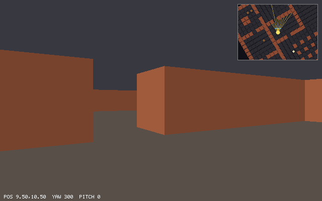

# Chapter 18 — Rasterizing Triangles

This is the heart of the polygon renderer. Chapter 17 left us with clipped polygons whose
corners have exact positions on the screen, and drew only their edges. Now we fill them. A
pixel belongs to a triangle when its center is on the inner side of all three edges. The
*edge function* from Chapter 10 says which side, and stepped from one pixel to the next it
costs one addition. With corners rounded to sixteenths of a pixel and the *top-left fill
rule*, two triangles that share an edge never both draw a pixel and never both skip one. The
three edge functions are also the *barycentric weights* that blend the corners' values, with a
correction for perspective that we derive. A *depth buffer* keeps the nearest surface at each
pixel, and *back-face culling* skips about a third of the triangles before any of this. In
`delve` the maze becomes solid, and it matches the ray caster's picture to within 2 pixels.
Unlike the ray caster, it can look up and down, and it can draw two cubes that cut through
each other.

Previous: [Chapter 17 — Clipping](17-clipping.md). Next:
[Chapter 19 — Shading and Lighting](19-shading-and-lighting.md).

## Inside or outside: the edge function

[Chapter 10](10-drawing-in-2d.md#filled-triangles-with-edge-functions) filled 2D triangles with
the edge function

```text
E_ab(p) = (b.x − a.x)·(p.y − a.y) − (b.y − a.y)·(p.x − a.x)
```

the z component of the cross product (b − a) × (p − a). It is twice the signed area of the
triangle (a, b, p): zero when p is on the line through a and b, positive on one side, negative
on the other. A point is inside a triangle when it is on the inner side of all three edges.

Chapter 10 kept things simple. Its corners were whole pixels, it counted a pixel as inside when
all three edge functions were `>= 0`, and its fan of six triangles drew 144 pixels twice
(Exercise 2 there counted them). That was good enough for a test card. For a 3D renderer it
isn't, for three reasons:

- Corners now come out of a divide by w. They land anywhere, not on whole pixels, and
  rounding them to whole pixels makes a slowly moving wall jump a pixel at a time.
- Neighboring triangles share edges everywhere. A wall is two triangles, the floor of a cell
  is two more, and a clipped polygon is a fan of up to seven. Every pixel on a shared edge must
  be drawn exactly once: twice is wasted work (and wrong as soon as anything is transparent),
  never is a crack you can see through.
- A pixel needs more than "inside or not". It needs to know *where* in the triangle it is, to
  blend the corners' colors and depths.

This chapter fixes all three. First, the signs. With y pointing down the screen, look at the
triangle (0, 0), (4, 0), (0, 4). It goes right along the top, then down and to the left, then
up: clockwise, as you see it on the screen. Its area is

```text
E(a, b, c) = (4 − 0)·(4 − 0) − (0 − 0)·(0 − 0) = 16
```

positive. In general, with y down, `E_ab(p) > 0` means p is to the right of the edge a→b as you
walk along it on the screen, and a triangle (a, b, c) with `E_ab(c) > 0` is clockwise. Inside a
clockwise triangle all three edge functions are positive. `delve`'s rasterizer takes only
clockwise triangles; we will see in the section on culling where the others go.

The new file `src/raster.zig` has the edge function and this test:

```zig
test "a clockwise triangle has a positive area" {
    // (0, 0) -> (4, 0) -> (0, 4) goes right, then down-left: clockwise
    // on a screen whose y points down.
    try testing.expectEqual(16 * one * one, edge(px(0, 0), px(4, 0), px(0, 4)));
    try testing.expectEqual(-16 * one * one, edge(px(0, 0), px(0, 4), px(4, 0)));
}
```

`one` is 16, one pixel in the fixed-point units explained in the next section, so the expected
area is 16 square pixels times 16 · 16.

### One addition per pixel

E is *linear* in p: written out, it is `A·p.x + B·p.y + C` with `A = −(b.y − a.y)`,
`B = b.x − a.x`, and a constant C. So moving p one pixel to the right changes E by exactly A,
and moving it one pixel down changes it by exactly B, wherever p is:

```text
E_ab(p + (1, 0)) − E_ab(p) = −(b.y − a.y)
E_ab(p + (0, 1)) − E_ab(p) =   b.x − a.x
```

The rasterizer evaluates the three edge functions once, at the first pixel of the bounding box,
and from then on only adds. The three values travel together in a `@Vector(3, i32)`, so one
vector addition steps all three edges.

The inside test needs all three to be `>= 0`. That's three comparisons and two `and`s, but there
is a shorter way. In two's complement, a number is negative exactly when its top bit, the sign
bit, is set. OR the three numbers together, and the result has its sign bit set if any of the
three had it set. So

```zig
if (@reduce(.Or, e) >= 0) {
```

is the whole inside test: one OR across the vector's lanes and one comparison.

## Fixed point: deciding exactly

The corners come out of the projection as floats. Why not compute the edge functions in floats
too? Consider a pixel center very close to the edge shared by two triangles. One triangle walks
the edge from a to b and computes `E_ab(p)`. The other walks it from b to a and computes

```text
E_ba(p) = (a.x − b.x)·(p.y − b.y) − (a.y − b.y)·(p.x − b.x)
```

In exact arithmetic that is −E_ab(p). In floats it is a different formula, with different
products and different roundings. For a point near enough to the edge, both results can come
out positive, and both triangles draw the pixel. Or both come out negative, and neither does.
Stepping makes it worse: adding a float step a thousand times also adds a thousand roundings.

Integers have neither problem. Sums and products of integers are exact, as long as they don't
overflow. So `delve` rounds every corner to a *fixed-point* integer: the position in pixels
times 16, which keeps 4 bits after the binary point.

```zig
pub const subpixel_bits = 4;
/// One pixel in fixed-point units.
pub const one = 1 << subpixel_bits;

/// A point on the screen in fixed point: pixels times 16.
pub const Point = struct { x: i32, y: i32 };

/// The fixed-point point nearest to (x, y) in pixels.
pub fn toFixed(x: f32, y: f32) Point {
    return .{ .x = @intFromFloat(@round(x * one)), .y = @intFromFloat(@round(y * one)) };
}
```

Now every edge function is an exact integer. The two triangles that share an edge share its two
corners bit for bit (Chapter 16 made sure the same vertex gives the same clip coordinates;
Chapter 17 made sure a clipped edge is cut at the same point from both sides). They round them
to the same integers, and `E_ba(p)` is exactly `−E_ab(p)` for every pixel center p. Rounding
moves a corner by at most 1/32 of a pixel in x and in y. That is a sixteenth of what Chapter
10's whole-pixel corners lost, and fine enough that a moving wall glides instead of jumping.
GPUs work the same way, with more sub-pixel bits and wider integers.

### How big can the numbers get?

An i32 holds values up to 2³¹ − 1. Each edge function is a difference of two products of
coordinate differences. If every point is less than 1024 pixels from the origin, every
coordinate is less than 1024 · 16 = 2¹⁴ in size, every difference less than 2¹⁵, every product
less than 2³⁰, and the difference of two products less than 2³¹:

```text
|E| < 2 · (2048 · 16)² = 2 · 2³⁰ = 2³¹
```

It fits. This is the reason Chapter 17 clips against all six planes instead of only the near
one: after clipping, every corner is on the screen, 640 by 400 pixels, far inside the limit.
Without the side planes, a corner of a wall beside the player could land tens of thousands of
pixels away (Chapter 17's first example showed one at column 32320), and the edge functions
would overflow. `fillTriangle` asserts the limit, so a Debug build would
stop there instead of drawing garbage.

`examples/ch18/edge_stepping.zig` puts the pieces together. It rounds three corners to
fixed point, steps the edge function of one edge across a 40 by 25 screen, compares every
stepped value with a direct evaluation, and checks the OR trick against three plain
comparisons:

`examples/ch18/edge_stepping.zig`

```zig
//! The edge function is linear: one pixel right or down adds a constant.
//! Stepping from pixel to pixel gives exactly the values a direct
//! evaluation gives, because everything is an integer.
const std = @import("std");

const one = 16; // one pixel in fixed point: 4 bits after the binary point
const Point = struct { x: i32, y: i32 };

fn toFixed(x: f32, y: f32) Point {
    return .{ .x = @intFromFloat(@round(x * one)), .y = @intFromFloat(@round(y * one)) };
}

fn edge(a: Point, b: Point, p: Point) i32 {
    return (b.x - a.x) * (p.y - a.y) - (b.y - a.y) * (p.x - a.x);
}

pub fn main() void {
    const a = toFixed(3.3, 1.7);
    const b = toFixed(36.81, 9.25);
    const c = toFixed(11.06, 22.4);
    std.debug.print("corners in 1/16 pixel: ({d},{d}) ({d},{d}) ({d},{d})\n", .{ a.x, a.y, b.x, b.y, c.x, c.y });
    std.debug.print("b.x = 36.81 is stored as {d}/16 = {d} pixels\n", .{ b.x, @as(f32, @floatFromInt(b.x)) / one });

    // Edge a->b at the pixel centers of a 40 x 25 screen.
    const step_x = -(b.y - a.y) * one;
    const step_y = (b.x - a.x) * one;
    std.debug.print("one pixel right adds {d}, one pixel down adds {d}\n", .{ step_x, step_y });
    var row = edge(a, b, .{ .x = one / 2, .y = one / 2 });
    var differ: usize = 0;
    var inside: usize = 0;
    for (0..25) |y| {
        var e = row;
        for (0..40) |x| {
            const center: Point = .{ .x = @intCast(x * one + one / 2), .y = @intCast(y * one + one / 2) };
            if (e != edge(a, b, center)) differ += 1;
            const all: @Vector(3, i32) = .{ e, edge(b, c, center), edge(c, a, center) };
            // All three >= 0 exactly when no sign bit is set in any of them.
            const by_or = @reduce(.Or, all) >= 0;
            const by_and = all[0] >= 0 and all[1] >= 0 and all[2] >= 0;
            if (by_or != by_and) differ += 1;
            if (by_or) inside += 1;
            e += step_x;
        }
        row += step_y;
    }
    std.debug.print("1000 pixels: {d} stepped values differ, {d} pixel centers inside\n", .{ differ, inside });
    // E(a, b, c) is twice the area, in square 1/16 pixels.
    const area = @as(f32, @floatFromInt(edge(a, b, c))) / (one * one) / 2;
    std.debug.print("E(a, b, c) = {d}: an area of {d} square pixels\n", .{ edge(a, b, c), area });

    // How far apart can the corners be before E overflows an i32?
    for ([_]i32{ 1000, 2000, 3000 }) |size| {
        const p: Point = .{ .x = 0, .y = 0 };
        const q: Point = .{ .x = size * one, .y = 0 };
        const r: Point = .{ .x = 0, .y = size * one };
        const wide = @as(i64, q.x - p.x) * (r.y - p.y) - @as(i64, q.y - p.y) * (r.x - p.x);
        std.debug.print("corners {d} px apart: E = {d}, fits in i32: {}\n", .{ size, wide, wide <= std.math.maxInt(i32) });
    }
}
```

```console
$ zig run examples/ch18/edge_stepping.zig
corners in 1/16 pixel: (53,27) (589,148) (177,358)
b.x = 36.81 is stored as 589/16 = 36.8125 pixels
one pixel right adds -1936, one pixel down adds 8576
1000 pixels: 0 stepped values differ, 318 pixel centers inside
E(a, b, c) = 162412: an area of 317.21094 square pixels
corners 1000 px apart: E = 256000000, fits in i32: true
corners 2000 px apart: E = 1024000000, fits in i32: true
corners 3000 px apart: E = 2304000000, fits in i32: false
```

- 36.81 pixels becomes 589/16 = 36.8125: the nearest sixteenth.
- Moving one pixel right adds −1936 to E_ab: that is −(148 − 27) · 16. The factor 16 is there
  because one pixel is 16 units. Moving one pixel down adds 8576 = (589 − 53) · 16.
- After 1000 steps, not one stepped value differs from a direct evaluation, and the OR test
  agrees with the three comparisons everywhere. Integers don't drift.
- 318 pixel centers are inside a triangle of area 317.2 square pixels. Every pixel center
  stands for one square pixel of area, so a fill rule that is fair should give about one
  pixel per square pixel.
- At 1000 and 2000 pixels the area still fits in an i32; at 3000 it doesn't. The limit
  `fillTriangle` asserts, 1024 pixels from the origin, has room to spare.

### Pixel centers and the bounding box

Pixel (x, y) covers the square from (x, y) to (x + 1, y + 1), and its center is at
(x + 0.5, y + 0.5). In fixed point that is `x · 16 + 8`. The rasterizer only visits pixels in
the triangle's *bounding box*: from the smallest corner coordinate to the largest, in whole
pixels, cut down to the screen. Whole pixels means dividing by 16 and rounding *down*, which for
negative numbers is not what `/` does. Zig makes you choose: `@divTrunc` rounds toward zero,
`@divFloor` toward minus infinity. The rasterizer uses `@divFloor`, so a corner at −0.5 pixels
(−8 units) belongs to pixel −1, not pixel 0.

## The top-left rule

Fixed point makes the edge functions exact. What exactness reveals is that some pixel centers
lie *exactly* on an edge, with E = 0. For a single triangle that is a matter of taste. For two
triangles sharing that edge it is a real question: the center is on the edge of both, with
E = 0 for both, and both must give the same answer. With `>= 0` both draw it. With `> 0`
neither does.

This happens far more often than you might think. A wall seen straight on has vertical edges,
and if one of them lands on x = 120.5, the edge function is zero at every pixel center of
column 120. Diagonals that pass through pixel centers are common too.

`examples/ch18/fill_rule.zig` fills three triangles that share edges through pixel centers: a
square from (1.5, 1.5) to (9.5, 9.5) cut along its diagonal into triangles a and b, and a third
triangle c to its right. It counts how many triangles claim each pixel, under three rules for a
center exactly on an edge. Letters mark pixels claimed once, digits pixels claimed more than
once:

`examples/ch18/fill_rule.zig`

```zig
//! Three triangles sharing edges that run through pixel centers, filled
//! with three rules for a center that lies exactly on an edge.
const std = @import("std");

const one = 16;
const Point = struct { x: i32, y: i32 };

fn px(x: f32, y: f32) Point {
    return .{ .x = @intFromFloat(@round(x * one)), .y = @intFromFloat(@round(y * one)) };
}

fn edge(a: Point, b: Point, p: Point) i32 {
    return (b.x - a.x) * (p.y - a.y) - (b.y - a.y) * (p.x - a.x);
}

/// Top edges run right (in a clockwise triangle), left edges run up.
fn isTopLeft(a: Point, b: Point) bool {
    return b.y < a.y or (b.y == a.y and b.x > a.x);
}

const Rule = enum { at_least_zero, above_zero, top_left };

/// Does pixel center p belong to the clockwise triangle t?
fn covers(rule: Rule, t: [3]Point, p: Point) bool {
    for (0..3) |i| {
        const a = t[i];
        const b = t[(i + 1) % 3];
        const e = edge(a, b, p);
        const ok = switch (rule) {
            .at_least_zero => e >= 0,
            .above_zero => e > 0,
            .top_left => e > 0 or (e == 0 and isTopLeft(a, b)),
        };
        if (!ok) return false;
    }
    return true;
}

pub fn main() void {
    // A square cut along its diagonal, and a third triangle on its right.
    const triangles = [_][3]Point{
        .{ px(1.5, 1.5), px(9.5, 1.5), px(9.5, 9.5) },
        .{ px(1.5, 1.5), px(9.5, 9.5), px(1.5, 9.5) },
        .{ px(9.5, 1.5), px(14.5, 5.5), px(9.5, 9.5) },
    };
    for ([_]Rule{ .at_least_zero, .above_zero, .top_left }) |rule| {
        var counts: [3]usize = .{ 0, 0, 0 }; // pixels hit 0, 1, 2+ times
        std.debug.print("{t}:\n", .{rule});
        for (0..11) |y| {
            var line: [16]u8 = undefined;
            for (&line, 0..) |*ch, x| {
                const center: Point = .{ .x = @intCast(x * one + one / 2), .y = @intCast(y * one + one / 2) };
                var hits: usize = 0;
                var last: usize = 0;
                for (triangles, 0..) |t, i| {
                    if (covers(rule, t, center)) {
                        hits += 1;
                        last = i;
                    }
                }
                counts[@min(hits, 2)] += 1;
                ch.* = switch (hits) {
                    0 => '.',
                    1 => "abc"[last],
                    else => '0' + @as(u8, @intCast(hits)),
                };
            }
            std.debug.print("  {s}\n", .{&line});
        }
        std.debug.print("  covered once: {d}, more than once: {d}\n\n", .{ counts[1], counts[2] });
    }
}
```

```console
$ zig run examples/ch18/fill_rule.zig
at_least_zero:
  ................
  .2aaaaaaa2......
  .b2aaaaaa2c.....
  .bb2aaaaa2cc....
  .bbb2aaaa2ccc...
  .bbbb2aaa2ccccc.
  .bbbbb2aa2ccc...
  .bbbbbb2a2cc....
  .bbbbbbb22c.....
  .bbbbbbbb3......
  ................
  covered once: 81, more than once: 17

above_zero:
  ................
  ................
  ...aaaaaa.c.....
  ..b.aaaaa.cc....
  ..bb.aaaa.ccc...
  ..bbb.aaa.cccc..
  ..bbbb.aa.ccc...
  ..bbbbb.a.cc....
  ..bbbbbb..c.....
  ................
  ................
  covered once: 58, more than once: 0

top_left:
  ................
  .aaaaaaaa.......
  .baaaaaaacc.....
  .bbaaaaaaccc....
  .bbbaaaaacccc...
  .bbbbaaaaccccc..
  .bbbbbaaacccc...
  .bbbbbbaaccc....
  .bbbbbbbacc.....
  ................
  ................
  covered once: 87, more than once: 0

```

- `at_least_zero` draws every pixel on the diagonal twice (a and b), every pixel on the
  vertical seam at column 9 twice (a or b, and c), and pixel (9, 9), where all three meet,
  three times. 17 pixels are written more than once.
- `above_zero` draws nothing twice, but it leaves the diagonal and the seam empty, and it loses
  the square's outer border too: row 1 and column 1 are gone. 58 pixels instead of 87, and you
  can see the background through every seam.
- `top_left` draws every pixel exactly once and leaves no gaps. Of the square's border it keeps
  the top row and the left column and drops the bottom and the right: rows 1 to 8 and columns 1
  to 8. The square is 8 pixels wide, from 1.5 to 9.5, and gets exactly 8 columns.

### Which edge owns the pixel

The third rule is the one Direct3D specifies (Microsoft's "Rasterization Rules", in the
sources). A pixel center that lies exactly on an edge belongs to the triangle only if that edge
is

- a *top* edge: exactly horizontal, with the rest of the triangle below it, or
- a *left* edge: not horizontal, with the rest of the triangle to its right.

Why does that give every shared pixel to exactly one triangle? Two triangles that share an edge
lie on opposite sides of it. If the edge is horizontal, one triangle is below it, and for that
one it is a top edge; for the other it is a bottom edge. If it isn't horizontal, one triangle is
to its right, and for that one it is a left edge; for the other it is a right edge. Either way,
exactly one of the two owns the edge.

In code we need "top" and "left" in terms of the edge's direction. In a clockwise triangle the
inside is always on the right as you walk around it. Take the triangle (0, 0), (4, 0), (0, 4)
from before:

- (0, 0) → (4, 0) is the top edge. It runs to the right: `dy == 0` and `dx > 0`.
- (4, 0) → (0, 4) runs down and to the left. It's the right side of the triangle.
- (0, 4) → (0, 0) is the left edge. It runs up: `dy < 0`.

That holds for every clockwise triangle: top edges run right and left edges run up. It also
shows the "exactly one" argument a second way. The two triangles on either side of a shared
edge are both clockwise, so they walk the edge in opposite directions. If it runs up for one, it
runs down for the other.

```zig
/// The top-left fill rule. A pixel center exactly on an edge belongs to
/// the triangle only if the edge is a top edge (horizontal, with the
/// triangle below it) or a left edge (the triangle to its right). Two
/// triangles sharing an edge see it as top-left from one side only, so
/// the pixel is drawn exactly once. In a clockwise triangle, top edges run
/// to the right and left edges run up.
pub fn isTopLeft(a: Point, b: Point) bool {
    const dx = b.x - a.x;
    const dy = b.y - a.y;
    return dy < 0 or (dy == 0 and dx > 0);
}
```

### A bias of −1

The inside test is now "E > 0, or E = 0 on a top-left edge". The rasterizer wants to keep its
single `@reduce(.Or, e) >= 0`. For a top-left edge, `E >= 0` is already the rule. For any
other edge the rule is `E > 0`, and for an *integer* E that is the same as `E − 1 >= 0`. So the
rasterizer subtracts 1 from the edge functions of the edges that aren't top-left, once, at the
start, and the test stays the same. This trick needs integers: there is no "one less than zero"
for floats. It's another thing fixed point buys.

### The whole rasterizer

Here is `raster.fillTriangle`. It is the only function in `delve` that decides which pixels a
triangle covers:

```zig
/// Calls `visitor.pixel(x, y, weights)` for every pixel of the `width` x
/// `height` screen whose center is in triangle `v`. The corners must go
/// clockwise on the screen (edge(v[0], v[1], v[2]) > 0) and lie less
/// than 1024 pixels from the screen's corner, which clipping guarantees:
/// then no edge function overflows an i32 (|E| < 2 * (2048 * 16)^2 = 2^31). `weights` are
/// the barycentric coordinates of the pixel center: how much of each
/// corner is in the point, adding up to 1.
pub fn fillTriangle(v: [3]Point, width: usize, height: usize, visitor: anytype) void {
    const a, const b, const c = v;
    for (v) |p| std.debug.assert(@abs(p.x) < 1024 * one and @abs(p.y) < 1024 * one);
    const area = edge(a, b, c);
    std.debug.assert(area > 0);

    // The bounding box of the triangle, in whole pixels, cut to the screen.
    const min_x = @max(@divFloor(@min(a.x, b.x, c.x), one), 0);
    const min_y = @max(@divFloor(@min(a.y, b.y, c.y), one), 0);
    const max_x = @min(@divFloor(@max(a.x, b.x, c.x), one), @as(i32, @intCast(width)) - 1);
    const max_y = @min(@divFloor(@max(a.y, b.y, c.y), one), @as(i32, @intCast(height)) - 1);
    if (min_x > max_x or min_y > max_y) return;

    // The edge opposite each corner: its function is that corner's weight
    // (times the area). Pixels exactly on an edge that is not top-left
    // must not count, so 1 is subtracted from that edge's function.
    const bias: Vec3i = .{
        if (isTopLeft(b, c)) 0 else -1,
        if (isTopLeft(c, a)) 0 else -1,
        if (isTopLeft(a, b)) 0 else -1,
    };
    const start: Point = .{ .x = min_x * one + one / 2, .y = min_y * one + one / 2 };
    var row: Vec3i = Vec3i{ edge(b, c, start), edge(c, a, start), edge(a, b, start) } + bias;
    // One pixel right adds -(b.y - a.y) to E_ab; one pixel down adds b.x - a.x.
    const step_x: Vec3i = .{ (b.y - c.y) * one, (c.y - a.y) * one, (a.y - b.y) * one };
    const step_y: Vec3i = .{ (c.x - b.x) * one, (a.x - c.x) * one, (b.x - a.x) * one };
    const inv_area: Vec3 = @splat(1 / @as(f32, @floatFromInt(area)));

    var y = min_y;
    while (y <= max_y) : (y += 1) {
        var e = row;
        var x = min_x;
        while (x <= max_x) : (x += 1) {
            // Inside when all three are >= 0: when no sign bit is set.
            if (@reduce(.Or, e) >= 0) {
                const weights = @as(Vec3, @floatFromInt(e - bias)) * inv_area;
                visitor.pixel(@intCast(x), @intCast(y), weights);
            }
            e += step_x;
        }
        row += step_y;
    }
}
```

- The asserts check the two promises: corners less than 1024 pixels from the origin, so nothing
  overflows, and a clockwise triangle. A zero area is not clockwise either; such a triangle has
  no inside, and the caller skips it.
- The bounding box is cut to the screen. If nothing of it is on the screen, there's nothing to
  do.
- `bias` holds the −1 for each edge that isn't top-left. The lanes are in the order of the
  *corner opposite* each edge: lane 0 is edge b→c, opposite a. The next section shows why.
- `row` holds the three edge functions at the center of the box's top-left pixel, already
  biased. `e` walks along a row, `row` steps down a column. `step_x` and `step_y` are the
  derivatives from before, written per edge: −(c.y − b.y) is `(b.y − c.y)`.
- `e - bias` undoes the bias for the weights, which are the subject of the next section. The
  bias only moved the inside test.
- `visitor` is anything with a `pixel` method. The rasterizer doesn't know what a pixel *does*.

Two tests pin the fill rule down. The first is the tough one. It takes a convex polygon with
seven corners, all on pixel centers, cuts it into a fan of triangles around corner 0, and again
around corner 3. The two fans have different inner edges, so different pixels are on shared
edges, but they cover the same polygon. Every pixel must be covered at most once, and the two
fans must cover exactly the same pixels:

```zig
test "triangles sharing edges cover every pixel exactly once" {
    // A convex polygon whose corners and edges pass through many pixel
    // centers (x.5): cut into triangles two different ways, it must
    // cover the same pixels, each exactly once.
    const polygon = [_]Point{
        px(2.5, 2.5),   px(16.5, 2.5), px(28.5, 8.5), px(28.5, 20.5),
        px(20.5, 28.5), px(6.5, 28.5), px(2.5, 16.5),
    };
    var from_corner: Counter = .{};
    from_corner.fan(&polygon, 0);
    var from_other: Counter = .{};
    from_other.fan(&polygon, 3);
    var covered: usize = 0;
    for (from_corner.counts, from_other.counts) |row_a, row_b| {
        for (row_a, row_b) |a, b| {
            try testing.expect(a <= 1);
            try testing.expectEqual(a, b);
            covered += a;
        }
    }
    try testing.expect(covered > 400);
}
```

`Counter.fan` builds the triangles of a fan and swaps two corners where needed to make each one
clockwise. The second test is the case from the beginning of this section: two triangles meet
along the vertical line x = 4.5, through the centers of column 4, and the column must go to the
triangle on its right only:

```zig
test "the top-left rule: a pixel center on an edge goes to one side" {
    // Two triangles meeting along the vertical line x = 4.5, through the
    // centers of column 4. The column belongs to the triangle on its right.
    const top = px(4.5, 0);
    const bottom = px(4.5, 8);
    var left: Counter = .{};
    fillTriangle(.{ top, bottom, px(0, 4) }, Counter.size, Counter.size, &left);
    var right: Counter = .{};
    fillTriangle(.{ top, px(9, 4), bottom }, Counter.size, Counter.size, &right);
    for (0..8) |y| {
        try testing.expectEqual(0, left.counts[y][4]);
        try testing.expectEqual(1, right.counts[y][4]);
    }
}
```

The edge from `top` to `bottom` runs down, so it is not a left edge of the left triangle (for
that one it's the right side). The triangle on the right walks it from `bottom` to `top`, up,
and owns it.

## Barycentric weights

A pixel inside a triangle needs a color, and later a texture coordinate, a normal, a depth. The
corners have those values; the pixel needs a blend of them that depends on where it is. The
edge functions give that blend for free.

Look at `E_bc(p)`, the edge function of the edge opposite corner a. It's twice the area of the
triangle (b, c, p). Divide it by twice the area of the whole triangle, `E_ab(c)`, and call the
result λa:

```text
λa(p) = E_bc(p) / area      λb(p) = E_ca(p) / area      λc(p) = E_ab(p) / area
```

- At p = a, the triangle (b, c, a) is the whole triangle, so λa = 1. At b and c the triangle
  (b, c, p) is flat, so λa = 0 there, and on the whole edge bc.
- The three small triangles (b, c, p), (c, a, p), and (a, b, p) together make up the whole
  triangle, so λa + λb + λc = 1 for every p. (For p outside, some areas are negative, and the
  sum is still 1.)
- Each λ is linear in p, like the edge function it comes from.

These are p's *barycentric coordinates*: how much of each corner the point is made of. Now take
any function f that is linear on the screen, `f(p) = A·p.x + B·p.y + C`, and compare it with
`λa·f(a) + λb·f(b) + λc·f(c)`. Both are linear in p, and they agree at the three corners. Two
linear functions of p that agree at three points not on one line agree everywhere. So

```text
f(p) = λa·f(a) + λb·f(b) + λc·f(c)
```

and in particular `p = λa·a + λb·b + λc·c`: the weights rebuild the point itself.

`examples/ch18/barycentric.zig` computes the weights of a few points in one triangle, rebuilds
each point from them, and blends three corner colors:

`examples/ch18/barycentric.zig`

```zig
//! Barycentric coordinates: the three edge functions, divided by the
//! area, say how much of each corner a point is made of.
const std = @import("std");

const Vec2 = @Vector(2, f32);
const Vec3 = @Vector(3, f32);

fn edge(a: Vec2, b: Vec2, p: Vec2) f32 {
    return (b[0] - a[0]) * (p[1] - a[1]) - (b[1] - a[1]) * (p[0] - a[0]);
}

/// The weights of a, b, c in p: the edge opposite each corner, over the area.
fn weights(a: Vec2, b: Vec2, c: Vec2, p: Vec2) Vec3 {
    const area = edge(a, b, c);
    return Vec3{ edge(b, c, p), edge(c, a, p), edge(a, b, p) } / @as(Vec3, @splat(area));
}

pub fn main() void {
    const a: Vec2 = .{ 2, 1 };
    const b: Vec2 = .{ 14, 4 };
    const c: Vec2 = .{ 5, 11 };
    const points = [_]struct { name: []const u8, p: Vec2 }{
        .{ .name = "corner a", .p = a },
        .{ .name = "corner c", .p = c },
        .{ .name = "middle of a-b", .p = (a + b) / @as(Vec2, @splat(2)) },
        .{ .name = "centroid", .p = (a + b + c) / @as(Vec2, @splat(3)) },
        .{ .name = "inside", .p = .{ 7, 6 } },
        .{ .name = "outside, past b-c", .p = .{ 12, 9 } },
    };
    // Each corner has a color: a red, b green, c blue.
    const red: Vec3 = .{ 255, 0, 0 };
    const green: Vec3 = .{ 0, 255, 0 };
    const blue: Vec3 = .{ 0, 0, 255 };

    std.debug.print("{s:<18} {s:>6} {s:>6} {s:>6} {s:>5}  {s:<13} color\n", .{ "point", "a", "b", "c", "sum", "rebuilt" });
    for (points) |t| {
        const w = weights(a, b, c, t.p);
        const rebuilt = a * @as(Vec2, @splat(w[0])) + b * @as(Vec2, @splat(w[1])) + c * @as(Vec2, @splat(w[2]));
        const color = red * @as(Vec3, @splat(w[0])) + green * @as(Vec3, @splat(w[1])) + blue * @as(Vec3, @splat(w[2]));
        std.debug.print("{s:<18} {d:>6.3} {d:>6.3} {d:>6.3} {d:>5.2}  ({d:>4.1},{d:>4.1})  ({d:.0}, {d:.0}, {d:.0})\n", .{
            t.name, w[0], w[1], w[2], @reduce(.Add, w), rebuilt[0], rebuilt[1], color[0], color[1], color[2],
        });
    }
}
```

```console
$ zig run examples/ch18/barycentric.zig
point                   a      b      c   sum  rebuilt       color
corner a            1.000  0.000  0.000  1.00  ( 2.0, 1.0)  (255, 0, 0)
corner c            0.000  0.000  1.000  1.00  ( 5.0,11.0)  (0, 0, 255)
middle of a-b       0.500  0.500  0.000  1.00  ( 8.0, 2.5)  (128, 128, 0)
centroid            0.333  0.333  0.333  1.00  ( 7.0, 5.3)  (85, 85, 85)
inside              0.279  0.315  0.405  1.00  ( 7.0, 6.0)  (71, 80, 103)
outside, past b-c  -0.279  0.685  0.595  1.00  (12.0, 9.0)  (-71, 175, 152)
```

- At a corner, that corner's weight is 1 and the others 0. Halfway along a–b, a and b get half
  each and c nothing. At the centroid, a third each.
- Every row sums to 1, and every row rebuilds its point.
- The last point is outside, past the edge b–c, so it is on the wrong side of the edge opposite
  a. Its weight for a is negative, and its blended red is −71, which is not a color. That is
  why only points with three nonnegative weights get drawn: the inside test and "all weights
  ≥ 0" are the same test.

In `fillTriangle` the lanes of `e` are in the order (E_bc, E_ca, E_ab), the edge opposite each
corner, so `(e - bias) * inv_area` is the vector of weights (λa, λb, λc). It costs one integer
to float conversion and one multiplication per pixel. The last test in `raster.zig` probes two
pixels of a triangle whose corners sit on pixel centers:

```zig
test "barycentric weights are 1 at a corner and 1/3 at the centroid" {
    var corner: Probe = .{ .x = 1, .y = 1 };
    const tri = [3]Point{ px(1.5, 1.5), px(13.5, 1.5), px(1.5, 13.5) };
    fillTriangle(tri, 32, 32, &corner);
    try expectWeights(.{ 1, 0, 0 }, corner.weights.?);

    var centroid: Probe = .{ .x = 5, .y = 5 };
    fillTriangle(tri, 32, 32, &centroid);
    try expectWeights(@splat(1.0 / 3.0), centroid.weights.?);
}
```

Pixel (1, 1) has its center at (1.5, 1.5), corner a. Pixel (5, 5) has its center at
(5.5, 5.5), which is the centroid: (1.5 + 13.5 + 1.5) / 3 = 5.5.

### The visitor

Chapter 10's `draw.fillTriangle` took a color and filled the triangle with it. That was all a
2D test card needed. A 3D renderer does much more per pixel, and the tests above want to do
something else again: count pixels, or watch for one. So the rasterizer hands every covered
pixel to a *visitor*:

```zig
pub fn fillTriangle(v: [3]Point, width: usize, height: usize, visitor: anytype) void {
```

and calls `visitor.pixel(x, y, weights)`. The tests pass a `*Counter` or a `*Probe`; the
renderer, later in this chapter, passes a `Fragment` that tests depth and shades. `anytype`
means Zig compiles a separate copy of `fillTriangle` for each visitor type. Inside each copy,
`visitor.pixel` is an ordinary, direct call that the compiler can inline. There is no function
pointer and no interface: if the type has a `pixel` method that takes these arguments, it's a
visitor. This is *duck typing*, checked at compile time. Pass a pointer when the visitor must
change its own fields, as `Counter` does: `pixel(c: *Counter, ...)`.

### A complete little rasterizer

`examples/ch18/hello_triangle_ppm.zig` is everything so far in one standalone program: fixed
point, edge functions stepped across the bounding box, the top-left rule, and barycentric
colors through a visitor. It fills a hexagon cut into a fan of four triangles, each corner with
its own color, once with plain `>= 0` and once with the top-left rule. It counts the writes per
pixel and saves the picture as `hexagon.ppm`:

`examples/ch18/hello_triangle_ppm.zig`

```zig
//! A complete little rasterizer: fixed point, the top-left rule, edge
//! functions stepped from pixel to pixel, and barycentric colors. It fills
//! a hexagon cut into four triangles and checks that no pixel is written
//! twice, then saves the picture as hexagon.ppm.
const std = @import("std");

const width = 160;
const height = 120;
const one = 16;
const Point = struct { x: i32, y: i32 };
const Vec3 = @Vector(3, f32);
const Vec3i = @Vector(3, i32);

fn edge(a: Point, b: Point, p: Point) i32 {
    return (b.x - a.x) * (p.y - a.y) - (b.y - a.y) * (p.x - a.x);
}

fn px(x: f32, y: f32) Point {
    return .{ .x = @intFromFloat(@round(x * one)), .y = @intFromFloat(@round(y * one)) };
}

fn isTopLeft(a: Point, b: Point) bool {
    return b.y < a.y or (b.y == a.y and b.x > a.x);
}

/// Calls visitor.pixel(x, y, weights) for each pixel center in the
/// clockwise triangle v.
fn fillTriangle(v: [3]Point, top_left: bool, visitor: anytype) void {
    const a, const b, const c = v;
    std.debug.assert(edge(a, b, c) > 0);
    const min_x = @max(@divFloor(@min(a.x, b.x, c.x), one), 0);
    const min_y = @max(@divFloor(@min(a.y, b.y, c.y), one), 0);
    const max_x = @min(@divFloor(@max(a.x, b.x, c.x), one), width - 1);
    const max_y = @min(@divFloor(@max(a.y, b.y, c.y), one), height - 1);

    const bias: Vec3i = if (top_left) .{
        if (isTopLeft(b, c)) 0 else -1,
        if (isTopLeft(c, a)) 0 else -1,
        if (isTopLeft(a, b)) 0 else -1,
    } else @splat(0);
    const start: Point = .{ .x = min_x * one + one / 2, .y = min_y * one + one / 2 };
    var row = Vec3i{ edge(b, c, start), edge(c, a, start), edge(a, b, start) } + bias;
    const step_x: Vec3i = .{ (b.y - c.y) * one, (c.y - a.y) * one, (a.y - b.y) * one };
    const step_y: Vec3i = .{ (c.x - b.x) * one, (a.x - c.x) * one, (b.x - a.x) * one };
    const inv_area: Vec3 = @splat(1 / @as(f32, @floatFromInt(edge(a, b, c))));

    var y = min_y;
    while (y <= max_y) : (y += 1) {
        var e = row;
        var x = min_x;
        while (x <= max_x) : (x += 1) {
            if (@reduce(.Or, e) >= 0) {
                visitor.pixel(@intCast(x), @intCast(y), @as(Vec3, @floatFromInt(e - bias)) * inv_area);
            }
            e += step_x;
        }
        row += step_y;
    }
}

/// Blends the corner colors of one triangle into the picture.
const Painter = struct {
    rgb: *[height][width]Vec3,
    writes: *[height][width]u8,
    colors: [3]Vec3,

    pub fn pixel(p: Painter, x: usize, y: usize, w: Vec3) void {
        p.rgb[y][x] = p.colors[0] * @as(Vec3, @splat(w[0])) +
            p.colors[1] * @as(Vec3, @splat(w[1])) + p.colors[2] * @as(Vec3, @splat(w[2]));
        p.writes[y][x] += 1;
    }
};

pub fn main(init: std.process.Init) !void {
    const io = init.io;
    // A hexagon, corners clockwise on the screen, each with its own color.
    // The corners are pixel centers, so the inner edges of the fan pass
    // through many pixel centers too.
    const corners = [6]Point{
        px(40.5, 10.5),   px(120.5, 10.5), px(150.5, 60.5),
        px(120.5, 110.5), px(40.5, 110.5), px(10.5, 60.5),
    };
    const colors = [6]Vec3{
        .{ 255, 64, 64 },  .{ 255, 200, 40 }, .{ 80, 220, 80 },
        .{ 40, 200, 255 }, .{ 80, 80, 255 },  .{ 230, 80, 230 },
    };

    var rgb: [height][width]Vec3 = @splat(@splat(@splat(24)));
    for ([_]bool{ false, true }) |top_left| {
        var writes: [height][width]u8 = @splat(@splat(0));
        // A fan around corner 0: (0, 1, 2), (0, 2, 3), (0, 3, 4), (0, 4, 5).
        for (1..5) |k| {
            const painter: Painter = .{
                .rgb = &rgb,
                .writes = &writes,
                .colors = .{ colors[0], colors[k], colors[k + 1] },
            };
            fillTriangle(.{ corners[0], corners[k], corners[k + 1] }, top_left, painter);
        }
        var counts: [3]usize = .{ 0, 0, 0 };
        for (writes) |line| for (line) |n| {
            counts[@min(n, 2)] += 1;
        };
        std.debug.print("{s:<14} pixels written once: {d}, twice: {d}\n", .{
            if (top_left) "top-left rule:" else "e >= 0:", counts[1], counts[2],
        });
    }

    var buffer: [4096]u8 = undefined;
    const file = try std.Io.Dir.cwd().createFile(io, "hexagon.ppm", .{});
    defer file.close(io);
    var writer = file.writer(io, &buffer);
    const out = &writer.interface;
    try out.print("P6\n{d} {d}\n255\n", .{ width, height });
    for (rgb) |line| for (line) |c| {
        const r: @Vector(3, u8) = @intFromFloat(@round(std.math.clamp(c, @as(Vec3, @splat(0)), @as(Vec3, @splat(255)))));
        try out.writeAll(&@as([3]u8, r));
    };
    try out.flush();
    std.debug.print("wrote hexagon.ppm\n", .{});
}
```

```console
$ zig run examples/ch18/hello_triangle_ppm.zig
e >= 0:        pixels written once: 10970, twice: 131
top-left rule: pixels written once: 11000, twice: 0
wrote hexagon.ppm
```

- With `>= 0`, 131 pixels on the fan's three inner edges are written twice. With the top-left
  rule, none are.
- With the top-left rule exactly 11000 pixels are written. The hexagon's area is an 80 by 100
  rectangle plus two triangles of 30 by 100: 8000 + 1500 + 1500 = 11000 square pixels. One pixel
  per square pixel, exactly. With `>= 0` there are 10970 + 131 = 11101 covered pixels: the
  extra 101 are the bottom and right borders, which the top-left rule leaves to the neighbors a
  bigger mesh would have there.
- `Painter` blends the three corner colors with the weights. Each pixel's color is a weighted
  average of the corners of *its* triangle, and since two triangles agree on their shared edge
  (both blend only the edge's two corners there), the seams don't show.

Here is `hexagon.ppm`, scaled up three times:


The colors blend smoothly within each triangle. The middle is a muddy pink-gray, because the
red corner, which every triangle of the fan shares, pulls toward its own color everywhere.
Look closely and you can see faint streaks running out from the red corner along the fan's
inner edges. Within one triangle the blend is linear, and its slope changes from one triangle
to the next.

What if a visitor doesn't have the method? Rename `Painter.pixel` to `plot` in a copy of the
example, `visitor.zig`:

```console
$ zig run visitor.zig
visitor.zig:53:24: error: no field or member function named 'pixel' in 'visitor.Painter'
                visitor.pixel(@intCast(x), @intCast(y), @as(Vec3, @floatFromInt(e - bias)) * inv_area);
                ~~~~~~~^~~~~~
visitor.zig:62:17: note: struct declared here
const Painter = struct {
                ^~~~~~
referenced by:
    main: visitor.zig:98:25
```

(Zig prints a few more lines of the reference trace, left out here.) The error points at the
call inside `fillTriangle`, where the method is missing, and the reference trace leads back to
line 98, the call in `main` that made `fillTriangle` be compiled for a `Painter`. That's the
price of duck typing: the error is about the generic code, and you follow the trace to find
your own.

## Perspective-correct interpolation

There is a catch in "any function that is linear on the screen". The values a 3D renderer
blends are linear *on the surface, in the world*: a color that fades evenly along a wall, a
texture coordinate, a world position. Under perspective, those are not linear on the screen.
The far half of a wall is smaller on the screen than the near half, but it holds half of the
wall's values. Blend with screen weights, and the far half gets too much of the screen.

Let's work out what is linear on the screen. Take a triangle with corners P₀, P₁, P₂ in clip
space, with clip w values w₀, w₁, w₂. A point of the triangle in the world is a blend of the
corners with some *true* weights μ₀, μ₁, μ₂ that sum to 1. The projection matrix is linear, so
the same weights give the point in clip space, and they give the right value of anything linear
in the world:

```text
x = Σ μᵢ·xᵢ      w = Σ μᵢ·wᵢ      v = Σ μᵢ·vᵢ
```

On the screen the point lands at `x/w`, and the corners at `xᵢ/wᵢ`. Rewrite:

```text
x/w = Σ μᵢ·xᵢ / w = Σ (μᵢ·wᵢ / w) · (xᵢ/wᵢ)
```

That's a blend of the corners' screen positions with weights `λᵢ = μᵢ·wᵢ / w`, and those sum to
1 because `Σ μᵢ·wᵢ = w`. The same goes for y. So the screen weights the rasterizer computes are

```text
λᵢ = μᵢ·wᵢ / w,   or turned around,   μᵢ = λᵢ·w / wᵢ
```

The true weights sum to 1, so `Σ λᵢ·w / wᵢ = 1`, which gives the first result:

```text
1/w = Σ λᵢ · (1/wᵢ)
```

1/w is linear on the screen: blend the corners' 1/w with screen weights and you get the point's
1/w. Then the value itself:

```text
v = Σ μᵢ·vᵢ = w · Σ λᵢ · (vᵢ/wᵢ) = (Σ λᵢ · vᵢ/wᵢ) / (Σ λᵢ · 1/wᵢ)
```

v/w is linear on the screen too. So the recipe is: divide each corner's values by its w, blend
v/w and 1/w with the screen weights, and divide the one by the other. This is called
*perspective-correct interpolation*.

What about depth? The depth the matrix produces is z/w, and the same rewrite gives

```text
z/w = Σ μᵢ·zᵢ / w = Σ λᵢ · (zᵢ/wᵢ)
```

The stored depth is already one of the screen-linear quantities. Plain screen weights are
exactly right for it, with no division. That's the fact Chapter 15 pointed out: depth is linear
on the screen, so it can be stepped across a triangle.

`examples/ch18/perspective_interp.zig` checks this on one edge of the floor, from x = −1 at
distance w = 1 to x = 2 at w = 4, with a value u going from 0 to 1 along it. For each point s of
the way across the screen, it prints u blended with screen weights, u from the 1/w recipe, and
the true u found by solving for the world point that lands there; and the same for the depth:

`examples/ch18/perspective_interp.zig`

```zig
//! Interpolating along an edge that recedes from the eye. A value that
//! is linear along the edge in the world (u, from 0 to 1) is not linear
//! on the screen, but u/w and 1/w are; so is the depth z/w.
const std = @import("std");

const near = 0.05;
const far = 64.0;

/// The depth delve stores: 0 at the near plane, 1 at the far plane.
fn depth(w: f32) f32 {
    return far / (far - near) * (1 - near / w);
}

pub fn main() void {
    // An edge on the floor: from x = -1 at distance w = 1 to x = 2 at
    // w = 4. On the screen x/w goes from -1 to 0.5.
    const xa: f32 = -1;
    const wa: f32 = 1;
    const xb: f32 = 2;
    const wb: f32 = 4;
    std.debug.print("    s  screen x  u (lerp)  u (1/w)    true u  depth (lerp)  true depth\n", .{});
    for (0..9) |i| {
        // s: how far along the edge on the screen.
        const s = @as(f32, @floatFromInt(i)) / 8;
        const sx = std.math.lerp(xa / wa, xb / wb, s);
        // Where the world edge (xa + t(xb - xa), wa + t(wb - wa)) has
        // x/w = sx: solve for t.
        const t = (sx * wa - xa) / ((xb - xa) - sx * (wb - wa));
        const w = std.math.lerp(wa, wb, t);
        // u is 0 at a and 1 at b: u/w is 0/wa and 1/wb at the ends.
        const u_correct = std.math.lerp(0 / wa, 1 / wb, s) / std.math.lerp(1 / wa, 1 / wb, s);
        const z_lerp = std.math.lerp(depth(wa), depth(wb), s);
        std.debug.print("{d:>5.3} {d:>9.4} {d:>9.4} {d:>8.4} {d:>9.4} {d:>13.6} {d:>11.6}\n", .{
            s, sx, s, u_correct, t, z_lerp, depth(w),
        });
    }
}
```

```console
$ zig run examples/ch18/perspective_interp.zig
    s  screen x  u (lerp)  u (1/w)    true u  depth (lerp)  true depth
0.000   -1.0000    0.0000   0.0000    0.0000      0.950743    0.950743
0.125   -0.8125    0.1250   0.0345    0.0345      0.955434    0.955434
0.250   -0.6250    0.2500   0.0769    0.0769      0.960125    0.960125
0.375   -0.4375    0.3750   0.1304    0.1304      0.964816    0.964816
0.500   -0.2500    0.5000   0.2000    0.2000      0.969507    0.969507
0.625   -0.0625    0.6250   0.2941    0.2941      0.974199    0.974199
0.750    0.1250    0.7500   0.4286    0.4286      0.978890    0.978890
0.875    0.3125    0.8750   0.6364    0.6364      0.983581    0.983581
1.000    0.5000    1.0000   1.0000    1.0000      0.988272    0.988272
```

- Halfway across the screen (s = 0.5) is only 0.2 of the way along the edge. The far part of
  the edge, 0.2 to 1, fills the other half of the screen. Plain blending says 0.5.
- The `1/w` column matches the true u in every row.
- The depth needs no correction: plain blending matches the true depth in every row.

In `delve`, a corner gets ready for the rasterizer as a `ScreenVertex`, which keeps 1/w and the
varyings already divided by w:

```zig
/// A corner after the divide by w, ready for the rasterizer.
const ScreenVertex = struct {
    point: raster.Point,
    /// Depth, 0 at the near plane to 1 at the far plane.
    z: f32,
    inv_w: f32,
    vary_w: Varyings,

    fn init(v: clip.Vertex, width: usize, height: usize) ScreenVertex {
        const s = camera.toScreen(v.pos, width, height);
        const inv_w = 1 / v.pos[3];
        return .{
            .point = raster.toFixed(s[0], s[1]),
            .z = s[2],
            .inv_w = inv_w,
            .vary_w = math.scale(v.vary, inv_w),
        };
    }
};
```

and `interpolate` does the blend and the divide:

```zig
/// The varyings at a pixel with barycentric `weights`, from the corners'
/// 1/w and varyings/w. A value that is linear across the triangle in the
/// world is not linear on the screen, but value/w and 1/w are; so those
/// are interpolated, and divided at the end.
pub fn interpolate(weights: Vec3, inv_w: Vec3, vary_w: [3]Varyings) Varyings {
    const sum = math.scale(vary_w[0], weights[0]) + math.scale(vary_w[1], weights[1]) +
        math.scale(vary_w[2], weights[2]);
    return math.scale(sum, 1 / math.dot(weights, inv_w));
}
```

`math.dot(weights, inv_w)` is Σ λᵢ/wᵢ, the point's 1/w. It's one division per pixel, plus a
multiply-add per varying. The test uses the edge from the example: corners at w = 1 and w = 4,
halfway between them on the screen:

```zig
test "varyings are interpolated with perspective" {
    // An edge from a corner at w = 1 to one at w = 4, with a value going
    // from 0 to 1. Halfway across the screen is not halfway along the
    // edge: the far half looks smaller. Points on the edge are
    // (-1 + 5t, 1 + 3t) in (x, w); the screen x is x / w, which is 0
    // (halfway between -1 and 1) at t = 0.2.
    const v = interpolate(.{ 0.5, 0.5, 0 }, .{ 1, 0.25, 1 }, .{ @splat(0), @splat(0.25), @splat(0) });
    try std.testing.expectApproxEqAbs(0.2, v[0], 1e-6);
}
```

In this chapter the maze is flat-shaded: every corner of a face carries the same color, and any
blend of equal values is that value. The correction shows when values vary across a triangle,
as lighting does in [Chapter 19](19-shading-and-lighting.md) and texture coordinates do in
[Chapter 20](20-texture-mapping.md). There, a texture mapped without it bends along the
triangle's diagonal.

## The depth buffer

Now for the problem this whole part has been heading toward: what is in front of what. Chapter
13's ray caster never had to ask, because a ray stops at the first wall it hits. Chapter 14
sorted the sprites from far to near and drew them in that order, so near ones painted over far
ones: the *painter's algorithm*. Sorting works for flat sprites facing the camera. It fails for
surfaces that cut through each other, where each is in front of the other in some places, and
for three triangles that overlap in a cycle. Sorting a few thousand triangles per frame isn't
cheap either.

The *depth buffer*, or *z-buffer*, decides per pixel instead. Next to the color of each pixel,
keep the depth of the surface drawn there. Clear every depth to 1, the far plane. Before writing
a pixel, compare its depth with the stored one: nearer, write both; otherwise skip. Whatever
order the triangles come in, each pixel ends up with the nearest surface.

`examples/ch18/zbuffer_ascii.zig` draws two rectangles that pierce each other. A is flat at
depth 0.5. B slants from 0.2 on its left to 0.8 on its right, so it starts in front of A and
ends behind it. It draws them in both orders, without and with a depth test:

`examples/ch18/zbuffer_ascii.zig`

```zig
//! Two rectangles that pierce each other: A is flat, B slants from near
//! (left) to far (right). Without a depth buffer the one drawn last wins
//! everywhere; with one, each pixel keeps whichever is nearer there.
const std = @import("std");

const width = 30;
const height = 9;

const Rect = struct {
    name: u8,
    x0: usize,
    x1: usize,
    y0: usize,
    y1: usize,
    /// Depth at the left and right side: 0 is at the eye, 1 far away.
    z_left: f32,
    z_right: f32,

    fn depthAt(r: Rect, x: usize) f32 {
        const t = @as(f32, @floatFromInt(x - r.x0)) / @as(f32, @floatFromInt(r.x1 - r.x0));
        return std.math.lerp(r.z_left, r.z_right, t);
    }
};

fn render(order: []const Rect, depth_test: bool) void {
    var color: [height][width]u8 = @splat(@splat('.'));
    var depth: [height][width]f32 = @splat(@splat(1));
    var written: usize = 0;
    for (order) |r| {
        for (r.y0..r.y1 + 1) |y| for (r.x0..r.x1 + 1) |x| {
            const z = r.depthAt(x);
            if (depth_test and z >= depth[y][x]) continue;
            depth[y][x] = z;
            color[y][x] = r.name;
            written += 1;
        };
    }
    std.debug.print("{c} then {c}, depth test {s}: {d} pixels written\n", .{
        order[0].name, order[1].name, if (depth_test) "on" else "off", written,
    });
    for (color) |line| std.debug.print("  {s}\n", .{&line});
}

pub fn main() void {
    const a: Rect = .{ .name = 'A', .x0 = 2, .x1 = 20, .y0 = 0, .y1 = 5, .z_left = 0.5, .z_right = 0.5 };
    const b: Rect = .{ .name = 'B', .x0 = 8, .x1 = 28, .y0 = 3, .y1 = 8, .z_left = 0.2, .z_right = 0.8 };
    render(&.{ a, b }, false);
    render(&.{ b, a }, false);
    render(&.{ a, b }, true);
    render(&.{ b, a }, true);
}
```

```console
$ zig run examples/ch18/zbuffer_ascii.zig
A then B, depth test off: 240 pixels written
  ..AAAAAAAAAAAAAAAAAAA.........
  ..AAAAAAAAAAAAAAAAAAA.........
  ..AAAAAAAAAAAAAAAAAAA.........
  ..AAAAAABBBBBBBBBBBBBBBBBBBBB.
  ..AAAAAABBBBBBBBBBBBBBBBBBBBB.
  ..AAAAAABBBBBBBBBBBBBBBBBBBBB.
  ........BBBBBBBBBBBBBBBBBBBBB.
  ........BBBBBBBBBBBBBBBBBBBBB.
  ........BBBBBBBBBBBBBBBBBBBBB.
B then A, depth test off: 240 pixels written
  ..AAAAAAAAAAAAAAAAAAA.........
  ..AAAAAAAAAAAAAAAAAAA.........
  ..AAAAAAAAAAAAAAAAAAA.........
  ..AAAAAAAAAAAAAAAAAAABBBBBBBB.
  ..AAAAAAAAAAAAAAAAAAABBBBBBBB.
  ..AAAAAAAAAAAAAAAAAAABBBBBBBB.
  ........BBBBBBBBBBBBBBBBBBBBB.
  ........BBBBBBBBBBBBBBBBBBBBB.
  ........BBBBBBBBBBBBBBBBBBBBB.
A then B, depth test on: 231 pixels written
  ..AAAAAAAAAAAAAAAAAAA.........
  ..AAAAAAAAAAAAAAAAAAA.........
  ..AAAAAAAAAAAAAAAAAAA.........
  ..AAAAAABBBBBBBBBBAAABBBBBBBB.
  ..AAAAAABBBBBBBBBBAAABBBBBBBB.
  ..AAAAAABBBBBBBBBBAAABBBBBBBB.
  ........BBBBBBBBBBBBBBBBBBBBB.
  ........BBBBBBBBBBBBBBBBBBBBB.
  ........BBBBBBBBBBBBBBBBBBBBB.
B then A, depth test on: 207 pixels written
  ..AAAAAAAAAAAAAAAAAAA.........
  ..AAAAAAAAAAAAAAAAAAA.........
  ..AAAAAAAAAAAAAAAAAAA.........
  ..AAAAAABBBBBBBBBBBAABBBBBBBB.
  ..AAAAAABBBBBBBBBBBAABBBBBBBB.
  ..AAAAAABBBBBBBBBBBAABBBBBBBB.
  ........BBBBBBBBBBBBBBBBBBBBB.
  ........BBBBBBBBBBBBBBBBBBBBB.
  ........BBBBBBBBBBBBBBBBBBBBB.
```

- Without a depth test, whichever comes last wins everywhere it covers. The two orders give two
  different pictures, and neither is right: B should be in front on the left and behind on the
  right.
- With the depth test both orders give the same picture: B in front up to column 17, A from
  column 19 on. No order of drawing whole rectangles could produce it.
- Column 18 is the exception. There B's depth is 0.5 exactly, the same as A's. The test skips a
  pixel when its depth is `>=` the stored one, so a tie goes to whichever came first: A in the
  first order, B in the second. Two surfaces at the same depth trade pixels depending on order
  and rounding. In a real scene that flickers as the camera moves, and it's called
  *z-fighting*.
- The number of pixels written depends on the order: 231 when the far rectangle comes first
  and is partly painted over, 207 when the near one comes first and the far one is rejected
  where it's hidden. The picture is the same; the work isn't. Exercise 4 uses that.

### Depth in delve

The `Renderer` from Chapter 16 gets a depth buffer of `f32`, one per pixel, and the size of the
screen. A frame starts by clearing it:

```zig
    /// Starts a frame: nothing drawn yet, everything is at the far plane.
    pub fn clearDepth(r: Renderer) void {
        @memset(r.depth, 1);
    }
```

The visitor that `drawMesh` hands to the rasterizer is a `Fragment`. It holds what a pixel
needs: the canvas, the depth buffer, the corners' depths, 1/w values and varyings, and a shader
that turns varyings into a color.

```zig
/// What the rasterizer calls for each pixel of a triangle: the depth test,
/// then the shader's color.
fn Fragment(comptime Shader: type) type {
    return struct {
        canvas: Canvas,
        depth: []f32,
        depth_test: bool,
        shader: Shader,
        z: Vec3,
        inv_w: Vec3,
        vary_w: [3]Varyings,
        pixels: u32 = 0,

        pub fn pixel(f: *@This(), x: usize, y: usize, weights: Vec3) void {
            const i = y * f.canvas.width + x;
            // Depth (z/w) is linear on the screen: plain weights are right.
            const z = math.dot(weights, f.z);
            if (f.depth_test and z >= f.depth[i]) return;
            f.depth[i] = z;
            f.canvas.pixels[i] = f.shader.pixel(interpolate(weights, f.inv_w, f.vary_w));
            f.pixels += 1;
        }
    };
}
```

- `Fragment` is a function that returns a type. `Fragment(FlatShader)` is a struct with a
  `shader: FlatShader` field and a `pixel` method that calls `FlatShader.pixel`. Each shader
  gets its own `Fragment` type, compiled with that shader's code inlined. `@This()` is the
  struct being defined, which has no name of its own to refer to.
- The depth is blended with plain weights, as derived above.
- The depth test comes before the shader runs. A hidden pixel costs a blend and a compare, not
  a shading. (Chapter 19's shaders are much more expensive than today's flat colors.)
- `pixels` counts the writes for the HUD.

`render3d.zig` tests the promise of the depth buffer directly: two overlapping cubes, drawn in
both orders, give identical canvases, and both cubes are partly visible:

```zig
test "with a depth test the drawing order does not matter" {
    const gpa = std.testing.allocator;
    const cube = @import("mesh.zig").cube;
    const vp = camera.Camera.projection(64, 40);
    // Two cubes, one partly in front of the other.
    const near_cube = Mat4.translation(.{ -0.8, -0.5, -3 });
    const far_cube = Mat4.translation(.{ -0.3, -0.7, -4 });
    var canvases: [2]Canvas = .{ try Canvas.init(gpa, 64, 40), try Canvas.init(gpa, 64, 40) };
    defer for (&canvases) |*canvas| canvas.deinit(gpa);
    var r = try Renderer.init(gpa, 24, 64, 40);
    defer r.deinit(gpa);
    const red: Flat = .{ .color = .hex(0xff0000) };
    const green: Flat = .{ .color = .hex(0x00ff00) };
    var stats: Stats = .{};

    r.clearDepth();
    r.drawMesh(canvases[0], cube, near_cube, vp, red, .{}, &stats);
    r.drawMesh(canvases[0], cube, far_cube, vp, green, .{}, &stats);
    r.clearDepth();
    r.drawMesh(canvases[1], cube, far_cube, vp, green, .{}, &stats);
    r.drawMesh(canvases[1], cube, near_cube, vp, red, .{}, &stats);
    try std.testing.expectEqualSlices(Color, canvases[0].pixels, canvases[1].pixels);
    // Both cubes are partly visible.
    var seen: [2]bool = .{ false, false };
    for (canvases[0].pixels) |p| {
        if (p.r == 255) seen[0] = true;
        if (p.g == 255) seen[1] = true;
    }
    try std.testing.expect(seen[0] and seen[1]);
}
```

### How precise is it?

Chapter 15's depth is `z = f/(f − n) · (1 − n/d)` for a point at distance d, with near
n = 0.05 and far f = 64 in `delve`. It rises steeply near the eye and is almost flat far away:
depth 0.95 is already one unit away. An f32 has 24 bits of mantissa, so near 1 neighboring
depths differ by about 2⁻²⁴ ≈ 6·10⁻⁸. How far apart are the *distances* those neighbors stand
for? Differentiate: `dz/dd = f·n / ((f − n)·d²)`, so a depth step Δz is a distance step of
about

```text
Δd ≈ Δz · d² / n
```

It grows with the square of the distance and shrinks with a larger near plane.
`examples/ch18/depth_precision.zig` measures it, using `std.math.nextAfter` to find the next
f32 above each depth:

`examples/ch18/depth_precision.zig`

```zig
//! How finely an f32 depth buffer can tell distances apart. The stored
//! depth is z/w = far/(far - near) * (1 - near/d) for a point at distance
//! d: it climbs steeply near the eye and is almost flat far away.
const std = @import("std");

const far = 64.0;

fn depth(near: f32, d: f32) f32 {
    return far / (far - near) * (1 - near / d);
}

/// The distance whose depth is z: the formula solved for d. In f64, so
/// that tiny gaps between two distances are not lost to rounding.
fn distance(near: f32, z: f32) f64 {
    const n: f64 = near;
    return n * far / (far - @as(f64, z) * (far - n));
}

pub fn main() void {
    for ([_]f32{ 0.05, 0.2 }) |near| {
        std.debug.print("near = {d}: depth 0.5 is {d:.3} away, depth 0.9 is {d:.3} away\n", .{
            near, distance(near, 0.5), distance(near, 0.9),
        });
        std.debug.print("  distance     depth  gap to the distance of the next f32\n", .{});
        for ([_]f32{ 0.25, 1, 10, 30, 60 }) |d| {
            const z = depth(near, d);
            const next = std.math.nextAfter(f32, z, 2);
            std.debug.print("  {d:>8} {d:>9.6} {e:>12.3}\n", .{ d, z, distance(near, next) - distance(near, z) });
        }
    }
}
```

```console
$ zig run examples/ch18/depth_precision.zig
near = 0.05: depth 0.5 is 0.100 away, depth 0.9 is 0.497 away
  distance     depth  gap to the distance of the next f32
      0.25  0.800626     7.445e-8
         1  0.950743     1.191e-6
        10  0.995778     1.191e-4
        30  0.999114     1.072e-3
        60  0.999948     4.289e-3
near = 0.2: depth 0.5 is 0.399 away, depth 0.9 is 1.945 away
  distance     depth  gap to the distance of the next f32
      0.25  0.200627     4.642e-9
         1  0.802508     2.971e-7
        10  0.983072     2.971e-5
        30  0.996447     2.674e-4
        60  0.999791     1.070e-3
```

- With near = 0.05, half of the depth range, 0 to 0.5, is used up in the first 0.1 units, and
  90% in the first half unit.
- Ten times farther, the step is a hundred times larger: 1.191e-6 at 1 unit, 1.191e-4 at 10.
  That's the d².
- At 60 units the step is 4.3e-3: 6·10⁻⁸ · 3600 / 0.05. Two surfaces 60 units away must be more
  than 4 thousandths apart for the depth buffer to tell them apart.
- Four times the near plane gives steps four times finer everywhere.

For `delve` this is plenty: walls are a whole unit thick, and nothing is ever 4 thousandths in
front of something else. Scenes with long views and near-touching surfaces need more care. A
near plane as far out as the game allows is the cheapest fix. Nathan Reed's "Depth Precision
Visualized", mentioned in Chapter 15, explains *reversed Z*, which maps the far plane to 0 so
that the float's fine steps near 0 land where the depth is flat.

### Seeing the depth buffer

The new `depth` view paints the depth buffer instead of the colors. Raw depth would be nearly
white everywhere, since every wall in view is farther than one unit. So `drawDepth` turns depth
back into distance with Chapter 15's formula solved for d, `d = n·f / (f − z·(f − n))`, and
shows 0 to 16 units as black to white:

```zig
    /// Paints the depth buffer: black at the eye, fading to white 16 units
    /// away. Depth is not proportional to distance, so it is turned back
    /// into the distance first.
    pub fn drawDepth(r: Renderer, canvas: Canvas) void {
        for (r.depth, canvas.pixels) |z, *pixel| {
            const dist = camera.near * camera.far / (camera.far - z * (camera.far - camera.near));
            const level: u8 = @intFromFloat(255 * std.math.clamp(dist / 16, 0, 1));
            pixel.* = .{ .r = level, .g = level, .b = level };
        }
    }
```

Here is the corridor of pillars, looking east, first in color and then as depth:

```console
$ ./zig-out/bin/delve --headless --pos 12.5,18.5 --yaw 0 --out ../../images/ch18-corridor.png
$ ./zig-out/bin/delve --headless --pos 12.5,18.5 --yaw 0 --view depth --out ../../images/ch18-depth.png
```

![A corridor in the solid maze, seen straight down its middle. Brown walls on the left and right are flat-shaded: faces along the corridor are dark brown, faces toward the viewer lighter orange-brown. Square pillars step inward and away in pairs toward a lighter wall at the far end. The ceiling is dark blue-gray, the floor gray-brown. The HUD reads TRIANGLES 4740  OUTSIDE 3161  CLIPPED 195  BEHIND NEAR 0  CULLED 571  DRAWN 1007  PIXELS 317784, and POS 12.50,18.50  YAW 0  PITCH 0. A minimap in the top right corner shows the player and the view cone.](images/ch18-corridor.png)


- The near walls and the floor under the player are black; the far wall at the end of the
  corridor, about 12 units away, is light gray.
- Floor and ceiling fade smoothly with distance. The depth along them changes at every row of
  pixels, and the depth buffer has a different value for every one of them.
- Each pillar's face toward the viewer is one flat gray: all of its points are at about the
  same distance.

### Without the depth test

Z toggles the depth test. Here is the corridor with it off:

```console
$ ./zig-out/bin/delve --headless --pos 12.5,18.5 --yaw 0 --press toggle_depth_test \
    --out ../../images/ch18-nodepth.png
```


- `maze3d.drawSolid` walks the map row by row from north to south, and each row from west to
  east. Looking east, the cells farther away come later in each row. Without the test, they
  paint over the nearer walls: the far end of the corridor is drawn on top.
- Floor and ceiling squares are drawn along with their cells, so the floor and ceiling of
  farther cells land as gray and blue-gray bands across the walls of nearer ones, on both
  sides.
- 520686 pixels were written, against 317784 with the test. With the test, a hidden pixel is
  rejected unless it happens to be drawn before what hides it. Without it, every pixel of every
  triangle is written.

ImageMagick's `compare` counts the pixels that differ between two pictures. It prints the count
to stderr. `-extract 640x370+0+0` compares only the part above the HUD, whose lines differ
anyway:

```console
$ compare -metric AE -extract 640x370+0+0 ../../images/ch18-corridor.png ../../images/ch18-nodepth.png null:
87689
```

That's more than a third of the 236800 pixels compared.

The cube view shows what no sorting can do. Two cubes, colored by position so that each corner
is a corner of the RGB color cube, cut through each other:

```console
$ ./zig-out/bin/delve --headless --view cube --frames 40 --out ../../images/ch18-cubes.png
```

![Two cubes on a near-black background, one passing through the other. The left cube shows faces blending from green at the top through cyan to blue and magenta at the bottom. The right cube shows faces blending from red and magenta at the top left to dark green at the right and yellow-green at the bottom. Where they intersect, a jagged boundary runs between the two: part of the right cube's face disappears behind the left cube's, and the left cube's white-pink corner pokes out through the right cube's face. The HUD reads TRIANGLES 24  OUTSIDE 0  CLIPPED 0  BEHIND NEAR 0  CULLED 12  DRAWN 12  PIXELS 52495.](images/ch18-cubes.png)

The line where the two cubes meet is where their depths are equal. Neither cube is in front of
the other; each wins on its own side of that line, pixel by pixel. The HUD shows 24 triangles,
12 culled (each cube's back half) and 12 drawn.

## Back-face culling

A closed mesh like a cube has an outside and an inside. From any eye outside it, the faces
turned away from the eye are hidden behind the faces turned toward it. Drawing them is wasted
work: the depth test throws every one of their pixels away, or the front faces paint over
them. *Back-face culling* skips them before they reach the rasterizer, and the winding tells
which ones they are.

[Chapter 16](16-wireframe-3d.md) fixed the convention: the corners of every mesh triangle go
counter-clockwise when you look at its front, from outside. Projection doesn't change what you
see, so a front face also looks counter-clockwise in the picture on the screen. A back face is
seen from behind, which mirrors it, and looks clockwise. And as the first section showed,
`raster.edge` measures with y pointing down, where a triangle that looks clockwise has a
*positive* area. So in screen coordinates:

- area < 0: counter-clockwise as seen, a front face. Swap two corners to make it clockwise for
  `fillTriangle`, and draw it.
- area > 0: clockwise as seen, a back face. Skip it.
- area = 0: the triangle is seen edge-on, or its corners rounded to sixteenths of a pixel lie
  on one line. It covers nothing. Skip it.

The test draws a cube straight ahead of the camera. Only the face toward the camera is turned
toward it, so 10 of the 12 triangles are culled:

```zig
test "only the faces turned toward the camera are drawn" {
    const gpa = std.testing.allocator;
    var canvas = try Canvas.init(gpa, 64, 40);
    defer canvas.deinit(gpa);
    var r = try Renderer.init(gpa, 24, 64, 40);
    defer r.deinit(gpa);
    const cube = @import("mesh.zig").cube;
    const vp = camera.Camera.projection(64, 40);
    const model = Mat4.translation(.{ -0.5, -0.5, -3 });
    const white: Flat = .{ .color = Color.white };

    // Straight ahead, only the face toward +z faces the camera.
    r.clearDepth();
    var stats: Stats = .{};
    r.drawMesh(canvas, cube, model, vp, white, .{}, &stats);
    try std.testing.expectEqual(10, stats.culled);
    try std.testing.expectEqual(2, stats.drawn);
    const front_pixels = stats.pixels;
    try std.testing.expect(front_pixels > 0);
    try std.testing.expectEqual(Color.white, canvas.get(32, 20));

    // Without culling the back faces are drawn first or last: either way
    // the depth test keeps the front face's pixels, at extra cost.
    r.clearDepth();
    stats = .{};
    r.drawMesh(canvas, cube, model, vp, white, .{ .cull_back_faces = false }, &stats);
    try std.testing.expect(stats.culled == 0 and stats.drawn > 2 and stats.pixels > front_pixels);
}
```

Without culling, more triangles are drawn and more pixels are written, but the front face's
pixels are still the ones that stay. Culling saves work without changing the picture. Or almost: B
toggles culling in `delve`, and the corridor without it differs from the corridor with it in
exactly 100 pixels:

```console
$ ./zig-out/bin/delve --headless --pos 12.5,18.5 --yaw 0 --press toggle_culling \
    --out ../../images/ch18-nocull.png
$ compare -metric AE -extract 640x370+0+0 ../../images/ch18-corridor.png ../../images/ch18-nocull.png null:
100
```


- 571 triangles were culled before; now they are drawn, 1578 in all, and 510636 pixels are
  written instead of 317784.
- The 100 pixels that differ lie in thin diagonal lines along the top and bottom edges of the
  dark faces that run along the corridor. With culling they are dark brown, the shaded color
  of a face along z. Without culling they are light brown, the color of the cube's top or
  bottom face.
- The top and bottom faces of a wall cube are back faces: the eye is between them, at height
  0.5. Without culling they are drawn too, and along the edge each shares with a side face, the
  two faces have the same depth, often to the last bit. The cube's faces come in the order +x,
  −x, +y, −y, +z, −z (`mesh.zig`), so the top and bottom are drawn before the faces along z,
  and the depth test's `>=` gives a tie to the face drawn first. That's z-fighting, as in column
  18 of the ASCII example. (Changing `>=` to `>` in `Fragment.pixel`, which gives ties to the
  face drawn last, brings the difference down to 10 pixels. Those last 10 are rounding.)

With culling there's no tie to decide, which is one more reason to cull: the fill rule says
exactly one triangle owns a pixel center among triangles that *meet* at an edge, but nothing
can say which of two triangles that *overlap* at the same depth should win.

## Clipped polygons and the fan

The clipper hands back a convex polygon of 3 to 9 corners. A convex polygon falls apart into a
*fan* of triangles around any of its corners: around corner 0, the triangles are (0, 1, 2),
(0, 2, 3), and so on, n − 2 of them. Here is `drawMesh`, which turns a mesh into pixels:

```zig
    /// Draws `mesh` filled, placed in the world by `model` and seen through
    /// `view_proj`. The `shader` decides the colors: its `vertex(vertex,
    /// world_pos)` returns the varyings of a vertex, and its
    /// `pixel(varyings)` the color of a pixel. The canvas must be the
    /// renderer's size.
    pub fn drawMesh(
        r: Renderer,
        canvas: Canvas,
        mesh: Mesh,
        model: Mat4,
        view_proj: Mat4,
        shader: anytype,
        options: Options,
        stats: *Stats,
    ) void {
        std.debug.assert(canvas.width == r.width and canvas.height == r.height);
        r.transform(mesh, model, view_proj);
        const n = mesh.vertices.len;
        for (mesh.vertices, r.world[0..n], r.vary[0..n]) |v, world, *vary| vary.* = shader.vertex(v, world);

        var i: usize = 0;
        while (i < mesh.indices.len) : (i += 3) {
            const poly = r.clipTriangle(mesh, i, options, stats) orelse continue;
            var screen: [clip.max_vertices]ScreenVertex = undefined;
            for (poly.vertices(), screen[0..poly.len]) |v, *s| s.* = .init(v, r.width, r.height);

            // The polygon is convex: cut it into a fan of triangles around
            // its first corner. They all face the same way.
            var drawn = false;
            var culled = false;
            for (1..poly.len - 1) |k| {
                var tri = [3]ScreenVertex{ screen[0], screen[k], screen[k + 1] };
                const area = raster.edge(tri[0].point, tri[1].point, tri[2].point);
                if (area == 0) continue; // too thin to cover any pixel center
                // The corners of a front face go counter-clockwise as we
                // see them (see mesh.zig), and the picture on the screen
                // looks the same. But `edge` measures with y pointing
                // down, where counter-clockwise is negative. A positive
                // area means we see the triangle's back.
                if (area > 0) {
                    if (options.cull_back_faces) {
                        culled = true;
                        continue;
                    }
                } else {
                    std.mem.swap(ScreenVertex, &tri[1], &tri[2]);
                }
                var fragment: Fragment(@TypeOf(shader)) = .{
                    .canvas = canvas,
                    .depth = r.depth,
                    .depth_test = options.depth_test,
                    .shader = shader,
                    .z = .{ tri[0].z, tri[1].z, tri[2].z },
                    .inv_w = .{ tri[0].inv_w, tri[1].inv_w, tri[2].inv_w },
                    .vary_w = .{ tri[0].vary_w, tri[1].vary_w, tri[2].vary_w },
                };
                raster.fillTriangle(.{ tri[0].point, tri[1].point, tri[2].point }, r.width, r.height, &fragment);
                stats.pixels += fragment.pixels;
                drawn = true;
            }
            if (drawn) stats.drawn += 1 else if (culled) stats.culled += 1;
        }
```

- `shader.vertex` runs once per vertex of the mesh, before any triangle, like `transform`.
  Vertices shared by several triangles are shaded once.
- `clipTriangle` is Chapter 17's outcode test and clipping, moved into a function of its own
  so that `drawWireframe` and `drawMesh` share it.
- Each corner of the polygon is divided by w and rounded to fixed point once, as a
  `ScreenVertex`, and the fan's triangles share them. That matters: the fan's inner edges are
  shared by two triangles, and their corners must be identical for the fill rule to work.
- All the triangles of a fan face the same way, since they lie in one plane, so one culling
  decision per polygon would do. `drawMesh` checks each, because rounding to sixteenths can
  squash a sliver to zero area.
- A triangle counts as drawn if any piece of its fan was drawn, and as culled if its pieces were
  culled and none was drawn. The HUD's numbers count mesh triangles, not fan pieces.

## Shaders: what color is a pixel?

`drawMesh` doesn't know what color anything is. Its `shader` parameter is `anytype`, and it
expects two methods:

- `vertex(v: mesh.Vertex, world: Vec3) Varyings`, called once per vertex. It gets the vertex
  (position and normal in the mesh) and where it ended up in the world, and returns the
  vertex's varyings, the 8 floats Chapter 17 carries through clipping.
- `pixel(vary: Varyings) Color`, called once for every pixel that passes the depth test, with
  the varyings interpolated with perspective.

These are *shaders* in the sense GPUs use the word: small programs the pipeline calls per
vertex and per pixel. `Fragment(comptime Shader: type)` makes a visitor type for each shader,
so `drawMesh` with a `FlatShader` compiles into a rasterizer loop with the flat shader's code
inside it.

The varyings are 8 lanes, and so far colors are all that ride in them. Two helpers put a color
in lanes 0 to 2 and take it out again, rounded and clamped to 0..255:

```zig
/// A color as varyings: red, green, and blue, 0 to 255, in lanes 0 to 2.
pub fn fromColor(c: Color) Varyings {
    return .{ @floatFromInt(c.r), @floatFromInt(c.g), @floatFromInt(c.b), 0, 0, 0, 0, 0 };
}

/// The color in lanes 0 to 2, rounded and limited to 0..255.
pub fn toColor(vary: Varyings) Color {
    const rgb = @round(std.math.clamp(Vec3{ vary[0], vary[1], vary[2] }, @as(Vec3, @splat(0)), @as(Vec3, @splat(255))));
    return .{ .r = @intFromFloat(rgb[0]), .g = @intFromFloat(rgb[1]), .b = @intFromFloat(rgb[2]) };
}
```

The maze's shader paints each face its tile's color. Like the ray caster without textures, it
darkens faces that run along the world's x axis, whose normals point along z, by
`raycast.y_side_shade`:

```zig
/// Paints each face one flat color, the way the ray caster does without
/// textures: faces across the map's y (along the world's z) are darker.
pub const FlatShader = struct {
    color: Color,

    pub fn vertex(s: FlatShader, v: mesh.Vertex, _: Vec3) render3d.Varyings {
        const shade: f32 = if (v.normal[2] != 0) raycast.y_side_shade else 1;
        return render3d.fromColor(s.color.scale(shade));
    }

    pub fn pixel(_: FlatShader, vary: render3d.Varyings) Color {
        return render3d.toColor(vary);
    }
};
```

The flat colors and the shade factor are the ray caster's own; `raycast.zig` makes
`wallColor`, `floor_color`, `ceiling_color`, and `y_side_shade` public. The cube view in
`app.zig` has a shader of its own that turns a point's position in the unit cube into a color.
That's where the colors of the two cubes above come from:

```zig
/// Colors a mesh by where each point is in it: the unit cube becomes the
/// RGB color cube (or its opposite, with `invert`).
const PositionShader = struct {
    invert: bool = false,

    pub fn vertex(s: PositionShader, v: mesh.Vertex, _: Vec3) render3d.Varyings {
        const c = if (s.invert) @as(Vec3, @splat(1)) - v.pos else v.pos;
        return .{ 255 * c[0], 255 * c[1], 255 * c[2], 0, 0, 0, 0, 0 };
    }

    pub fn pixel(_: PositionShader, vary: render3d.Varyings) Color {
        return render3d.toColor(vary);
    }
};
```

The corners of a face get different colors here, so the blend across each face is visible. In
`delve` it's the only place so far where the perspective correction changes what you see: the
flat shader gives all corners of a face the same color.

## The solid maze

`maze3d.drawSolid` draws the maze filled: a cube for every wall cell that touches the floor, as
in the wireframe, and for every floor cell, a square of floor and a square of ceiling. The
squares are faces of the unit cube, taken one at a time as meshes of their own. `mesh.zig`
names the two triangles of a square once:

```zig
/// A square as two triangles: corners 0, 1, 2 and 0, 2, 3.
const quad_indices = [6]u16{ 0, 1, 2, 0, 2, 3 };
```

uses that list for all six faces of the cube, and adds `cubeFace`:

```zig
/// One face of the cube as a mesh of its own: 0 is the face toward +x,
/// then -x, +y (the top), -y (the bottom), +z, -z.
pub fn cubeFace(face: usize) Mesh {
    return .{ .vertices = cube.vertices[face * 4 ..][0..4], .indices = &quad_indices };
}
```

The cube's top face, moved down by 1, lies at height 0 and faces up: a floor square. Its bottom
face, moved up by 1, lies at height 1 and faces down: a ceiling square. Both face the eye, which
stands at height 0.5 between them.

```zig
const floor_face = mesh.cubeFace(2); // the top of a cube, facing up
const ceiling_face = mesh.cubeFace(3); // the bottom, facing down

/// Draws the maze with flat colors: the visible wall cubes, and the floor
/// and ceiling over every floor cell.
pub fn drawSolid(
    r: render3d.Renderer,
    canvas: Canvas,
    map: Map,
    view_proj: Mat4,
    options: render3d.Options,
    stats: *render3d.Stats,
) void {
    for (0..map.height) |y| {
        for (0..map.width) |x| {
            const tile = map.at(@intCast(x), @intCast(y));
            const fx: f32 = @floatFromInt(x);
            const fy: f32 = @floatFromInt(y);
            if (tile.isWall()) {
                if (!touchesFloor(map, @intCast(x), @intCast(y))) continue;
                const shader: FlatShader = .{ .color = raycast.wallColor(tile) };
                r.drawMesh(canvas, cube, .translation(.{ fx, 0, fy }), view_proj, shader, options, stats);
            } else {
                const floor: FlatShader = .{ .color = raycast.floor_color };
                r.drawMesh(canvas, floor_face, .translation(.{ fx, -1, fy }), view_proj, floor, options, stats);
                const ceiling: FlatShader = .{ .color = raycast.ceiling_color };
                r.drawMesh(canvas, ceiling_face, .translation(.{ fx, 1, fy }), view_proj, ceiling, options, stats);
            }
        }
    }
}
```

That's 218 wall cubes of 12 triangles, 2616, plus 531 floor cells with 4 triangles each, 2124:
4740 triangles per frame, submitted every frame whatever the player looks at.

### The same picture, twice

The solid view is the new default, so the pose from Chapter 13 needs no `--view`. The same pose
in the ray caster, with textures off (`toggle_textures`), uses the same flat colors:

```console
$ ./zig-out/bin/delve --headless --pos 9.5,10.5 --yaw -60 --out ../../images/ch18-solid.png
$ ./zig-out/bin/delve --headless --pos 9.5,10.5 --yaw -60 --view raycast --press toggle_textures \
    --out ../../images/ch18-raycast.png
$ compare -metric AE -extract 640x370+0+0 ../../images/ch18-solid.png ../../images/ch18-raycast.png null:
2
```

![The solid maze from the Chapter 13 pose. A dark brown wall on the left ends partway; past its end a more distant dark wall shows. In the middle, a block of wall juts toward the viewer: its left face is lighter orange-brown, and its front continues as a long dark brown wall off to the right, where another lighter face appears at the edge. The floor is gray-brown, the ceiling dark blue-gray, and a minimap sits in the top right corner. The HUD reads TRIANGLES 4740  OUTSIDE 3761  CLIPPED 191  BEHIND NEAR 0  CULLED 376  DRAWN 599  PIXELS 341156, and POS 9.50,10.50  YAW 300  PITCH 0.](images/ch18-solid.png)



Two renderers that share no code past the map and the colors produce the same 236800 pixels
but 2. One walks a ray per column through the grid and computes a wall height. The other
transforms 4740 triangles through two matrices, clips them, culls them, and fills them with
integer edge functions and a depth buffer. When they agree this well, both are probably right.
(The 2 pixels are where a wall edge passes almost exactly through a pixel center, and the two
renderers round it differently.)

### No cracks

A crack is a pixel that no triangle covers. In a closed maze every line of sight ends at a wall,
the floor, or the ceiling, so a crack shows as the clear color. The test clears to magenta and
looks for any magenta pixel left over, from four poses:

```zig
test "the maze has no cracks" {
    // Everywhere the eye looks inside the maze there is a wall, the floor,
    // or the ceiling. Any pixel left in the clear color is a crack.
    const gpa = std.testing.allocator;
    var map = try Map.parse(gpa, @embedFile("maps/cellar.txt"));
    defer map.deinit(gpa);
    var canvas = try Canvas.init(gpa, 160, 100);
    defer canvas.deinit(gpa);
    var r = try render3d.Renderer.init(gpa, 24, 160, 100);
    defer r.deinit(gpa);
    const camera = @import("camera.zig");
    const crack: Color = .hex(0xff00ff);
    for ([_][3]f32{ .{ 9.5, 10.5, -1 }, .{ 1.5, 1.5, 0.6 }, .{ 20.3, 13.7, 2.5 }, .{ 12.5, 18.5, 3.1 } }) |pose| {
        const cam: camera.Camera = .{ .pos = .{ pose[0], camera.eye_height, pose[1] }, .yaw = pose[2], .pitch = 0.3 * pose[2] };
        canvas.clear(crack);
        r.clearDepth();
        var stats: render3d.Stats = .{};
        drawSolid(r, canvas, map, cam.viewProjection(160, 100), .{}, &stats);
        for (canvas.pixels) |p| try std.testing.expect(!std.meta.eql(p, crack));
        try std.testing.expect(stats.pixels >= 160 * 100);
    }
}
```

The pitch is 0.3 times the yaw, which makes one pose look down and three look up, at
different angles. No pixel may stay magenta, and since every pixel must be written, the count of
written pixels can't be less than 160 · 100. Exercise 3 breaks the fill rule and watches this
test fail.

### Looking up, and the hole Chapter 17 fixed

The ray caster ignores the pitch: it draws every wall as a vertical strip of the screen, which
is only right when the eye looks straight ahead. The polygon renderer takes any camera. Here is
the corridor with the eye tilted 25° up:

```console
$ ./zig-out/bin/delve --headless --pos 12.5,18.5 --yaw 0 --pitch 25 --out ../../images/ch18-pitch.png
```

![The corridor looking 25 degrees up. The ceiling, dark blue-gray, fills the middle and top of the picture. The brown walls on both sides lean outward toward the top, their edges converging toward a point below the bottom of the screen. Along the bottom, the pillars stand on both sides of the corridor, getting smaller toward the middle; the floor is out of sight. The HUD reads TRIANGLES 4740  OUTSIDE 3641  CLIPPED 521  BEHIND NEAR 0  CULLED 444  DRAWN 650  PIXELS 302461, and POS 12.50,18.50  YAW 0  PITCH 25.](images/ch18-pitch.png)

The vertical edges of the walls now converge downward, toward a vanishing point below the
screen, the way tall buildings look from the street. Clipping works harder: 521 triangles cut,
against 195 looking straight.

Chapter 17 stood beside the west wall of the cellar, looking along it, and found that without
near clipping two triangles are lost there, invisibly in a wireframe. Filled, from the same
pose, with C pressed:

```console
$ ./zig-out/bin/delve --headless --pos 1.15,12.5 --yaw -105 --press toggle_clipping \
    --out ../../images/ch18-noclip.png
```


With clipping, the wall beside the player fills the whole left side of the screen in its light
orange-brown, from the left edge of the screen to the corner (the HUD reads `CLIPPED 88  BEHIND
NEAR 0  DRAWN 207  PIXELS 520382`). Without it, two of that wall's triangles reach behind the
near plane and are dropped (`BEHIND NEAR 2`). Where they were, the dark brown of a wall farther
away shows through a hole the size of the wall. 123200 fewer pixels are written, and `compare`
counts 113960 that differ above the HUD.

## Building delve: solid walls

At the end of [Chapter 17](17-clipping.md), `delve` drew its maze as clipped lines. Now it
fills them.

| File | Change |
|---|---|
| `src/raster.zig` | new: fixed point, `edge`, `isTopLeft`, `fillTriangle`, four tests |
| `src/render3d.zig` | the depth buffer in `Renderer` (`init` takes the screen size), `clearDepth`, `clipTriangle` factored out, `drawMesh`, `Fragment`, `ScreenVertex`, `interpolate`, `fromColor`/`toColor`, `drawDepth`; `Options.cull_back_faces` and `depth_test`; `Stats.culled` and `pixels`; three tests |
| `src/mesh.zig` | `quad_indices`, `cubeFace` |
| `src/maze3d.zig` | `FlatShader`, `drawSolid`, the cracks test |
| `src/raycast.zig` | the colors and `y_side_shade` are public |
| `src/app.zig` | views `solid` (the new default) and `depth`; two cubes with `PositionShader` in the cube view; B and Z toggles; the HUD; `init` takes the height |
| `src/input.zig` | actions `toggle_culling` and `toggle_depth_test` |
| `src/platform.zig` | B and Z |
| `src/options.zig` | `--view` lists the new views |
| `src/main.zig` | passes the height to `App.init`; the test block imports `raster.zig` |

The complete project is in `project/ch18/`, 3638 lines, up from 3040.

The two new views share one branch of `App.render`. The depth view draws exactly what the solid
view draws, then paints the depth buffer over the colors:

```zig
            .solid, .depth => {
                canvas.clear(.hex(0x101018));
                const view_proj = camera.Camera.fromPlayer(p).viewProjection(canvas.width, canvas.height);
                app.renderer3d.clearDepth();
                stats = .{};
                maze3d.drawSolid(app.renderer3d, canvas, app.map, view_proj, app.render_options, &stats.?);
                if (app.view == .depth) app.renderer3d.drawDepth(canvas);
                if (app.show_minimap) app.drawMinimap(canvas);
            },
            .raycast => {
```

The toggles flip the options that `drawMesh` reads:

```zig
        if (input.pressed.contains(.toggle_culling)) {
            app.render_options.cull_back_faces = !app.render_options.cull_back_faces;
        }
        if (input.pressed.contains(.toggle_depth_test)) {
            app.render_options.depth_test = !app.render_options.depth_test;
        }
```

The cube view draws two cubes now, one spinning and one still, with the position shader and its
inverse; the HUD's stats line gains `culled` and `pixels`; and the status line names any
option that is switched off. `main.zig` passes the canvas height to `App.init`, which passes it
on to `render3d.Renderer.init` for the depth buffer.

### Running it

```console
$ cd project/ch18
$ zig build test --summary all
Build Summary: 6/6 steps succeeded; 51/51 tests passed
test success
+- run test 51 pass (51 total) 33ms MaxRSS:7M
   +- compile test debug native success 530ms MaxRSS:185M
      +- WriteFile raylib.h cached
      +- compile lib raylib debug native cached 13ms MaxRSS:40M
      +- compile lib raylib debug native (reused)
      +- translate-c cached 11ms MaxRSS:39M
```

Chapter 17 had 43 tests. The new ones are the four in `raster.zig`, the three in
`render3d.zig`, and the cracks test.

The help text lists the views; an unknown one is an error:

```console
$ ./zig-out/bin/delve --view top
delve: InvalidValue
usage: delve [OPTIONS]

  --frames N         stop after N frames (each frame advances exactly one tick)
  --headless         render without opening a window
  --out FILE         save the last frame as FILE (.png or .ppm)
  --screenshot FILE  save a screenshot of the window as FILE (.png)
  --scale N          window pixels per canvas pixel (default 2)
  --pos X,Y          start at map position X,Y instead of the map's start
  --yaw DEG          start facing DEG degrees (0 east, 90 south)
  --pitch DEG        start looking DEG degrees up (negative: down), -89 to 89
  --hold F,S,T       hold forward, strafe, and turn input (-1 to 1) all run long
  --press ACTION     perform ACTION (for example next_view) on the first tick
  --view NAME        start in view NAME: solid, depth, raycast, wireframe, cube,
                     map_fixed, map_follow
  -h, --help         show this help
$ echo $?
2
```

`zig build run` opens the window in the solid view. Walk with the usual keys; Tab cycles
through the views; B, Z, and C switch off culling, the depth test, and near clipping. Here is a
windowed run that walks forward and turns for 60 ticks:

```console
$ xvfb-run -a -s "-screen 0 1920x1080x24" ./zig-out/bin/delve --frames 60 --hold 1,0,0.3 \
    --scale 1 --screenshot ../../images/ch18-window.png
```


The run is deterministic: `--headless --frames 60 --hold 1,0,0.3 --out` gives the same frame,
pixel for pixel. And the HUD shows a curiosity: `PIXELS 256000` is exactly 640 · 400. At this
pose every pixel was written exactly once.

## How fast is it?

Timing 600 frames in a release build, the best of several runs each:

```console
$ zig build --release=fast
$ /usr/bin/time -f "%e s" ./zig-out/bin/delve --headless --frames 600 --pos 9.5,10.5 --yaw -60
1.84 s
$ /usr/bin/time -f "%e s" ./zig-out/bin/delve --headless --frames 600 --pos 12.5,18.5 --yaw 0
2.03 s
$ /usr/bin/time -f "%e s" ./zig-out/bin/delve --headless --frames 600 --pos 12.5,18.5 --yaw 0 \
    --press toggle_culling
3.20 s
$ /usr/bin/time -f "%e s" ./zig-out/bin/delve --headless --frames 600 --pos 9.5,10.5 --yaw -60 \
    --view raycast
0.37 s
```

- About 3.1 ms per frame at the Chapter 13 pose and 3.4 ms in the corridor, for 4740 submitted
  triangles. In the corridor, 3161 are rejected by their outcodes, which leaves 1579. Of
  those, 571 are culled and 1007 drawn; the last one is clipped to nothing.
- Without culling, 5.3 ms per frame: the 571 back faces cost more than a third of the frame.
- The textured ray caster draws the same pose in 0.6 ms. It visits each column once and
  each pixel once. The polygon renderer transforms and tests all 4740 triangles, though only
  a fifth of them can be seen, and writes many pixels more than once.

That is fast enough for a game: 3.4 ms is about 300 frames per second, on one core. Most of the
cost is per triangle (transform, outcodes, clipping, setup) and per pixel (the depth test,
interpolation). [Chapter 23](23-visibility-and-occlusion.md) stops submitting what can't be
seen, and [Chapter 24](24-performance-and-finishing.md) speeds up the inner loop.

## Summary

- The edge function `E_ab(p)` is twice the signed area of (a, b, p). With y down, it's positive
  when p is right of a→b, and a triangle is clockwise when its area is positive. A pixel is
  covered when its center is inside all three edges.
- E is linear: one pixel right adds `−(b.y − a.y)`, one down adds `b.x − a.x`. The rasterizer
  steps all three edge functions as one `@Vector(3, i32)`, and `@reduce(.Or, e) >= 0` is the
  inside test.
- Fixed point with 4 sub-pixel bits makes every edge function an exact integer, so a shared edge
  gives exactly opposite values on its two sides. Clipping keeps corners within 1024 pixels of
  the origin, so nothing overflows an i32.
- The top-left rule gives a pixel center on an edge to the triangle for which the edge is a top
  edge (runs right) or a left edge (runs up). It's a bias of −1 on the other edges. Shared edges
  are drawn exactly once; the test fans a polygon two ways and compares.
- The edge functions divided by the area are the barycentric weights. They blend anything that
  is linear on the screen. `fillTriangle` passes them to a visitor, any type with a `pixel`
  method, checked and inlined at compile time.
- Values linear in the world are not linear on the screen; v/w and 1/w are. Interpolate those
  and divide. Depth, z/w, is already screen-linear and needs no correction.
- The depth buffer keeps the nearest depth per pixel and makes the drawing order irrelevant,
  except for ties. f32 depth steps grow with the square of the distance and shrink with a
  larger near plane.
- Back faces have a positive area on the screen and are culled; front faces are swapped to
  clockwise. Clipped polygons are drawn as fans around corner 0.
- `drawMesh` takes a shader with `vertex` and `pixel` methods. `delve`'s solid maze is 4740
  flat-shaded triangles, matches the ray caster to 2 pixels, has no cracks, can look up, and
  runs at about 3.4 ms per frame.

## Exercises

1. **Hidden lines.** Draw the wireframe over the solid maze when O is pressed, but only the
   lines that aren't hidden behind a wall. Use the depth buffer that `drawSolid` just filled.

   <details><summary>Solution</summary>

   A line's depth is linear on the screen, like its x and y, so a line drawn from the corners'
   screen positions can carry depth along and compare it with the depth buffer at each pixel.
   An edge of a visible face has the same depth as the face, so the comparison needs some
   slack. Comparing distances (not raw depths, which are crowded together near 1) with 2%
   slack works. In `render3d.zig`, a new option:

   ```zig
       /// Wireframe: draw only the parts of lines not hidden behind what the
       /// depth buffer holds.
       hidden_lines: bool = false,
   ```

   `drawWireframe` keeps the screen positions with their depth and picks the line routine:

   ```zig
               var p: [clip.max_vertices]draw.Point = undefined;
               var s: [clip.max_vertices]Vec3 = undefined;
               for (poly.vertices(), p[0..poly.len], s[0..poly.len]) |v, *point, *screen| {
                   screen.* = camera.toScreen(v.pos, canvas.width, canvas.height);
                   point.* = .{ .x = @intFromFloat(@floor(screen[0])), .y = @intFromFloat(@floor(screen[1])) };
               }
   ```

   ```zig
                   const next = (k + 1) % poly.len;
                   if (options.hidden_lines) {
                       r.depthLine(canvas, s[k], s[next], edge_color);
                   } else {
                       draw.line(canvas, p[k], p[next], edge_color);
                   }
   ```

   The line itself steps once per pixel along its longer axis:

   ```zig
       /// A line from a to b (x and y in pixels, z the depth), drawing only
       /// the pixels that are at most 2% farther away than the depth buffer
       /// says: the edges of the faces that were drawn, not those behind them.
       fn depthLine(r: Renderer, canvas: Canvas, a: Vec3, b: Vec3, color: Color) void {
           const steps = @ceil(@max(@abs(b[0] - a[0]), @abs(b[1] - a[1])));
           const n: usize = @intFromFloat(steps);
           for (0..n + 1) |k| {
               // Depth is linear on the screen, like the edge's x and y.
               const t = if (n == 0) 0 else @as(f32, @floatFromInt(k)) / steps;
               const p = math.lerp(a, b, t);
               if (p[0] < 0 or p[1] < 0) continue;
               const x: usize = @intFromFloat(p[0]);
               const y: usize = @intFromFloat(p[1]);
               if (x >= r.width or y >= r.height) continue;
               const i = y * r.width + x;
               if (distance(p[2]) > 1.02 * distance(r.depth[i])) continue;
               canvas.pixels[i] = color;
           }
       }
   ```

   `distance` is the formula from `drawDepth`, moved to a function of its own outside the
   struct (and `drawDepth` now calls it):

   ```zig
   /// How far from the eye a point with depth z is (Chapter 15's formula
   /// for the depth, solved for the distance).
   fn distance(z: f32) f32 {
       return camera.near * camera.far / (camera.far - z * (camera.far - camera.near));
   }
   ```

   In `app.zig`, after `drawSolid`:

   ```zig
                   if (app.show_overlay) {
                       var options = app.render_options;
                       options.hidden_lines = true;
                       var wire_stats: render3d.Stats = .{};
                       maze3d.drawWireframe(app.renderer3d, canvas, app.map, view_proj, options, &wire_stats);
                   }
   ```

   All 51 tests still pass. O toggles the overlay:

   ```console
   $ ./zig-out/bin/delve --headless --pos 12.5,18.5 --yaw 0 --press toggle_overlay --out hidden.png
   ```

   The corridor gets thin orange outlines on exactly the faces you can see: the pillar edges
   and the diagonals that split each face into its two triangles. The floor and ceiling have
   no lines, because `maze3d.drawWireframe` only draws walls. With `hidden_lines = false`
   instead, the whole maze shows through the walls: a dense lattice of cubes fills a band
   along the horizon, the rows of walls behind the corridor's sides.

   </details>

2. **Overdraw.** Count how many times each pixel is written in a frame, and show the counts as
   a heat map in a new view. Compare the corridor with and without culling.

   <details><summary>Solution</summary>

   The renderer gets a counter per pixel, next to the depth buffer. Since `depth` was allocated
   inside the `return`, it needs an `errdefer` of its own now that another allocation follows
   it:

   ```zig
       /// How many times each pixel was written this frame.
       overdraw: []u8,
   ```

   ```zig
           const depth = try gpa.alloc(f32, width * height);
           errdefer gpa.free(depth);
           return .{
               .world = world,
               .clip = clip_pos,
               .vary = vary,
               .depth = depth,
               .overdraw = try gpa.alloc(u8, width * height),
               .width = width,
               .height = height,
           };
   ```

   `deinit` frees it, `clearDepth` zeroes it with `@memset(r.overdraw, 0)`, and `drawMesh`
   passes `.overdraw = r.overdraw` to the `Fragment`, which gets a field `overdraw: []u8` and
   counts after the depth test:

   ```zig
               f.depth[i] = z;
               f.overdraw[i] +|= 1;
   ```

   `+|=` is saturating addition: at 255 it stays 255 instead of overflowing. The view paints
   the counts:

   ```zig
       /// Paints how often each pixel was written: black never, then blue,
       /// green, yellow, and red for four times or more.
       pub fn drawOverdraw(r: Renderer, canvas: Canvas) void {
           const palette = [_]Color{ .hex(0x000000), .hex(0x2040c0), .hex(0x20c040), .hex(0xe0e020), .hex(0xe02020) };
           for (r.overdraw, canvas.pixels) |n, *pixel| pixel.* = palette[@min(n, palette.len - 1)];
       }
   ```

   In `app.zig`, `overdraw` joins the `View` enum after `depth`, joins the
   `.solid, .depth` branch, and gets its own line after the depth view's:

   ```zig
                   if (app.view == .overdraw) app.renderer3d.drawOverdraw(canvas);
   ```

   ```console
   $ ./zig-out/bin/delve --headless --pos 12.5,18.5 --yaw 0 --view overdraw --out od.png
   $ ./zig-out/bin/delve --headless --pos 12.5,18.5 --yaw 0 --view overdraw --press toggle_culling --out od-nocull.png
   ```

   With culling, most of the screen is blue: 184820 of the 236800 pixels above the HUD are
   written once. A wedge on the left, from the screen's edge to the vanishing point, is green,
   yellow, and red. That is the north wall of the corridor. The rows north of the player come
   first in `drawSolid`'s order, so the walls behind the north wall were drawn first and then
   painted over by every nearer wall in turn. Without culling, the walls turn green: each
   pillar's far face is drawn, and then its near face on top of it. On average a pixel is
   written 317784 / 256000 = 1.24 times with culling and 510636 / 256000 = 1.99 times without.

   </details>

3. **Break the fill rule.** Make `isTopLeft` always return false, so that every pixel center
   on an edge is left out. Which tests fail? How many cracks open in the corridor?

   <details><summary>Solution</summary>

   ```zig
   pub fn isTopLeft(a: Point, b: Point) bool {
       _ = a;
       _ = b;
       return false;
   }
   ```

   ```console
   $ zig build test --summary all
   test
   +- run test 47 pass, 3 fail, 1 crash (51 total)
   error: 'maze3d.test.the maze has no cracks' failed:
   error: 'raster.test.triangles sharing edges cover every pixel exactly once' failed:
          expected 0, found 1
   error: 'raster.test.the top-left rule: a pixel center on an edge goes to one side' failed:
          expected 1, found 0
   error: 'raster.test.barycentric weights are 1 at a corner and 1/3 at the centroid' terminated with signal ABRT with stderr:
          thread 348104 panic: attempt to use null value
   Build Summary: 4/6 steps succeeded (1 failed); 47/51 tests passed (3 failed, 1 crashed)
   ```

   (The stack traces under each error are left out.)

   - The maze has cracks.
   - The two fans of the polygon no longer cover the same pixels: a pixel on an inner edge of
     one fan is inside a triangle of the other.
   - Column 4 belongs to neither triangle.
   - The barycentric test probes pixel (1, 1), whose center is corner a, on two edges. It's no
     longer drawn, the probe never fires, and `corner.weights.?` unwraps a null: a panic, not a
     failure.

   To count the cracks, take the corridor without the minimap (`--press toggle_minimap`) and
   count the pixels above the HUD that still have the clear color, 0x101018:

   ```console
   $ ./zig-out/bin/delve --headless --pos 12.5,18.5 --yaw 0 --press toggle_minimap --out cracks.png
   $ convert cracks.png -crop 640x370+0+0 +repage -fill white +opaque "#101018" -fill black -opaque "#101018" \
       -format "%[fx:round(w*h*(1-mean))]\n" info:
   888
   ```

   888 pixels, along the diagonals of the floor and ceiling squares and along the lines where
   the far wall meets the floor and the ceiling: edges that pass exactly through pixel centers.
   The correct build gives 0. At the Chapter 13 pose the broken rule leaves only 1: how many
   cracks show depends on how many pixel centers happen to lie exactly on edges.

   </details>

4. **Front to back.** The ASCII example wrote fewer pixels when the near rectangle came first.
   Make `drawSolid` visit the cells nearest the eye first, and measure `PIXELS` and the time
   in the corridor.

   <details><summary>Solution</summary>

   Visit the cells in square rings around the eye's cell: ring 0 is the eye's cell, ring k the
   cells at a Chebyshev distance of k (the larger of the x and y distances). Ring k is the
   whole top and bottom rows of a square of side 2k + 1, plus the two end cells of each row in
   between. `drawSolid` gets the eye's position and walks the rings; the body of the old loop
   moves into `drawCell`:

   ```zig
   /// Draws the maze with flat colors: the visible wall cubes, and the floor
   /// and ceiling over every floor cell. Cells are visited in square rings
   /// around the eye's cell, nearest first, so the depth test rejects most
   /// hidden pixels before they are shaded.
   pub fn drawSolid(
       r: render3d.Renderer,
       canvas: Canvas,
       map: Map,
       view_proj: Mat4,
       eye: math.Vec2,
       options: render3d.Options,
       stats: *render3d.Stats,
   ) void {
       const ex: i32 = @intFromFloat(@floor(eye[0]));
       const ey: i32 = @intFromFloat(@floor(eye[1]));
       const rings: i32 = @intCast(@max(map.width, map.height));
       var k: i32 = 0;
       while (k <= rings) : (k += 1) {
           var y = ey - k;
           while (y <= ey + k) : (y += 1) {
               // Top and bottom rows of the ring are whole; the rows between
               // contribute only their two end cells.
               const step: i32 = if (y == ey - k or y == ey + k) 1 else 2 * k;
               var x = ex - k;
               while (x <= ex + k) : (x += step) drawCell(r, canvas, map, x, y, view_proj, options, stats);
           }
       }
   }

   fn drawCell(
       r: render3d.Renderer,
       canvas: Canvas,
       map: Map,
       x: i32,
       y: i32,
       view_proj: Mat4,
       options: render3d.Options,
       stats: *render3d.Stats,
   ) void {
       if (x < 0 or y < 0 or x >= map.width or y >= map.height) return;
       const tile = map.at(x, y);
       const fx: f32 = @floatFromInt(x);
       const fy: f32 = @floatFromInt(y);
       if (tile.isWall()) {
           if (!touchesFloor(map, x, y)) return;
           const shader: FlatShader = .{ .color = raycast.wallColor(tile) };
           r.drawMesh(canvas, cube, .translation(.{ fx, 0, fy }), view_proj, shader, options, stats);
       } else {
           const floor: FlatShader = .{ .color = raycast.floor_color };
           r.drawMesh(canvas, floor_face, .translation(.{ fx, -1, fy }), view_proj, floor, options, stats);
           const ceiling: FlatShader = .{ .color = raycast.ceiling_color };
           r.drawMesh(canvas, ceiling_face, .translation(.{ fx, 1, fy }), view_proj, ceiling, options, stats);
       }
   }
   ```

   In ring 0, `2 * k` is 0, but ring 0 has only one row, which is a top row, so the step is 1
   there. `app.zig` passes `p.pos` after `view_proj`, and the cracks test passes
   `.{ pose[0], pose[1] }`. All 51 tests pass, and the pictures are identical: `compare` finds
   0 differing pixels above the HUD, at the corridor and at the Chapter 13 pose. The HUD's
   `PIXELS`:

   | Pose | Row by row | Front to back |
   |---|---|---|
   | corridor (12.5,18.5, yaw 0) | 317784 | 256070 |
   | Chapter 13 (9.5,10.5, yaw −60) | 341156 | 259546 |

   The screen has 256000 pixels; front to back, almost every pixel is written once. 600 frames
   in the corridor take 1.85 s instead of 2.03 s. Only about 9% faster, though a fifth of the
   pixel writes are gone: the flat shader is cheap, and a rejected pixel still costs its edge
   test, its depth blend, and its compare. With the costlier shaders of Chapter 19, the order
   matters more. Exact front-to-back order is impossible in general, but any rough order helps,
   and Chapter 23 comes back to it.

   </details>

Sources for this chapter: [REFERENCES.md](REFERENCES.md#chapter-18--rasterizing-triangles)
