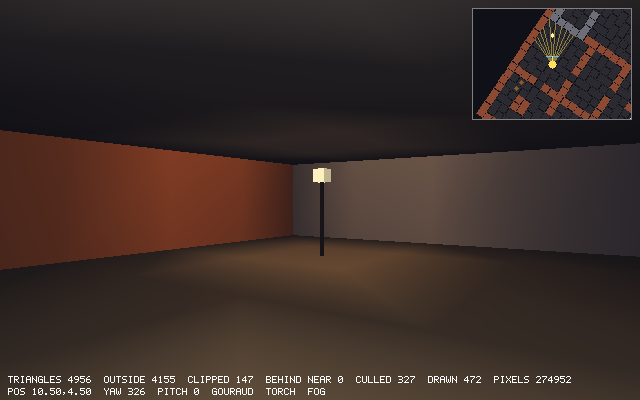
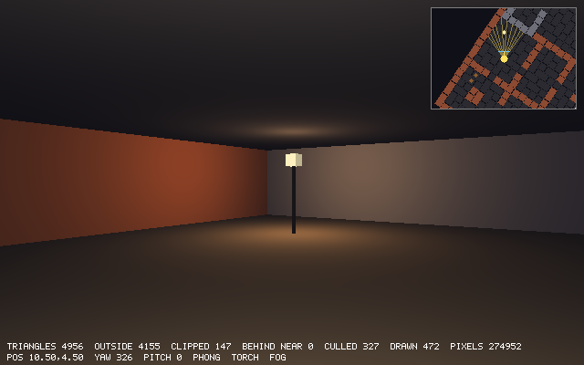
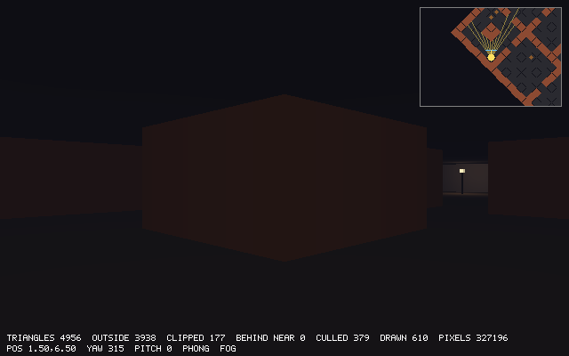
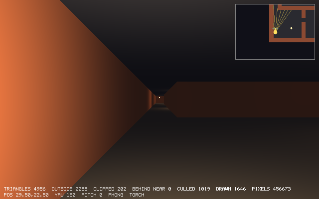

# Chapter 19 — Shading and Lighting

Since Chapter 13 every wall in the cellar has had one flat color. Walls facing one axis were
drawn a little darker to suggest a light from one side. This chapter lights the maze for
real, and the tools are simple. Lambert's cosine law says how much light a surface catches.
The inverse square law, softened near the light and cut off at a radius, says how much of a
lamp's light gets that far. Ambient light covers everything else, and exponential fog takes
light away with distance. The map's lamps become poles with glowing globes, and the player
carries a torch. All of the lighting needs one number per surface point that we have not
used yet, the *normal*, so the chapter starts there: where normals come from, and why a
model matrix that stretches a mesh needs a different matrix for its normals.

The same lighting can be done once per triangle (flat shading), once per corner (Gouraud
shading) or once per pixel (Phong shading). The L key switches between them, so the look and
the cost of each can be compared on the same picture. Each cell of the maze asks only the
lights that can reach it. The renderer from Chapter 18 keeps its structure: there is a new
shader, and the varyings carry a little more. The chapter also has to admit something about
every color in this book so far. A pixel value is not an amount of light, so most of the
arithmetic here is a little wrong. We will see how wrong, why the pictures still look fine,
and how to do it properly.

Previous: [Chapter 18 — Rasterizing Triangles](18-rasterizing-triangles.md). Next:
[Chapter 20 — Texture Mapping](20-texture-mapping.md).

## Light as numbers

A color in `delve` is three numbers, red, green and blue, each from 0 to 255. For lighting we
treat a color as a `Vec3` of floats on the same scale, and light as a *factor* per channel:
1 means full strength, 0.5 half, 0 none. The color we see is the surface's color times the
light, channel by channel:

```text
seen = surface * light            (per channel: r * lr, g * lg, b * lb)
```

Zig's `@Vector` multiplies element by element, so in code this is just `s.color * light`. A
warm light, say (1.0, 0.8, 0.5), leaves red alone, takes a fifth of the green and half of the
blue, and a gray wall under it turns orange. A white wall reflects whatever color the light
is. A pure red wall under a pure blue light is black, because it has no blue to reflect.

Lights add up. A point lit by two lamps gets the sum of what each gives, and the lighting
model of this chapter is that sum:

```text
light = ambient + Σ over lights: color · (how much the surface faces it) · (how much of it gets this far)
```

*Ambient* is a constant for light that comes from everywhere: light bounced off all the
walls, floors and ceilings, which would be far too costly to trace. The next sections work
out the two factors of the sum. A light factor can be larger than 1, and two strong lights
together certainly are. `render3d.toColor` clamps each channel to 255, so a strongly lit
surface goes to its brightest and then stops, with the lightest channel stopping first.

All of this treats the numbers 0 to 255 as amounts of light: 128 as half of 255, and 100 + 100
as 200. They are not. Screens and image files store colors in the *sRGB* encoding, where the
value 128 stands for only about 22% of the light of 255. So multiplying and adding these
values is not quite how light behaves. The pictures still come out believable, and the reasons
are in [The sRGB problem](#the-srgb-problem). Until then we will do what games did for a long
time, and treat the values as if they were light.

## Where normals come from

A surface's *normal* is a vector of length 1 that is perpendicular to the surface and points
out of its front side. Every formula in this chapter starts from the normal, because how
much light a surface catches depends on how it is turned toward the light.

For a triangle the normal comes from a cross product. Chapter 11 showed that `a × b` is
perpendicular to both `a` and `b`. Two edges of a triangle lie in its plane, so their cross
product is perpendicular to the plane. For a triangle with corners `a`, `b`, `c`, the normal is
`(b − a) × (c − a)` divided by its length. Its direction follows the right-hand rule, so it
depends on the order of the corners. Going round the other way flips it. Chapter 17 used the
same fact for back-face culling: the winding of the corners tells front from back.

A mesh does not usually work out normals when it is drawn. It stores one in every vertex, next
to the position. That raises a question: a corner shared by several faces has several face
normals, so which one does the vertex get? There are two choices, and they decide how the
surface looks:

- **One vertex per face, each with its face's normal.** The corner is stored several times,
  once per face, so the light changes all at once across the edge. This is a *hard edge*, and
  it is right for a cube.
- **One vertex with the average of the faces' normals.** The light then changes smoothly
  across the edge, and the mesh looks like a smooth surface that has been sampled at its
  corners. This is right for a sphere or a face made of triangles.

`delve`'s cube in `mesh.zig` has 24 vertices, four for each of its six faces, each with its
face's outward normal. It is the first choice. One of `mesh.zig`'s tests checks the normals
against the cross products of the edges. Some surfaces have an exact normal at every point,
with no triangles needed: on a sphere it points straight away from the center, so it is
`(p − center) / radius`. Here are all three:

`examples/ch19/face_normals.zig`

```zig
//! Where normals come from. A triangle's normal is the cross product of
//! two of its edges; the order of the corners decides which side it points
//! to. A vertex shared by several faces gets one normal per face (a hard
//! edge) or the average of them (a smooth surface).
const std = @import("std");

const Vec3 = @Vector(3, f32);

fn cross(a: Vec3, b: Vec3) Vec3 {
    return .{ a[1] * b[2] - a[2] * b[1], a[2] * b[0] - a[0] * b[2], a[0] * b[1] - a[1] * b[0] };
}

fn length(v: Vec3) f32 {
    return @sqrt(@reduce(.Add, v * v));
}

fn normalize(v: Vec3) Vec3 {
    return v / @as(Vec3, @splat(length(v)));
}

fn show(name: []const u8, v: Vec3) void {
    std.debug.print("{s:<34} ({d:>6.3}, {d:>6.3}, {d:>6.3})\n", .{ name, v[0], v[1], v[2] });
}

pub fn main() void {
    // A triangle on the floor (y = 0), counter-clockwise seen from above.
    const a: Vec3 = .{ 0, 0, 0 };
    const b: Vec3 = .{ 0, 0, 1 };
    const c: Vec3 = .{ 1, 0, 0 };
    const n = cross(b - a, c - a);
    show("(b - a) x (c - a)", n);
    std.debug.print("{s:<34} {d:.3}\n", .{ "its length = twice the area", length(n) });
    show("corners in the other order", cross(c - a, b - a));

    // A square pyramid: apex above the center of a 2x2 base. Its four
    // sides are triangles that meet at the apex.
    const apex: Vec3 = .{ 0, 1, 0 };
    const base = [4]Vec3{ .{ -1, 0, -1 }, .{ -1, 0, 1 }, .{ 1, 0, 1 }, .{ 1, 0, -1 } };
    var sum: Vec3 = @splat(0);
    for (0..4) |i| {
        const p = base[i];
        const q = base[(i + 1) % 4];
        const side = normalize(cross(q - p, apex - p));
        var buf: [32]u8 = undefined;
        show(std.fmt.bufPrint(&buf, "side {d} normal", .{i}) catch unreachable, side);
        sum += side;
    }
    // One shared apex vertex with the average normal: the pyramid is shaded
    // like a smooth cone. Four apex vertices with their own normals: sharp.
    show("apex, averaged (smooth)", normalize(sum));

    // A sphere has an exact normal at every point: away from its center.
    const center: Vec3 = .{ 0, 0, -3 };
    const radius = 2;
    const on_sphere: Vec3 = .{ 1.2, 1.6, -3 };
    show("sphere: (p - center) / radius", (on_sphere - center) / @as(Vec3, @splat(radius)));
}
```

```console
$ zig run examples/ch19/face_normals.zig
(b - a) x (c - a)                  ( 0.000,  1.000,  0.000)
its length = twice the area        1.000
corners in the other order         ( 0.000, -1.000,  0.000)
side 0 normal                      (-0.707,  0.707,  0.000)
side 1 normal                      (-0.000,  0.707,  0.707)
side 2 normal                      ( 0.707,  0.707,  0.000)
side 3 normal                      ( 0.000,  0.707, -0.707)
apex, averaged (smooth)            ( 0.000,  1.000,  0.000)
sphere: (p - center) / radius      ( 0.600,  0.800,  0.000)
```

- The floor triangle's normal points up, (0, 1, 0), and with the corners the other way round
  it points down. The length of the cross product is `|b − a| |c − a| sin θ`, which is twice
  the triangle's area: 1 here, for a right triangle with legs of 1. A real normal is divided by
  that length.
- Each side of the pyramid leans out at 45°. All four meet at the apex, and their average
  points straight up. A shared apex vertex with that normal would be lit as if the top were
  flat and round, like a cone. Four separate apex vertices keep the four sides distinct.
- The sphere's normal needs no triangles at all: (1.2, 1.6, 0) from the center, divided by
  the radius 2. We use it in [A lit sphere](#a-lit-sphere).

## Lambert's cosine law

Point a flashlight straight at a wall and it makes a small bright circle. Tilt the wall away
and the same beam spreads into a long, dimmer ellipse. The light in the beam has not changed,
but it is spread over more wall, so each bit of the wall gets less.

Here is how much less. A thin beam with cross-section `A` meets a surface whose normal is at
an angle θ to the beam. The patch it lights on the surface is stretched in one direction by
`1 / cos θ`, so its area is `A / cos θ`. The same power is spread over that larger area, so
each unit of area gets `cos θ` of what it would get head-on. That is *Lambert's cosine law*.

If `n` is the normal and `l` is the direction from the surface toward the light, both of
length 1, then `cos θ` is their dot product `n · l` (Chapter 11). When the light is behind
the surface, θ is more than 90° and the cosine is negative. A surface cannot catch a negative
amount of light, so the result is clamped at zero:

```zig
/// Lambert's cosine law: a surface facing the light gets all of it, a
/// surface tilted by an angle gets cos(angle) of it (the same light
/// spread over more area), and a surface facing away gets none. Both
/// directions have length 1, so the cosine is their dot product.
pub fn lambert(normal: Vec3, to_light: Vec3) f32 {
    return @max(0, math.dot(normal, to_light));
}
```

A surface that follows this law is a *Lambertian* or *perfectly diffuse* surface. Its own
brightness looks the same from every viewing direction, because it scatters light equally in
all directions. Plaster, unglazed brick, stone and paper are close to that, which suits a
cellar. Shiny surfaces also have a highlight that moves as the eye moves; exercise 1 adds one.

Here is the law in numbers, for a gray wall (180, 180, 180) with ambient 0.25 added to the
light:

`examples/ch19/lambert_table.zig`

```zig
//! Lambert's cosine law: how much light a surface catches as the light
//! tilts away from its normal. Also: what that does to a gray wall.
const std = @import("std");

const Vec3 = @Vector(3, f32);

fn dot(a: Vec3, b: Vec3) f32 {
    return @reduce(.Add, a * b);
}

/// The share of a light that a surface facing `normal` catches from the
/// direction `to_light`. Both have length 1.
fn lambert(normal: Vec3, to_light: Vec3) f32 {
    return @max(0, dot(normal, to_light));
}

pub fn main() void {
    const up: Vec3 = .{ 0, 1, 0 };
    const gray = 180.0; // the wall's own color, 0-255
    const ambient = 0.25;
    std.debug.print("angle  cos      lambert  wall (ambient 0.25 + light)\n", .{});
    for ([_]f32{ 0, 15, 30, 45, 60, 75, 90, 120, 180 }) |deg| {
        const angle = std.math.degreesToRadians(deg);
        // A light direction tilted `deg` degrees from the normal.
        const to_light: Vec3 = .{ @sin(angle), @cos(angle), 0 };
        const l = lambert(up, to_light);
        const wall = @min(255, gray * (ambient + l));
        const bar: [40]u8 = @splat('#');
        const n: usize = @intFromFloat(wall / 255 * 40);
        std.debug.print("{d:>5}  {d:>6.3}  {d:>6.3}   {d:>3.0} {s}\n", .{ deg, @cos(angle), l, wall, bar[0..n] });
    }
}
```

```console
$ zig run examples/ch19/lambert_table.zig
angle  cos      lambert  wall (ambient 0.25 + light)
    0   1.000   1.000   225 ###################################
   15   0.966   0.966   219 ##################################
   30   0.866   0.866   201 ###############################
   45   0.707   0.707   172 ###########################
   60   0.500   0.500   135 #####################
   75   0.259   0.259    92 ##############
   90  -0.000   0.000    45 #######
  120  -0.500   0.000    45 #######
  180  -1.000   0.000    45 #######
```

- The light barely changes for the first 30°, since the cosine is flat near 0, and drops
  fast toward 90°. At 60° it is exactly half.
- At 90° and beyond, the light is gone and only the ambient part is left: 180 × 0.25 = 45.
  Without ambient, every surface turned away from every light would be pure black.
- The −0.000 at 90° is `cos` of a float that is not exactly π/2. The clamp makes it a clean 0.
- The head-on wall is 225, brighter than its own color 180, because ambient and direct light
  add up to 1.25. A light factor above 1 is fine until a channel reaches 255.

The project's test checks the same three cases: all of the light head-on, half at 60°, and
none, not a negative amount, from behind:

```zig
test "Lambert: light falls off with the cosine of the angle" {
    const up: Vec3 = .{ 0, 1, 0 };
    try expectApprox(1, lambert(up, up), 1e-6);
    // 60 degrees away from the normal: half the light.
    const angle = std.math.degreesToRadians(60.0);
    try expectApprox(0.5, lambert(up, .{ @sin(angle), @cos(angle), 0 }), 1e-6);
    // From behind: none at all, not a negative amount.
    try std.testing.expectEqual(0, lambert(up, .{ 0, -1, 0 }));
}
```

## Point lights and falloff

A *point light* sends the same light in every direction from one point, like a bare bulb or
a candle flame. It needs a position and a color. The color doubles as the strength, so
(2.8, 2.0, 1.1) is a warm light, stronger than 1 so that it still means something a few
units away.

### The inverse square law

The light leaving a point spreads out over a sphere that grows with distance. At distance
`d` the sphere's area is `4πd²`, so the light per unit of area falls off as `1 / d²`. Twice
as far, a quarter of the light. That is the *inverse square law*, and it is plain geometry,
like Lambert's law.

Used as it is, it has two problems. At the light itself `1 / d²` is infinite, and a wall a
tenth of a unit from a lamp would get a hundred times its full light. Real lamps are not
points: a flame or a bulb has a size, and close to it the falloff flattens out. The usual fix
is to add a constant:

```text
soft(d) = 1 / (1 + (d / h)²)
```

At `d = 0` this is 1. At `d = h` it is a half, so `h` is the *half distance*, and far from
the light the 1 hardly matters and it is `h² / d²`, the inverse square law again. `delve` uses
`h = 1.5`, a cell and a half.

The second problem is that `1 / d²` never reaches zero. Every light reaches every point in
the world, however far, so every pixel would have to add up every light in the map. We want
each light to end at a *radius* `r`, so that anything farther can skip it. Simply cutting it
off at `r` would leave a visible edge, a circle where the light drops from a little to nothing.
Instead, the falloff is multiplied by a *window* that slides smoothly down to exactly zero:

```text
window(d) = (max(0, 1 − (d / r)²))²
```

This is the window that Brian Karis described for Unreal Engine 4 (see the sources). The
inner part, `1 − (d/r)²`, is 1 at the light and 0 at `r`. Squaring it makes it level out
as it reaches 0: its slope there is `2 · (1 − x²) · (−2x) / r` with `x = 1`, which is 0. A
light that fades out with zero slope leaves no crease where it ends. Close to the light the
window is nearly 1 and does not change the falloff much.

`examples/ch19/falloff_curves.zig`

```zig
//! How a point light fades with distance: the inverse square law, the
//! same with a 1 + that keeps it finite, a window that ends it at a
//! radius, and the product that delve uses.
const std = @import("std");

/// Half strength at this distance (before the window).
const half_distance = 1.5;
/// The light adds nothing from here on.
const radius = 5.0;

fn inverseSquare(d: f32) f32 {
    return 1 / (d * d);
}

fn soft(d: f32) f32 {
    const x = d / half_distance;
    return 1 / (1 + x * x);
}

fn window(d: f32) f32 {
    const x = d / radius;
    const w = @max(0, 1 - x * x);
    return w * w;
}

pub fn main() void {
    std.debug.print("   d    1/d^2   soft  window  product\n", .{});
    var i: usize = 0;
    while (i <= 12) : (i += 1) {
        const d = 0.5 * @as(f32, @floatFromInt(i));
        const product = soft(d) * window(d);
        const bar: [40]u8 = @splat('#');
        const n: usize = @intFromFloat(@round(product * 40));
        const gap = if (n == 0) "" else " ";
        std.debug.print("{d:>4.1}  {d:>6.3}  {d:>5.3}  {d:>6.3}  {d:>6.3}{s}{s}\n", .{
            d, inverseSquare(d), soft(d), window(d), product, gap, bar[0..n],
        });
    }
    // The window's slope at the radius: zero, so the light fades out
    // without a crease.
    const e = 0.001;
    std.debug.print("window slope just inside the radius: {d:.6}\n", .{(window(radius) - window(radius - e)) / e});
}
```

```console
$ zig run examples/ch19/falloff_curves.zig
   d    1/d^2   soft  window  product
 0.0     inf  1.000   1.000   1.000 ########################################
 0.5   4.000  0.900   0.980   0.882 ###################################
 1.0   1.000  0.692   0.922   0.638 ##########################
 1.5   0.444  0.500   0.828   0.414 #################
 2.0   0.250  0.360   0.706   0.254 ##########
 2.5   0.160  0.265   0.563   0.149 ######
 3.0   0.111  0.200   0.410   0.082 ###
 3.5   0.082  0.155   0.260   0.040 ##
 4.0   0.063  0.123   0.130   0.016 #
 4.5   0.049  0.100   0.036   0.004
 5.0   0.040  0.083   0.000   0.000
 5.5   0.033  0.069   0.000   0.000
 6.0   0.028  0.059   0.000   0.000
window slope just inside the radius: -0.000160
```

- `1/d²` is infinite at 0 and 4 at half a unit. `soft` starts at 1 and is exactly 0.5 at
  1.5. From 3 units on, `soft` is close to `1.5² / d² = 2.25 / d²`, the inverse square law
  scaled to match.
- The window takes off only a few percent near the light (0.98 at 0.5), and most of the
  light past 3 units. It is exactly 0 from 5 on. A light that should look like pure inverse
  square needs a radius well beyond where it matters; Karis's window trades accuracy far away
  for a finite reach.
- The slope of the window just inside the radius is −0.00016 per unit, a flat landing. The
  product reaches 0 the same way.

In `light.zig` the product is one function:

```zig
/// The distance at which a light is down to half its strength (before the
/// window): a cell and a half. The 1 + of the falloff stands for the size
/// of the flame or bulb, which is not a point; this sets that size.
pub const half_distance = 1.5;

/// How much of a light reaches `dist` away. Light spreads over a sphere
/// whose area grows with the square of the distance, so it fades as
/// 1/dist^2; the 1 + keeps that finite at the light itself. The window
/// (1 - (dist/radius)^2)^2 brings it smoothly down to exactly 0 at
/// `radius`, so lights farther away can be skipped without a visible edge.
pub fn attenuation(dist: f32, radius: f32) f32 {
    const x = dist / radius;
    const window = @max(0, 1 - x * x);
    const d = dist / half_distance;
    return window * window / (1 + d * d);
}
```

*Attenuation* is the usual name for how much a light weakens on its way. Its test checks
that it keeps falling all the way out, is exactly 0 at the radius and beyond, and, with a
huge radius so that the window is nearly 1, gives a half at `h` and a fifth at `2h`:
`1 / (1 + 2²) = 0.2`.

```zig
test "attenuation fades to exactly zero at the radius" {
    try expectApprox(1, attenuation(0, 5), 1e-6);
    var last: f32 = 1;
    for (1..50) |i| {
        const a = attenuation(0.1 * @as(f32, @floatFromInt(i)), 5);
        try std.testing.expect(a < last);
        last = a;
    }
    try std.testing.expectEqual(0, attenuation(5, 5));
    try std.testing.expectEqual(0, attenuation(7, 5));
    // Well inside the radius it is nearly the inverse square law: half
    // at `half_distance`, a fifth at twice that.
    try expectApprox(0.5, attenuation(half_distance, 1000), 1e-5);
    try expectApprox(0.2, attenuation(2 * half_distance, 1000), 1e-5);
}
```

### Adding up the lights

A light is a position, a color and a radius. A *scene* is the ambient light, a list of
lights, the eye's position (for fog, later) and an optional fog:

```zig
/// A point light: it shines the same way in every direction.
pub const Light = struct {
    pos: Vec3,
    /// Color and strength, per channel.
    color: Vec3,
    /// Beyond this distance the light adds nothing.
    radius: f32,
};
```

```zig
pub const Scene = struct {
    /// Light that is everywhere, from every direction: the light bounced
    /// around by all the walls, which is too costly to work out.
    ambient: Vec3,
    lights: []const Light,
    eye: Vec3,
    fog: ?Fog = null,

    /// The light falling on a surface at `pos` facing `normal`.
    pub fn lightAt(scene: Scene, pos: Vec3, normal: Vec3) Vec3 {
        var sum = scene.ambient;
        for (scene.lights) |light| {
            const to_light = light.pos - pos;
            // Two cheap tests first: out of reach, or lit from behind.
            const dist_squared = math.dot(to_light, to_light);
            if (dist_squared >= light.radius * light.radius) continue;
            if (math.dot(normal, to_light) <= 0) continue;
            const dist = @sqrt(dist_squared);
            const strength = lambert(normal, math.scale(to_light, 1 / dist)) * attenuation(dist, light.radius);
            sum += math.scale(light.color, strength);
        }
        return sum;
    }
```

`lightAt` is the sum from [Light as numbers](#light-as-numbers): ambient, plus each light's
color times Lambert times attenuation. Most lights are rejected before any real work:

- A light out of reach is skipped by comparing squared lengths, `d² ≥ r²`, which needs no
  square root.
- A light behind the surface is skipped when `n · (light − pos) ≤ 0`. That vector is not
  normalized, but normalizing does not change the sign of a dot product, so the test is safe.

Only then does it take the square root, once, and use it twice: to normalize the direction
for `lambert` and as the distance for `attenuation`.

## A lit sphere

Before any of this goes into the rasterizer, here it is on its own. The next example draws a
sphere standing on a floor, lit by one warm point light and ambient light, with the same
`lightAt` as `delve`. It does not need a rasterizer. For each pixel it sends a ray from the
eye and works out what the ray hits. This is ray tracing in its simplest form: one ray per
pixel and no bounces.

A ray from the eye at the origin is `t · dir`. It meets the sphere where it is `radius` away
from the center:

```text
|t·dir − c|² = r²
t² (dir · dir) − 2t (dir · c) + (c · c − r²) = 0
```

That is a quadratic `a t² − 2b t + c' = 0` with `a = dir · dir`, `b = dir · c` and
`c' = c · c − r²`, so `t = (b ± √(b² − a c')) / a`. If the number under the root is negative,
the ray misses. Otherwise the smaller root is the nearer hit, where the ray enters the
sphere. The floor is the plane `y = −1`, which a ray going down meets at `t = −1 / dir.y`.
The sphere's normal is `(p − center) / radius`, from the previous section. The floor's normal
is straight up.

`examples/ch19/shade_sphere.zig`

```zig
//! A sphere on a floor, lit by one warm point light and ambient light, the
//! way delve lights its walls: Lambert times a windowed falloff. No
//! rasterizer: each pixel's ray is intersected with the sphere and the
//! floor directly. Writes sphere.ppm.
const std = @import("std");

const Vec3 = @Vector(3, f32);

fn dot(a: Vec3, b: Vec3) f32 {
    return @reduce(.Add, a * b);
}

fn splat(s: f32) Vec3 {
    return @splat(s);
}

fn normalize(v: Vec3) Vec3 {
    return v / splat(@sqrt(dot(v, v)));
}

const center: Vec3 = .{ 0, 0, -3.5 };
const radius = 1.0;
const floor_y = -1.0;

const ambient: Vec3 = .{ 0.25, 0.25, 0.3 };
const light_pos: Vec3 = .{ 1.6, 1.2, -2.2 };
const light_color: Vec3 = .{ 2.8, 2.0, 1.1 };
const light_radius = 5.0;
const background: Vec3 = .{ 16, 16, 24 };

/// The light falling on a point facing `normal`: ambient plus Lambert
/// times delve's falloff.
fn lightAt(pos: Vec3, normal: Vec3) Vec3 {
    const to_light = light_pos - pos;
    const d = @sqrt(dot(to_light, to_light));
    const lambert = @max(0, dot(normal, to_light) / d);
    const w = @max(0, 1 - (d / light_radius) * (d / light_radius));
    const h = d / 1.5;
    return ambient + light_color * splat(lambert * w * w / (1 + h * h));
}

/// The nearest t > 0 where the ray t * dir from the eye (at the origin)
/// meets the sphere: |t dir - center|^2 = radius^2, a quadratic in t.
fn hitSphere(dir: Vec3) ?f32 {
    const a = dot(dir, dir);
    const b = dot(dir, center);
    const c = dot(center, center) - radius * radius;
    const disc = b * b - a * c;
    if (disc < 0) return null;
    const t = (b - @sqrt(disc)) / a;
    return if (t > 0) t else null;
}

pub fn main(init: std.process.Init) !void {
    const w = 320;
    const h = 200;
    var pixels: [w * h][3]u8 = undefined;
    for (0..h) |y| {
        for (0..w) |x| {
            // The camera looks down -z; a vertical field of view of 53.13
            // degrees puts the screen's top edge at y = 0.5 at distance 1.
            const sx = ((@as(f32, @floatFromInt(x)) + 0.5) - w / 2.0) / h;
            const sy = (h / 2.0 - (@as(f32, @floatFromInt(y)) + 0.5)) / h;
            const dir: Vec3 = .{ sx, sy, -1 };
            var rgb = background;
            if (hitSphere(dir)) |t| {
                const p = dir * splat(t);
                // The normal of a sphere points away from its center.
                const n = (p - center) / splat(radius);
                rgb = Vec3{ 138, 138, 150 } * lightAt(p, n);
            } else if (dir[1] < 0) {
                // The floor, y = floor_y: t = floor_y / dir.y.
                const p = dir * splat(floor_y / dir[1]);
                rgb = Vec3{ 88, 80, 72 } * lightAt(p, .{ 0, 1, 0 });
            }
            const clamped = @round(std.math.clamp(rgb, splat(0), splat(255)));
            pixels[y * w + x] = .{ @intFromFloat(clamped[0]), @intFromFloat(clamped[1]), @intFromFloat(clamped[2]) };
        }
    }

    const io = init.io;
    const file = try std.Io.Dir.cwd().createFile(io, "sphere.ppm", .{});
    defer file.close(io);
    var buffer: [4096]u8 = undefined;
    var writer = file.writer(io, &buffer);
    try writer.interface.print("P6\n{d} {d}\n255\n", .{ w, h });
    try writer.interface.writeAll(std.mem.sliceAsBytes(&pixels));
    try writer.interface.flush();
    std.debug.print("wrote sphere.ppm, {d}x{d}\n", .{ w, h });
}
```

```console
$ zig run examples/ch19/shade_sphere.zig
wrote sphere.ppm, 320x200
$ ls -l sphere.ppm
-rw-r--r-- 1 tbangma tbangma 192015 Nov  7 22:03 sphere.ppm
```

The file is 320 × 200 × 3 = 192,000 bytes of pixels plus the 15-byte header. Shown at twice
its size:


- The brightest part of the sphere is where its normal points at the light, and the light
  fades around the curve as the cosine falls. That point is 1.39 units from the light, where
  the attenuation is 0.46, so the light there is 0.25 + 2.8 × 0.46 ≈ 1.54 in red, 1.17 in green
  and 0.81 in blue. Times the gray (138, 138, 150), that is the brightest pixel in the file,
  (212, 161, 121): the light's warm color on a gray surface.
- The lower left gets ambient light only: (138 × 0.25, 138 × 0.25, 150 × 0.3) = (35, 35, 45),
  a dark gray with a little more blue. Without the ambient term it would be black and the
  sphere would look like a half moon.
- The floor is 2.2 units below the light, so its pool is faint and wide. There is no shadow
  under the sphere. Nothing in
  `lightAt` asks whether something stands between the point and the light. Shadows need that
  question answered for every lit point. The ray tracer could answer it with one more ray per
  pixel, but a rasterizer cannot, and exercise 4 does a cheap version for whole maze cells.
- The edge where the sphere meets the background is a staircase, one ray per pixel. A real
  ray tracer sends several rays per pixel and averages them.

## Normals need their own matrix

A mesh's normals are given in the mesh's own coordinates, like its positions. When the model
matrix places the mesh in the world, the normals have to turn with it. For a rotation this is
easy: rotate the normal the same way. `transformDir` does exactly that, multiplying with
`w = 0` so that the translation does not move it.

A scale that is not the same along every axis breaks this. `delve`'s lamp pole is the unit
cube squeezed to 0.03 wide and stretched to 0.66 tall. Here is a smaller example: a 45° slope,
going up one unit for every unit along x, with the normal (−1, 1, 0)/√2. Stretch it four times
along x. The slope is now much flatter, up one for every four along, so its normal should
point nearly straight up. Stretch the normal like a position and it gets four times more x,
(−4, 1, 0), and points even further to the side. It is no longer perpendicular to the slope.

### The inverse transpose

To find the right matrix, use what a normal is: perpendicular to every direction `t` that lies
along the surface (a *tangent*). In matrix form, with vectors as columns,

```text
nᵀ t = 0
```

Tangents are differences of points on the surface, so they are transformed like directions:
`t' = M t`. We want a matrix `N` with `(N n)ᵀ (M t) = 0` for every tangent. Try
`N = (M⁻¹)ᵀ`, the transpose of the inverse:

```text
((M⁻¹)ᵀ n)ᵀ (M t) = nᵀ M⁻¹ M t = nᵀ t = 0
```

The first step uses `(A n)ᵀ = nᵀ Aᵀ`, and the transpose of a transpose is the matrix itself.
So the transformed normal is perpendicular to every transformed tangent, which is all a normal
has to be. Its length can change, so it is normalized afterwards.

For a rotation `R` the inverse is the transpose (Chapter 12), so `(R⁻¹)ᵀ = R`: the normal
matrix is the rotation itself, as it should be. For a uniform scale by `s` it is a scale by
`1/s`, which normalizing undoes. Only scales that differ between axes, and shears, need the
real thing. For the stretch by 4 along x, `(M⁻¹)ᵀ` scales x by 1/4: (−1, 1, 0) becomes
(−0.25, 1, 0), which points nearly up, as it should.

The example below uses a short cut that needs no inverse. For a 3 × 3 matrix with columns
`a`, `b`, `c`, the matrix with columns `b × c`, `c × a`, `a × b` is `det(M) · (M⁻¹)ᵀ`, the
*cofactor matrix*. Normals are normalized after turning anyway, so the factor `det(M)` makes
no difference, as long as it is positive.

`examples/ch19/normal_matrix.zig`

```zig
//! Turning normals. A slope and its normal go through a transform M. The
//! slope's direction turns with M; the normal must turn with the inverse
//! transpose of M, or it stops being perpendicular to the surface.
const std = @import("std");

const Vec3 = @Vector(3, f32);

fn dot(a: Vec3, b: Vec3) f32 {
    return @reduce(.Add, a * b);
}

fn cross(a: Vec3, b: Vec3) Vec3 {
    return .{ a[1] * b[2] - a[2] * b[1], a[2] * b[0] - a[0] * b[2], a[0] * b[1] - a[1] * b[0] };
}

fn normalize(v: Vec3) Vec3 {
    return v / @as(Vec3, @splat(@sqrt(dot(v, v))));
}

/// A 3x3 matrix as three columns: enough for directions, which ignore
/// translation.
const Mat3 = struct {
    cols: [3]Vec3,

    fn apply(m: Mat3, v: Vec3) Vec3 {
        return m.cols[0] * @as(Vec3, @splat(v[0])) + m.cols[1] * @as(Vec3, @splat(v[1])) +
            m.cols[2] * @as(Vec3, @splat(v[2]));
    }

    fn mul(a: Mat3, b: Mat3) Mat3 {
        return .{ .cols = .{ a.apply(b.cols[0]), a.apply(b.cols[1]), a.apply(b.cols[2]) } };
    }

    /// The inverse transpose times the determinant: its columns are cross
    /// products of M's columns. Normals are normalized after turning, so
    /// the factor does not matter, and no division is needed.
    fn cofactor(m: Mat3) Mat3 {
        const a, const b, const c = m.cols;
        return .{ .cols = .{ cross(b, c), cross(c, a), cross(a, b) } };
    }
};

fn degreesBetween(a: Vec3, b: Vec3) f32 {
    return std.math.radiansToDegrees(std.math.acos(dot(normalize(a), normalize(b))));
}

fn check(name: []const u8, m: Mat3) void {
    // A slope rising along x at 45 degrees, and its normal.
    const along: Vec3 = .{ 1, 1, 0 };
    const normal = normalize(.{ -1, 1, 0 });
    const new_along = m.apply(along);
    std.debug.print("{s}\n", .{name});
    std.debug.print("  normal turned with M:          {d:>6.2} deg to the surface\n", .{degreesBetween(m.apply(normal), new_along)});
    const n = normalize(m.cofactor().apply(normal));
    std.debug.print("  with the inverse transpose:    {d:>6.2} deg, normal ({d:.3}, {d:.3}, {d:.3})\n", .{
        degreesBetween(n, new_along), n[0], n[1], n[2],
    });
}

pub fn main() void {
    const stretch: Mat3 = .{ .cols = .{ .{ 4, 0, 0 }, .{ 0, 1, 0 }, .{ 0, 0, 1 } } };
    check("stretch x by 4", stretch);

    const a = std.math.degreesToRadians(30.0);
    const rotate: Mat3 = .{ .cols = .{ .{ @cos(a), @sin(a), 0 }, .{ -@sin(a), @cos(a), 0 }, .{ 0, 0, 1 } } };
    check("rotate 30 deg about z", rotate);
    check("stretch, then rotate", rotate.mul(stretch));

    const uniform: Mat3 = .{ .cols = .{ .{ 3, 0, 0 }, .{ 0, 3, 0 }, .{ 0, 0, 3 } } };
    check("scale by 3 in every direction", uniform);
}
```

```console
$ zig run examples/ch19/normal_matrix.zig
stretch x by 4
  normal turned with M:          151.93 deg to the surface
  with the inverse transpose:     90.00 deg, normal (-0.243, 0.970, 0.000)
rotate 30 deg about z
  normal turned with M:           90.00 deg to the surface
  with the inverse transpose:     90.00 deg, normal (-0.966, 0.259, 0.000)
stretch, then rotate
  normal turned with M:          151.93 deg to the surface
  with the inverse transpose:     90.00 deg, normal (-0.695, 0.719, 0.000)
scale by 3 in every direction
  normal turned with M:           90.00 deg to the surface
  with the inverse transpose:     90.00 deg, normal (-0.707, 0.707, 0.000)
```

- Stretched, the normal turned with `M` is 152° from the slope instead of 90°, 62° off.
  Lit with that normal, the slope would catch light as if it were a steep wall. The inverse
  transpose gives (−0.243, 0.970, 0), which is (−0.25, 1, 0) normalized, exactly
  perpendicular.
- For the rotation and the uniform scale both are right, as the derivation predicted. The
  rotated normal (−0.966, 0.259, 0) is (−1, 1, 0)/√2 turned by 30°.
- A rotation after the stretch does not fix the stretch's damage. Both errors are the same
  152°, because rotating keeps angles.

In `delve` the normal matrix is a `Mat4` method, using the general inverse from Chapter 12:

```zig
    /// The matrix that turns the normals of a surface transformed by `m`:
    /// the transpose of its inverse. Use it with `transformDir`, then
    /// normalize. For rotations it is `m` itself, but a stretch along one
    /// axis tilts the surface away from the stretch, so its normal must
    /// tilt toward it.
    pub fn normalMatrix(m: Mat4) Mat4 {
        return (m.inverse() orelse unreachable).transpose();
    }
```

A model matrix places a mesh in the world, so it always has an inverse. A matrix without one
would squash the mesh flat, and that would be a bug, hence `unreachable`. The model matrix's
translation is in its last column. In the inverse transpose it ends up in the last row, which
only affects `w`, and `transformDir` drops `w`. So the 4 × 4 matrix works for normals without
first cutting out its 3 × 3 corner. The test is the slope from the example, with a
translation as well:

```zig
test "normals stay perpendicular under a stretch" {
    // A slope rising along x, with its normal, stretched 4 times along x.
    const along: Vec3 = .{ 1, 1, 0 };
    const normal = normalize(Vec3{ -1, 1, 0 });
    const m = Mat4.translation(.{ 5, 0, 2 }).mul(Mat4.scaling(.{ 4, 1, 1 }));
    const new_along = m.transformDir(along);
    // Turned like a direction, the normal is no longer perpendicular...
    try expect(@abs(dot(m.transformDir(normal), new_along)) > 0.1);
    // ...turned by the inverse transpose, it is.
    const new_normal = normalize(m.normalMatrix().transformDir(normal));
    try expectApprox(0, dot(new_normal, new_along), 1e-5);
    try expect(new_normal[1] > 0);
}
```

Inverting a 4 × 4 matrix is not free, so it is done once per mesh drawn, in the shader's
`init`, and not once per vertex.

## Where to light: flat, Gouraud, Phong

We know how to light a point. The renderer from Chapter 18 runs a shader's `vertex` function
at each corner of a triangle and its `pixel` function at each pixel, and in between it
interpolates eight floats, the *varyings*, across the triangle with perspective correction.
That leaves a choice of where to do the lighting, and there are three classic answers:

| Shading | Lighting is done | Varyings carry |
|---|---|---|
| Flat | once per triangle | one lit color for the whole triangle |
| Gouraud | at each vertex | the lit color, blended across the triangle |
| Phong | at each pixel | the normal and the position, blended, then lit |

*Gouraud shading* is named after Henri Gouraud, who described it in 1971, and *Phong shading*
after Bui Tuong Phong, 1975. Phong also gave his name to a different thing, the *Phong
reflection model*: a formula for shiny highlights, which exercise 1 adds in Blinn's version.
The two are often confused. Phong shading is about *where* lighting is computed, per pixel
from interpolated normals. It works with any lighting formula, including plain Lambert as
here.

### What blending misses

Gouraud shading is cheap: three lighting calculations per triangle, however many pixels it
covers. But blending between the corners can only produce values between the corners' values.
If the brightest point of a face is in its middle, where no vertex is, Gouraud shading cannot
show it. The next example is a strip of floor 5 units long with a lamp above its middle, at
`delve`'s lamp height of 0.72. It is lit three ways: one face 5 long, five faces 1 long (the
size of a maze cell), and at every point.

`examples/ch19/gouraud_vs_phong_1d.zig`

```zig
//! A row of floor from x = -2.5 to 2.5 with a lamp above its middle, at
//! delve's lamp height and radius, lit three ways: at the two ends of one
//! long face and blended between them (Gouraud), the same with the floor
//! cut into five faces one unit wide like the maze's floor cells, and at
//! every sample (Phong).
const std = @import("std");

const lamp_height = 0.72;
const radius = 5.0;
const half_distance = 1.5;

/// The light on the floor at x: Lambert times delve's falloff. The floor
/// faces up, so the cosine is the lamp's height over its distance.
fn lightAt(x: f32) f32 {
    const d = @sqrt(x * x + lamp_height * lamp_height);
    const lambert = lamp_height / d;
    const w = @max(0, 1 - (d / radius) * (d / radius));
    const h = d / half_distance;
    return lambert * w * w / (1 + h * h);
}

/// Gouraud: light the corners of faces `size` wide, blend in between.
fn gouraud(x: f32, size: f32) f32 {
    const left = @min(2.5 - size, -2.5 + size * @floor((x + 2.5) / size));
    const t = (x - left) / size;
    return std.math.lerp(lightAt(left), lightAt(left + size), t);
}

fn phong(x: f32, _: f32) f32 {
    return lightAt(x);
}

/// One row of characters, darkest to brightest, sampled every 0.1.
fn picture(name: []const u8, f: fn (f32, f32) f32, size: f32) void {
    const ramp = " .:-=+*#%@";
    var row: [51]u8 = undefined;
    for (&row, 0..) |*c, i| {
        const v = f(-2.5 + 0.1 * @as(f32, @floatFromInt(i)), size);
        c.* = ramp[@min(ramp.len - 1, @as(usize, @intFromFloat(v * ramp.len)))];
    }
    std.debug.print("{s:<10}|{s}|\n", .{ name, &row });
}

pub fn main() void {
    std.debug.print("    x   1 face  5 faces  per pixel\n", .{});
    for (0..11) |i| {
        const x = -2.5 + 0.5 * @as(f32, @floatFromInt(i));
        std.debug.print("{d:>5.1}  {d:>6.3}  {d:>7.3}  {d:>9.3}\n", .{ x, gouraud(x, 5), gouraud(x, 1), phong(x, 0) });
    }
    picture("1 face", gouraud, 5);
    picture("5 faces", gouraud, 1);
    picture("per pixel", phong, 0);
}
```

```console
$ zig run examples/ch19/gouraud_vs_phong_1d.zig
    x   1 face  5 faces  per pixel
 -2.5   0.037    0.037      0.037
 -2.0   0.037    0.095      0.076
 -1.5   0.037    0.153      0.153
 -1.0   0.037    0.364      0.308
 -0.5   0.037    0.575      0.575
  0.0   0.037    0.575      0.779
  0.5   0.037    0.575      0.575
  1.0   0.037    0.364      0.308
  1.5   0.037    0.153      0.153
  2.0   0.037    0.095      0.076
  2.5   0.037    0.037      0.037
1 face    |                                                   |
5 faces   |      ......::--===+++++++++++++===--::......      |
per pixel |       .....:::--==++**#####**++==--:::.....       |
```

- With one face, both corners are 2.5 from the lamp and get 0.037. Everything in between is
  0.037 too, so the lamp has no visible effect on the floor at all.
- With faces one unit wide, the corners at ±0.5 get 0.575. The middle face is a flat 0.575
  across, so the peak of 0.779 straight under the lamp is gone. The pool is a flat-topped
  trapezoid. Between corners the blend is a straight line, which is too bright at ±1 and ±2
  (0.364 against 0.308) because the real curve sags between them.
- Where the vertices are, all three agree. The error is only between vertices, so Gouraud
  shading is good when faces are small compared with how fast the light changes.

The maze's floor is exactly the five-face case: one quad per cell, and each lamp stands in the
middle of its cell, where no vertex is. Gouraud shading will lose the bright spot under every
lamp. The ceiling is worse. Its lamp is 0.28 below it, so the spot above a lamp is small and
very bright, and it falls entirely between the four corners of the cell.

### The shader

The renderer's shaders since Chapter 18 are plain structs with two functions, `vertex` and
`pixel`, and `drawMesh` takes the shader type as a generic parameter. The new `light.Shader`
handles flat, Gouraud and Phong shading with one set of varyings:

| Lanes | Flat and Gouraud | Phong |
|---|---|---|
| 0–2 | the lit color | the normal in the world |
| 3–5 | the position in the world (unused) | the position in the world |
| 6 | how much of it gets through the fog | the same |

```zig
/// Lights a mesh of one color. The varyings are the lit color in lanes 0
/// to 2 and how much of it gets through the fog in lane 6. For Phong
/// shading, lanes 0 to 2 hold the normal instead, and lanes 3 to 5 the
/// position in the world, to light each pixel. Flat shading also needs
/// `Options.flat_shading`, which gives each triangle the average of its
/// corners' varyings.
///
/// The fog is worked out per vertex too, even for Phong shading: an
/// exponential per pixel costs more than all the rest of the fog, and
/// across one cell of the maze it is nearly a straight line anyway.
pub const Shader = struct {
    scene: Scene,
    color: Vec3,
    shading: Shading,
    /// Turns the mesh's normals into the world's.
    normal_matrix: Mat4,

    pub fn init(scene: Scene, color: Color, shading: Shading, model: Mat4) Shader {
        std.debug.assert(shading != .unlit);
        return .{ .scene = scene, .color = fromColor(color), .shading = shading, .normal_matrix = model.normalMatrix() };
    }

    pub fn vertex(s: Shader, v: mesh.Vertex, world: Vec3) render3d.Varyings {
        const normal = math.normalize(s.normal_matrix.transformDir(v.normal));
        const first = if (s.shading == .phong) normal else s.color * s.scene.lightAt(world, normal);
        return .{ first[0], first[1], first[2], world[0], world[1], world[2], s.scene.fogAt(world), 0 };
    }

    pub fn pixel(s: Shader, vary: render3d.Varyings) Color {
        var rgb: Vec3 = .{ vary[0], vary[1], vary[2] };
        if (s.shading == .phong) {
            const world: Vec3 = .{ vary[3], vary[4], vary[5] };
            // Blending unit normals shortens them: normalize again.
            rgb = s.color * s.scene.lightAt(world, math.normalize(rgb));
        }
        rgb = s.scene.applyFog(rgb, vary[6]);
        return render3d.toColor(.{ rgb[0], rgb[1], rgb[2], 0, 0, 0, 0, 0 });
    }
};
```

- `vertex` gets the vertex and its position in the world (the model matrix applied, which
  the renderer works out anyway). It turns the normal with the normal matrix and normalizes
  it. For Gouraud and flat shading it lights the vertex right away. For Phong it passes the
  normal on.
- `pixel` gets the blended varyings. For Phong it normalizes the normal again and lights the
  pixel at the blended world position. The perspective-correct interpolation from Chapter 18
  is what makes that position the right point in the world, not just a point on the screen.
- `fromColor` turns a `Color` into a `Vec3` of floats; `render3d.toColor` rounds and clamps
  the first three lanes back to bytes.

The renormalizing matters. Blend two unit vectors that are 90° apart halfway and the result
has length `√2 / 2 ≈ 0.71`. Lambert with that normal would make the middle of a smooth face
29% too dark. On a flat floor all the normals are the same and the blend is exact, but the
pole and future meshes are not that kind.

Phong shading also needs the position at each pixel, which flat and Gouraud do not. For them
lanes 3 to 5 are carried across the triangle for nothing. Splitting the shader in two would
save that, but interpolating three more lanes costs little next to lighting, and one shader
keeps the code short.

### Flat shading before clipping

Flat shading is the one mode that needs help from the renderer. Every pixel of a triangle
should get the same color, so the three corners should carry the same varyings. Chapter 18's
`clipTriangle` already gathers the three corners of each triangle, and with the new option
`flat_shading` it replaces their varyings with their average:

```zig
        if (options.flat_shading) {
            const average = math.scale(tri[0].vary + tri[1].vary + tri[2].vary, 1.0 / 3.0);
            for (&tri) |*v| v.vary = average;
        }
        if (any.count() > 0) stats.clipped += 1;
        const poly = clip.clipTriangle(tri, any);
```

Where this happens matters: *before* clipping. A triangle cut by the near plane or the screen
edges becomes a polygon with new corners on the cut lines, whose varyings are blends of the
old ones. Averaging those corners would give a different color depending on where the cut
falls, so a triangle would change color as the view moved. Averaged first, every new corner
is a blend of three equal values, and the color stays put.

Classic flat shading lights each triangle once with its face normal, at one point such as its
center. Here the corners are lit and their colors averaged, which for a face with one normal
is nearly the same thing. It is not exactly the same, because the falloff is not a straight
line. It costs as much as Gouraud shading, since the lighting is still done per vertex. A flat
shaded renderer from the 1990s did it once per face to save time. Here flat shading is a way
to *see* the triangles, not to save time.

The test uses a small `Ramp` shader whose red grows along x, and draws one face of the cube,
two triangles, with and without the option:

```zig
/// Colors a mesh by where each point is in it: red grows along x.
const Ramp = struct {
    pub fn vertex(_: Ramp, v: @import("mesh.zig").Vertex, _: Vec3) Varyings {
        return .{ 255 * v.pos[0], 0, 0, 0, 0, 0, 0, 0 };
    }

    pub fn pixel(_: Ramp, vary: Varyings) Color {
        return toColor(vary);
    }
};

test "flat shading gives each triangle one color" {
    const gpa = std.testing.allocator;
    var canvas = try Canvas.init(gpa, 64, 40);
    defer canvas.deinit(gpa);
    var r = try Renderer.init(gpa, 24, 64, 40);
    defer r.deinit(gpa);
    const front = @import("mesh.zig").cubeFace(4);
    const vp = camera.Camera.projection(64, 40);
    const model = Mat4.translation(.{ -0.5, -0.5, -2 });
    var stats: Stats = .{};
    for ([_]bool{ false, true }) |flat| {
        canvas.clear(Color.black);
        r.clearDepth();
        r.drawMesh(canvas, front, model, vp, Ramp{}, .{ .flat_shading = flat }, &stats);
        // Count the different reds on the screen.
        var seen: std.StaticBitSet(256) = .empty;
        for (canvas.pixels) |p| if (p.r != 0) seen.set(p.r);
        if (flat) {
            // The face's two triangles: corners 0, 1, 2 (x = 0, 1, 1) and
            // 0, 2, 3 (x = 0, 1, 0) average to 2/3 and 1/3 of 255.
            try std.testing.expectEqual(2, seen.count());
            try std.testing.expect(seen.isSet(170) and seen.isSet(85));
        } else {
            try std.testing.expect(seen.count() > 20);
        }
    }
}
```

The second test is the floor problem from the example, on a 4 × 4 face with a light half a
unit above its middle. It runs the shader's `vertex` at the four corners and averages the
varyings, which is what the rasterizer would hand to `pixel` at the center:

```zig
test "Gouraud shading misses a light over the middle of a face" {
    // A floor from (-2, 0, -2) to (2, 0, 2) with a light just above its
    // center. Its four corners are far from the light and get little;
    // blending them can never be brighter than the brightest corner.
    const light: Light = .{ .pos = .{ 0, 0.5, 0 }, .color = @splat(1), .radius = 4 };
    const scene: Scene = .{ .ambient = @splat(0), .lights = &.{light}, .eye = .{ 0, 1, 3 } };
    const corners = [4]Vec3{ .{ -2, 0, -2 }, .{ 2, 0, -2 }, .{ 2, 0, 2 }, .{ -2, 0, 2 } };
    const up: Vec3 = .{ 0, 1, 0 };
    var results: [2]Color = undefined;
    for ([_]Shading{ .gouraud, .phong }, &results) |shading, *result| {
        const s = Shader.init(scene, Color.white, shading, Mat4.identity);
        // The varyings at the center are the average of the corners'.
        var sum: render3d.Varyings = @splat(0);
        for (corners) |pos| sum += s.vertex(.{ .pos = pos, .normal = up }, pos);
        result.* = s.pixel(math.scale(sum, 0.25));
    }
    try std.testing.expect(results[0].r < 10);
    // Lit at the pixel itself, the center is close to the light.
    try std.testing.expect(results[1].r > 150);
}
```

The actual values are 2 and 222. Each corner is 2.87 units from the light, at a shallow angle,
and gets less than 1% of it.

## Lamps and a torch

Since Chapter 14 the map has had nine lamps, the `*` characters in `cellar.txt`. The ray
caster drew them as sprites. The 3D views have not drawn them at all so far. Now each lamp
becomes three things: a thin pole, a small glowing cube on top of it (the *globe*), and a
point light at the globe's center.

```zig
/// The center of a lamp's globe, above the floor.
pub const lamp_height = 0.72;
const globe_size = 0.12;
const pole_width = 0.03;
const globe_color: Color = .hex(0xfff0c0);
const pole_color: Color = .hex(0x484040);

/// The light of the lamp standing at map position `pos`: warm, like a
/// flame.
pub fn lampLight(pos: Vec2) light.Light {
    return .{ .pos = .{ pos[0], lamp_height, pos[1] }, .color = .{ 2.8, 2.0, 1.1 }, .radius = 5 };
}
```

The light is warm: much more red than blue, like a flame. It is also strong. With 2.8 in
red, a wall a unit and a half away still gets 2.8 × 0.41 ≈ 1.2 times its own red, from this
lamp alone. The value was chosen by eye, and [The sRGB problem](#the-srgb-problem) explains
why it had to be this high.

`drawSolid` draws the lamps after the walls, floor and ceiling:

```zig
    for (map.sprites) |sprite| {
        if (sprite.thing != .lamp) continue;
        const base: Vec3 = .{ sprite.pos[0], 0, sprite.pos[1] };
        // The pole: the unit cube, squeezed thin and stretched up to the
        // globe. Its box is tight, so only lights close by are used.
        const pole_size: Vec3 = .{ pole_width, lamp_height - globe_size / 2.0, pole_width };
        const pole_corner = base - Vec3{ pole_width / 2.0, 0, pole_width / 2.0 };
        const pole = Mat4.translation(pole_corner).mul(.scaling(pole_size));
        drawPart(r, canvas, cube, pole, view_proj, pole_color, shading, scene, .{ pole_corner, pole_corner + pole_size }, options, stats);
        // The globe gives light and gets none: always drawn unlit.
        const globe = Mat4.translation(base + Vec3{ -globe_size / 2.0, lamp_height - globe_size / 2.0, -globe_size / 2.0 })
            .mul(.scaling(@splat(globe_size)));
        r.drawMesh(canvas, cube, globe, view_proj, FlatShader{ .color = globe_color }, options, stats);
    }
```

- The pole is the unit cube scaled to 0.03 × 0.66 × 0.03 and moved so that its bottom is
  centered on the lamp's position. That scale is the non-uniform kind from the previous
  section. Without the normal matrix, the pole's side faces would have normals tilted almost
  straight up or down, and they would be lit like a floor or a ceiling.
- The globe is a cube 0.12 on a side, centered at the light, drawn with Chapter 18's
  `FlatShader`. It is a light source, so lighting it would be wrong. The light is inside it,
  so every face would be lit from behind and come out at the ambient level, a dark gray cube
  where the light should be. Unlit, it is drawn in its own pale yellow at full strength.
- Each lamp adds two cubes of 12 triangles. The HUD now counts 4956 triangles, 216 more
  than Chapter 18's 4740: 9 × 2 × 12 = 216.
- The barrels are still not drawn in 3D.

Every halving in this code is written `/ 2.0`, not `/ 2`. `globe_size` is a
`comptime_float`, and Zig does not decide on its own whether `0.12 / 2` should be integer
division:

```console
$ zig run half_mistake.zig
half_mistake.zig:6:41: error: ambiguous coercion of division operands 'comptime_float' and 'comptime_int'; non-zero remainder '0.12'
    const lift: f32 = 0.72 - globe_size / 2;
                             ~~~~~~~~~~~^~~
referenced by:
    callMain [inlined]: /home/tbangma/opt/zig-x86_64-linux-0.17.1/lib/std/start.zig:788:64
    callMainWithArgs [inlined]: /home/tbangma/opt/zig-x86_64-linux-0.17.1/lib/std/start.zig:729:20
    posixCallMainAndExit: /home/tbangma/opt/zig-x86_64-linux-0.17.1/lib/std/start.zig:681:38
    2 reference(s) hidden; use '-freference-trace=5' to see all references
```

When both operands are known at compile time, one is a float and the other an integer, and
the division does not come out even, Zig asks you to say which you mean. `2.0` makes it float
division. Once a value has a runtime type such as `f32`, `/ 2` is fine, because the 2 simply
becomes an `f32`.

### The torch

Lamps light only the rooms they stand in. To see anything elsewhere, the player carries a
torch: one more point light, at the eye.

```zig
/// The most lamps a map may have.
const max_lamps = 63;

/// Light that reaches everywhere, a little blue, like moonlight.
const ambient: Vec3 = .{ 0.25, 0.25, 0.3 };
/// The player's torch: a little whiter than the lamps, and reaching farther.
const torch_color: Vec3 = .{ 2.5, 2.2, 1.6 };
const torch_radius = 6;
const fog: light.Fog = .{ .color = .{ 16, 16, 24 }, .density = 0.12 };
```

`App.init` collects one light per lamp from the map into `app.lamps` and refuses a map with
more than 63 of them (`error.TooManyLamps`). Each frame, `App.draw` builds the list of lights
on the stack, torch first:

```zig
                const cam = camera.Camera.fromPlayer(p);
                const view_proj = cam.viewProjection(canvas.width, canvas.height);
                // The torch first, then the lamps.
                var lights: [max_lamps + 1]light.Light = undefined;
                lights[0] = .{ .pos = cam.pos, .color = torch_color, .radius = torch_radius };
                @memcpy(lights[1..][0..app.lamps.len], app.lamps);
                const scene: light.Scene = .{
                    .ambient = ambient,
                    .lights = lights[@intFromBool(!app.torch) .. app.lamps.len + 1],
                    .eye = cam.pos,
                    .fog = if (app.fog) fog else null,
                };
```

With the torch first, turning it off is just starting the slice at 1 instead of 0.
`@intFromBool(!app.torch)` is 1 when the torch is off and 0 when it is on. The torch moves
with the player, so it cannot be kept in `app.lamps`, and copying at most 64 small structs is
nothing next to drawing a frame. H toggles the torch.

A light at the eye has a useful property: every surface it lights is facing the eye, so
everything the player sees is lit from the front, brightest where it is nearest. That is the
look of a flashlight held at the head, and the reason the torch shows the shape of the maze
so well.

## Only the lights that reach

With nine lamps and the torch, `lightAt` loops over ten lights for every vertex, or for every
pixel with Phong shading. Most of them are too far away to matter and are rejected by the
`d² ≥ r²` test, but even that test costs a few multiplications, 300,000 times a frame. The
maze is a grid of cells, and the lights that can reach a cell can be found once for the
whole cell.

A light reaches a box if the nearest point of the box is within its radius. The nearest
point of an axis-aligned box to a point `p` is `p` clamped to the box, each axis on its own.
If `p` is inside the box, it is its own nearest point and the distance is 0.

```zig
    /// The scene with only the lights that reach some point of the box
    /// from `min` to `max`, kept in `buffer`. Everything drawn inside the
    /// box then loops over fewer lights.
    pub fn reaching(scene: Scene, min: Vec3, max: Vec3, buffer: []Light) Scene {
        var n: usize = 0;
        for (scene.lights) |light| {
            // The point of the box nearest to the light.
            const nearest = std.math.clamp(light.pos, min, max);
            if (math.length(light.pos - nearest) >= light.radius) continue;
            if (n == buffer.len) break;
            buffer[n] = light;
            n += 1;
        }
        var near = scene;
        near.lights = buffer[0..n];
        return near;
    }
```

`std.math.clamp` works on vectors, element by element, so one call clamps all three axes.
The result is a copy of the scene with a shorter list. `maze3d.drawPart` does this for every
part it draws, and picks the shader:

```zig
/// The most lights that may reach one cell.
const max_cell_lights = 8;

/// Draws one mesh, either unlit with a flat color per face or lit by the
/// lights of `scene` that reach the box from `min` to `max`.
fn drawPart(
    r: render3d.Renderer,
    canvas: Canvas,
    part: mesh.Mesh,
    model: Mat4,
    view_proj: Mat4,
    color: Color,
    shading: light.Shading,
    scene: light.Scene,
    box: [2]Vec3,
    options: render3d.Options,
    stats: *render3d.Stats,
) void {
    if (shading == .unlit) {
        r.drawMesh(canvas, part, model, view_proj, FlatShader{ .color = color }, options, stats);
    } else {
        var buffer: [max_cell_lights]light.Light = undefined;
        const near = scene.reaching(box[0], box[1], &buffer);
        const shader: light.Shader = .init(near, color, shading, model);
        r.drawMesh(canvas, part, model, view_proj, shader, options, stats);
    }
}
```

`drawSolid` passes each cell's box, from (x, 0, y) to (x + 1, 1, y + 1), for its wall cube or
for its floor and ceiling. The pole gets its own thin box, so a light has to come within its
radius of the pole itself. The list lives on the stack in an array of eight. With the lamps of
`cellar.txt` no cell is reached by more than a few, and if a map had more, the extra lights
would simply be left out.

This is exact, not an approximation, thanks to the window in the falloff. A skipped light is
farther than its radius from every point of the box, so it would have added exactly zero.
With a plain `1 / d²` falloff, skipping lights would leave a visible edge between cells.

The test covers a light that reaches, a light whose radius is too short, and a light inside
the box:

```zig
test "only lights within their radius of a box reach it" {
    const lights = [_]Light{
        .{ .pos = .{ 3, 0.5, 0.5 }, .color = @splat(1), .radius = 2.5 }, // 2 from the box: reaches
        .{ .pos = .{ 3, 0.5, 0.5 }, .color = @splat(1), .radius = 1.5 }, // too short
        .{ .pos = .{ 0.5, 0.5, 0.5 }, .color = @splat(1), .radius = 0.1 }, // inside
    };
    const scene: Scene = .{ .ambient = @splat(0), .lights = &lights, .eye = @splat(0) };
    var buffer: [4]Light = undefined;
    const near = scene.reaching(.{ 0, 0, 0 }, .{ 1, 1, 1 }, &buffer);
    try std.testing.expectEqual(2, near.lights.len);
    try std.testing.expectEqual(2.5, near.lights[0].radius);
    try std.testing.expectEqual(0.1, near.lights[1].radius);
}
```

Note what `reaching` does not check: walls. A lamp's light passes straight through them and
lights the floor of the next room, as long as it is within 5 units. Lambert's law darkens the
far side of a wall, because that side faces away from the lamp, but a floor or a ceiling
across the wall still gets lit. Exercise 4 fixes the worst of it.

## Fog

Light that travels through air loses a little on the way: dust, smoke and water droplets
absorb some of it and scatter some of it away. Each thin slice of air takes away the same
*share* of the light that enters it. Over a slice of thickness `dx`, a share `σ dx` of the
light `I` is lost, where `σ` is the fog's *density*:

```text
dI = −σ I dx
```

A quantity whose change is proportional to itself is an exponential, so after a distance
`d`

```text
I(d) = I(0) · e^(−σ d)
```

This is the Beer–Lambert law (the same Lambert as the cosine law). The share that gets through,
`e^(−σ d)`, is the *visibility*. Each unit of distance multiplies it by the same factor, so 3
units of fog then 4 more are the same as 7 units. Half the light gets through at
`d = ln 2 / σ`, since `e^(−σd) = 1/2` gives `σd = ln 2`.

Fog also adds light. The same droplets that scatter the surface's light away from the eye
scatter other light toward it, which gives fog its own color. A simple and common model: what
is lost from the surface is made up by the fog color, so the pixel is a blend.

```text
seen = e^(−σ d)
pixel = fog_color + (surface − fog_color) · seen = lerp(fog_color, surface, seen)
```

`examples/ch19/fog_table.zig`

```zig
//! Exponential fog: the share of a surface's light that gets through
//! `d` units of air, exp(-density * d), for three densities. Then one
//! color seen through the fog at a few distances.
const std = @import("std");

fn visibility(d: f32, density: f32) f32 {
    return @exp(-density * d);
}

pub fn main() void {
    const densities = [_]f32{ 0.06, 0.12, 0.25 };
    const distances = [_]f32{ 1, 2, 5, 10, 20 };
    std.debug.print("density", .{});
    for (distances) |d| std.debug.print("  {d:>5.0}", .{d});
    std.debug.print("   half at\n", .{});
    for (densities) |density| {
        std.debug.print("{d:>7.2}", .{density});
        for (distances) |d| std.debug.print("  {d:>5.3}", .{visibility(d, density)});
        // exp(-density * d) = 1/2  <=>  d = ln 2 / density.
        std.debug.print("  {d:>6.2}\n", .{@log(2.0) / density});
    }

    // delve's fog: density 0.12 toward the clear color (16, 16, 24).
    const fog = [3]f32{ 16, 16, 24 };
    const wall = [3]f32{ 160, 90, 60 };
    std.debug.print("a brick wall through delve's fog:\n", .{});
    for (distances) |d| {
        const seen = visibility(d, 0.12);
        var rgb: [3]u8 = undefined;
        for (&rgb, fog, wall) |*c, f, w| c.* = @intFromFloat(@round(f + (w - f) * seen));
        std.debug.print("  d = {d:>2.0}: ({d:>3}, {d:>3}, {d:>3})\n", .{ d, rgb[0], rgb[1], rgb[2] });
    }
}
```

```console
$ zig run examples/ch19/fog_table.zig
density      1      2      5     10     20   half at
   0.06  0.942  0.887  0.741  0.549  0.301   11.55
   0.12  0.887  0.787  0.549  0.301  0.091    5.78
   0.25  0.779  0.607  0.287  0.082  0.007    2.77
a brick wall through delve's fog:
  d =  1: (144,  82,  56)
  d =  2: (129,  74,  52)
  d =  5: ( 95,  57,  44)
  d = 10: ( 59,  38,  35)
  d = 20: ( 29,  23,  27)
```

- Doubling the density does the same as doubling the distance: 0.06 at 10 units and 0.12 at
  5 units are both 0.549, and the half distance halves from 11.55 to 5.78.
- `delve` uses 0.12. That leaves 1/e ≈ 37% at 8.3 units and 9% at 20, and the cellar's long
  corridors are 20 to 30 units, so their far ends fade out.
- The brick wall loses its color first as a share of what it had, and at 20 units it is
  close to the fog color (16, 16, 24). Its blue even goes *up* a little at the end, from 35 to
  27 and so toward 24. The fog has more blue than the brick, and blending moves every channel
  toward the fog's.

In `light.zig`:

```zig
pub const Fog = struct {
    color: Vec3,
    /// How much of the light the air takes away per unit of distance.
    density: f32,
};

/// The share of a surface's light that comes through `dist` of fog. Each
/// bit of air takes away the same share of what passes through it, so
/// what is left falls off exponentially: exp(-density * dist).
pub fn visibility(dist: f32, density: f32) f32 {
    return @exp(-density * dist);
}
```

```zig
    /// The share of the light from `pos` that reaches the eye.
    pub fn fogAt(scene: Scene, pos: Vec3) f32 {
        const fog = scene.fog orelse return 1;
        return visibility(math.length(pos - scene.eye), fog.density);
    }

    /// `color`, with the share `seen` of it reaching the eye and the fog's
    /// color making up the rest.
    pub fn applyFog(scene: Scene, color: Vec3, seen: f32) Vec3 {
        const fog = scene.fog orelse return color;
        return math.lerp(fog.color, color, seen);
    }
```

Three choices in this code are worth a note:

- **The fog color is the clear color.** `App.draw` clears the canvas to `0x101018`, which is
  (16, 16, 24), and that is the fog color. Far away, a wall fades into exactly the color of
  whatever is behind it, so there is no visible line where the drawing ends.
- **The distance is the real distance from the eye**, `length(pos − eye)`. Chapter 14's fog
  exercise used depth, the distance in front of the camera plane, because it had nothing else.
  With depth, a wall at the edge of the screen is less fogged than one at the same distance
  straight ahead, and turning on the spot changes the fog on it. Real distance gives a round
  fog around the player that does not change when the player turns.
- **Visibility is worked out per vertex**, lane 6 of the varyings, even for Phong shading.
  Between vertices it is blended in a straight line, and the exponential is not a straight
  line. But across one cell its curve is very flat: from 5 to 6 units, the exact value halfway
  is `e^(−0.66) = 0.517` and the straight line gives `(0.549 + 0.487) / 2 = 0.518`. An
  exponential per pixel would cost more than all the rest of the fog for no visible change.

The test checks the multiplying property, that far away only the fog color is left, and that
`seen = 1` leaves a color alone:

```zig
test "fog takes the same share of the light per unit of distance" {
    try expectApprox(1, visibility(0, 0.2), 1e-6);
    try expectApprox(1.0 / std.math.e, visibility(5, 0.2), 1e-6);
    try expectApprox(visibility(3, 0.2) * visibility(4, 0.2), visibility(7, 0.2), 1e-6);
    const scene: Scene = .{ .ambient = @splat(0), .lights = &.{}, .eye = @splat(0), .fog = .{ .color = .{ 10, 20, 30 }, .density = 0.2 } };
    const seen = scene.fogAt(.{ 0, 0, -1000 });
    try std.testing.expect(math.approxEq(scene.applyFog(.{ 200, 200, 200 }, seen), Vec3{ 10, 20, 30 }));
    try std.testing.expect(math.approxEq(scene.applyFog(.{ 200, 200, 200 }, 1), Vec3{ 200, 200, 200 }));
}
```

G toggles the fog. Off, `Scene.fog` is `null`, and `fogAt` and `applyFog` return early.

## The sRGB problem

Every formula in this chapter so far has a hidden assumption: that the color values 0 to 255
are proportional to amounts of light, so that 128 is half as bright as 255 and two lights of
100 add up to 200. Lambert's law, the inverse square law and the fog's absorption are all
laws about amounts of light. The numbers in the canvas are not amounts of light.

### What the bytes mean

Since the 1990s, images, screens and operating systems have agreed on a color encoding
called *sRGB*. An sRGB byte `v` stands for an amount of light that grows much faster than `v`.
With `c = v / 255`:

```text
linear(c) = c / 12.92                       if c ≤ 0.04045
linear(c) = ((c + 0.055) / 1.055)^2.4       otherwise
```

That is close to `c^2.2`, which is how it is often described. The encoding came from cathode
ray tubes, whose brightness happened to follow roughly that power of the voltage. It was kept
because it is a good use of 8 bits. Our eyes notice small differences between dark shades
much more than between bright ones, and the curve gives the dark shades more of the 256 codes.
In a linear encoding with 8 bits, the darkest steps would show as bands while many codes
near white would be wasted on differences no one can see.

The canvas holds sRGB bytes. raylib uploads them to a texture unchanged, and the screen
decodes them with the sRGB curve. So when `delve` writes 128, the screen shows about 22% of
the light of 255, not 50%.

`examples/ch19/srgb_vs_linear.zig`

```zig
//! Pixel values are not amounts of light. Screens and image files use
//! the sRGB curve: a byte value v stands for linear light decode(v), which
//! grows much faster than v. Lighting math on bytes is therefore off.
const std = @import("std");

/// sRGB byte to linear light, 0 to 1 (the exact sRGB curve).
fn decode(byte: u8) f32 {
    const c = @as(f32, @floatFromInt(byte)) / 255;
    return if (c <= 0.04045) c / 12.92 else std.math.pow(f32, (c + 0.055) / 1.055, 2.4);
}

/// Linear light, 0 to 1, to the nearest sRGB byte.
fn encode(light: f32) u8 {
    const l = std.math.clamp(light, 0, 1);
    const c = if (l <= 0.0031308) l * 12.92 else 1.055 * std.math.pow(f32, l, 1.0 / 2.4) - 0.055;
    return @intFromFloat(@round(c * 255));
}

pub fn main() void {
    std.debug.print("sRGB  linear  (v/255)^2.2  back\n", .{});
    for ([_]u8{ 0, 10, 64, 128, 188, 192, 255 }) |v| {
        const approx = std.math.pow(f32, @as(f32, @floatFromInt(v)) / 255, 2.2);
        std.debug.print("{d:>4}  {d:>6.4}  {d:>11.4}  {d:>4}\n", .{ v, decode(v), approx, encode(decode(v)) });
    }

    std.debug.print("half the light of 255:          sRGB {d}\n", .{encode(0.5 * decode(255))});
    std.debug.print("byte 200 scaled by 0.5 = 100:   {d:.3} of the light\n", .{decode(100) / decode(200)});
    std.debug.print("ambient 0.25 on byte 255 = 64:  {d:.3} of the light\n", .{decode(64) / decode(255)});
    std.debug.print("two lights of 128, as bytes:    {d}\n", .{@min(255, 128 + 128)});
    std.debug.print("two lights of 128, linear:      sRGB {d}\n", .{encode(decode(128) + decode(128))});
}
```

```console
$ zig run examples/ch19/srgb_vs_linear.zig
sRGB  linear  (v/255)^2.2  back
   0  0.0000       0.0000     0
  10  0.0030       0.0008    10
  64  0.0513       0.0478    64
 128  0.2159       0.2195   128
 188  0.5029       0.5114   188
 192  0.5271       0.5356   192
 255  1.0000       1.0000   255
half the light of 255:          sRGB 188
byte 200 scaled by 0.5 = 100:   0.221 of the light
ambient 0.25 on byte 255 = 64:  0.051 of the light
two lights of 128, as bytes:    255
two lights of 128, linear:      sRGB 176
```

- sRGB 128 is 21.6% of the light of 255, and half the light of 255 is sRGB 188. The power 2.2
  is a fair approximation in the middle, but off near black: the exact curve has a short
  straight piece there, which gives 0.0030 for byte 10 instead of 0.0008.
- Every byte decodes and encodes back to itself. The two functions are exact inverses, up to
  rounding to bytes.
- Halving a byte, 200 to 100, keeps only 22% of the light, not half.
- Ambient 0.25 on bytes gives 5% of the light, not 25%.
- Two lights that each give byte 128 add up to 255, white, as bytes. As light they add up
  to sRGB 176.

The encoder has a classic Zig trap in it. With the exponent written as `1 / 2.4`, it does not
compile:

```console
$ zig run srgb_mistake.zig
srgb_mistake.zig:15:81: error: ambiguous coercion of division operands 'comptime_int' and 'comptime_float'; non-zero remainder '1'
    const c = if (l <= 0.0031308) l * 12.92 else 1.055 * std.math.pow(f32, l, 1 / 2.4) - 0.055;
                                                                              ~~^~~~~
referenced by:
    main: srgb_mistake.zig:23:97
    callMain [inlined]: /home/tbangma/opt/zig-x86_64-linux-0.17.1/lib/std/start.zig:788:64
    callMainWithArgs [inlined]: /home/tbangma/opt/zig-x86_64-linux-0.17.1/lib/std/start.zig:729:20
    posixCallMainAndExit: /home/tbangma/opt/zig-x86_64-linux-0.17.1/lib/std/start.zig:681:38
    2 reference(s) hidden; use '-freference-trace=6' to see all references
```

It is the same rule as `globe_size / 2` in the lamps. Many languages would quietly compute
`1 / 2.4` as integer division, 0, and the encoder would return 1 for everything above
black. Zig refuses to guess, and `1.0 / 2.4` says what is meant.

### What that does to delve

`delve` multiplies sRGB bytes by light factors and adds them up as if they were light. Here
is what that gets wrong, item by item:

- **Falloff looks steeper than the formula.** When a light factor of 0.5 halves a byte, the
  screen shows a fifth of the light. Every factor `a` is shown as roughly `a^2.2` of the light.
  The attenuation falls off as `1/d²` far from a lamp, so on screen the light falls off about
  as `1/d^4.4`. Pools of light look smaller and harder-edged than a real lamp's.
- **Ambient is much darker than it says.** 0.25 is 5% of the light. It suits a cellar, which
  is why 0.25 was chosen, but the number does not mean what it seems to.
- **Overlapping lights saturate too soon.** Two lamps add up their bytes, so where pools
  overlap, colors hit 255 much sooner than real light would.
- **Strong lights had to be very strong.** To make a lamp look bright a unit and a half away,
  its color had to be 2.8. Part of that is making up for the dimming of the curve.
- **Blending is in the wrong space.** Gouraud shading blends sRGB colors and fog blends toward
  the fog color in sRGB. A blend halfway between a bright and a dark byte is darker on screen
  than a halfway blend of the light would be.

Why do the pictures still look fine? Partly because every number was tuned by looking at the
result: the lamp color, the ambient, the fog density. They were adjusted until the cellar looked
right, so the errors are built into the numbers. Partly because a steep falloff and dark
shadows suit a dim cellar. And this is how almost all real-time graphics was done until the
mid-2000s. Games lit in sRGB space for years, and their lighting was tuned the same way.

The right way is to *decode* surface colors to linear light, light and fog and blend in linear
light, and *encode* back to sRGB only at the very end, when the pixel is written. Graphics
hardware does the decoding and encoding for free when textures and framebuffers are marked as
sRGB. `delve` would have to do it in code: `pow` is slow, but a table of 256 decodes and a
table of a few thousand encodes are cheap. Exercise 2 does it, and finds out what it costs and
how much the light colors must be retuned.

A second problem is close to this one: light values above 1 are clipped per channel. In
`ch19-window.png` below, the torch is close to a brick wall and the light's red and green go
far past 255. The brick turns pale orange, then nearly yellow. Mapping a large range of light
onto the screen's range with a smooth curve, instead of clipping, is *tone mapping*, and it is
exercise 3.

## Choosing at run time

The shading mode is an `enum` in `light.zig`:

```zig
/// How often the light on a surface is worked out, from least to most.
pub const Shading = enum {
    /// Not at all: each face keeps its own flat color, as in chapter 18.
    unlit,
    /// Once per triangle.
    flat,
    /// At each corner, with the colors blended across the triangle
    /// (Gouraud shading).
    gouraud,
    /// At each pixel, from the position and normal blended across the
    /// triangle (Phong shading).
    phong,
};
```

`unlit` keeps Chapter 18's look, with the `FlatShader` that darkens faces along one axis.
The default is `phong`. The command line takes `--shading NAME`, parsed with
`std.meta.stringToEnum` like `--view`, and L cycles through the four modes in `App.update`:

```zig
        if (input.pressed.contains(.next_shading)) {
            const all = std.enums.values(light.Shading);
            app.shading = all[(@backingInt(app.shading) + 1) % all.len];
        }
        if (input.pressed.contains(.toggle_torch)) app.torch = !app.torch;
        if (input.pressed.contains(.toggle_fog)) app.fog = !app.fog;
```

`std.enums.values` gives every value of the enum in declaration order, and `@backingInt`
turns an enum value into its integer: 0 for `unlit`, up to 3 for `phong`. Adding 1 modulo the
count goes to the next mode and wraps from `phong` back to `unlit`. Adding a fifth mode would
need no change here.

The HUD's second line shows the mode with `{t}`, which formats an enum value as its tag name,
and then `torch` and `fog` when they are on: `POS 10.50,4.50 YAW 326 PITCH 0 PHONG TORCH FOG`.
The HUD's font draws lowercase letters with its capital glyphs.

`drawPart` uses one of two shader types, `FlatShader` or `light.Shader`. Because `drawMesh`
is generic over the shader, the compiler builds a separate copy of the whole triangle loop for
each one, with the shader's functions inlined. Inside `light.Shader` the choice between flat,
Gouraud and Phong is a run-time `if` on `s.shading`. It is the same for every pixel of a mesh,
so the processor's branch predictor guesses it right every time, and it costs almost nothing.

## Building delve: lights, lamps, and fog

| File | Change |
|---|---|
| `src/light.zig` | New: `Shading`, `Light`, `lambert`, `attenuation`, `Fog`, `visibility`, `Scene` with `lightAt`, `fogAt`, `applyFog` and `reaching`, and `Shader`; five tests |
| `src/math.zig` | `Mat4.normalMatrix`, and a test |
| `src/render3d.zig` | `Options.flat_shading`, applied in `clipTriangle` before clipping; a test |
| `src/maze3d.zig` | Lamps: pole, globe and `lampLight`; `drawPart` with each cell's lights; `drawSolid` takes the shading and the scene; the cracks test runs every shading |
| `src/app.zig` | Lamps, ambient, torch and fog; the shading, torch and fog state; the HUD |
| `src/input.zig` | Actions `next_shading`, `toggle_torch` and `toggle_fog` |
| `src/platform.zig` | Keys L, H and G |
| `src/options.zig` | `--shading NAME` |
| `src/main.zig` | Applies `--shading`; tests `light.zig` |

The complete project is in `project/ch19/`, 4090 lines in all.

The cracks test from Chapter 18 renders the maze from four poses and checks that no pixel is
left in the clear color. It now does that for every shading mode, with the map's lamps lit:

```zig
        for (std.enums.values(light.Shading)) |shading| {
```

### Running it

```console
$ zig build test --summary all
Build Summary: 6/6 steps succeeded; 58/58 tests passed
test success
+- run test 58 pass (58 total) 155ms MaxRSS:7M
   +- compile test debug native success 552ms MaxRSS:188M
      +- WriteFile raylib.h success
      +- compile lib raylib debug native success 3s MaxRSS:454M
      +- compile lib raylib debug native (reused)
      +- translate-c success 17ms MaxRSS:41M
$ zig build
$ ./zig-out/bin/delve --shading toon --headless
delve: InvalidValue
usage: delve [OPTIONS]
...
```

The seven new tests are five in `light.zig`, one in `math.zig` and one in `render3d.zig`. An
unknown shading name prints the usage and exits with status 2, like any bad argument.

`zig build run` starts in the lit maze with Phong shading, the torch and fog. L cycles the
shading, H toggles the torch and G the fog. The pictures for this chapter:

```console
$ for s in flat gouraud phong; do
    ./zig-out/bin/delve --headless --pos 10.5,4.5 --yaw -34 --shading $s --out ../../images/ch19-$s.png
  done
$ ./zig-out/bin/delve --headless --pos 1.5,6.5 --yaw -45 --out ../../images/ch19-torch.png
$ ./zig-out/bin/delve --headless --pos 1.5,6.5 --yaw -45 --press toggle_torch --out ../../images/ch19-dark.png
$ ./zig-out/bin/delve --headless --pos 29.5,22.5 --yaw 180 --out ../../images/ch19-fog.png
$ ./zig-out/bin/delve --headless --pos 29.5,22.5 --yaw 180 --press toggle_fog --out ../../images/ch19-nofog.png
$ ./zig-out/bin/delve --headless --pos 13.5,16.5 --yaw 0 --out ../../images/ch19-pillars.png
$ xvfb-run -a -s "-screen 0 1920x1080x24" ./zig-out/bin/delve --frames 60 --hold 1,0,0.3 \
    --scale 1 --screenshot ../../images/ch19-window.png
```

The first three are the same view of the lamp in the top middle room, at (13.5, 2.5), 3.6
units straight ahead. The wall on the left is brick, the one behind the lamp is the stone
wall of the next room. Their HUDs are the same:
`TRIANGLES 4956  OUTSIDE 4155  CLIPPED 147  BEHIND NEAR 0  CULLED 327  DRAWN 472  PIXELS 274952`.
Shading changes the colors of pixels, not which pixels are drawn.


- Flat shading shows the mesh. Each floor and ceiling cell is two triangles, and each
  triangle is one color, so the diagonal of every quad shows. Walls are cubes, two triangles
  per face, so the brick wall is a row of panels getting lighter toward the lamp.
- Around the foot of the lamp the floor is a fan of brighter triangles with straight, sharp
  edges where a round pool should be.



- Gouraud shading is smooth everywhere. On the walls, which are lit from a distance and change
  slowly, it is close to the Phong image.
- On the floor, the pool of light is spread over whole cells and its center is missing: the
  flat-topped trapezoid of the 1D example, in 2D. The ceiling above the lamp has no spot at
  all.



- Phong shading has the round pool on the floor and a bright spot on the ceiling, 0.28 above
  the globe. Neither depends on where the vertices are.
- The stone wall behind the lamp is lit in a broad patch, brightest where it is nearest the
  lamp. Both walls get the torch as well, which is why their near ends are brighter than
  their far ends.




- With the torch the pillar is lit from the front, brightest at its near corner. The HUD
  shows `TORCH`.
- Without it there is only ambient light: brick at 0.25 of its color, the floor and ceiling
  barely visible. The room seen through the gap at the right is lit by its own lamp, so it
  does not change.




- The corridor runs 25 units west from the player to the lamp at (4.5, 22.5). With fog,
  only 5% of the far end's light gets through, and it blends into the clear color, so the
  corridor seems to go on into the dark. Only the globe still shows, as a bright point. It
  is drawn with `FlatShader`, which knows nothing of fog, so it keeps its full color at any
  distance. That is not physics, but a light seen through fog does stand out like this. (For
  the same reason, the `unlit` mode has no fog at all.)
- Without fog the far end is plain to see: a small, sharp picture of walls lit by the lamp,
  at the end of a dark tube. The near walls look the same in both, because fog at 1 to 3 units takes away only 11–30%. The
  HUD shows `OUTSIDE 2255  CLIPPED 202  CULLED 1019  DRAWN 1646  PIXELS 456673` for both.


The pillar corridor of Chapter 14's `ch14-lamp.png`, now in 3D and lit. The lamp at the end is
five units away. The near pillars are lit by the torch. The faces of the second pair that
we see are turned away from the lamp behind them, so Lambert's law gives them nothing from
it, and the torch is weaker there: they are the darkest walls in the picture.


The window shot shows the clipping problem. The player is close to a brick wall at
`POS 4.22,2.59  YAW 43`, and the torch's light on it is far above 1 in red and green. Red clips
at 255 first, then green keeps rising, and the brick turns pale orange. It is brightest at the
right, where the wall is closest. Exercise 3 fixes this.

## How fast is it?

Lighting is work per vertex or per pixel, so it costs time. Here are 600 frames at the
Chapter 13 pose in each mode, and in the pillar corridor with Phong and Gouraud shading, in
ReleaseFast:

```console
$ zig build --release=fast
$ for s in unlit flat gouraud phong; do /usr/bin/time -f "$s %e s" ./zig-out/bin/delve --headless \
    --frames 600 --pos 9.5,10.5 --yaw -60 --shading $s; done
unlit 2.05 s
flat 2.63 s
gouraud 2.71 s
phong 5.35 s
$ /usr/bin/time -f "%e s" ./zig-out/bin/delve --headless --frames 600 --pos 12.5,18.5 --yaw 0
6.71 s
$ /usr/bin/time -f "%e s" ./zig-out/bin/delve --headless --frames 600 --pos 12.5,18.5 --yaw 0 \
    --shading gouraud
2.80 s
```

These were measured on a machine shared with other work, so runs differ by up to a quarter. One
repeat of the same commands gave 2.15, 3.23, 3.29, 6.10, 7.31 and 3.22 s. The ratios are what
matter, and those stay about the same:

- Unlit: 3.4 ms per frame, the Chapter 18 renderer drawing the maze.
- Flat and Gouraud: about 1 ms more per frame. They light every vertex of every mesh, about
  4 per face, a few thousand per frame, and the extra varyings are interpolated across every
  pixel. Flat shading costs the same as Gouraud because it lights the same vertices; it only
  averages the results.
- Phong: twice the time of unlit, 8.9 ms per frame. At this pose 341,156 pixels pass the depth
  test each frame (the HUD's `PIXELS`). Each needs a normalize, the reject tests for each of
  its cell's lights, and a square root, Lambert and attenuation for each light that passes.
  The extra 5.5 ms is about 16 ns per pixel.
- The pillar corridor has four lamps close together and the torch, so more lights pass the
  tests per pixel: 11 ms per frame with Phong, and still 4.7 ms with Gouraud.

At 60 frames per second a frame has 16.7 ms, so Phong shading fits, but it uses two thirds of
it in the worst place in the maze. Part of the cost is pixels that are drawn and then drawn over:
the depth test passes for a pixel of a far wall, which is lit, and then a nearer wall covers
it. Chapter 24 comes back to that. Meanwhile, Gouraud shading is the cheap choice when a
mesh is finely divided, and Phong is the right one for big faces like the maze's.

## Summary

- A color is a vector, light is a factor per channel, and the lit color is their product.
  Lights add: ambient plus the contribution of each light.
- A normal is perpendicular to the surface: for a triangle, the normalized cross product of
  two edges, with the corners' order deciding which side. Vertices shared between faces carry
  each face's normal for hard edges, or the average for smooth surfaces.
- Lambert's cosine law, `max(0, n · l)`: tilted surfaces catch the same light over more area.
- A point light falls off as the inverse square of the distance. `delve` softens it to
  `1 / (1 + (d/h)²)` and multiplies it by a window `(1 − (d/r)²)²` that reaches zero smoothly
  at the radius, so lights can be skipped beyond it exactly.
- Normals are transformed by the inverse transpose of the model matrix. It keeps them
  perpendicular under stretches, and it is the matrix itself for rotations.
- Flat shading lights once per triangle, Gouraud once per vertex and blends the colors, Phong
  blends the normals and lights every pixel. Gouraud misses light that peaks between vertices;
  Phong does not, at about twice the cost of not lighting at all. Flat shading's averaging
  must happen before clipping.
- Each maze cell is drawn with only the lights within reach of its box. The window makes this
  exact.
- Fog lets through `e^(−density · d)` of the light and blends toward the fog color. With the
  fog color equal to the clear color, far geometry fades out instead of ending at a line.
- Pixel values are sRGB, not light: 128 is 22% of the light of 255. Lighting on sRGB values is
  wrong in known ways, which tuning by eye hides. Doing it right means decoding to linear,
  lighting, and encoding at the end.

## Exercises

1. **Specular highlights.** Shiny surfaces have a highlight where they reflect the light toward
   the eye. Add the Blinn–Phong highlight: `(n · h)^32`, where `h` is the *half vector*
   `normalize(l + v)`, halfway between the directions to the light (`l`) and to the eye (`v`).
   The highlight has the light's color, not the surface's. Compare Phong and Gouraud shading.

   <details><summary>Solution</summary>

   A surface is a mirror from the light to the eye where its normal is halfway between `l` and
   `v`, and that is `h`. The closer `n` is to `h`, the closer the surface is to mirroring the
   light, and a high power makes the highlight small: `0.9^32` is 0.03. In `light.zig`, a second
   sum next to `lightAt`, with the same reject tests:

   ```zig
       /// The light that a shiny surface at `pos` facing `normal` reflects
       /// toward the eye (Blinn-Phong). The half vector lies halfway between
       /// the directions to the light and to the eye; the closer the normal is
       /// to it, the closer the surface is to a mirror from the light to the
       /// eye. The power (n . h)^32 makes the highlight small; it is five
       /// squarings, much cheaper than `std.math.pow`.
       pub fn specularAt(scene: Scene, pos: Vec3, normal: Vec3) Vec3 {
           var sum: Vec3 = @splat(0);
           const to_eye = math.normalize(scene.eye - pos);
           for (scene.lights) |light| {
               const to_light = light.pos - pos;
               const dist_squared = math.dot(to_light, to_light);
               if (dist_squared >= light.radius * light.radius) continue;
               if (math.dot(normal, to_light) <= 0) continue;
               const dist = @sqrt(dist_squared);
               const half = math.normalize(math.scale(to_light, 1 / dist) + to_eye);
               var highlight = @max(0, math.dot(normal, half));
               inline for (0..5) |_| highlight *= highlight;
               sum += math.scale(light.color, highlight * attenuation(dist, light.radius));
           }
           return sum;
       }
   ```

   The shader gets a `specular` strength and one function used by both `vertex` and `pixel`:

   ```zig
       /// How much white light the surface reflects like a mirror, 0 to 1.
       specular: f32 = 0.15,

       /// The color of the surface at `pos`: its own color times the light,
       /// plus the highlights, which have the lights' color, not its own.
       fn shade(s: Shader, pos: Vec3, normal: Vec3) Vec3 {
           const diffuse = s.color * s.scene.lightAt(pos, normal);
           return diffuse + math.scale(s.scene.specularAt(pos, normal), 255 * s.specular);
       }
   ```

   In `vertex`, `s.color * s.scene.lightAt(world, normal)` becomes `s.shade(world, normal)`,
   and in `pixel`, `s.shade(world, math.normalize(rgb))`. A test puts a light at (−1, 1, 0)
   above a floor point at the origin and moves the eye from x = 1 (the mirror direction) to
   1.5 and 3. The highlight must get weaker each time, and at the mirror point, where
   `n · h = 1`, it must equal the light's attenuation alone. `zig build test` passes 59 of 59.

   With `--pos 10.5,4.5 --yaw -34`, Phong shading shows a glossy streak on the ceiling above the
   lamp and a sheen on the walls where the angle is right. With `--shading gouraud` the
   highlights are mostly gone: a highlight is smaller than a cell, so it falls between
   vertices, the same problem as the pool of light, only worse. When the player moves, Gouraud
   highlights also jump from vertex to vertex instead of sliding.

   The first version used `std.math.pow(f32, n_dot_h, 32)`, and 600 frames at the Chapter 13
   pose took 13.8 s. Five squarings brought it to 6.9 s, against 4.7–5.0 s without highlights in
   runs at the same time. A general `pow` is an `exp` and a `log`; a fixed power of two is
   five multiplications.

   </details>

2. **Light in linear space.** Do the lighting properly: decode surface colors and the fog color
   to linear light, light and fog in linear light, and encode to sRGB when the pixel is
   written. Keep it fast. Then compare the look and retune the lights.

   <details><summary>Solution</summary>

   In `light.zig`, linear light keeps the 0 to 255 scale, so that the rest of the code does not
   change. Decoding happens once per mesh, in `Shader.init`, so it can call `pow`. Encoding
   happens once per pixel, so it uses a table, built at compile time:

   ```zig
   /// An sRGB value, 0 to 255, as linear light on the same scale.
   fn linearChannel(c: f32) f32 {
       const x = c / 255;
       return 255 * if (x <= 0.04045) x / 12.92 else std.math.pow(f32, (x + 0.055) / 1.055, 2.4);
   }

   pub fn toLinear(c: Vec3) Vec3 {
       return .{ linearChannel(c[0]), linearChannel(c[1]), linearChannel(c[2]) };
   }

   /// Linear light 0 to 255, in 4096 steps, to sRGB bytes.
   const encode_steps = 4096;
   const encode_table: [encode_steps]u8 = blk: {
       @setEvalBranchQuota(1_000_000);
       var table: [encode_steps]u8 = undefined;
       for (&table, 0..) |*byte, i| {
           const l: f32 = @as(f32, @floatFromInt(i)) / (encode_steps - 1);
           const c = if (l <= 0.0031308) l * 12.92 else 1.055 * std.math.pow(f32, l, 1.0 / 2.4) - 0.055;
           byte.* = @intFromFloat(@round(c * 255));
       }
       break :blk table;
   };

   /// Linear light, 0 to 255 per channel, to an sRGB color for the screen.
   pub fn toSrgb(rgb: Vec3) Color {
       const scaled = std.math.clamp(rgb, @as(Vec3, @splat(0)), @as(Vec3, @splat(255))) * @as(Vec3, @splat((encode_steps - 1.0) / 255.0));
       const i: @Vector(3, u32) = @intFromFloat(@round(scaled));
       return .{ .r = encode_table[i[0]], .g = encode_table[i[1]], .b = encode_table[i[2]] };
   }
   ```

   Why 4096 entries and not 256? The curve is steep near black, 12.92 times steeper than a
   straight line. With 256 steps of linear light, the darkest bytes would be skipped: the
   first step, 1/255, already encodes to byte 13. With 4096 steps each step is less than one
   byte everywhere. The table is 4 KB, and the comptime loop needs a larger branch quota.
   Writing `(encode_steps - 1) / 255.0` fails with the same ambiguous-division error as the
   chapter's examples, since 4095 / 255 is not whole; `encode_steps - 1.0` fixes it.

   `Shader.init` decodes the color and the fog color, and `pixel` encodes instead of calling
   `render3d.toColor`:

   ```zig
       pub fn init(scene: Scene, color: Color, shading: Shading, model: Mat4) Shader {
           std.debug.assert(shading != .unlit);
           // Light adds up in linear light, so the surface and the fog are
           // decoded from sRGB once here, and the result encoded per pixel.
           var linear = scene;
           if (linear.fog) |*fog| fog.color = toLinear(fog.color);
           return .{ .scene = linear, .color = toLinear(fromColor(color)), .shading = shading, .normal_matrix = model.normalMatrix() };
       }
   ```

   ```zig
           return toSrgb(s.scene.applyFog(rgb, vary[6]));
   ```

   A new test checks that all 256 bytes survive `toSrgb(toLinear(...))`, and that a quarter of
   the light of white is byte 137. The Gouraud test needs a change: its dim center is now byte
   23 instead of 2, because the encoding brightens dim light, so the bound becomes `< 30`.
   59 of 59 pass.

   With the old numbers everything is washed out. Ambient 0.25 is now really a quarter of the
   light, and dark corners turn mid-gray. Ambient (0.05, 0.05, 0.07) gives back the old dark
   look, since it is the 5% that 0.25 used to be. The lamps and the torch need about half their
   strength, (1.4, 1.0, 0.55) and (1.0, 0.9, 0.65), or the pools spread across whole rooms.
   Even then the pools are broader and softer than before: on screen the light now falls off
   as the inverse square law says, not as its 2.2th power. Overlapping lamps no longer burn
   out. Which one looks better is a matter of taste here, but only the linear one gets the same
   result when lights are combined in different ways, and textures and many lights make that
   matter more.

   The cost is small: 600 frames at the Chapter 13 pose took 5.4–5.7 s, against 4.8 s for
   Chapter 19 run alongside it. The table lookup is three loads per pixel, but `pow` in
   `Shader.init` runs for every mesh drawn.

   </details>

3. **Tone mapping.** The torch burns walls out to pale orange (`ch19-window.png`). Instead of
   letting each channel clip at 255, squeeze bright light into range with a curve. Reinhard's
   `l / (1 + l)` is the classic one. Compare the window shot before and after.

   <details><summary>Solution</summary>

   Reinhard's curve maps 0 to infinity onto 0 to 1, but it changes all light, not just bright
   light: 1 becomes 0.5 and 0.25 becomes 0.2. Every light in the maze would need retuning. A
   variant leaves light up to a *knee* alone and squeezes only what is above it, with the same
   `x / (1 + x)` shape:

   ```zig
   /// Below this much light, `toneMap` changes nothing.
   const knee = 0.8;
   /// No amount of light makes a surface brighter than this many times its color.
   const most_light = 1.4;

   fn compress(l: f32) f32 {
       if (l <= knee) return l;
       const room = most_light - knee;
       const over = l - knee;
       // Slope 1 at the knee, so there is no visible crease, and it creeps up
       // to `most_light` but never passes it.
       return knee + room * over / (room + over);
   }

   /// Squeezes light above `knee` so that strong light brightens a surface
   /// without burning it out to a flat color.
   pub fn toneMap(light: Vec3) Vec3 {
       return .{ compress(light[0]), compress(light[1]), compress(light[2]) };
   }
   ```

   `room · over / (room + over)` has slope 1 at `over = 0` and approaches `room`, so the curve
   joins the straight line without a kink and never passes 1.4. It is applied to the light
   factor before it multiplies the surface color, in `vertex` and in `pixel`:
   `s.color * toneMap(s.scene.lightAt(world, normal))`. The test checks that 0.5 and the knee
   are unchanged, and that the curve keeps rising but stays below 1.4 for light up to 50.
   59 of 59 pass.

   For the window pose, render headless with the same input as the screenshot:

   ```console
   $ ./zig-out/bin/delve --headless --frames 60 --hold 1,0,0.3 --out window.png
   ```

   In the part of the picture left of the minimap and above the HUD, 40,509 pixels have a
   channel at 255 in Chapter 19, and 1 with tone mapping. The wall in front of the torch keeps
   its brick color, getting lighter toward the near end instead of turning yellow. The lamp
   room looks almost the same as before, since little of it is lit above 0.8.

   Brick is red, so 1.4 times its color is still a fairly dark red. Very light surfaces, such
   as a white wall at 255, would clip at any factor above 1; real tone mapping works on the
   final color, after lighting, and usually on its brightness rather than per channel, so that
   colors keep their hue. That is easier in linear light, so exercises 2 and 3 belong together.
   Timing at the Chapter 13 pose was 5.3–6.1 s against 4.8 s, within the noise of a shared
   machine; two comparisons per channel are cheap.

   </details>

4. **Walls block lamp light.** Lamp light goes through walls. Stop it, at least per cell: drop
   a lamp from a cell's lights if Chapter 13's DDA, cast from the lamp toward the cell, hits a
   wall first. How many rays is that per frame? What does it look like, and what would real
   shadows need?

   <details><summary>Solution</summary>

   The torch is at the eye, and anything the player sees, the torch can see too, so only lamps
   need the test. In `light.zig`, `Light` gets a flag, and `lampLight` sets it:

   ```zig
       /// Walls stop this light: see `maze3d.drawPart`.
       walls_block: bool = false,
   ```

   In `maze3d.zig`, a floor cell is lit by a lamp if the lamp sees its center, or a point
   near one of its corners, so that a cell seen only partly through a doorway is lit too. A
   wall cell is lit if the lamp sees a floor cell next to it:

   ```zig
   /// Whether a light at `from` can see some of floor cell `cell`: its
   /// center or a point near one of its corners.
   fn seesFloor(map: Map, from: Vec2, cell: [2]i32) bool {
       if (map.at(cell[0], cell[1]).isWall()) return false;
       const corner: Vec2 = .{ @floatFromInt(cell[0]), @floatFromInt(cell[1]) };
       // In the same cell nothing is in the way (and the ray would have no
       // direction if the light were exactly at the point).
       if (@reduce(.And, @floor(from) == corner)) return true;
       const points = [_]Vec2{ .{ 0.5, 0.5 }, .{ 0.1, 0.1 }, .{ 0.9, 0.1 }, .{ 0.1, 0.9 }, .{ 0.9, 0.9 } };
       for (points) |p| {
           const to = corner + p;
           // `t` counts in lengths of the ray: a wall past t = 1 is behind
           // the point.
           if (raycast.cast(map, from, to - from).t >= 1) return true;
       }
       return false;
   }

   /// Whether a light at `from` reaches cell `cell`. A floor cell must be
   /// seen. A wall cell is lit on the side of any floor cell next to it that
   /// is seen.
   fn seesCell(map: Map, from: Vec2, cell: [2]i32) bool {
       if (!map.at(cell[0], cell[1]).isWall()) return seesFloor(map, from, cell);
       for ([_][2]i32{ .{ 1, 0 }, .{ -1, 0 }, .{ 0, 1 }, .{ 0, -1 } }) |d| {
           if (seesFloor(map, from, .{ cell[0] + d[0], cell[1] + d[1] })) return true;
       }
       return false;
   }
   ```

   `raycast.cast` walks the grid from `from` along `to − from` and returns the first wall's `t`
   in lengths of that vector, so `t ≥ 1` means the wall is beyond the point. `drawPart` takes
   the map and the cell as two more parameters and filters the list after `reaching`:

   ```zig
           var near = scene.reaching(box[0], box[1], &buffer);
           // Keep only the lights that walls do not hide from this cell.
           var n: usize = 0;
           for (near.lights) |l| {
               if (l.walls_block and !seesCell(map, .{ l.pos[0], l.pos[2] }, cell)) continue;
               buffer[n] = l;
               n += 1;
           }
           near.lights = buffer[0..n];
   ```

   `drawSolid` passes each cell's coordinates, and for a pole the lamp's own cell,
   `@as(@Vector(2, i32), @intFromFloat(@floor(sprite.pos)))`. A test on a small map with two
   rooms checks that a lamp lights its own room and the near side of the wall between, but
   not the room behind it. 59 of 59 pass.

   Counting the calls to `cast` gave 3,418 rays per frame, the same from every pose, because
   `drawSolid` asks for every cell in the map before the renderer culls anything. Each is a
   few cells long. 600 frames at the Chapter 13 pose took 5.89 s against 5.66 s for Chapter 19
   run alongside it, so the rays are cheap. They could be cut to zero per frame: lamps do not
   move, so each cell's list of lamps could be worked out once, when the map is loaded.

   The difference is clearest in the bottom corridor, looking east from `--pos 9.5,22.5
   --yaw 0`. The pillar room's lamps are two units north, behind the corridor's north wall. In
   Chapter 19 they light the corridor's south wall through that wall, an orange glow with no
   source. With the exercise, only the torch lights the corridor.

   What it cannot do: a cell is lit or not as a whole, so light ends at cell edges, in hard
   straight lines. Light does not go around a pillar to leave a shadow behind it on the same
   cell's floor. And a wall cube lit for one of its faces is lit for all of them; Lambert's law
   hides most of the mistakes, since faces away from the lamp get nothing anyway.

   Real shadows need the test per pixel: is anything between this point and the light? A ray
   per pixel and light, as the sphere example could do, is ray tracing, too slow for this
   renderer. The common real-time answer is the *shadow map*: render the scene's depth from the
   light's point of view into a buffer (six of them, a cube, for a point light), and when
   lighting a pixel, compare its distance to the light with the depth stored in that direction.
   If something nearer was stored there, the pixel is in shadow. It is the depth buffer of
   Chapter 18, used a second time from the light's point of view.

   </details>

Sources for this chapter: [REFERENCES.md](REFERENCES.md#chapter-19--shading-and-lighting)
