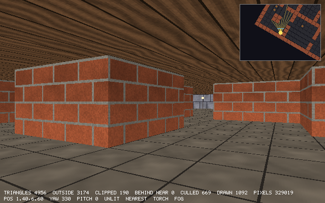
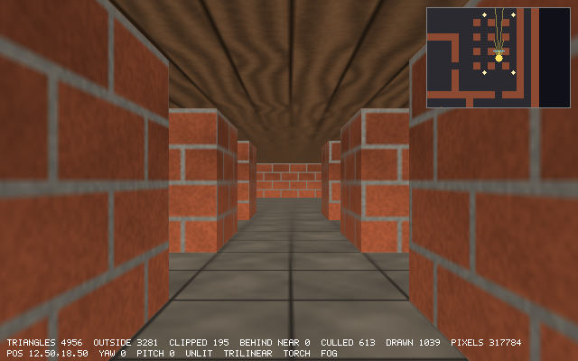

# Chapter 20 — Texture Mapping

The polygon maze has lights, fog and a torch, but its walls are still one flat color each,
while Chapter 14's ray caster has had brick textures since it was written. This chapter puts the
same textures on the triangles. Each vertex gets a pair of texture coordinates (u, v) that
say where it lies on the texture, and they travel through the pipeline as two more varyings.
That does not fit in eight lanes any more, so the varyings grow to sixteen. It also shows,
very visibly, why Chapter 18 took the trouble to interpolate with perspective: blend u and v
straight across the screen instead and the bricks bend into zig-zags, the way they did on the
first PlayStation.

Then there are two sampling problems. Up close, one texel covers many pixels, and the
texture looks like a mosaic of hard squares; *bilinear filtering* blends the four nearest
texels. Far away, one pixel covers many texels, and picking one of them makes the far ceiling
shimmer; *mipmaps* fix that with a pyramid of shrunken copies of each texture, a *level of
detail* worked out for every pixel, and *trilinear* blending between levels. The level of
detail needs to know how big a pixel is on the texture, and that comes straight out of the
rasterizer's own arithmetic with the quotient rule. The lit shader becomes "texel times
light". At the end, with lighting off, the polygon renderer and the ray caster draw the same
picture to within 0.2% of the pixels, two independent programs that check each other.

Previous: [Chapter 19 — Shading and Lighting](19-shading-and-lighting.md). Next:
[Chapter 21 — Building the World](21-building-the-world.md).

## Coordinates on a texture

A texture in `delve` is a 64×64 image (Chapter 14's `texture.zig`). To put it on a triangle,
each vertex says which point of the texture it shows. Those are its *texture coordinates*,
written (u, v): u runs across the texture, v down it. They are measured in whole textures, not
texels, so (0, 0) is the top-left corner of the texture and (1, 1) the bottom-right, whatever
its size. Beyond 1 the texture repeats: u = 1.25 is the same as u = 0.25. That is the `& 63`
wrap that Chapter 14 used for the ray caster's walls.

`mesh.Vertex` gets one more field:

```zig
pub const Vertex = struct {
    pos: Vec3,
    /// The direction the surface faces at this vertex, length 1.
    normal: Vec3,
    /// Where this vertex is on the texture: (0, 0) is the texture's
    /// top-left corner, (1, 1) its bottom-right. Beyond 1 it repeats.
    uv: Vec2 = .{ 0, 0 },
};
```

The default value means that every mesh literal and every function that makes vertices
without texture coordinates compiles as before. A mesh without a texture never reads them.

Every face of the cube shows the whole texture once, so its four corners get (0, 0), (1, 0),
(1, 1) and (0, 1) in some order. The order matters: a texture can be put on a square in eight
ways (four rotations, each mirrored or not), and only one of them shows the bricks upright and
readable from outside. The cube already has what we need. Since Chapter 16 each face is
described by its outward normal n and two directions u and v across it, chosen so that
u × v = n, and its corners are at the center plus `c0/2 · u + c1/2 · v` for the four signs
(c0, c1) ∈ {−1, 1}². Seen from outside, with n pointing at us, u points right and v points
up, like the x and y axes of a page whose z points out of it. A texture's right is +u, then,
and its down is −v:

```zig
            // The texture's right is +u. Its down is -v, which makes it
            // upright on the side faces; on the top and the bottom down
            // is +z instead, so floor and ceiling textures line up the
            // way the ray caster draws them.
            const down = if (n[1] < 0) c[1] else -c[1];
            vertices[f * 4 + k] = .{ .pos = pos, .normal = n, .uv = .{ (c[0] + 1) / 2, (down + 1) / 2 } };
```

`(c0 + 1) / 2` turns the sign −1 or 1 into the coordinate 0 or 1.

Take the face at x = 0, which faces −x. Its row in the face table is n = (−1, 0, 0),
u = (0, 0, 1), v = (0, 1, 0). Stand in front of it, at negative x, looking toward +x with up
being +y. Your right hand points along forward × up = (1, 0, 0) × (0, 1, 0) = (0, 0, 1),
which is u. The corner with c = (−1, −1) is at z = 0, y = 0, the bottom-left corner as you
see it, and it gets uv = (0, 1), the texture's bottom-left. The corner c = (1, 1) is at
z = 1, y = 1, top right, and gets (1, 0), the texture's top right. The bricks stand upright
and are not mirrored, and the same holds for the other three walls, because each face's u
and v were chosen by the same rule.

Chapter 14's ray caster had to work for this. A ray hits a wall at some point along it, and
the fraction of the cell at that point becomes u, but whether that fraction grows to the
viewer's left or right depends on which side the ray came from, so the ray caster flips u on
faces it sees from the other side. The mesh needs no flip: each face carries its own right,
by construction.

Floor and ceiling are different. The ray caster samples both at the world position (x, z), so
1 unit of floor is one texture, with u along x and v along z. For the polygon renderer to show
the same picture, the top and bottom faces of the cube must agree. The top face (the floor's
surface) has u = (1, 0, 0) and v = (0, 0, −1), so "down = −v" is +z already. The bottom face
(the ceiling's surface, seen from below) has v = (0, 0, 1), so for it down is +v, and that is
the one line `down = if (n[1] < 0) c[1] else -c[1]`. The price is that the bottom face shows
its texture mirrored when seen from below. The ray caster's ceiling is mirrored in exactly the
same way, which is what we want here.

`mesh.zig`'s winding test already walks every triangle of the cube and checks its normal. It
now checks the texture coordinates too. Moving from one corner to another, u must change by
the distance moved to the right, and v by the distance moved down:

```zig
        // Texture down is world down on the walls, +z on the floor and
        // ceiling. Texture right is then to the right seen from outside,
        // except on the bottom, which shows the texture mirrored.
        const down = if (a.normal[1] != 0) Vec3{ 0, 0, 1 } else Vec3{ 0, -1, 0 };
        const right = math.cross(a.normal, down);
        for ([_]Vertex{ a, b, c }) |corner| {
            const offset = corner.pos - a.pos;
            if (a.normal[1] >= 0) try std.testing.expectApproxEqAbs(corner.uv[0] - a.uv[0], math.dot(offset, right), 1e-6);
            try std.testing.expectApproxEqAbs(corner.uv[1] - a.uv[1], math.dot(offset, down), 1e-6);
        }
```

"Right" is `n × down`: for the −x face that is (−1, 0, 0) × (0, −1, 0) = (0, 0, 1), the u we
found by hand.

## Two more varyings

The texture coordinates have to reach the pixels, and the renderer already has a way to move
numbers from the corners to the pixels: the varyings, which the clipper cuts and the
rasterizer interpolates with perspective. But `light.Shader` uses lanes 0 to 6 of the eight
lanes of `clip.Varyings`: the light (or the normal) in 0–2, the world position in 3–5 and the
fog in 6. There is one lane left, and u and v need two, plus one more that we will need for
the pixel's size on the texture. So the varyings get twice as wide:

```zig
pub const Varyings = @Vector(16, f32);
```

It is one line, plus padding every vector literal of varyings with eight more zeros: there are
a handful, such as `render3d.fromColor` and the shaders in the tests. Zig does not let a
16-lane vector be initialized from eight values, so the compiler finds every one of them.

`render3d.zig` now says what each lane is for:

```zig
/// What a shader carries from the vertices to the pixels. Lanes 0 to 7
/// are the shader's own (light, color, position, fog...). Lanes 8 and 9
/// are texture coordinates u and v, and lane 10 is filled in per pixel
/// for shaders that want the footprint (see `Fragment`).
pub const Varyings = clip.Varyings;
pub const uv_lane = 8;
pub const footprint_lane = 10;
```

Lanes 11 to 15 are free. Is it slower to carry 16 floats instead of 8 through the clipper and
the interpolation of every pixel? Measured on the long corridor, with Chapter 19's code and
then the same code with only this one change, best of three, twice each: Gouraud shading 4.08
and 4.00 ms per frame before, 4.08 and 4.08 after; Phong 10.0 and 10.0 before, 10.0 and 10.08
after. There is no difference. On a processor with AVX2, an 8-lane `f32` vector is one 256-bit
register and a 16-lane one is two, and the multiply-adds of the interpolation are a small part
of what a pixel costs. The lighting is most of it.

One thing does change in the renderer itself. Flat shading (Chapter 19) gives each triangle
the average of its corners' varyings, so the whole triangle gets one color. Averaging the
texture coordinates too would paint the whole triangle with one texel. The texture must still
move across a flat-shaded triangle; only the light is flat. So the average applies only to the
shader's lanes, with a mask that is built at compile time and `@select`, which takes each lane
from one vector or the other:

```zig
/// The lanes that flat shading averages: the texture still moves across a
/// flat-shaded triangle.
const shading_lanes = blk: {
    var mask: @Vector(16, bool) = @splat(false);
    for (0..uv_lane) |i| mask[i] = true;
    break :blk mask;
};
```

```zig
        if (options.flat_shading) {
            const average = math.scale(tri[0].vary + tri[1].vary + tri[2].vary, 1.0 / 3.0);
            for (&tri) |*v| v.vary = @select(f32, shading_lanes, average, v.vary);
        }
```

The shaders put u and v in their lanes with a small helper in `light.zig`, used by every
shader that has a texture:

```zig
/// The texture coordinates of a vertex, in the lanes the renderer
/// expects them.
pub fn withUv(vary: render3d.Varyings, v: mesh.Vertex) render3d.Varyings {
    var result = vary;
    result[render3d.uv_lane] = v.uv[0];
    result[render3d.uv_lane + 1] = v.uv[1];
    return result;
}
```

## Perspective-correct, and what happens without it

Chapter 18 interpolated every varying with perspective. Here is the reason again, now that it
matters. The rasterizer's weights λ₀, λ₁, λ₂ are linear on the *screen*: they change by the
same amount from each pixel to the next. Texture coordinates are linear on the *surface*, in
the world. A projection does not keep distances in proportion (a floor tile far away is a few
pixels tall, one nearby is a hundred), so u is not linear on the screen. What is linear on the
screen is u/w and 1/w, where w is the distance along the view direction, and `interpolate`
blends those two and divides:

```zig
pub fn interpolate(weights: Vec3, inv_w: Vec3, vary_w: [3]Varyings) Varyings {
    const sum = math.scale(vary_w[0], weights[0]) + math.scale(vary_w[1], weights[1]) +
        math.scale(vary_w[2], weights[2]);
    return math.scale(sum, 1 / math.dot(weights, inv_w));
}
```

`vary_w` holds each corner's varyings already divided by its w, so the result is
(Σλᵢuᵢ/wᵢ) / (Σλᵢ/wᵢ), for all sixteen lanes at once.

The shortcut is to blend u itself across the screen, Σλᵢuᵢ, called *affine* interpolation. It
costs one division less per pixel. To see what it does, `render3d.Options` gets a switch, and
the P key toggles it:

```zig
    /// Interpolate varyings with perspective. Without it they are blended
    /// straight across the screen (affine), as on the first PlayStation.
    perspective_correct: bool = true,
```

It needs no second version of `interpolate`. If every corner pretends that 1/w = 1, the
division by Σλᵢ · 1 = 1 does nothing, and the same function blends affinely:

```zig
    fn init(v: clip.Vertex, width: usize, height: usize, perspective_correct: bool) ScreenVertex {
        const s = camera.toScreen(v.pos, width, height);
        // With 1/w = 1 at every corner, interpolate() is a plain blend.
        const inv_w = if (perspective_correct) 1 / v.pos[3] else 1;
```

The depth test is not affected: it uses the z from the projection, a separate number. Only
the varyings are blended differently.

How wrong is affine? Take a floor 0.5 below the eye that runs from distance 1 to distance 5
straight ahead, with v = 1 at its near edge and v = 0 at its far edge. With a focal length of
1, a floor point at distance d appears 0.5/d below the center of the screen: the near edge at
0.5, the far edge at 0.1. The example walks 20 rows evenly down the screen between them and
works out v three ways: the truth (from the distance), affine and perspective-correct.

`examples/ch20/affine_vs_perspective.zig`

```zig
//! Why texture coordinates must be interpolated with perspective. A floor
//! lies 0.5 below the eye and runs from distance 1 to distance 5. Its
//! texture coordinate v is 1 at the near edge and 0 at the far edge. On the
//! screen (focal length 1) the near edge is 0.5 below the center and the
//! far edge 0.1 below. For rows between them, compare v blended straight
//! across the screen (affine) with v from v/w and 1/w (perspective-correct).
const std = @import("std");

const eye_height: f32 = 0.5;
const near_d: f32 = 1.0;
const far_d: f32 = 5.0;
const near_v: f32 = 1.0;
const far_v: f32 = 0.0;

pub fn main() void {
    const near_y = eye_height / near_d;
    const far_y = eye_height / far_d;
    const rows = 20;
    var worst: f32 = 0;
    var worst_row: usize = 0;
    std.debug.print(" row  screen y  distance  v true  v affine  v perspective  affine error\n", .{});
    for (0..rows) |i| {
        // t runs from 0 at the near edge to 1 at the far edge, evenly on
        // the screen: that is how the rasterizer's weights run.
        const t = @as(f32, @floatFromInt(i)) / (rows - 1);
        const y = std.math.lerp(near_y, far_y, t);
        const d = eye_height / y;
        const v_true = near_v + (far_v - near_v) * (d - near_d) / (far_d - near_d);
        const affine = std.math.lerp(near_v, far_v, t);
        // w is the distance here; v/w and 1/w are what is linear on screen.
        const v_over_w = std.math.lerp(near_v / near_d, far_v / far_d, t);
        const one_over_w = std.math.lerp(1 / near_d, 1 / far_d, t);
        const perspective = v_over_w / one_over_w;
        const err = affine - v_true;
        if (@abs(err) > @abs(worst)) {
            worst = err;
            worst_row = i;
        }
        std.debug.print("{d:>4}  {d:>8.3}  {d:>8.3}  {d:>6.3}  {d:>8.3}  {d:>13.3}  {d:>12.3}\n", .{
            i, y, d, v_true, affine, perspective, err,
        });
    }
    std.debug.print("largest affine error: {d:.3} at row {d} ({d:.0}% of the texture)\n", .{
        worst, worst_row, @abs(worst) * 100,
    });
}
```

```console
$ zig run examples/ch20/affine_vs_perspective.zig
 row  screen y  distance  v true  v affine  v perspective  affine error
   0     0.500     1.000   1.000     1.000          1.000         0.000
   1     0.479     1.044   0.989     0.947          0.989        -0.042
   2     0.458     1.092   0.977     0.895          0.977        -0.082
   3     0.437     1.145   0.964     0.842          0.964        -0.122
   4     0.416     1.203   0.949     0.789          0.949        -0.160
   5     0.395     1.267   0.933     0.737          0.933        -0.196
   6     0.374     1.338   0.915     0.684          0.915        -0.231
   7     0.353     1.418   0.896     0.632          0.896        -0.264
   8     0.332     1.508   0.873     0.579          0.873        -0.294
   9     0.311     1.610   0.847     0.526          0.847        -0.321
  10     0.289     1.727   0.818     0.474          0.818        -0.344
  11     0.268     1.863   0.784     0.421          0.784        -0.363
  12     0.247     2.021   0.745     0.368          0.745        -0.376
  13     0.226     2.209   0.698     0.316          0.698        -0.382
  14     0.205     2.436   0.641     0.263          0.641        -0.378
  15     0.184     2.714   0.571     0.211          0.571        -0.361
  16     0.163     3.065   0.484     0.158          0.484        -0.326
  17     0.142     3.519   0.370     0.105          0.370        -0.265
  18     0.121     4.130   0.217     0.053          0.217        -0.165
  19     0.100     5.000  -0.000     0.000          0.000         0.000
largest affine error: -0.382 at row 13 (38% of the texture)
```

- The perspective-correct column equals the truth in every row (to three decimals), and
  the affine one only at the two ends, where it is given the right values.
- In between, affine runs ahead: halfway down the screen it has used up half of the texture,
  but the floor there is only 1.7 units away, a sixth of the way to the far edge. Most of the
  screen is near floor, and affine spreads the texture evenly over it.
- The error peaks at 38% of the texture, two thirds of the way to the far edge. On a wall
  with 4 rows of bricks per texture that is a brick and a half out of place.

`render3d.zig` has a test with the same floor, drawn by the real renderer on a 64×64 canvas.
A floor point 0.3 below the center of the screen is at d = 0.5/0.3 = 5/3, a sixth of the way
from the near edge to the far one, so v = 5/6 there. Affine gets 0.5, because 0.3 is halfway
between 0.5 and 0.1 on the screen. A small test shader, `Show`, writes one lane of its
varyings into the red channel, so the test can read v off the canvas:

```zig
test "affine interpolation is wrong on a face seen at an angle" {
    const gpa = std.testing.allocator;
    var canvas = try Canvas.init(gpa, 64, 64);
    defer canvas.deinit(gpa);
    var r = try Renderer.init(gpa, 24, 64, 64);
    defer r.deinit(gpa);
    // A floor 0.5 below the eye from z = -1 to z = -5, texture v going
    // from 0 at the far edge to 1 at the near one. On the screen a floor
    // point appears 0.5/d below the horizon; the near edge is at 0.5,
    // the far one at 0.1, and the row halfway, at 0.3, sees the floor at
    // d = 5/3. That is 1/6 of the way from the near edge, so v = 5/6.
    const floor = @import("mesh.zig").cubeFace(2);
    const model = Mat4.translation(.{ -0.5, -0.5, -5 }).mul(.scaling(.{ 1, 1, 4 })).mul(.translation(.{ 0, -1, 0 }));
    const vp = camera.Camera.projection(64, 64);
    // vfov is 2 atan(0.5): 0.5 below the horizon is the bottom of the
    // screen, so 0.3 is 32 + 32 * 0.3 / 0.5 = 51.2 pixels down.
    const show: Show = .{ .lane = uv_lane + 1, .scale = 255 };
    var stats: Stats = .{};
    for ([_]bool{ true, false }, [_]f32{ 5.0 / 6.0, 0.5 }) |perspective, v| {
        r.clearDepth();
        r.drawMesh(canvas, floor, model, vp, show, .{ .perspective_correct = perspective }, &stats);
        // Row 51, pixel center at 51.5: close to halfway.
        try std.testing.expectApproxEqAbs(255 * v, @as(f32, @floatFromInt(canvas.get(32, 51).r)), 255 * 0.02);
    }
}
```

The floor is the top face of the unit cube (`cubeFace(2)`), stretched to 4 units deep and
moved below and in front of the eye. Its texture coordinates are the ones from the previous
section: v grows toward +z, toward the eye.

In the maze, affine texturing looks like this:




- Each face of a wall cube is two triangles, and each triangle gets its own affine blend.
  Within one triangle the lines stay straight but are spaced wrongly. Where two triangles
  meet, along the diagonal, the two blends disagree about the slope, and the lines kink. That
  is the zig-zag in the bricks.
- The floor and ceiling are worse, because they are seen at a steeper angle and run further
  into the distance, so 1/w changes more across each triangle. The kinks there are where
  the cells' diagonals are.
- Both images were made with `--shading unlit --filter nearest`, so nothing but the texture
  coordinates differs. The HUD's second line says `AFFINE` in the first one.

This is what 3D games looked like on the first PlayStation, which had no hardware to divide
per pixel. Games hid it by cutting big polygons into many small ones, because the error grows
with how much 1/w changes across a triangle. Quake, on a PC in 1996, divided only once every
16 pixels along a row and blended affinely in between, an error too small to see at a price
the Pentium could pay. Exercise 1 does this.

## Between the texels: bilinear filtering

Chapter 14's `Texture.sample` reads the texel that the point (u, v) falls in:

```zig
    pub fn sample(tex: Texture, u: f32, v: f32) Color {
        return tex.texel(@intFromFloat(@floor(u * size)), @intFromFloat(@floor(v * size)));
    }
```

That is *nearest* sampling. When one texel covers many pixels, a texel is drawn as a
hard-edged square of several pixels, and up close against a wall a texture looks like a mosaic.
In the 640×400 window, a wall 0.3 units away is about 1300 pixels per unit tall, 20 pixels
per texel.

*Bilinear filtering* treats the texture as a smooth image whose colors are known only at the
texel centers, and blends between them. Texel i covers the stretch from i to i + 1 in texel
units, so its center is at i + 0.5. For a point at texture coordinate u, the position in
texel units relative to the centers is `x = u · n − 0.5`. Its integer part `⌊x⌋` is the
texel center to its left, `⌊x⌋ + 1` the one to its right, and the fraction `fx = x − ⌊x⌋`
says how far it is between them. Do the same for v, and the point lies in a square of four
texel centers. Blend the top two by fx, the bottom two by fx, and the results by fy:

```zig
    /// Blends the four texels of mipmap `level` around (u, v). Texel
    /// centers are at half-texel positions, so a point exactly on a center
    /// gets that texel alone.
    pub fn bilinear(tex: Texture, level: usize, u: f32, v: f32) Vec3 {
        const n = levelSize(level);
        const x = u * @as(f32, @floatFromInt(n)) - 0.5;
        const y = v * @as(f32, @floatFromInt(n)) - 0.5;
        const x0 = @floor(x);
        const y0 = @floor(y);
        const fx = x - x0;
        const fy = y - y0;
        const pixels = tex.levels[level].pixels;
        const m: i32 = @intCast(n - 1);
        const ix: i32 = @intFromFloat(x0);
        const iy: i32 = @intFromFloat(y0);
        const left: usize = @intCast(ix & m);
        const right: usize = @intCast((ix + 1) & m);
        const top: usize = @intCast(iy & m);
        const bottom: usize = @intCast((iy + 1) & m);
        const above = math.lerp(rgb(pixels[top * n + left]), rgb(pixels[top * n + right]), fx);
        const below = math.lerp(rgb(pixels[bottom * n + left]), rgb(pixels[bottom * n + right]), fx);
        return math.lerp(above, below, fy);
    }
```

The `level` argument and `levels` are for mipmaps, in the next section; level 0 is the
texture itself, n = 64. All four texel indices are wrapped with `& (n − 1)` separately. Near
the left edge, x is between −0.5 and 0, so `⌊x⌋ = −1`, and `−1 & 63 = 63`: the left
neighbor is the last texel of the row. The texture repeats, so blending across its edge
with the texel on the other side is exactly right, and there is no seam where the texture
starts again. In two's complement, `& 63` on a negative number is the same as a modulo that
always comes out positive.

The result is a `Vec3` of floats, not a `Color`, because the blend makes values between
texel colors and the shader multiplies them by the light anyway.

Here it is on an 8×8 checkerboard with one red texel in its top-left corner, magnified 16
times, once with each kind of sampling:

`examples/ch20/bilinear_zoom.zig`

```zig
//! Magnification: an 8x8 checkerboard texture drawn 16 times larger, once
//! with nearest sampling and once with bilinear filtering, side by side in
//! zoom.ppm. Also prints one row of each, so the difference shows in text.
const std = @import("std");

const n = 8; // texels per side
const zoom = 16; // pixels per texel
const out_size = n * zoom;

const Rgb = @Vector(3, f32);

/// The checkerboard: dark and light texels, plus one red texel in the
/// top-left corner so the wrap at the edges is easy to see.
fn texel(x: i32, y: i32) Rgb {
    const ux = x & (n - 1);
    const uy = y & (n - 1);
    if (ux == 0 and uy == 0) return .{ 220, 40, 40 };
    return if ((ux + uy) & 1 == 0) .{ 200, 200, 190 } else .{ 40, 40, 60 };
}

fn nearest(u: f32, v: f32) Rgb {
    return texel(@intFromFloat(@floor(u * n)), @intFromFloat(@floor(v * n)));
}

fn lerp(a: Rgb, b: Rgb, t: f32) Rgb {
    return a + (b - a) * @as(Rgb, @splat(t));
}

/// Texel centers sit at half-texel positions, so shift by half a texel,
/// then blend the four texels around the point.
fn bilinear(u: f32, v: f32) Rgb {
    const x = u * n - 0.5;
    const y = v * n - 0.5;
    const x0 = @floor(x);
    const y0 = @floor(y);
    const ix: i32 = @intFromFloat(x0);
    const iy: i32 = @intFromFloat(y0);
    const above = lerp(texel(ix, iy), texel(ix + 1, iy), x - x0);
    const below = lerp(texel(ix, iy + 1), texel(ix + 1, iy + 1), x - x0);
    return lerp(above, below, y - y0);
}

/// The texture coordinate at the center of output pixel i.
fn coord(i: usize) f32 {
    return (@as(f32, @floatFromInt(i)) + 0.5) / out_size;
}

pub fn main(init: std.process.Init) !void {
    const io = init.io;
    const gap = 8;
    const width = 2 * out_size + gap;

    std.debug.print("row 40, red channel, every 4th pixel from x = 0 to 60:\n", .{});
    inline for (.{ "nearest ", "bilinear" }, .{ nearest, bilinear }) |name, sampler| {
        std.debug.print("{s} ", .{name});
        var x: usize = 0;
        while (x <= 60) : (x += 4) std.debug.print("{d:>4.0}", .{sampler(coord(x), coord(40))[0]});
        std.debug.print("\n", .{});
    }
    std.debug.print("bilinear at the top-left pixel (wraps to texels 7 and 0): {d:.0}\n", .{bilinear(coord(0), coord(0))});

    var buffer: [4096]u8 = undefined;
    const file = try std.Io.Dir.cwd().createFile(io, "zoom.ppm", .{});
    defer file.close(io);
    var writer = file.writer(io, &buffer);
    const out = &writer.interface;
    try out.print("P6\n{d} {d}\n255\n", .{ width, out_size });
    for (0..out_size) |y| {
        for (0..width) |x| {
            const c: Rgb = if (x < out_size)
                nearest(coord(x), coord(y))
            else if (x < out_size + gap)
                .{ 255, 255, 255 }
            else
                bilinear(coord(x - out_size - gap), coord(y));
            const bytes: @Vector(3, u8) = @intFromFloat(@round(c));
            try out.writeAll(&@as([3]u8, bytes));
        }
    }
    try out.flush();
    std.debug.print("wrote zoom.ppm ({d}x{d}): nearest on the left, bilinear on the right\n", .{ width, out_size });
}
```

```console
$ zig run examples/ch20/bilinear_zoom.zig
row 40, red channel, every 4th pixel from x = 0 to 60:
nearest   200 200 200 200  40  40  40  40 200 200 200 200  40  40  40  40
bilinear  125 162 190 153 115  78  50  87 125 162 190 153 115  78  50  87
bilinear at the top-left pixel (wraps to texels 7 and 0): { 126, 75, 83 }
wrote zoom.ppm (264x128): nearest on the left, bilinear on the right
```

- Nearest jumps between 200 and 40 every 16 pixels: four samples of each, hard squares.
- Bilinear rises and falls smoothly. It reaches 190, close to the light texel's 200, at
  pixel 8, near the texel's center (pixel 7.5), and 50 at pixel 24, near the next center.
  It never quite reaches 200 or 40 here because row 40 is not on a texel center either:
  the blend down mixes in 3% of the row below, which has the opposite colors.
- At pixel 0 the value is 125, halfway between light and dark. The pixel is left of the
  center of texel 0, so it blends with texel 7, the last one of the row, through the wrap.
  The top-left pixel blends four texels across both edges and comes out
  `{ 126, 75, 83 }`: a quarter-ish of the red texel and the rest from its neighbors on the
  far side of the texture.

`zoom.ppm` is a plain PPM image, which most image viewers open (as do ImageMagick's
`display` and GIMP). The left half is the checkerboard of hard squares; the right half is
a blurry grid of blobs, light and dark blending into each other. Bilinear filtering cannot add
detail the texture does not have, but it does hide the squares, and in motion it stops the
texels from popping from one pixel to the next.

`texture.zig`'s test checks both properties: on a texel center the result is that texel
alone, and halfway between two centers across the edge of the texture it is their average.

```zig
test "bilinear filtering blends the texels around the point" {
    const gpa = std.testing.allocator;
    var set: Set = try .generate(gpa);
    defer set.deinit(gpa);
    const tex = set.get(.stone);
    // On a texel center: that texel alone.
    try std.testing.expect(math.approxEq(rgb(tex.texel(5, 9)), tex.bilinear(0, 5.5 / @as(f32, size), 9.5 / @as(f32, size))));
    // Halfway between two centers: their average, also across the
    // texture's edge, where it wraps.
    const between = math.scale(rgb(tex.texel(size - 1, 0)) + rgb(tex.texel(0, 0)), 0.5);
    try std.testing.expect(math.approxEq(between, tex.bilinear(0, 0, 0.5 / @as(f32, size))));
}
```

At u = 0 the point is half a texel left of texel 0's center, exactly between texel 63 and
texel 0. At v = 0.5/64 it is on the center of row 0, so the vertical blend adds nothing.

### Four bytes to four floats at once

Bilinear filtering reads four texels and turns each into three floats: twelve conversions
from integer to float per sample, and trilinear filtering will take two samples per pixel.
The first version of `rgb` converted the channels one by one,
`.{ @floatFromInt(c.r), @floatFromInt(c.g), @floatFromInt(c.b) }`. A color is four bytes in a
row, and a `@Vector(4, u8)` can be converted to a `@Vector(4, f32)` in one go: one
instruction that widens the bytes and one that converts four integers. The obvious way to
look at a `Color` as a vector is `@bitCast`:

```zig
const std = @import("std");

const Color = extern struct { r: u8, g: u8, b: u8, a: u8 };

pub fn main() void {
    const c: Color = .{ .r = 176, .g = 90, .b = 56, .a = 255 };
    const bytes: @Vector(4, u8) = @bitCast(c);
    const all: @Vector(4, f32) = @floatFromInt(bytes);
    std.debug.print("{any}\n", .{all});
}
```

```console
$ zig run bitcast_mistake.zig
bitcast_mistake.zig:7:44: error: cannot @bitCast from 'bitcast_mistake.Color'
    const bytes: @Vector(4, u8) = @bitCast(c);
                                           ^
bitcast_mistake.zig:3:22: note: struct declared here
const Color = extern struct { r: u8, g: u8, b: u8, a: u8 };
              ~~~~~~~^~~~~~~~~~~~~~~~~~~~~~~~~~~~~~~~~~~~~
referenced by:
...
```

`@bitCast` does not take an extern struct, even one whose layout is fixed. Casting to
`[4]u8` gives the same error. The way through is a pointer: an extern struct of four bytes
has the same memory as `[4]u8`, so a pointer to one can be cast to a pointer to the other,
and an array converts to a vector of the same length by plain coercion:

```zig
/// A color as a vector of red, green, and blue, 0 to 255. The four bytes
/// of a color convert to floats in one go, as a vector.
pub fn rgb(c: Color) Vec3 {
    const bytes: @Vector(4, u8) = @as(*const [4]u8, @ptrCast(&c)).*;
    const all: @Vector(4, f32) = @floatFromInt(bytes);
    return .{ all[0], all[1], all[2] };
}
```

It made texture sampling measurably faster, and together with the fast logarithm of a later
section, it took trilinear filtering in the long corridor from about 38 to 22.8 ms per frame.

## Far away: mipmaps

Bilinear filtering helps when a texel covers many pixels. The opposite case is worse. Look
down the long corridor and the ceiling planks 15 units away are a few pixels tall, so each
pixel covers several texels in each direction. Nearest sampling picks one of them, whichever
the pixel's center happens to land on, and its neighbor picks another one several texels
further on. The far ceiling becomes noise: dark gaps between planks and light wood picked
almost at random. Worse, it changes completely when the player moves a tiny step, so it
crawls and shimmers. This is *aliasing*, the same effect as the jagged edges of Chapter 10,
and bilinear filtering doesn't help, because it blends the four texels around one point and
the pixel covers dozens.

What a far pixel should show is the *average* of all the texels it covers. Averaging dozens of
texels per pixel would be too slow, so we average ahead of time. Lance Williams described the
way in 1983 and called it a *mipmap*, from the Latin *multum in parvo*, "much in little". Next
to the 64×64 texture, keep a 32×32 copy where each texel is the average of a 2×2 block of the
original, then a 16×16 copy made the same way from the 32×32 one, and so on down to 1×1, the
average color of the whole texture. These are the *levels* of the mipmap; level k is
64/2ᵏ texels across, and each of its texels is the average of a 2ᵏ×2ᵏ block of the
original. A pixel that covers 8×8 texels reads level 3, where one texel is exactly that
average.

In `texture.zig`, a texture becomes its levels:

```zig
/// The mipmap levels of a texture: 64x64, 32x32, ... down to 1x1.
pub const level_count = std.math.log2_int(u32, size) + 1;
```

```zig
pub const Texture = struct {
    /// Level 0 is the texture itself; level k is size >> k texels square,
    /// each texel the average of four texels of level k - 1.
    levels: [level_count]Canvas,
```

`std.math.log2_int(u32, 64)` is 6, computed at compile time, so there are 7 levels. Each
level is a `Canvas`, the same image type as the screen. `texel` and `sample` read level 0 as
before.

Halving a level is a loop over the smaller one, adding up the four texels it covers. It adds
all four channels at once, as a vector of four `u32`s, so a sum cannot overflow, then adds 2
and divides by 4 to round to the nearest instead of down:

```zig
/// Each texel of the smaller level is the average of the 2x2 texels it
/// covers in the larger one (a box filter), rounded to the nearest.
fn halve(big: Canvas, small: Canvas) void {
    for (0..small.height) |y| {
        for (small.row(y), 0..) |*p, x| {
            var sum: @Vector(4, u32) = @splat(0);
            for ([_][2]usize{ .{ 0, 0 }, .{ 1, 0 }, .{ 0, 1 }, .{ 1, 1 } }) |d| {
                const c = big.get(2 * x + d[0], 2 * y + d[1]);
                sum += @Vector(4, u32){ c.r, c.g, c.b, c.a };
            }
            const avg = (sum + @as(@Vector(4, u32), @splat(2))) / @as(@Vector(4, u32), @splat(4));
            p.* = .{ .r = @intCast(avg[0]), .g = @intCast(avg[1]), .b = @intCast(avg[2]), .a = @intCast(avg[3]) };
        }
    }
}
```

The textures are generated when the program starts, and the levels are made right after.
`Set.generate` now allocates seven canvases per texture instead of one, which means more
ways to fail halfway. Two `errdefer`s clean up: the inner one frees the levels of the texture
being made, the outer one frees every texture already finished:

```zig
    pub fn generate(gpa: std.mem.Allocator) !Set {
        var set: Set = .{ .textures = undefined };
        var done: usize = 0;
        errdefer for (set.textures.values[0..done]) |*t| freeLevels(gpa, &t.levels);
        inline for (comptime std.enums.values(Kind)) |kind| {
            var levels: [level_count]Canvas = undefined;
            var made: usize = 0;
            errdefer freeLevels(gpa, levels[0..made]);
            for (&levels, 0..) |*level, k| {
                level.* = try Canvas.init(gpa, levelSize(k), levelSize(k));
                made += 1;
            }
            for (0..size) |y| {
                for (levels[0].row(y), 0..) |*p, x| p.* = paint(kind, @intCast(x), @intCast(y));
            }
            for (1..level_count) |k| halve(levels[k - 1], levels[k]);
            set.textures.set(kind, .{ .levels = levels });
            done += 1;
        }
        return set;
    }
```

The counters `made` and `done` say how much exists at each moment, so the cleanup frees
exactly that. An `errdefer` inside an `inline for` body runs when an error leaves that body,
like one inside an ordinary block.

Here is a mip chain built by an example, from a simpler brick texture than `delve`'s:

`examples/ch20/mip_chain.zig`

```zig
//! A mip chain: a 64x64 brick texture, then 32x32, 16x16, ... 1x1, each
//! texel the rounded average of the 2x2 texels above it. Writes all levels
//! side by side into mips.ppm and prints each level's size and mean color.
const std = @import("std");

const size = 64;
const level_count = std.math.log2_int(u32, size) + 1;

const Color = @Vector(4, u8);

/// A well-mixed hash, so the "random" tint of each brick is the same on
/// every run.
fn hash(x: u32, y: u32) u32 {
    var h = x *% 0x8da6b343 +% y *% 0xd8163841;
    h ^= h >> 15;
    h *%= 0x2c1b3c6d;
    h ^= h >> 12;
    return h;
}

/// Bricks 32x16 texels in gray mortar, every other row shifted by half a
/// brick (a simpler cousin of delve's brick texture).
fn brick(x: u32, y: u32) Color {
    const row = y / 16;
    const sx = (x + (row % 2) * 16) % size;
    if (y % 16 < 2 or sx % 32 < 2) return .{ 154, 148, 136, 255 };
    const tint: u32 = 80 + hash(sx / 32, row) % 40; // percent
    const grain: u32 = 90 + hash(x, y) % 10;
    const scale = tint * grain;
    return .{ @intCast(176 * scale / 10000), @intCast(90 * scale / 10000), @intCast(56 * scale / 10000), 255 };
}

fn levelSize(level: usize) usize {
    return @as(usize, size) >> @intCast(level);
}

/// Each texel of `small` is the 2x2 box average of `big`, rounded: add 2
/// before dividing by 4. All four channels at once, as a vector.
fn halve(big: []const Color, small: []Color, n: usize) void {
    for (0..n) |y| {
        for (0..n) |x| {
            var sum: @Vector(4, u32) = @splat(0);
            for ([_][2]usize{ .{ 0, 0 }, .{ 1, 0 }, .{ 0, 1 }, .{ 1, 1 } }) |d| {
                sum += big[(2 * y + d[1]) * 2 * n + 2 * x + d[0]];
            }
            small[y * n + x] = @intCast((sum + @as(@Vector(4, u32), @splat(2))) / @as(@Vector(4, u32), @splat(4)));
        }
    }
}

pub fn main(init: std.process.Init) !void {
    const io = init.io;
    const gpa = init.gpa;

    var levels: [level_count][]Color = undefined;
    var made: usize = 0;
    defer for (levels[0..made]) |level| gpa.free(level);
    for (&levels, 0..) |*level, k| {
        const n = levelSize(k);
        level.* = try gpa.alloc(Color, n * n);
        made += 1;
    }
    for (0..size) |y| {
        for (0..size) |x| levels[0][y * size + x] = brick(@intCast(x), @intCast(y));
    }
    for (1..level_count) |k| halve(levels[k - 1], levels[k], levelSize(k));

    var texels: usize = 0;
    for (levels, 0..) |level, k| {
        const n = levelSize(k);
        var sum: @Vector(4, u32) = @splat(0);
        for (level) |c| sum += c;
        const mean = @as(@Vector(4, f32), @floatFromInt(sum)) / @as(@Vector(4, f32), @splat(@floatFromInt(n * n)));
        std.debug.print("level {d}: {d:>2}x{d:<2} {d:>5} texels, mean color {d:>6.2} {d:>6.2} {d:>6.2}\n", .{
            k, n, n, n * n, mean[0], mean[1], mean[2],
        });
        texels += n * n;
    }
    std.debug.print("all levels: {d} texels, {d:.4} times the texture alone\n", .{
        texels, @as(f32, @floatFromInt(texels)) / (size * size),
    });

    // All levels next to each other, top-aligned, on black.
    var width: usize = 0;
    for (0..level_count) |k| width += levelSize(k) + 2;
    var buffer: [4096]u8 = undefined;
    const file = try std.Io.Dir.cwd().createFile(io, "mips.ppm", .{});
    defer file.close(io);
    var writer = file.writer(io, &buffer);
    const out = &writer.interface;
    try out.print("P6\n{d} {d}\n255\n", .{ width, size });
    for (0..size) |y| {
        for (levels, 0..) |level, k| {
            const n = levelSize(k);
            for (0..n + 2) |x| {
                const c: Color = if (x < n and y < n) level[y * n + x] else .{ 0, 0, 0, 255 };
                try out.writeAll(&[3]u8{ c[0], c[1], c[2] });
            }
        }
    }
    try out.flush();
    std.debug.print("wrote mips.ppm ({d}x{d})\n", .{ width, size });
}
```

```console
$ zig run examples/ch20/mip_chain.zig
level 0: 64x64  4096 texels, mean color 158.94  93.56  65.97
level 1: 32x32  1024 texels, mean color 159.08  93.67  66.07
level 2: 16x16   256 texels, mean color 159.22  93.77  66.20
level 3:  8x8     64 texels, mean color 159.33  93.88  66.31
level 4:  4x4     16 texels, mean color 159.44  94.06  66.56
level 5:  2x2      4 texels, mean color 159.75  94.50  66.50
level 6:  1x1      1 texels, mean color 160.00  95.00  67.00
all levels: 5461 texels, 1.3333 times the texture alone
wrote mips.ppm (141x64)
```

- Every level has the same mean color, give or take a little: averaging keeps the average.
  The 1×1 level is one texel of the texture's average color, (160, 95, 67), a brick color
  lightened by the gray mortar.
- The mean creeps up by about 0.1 to 0.2 per level. That is the rounding. A sum of four
  bytes that leaves a remainder of 2 when divided by 4 is exactly halfway and rounds up, by
  half a step; remainders 1 and 3 round by a quarter step down and up. On average a level
  comes out an eighth of a step brighter than the one above it.
- All levels together are 5461 texels, a third more than the texture alone:
  1 + 1/4 + 1/16 + … = 4/3. Mipmaps cost a third more memory, which is why every GPU uses them.

`mips.ppm` shows the levels side by side, left to right, on black. In the 32×32 level the
bricks and mortar are still clear. At 8×8 a brick is a couple of texels and the mortar has
blended into them, and the last three levels are blotches of brick color.

`levelSize` shifts the size right by the level. The first version was simply `64 >> level`:

```zig
const std = @import("std");

fn levelSize(level: usize) usize {
    return 64 >> level;
}

pub fn main() void {
    for (0..7) |level| std.debug.print("{d} ", .{levelSize(level)});
    std.debug.print("\n", .{});
}
```

```console
$ zig run shift_mistake.zig
shift_mistake.zig:4:15: error: LHS of shift must be a fixed-width integer type, or RHS must be comptime-known
    return 64 >> level;
           ~~~^~~~~~~~
referenced by:
    main: shift_mistake.zig:8:59
...
```

`64` is a `comptime_int`, which has no fixed width, so Zig cannot shift it by a number only
known at run time. The left side needs a type, and the shift amount must then fit the type's
bit count: for a `usize`, a `u6`. `@intCast` converts the `usize` level to it, with a safety
check in debug builds that the level is below 64:

```zig
/// The width and height of mipmap `level`, in texels.
pub fn levelSize(level: usize) usize {
    return @as(usize, size) >> @intCast(level);
}
```

## How big is a pixel on the texture?

To pick a level, each pixel needs to know how much of the texture it covers. Call it the
pixel's *footprint* ρ (rho): how far the texture coordinates move from this pixel to the next
one, measured in whole textures. If ρ = 1/64, a step of one pixel moves one texel, and level 0
is right. If ρ = 8/64, a pixel covers 8 texels, and level 3 has texels that size. The level
is log₂ of the footprint in texels:

  λ = log₂(ρ · 64)

called the *level of detail*. It is a real number: λ = 2.4 means "between level 2 and level
3, nearer 2". λ below 0 means the texture is magnified, and level 0 is the best there is.

How far u moves per pixel is a derivative, ∂u/∂x across and ∂u/∂y down, and the same for v.
A GPU gets them by subtraction: it shades pixels in 2×2 blocks and subtracts the neighbors'
values (Exercise 4 does this). The rasterizer of Chapter 10 does one pixel at a time, but it
can work the derivatives out exactly, because it knows how its weights change.

Each weight λᵢ is an edge function divided by the triangle's area (Chapter 10). An edge
function is linear in the pixel position: for the edge from b to c, at pixel p it is
`(c.x − b.x)(p.y − b.y) − (c.y − b.y)(p.x − b.x)`, so one pixel to the right it changes by
`b.y − c.y` and one pixel down by `c.x − b.x`. Divided by the area, those are ∂λ₀/∂x and
∂λ₀/∂y, the same everywhere on the triangle. The other two weights are the same with the
corners rotated.

The values that are linear on the screen are U = Σλᵢuᵢ/wᵢ and Q = Σλᵢ/wᵢ, the two sums
`interpolate` divides. Their derivatives are then constant too: ∂U/∂x = Σ(∂λᵢ/∂x)·uᵢ/wᵢ,
and so on. And u = U/Q, so by the quotient rule

  ∂u/∂x = (∂U/∂x · Q − U · ∂Q/∂x) / Q² = (∂U/∂x − u · ∂Q/∂x) / Q

using U/Q = u. For each triangle, then, we work out six numbers once: the derivatives of
u/w, v/w and 1/w across and down. For each pixel, the formula gives the four derivatives of
u and v with a few multiplies and one division:

```zig
/// How fast u/w, v/w, and 1/w change from one pixel to the next across a
/// triangle. They are linear on the screen, so this is the same
/// everywhere on it.
const Gradients = struct {
    /// d(u/w)/dx, d(v/w)/dx, d(u/w)/dy, d(v/w)/dy.
    uv_w: Vec4,
    /// d(1/w)/dx twice, then d(1/w)/dy twice.
    inv_w: Vec4,

    fn init(tri: [3]ScreenVertex) Gradients {
        const a, const b, const c = .{ tri[0].point, tri[1].point, tri[2].point };
        // Each weight is an edge function divided by the area (see
        // raster.zig), so it changes by the edge's step per pixel over the
        // area. In fixed point, a step is in units of 1/16 pixel and the
        // area in units of 1/256 pixel^2: one more factor of 16.
        const area: f32 = @floatFromInt(raster.edge(a, b, c));
        const scale = raster.one / area;
        const dx = math.scale(@as(Vec3, @floatFromInt(@Vector(3, i32){ b.y - c.y, c.y - a.y, a.y - b.y })), scale);
        const dy = math.scale(@as(Vec3, @floatFromInt(@Vector(3, i32){ c.x - b.x, a.x - c.x, b.x - a.x })), scale);
        const inv_w: Vec3 = .{ tri[0].inv_w, tri[1].inv_w, tri[2].inv_w };
        const u_w: Vec3 = .{ tri[0].vary_w[uv_lane], tri[1].vary_w[uv_lane], tri[2].vary_w[uv_lane] };
        const v_w: Vec3 = .{ tri[0].vary_w[uv_lane + 1], tri[1].vary_w[uv_lane + 1], tri[2].vary_w[uv_lane + 1] };
        return .{
            .uv_w = .{ math.dot(dx, u_w), math.dot(dx, v_w), math.dot(dy, u_w), math.dot(dy, v_w) },
            .inv_w = .{ math.dot(dx, inv_w), math.dot(dx, inv_w), math.dot(dy, inv_w), math.dot(dy, inv_w) },
        };
    }

    /// How far (u, v) moves for one pixel across or down the screen, at a
    /// pixel where 1/w is `inv_w` and the texture coordinates are `uv`:
    /// the longer of the two. u = (u/w) / (1/w), so by the quotient rule
    /// du/dx = (d(u/w)/dx - u d(1/w)/dx) / (1/w), and the same for v and y.
    fn footprint(g: Gradients, inv_w: f32, u: f32, v: f32) f32 {
        const d = math.scale(g.uv_w - Vec4{ u, v, u, v } * g.inv_w, 1 / inv_w);
        const across = d[0] * d[0] + d[1] * d[1];
        const down = d[2] * d[2] + d[3] * d[3];
        return @sqrt(@max(across, down));
    }
};
```

- The rasterizer's corners are in fixed point, 16 steps per pixel (`raster.one` is 16,
  Chapter 10). A difference of y coordinates is 16 times too big, an area 256 times; their
  ratio is 16 times too small, and `raster.one / area` puts the factor back.
- `footprint` packs the four derivatives in one `Vec4`: (∂u/∂x, ∂v/∂x, ∂u/∂y, ∂v/∂y). One
  vector subtract, multiply and scale computes all four quotient rules at once, which is why
  `inv_w` holds each derivative of 1/w twice.
- A pixel moves through the texture by (∂u/∂x, ∂v/∂x) when it steps right and by
  (∂u/∂y, ∂v/∂y) when it steps down. The footprint is the length of the longer step. That
  is what the OpenGL specification does too (its "scale factor" ρ, section 8.14).

With perspective correction switched off, every `inv_w` is 1, both derivatives of 1/w are
0, and `footprint` gives the plain affine derivatives. That is right for an affine picture.

Not every shader reads textures. The test shaders, the flat colors of the lamp globes and the
`--view normals` shader do not need a footprint, and they should not pay for one. A shader
asks for it by declaring a constant, and the renderer checks for the declaration at compile
time:

```zig
/// True if `Shader` declares `wants_footprint = true`: it reads textures
/// and needs to know how big a pixel is on them.
fn wantsFootprint(comptime Shader: type) bool {
    return @hasDecl(Shader, "wants_footprint") and Shader.wants_footprint;
}
```

`@hasDecl(T, name)` is true if the type declares something by that name. The rasterizer's
`Fragment` stores the gradients only for such shaders. For the others the field's type is
`void`, which takes no memory, and the code that fills it in is not compiled at all:

```zig
        gradients: if (wantsFootprint(Shader)) Gradients else void,
```

```zig
            var vary = interpolate(weights, f.inv_w, f.vary_w);
            if (comptime wantsFootprint(Shader)) {
                vary[footprint_lane] = f.gradients.footprint(math.dot(weights, f.inv_w), vary[uv_lane], vary[uv_lane + 1]);
            }
```

`math.dot(weights, f.inv_w)` is Q, the 1/w of this pixel, which `interpolate` has just
computed too. The footprint goes into lane 10, where the shader finds it with the texture
coordinates. In `drawMesh`, where the fragment is made, `.gradients = if (comptime
wantsFootprint(@TypeOf(shader))) .init(tri) else {}`: `{}` is the value of type `void`.

The test draws a face square to the camera, where the answer is easy to know. The canvas is
40 pixels high and the projection's vertical field of view shows 1 unit per unit of distance,
so at distance 2 the screen shows 2 units, 20 pixels per unit. The face is 1 unit wide: one
pixel is 1/20 of its texture. The test shader `Show` writes 1000 × lane 10 into red, so red
should be 50:

```zig
test "the footprint is the size of a pixel on the texture" {
    const gpa = std.testing.allocator;
    var canvas = try Canvas.init(gpa, 64, 40);
    defer canvas.deinit(gpa);
    var r = try Renderer.init(gpa, 24, 64, 40);
    defer r.deinit(gpa);
    const front = @import("mesh.zig").cubeFace(4);
    const vp = camera.Camera.projection(64, 40);
    // The face is the cube's side at z = 1, moved to z = -2. The screen
    // is 40 pixels high, and at distance 2 it shows 2 units:
    // a face 1 wide covers 20 pixels, so one pixel covers 1/20 of the
    // texture, wherever it is on the face.
    const show: Show = .{ .lane = footprint_lane, .scale = 1000 };
    var stats: Stats = .{};
    for ([_]bool{ true, false }) |perspective| {
        r.clearDepth();
        r.drawMesh(canvas, front, .translation(.{ -0.5, -0.5, -3 }), vp, show, .{ .perspective_correct = perspective }, &stats);
        for ([_][2]usize{ .{ 32, 20 }, .{ 25, 13 }, .{ 40, 28 } }) |p| {
            try std.testing.expectEqual(50, canvas.get(p[0], p[1]).r);
        }
    }
    // Twice as far, twice the footprint.
    r.clearDepth();
    r.drawMesh(canvas, front, .translation(.{ -0.5, -0.5, -5 }), vp, show, .{}, &stats);
    try std.testing.expectEqual(100, canvas.get(32, 20).r);
}
```

It checks three pixels, with and without perspective, because a face square to the camera
has the same w everywhere and both must agree. Then at distance 4 the footprint doubles.

### Floors are anisotropic

On a wall seen straight on, a pixel covers a square of the texture. On a floor seen at a
shallow angle, it does not. The next example works out both steps of the footprint for a
floor point straight ahead at distance d, with the eye 0.5 above the floor and 400 pixels per
unit at distance 1 (the 640×400 window). Across, one pixel is d/400 units of floor, because
everything at distance d is shrunk by d. Down, the floor point is 400 · 0.5/d pixels below
the center, so one pixel down changes d by d²/200: the floor recedes much faster than it
narrows.

`examples/ch20/footprint_table.zig`

```zig
//! How big a pixel is on the floor texture, straight ahead at distance d.
//! The eye is 0.5 above the floor, the screen has 400 pixels per unit at
//! distance 1, and the floor texture repeats once per unit (u = x, v = z).
//! A floor point at distance d is 400 * 0.5 / d pixels below the center
//! of the screen, so:
//!   one pixel across moves  d / 400        units (grows with d),
//!   one pixel down moves    d^2 / 200      units (grows with d squared).
//! The level of detail takes the larger of the two, in texels, and log2.
const std = @import("std");

const size = 64; // texels per unit
const focal = 400.0; // pixels per unit at distance 1
const eye_height = 0.5;
const last_level = 6; // 64 -> 1x1 is 7 levels

pub fn main() void {
    const distances = [_]f32{ 1, 1.5, 2, 3, 4, 6, 8, 12, 16, 24, 32 };
    std.debug.print("   d  across (texels)  down (texels)  ratio  lambda  mipmap  trilinear\n", .{});
    for (distances) |d| {
        const across = d / focal * size;
        const down = d * d / (focal * eye_height) * size;
        const lambda = @log2(@max(across, down));
        const clamped = std.math.clamp(lambda, 0, last_level);
        const level = @floor(clamped);
        std.debug.print("{d:>4}  {d:>15.3}  {d:>13.3}  {d:>5.1}  {d:>6.2}  {d:>6.0}  {d:.0} + {d:.2}\n", .{
            d, across, down, down / across, lambda, @round(clamped), level, clamped - level,
        });
    }
    std.debug.print("nearest and bilinear always read level 0.\n", .{});
}
```

```console
$ zig run examples/ch20/footprint_table.zig
   d  across (texels)  down (texels)  ratio  lambda  mipmap  trilinear
   1            0.160          0.320    2.0   -1.64       0  0 + 0.00
 1.5            0.240          0.720    3.0   -0.47       0  0 + 0.00
   2            0.320          1.280    4.0    0.36       0  0 + 0.36
   3            0.480          2.880    6.0    1.53       2  1 + 0.53
   4            0.640          5.120    8.0    2.36       2  2 + 0.36
   6            0.960         11.520   12.0    3.53       4  3 + 0.53
   8            1.280         20.480   16.0    4.36       4  4 + 0.36
  12            1.920         46.080   24.0    5.53       6  5 + 0.53
  16            2.560         81.920   32.0    6.36       6  6 + 0.00
  24            3.840        184.320   48.0    7.53       6  6 + 0.00
  32            5.120        327.680   64.0    8.36       6  6 + 0.00
nearest and bilinear always read level 0.
```

- Up to distance 1.5 the floor is magnified (λ < 0) and every filter reads level 0.
- At distance 4 a pixel covers 0.64 texels across but 5.12 down, a ratio of 8. The ratio is
  d/0.25 and keeps growing. The pixel's footprint on the floor is a long thin sliver
  pointing away from the viewer.
- λ takes the longer side, so at distance 4 it reads level 2, whose texels are 4 times
  wider than needed across. The floor's far end is blurred sideways. That is the price of
  treating the footprint as a square (*isotropic*), and Exercise 3 pays it off with
  *anisotropic* filtering.
- From distance 16 on, a pixel covers more than the whole texture down, and the 1×1 level
  is all that is left: the average color, which is the right answer for a pixel that covers
  a whole tile.
- The `mipmap` column rounds λ to the nearest level and jumps from 0 to 2 to 4 to 6, while
  `trilinear` keeps the fraction. That difference is the next section.

### A logarithm from the bits

λ is a logarithm, computed for every pixel of every textured triangle: about 300,000 a frame.
The first version used `@log2` and cost several milliseconds per frame. But the level of detail
doesn't need to be exact; it chooses between blurrier and sharper and nobody can see 0.05 of a
level. And a float already *is* a logarithm, nearly. An `f32` is stored as a sign bit, 8 bits
of exponent e (plus 127) and 23 bits of mantissa: the value is 2ᵉ · m, with m from 1 to 2.
So log₂(x) = e + log₂(m), and log₂(m) runs from 0 to 1 as m runs from 1 to 2, a gentle curve
close to the straight line m − 1:

```zig
/// log2(x) for x > 0, read off the bits of the float: x is 2^e times a
/// mantissa m from 1 to 2, so log2(x) = e + log2(m), and log2(m) is
/// close to m - 1 (exact at both ends, at most 0.09 off between). A
/// library log2 costs several times more, and the level of detail does
/// not need to be exact; GPUs approximate it too.
pub fn fastLog2(x: f32) f32 {
    const bits: u32 = @bitCast(x);
    const exponent: f32 = @floatFromInt(@as(i32, @intCast(bits >> 23)) - 127);
    const mantissa: f32 = @bitCast((bits & 0x7fffff) | 0x3f800000); // 1 to 2
    return exponent + mantissa - 1;
}
```

- `bits >> 23` is the exponent field (the sign bit is 0 for positive numbers), and
  subtracting 127 gives e.
- `bits & 0x7fffff` keeps the 23 mantissa bits, and OR-ing in `0x3f800000`, the bits of
  1.0, gives them exponent 0: a float from 1 to 2 with the same mantissa, which is m.
- `@bitCast` reinterprets the 32 bits of an `f32` as a `u32` and back. Unlike the extern
  struct earlier, this works: both are plain 32-bit types.

```zig
/// Which mipmap level has texels the size of a pixel that covers
/// `footprint` of the texture: level k has texels 2^k times wider than
/// level 0's, so it is log2 of the pixel's size in level-0 texels.
/// Below 0 the texture is magnified, and level 0 is the best there is.
pub fn levelOfDetail(footprint: f32) f32 {
    return fastLog2(footprint * size);
}
```

How close is "close"? The example prints both for 30 values from 0.05 up, each 1.37 times the
last, then searches one octave for the worst error, and times both over a million values,
a hundred times:

`examples/ch20/fast_log2.zig`

```zig
//! log2 from the bits of a float. An f32 is 2^e times a mantissa m from 1
//! to 2, so log2(x) = e + log2(m). Replacing log2(m) by m - 1 is exact at
//! m = 1 and m = 2 and a little low between. Prints both for 30 values,
//! finds the largest error, and times both over many values.
const std = @import("std");

fn fastLog2(x: f32) f32 {
    const bits: u32 = @bitCast(x);
    const exponent: f32 = @floatFromInt(@as(i32, @intCast(bits >> 23)) - 127);
    const mantissa: f32 = @bitCast((bits & 0x7fffff) | 0x3f800000); // 1 to 2
    return exponent + mantissa - 1;
}

fn libraryLog2(x: f32) f32 {
    return @log2(x);
}

fn time(io: std.Io, comptime f: fn (f32) f32, xs: []const f32) struct { ns: i96, sum: f32 } {
    const start: std.Io.Timestamp = .now(io, .awake);
    var sum: f32 = 0;
    for (0..100) |_| {
        for (xs) |x| sum += f(x);
    }
    std.mem.doNotOptimizeAway(sum);
    const end: std.Io.Timestamp = .now(io, .awake);
    return .{ .ns = start.durationTo(end).nanoseconds, .sum = sum };
}

pub fn main(init: std.process.Init) !void {
    const io = init.io;
    std.debug.print("       x     @log2  fastLog2   error\n", .{});
    var x: f32 = 0.05;
    for (0..30) |_| {
        std.debug.print("{d:>8.3}  {d:>8.4}  {d:>8.4}  {d:>6.4}\n", .{ x, @log2(x), fastLog2(x), fastLog2(x) - @log2(x) });
        x *= 1.37;
    }

    // The error repeats in every octave, so one octave finds the worst.
    var worst: f32 = 0;
    var worst_m: f32 = 1;
    var m: f32 = 1;
    while (m < 2) : (m += 1.0 / 4096.0) {
        const e = @abs(fastLog2(m) - @log2(m));
        if (e > worst) {
            worst = e;
            worst_m = m;
        }
    }
    std.debug.print("largest error {d:.4} at m = {d:.3} (1 / ln 2 = {d:.3})\n", .{ worst, worst_m, 1.0 / @log(2.0) });

    const gpa = init.gpa;
    const xs = try gpa.alloc(f32, 1 << 20);
    defer gpa.free(xs);
    for (xs, 0..) |*v, i| v.* = 0.01 + @as(f32, @floatFromInt(i)) * 0.001;
    const lib = time(io, libraryLog2, xs);
    const fast = time(io, fastLog2, xs);
    const calls: f64 = @floatFromInt(xs.len * 100);
    std.debug.print("@log2:    {d:.2} ns per call\n", .{@as(f64, @floatFromInt(lib.ns)) / calls});
    std.debug.print("fastLog2: {d:.2} ns per call\n", .{@as(f64, @floatFromInt(fast.ns)) / calls});
}
```

The timing only means something in an optimized build:

```console
$ zig run -O ReleaseFast examples/ch20/fast_log2.zig
       x     @log2  fastLog2   error
   0.050   -4.3219   -4.4000  -0.0781
   0.069   -3.8678   -3.9040  -0.0362
   0.094   -3.4136   -3.4985  -0.0849
   0.129   -2.9594   -2.9715  -0.0121
   0.176   -2.5052   -2.5909  -0.0857
   0.241   -2.0510   -2.0695  -0.0185
   0.331   -1.5969   -1.6776  -0.0808
   0.453   -1.1427   -1.1884  -0.0457
   0.620   -0.6885   -0.7590  -0.0705
   0.850   -0.2343   -0.2999  -0.0655
   1.165    0.2198    0.1646  -0.0552
   1.595    0.6740    0.5955  -0.0785
   2.186    1.1282    1.0929  -0.0353
   2.995    1.5824    1.4973  -0.0851
   4.103    2.0365    2.0256  -0.0109
   5.621    2.4907    2.4051  -0.0856
   7.700    2.9449    2.9250  -0.0198
  10.549    3.3991    3.3187  -0.0804
  14.452    3.8532    3.8066  -0.0467
  19.800    4.3074    4.2375  -0.0699
  27.126    4.7616    4.6954  -0.0662
  37.162    5.2158    5.1613  -0.0544
  50.912    5.6699    5.5910  -0.0789
  69.750    6.1241    6.0898  -0.0343
  95.557    6.5783    6.4931  -0.0852
 130.913    7.0325    7.0228  -0.0097
 179.351    7.4866    7.4012  -0.0855
 245.712    7.9408    7.9196  -0.0212
 336.625    8.3950    8.3149  -0.0801
 461.176    8.8492    8.8015  -0.0477
largest error 0.0861 at m = 1.443 (1 / ln 2 = 1.443)
@log2:    3.76 ns per call
fastLog2: 0.66 ns per call
```

- The error is always negative or zero. log₂ bends downward (it is concave), so the
  straight line m − 1 between its ends at m = 1 and m = 2 lies below it.
- It is largest where the curve's slope 1/(m ln 2) equals the line's slope 1, at
  m = 1/ln 2 = 1.443, and there it is 0.086 of a level. A level of detail 0.09 too low
  means a picture very slightly sharper than it should be.
- It is six times faster here. Other runs gave 4.25 against 0.70 and 4.05 against 0.75 ns,
  so the times move but the ratio stays. In `delve` the pixel loop does other work at the
  same time, so the saving there is smaller than the ratio suggests, but it was several
  milliseconds a frame.

The tests pin down both properties, and the level of detail for three footprints:

```zig
test "the fast log2 is exact at powers of two and close between" {
    for ([_]f32{ 0.125, 1, 2, 64, 1024 }) |x| try std.testing.expectEqual(@log2(x), fastLog2(x));
    var x: f32 = 0.01;
    while (x < 100) : (x *= 1.07) try std.testing.expectApproxEqAbs(@log2(x), fastLog2(x), 0.09);
}

test "the level of detail is log2 of the pixel size in texels" {
    try std.testing.expectEqual(0, levelOfDetail(1.0 / @as(f32, size)));
    try std.testing.expectEqual(3, levelOfDetail(8.0 / @as(f32, size)));
    try std.testing.expectEqual(-1, levelOfDetail(0.5 / @as(f32, size)));
}
```

GPUs approximate the level of detail too; the OpenGL specification allows it, as long as the
approximation keeps the right trends.

## Four filters

With levels and a level of detail, a texture can be read four ways, and `texture.Filter`
names them:

```zig
/// How a texture is read where a pixel falls between texels, or covers
/// many of them.
pub const Filter = enum {
    /// The one texel the point falls in.
    nearest,
    /// The four texels around the point, blended by how close each is.
    bilinear,
    /// Bilinear, from the mipmap level whose texels are nearest in size to
    /// the pixel.
    mipmap,
    /// Bilinear from the two levels around the pixel's size, blended:
    /// trilinear filtering.
    trilinear,
};
```

`Texture.filtered` reads a texture with one of them. It takes the footprint as well as u
and v, and returns a color as floats:

```zig
    /// The color at (u, v), 0 to 255 per channel, read with `filter`.
    /// `footprint` is how far u and v move from one pixel to the next:
    /// the size of the pixel on the texture.
    pub fn filtered(tex: Texture, u: f32, v: f32, footprint: f32, filter: Filter) Vec3 {
        switch (filter) {
            .nearest => return rgb(tex.sample(u, v)),
            .bilinear => return tex.bilinear(0, u, v),
            .mipmap => {
                const lod = std.math.clamp(levelOfDetail(footprint), 0, level_count - 1);
                return tex.bilinear(@intFromFloat(@round(lod)), u, v);
            },
            .trilinear => {
                const lod = std.math.clamp(levelOfDetail(footprint), 0, level_count - 1);
                const level: usize = @intFromFloat(@floor(lod));
                const finer = tex.bilinear(level, u, v);
                if (level == level_count - 1) return finer;
                return math.lerp(finer, tex.bilinear(level + 1, u, v), lod - @floor(lod));
            },
        }
    }
```

- `nearest` and `bilinear` ignore the footprint and read level 0.
- `mipmap` rounds λ to the nearest level and reads it bilinearly. Its texels are at most a
  factor of √2 too big or too small.
- `trilinear` reads the two levels around λ, both bilinearly, and blends them by λ's
  fraction: λ = 2.3 is 70% of level 2 and 30% of level 3. Bilinear in u, v and linear
  between levels make three directions of blending, hence the name. It costs two bilinear
  reads, eight texels. At the last level there is no coarser one to blend with, so it
  returns early.
- λ is clamped to the levels that exist: from 0 (magnified) to 6 (the 1×1 level).

`--filter NAME` picks one on the command line and N cycles through them while playing. The
HUD shows the filter's name. An unknown name is an error, as for every option:

```zig
            } else if (eql(arg, "--filter")) {
                const name = try value(args, &i);
                opts.filter = std.meta.stringToEnum(Filter, name) orelse return error.InvalidValue;
```

Here is the long corridor from Chapter 19 with nearest sampling, unlit:




The difference is at the far end, so here it is magnified, cut from the four pictures
(nearest, bilinear, mipmap, trilinear, left to right), each the same 160×150 pixels around
the far end, twice the size:

![Four crops of the far end of the corridor side by side. In the first, nearest, the ceiling between the dark plank joints is full of wavy moiré stripes, and the joints are jagged. In the second, bilinear, the stripes are softer but still there. In the third, mipmap, the ceiling is smooth, but there are visible horizontal steps across the ceiling where the texture suddenly becomes blurrier. In the fourth, trilinear, the ceiling goes from sharp to blurry smoothly, with no steps, and the far ceiling is a plain brown.](images/ch20-filters.png)

- **Nearest**: the planks' grain makes a wavy pattern, *moiré*, which has nothing to do with
  the texture: it comes from where the pixel centers happen to fall. In motion it crawls.
- **Bilinear**: softer, but the moiré is still there, because each pixel still reads four
  texels out of the dozens it covers.
- **Mipmap**: the noise is gone. But where λ crosses 0.5, 1.5, 2.5 the level switches, and
  the ceiling suddenly gets blurrier along a line. The lines lie across the corridor at
  fixed distances and follow the player around.
- **Trilinear**: no lines. But the far ceiling is blurry, too blurry. The planks run along
  the corridor and their joints should stay visible as lines converging on the far wall.
  That is the floor table's anisotropy again: λ follows the longer, down-the-corridor side of
  the footprint, and the texture is blurred across the corridor as much as along it.

To see which level each pixel reads, `--view levels` (Tab cycles to it) tints every texel 60%
toward a color per level:

```zig
/// A color per mipmap level, to see which level each pixel reads.
pub fn levelColor(lod: f32) Vec3 {
    const colors = [level_count]Vec3{
        .{ 255, 64, 64 }, .{ 255, 200, 64 }, .{ 64, 220, 64 },   .{ 64, 220, 255 },
        .{ 64, 96, 255 }, .{ 220, 64, 255 }, .{ 255, 255, 255 },
    };
    const l = std.math.clamp(lod, 0, level_count - 1);
    const level: usize = @intFromFloat(@floor(l));
    return math.lerp(colors[level], colors[@min(level + 1, level_count - 1)], l - @floor(l));
}
```

Red is level 0, then yellow, green, cyan, blue, magenta, and white for the 1×1 level, blended
by λ's fraction like trilinear filtering.


- The bands are where λ crosses whole numbers. They come closer together with distance,
  because each level is twice the footprint, and the footprint grows like d² on the floor.
- On the floor and ceiling the colors run ahead of the walls at the same distance. The walls
  are seen straight on along their height, and the floor and ceiling at a grazing angle.
- The far wall, square to the view, is only orange: a pixel there covers between one and
  two texels, while the floor and ceiling at the same distance are at level 4 or 5.
  Distance alone does not decide the level; the angle matters as much.

## Texel times light

So far textures have only been read, not used. A surface is now described by its
*material*, its color before light: either one color, or a texture read with a filter.

```zig
/// What a surface looks like before any light falls on it: one color, or
/// a texture.
pub const Material = struct {
    color: Color,
    texture: ?*const texture.Texture = null,
    filter: texture.Filter = .trilinear,
    /// Paint each pixel in the color of the mipmap level it reads.
    show_levels: bool = false,

    /// The color at a pixel, 0 to 255 per channel, from the texture
    /// coordinates and footprint in its varyings.
    pub fn at(m: Material, vary: render3d.Varyings) Vec3 {
        const tex = m.texture orelse return fromColor(m.color);
        const u = vary[render3d.uv_lane];
        const v = vary[render3d.uv_lane + 1];
        const footprint = vary[render3d.footprint_lane];
        const texel = tex.filtered(u, v, footprint, m.filter);
        if (!m.show_levels) return texel;
        return math.lerp(texel, texture.levelColor(texture.levelOfDetail(footprint)), 0.6);
    }
};
```

The texture is a pointer to a `Texture` in the program's texture set, so a material is small
and is copied into each shader by value. A `Texture` itself is seven `Canvas`es (seven
slices and sizes), so copying it into every shader would be a waste.

In Chapter 19, `light.Shader` worked out color × light at each vertex for flat and Gouraud
shading, and passed the product to the pixels. With a texture, the color is only known at the
pixel, so the vertex now passes the *light* in lanes 0 to 2, and the pixel multiplies:

```zig
    pub fn vertex(s: Shader, v: mesh.Vertex, world: Vec3) render3d.Varyings {
        const normal = math.normalize(s.normal_matrix.transformDir(v.normal));
        const first = if (s.shading == .phong) normal else s.scene.lightAt(world, normal);
        return withUv(.{ first[0], first[1], first[2], world[0], world[1], world[2], s.scene.fogAt(world), 0, 0, 0, 0, 0, 0, 0, 0, 0 }, v);
    }

    pub fn pixel(s: Shader, vary: render3d.Varyings) Color {
        var light: Vec3 = .{ vary[0], vary[1], vary[2] };
        if (s.shading == .phong) {
            const world: Vec3 = .{ vary[3], vary[4], vary[5] };
            // Blending unit normals shortens them: normalize again.
            light = s.scene.lightAt(world, math.normalize(light));
        }
        const rgb = s.scene.applyFog(s.material.at(vary) * light, vary[6]);
        return render3d.toColor(.{ rgb[0], rgb[1], rgb[2], 0, 0, 0, 0, 0, 0, 0, 0, 0, 0, 0, 0, 0 });
    }
```

For a material of one flat color, this is the same picture as before. Interpolation is linear:
blending `color × light` across a triangle gives the same as blending the light and
multiplying by the constant color afterwards. The Chapter 19 screenshots come out the same.

`maze3d.FlatShader`, the unlit look of the ray caster, gets a material too. It still darkens
faces along the world's z, like the ray caster's y sides, and passes that shade in lane 0:

```zig
/// Paints each face in its material without light, the way the ray
/// caster does: faces across the map's y (along the world's z) are darker.
pub const FlatShader = struct {
    material: light.Material,

    pub const wants_footprint = true;

    pub fn vertex(_: FlatShader, v: mesh.Vertex, _: Vec3) render3d.Varyings {
        var vary: render3d.Varyings = @splat(0);
        vary[0] = if (v.normal[2] != 0) raycast.y_side_shade else 1;
        return light.withUv(vary, v);
    }

    pub fn pixel(s: FlatShader, vary: render3d.Varyings) Color {
        const rgb = math.scale(s.material.at(vary), vary[0]);
        return render3d.toColor(.{ rgb[0], rgb[1], rgb[2], 0, 0, 0, 0, 0, 0, 0, 0, 0, 0, 0, 0, 0 });
    }
};
```

What goes where is decided by `maze3d.Paint`, which `drawSolid` takes instead of a flag:

```zig
/// How the surfaces are painted: in flat colors, or with textures read
/// through `filter`.
pub const Paint = struct {
    textures: ?*const texture.Set = null,
    filter: texture.Filter = .trilinear,
    show_levels: bool = false,

    /// The material of a surface whose flat color is `color` and whose
    /// texture is `kind`.
    pub fn material(p: Paint, color: Color, kind: texture.Kind) light.Material {
        const set = p.textures orelse return .{ .color = color };
        return .{ .color = color, .texture = set.ptr(kind), .filter = p.filter, .show_levels = p.show_levels };
    }
};
```

A wall cube gets its tile's texture, `raycast.wallTexture(tile)` (made `pub` for this), and
the floor and ceiling faces get `.floor` and `.ceiling`:

```zig
                const wall = paint.material(raycast.wallColor(tile), raycast.wallTexture(tile));
                drawPart(r, canvas, cube, model, view_proj, wall, shading, scene, box, options, stats);
            } else {
                const floor: Mat4 = .translation(.{ fx, -1, fy });
                drawPart(r, canvas, floor_face, floor, view_proj, paint.material(raycast.floor_color, .floor), shading, scene, box, options, stats);
```

The lamp's pole and globe keep flat colors: `.{ .color = pole_color }` is a material with no
texture. `Set.ptr` is new, returning a pointer to a texture in the set instead of a copy.

In `app.zig`, the T key already toggled textures in the ray caster. It now does the same in the
3D views, from the same flag, so the two renderers agree on what T means:

```zig
                // T turns textures off here as in the ray caster.
                const paint: maze3d.Paint = .{
                    .textures = if (app.raycast_options.textured) &app.textures else null,
                    .filter = app.filter,
                    .show_levels = app.view == .levels,
                };
```

The cracks test of Chapter 18 renders four poses in every shading mode. Now it also does
each of them with and without textures, 4 × 4 × 2 = 32 renders, and every one must cover
every pixel:

```zig
        for (std.enums.values(light.Shading)) |shading| for ([_]Paint{ .{}, .{ .textures = &textures } }) |paint| {
```

Here is the corridor lit, with Phong shading, the torch and fog, and trilinear filtering:


And the lamp room of Chapter 19's `ch19-phong.png`, textured:


- The texture multiplies the light: dark mortar stays dark however bright the light is, and
  light stone is lit more visibly than dark brick.
- Its HUD is the same as Chapter 19's, `TRIANGLES 4956  OUTSIDE 4155  CLIPPED 147  BEHIND
  NEAR 0  CULLED 327  DRAWN 472  PIXELS 274952`. Textures change what pixels look like, not
  which are drawn.

## Two renderers, one picture

The polygon renderer now draws the same maze with the same textures as Chapter 14's ray
caster, but in a completely different way. The ray caster walks a ray per column through the
grid and draws vertical strips. The polygon renderer turns cubes into triangles, transforms,
clips and rasterizes them. They share the map and the textures and nothing else. If they
draw the same picture, both are probably right; where they don't, one has a bug or a real
difference.

`--shading unlit --filter nearest` makes the polygon renderer as plain as the ray caster:
nearest texels, the darker y sides, no lights, no fog. With the minimap off, the two pictures
can be compared pixel by pixel with ImageMagick's `compare`, over the 3D area above the HUD,
640×370 pixels:

```console
$ ./zig-out/bin/delve --headless --pos 12.5,18.5 --yaw 0 --view raycast --press toggle_minimap --out rc.png
$ ./zig-out/bin/delve --headless --pos 12.5,18.5 --yaw 0 --shading unlit --filter nearest \
    --press toggle_minimap --out poly.png
$ compare -metric AE -fuzz 6% -extract 640x370+0+0 rc.png poly.png null:
548
```

`-metric AE` counts the pixels that differ, "absolute error". `-fuzz 6%` lets two colors that
are within 6% of each other count as the same, because the two renderers compute their
texture coordinates with different arithmetic and round differently. Of 236,800 pixels, 548
differ, 0.23%. Writing the difference image instead of `null:` shows where: a one-pixel line
along two of the long edges where a wall meets the floor or ceiling, where the two disagree
about which surface a pixel center belongs to, and single pixels scattered over the far
ceiling, where a pixel center lies almost exactly on the boundary between two texels. There
is no area where they disagree.

At Chapter 13's pose, (9.5, 10.5) facing −60°, 409 pixels differ.

At (20.3, 13.7) facing 143° it is 2904. That view has two lamps in it. The ray caster draws a
lamp as a sprite, a flat picture of a pole and a globe that always faces the viewer. The
polygon renderer draws a thin box for the pole and a small cube for the globe. Both are
"right", and they are not the same picture.

With `--filter bilinear` instead, about 15,400 pixels differ, because now the filters really
are different. That is the comparison working: it notices a real change.

This kind of check, two independent implementations of the same thing compared on the same
input, is one of the most effective tests there is for code like a renderer, where "correct"
is hard to state as assertions. A bug in one is unlikely to be repeated in the other: a
texture turned by 90°, mirrored, or shifted by half a texel, or a side darkened that should
not be, shows up as thousands of differing pixels.

## What it costs

Texturing is work per pixel, and trilinear filtering reads eight texels per pixel, so it is
worth measuring. From this chapter on, the benchmarks follow one protocol: 120 headless frames
at a fixed pose, pinned to one core with `taskset -c 4`, best of three, in milliseconds per
frame, ReleaseFast. The machine these were measured on is shared with other work, and without
pinning, the elapsed time swung by ±50%. A small script does it:

```sh
# bench ARGS...: 120 headless frames on one core, best of three, in ms/frame
bench() {
  best=
  for i in 1 2 3; do
    t=$( { /usr/bin/time -f %e taskset -c 4 ./zig-out/bin/delve --headless --frames 120 "$@" > /dev/null; } 2>&1 )
    if [ -z "$best" ] || [ "$(echo "$t < $best" | bc)" = 1 ]; then best=$t; fi
  done
  printf "%.2f ms/frame  %s\n" "$(echo "$best * 1000 / 120" | bc -l)" "$*"
}
```

```console
$ zig build --release=fast
$ for f in nearest bilinear mipmap trilinear; do bench --pos 12.5,18.5 --yaw 0 --filter $f; done
13.92 ms/frame  --pos 12.5,18.5 --yaw 0 --filter nearest
15.75 ms/frame  --pos 12.5,18.5 --yaw 0 --filter bilinear
19.17 ms/frame  --pos 12.5,18.5 --yaw 0 --filter mipmap
22.75 ms/frame  --pos 12.5,18.5 --yaw 0 --filter trilinear
$ bench --pos 12.5,18.5 --yaw 0 --shading gouraud
17.08 ms/frame  --pos 12.5,18.5 --yaw 0 --shading gouraud
$ bench --pos 12.5,18.5 --yaw 0 --shading gouraud --filter mipmap
12.75 ms/frame  --pos 12.5,18.5 --yaw 0 --shading gouraud --filter mipmap
$ bench --pos 12.5,18.5 --yaw 0 --press toggle_textures
12.00 ms/frame  --pos 12.5,18.5 --yaw 0 --press toggle_textures
```

That is the corridor, Phong shading, torch and fog, where 317,784 pixels are drawn per frame.
The same protocol gives 10.92 ms/frame for Chapter 19's code.

- Textures off costs 1.1 ms more than Chapter 19: sixteen lanes of varyings instead of
  eight, the footprint worked out per pixel even when no texture reads it (the shader
  declares `wants_footprint` either way), and the material's branch.
- Nearest sampling adds 1.9 ms, about 6 ns per pixel: two float-to-integer conversions, a
  wrap and a load.
- Bilinear adds another 1.8 ms: four texels instead of one, and the blends.
- Mipmap adds 3.4 ms, although it reads four texels like bilinear. The difference is the
  level of detail per pixel (the logarithm, the clamp and the rounding) and the bigger
  `filtered` function with its integer level, which the measurement cannot separate.
- Trilinear adds 3.6 ms more: a second bilinear read and a blend. In all, textures make the
  corridor twice as slow as Chapter 19.
- Gouraud with trilinear, 17.1, is cheaper than Phong by 5.7 ms; Gouraud with mipmap is
  12.8. On a slow machine, Gouraud and mipmap is the cheap setting that still looks textured.
- Before the vector `rgb` and the fast logarithm, trilinear took about 38 ms per frame here.
  Most of the speed-up came from those two small functions, because they run eight times and
  once per pixel.

The default, Phong with trilinear, runs at 22.75 ms per frame in the worst view: 44 frames
per second on one core. That is playable, but not 60. Chapter 23 stops drawing what cannot be
seen, and Chapter 24 spreads the pixels over several cores.

A repeat run on the same machine while it was busier (load average about 3), with the same
binary and protocol, gave 23.67, 27.17, 35.17 and 40.58 for the four filters, 30.50 and 24.75
for the two Gouraud runs and 21.58 with textures off. Every number is about 1.75 times larger,
and the ratios between them are within a few percent of the quiet run. Measure on your own
machine: the absolute numbers will differ, and the ratios are what to compare.

## Building delve: textured walls, floors and ceilings

| File | Change |
|---|---|
| `src/clip.zig` | `Varyings` widened to 16 lanes |
| `src/mesh.zig` | `Vertex.uv`; texture coordinates on the cube's faces; the winding test checks them |
| `src/render3d.zig` | `uv_lane`, `footprint_lane`; flat shading averages only the shading lanes; `Options.perspective_correct`; `Gradients` and the footprint, for shaders that declare `wants_footprint`; two tests |
| `src/texture.zig` | Mipmap `levels`, `level_count`, `levelSize`, `halve`; `Filter`, `bilinear`, `filtered`; `levelOfDetail`, `fastLog2`, `levelColor`; vector `rgb`; `Set.ptr`; four tests |
| `src/light.zig` | `Material`, `withUv`; `Shader` takes a material and passes the light to the pixels |
| `src/maze3d.zig` | `FlatShader` with a material, `Paint`; `drawSolid` takes a paint; the cracks test runs with and without textures |
| `src/app.zig` | The filter, the `levels` view, N and P, T for the 3D views, the HUD |
| `src/input.zig` | Actions `next_filter` and `toggle_perspective` |
| `src/platform.zig` | Keys N and P |
| `src/options.zig` | `--filter NAME`, and its tests |
| `src/main.zig` | Applies `--filter` |
| `src/raycast.zig` | `wallTexture` made `pub` |

The complete project is in `project/ch20/`, 4526 lines in all.

The usage text has one more line:

```
  --filter NAME      read textures with NAME: nearest, bilinear, mipmap, trilinear
```

and `main.zig` one more line to apply it:

```zig
    if (opts.filter) |filter| app.filter = filter;
```

The keys are in `platform.zig`'s table, next to Chapter 19's:

```zig
    .{ .key = rl.KEY_N, .action = .next_filter },
    .{ .key = rl.KEY_P, .action = .toggle_perspective },
```

The HUD's second line names the shading and the filter with `{t}`, and adds `AFFINE` and `NO
TEXTURES` when those are on. In the corridor:
`POS 12.50,18.50  YAW 0  PITCH 0  PHONG  TRILINEAR  TORCH  FOG`.

### Running it

```console
$ zig build test --summary all
Build Summary: 6/6 steps succeeded; 64/64 tests passed
test success
+- run test 64 pass (64 total) 306ms MaxRSS:8M
   +- compile test debug native success 461ms MaxRSS:185M
      +- WriteFile raylib.h cached
      +- compile lib raylib debug native cached 10ms MaxRSS:39M
      +- compile lib raylib debug native (reused)
      +- translate-c cached 9ms MaxRSS:38M
$ zig build
$ ./zig-out/bin/delve --filter cubic --headless
delve: InvalidValue
usage: delve [OPTIONS]
...
```

The six new tests are two in `render3d.zig` (affine interpolation, the footprint) and four in
`texture.zig` (the 1×1 mipmap level is the texture's average color within the rounding,
bilinear filtering, the fast logarithm and the level of detail). The winding test in `mesh.zig` and the cracks
test in `maze3d.zig` do more than before, and `options.zig`'s tests parse `--filter`.

`zig build run` starts with trilinear filtering and Phong shading. N cycles the filters, P
toggles perspective correction, T textures, and Tab reaches the `levels` view. The pictures
for this chapter:

```console
$ ./zig-out/bin/delve --headless --pos 1.4,6.6 --yaw -30 --shading unlit --filter nearest \
    --press toggle_perspective --out ../../images/ch20-affine.png
$ ./zig-out/bin/delve --headless --pos 1.4,6.6 --yaw -30 --shading unlit --filter nearest \
    --out ../../images/ch20-perspective.png
$ for f in nearest bilinear mipmap trilinear; do ./zig-out/bin/delve --headless \
    --pos 12.5,18.5 --yaw 0 --shading unlit --filter $f --out ../../images/ch20-$f.png; done
$ convert ../../images/ch20-{nearest,bilinear,mipmap,trilinear}.png -crop 160x150+240+70 \
    +repage -scale 200% +append ../../images/ch20-filters.png
$ ./zig-out/bin/delve --headless --pos 12.5,18.5 --yaw 0 --shading unlit --view levels \
    --out ../../images/ch20-levels.png
$ ./zig-out/bin/delve --headless --pos 12.5,18.5 --yaw 0 --out ../../images/ch20-lit.png
$ ./zig-out/bin/delve --headless --pos 10.5,4.5 --yaw -34 --out ../../images/ch20-lamps.png
$ xvfb-run -a -s "-screen 0 1920x1080x24" ./zig-out/bin/delve --frames 60 --hold 1,0,0.3 \
    --scale 1 --screenshot ../../images/ch20-window.png
```

The `convert` line is ImageMagick: it cuts the same 160×150 rectangle out of each picture,
doubles it, and puts the four side by side. `ch20-bilinear.png` and `ch20-mipmap.png` are only
made for it; they are not shown on their own.

For the affine and perspective pictures the HUD reads `TRIANGLES 4956  OUTSIDE 3174  CLIPPED
190  BEHIND NEAR 0  CULLED 669  DRAWN 1092  PIXELS 329019` in both: perspective correction
changes which texel a pixel shows, never which pixels are drawn.


The window shot is Chapter 19's, at `POS 4.22,2.59  YAW 43`, now with textures. Up close,
one texel of the near wall covers about ten pixels. Bilinear filtering (trilinear reads level 0
there, since λ < 0) blends between them, so the bricks are soft instead of blocky. The torch
still clips the wall to pale orange; Chapter 19's Exercise 3 is about that.

## Summary

- Texture coordinates (u, v) say which point of a texture a vertex shows, in whole textures:
  (0, 0) is the top-left, (1, 1) the bottom-right, beyond 1 it repeats. For a face, the
  texture's right and down must be chosen so it is upright and not mirrored as seen from
  outside.
- The coordinates travel as varyings, which now have 16 lanes. That costs no measurable time.
  Flat shading averages only the shading lanes, so textures still move across flat triangles.
- Texture coordinates must be interpolated with perspective: u/w and 1/w are linear on the
  screen, u is not. Affine interpolation bends lines at triangle edges, by up to 38% of the
  texture for a floor 1 to 5 units away.
- Bilinear filtering blends the four texels around a point, with texel centers at half-texel
  positions. Wrapping each index separately makes the blend seamless across the texture's
  edge. It softens magnified textures but does nothing for far ones.
- A mipmap is a chain of half-size averages of the texture, down to 1×1, a third more memory
  in all. A far pixel reads the level whose texels are its own size.
- The level of detail λ is log₂ of the pixel's footprint in texels. The footprint comes from
  the screen derivatives of u and v. The rasterizer knows them exactly: the weights change by
  constants per pixel, and the quotient rule turns derivatives of u/w and 1/w into
  derivatives of u.
- A log₂ read from the bits of a float is within 0.09 of the real one and six times faster.
- Nearest sampling shimmers in the distance, bilinear barely less. Mipmap is clean but shows
  lines where the level switches. Trilinear blends two levels and has no lines, but is blurry
  on floors and ceilings, where the footprint is long and thin and λ follows its long side.
- A material is a color or a filtered texture. The lit color is texel × light, then fog.
- Two renderers that share nothing but the map and the textures draw the same picture to
  within 0.23% of the pixels. Comparing independent implementations is a strong test.
- Textures make the worst view about twice as slow as Chapter 19: 22.75 ms per frame with
  trilinear filtering on one core.

## Exercises

1. **Affine spans, Quake style.** Make the texture coordinates exact only every 16 pixels
   along a row, and blend them straight across in between. Add it as a third mode for P,
   after perspective-correct and affine. Compare the pictures with the other two.

   <details><summary>Solution</summary>

   Along one row, u/w, v/w and 1/w change by constant steps from pixel to pixel: the
   `Gradients` of this chapter, ∂(u/w)/∂x and ∂(1/w)/∂x. So at any pixel, their values at the
   start of its 16-pixel span and at the start of the next span are a known number of steps
   away, and dividing gives the exact u and v at the two ends. In between, blend straight.
   `render3d.Options` gets a flag and the span length:

   ```zig
       /// Texture coordinates exact only every `span` pixels along a row and
       /// blended straight across in between, as Quake did.
       affine_spans: bool = false,
   };

   /// The length of an affine span, in pixels.
   pub const span = 16;
   ```

   and `Gradients` a method that replaces the exact coordinates of a pixel by the blend:

   ```zig
       /// Replaces the texture coordinates in `vary` (at pixel column `x`,
       /// where 1/w is `inv_w`) by a straight blend between the exact ones
       /// at the ends of its span. u/w, v/w and 1/w are linear along the
       /// row, so their values at the span's ends are a step away.
       fn spanUv(g: Gradients, vary: *Varyings, inv_w: f32, x: usize) void {
           const start = x - x % span;
           const back: f32 = @floatFromInt(x - start);
           const ahead: f32 = @floatFromInt(start + span - x);
           const u_w = vary[uv_lane] * inv_w;
           const v_w = vary[uv_lane + 1] * inv_w;
           const w0 = inv_w - back * g.inv_w[0];
           const w1 = inv_w + ahead * g.inv_w[0];
           // Past the horizon of the plane, 1/w is 0 or less: keep the exact
           // coordinates there.
           if (w0 <= 0 or w1 <= 0) return;
           const t = back / span;
           vary[uv_lane] = std.math.lerp((u_w - back * g.uv_w[0]) / w0, (u_w + ahead * g.uv_w[0]) / w1, t);
           vary[uv_lane + 1] = std.math.lerp((v_w - back * g.uv_w[1]) / w0, (v_w + ahead * g.uv_w[1]) / w1, t);
       }
   ```

   The spans start at multiples of 16 on the screen, not at the triangle's edge, so two
   triangles side by side agree where they meet. The end of a span may be outside the
   triangle; the plane of u/w and 1/w goes on there, so the numbers still mean something,
   unless 1/w has gone to zero or below, beyond the plane's horizon. `Fragment` gets a field
   `affine_spans: bool = false`, set from `options.affine_spans and
   options.perspective_correct` in `drawMesh`, and calls it after the footprint:

   ```zig
               if (comptime wantsFootprint(Shader)) {
                   const inv_w = math.dot(weights, f.inv_w);
                   vary[footprint_lane] = f.gradients.footprint(inv_w, vary[uv_lane], vary[uv_lane + 1]);
                   if (f.affine_spans) f.gradients.spanUv(&vary, inv_w, x);
               }
   ```

   In `app.zig`, P now cycles through three modes, and the HUD shows `SPANS` for the third:

   ```zig
           if (input.pressed.contains(.toggle_perspective)) {
               // Perspective-correct, then affine, then affine spans.
               const o = &app.render_options;
               if (o.affine_spans) {
                   o.affine_spans = false;
               } else if (o.perspective_correct) {
                   o.perspective_correct = false;
               } else {
                   o.perspective_correct = true;
                   o.affine_spans = true;
               }
           }
   ```

   The test draws a wall on the left, 0.5 to the side, running from distance 1 to 5, so u
   changes very unevenly along a row. It reads row 32 three times, with `Show` putting u in
   red, and compares:

   ```zig
   test "affine spans are exact at their ends and close between" {
       const gpa = std.testing.allocator;
       var canvas = try Canvas.init(gpa, 64, 64);
       defer canvas.deinit(gpa);
       var r = try Renderer.init(gpa, 24, 64, 64);
       defer r.deinit(gpa);
       // A wall on the left, 0.5 away, from z = -1 to z = -5, facing +x: along
       // a row its u is far from linear.
       const wall = @import("mesh.zig").cubeFace(0);
       const model = Mat4.translation(.{ -0.5, -0.5, -5 }).mul(.scaling(.{ 1, 1, 4 })).mul(.translation(.{ -1, 0, 0 }));
       const vp = camera.Camera.projection(64, 64);
       const show: Show = .{ .lane = uv_lane, .scale = 255 };
       var rows: [3][64]u8 = undefined;
       for ([_]Options{ .{}, .{ .affine_spans = true }, .{ .perspective_correct = false } }, &rows) |options, *row| {
           r.clearDepth();
           @memset(canvas.pixels, .hex(0));
           var stats: Stats = .{};
           r.drawMesh(canvas, wall, model, vp, show, options, &stats);
           for (row, 0..) |*red, x| red.* = canvas.get(x, 32).r;
       }
       var worst_spans: u8 = 0;
       var worst_affine: u8 = 0;
       for (rows[0], rows[1], rows[2]) |exact, spans, affine| {
           worst_spans = @max(worst_spans, @max(exact, spans) - @min(exact, spans));
           worst_affine = @max(worst_affine, @max(exact, affine) - @min(exact, affine));
       }
       try std.testing.expect(worst_spans <= 16); // 12 here
       try std.testing.expect(worst_affine > 50);
   }
   ```

   The worst error with spans is 12 of 255 in u, with plain affine 97. `zig build test` passes
   65 of 65. On a 64-pixel canvas a 16-pixel span is a quarter of the screen, a harsh case; in
   the 640-pixel window it is a fortieth.

   In the maze, at the pose of `ch20-affine.png`, 42,598 pixels of the 3D area differ from
   the perspective-correct picture with plain affine (`compare -fuzz 6%`, as in the chapter),
   and 835 with spans. By eye the spans picture is straight; the differences are single
   texels at the far floor and ceiling, where 1/w changes most within a span.

   This version is not faster. It still runs `interpolate` with its division for every
   pixel, and adds two divisions per pixel on top. Quake was fast because its span loop
   divided only at span ends and *stepped* u and v by constants in between, with no
   per-pixel division at all, while the processor's floating-point unit worked out the
   next span's division in parallel. Doing that here needs a version of `fillTriangle`
   that walks each row in spans and hands the shader its u and v, instead of calling it
   with weights for one pixel at a time. The picture would be the same as this one.

   </details>

2. **Mipmaps in linear light.** Chapter 19 explained that pixel values are sRGB, not light.
   Averaging four texels to make a mipmap level is mixing light, so it should be done in
   linear light. Change `halve` to decode, average and encode. How do the levels and the
   far corridor change?

   <details><summary>Solution</summary>

   Two conversions with the sRGB formulas, the decode with its linear piece below 0.04045 and
   the encode with its piece below 0.0031308:

   ```zig
   /// An sRGB byte as linear light, 0 to 1.
   fn toLinear(c: u8) f32 {
       const x = @as(f32, @floatFromInt(c)) / 255;
       return if (x <= 0.04045) x / 12.92 else std.math.pow(f32, (x + 0.055) / 1.055, 2.4);
   }

   /// Linear light, 0 to 1, as an sRGB byte.
   fn toSrgb(light: f32) u8 {
       const x = std.math.clamp(light, 0, 1);
       const y = if (x <= 0.0031308) 12.92 * x else 1.055 * std.math.pow(f32, x, 1.0 / 2.4) - 0.055;
       return @intFromFloat(@round(y * 255));
   }
   ```

   The exponent has to be written `1.0 / 2.4`: with `1 / 2.4`, Zig stops with an
   "ambiguous coercion" error, because an integer literal divided by a float literal has
   no obvious type. The alpha channel is a coverage, not light, and stays a plain average:

   ```zig
   /// Each texel of the smaller level is the average of the 2x2 texels it
   /// covers in the larger one (a box filter). Texel values are sRGB, not
   /// light, so they are decoded to linear light, averaged, and encoded again.
   fn halve(big: Canvas, small: Canvas) void {
       for (0..small.height) |y| {
           for (small.row(y), 0..) |*p, x| {
               var light: Vec3 = @splat(0);
               var alpha: u32 = 0;
               for ([_][2]usize{ .{ 0, 0 }, .{ 1, 0 }, .{ 0, 1 }, .{ 1, 1 } }) |d| {
                   const c = big.get(2 * x + d[0], 2 * y + d[1]);
                   light += Vec3{ toLinear(c.r), toLinear(c.g), toLinear(c.b) };
                   alpha += c.a;
               }
               light = math.scale(light, 0.25);
               p.* = .{ .r = toSrgb(light[0]), .g = toSrgb(light[1]), .b = toSrgb(light[2]), .a = @intCast((alpha + 2) / 4) };
           }
       }
   }
   ```

   `pow` is slow, but this runs once at startup, for the 1365 texels of levels 1 to 6 of each
   of six textures, and takes no noticeable time. The mipmap test now compares the 1×1 level with the texture's average
   *light*, encoded:

   ```zig
       var sum: Vec3 = @splat(0);
       for (tex.levels[0].pixels) |p| sum += Vec3{ toLinear(p.r), toLinear(p.g), toLinear(p.b) };
       const average = math.scale(sum, 1.0 / @as(f32, size * size));
       const last = tex.levels[level_count - 1].pixels[0];
       const want = [3]u8{ toSrgb(average[0]), toSrgb(average[1]), toSrgb(average[2]) };
       const got = [3]u8{ last.r, last.g, last.b };
       for (want, got) |w, g| try std.testing.expect(@max(w, g) - @min(w, g) <= 3);
   ```

   `zig build test` passes 64 of 64. For `delve`'s brick texture, the average of the bytes is
   (139.7, 81.5, 57.1), and the average light, encoded, is (141, 85, 64); the new 1×1 level is
   (141, 85, 64) exactly. The difference is largest in blue, the darkest channel: averaging
   bytes underweights the bright texels, because a byte value is about the square root of
   the light. The extreme case is a black and a white texel: their bytes average to 128,
   which is 22% of white's light, while their light averages to 50%, which is byte 188.

   In the far corridor, unlit, 618 pixels differ by more than 2%, and the mean color of the
   far end goes from (93.26, 60.10, 40.49) to (93.73, 60.52, 40.95): the distance gets a
   little lighter. The light mortar lines carry more weight when they blend into the
   bricks. It is a small change for these textures, which have no strong contrasts. A
   texture of thin bright lines on black, like a fence against the sky, gets visibly darker
   in the distance with byte averages, and keeps its brightness in linear light.

   </details>

3. **Anisotropic filtering.** Trilinear filtering blurs the far ceiling because λ follows
   the longer side of the footprint. Instead, take λ from the *shorter* side, and average
   several trilinear samples spaced along the longer one. Add it as a fifth filter,
   `anisotropic`, and measure what it costs.

   <details><summary>Solution</summary>

   The footprint's two sides are the steps (∂u/∂x, ∂v/∂x) and (∂u/∂y, ∂v/∂y). The shader
   needs the shorter one's length and the longer one as a step in (u, v), three more numbers,
   so they get lanes 11 to 13:

   ```zig
   /// For anisotropic filtering: the shorter axis of the footprint in lane
   /// 11, and the longer one as a (u, v) step in lanes 12 and 13.
   pub const minor_lane = 11;
   pub const major_lane = 12;
   ```

   `Gradients` gets a second method beside `footprint`, the same arithmetic with a different
   ending:

   ```zig
       /// Both axes of the footprint: the shorter one's length, and the
       /// longer one as a step in (u, v).
       fn axes(g: Gradients, inv_w: f32, u: f32, v: f32) struct { minor: f32, major: [2]f32 } {
           const d = math.scale(g.uv_w - Vec4{ u, v, u, v } * g.inv_w, 1 / inv_w);
           const across = d[0] * d[0] + d[1] * d[1];
           const down = d[2] * d[2] + d[3] * d[3];
           return if (across > down)
               .{ .minor = @sqrt(down), .major = .{ d[0], d[1] } }
           else
               .{ .minor = @sqrt(across), .major = .{ d[2], d[3] } };
       }
   ```

   and `Fragment.pixel` fills the lanes:

   ```zig
               if (comptime wantsFootprint(Shader)) {
                   const inv_w = math.dot(weights, f.inv_w);
                   vary[footprint_lane] = f.gradients.footprint(inv_w, vary[uv_lane], vary[uv_lane + 1]);
                   const axes = f.gradients.axes(inv_w, vary[uv_lane], vary[uv_lane + 1]);
                   vary[minor_lane] = axes.minor;
                   vary[major_lane] = axes.major[0];
                   vary[major_lane + 1] = axes.major[1];
               }
   ```

   In `texture.zig`, the filter, and the samples. The number of samples is the ratio of the
   two sides, at most 8. Beyond a ratio of 8 the samples would be further apart than the
   level is wide, so the short side is widened to an eighth of the long one and the picture
   blurs a little across it as well:

   ```zig
       /// Trilinear, several times along the longer axis of the pixel's
       /// footprint, with the level picked from the shorter one.
       anisotropic,
   ```

   ```zig
   pub const max_samples = 8;

   /// Up to `max_samples` trilinear samples spread along `major`, the longer
   /// axis of the pixel's footprint, each read at the level that suits
   /// `minor`, the shorter one.
   pub fn anisotropic(tex: Texture, u: f32, v: f32, minor: f32, major: [2]f32) Vec3 {
       const length = @sqrt(major[0] * major[0] + major[1] * major[1]);
       // Past max_samples to one, blur along the short axis too.
       const short = @max(minor, length / max_samples);
       const n = std.math.clamp(@ceil(length / @max(short, 1e-6)), 1, max_samples);
       const count: usize = @intFromFloat(n);
       var sum: Vec3 = @splat(0);
       for (0..count) |i| {
           const t = (@as(f32, @floatFromInt(i)) + 0.5) / n - 0.5;
           sum += tex.filtered(u + t * major[0], v + t * major[1], short, .trilinear);
       }
       return math.scale(sum, 1 / n);
   }
   ```

   The samples sit at the centers of n equal pieces of the long axis, from −½ to +½ of it
   around the pixel's (u, v). `filtered` treats `.anisotropic` like `.trilinear`
   (`.trilinear, .anisotropic => {` in its switch), so the samples, and any code that calls
   `filtered` directly, work. `Material.at` sends the new filter to the new function:

   ```zig
           const texel = if (m.filter == .anisotropic)
               texture.anisotropic(tex.*, u, v, vary[render3d.minor_lane], .{ vary[render3d.major_lane], vary[render3d.major_lane + 1] })
           else
               tex.filtered(u, v, footprint, m.filter);
   ```

   `--filter anisotropic` and the N key need no change: `stringToEnum` and
   `std.enums.values` find the new name by themselves. Only the usage text lists it.

   The test builds a footprint 1 texel tall and 8 wide by hand and walks down a column of
   the brick texture. Trilinear reads level 3 there, where a brick row is two texels, so its
   color barely changes from row to row. Anisotropic reads level 0 eight times along u, so
   it still sees the mortar lines:

   ```zig
   test "anisotropic filtering keeps the detail across a stretched footprint" {
       const gpa = std.testing.allocator;
       var set: Set = try .generate(gpa);
       defer set.deinit(gpa);
       const tex = set.get(.brick);
       // A pixel 1 texel tall and 8 texels wide: trilinear blurs it to level 3,
       // anisotropic reads level 0 eight times along u.
       const n: f32 = size;
       const minor = 1 / n;
       const major = [2]f32{ 8 / n, 0 };
       // Down a column of the texture, the anisotropic result still changes
       // from row to row as much as level 0's row averages do; trilinear's
       // barely does.
       var aniso_range: f32 = 0;
       var tri_range: f32 = 0;
       var prev_a: Vec3 = undefined;
       var prev_t: Vec3 = undefined;
       for (0..size) |row| {
           const v = (@as(f32, @floatFromInt(row)) + 0.5) / n;
           const a = anisotropic(tex, 0.5, v, minor, major);
           const t = tex.filtered(0.5, v, 8 / n, .trilinear);
           if (row > 0) {
               aniso_range = @max(aniso_range, @abs(a[0] - prev_a[0]));
               tri_range = @max(tri_range, @abs(t[0] - prev_t[0]));
           }
           prev_a = a;
           prev_t = t;
       }
       try std.testing.expect(aniso_range > 2 * tri_range);
   }
   ```

   `zig build test` passes 65 of 65. In the corridor with `--filter anisotropic`, the far
   ceiling keeps its plank joints as sharp lines all the way to the far wall, where
   trilinear blurred them into a plain brown, and the far floor keeps its tile joints. A
   faint moiré remains in the plank grain at the very end, where the ratio is above 8.

   It is not cheap. Measured with the chapter's protocol, but on a busy machine at a time
   when trilinear itself took 18.67 ms per frame, anisotropic took 28.61: half as slow
   again, for up to eight trilinear reads (64 texels) on the far pixels. GPUs do this in
   hardware and offer it as a setting ("16× anisotropic") because the far floor of every
   game has this problem.

   </details>

4. **Derivatives from 2×2 quads.** A GPU does not compute derivatives with the quotient
   rule. It shades pixels in 2×2 blocks, *quads*, and subtracts the values of neighbors in
   the quad. Where a quad sticks out of the triangle, the pixels outside are still computed,
   as *helper* pixels, but not written. Write a program that rasterizes a floor triangle
   this way, and compares λ from the quads with the analytic λ of this chapter. Why do GPUs
   use quads?

   <details><summary>Solution</summary>

   A standalone program is enough: a floor triangle from 1.2 to 24 units ahead, projected
   onto a 640×360 screen, with u/w, v/w and 1/w as planes over the screen. The analytic λ
   uses the quotient rule as `Gradients` does. The quad λ takes the four pixels of a quad,
   computes u and v at the top-left, top-right and bottom-left pixel centers, and subtracts:

   ```zig
   //! Texture derivatives two ways for a floor triangle: analytically, from
   //! the quotient rule as delve does, and by differencing u and v across 2x2
   //! pixel quads as a GPU does.
   const std = @import("std");

   const width = 640;
   const height = 360;
   const focal = 320.0;
   const texels = 64.0;

   const Corner = struct { x: f32, y: f32, inv_w: f32, u_w: f32, v_w: f32 };

   /// A point on the floor, 0.5 below the eye, at (x, -z) in front of it,
   /// with texture coordinates (u, v) in repeats of the texture.
   fn corner(x: f32, z: f32, u: f32, v: f32) Corner {
       return .{
           .x = width / 2 + focal * x / z,
           .y = height / 2 + focal * 0.5 / z,
           .inv_w = 1 / z,
           .u_w = u / z,
           .v_w = v / z,
       };
   }

   const tri = [3]Corner{ corner(-1.5, 1.2, 0, 0), corner(1.5, 1.2, 3, 0), corner(0.3, 24, 1.8, 22.8) };

   fn edge(a: Corner, b: Corner, x: f32, y: f32) f32 {
       return (b.x - a.x) * (y - a.y) - (b.y - a.y) * (x - a.x);
   }

   /// Barycentric weights at (x, y); outside the triangle some are negative,
   /// but the plane they describe goes on, so u and v still make sense.
   fn weights(x: f32, y: f32) [3]f32 {
       const area = edge(tri[0], tri[1], tri[2].x, tri[2].y);
       return .{
           edge(tri[1], tri[2], x, y) / area,
           edge(tri[2], tri[0], x, y) / area,
           edge(tri[0], tri[1], x, y) / area,
       };
   }

   fn inside(x: f32, y: f32) bool {
       const w = weights(x, y);
       return w[0] >= 0 and w[1] >= 0 and w[2] >= 0;
   }

   /// u/w, v/w and 1/w at (x, y): all three are linear on the screen.
   fn plane(x: f32, y: f32) @Vector(3, f32) {
       const w = weights(x, y);
       var sum: @Vector(3, f32) = @splat(0);
       for (w, tri) |k, c| sum += @as(@Vector(3, f32), @splat(k)) * @Vector(3, f32){ c.u_w, c.v_w, c.inv_w };
       return sum;
   }

   /// The longer of the two derivative vectors, in texels, as a mip level.
   fn lambda(dudx: f32, dvdx: f32, dudy: f32, dvdy: f32) f32 {
       const across = dudx * dudx + dvdx * dvdx;
       const down = dudy * dudy + dvdy * dvdy;
       return std.math.log2(@sqrt(@max(across, down)) * texels);
   }

   /// delve's way: the gradients of u/w, v/w and 1/w are constant across the
   /// triangle (a difference of one pixel is exact), and the quotient rule
   /// turns them into du/dx and the rest.
   fn analytic(x: f32, y: f32) f32 {
       const p = plane(x, y);
       const gx = plane(x + 1, y) - p;
       const gy = plane(x, y + 1) - p;
       const u = p[0] / p[2];
       const v = p[1] / p[2];
       return lambda(
           (gx[0] - u * gx[2]) / p[2],
           (gx[1] - v * gx[2]) / p[2],
           (gy[0] - u * gy[2]) / p[2],
           (gy[1] - v * gy[2]) / p[2],
       );
   }

   /// u and v at (x, y).
   fn uvAt(x: f32, y: f32) [2]f32 {
       const p = plane(x, y);
       return .{ p[0] / p[2], p[1] / p[2] };
   }

   /// The GPU's way: shade the four pixels of a 2x2 quad together and
   /// subtract neighbours. All four get the same answer.
   fn fromQuad(qx: f32, qy: f32) f32 {
       const a = uvAt(qx + 0.5, qy + 0.5);
       const b = uvAt(qx + 1.5, qy + 0.5);
       const c = uvAt(qx + 0.5, qy + 1.5);
       return lambda(b[0] - a[0], b[1] - a[1], c[0] - a[0], c[1] - a[1]);
   }

   pub fn main(init: std.process.Init) !void {
       const io = init.io;
       var buffer: [4096]u8 = undefined;
       var stdout = std.Io.File.stdout().writer(io, &buffer);
       const out = &stdout.interface;

       var pixels: usize = 0;
       var quads: usize = 0;
       var helpers: usize = 0;
       var worst: f32 = 0;
       var total: f32 = 0;
       var edge_worst: f32 = 0;
       var qy: usize = 0;
       while (qy < height) : (qy += 2) {
           var qx: usize = 0;
           while (qx < width) : (qx += 2) {
               var in: usize = 0;
               for (0..4) |k| {
                   const x: f32 = @as(f32, @floatFromInt(qx + k % 2)) + 0.5;
                   const y: f32 = @as(f32, @floatFromInt(qy + k / 2)) + 0.5;
                   if (inside(x, y)) in += 1;
               }
               if (in == 0) continue;
               quads += 1;
               helpers += 4 - in;
               const quad = fromQuad(@floatFromInt(qx), @floatFromInt(qy));
               for (0..4) |k| {
                   const x: f32 = @as(f32, @floatFromInt(qx + k % 2)) + 0.5;
                   const y: f32 = @as(f32, @floatFromInt(qy + k / 2)) + 0.5;
                   if (!inside(x, y)) continue;
                   pixels += 1;
                   const diff = @abs(quad - analytic(x, y));
                   worst = @max(worst, diff);
                   total += diff;
                   if (in < 4) edge_worst = @max(edge_worst, diff);
               }
           }
       }
       try out.print("{d} pixels in {d} quads: {d} helper pixels shaded but not written ({d:.0}%)\n", .{
           pixels, quads, helpers, 100 * @as(f32, @floatFromInt(helpers)) / @as(f32, @floatFromInt(quads * 4)),
       });
       try out.print("lambda, quad minus analytic: mean {d:.3}, worst {d:.3}, worst on an edge quad {d:.3}\n\n", .{
           total / @as(f32, @floatFromInt(pixels)), worst, edge_worst,
       });

       // Down the middle of the triangle, from the far tip to the near edge.
       try out.print("  row  analytic  quad   quad - analytic\n", .{});
       for ([_]usize{ 188, 189, 190, 192, 196, 204, 220, 250, 300 }) |row| {
           const x: f32 = 320.5;
           const y: f32 = @as(f32, @floatFromInt(row)) + 0.5;
           const a = analytic(x, y);
           const q = fromQuad(320, @floatFromInt(row & ~@as(usize, 1)));
           try out.print("  {d:>3}  {d:>8.3}  {d:>5.3}  {d:>6.3}\n", .{ row, a, q, q - a });
       }
       try out.flush();
   }
   ```

   ```console
   $ zig run quads.zig
   48427 pixels in 12373 quads: 1065 helper pixels shaded but not written (2%)
   lambda, quad minus analytic: mean 0.020, worst 0.206, worst on an edge quad 0.206

     row  analytic  quad   quad - analytic
     188     7.147  6.987  -0.160
     189     6.826  6.987   0.160
     190     6.537  6.406  -0.131
     192     6.034  5.923  -0.111
     196     5.233  5.148  -0.085
     204     4.093  4.035  -0.058
     220     2.642  2.607  -0.035
     250     1.043  1.023  -0.020
     300    -0.504  -0.516  -0.012
   ```

   - The quad's difference is a *one-sided* derivative: it measures how u changes from the
     quad's first pixel to its second, which is the derivative at a point half a pixel
     away. All four pixels of a quad get the same λ, so in a quad's top row it comes out a
     little low, and in its bottom row a little high: rows 188 and 189 above are one quad,
     −0.160 and +0.160. The sign alternates down the screen.
   - The error is largest where u changes fastest, near the far tip, and still only 0.2 of a
     level. On average it is 0.02. Nobody can see that.
   - The worst error, 0.206, is on an edge quad, near the far tip, where the triangle is a
     few pixels wide and u changes fastest. It is the same half-pixel error as inside, not
     a wrong value from outside the triangle. The helper pixels are outside, but the planes
     of u/w, v/w and 1/w go on there, so the values at the helpers are exactly what the
     difference needs. That is why GPUs shade them.
   - For this big triangle, helpers are 2% of the work. For a small one, they are most of it:
     with a triangle of 3 pixels (edit the corners to `corner(0, 6, 0, 0), corner(0.06, 6,
     0.06, 0), corner(0, 6.3, 0, 0.3)`), the output starts `3 pixels in 2 quads: 5 helper
     pixels shaded but not written (63%)`. This is why GPUs are slow at very small
     triangles, and why games cut meshes into fewer, bigger triangles in the distance.

   GPUs pick quads because differencing works for *anything* the shader computes, not just
   texture coordinates that the rasterizer interpolates. A shader that computes its texture
   coordinates from a formula (a scrolling texture, a reflection, a coordinate from noise)
   gets correct derivatives without anyone working them out, at the cost of shading the
   helpers. Our rasterizer can afford the analytic way because it knows that u and v are
   interpolated and nothing else changes them; Exercise 1's spans, for instance, would
   change u and v in a way that the analytic footprint does not see.

   </details>

Sources for this chapter: [REFERENCES.md](REFERENCES.md#chapter-20--texture-mapping)
