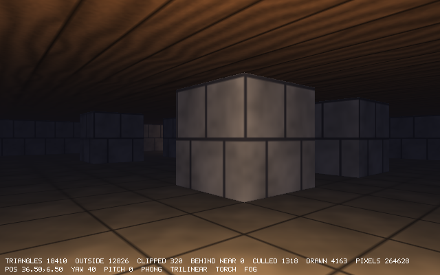

# Chapter 21 — Building the World

Since Chapter 17 the maze has been drawn the simplest way there is: one unit cube for every
wall cell next to the floor, and two squares, floor and ceiling, for every floor cell. That is
about 1300 small draw calls a frame, and most of the triangles in them can never be seen: the
tops and bottoms of the cubes, and every side that faces another wall. This chapter builds
the world once, when the map loads, the way game levels are built. It keeps only the surfaces
that border open floor, in world coordinates, with texture coordinates that run on across
cells. It cuts them into chunks of 4×4 cells, with one mesh per material in each chunk. The
picture does not change: compared with Chapter 20's at four poses, no pixel differs by more
than 2%. The world has nearly 40% fewer triangles, and the draw calls drop from 1298 to 175. The
chunks are also the unit that Chapter 23 will skip when they are out of sight.

Then the barrels, which the polygon renderer has not drawn at all so far, become real 3D
models, loaded from a Wavefront OBJ file with a small parser. A new option, `--map`, loads
maps from files and reports mistakes in them as `file:line:column`, the way a compiler does.
A second, much bigger map, a 63×63 labyrinth, gives the next chapters something worth
culling.

Previous: [Chapter 20 — Texture Mapping](20-texture-mapping.md). Next:
[Chapter 22 — The First-Person Client](22-the-first-person-client.md).

## What the cubes cost

Stand in the corridor where Chapter 20 measured its filters, and read the HUD:

```
TRIANGLES 4956  OUTSIDE 3281  CLIPPED 195  BEHIND NEAR 0  CULLED 613  DRAWN 1039  PIXELS 317784
```

The 4956 triangles are 218 wall cubes of 12 triangles each, 531 floor cells with a floor
square and a ceiling square (4 triangles), and 9 lamps of 24 triangles:
218 × 12 + 531 × 4 + 9 × 24 = 2616 + 2124 + 216 = 4956. Since Chapter 16, only wall cells
with a floor cell next to them are drawn at all; the cellar has 237 wall cells, and the other
19 are buried.

Every one of those triangles is transformed and then clipped. Most are outside the view, and
the rest go to the rasterizer. A cube has six faces, but in a maze its top touches the
ceiling, its bottom stands on the floor, and every side that faces another wall cell is
inside solid wall. Those faces are thrown away by back-face culling (the top and the bottom
are seen from the inside, from the corridor below the ceiling) or lose to the depth test,
but only after they have been transformed and clipped. Each cell is also its own
`drawMesh` call, and each looks up its own list of nearby lights. The cellar takes 218
calls for the walls, 2 × 531 for the floors and ceilings and 18 for the lamps (pole and
globe): 1298 calls per frame, each for 2 to 12 triangles.

Game engines do this work once, ahead of time. A level editor saves a description of the
level (rooms, walls, the materials on them), and a *level compiler* turns it into a few big
static meshes, stored in the form the renderer draws fastest. The renderer then never
thinks about cells or cubes again. `delve`'s maps are small enough to compile when they
load, in a few milliseconds, so there is no separate tool and no second file format: the
same `Map` that the ray caster and the player's collisions read is built into a `World`
in `App.init`.

### Level compilers

Doom's levels are drawn in an editor as 2D lines with heights. A *node builder* turns them
into a binary space partition (BSP) of the map, a tree that the renderer walks front to back.
It also splits walls where the tree cuts them and stores the result in the level file.
Quake's `qbsp` does the same in 3D. It starts from solid blocks (*brushes*), keeps only the
faces that border empty space, and throws away the rest. A tool that ran after it, `vis`,
worked out which parts of the level can see which others, and was by far the slowest step
of building a map. Chapter 23 takes the idea of deciding visibility per region, in a much
simpler form, and this chapter takes the first step: keep only what borders empty space.

### Counting first

How much is there to save? The first example of this chapter counts both ways for any map.
It reads a map file, treats outside the map as wall as `Map.at` does, and counts. For the
cubes, it counts the wall cells with a floor neighbor. For the world, it counts the floor
cells and, for each, how many of its four sides border a wall:

```zig
//! Counts what it costs to draw a map as cubes (chapter 20) and as a built
//! world (chapter 21). Cubes: 12 triangles for every wall cell next to a
//! floor cell, plus a floor and a ceiling square (4 triangles) per floor
//! cell. World: per floor cell a floor and a ceiling square, plus one
//! square for each side of it that borders a wall.
//!
//!   zig run examples/ch21/count_faces.zig -- project/ch21/src/maps/labyrinth.txt
const std = @import("std");

fn isWall(c: u8) bool {
    return c == '#' or c == '%';
}

pub fn main(init: std.process.Init) !void {
    const args = try init.minimal.args.toSlice(init.arena.allocator());
    const path = if (args.len > 1) args[1] else "project/ch21/src/maps/cellar.txt";
    const text = try std.Io.Dir.cwd().readFileAlloc(init.io, path, init.arena.allocator(), .limited(1 << 20));

    var rows: std.ArrayList([]const u8) = .empty;
    var lines = std.mem.tokenizeAny(u8, text, "\r\n");
    while (lines.next()) |line| try rows.append(init.arena.allocator(), line);
    const height = rows.items.len;
    const width = rows.items[0].len;

    // Outside the map counts as wall, as in delve's Map.at.
    const at = struct {
        fn wall(r: []const []const u8, x: isize, y: isize) bool {
            if (x < 0 or y < 0 or y >= r.len or x >= r[0].len) return true;
            return isWall(r[@intCast(y)][@intCast(x)]);
        }
    }.wall;
    const sides = [_][2]isize{ .{ 1, 0 }, .{ -1, 0 }, .{ 0, 1 }, .{ 0, -1 } };

    var floor_cells: usize = 0;
    var wall_cells: usize = 0;
    var wall_cubes: usize = 0; // wall cells next to a floor cell
    var wall_sides: usize = 0; // floor-cell sides that border a wall
    for (0..height) |yu| {
        for (0..width) |xu| {
            const x: isize = @intCast(xu);
            const y: isize = @intCast(yu);
            if (at(rows.items, x, y)) {
                wall_cells += 1;
                for (sides) |d| {
                    if (!at(rows.items, x + d[0], y + d[1])) {
                        wall_cubes += 1;
                        break;
                    }
                }
            } else {
                floor_cells += 1;
                for (sides) |d| {
                    if (at(rows.items, x + d[0], y + d[1])) wall_sides += 1;
                }
            }
        }
    }
    const cube_triangles = 12 * wall_cubes + 4 * floor_cells;
    const world_triangles = 2 * (2 * floor_cells + wall_sides);
    std.debug.print("{s}: {d}x{d}\n", .{ path, width, height });
    std.debug.print("floor cells       {d:>6}\n", .{floor_cells});
    std.debug.print("wall cells        {d:>6} ({d} next to floor)\n", .{ wall_cells, wall_cubes });
    std.debug.print("wall sides        {d:>6}\n", .{wall_sides});
    std.debug.print("cube triangles    {d:>6} (12 x {d} + 4 x {d})\n", .{ cube_triangles, wall_cubes, floor_cells });
    std.debug.print("world triangles   {d:>6} (2 x (2 x {d} + {d}))\n", .{ world_triangles, floor_cells, wall_sides });
    const saved = 100 * @as(f32, @floatFromInt(cube_triangles - world_triangles)) / @as(f32, @floatFromInt(cube_triangles));
    std.debug.print("saved             {d:>5.0}%\n", .{saved});
}
```

```console
$ zig run examples/ch21/count_faces.zig
project/ch21/src/maps/cellar.txt: 32x24
floor cells          531
wall cells           237 (218 next to floor)
wall sides           372
cube triangles      4740 (12 x 218 + 4 x 531)
world triangles     2868 (2 x (2 x 531 + 372))
saved                39%
$ zig run examples/ch21/count_faces.zig -- project/ch21/src/maps/labyrinth.txt
project/ch21/src/maps/labyrinth.txt: 63x63
floor cells         2178
wall cells          1791 (1760 next to floor)
wall sides          3472
cube triangles     29832 (12 x 1760 + 4 x 2178)
world triangles    15656 (2 x (2 x 2178 + 3472))
saved                48%
```

The labyrinth is new in this chapter; it is at the end. A floor cell's sides that border a
wall are the only wall faces anyone can see, and there are 372 of them in the cellar
against 218 × 4 = 872 cube sides. The floor and ceiling squares stay as they are. The
world has 39% fewer triangles than the cubes in the cellar, and 48% fewer in the labyrinth,
which has long thin corridors with walls on both sides.

## Only what can be seen

The new file `world.zig` builds the world. The rule is the one `count_faces.zig` counted
with: a surface exists exactly where open floor meets something. For every floor cell, that
is a floor square at height 0, a ceiling square at height 1, and, for each of the four
neighbors that is a wall, the side of that wall that faces this cell. Walls are never
visited at all. Everything the player can see from inside the maze is one of those squares,
and nothing else is built.

The squares are added by a small `Builder`, which appends four vertices and six indices to
two lists that the whole world shares:

```zig
/// Adds the quads of one part of a chunk to the world's lists.
const Builder = struct {
    gpa: std.mem.Allocator,
    vertices: *std.ArrayList(Vertex),
    indices: *std.ArrayList(u16),
    /// The part's first vertex: its indices count from there.
    first: usize,

    /// Adds a square whose corners `pos` go counter-clockwise seen from
    /// the side `normal` points to.
    fn addQuad(b: *Builder, pos: [4]Vec3, normal: Vec3, uv: [4]Vec2) !void {
        const start = b.vertices.items.len - b.first;
        if (start + 4 > std.math.maxInt(u16)) return error.ChunkTooBig;
        for (pos, uv) |p, t| try b.vertices.append(b.gpa, .{ .pos = p, .normal = normal, .uv = t });
        for ([6]usize{ 0, 1, 2, 0, 2, 3 }) |q| try b.indices.append(b.gpa, @intCast(start + q));
    }
```

`first` is where the current part's vertices start. The indices count from there, which
comes up again with the chunks.

`addCell` adds one cell's share of one kind of surface. There are four kinds, one mesh each
per chunk, because each needs its own material:

```zig
/// The kinds of surface, one mesh each per chunk.
pub const Surface = enum {
    brick,
    stone,
    floor,
    ceiling,

    fn ofWall(tile: Tile) Surface {
        return switch (tile) {
            .floor => unreachable,
            .brick => .brick,
            .stone => .stone,
        };
    }

    fn material(surface: Surface, paint: maze3d.Paint) light.Material {
        return switch (surface) {
            .brick => paint.material(raycast.wallColor(.brick), .brick),
            .stone => paint.material(raycast.wallColor(.stone), .stone),
            .floor => paint.material(raycast.floor_color, .floor),
            .ceiling => paint.material(raycast.ceiling_color, .ceiling),
        };
    }
};
```

```zig
    /// Adds what cell (x, y) has of `surface`. Floor and ceiling take
    /// their texture coordinates from the world's x and z, as the ray
    /// caster does, so the texture runs on across cells. A wall side shows
    /// the whole texture once, upright.
    fn addCell(b: *Builder, map: Map, x: i32, y: i32, surface: Surface) !void {
        if (map.at(x, y).isWall()) return;
        const fx: f32 = @floatFromInt(x);
        const fz: f32 = @floatFromInt(y);
        switch (surface) {
            .floor, .ceiling => {
                // Counter-clockwise seen from above: toward +z, then +x.
                var corners = [4]Vec2{ .{ fx, fz }, .{ fx, fz + 1 }, .{ fx + 1, fz + 1 }, .{ fx + 1, fz } };
                // Seen from below, the same corners go the other way.
                if (surface == .ceiling) std.mem.reverse(Vec2, &corners);
                const height: f32 = if (surface == .floor) 0 else 1;
                var pos: [4]Vec3 = undefined;
                for (corners, &pos) |c, *p| p.* = .{ c[0], height, c[1] };
                try b.addQuad(pos, .{ 0, if (surface == .floor) 1 else -1, 0 }, corners);
            },
            .brick, .stone => for ([_][2]i32{ .{ 1, 0 }, .{ -1, 0 }, .{ 0, 1 }, .{ 0, -1 } }) |d| {
                const tile = map.at(x + d[0], y + d[1]);
                if (!tile.isWall() or Surface.ofWall(tile) != surface) continue;
                // The wall's side facing this cell: it faces back along d.
                const dx: f32 = @floatFromInt(d[0]);
                const dz: f32 = @floatFromInt(d[1]);
                const normal: Vec3 = .{ -dx, 0, -dz };
                const center: Vec3 = .{ fx + 0.5 + dx / 2, 0.5, fz + 0.5 + dz / 2 };
                // Right as seen from the front, and up: right x up = normal.
                const right: Vec3 = .{ normal[2] / 2, 0, -normal[0] / 2 };
                const up: Vec3 = .{ 0, 0.5, 0 };
                try b.addQuad(
                    .{ center - right - up, center + right - up, center + right + up, center - right + up },
                    normal,
                    .{ .{ 0, 1 }, .{ 1, 1 }, .{ 1, 0 }, .{ 0, 0 } },
                );
            },
        }
    }
```

The two halves of the `switch` each have a winding to get right, since back-face culling
throws away any triangle wound the wrong way.

The floor's corners go (x, z), (x, z + 1), (x + 1, z + 1), (x + 1, z). The first two edges
from the first corner are (0, 0, 1) and (1, 0, 1), and their cross product is

```
(0, 0, 1) × (1, 0, 1) = (0·1 − 1·0, 1·1 − 0·1, 0·0 − 0·1) = (0, 1, 0)
```

which points up, toward the eye: counter-clockwise seen from above, as Chapter 16's rule
wants. The ceiling is seen from below, so it takes the same four corners in the opposite
order. `std.mem.reverse` turns the array around in place, and the normal becomes (0, −1, 0).

A wall side is built from its center and two half-size vectors. The neighbor in direction d
is a wall, and the side facing this cell points back at it, so its normal n is −d. *Right*
is the direction to the right as seen standing in front of the face, looking at it along
−n. With y up, that is (n.z, 0, −n.x), and *up* is (0, 1, 0). The corners go
center − right − up (bottom left), then bottom right, top right, top left. That is
counter-clockwise seen from the front exactly when right × up = n. For the wall east of a
cell, d = (1, 0), n = (−1, 0, 0) and right = (0, 0, 1) (halved in the code):

```
right × up = (0, 0, 1) × (0, 1, 0) = (0·0 − 1·1, 1·0 − 0·0, 0·1 − 0·0) = (−1, 0, 0) = n
```

Because n.z and −n.x just swap and negate the components, the same holds for the other three
directions; a test below checks every triangle anyway.

All corners are whole numbers, 0 or 1 apart, and computing them involves only additions and
halves of whole numbers, which floating point does exactly. Two squares that meet at an edge
therefore have bit-identical corners there, so there are no cracks, without any welding of
vertices. Chapter 18's fill rule then gives every pixel along a shared edge to exactly one of
the two triangles.

The first test builds a world from a map with two floor cells:

```zig
test "the world has only the surfaces that can be seen" {
    const gpa = std.testing.allocator;
    var map = try Map.parse(gpa,
        \\#####
        \\#>.%#
        \\#####
    );
    defer map.deinit(gpa);
    var world: World = try .build(gpa, map);
    defer world.deinit(gpa);
    // Two floor cells: two squares of floor and two of ceiling, and the
    // walls around them: 5 brick sides and 1 stone side. 10 squares.
    try std.testing.expectEqual(10 * 2, world.triangleCount());
    try std.testing.expectEqual(2, world.columns);
    try std.testing.expectEqual(1, world.rows);
    try std.testing.expectEqual(1 * 2, world.chunks[0].parts.get(.stone).triangleCount());
    try std.testing.expectEqual(0, world.chunks[1].parts.get(.brick).triangleCount());
}
```

The two floor cells have two floor squares and two ceiling squares. Around them are five
brick sides (two to the north, two to the south, one to the west) and one stone side, to the
east. That is ten squares, or twenty triangles. The map is 5 cells wide, so it has two
chunk columns, and the second holds only the wall column x = 4, which has nothing in it.

## Texture coordinates in world space

The floor square's texture coordinates are its corners' x and z, the same numbers as its
position. Chapter 20's cube face gave every square (0, 0) to (1, 1). Now the cell at x = 37
has u from 37 to 38. Since a texture repeats once per unit, the picture is the same: each
cell shows the whole texture once. This is also the ray caster's rule from Chapter 14, where
the floor texel under a pixel came straight from the world position's fraction. A floor that
spans many cells, as in Exercise 1, would need it: one big square from x = 3 to x = 7 with u
from 3 to 7 shows the texture four times, just as four small squares would.

Large and negative coordinates cost nothing. `Texture.sample` rounds u × 64 down with
`@floor`, and `texel` masks the integer with `& 63` (`bilinear` does the same with the
mask of the level it reads). On two's complement integers that mask is a wrap, so u = 63.7 gives
⌊4076.8⌋ = 4076 and texel 44, and u = −0.3 gives ⌊−19.2⌋ = −20 and texel 44 too. The
level-of-detail calculation does not care either: it uses only the derivatives of u and v
across the screen, which do not change when the same number is added to u everywhere.

The wall sides keep the cube's coordinates, (0, 1) at the bottom left to (1, 0) at the top
right, so each side shows its texture once, upright, and not mirrored as seen from the
front. The ray caster also starts a wall's texture at a cell corner, so the two renderers
still agree, which the next sections check.

## Chunks

`World.build` cuts the map into chunks of 4×4 cells:

```zig
/// A chunk is chunk_size x chunk_size cells.
pub const chunk_size = 4;
```

```zig
pub const Chunk = struct {
    /// The box everything in the chunk is inside: lowest and highest corner.
    box: [2]Vec3,
    parts: std.EnumArray(Surface, Mesh),
};
```

A chunk has a box, the lowest and highest corner of everything in it. It is used for
choosing lights now and for culling in Chapter 23. It also has one `Mesh` per surface kind,
in an `std.EnumArray`: an array with one element per enum value, indexed by the enum
itself. The `World` holds the chunks row by row, and one big list each of vertices and
indices that the chunks' meshes are slices of:

```zig
pub const World = struct {
    /// Row by row, `columns` chunks to a row.
    chunks: []Chunk,
    columns: usize,
    rows: usize,
    /// The vertices and indices of every chunk's meshes, one after another.
    vertices: []Vertex,
    indices: []u16,
    lamps: []Vec2,
    barrels: []Barrel,
    barrel_model: obj.Model,
```

`build` walks the chunks row by row. For each chunk and each surface, it adds that surface
for each of the chunk's 16 cells, and writes down where the part's vertices and indices
start and end:

```zig
    pub fn build(gpa: std.mem.Allocator, map: Map) !World {
        const columns = (map.width + chunk_size - 1) / chunk_size;
        const rows = (map.height + chunk_size - 1) / chunk_size;
        var vertices: std.ArrayList(Vertex) = .empty;
        defer vertices.deinit(gpa);
        var indices: std.ArrayList(u16) = .empty;
        defer indices.deinit(gpa);
        // Where each part's vertices and indices start and end, until all
        // are built and the lists stop moving in memory.
        const Range = struct { vertices: [2]usize, indices: [2]usize };
        const ranges = try gpa.alloc(std.EnumArray(Surface, Range), columns * rows);
        defer gpa.free(ranges);

        for (ranges, 0..) |*chunk_ranges, i| {
            const cx = (i % columns) * chunk_size;
            const cy = (i / columns) * chunk_size;
            for (std.enums.values(Surface)) |surface| {
                var builder: Builder = .{ .gpa = gpa, .vertices = &vertices, .indices = &indices, .first = vertices.items.len };
                const first_index = indices.items.len;
                for (cy..@min(cy + chunk_size, map.height)) |y| {
                    for (cx..@min(cx + chunk_size, map.width)) |x| {
                        try builder.addCell(map, @intCast(x), @intCast(y), surface);
                    }
                }
                chunk_ranges.set(surface, .{
                    .vertices = .{ builder.first, vertices.items.len },
                    .indices = .{ first_index, indices.items.len },
                });
            }
        }

        const all_vertices = try vertices.toOwnedSlice(gpa);
        errdefer gpa.free(all_vertices);
        const all_indices = try indices.toOwnedSlice(gpa);
        errdefer gpa.free(all_indices);
        const chunks = try gpa.alloc(Chunk, columns * rows);
        errdefer gpa.free(chunks);
        for (chunks, ranges, 0..) |*chunk, chunk_ranges, i| {
            const x: f32 = @floatFromInt((i % columns) * chunk_size);
            const y: f32 = @floatFromInt((i / columns) * chunk_size);
            const w: f32 = @floatFromInt(map.width);
            const h: f32 = @floatFromInt(map.height);
            chunk.box = .{ .{ x, 0, y }, .{ @min(x + chunk_size, w), 1, @min(y + chunk_size, h) } };
            for (std.enums.values(Surface)) |surface| {
                const range = chunk_ranges.get(surface);
                chunk.parts.set(surface, .{
                    .vertices = all_vertices[range.vertices[0]..range.vertices[1]],
                    .indices = all_indices[range.indices[0]..range.indices[1]],
                });
            }
        }
```

The ranges are kept as numbers, and the slices are taken only once everything is built.
That is not a style choice.

### Slices into a list that grows

An `std.ArrayList` keeps its items in one block of memory with room to spare. When an
`append` finds the block full, it allocates a bigger one, copies the items over and frees
the old block. Any slice taken from `items` before that still points into the old block.
Zig does not stop you from keeping such a slice, but in a Debug build the allocator fills
memory it has freed with the byte 0x55, which makes the mistake easy to see:

```zig
const std = @import("std");

pub fn main(init: std.process.Init) !void {
    const gpa = init.gpa;
    var vertices: std.ArrayList(u32) = .empty;
    defer vertices.deinit(gpa);
    try vertices.appendSlice(gpa, &.{ 10, 11, 12, 13 });
    const first_part = vertices.items[0..4]; // too early
    for (0..1000) |i| try vertices.append(gpa, @intCast(i)); // the list grows and moves
    std.debug.print("first part: {any}\n", .{first_part});
}
```

```console
$ zig run dangling_mistake.zig
first part: { 1431655765, 1431655765, 1431655765, 1431655765 }
```

1431655765 is 0x55555555, four bytes of 0x55: `first_part` points at freed memory. In a
release build the old block may be handed out again, and the slice then shows whatever
was put there next. `World.build` would have this bug if it sliced each part as soon as it
was built, because building the next part grows the lists. Instead it keeps the ranges as
numbers in `ranges`, and turns them into slices only after `toOwnedSlice` has handed it the
final arrays, which never move again. The same trap exists with pointers to items, and in
every language with growable arrays: C++'s `std::vector` invalidates its iterators the same
way.

### Small indices

Each part's indices count from the part's own first vertex, not from the start of the
world's list. `addQuad` subtracts `b.first`:

```zig
        const start = b.vertices.items.len - b.first;
```

The renderer transforms a mesh's vertices into its scratch arrays, which have room for
`max_vertices` = 1024 vertices, and the indices pick from those. With indices local to the
part, a part's mesh is a self-contained `Mesh`, its vertices one slice and its indices
another, numbered from 0. The largest part in the two maps has 80 vertices; a chunk's floor
has at most 16 × 4 = 64. A 4×4 chunk cannot have more than 16 × 4 = 64 wall sides of one
kind, 256 vertices, so u16 indices and the scratch arrays are both far from full. `ChunkTooBig`
guards the u16 limit in case someone makes the chunks much bigger. (The 80 vertices are
a wall part: 20 wall sides in one chunk of the labyrinth's corridors.)

### Seeing the chunks

A debug view shows them. `--view chunks` (or Tab until it appears) paints each chunk in one
flat color, unlit, with no texture. The color comes from the chunk's column and row:

```zig
/// A color per chunk, different from all eight neighbors' colors:
/// x + 3y mod 8 changes by 1, 2, 3, 4, or 7 from one chunk to the next.
fn chunkColor(x: usize, y: usize) Color {
    const colors = [8]Color{
        .hex(0xe05050), .hex(0xe0a040), .hex(0xd0d050), .hex(0x60c060),
        .hex(0x50c0c0), .hex(0x5070e0), .hex(0xa060e0), .hex(0xe070b0),
    };
    return colors[(x + 3 * y) % colors.len];
}
```

Eight colors are enough for no chunk to share its color with any of its eight neighbors.
Moving one chunk right changes x + 3y by 1, one down by 3, and diagonally by 3 ± 1, so by 2
or 4. Mod 8, the differences ±1, ±2, ±3 and ±4 are never 0. (The comment in the code lists
them as 1, 2, 3, 4 and 7, which is the same set seen from both sides: −1 is 7 mod 8.)

`App` passes the view on to the paint as `chunk_colors`, and draws it unlit, since lighting
and fog would make one chunk's color into many:

```zig
                    .chunk_colors = app.view == .chunks,
```

```zig
                // Chunk colors read best flat, without light or fog.
                const shading: light.Shading = if (app.view == .chunks) .unlit else app.shading;
```


This is the labyrinth's northern room, which the end of the chapter visits. Unlit and
without fog, a chunk's floor and its ceiling have the same color and meet at the horizon
without a line, so each chunk looks like a band across the middle of the picture. A chunk
border on the floor is a straight line from the bottom of the picture toward the horizon.
The pillar in the middle is one stone cell. Its left side faces a floor cell in the
player's chunk and is teal, darker because the flat shader darkens faces that run along the
map's x. Its right side faces a cell in the pink chunk, and merges with that chunk's floor
and ceiling into one pink area. A wall side belongs to the chunk of the floor cell it faces,
not to the wall cell it is the side of.

### The second test

The second test of `world.zig` builds the cellar and checks every triangle in it:

```zig
test "every surface faces into a floor cell and winds counter-clockwise" {
    const gpa = std.testing.allocator;
    var map = try Map.parse(gpa, map_zig.builtin.get("cellar").?);
    defer map.deinit(gpa);
    var world: World = try .build(gpa, map);
    defer world.deinit(gpa);
    for (world.chunks) |chunk| for (chunk.parts.values) |part| {
        var i: usize = 0;
        while (i < part.indices.len) : (i += 3) {
            const a = part.vertices[part.indices[i]];
            const b = part.vertices[part.indices[i + 1]];
            const c = part.vertices[part.indices[i + 2]];
            const n = math.cross(b.pos - a.pos, c.pos - a.pos);
            try std.testing.expect(math.approxEq(math.normalize(n), a.normal));
            // Just in front of the triangle's center is open floor...
            const front = math.scale(a.pos + b.pos + c.pos, 1.0 / 3.0) + math.scale(a.normal, 0.01);
            try std.testing.expect(!map.isWallAt(.{ front[0], front[2] }));
            // ...and the triangle is inside its chunk's box.
            for ([_]Vec3{ a.pos, b.pos, c.pos }) |p| {
                try std.testing.expect(@reduce(.And, p >= chunk.box[0]) and @reduce(.And, p <= chunk.box[1]));
            }
        }
    };
}
```

For every triangle, the normal from its winding must be its vertices' normal (so
back-face culling and lighting agree). A point 0.01 in front of its center must not be in a
wall (so it faces into the open). All three corners must be inside the chunk's box (so
lights and, in Chapter 23, culling may trust the box). The `for` over `chunk.parts.values`
reads the `EnumArray`'s underlying array directly, all four surface kinds in order. A
mistake in any one of the four wall directions, such as a sign error in `right`, fails
the first check for a quarter of the walls.

## Same picture, fewer triangles

`World.draw` replaces Chapter 20's `maze3d.drawSolid`:

```zig
    /// Draws everything: each chunk's surfaces, painted as `paint` says,
    /// shaded as `shading` says, and lit by `scene`, then the things.
    pub fn draw(
        world: World,
        r: render3d.Renderer,
        canvas: Canvas,
        view_proj: Mat4,
        paint: maze3d.Paint,
        shading: light.Shading,
        scene: light.Scene,
        render_options: render3d.Options,
        stats: *render3d.Stats,
    ) void {
        var options = render_options;
        options.flat_shading = shading == .flat;
        for (world.chunks, 0..) |chunk, i| {
            for (std.enums.values(Surface)) |surface| {
                const part = chunk.parts.get(surface);
                if (part.indices.len == 0) continue;
                const material: light.Material = if (paint.chunk_colors)
                    .{ .color = chunkColor(i % world.columns, i / world.columns) }
                else
                    surface.material(paint);
                maze3d.drawPart(r, canvas, part, .identity, view_proj, material, shading, scene, chunk.box, options, stats);
            }
        }
        for (world.lamps) |pos| maze3d.drawLamp(r, canvas, pos, view_proj, shading, scene, options, stats);
        const barrel = paint.material(barrel_color, .staves);
        for (world.barrels) |b| {
            const base: Vec3 = .{ b.pos[0], 0, b.pos[1] };
            const model = Mat4.translation(base).mul(.rotationY(b.angle));
            const box = [2]Vec3{ base - Vec3{ 0.25, 0, 0.25 }, base + Vec3{ 0.25, 0.5, 0.25 } };
            maze3d.drawPart(r, canvas, world.barrel_model.mesh(), model, view_proj, barrel, shading, scene, box, options, stats);
        }
    }
```

It draws each non-empty part of each chunk with the identity model matrix, since the
vertices are already in world coordinates. Then come the lamps and the barrels, which are
the topic after the next. `drawPart` in `maze3d.zig` is Chapter 19's, unchanged except
that it is now `pub` and its light buffer has grown:

```zig
/// The most lights that may reach one part.
const max_part_lights = 16;
```

It was 8 per cell. `scene.reaching` keeps the lights whose radius reaches the box, and a
chunk's box is 4×4 cells, so more lamps can reach it than reach one cell. In the two maps of
this chapter no chunk is reached by more than 4 lamps (in the cellar; 2 in the labyrinth,
whose lamps are farther apart), but a map with lamps close together could pass 8. Past the
limit, the extra lights would be dropped, and the light would change at the chunk border.

What is left of `maze3d.zig` is the painting: `FlatShader`, `Paint` (with the new
`chunk_colors`), the lamp light, `drawPart`, and the lamp itself, moved unchanged into
`drawLamp`. `drawSolid`, `drawWireframe` and `touchesFloor` are gone, with their two tests.
The cracks test moved to `world.zig`, which the next section describes.

### Is it the same picture?

It should be. The same surfaces are drawn with the same materials and the same lights; only
the hidden ones are gone. To check, render both versions at the same poses and compare them
with ImageMagick's `compare`, which counts the pixels that differ (`-metric AE`, absolute
error). `-fuzz 2%` lets a pixel differ by up to 2% of full brightness before it counts.
`-extract` leaves out the HUD at the bottom, whose numbers differ by design. With the
Chapter 20 snapshot built into `../ch20` and this one into `.`:

```console
$ for pose in "12.5,18.5 0" "9.5,10.5 -60" "10.5,4.5 -34" "20.3,13.7 143"; do
    set -- $pose
    ../ch20/zig-out/bin/delve --headless --pos $1 --yaw $2 --out ch20.png
    ./zig-out/bin/delve --headless --pos $1 --yaw $2 --out ch21.png
    compare -metric AE -fuzz 2% -extract 640x370+0+0 ch20.png ch21.png null: 2>&1; echo
    compare -metric AE -extract 640x370+0+0 ch20.png ch21.png null: 2>&1; echo
  done
0
1213
0
19628
0
35328
0
43112
```

`compare` prints the count on standard error, hence the `2>&1`. With the fuzz, not one pixel
differs at any of the four poses. Without it, between 1213 and 43112 of the 236,800 pixels
do, each by less than 2%, five steps out of 255. Two things change the arithmetic without
changing the picture. A floor square of Chapter 20 was the cube's top face, moved down, and
its diagonal ran the other way, so the pixels near the diagonal are interpolated from
different corners. The results agree in exact arithmetic, but not to the last bit in
floating point. Where a triangle is the same but its corners come in a different order, the
rasterizer's sums are also done in a different order, with the same effect. None of the four
poses has a barrel in view; Chapter 20 drew none.

The HUD in the corridor, Chapter 20 and then this chapter:

```
TRIANGLES 4956  OUTSIDE 3281  CLIPPED 195  BEHIND NEAR 0  CULLED 613  DRAWN 1039  PIXELS 317784
TRIANGLES 3826  OUTSIDE 2647  CLIPPED 132  BEHIND NEAR 0  CULLED 182  DRAWN 965  PIXELS 304352
```

The 3826 are the world's 2868, the 9 lamps' 216, and 7 barrels of 106 triangles each (742),
which are new. CULLED fell from 613 to 182: back-face culling has much less to throw away,
because the world has hardly any back faces left, only those of the far sides of pillars and
corners. DRAWN fell by 74 even though the barrels add some. Those were cube faces that face
the camera but lie behind other walls: the tops of cubes seen from below, the sides of wall
cells hidden inside a wall. PIXELS fell by 4% for the same reason: some of those faces were
drawn before the wall in front of them, and passed the depth test while nothing nearer was
there yet.

The draw calls: 48 chunks have 150 non-empty parts between them, plus 18 lamp calls and 7
barrels, 175 calls instead of 1298.

### And the time?

Chapter 20's benchmark protocol (120 headless frames, one core, best of three, ReleaseFast),
with both snapshots built with `zig build --release=fast`, Chapter 20 first:

```console
$ bench --pos 12.5,18.5 --yaw 0
20.42 ms/frame  --pos 12.5,18.5 --yaw 0
$ bench --pos 9.5,10.5 --yaw -60 --shading gouraud
16.17 ms/frame  --pos 9.5,10.5 --yaw -60 --shading gouraud
$ bench --pos 9.5,10.5 --yaw -60 --shading unlit --press toggle_textures
4.33 ms/frame  --pos 9.5,10.5 --yaw -60 --shading unlit --press toggle_textures
```

and this chapter:

```console
$ bench --pos 12.5,18.5 --yaw 0
20.08 ms/frame  --pos 12.5,18.5 --yaw 0
$ bench --pos 9.5,10.5 --yaw -60 --shading gouraud
14.67 ms/frame  --pos 9.5,10.5 --yaw -60 --shading gouraud
$ bench --pos 9.5,10.5 --yaw -60 --shading unlit --press toggle_textures
3.92 ms/frame  --pos 9.5,10.5 --yaw -60 --shading unlit --press toggle_textures
```

The corridor, with Phong shading and trilinear filtering, got 2% faster. Chapter 13's
screenshot view, from (9.5, 10.5) at −60°, with Gouraud shading, got 9% faster, and the same
view with neither lighting nor textures 9.5% faster. Almost a quarter fewer triangles and
1100 fewer draw calls barely show. That is the lesson of this section: the triangles were
never the expensive part. The pixels are. The corridor shades about 300,000 of them per
frame, and every one runs the Phong loop over the lights and reads eight texels. Building
the world removed work from the front of the pipeline, which was a small part of the frame.
Where the pixel work is small, unlit and untextured, the saving is a larger share. Chapter
23 will skip whole chunks before they are transformed, and Chapter 24 will spread the pixels
over several cores.

### No cracks, on two maps

Chapter 17's cracks test, which fills the screen with magenta, draws the maze and fails if
any magenta is left, moves from `maze3d.zig` to `world.zig`, and now also runs in the
labyrinth:

```zig
test "the world has no cracks" {
    // Everywhere the eye looks inside the maze there is a wall, the floor,
    // or the ceiling. Any pixel left in the clear color is a crack.
    const gpa = std.testing.allocator;
    var canvas = try Canvas.init(gpa, 160, 100);
    defer canvas.deinit(gpa);
    var r = try render3d.Renderer.init(gpa, 1024, 160, 100);
    defer r.deinit(gpa);
    const camera = @import("camera.zig");
    const crack: Color = .hex(0xff00ff);
    var textures = try texture.Set.generate(gpa);
    defer textures.deinit(gpa);
    const poses = [_]struct { map: []const u8, x: f32, y: f32, yaw: f32 }{
        .{ .map = "cellar", .x = 9.5, .y = 10.5, .yaw = -1 },
        .{ .map = "cellar", .x = 1.5, .y = 1.5, .yaw = 0.6 },
        .{ .map = "cellar", .x = 20.3, .y = 13.7, .yaw = 2.5 },
        .{ .map = "cellar", .x = 12.5, .y = 18.5, .yaw = 3.1 },
        .{ .map = "labyrinth", .x = 1.5, .y = 1.5, .yaw = 0.3 },
        .{ .map = "labyrinth", .x = 40.5, .y = 9.5, .yaw = 2.2 },
    };
    for (poses) |pose| {
        var map = try Map.parse(gpa, map_zig.builtin.get(pose.map).?);
        defer map.deinit(gpa);
        var world: World = try .build(gpa, map);
        defer world.deinit(gpa);
        var lights: [32]light.Light = undefined;
        for (world.lamps, lights[0..world.lamps.len]) |pos, *l| l.* = maze3d.lampLight(pos);
        const cam: camera.Camera = .{ .pos = .{ pose.x, camera.eye_height, pose.y }, .yaw = pose.yaw, .pitch = 0.3 * pose.yaw };
        const scene: light.Scene = .{ .ambient = @splat(0.1), .lights = lights[0..world.lamps.len], .eye = cam.pos };
        for (std.enums.values(light.Shading)) |shading| for ([_]maze3d.Paint{ .{}, .{ .textures = &textures } }) |paint| {
            canvas.clear(crack);
            r.clearDepth();
            var stats: render3d.Stats = .{};
            world.draw(r, canvas, cam.viewProjection(160, 100), paint, shading, scene, .{}, &stats);
            for (canvas.pixels) |p| try std.testing.expect(!std.meta.eql(p, crack));
            try std.testing.expect(stats.pixels >= 160 * 100);
        };
    }
}
```

Six poses, four kinds of shading and two paints (flat colors and textures): 48 renders. The
renderer gets room for 1024 vertices instead of 24, since a part has up to 80 now. The
lights are made from `world.lamps`, which `World.build` collects from the map's sprites
(the end of `build`, not shown above, does that and loads the barrel model). It works for
any map with up to 32 lamps.

## Reading a model: Wavefront OBJ

The cellar has seven barrels. The ray caster draws them as sprites, flat pictures that always
face the camera. The polygon renderer has not drawn them at all yet, and a flat picture would
look wrong in a world where the player can look up and down and walk around things. They
should be models: real 3D meshes, made in a modelling program, or here, by a short program,
and stored in a file.

Chapter 16 showed the simplest part of the most common text format for models, Wavefront
OBJ: a line `v x y z` for each vertex and `f a b c` for each triangle, numbered from 1,
and its Exercise 1 read those into a `Mesh`. Real OBJ files have more. One item per line,
with a keyword first:

| Line | Meaning |
|---|---|
| `v x y z` | a position |
| `vt u v` | a texture coordinate; v runs *up* from the bottom of the image |
| `vn x y z` | a normal, not necessarily of length 1 |
| `f a/b/c d/e/f g/h/i …` | a face with three or more corners |
| `# …` | a comment, to the end of the line |
| `o`, `g`, `s`, `usemtl`, `mtllib`, … | names, groups, smoothing, materials: skipped here |

Positions, texture coordinates and normals are three separate numbered lists. Each face
corner names one from each, as `p/t/n`; `p//n` leaves the texture coordinate out, and `p`
or `p/t` leave out the normal. Numbers count from 1 in the order the items appear in the
file, and a negative number counts back from the last one read so far: `-1` is the latest.

The three lists are separate because the same position appears with different texture
coordinates or normals in different faces. A cube has 8 corner positions, but each corner
belongs to three faces with three different normals. The renderer needs one vertex per
distinct combination, so the parser must build those combinations.

### The parser

`obj.zig` is new. The model it returns owns its memory:

```zig
/// A mesh read from a file, which owns its memory.
pub const Model = struct {
    vertices: []Vertex,
    indices: []u16,

    pub fn mesh(m: Model) Mesh {
        return .{ .vertices = m.vertices, .indices = m.indices };
    }

    pub fn deinit(m: *Model, gpa: std.mem.Allocator) void {
        gpa.free(m.indices);
        gpa.free(m.vertices);
        m.* = undefined;
    }
};

pub const Error = error{
    BadNumber,
    BadIndex,
    /// A face corner without a normal: delve does not make up normals.
    MissingNormal,
    /// A face with fewer than three corners.
    ShortFace,
    /// More vertices than 16-bit indices can number.
    TooManyVertices,
} || std.mem.Allocator.Error;
```

```zig
/// Reads a model from the text of an OBJ file. On an error, `line` is the
/// number of the line it was found on.
pub fn parse(gpa: std.mem.Allocator, text: []const u8, line: *usize) Error!Model {
    var positions: std.ArrayList(Vec3) = .empty;
    defer positions.deinit(gpa);
    var uvs: std.ArrayList(Vec2) = .empty;
    defer uvs.deinit(gpa);
    var normals: std.ArrayList(Vec3) = .empty;
    defer normals.deinit(gpa);
    var vertices: std.ArrayList(Vertex) = .empty;
    errdefer vertices.deinit(gpa);
    var indices: std.ArrayList(u16) = .empty;
    errdefer indices.deinit(gpa);
    // A corner used by several faces becomes one vertex: the vertex made
    // for each (position, texture coordinate, normal) triple so far.
    var known: std.AutoHashMapUnmanaged([3]usize, u16) = .empty;
    defer known.deinit(gpa);

    var lines = std.mem.splitScalar(u8, text, '\n');
    line.* = 0;
    while (lines.next()) |full| {
        line.* += 1;
        const content = full[0 .. std.mem.indexOfScalar(u8, full, '#') orelse full.len];
        var words = std.mem.tokenizeAny(u8, content, " \t\r");
        const keyword = words.next() orelse continue;
        if (std.mem.eql(u8, keyword, "v")) {
            try positions.append(gpa, try numbers(3, &words));
        } else if (std.mem.eql(u8, keyword, "vt")) {
            const uv = try numbers(2, &words);
            // OBJ's v goes up from the bottom of the image; ours goes down
            // from the top.
            try uvs.append(gpa, .{ uv[0], 1 - uv[1] });
        } else if (std.mem.eql(u8, keyword, "vn")) {
            try normals.append(gpa, math.normalize(try numbers(3, &words)));
        } else if (std.mem.eql(u8, keyword, "f")) {
            var corners: [3]u16 = undefined;
            var n: usize = 0;
            while (words.next()) |word| : (n += 1) {
                const key = try corner(word, positions.items.len, uvs.items.len, normals.items.len);
                const entry = try known.getOrPut(gpa, key);
                if (!entry.found_existing) {
                    if (vertices.items.len > std.math.maxInt(u16)) return error.TooManyVertices;
                    entry.value_ptr.* = @intCast(vertices.items.len);
                    try vertices.append(gpa, .{
                        .pos = positions.items[key[0]],
                        .uv = if (key[1] == none) .{ 0, 0 } else uvs.items[key[1]],
                        .normal = normals.items[key[2]],
                    });
                }
                // A fan: the first corner, the previous one, and this one.
                if (n == 0) corners[0] = entry.value_ptr.*;
                corners[1] = corners[2];
                corners[2] = entry.value_ptr.*;
                if (n >= 2) try indices.appendSlice(gpa, &corners);
            }
            if (n < 3) return error.ShortFace;
        }
    }
    const final_vertices = try vertices.toOwnedSlice(gpa);
    errdefer gpa.free(final_vertices);
    return .{ .vertices = final_vertices, .indices = try indices.toOwnedSlice(gpa) };
}
```

The steps, line by line:

- `splitScalar` on `'\n'`, not `tokenize`: empty lines must still be counted for `line` to
  say where an error is. Everything from a `#` on is cut off, and the words are split on
  spaces, tabs and `\r`, so files from Windows work.
- `v`, `vt` and `vn` go into the three lists. `numbers` reads `n` floats into a vector, and a
  missing or unreadable one is `BadNumber`.
- OBJ's v runs up from the bottom of the image, and `delve`'s runs down from the top, as
  Chapter 20 chose. `1 - v` turns it over. Without it, every texture on a model would be
  upside down.
- Normals are made length 1 when they are read. The file may have any length, and the
  lighting code expects unit normals.
- Each face corner becomes a key of three indices. `known` is a hash map from such keys to
  the vertex already made for them. `getOrPut` either finds the vertex or makes a slot for a
  new one in the same lookup. A corner shared by several faces becomes one vertex, as in
  Chapter 16's index buffers.
- A face with n corners becomes a *fan* of n − 2 triangles: (0, 1, 2), (0, 2, 3), …, each
  made of the first corner, the previous one and this one. `corners` holds those three as the
  corners stream past. A fan is right for any convex face, which is what modelling programs
  write.

Here are the three helpers:

```zig
/// Stands for "no texture coordinate" in a corner.
const none = std.math.maxInt(usize);

/// The next `n` words as numbers.
fn numbers(comptime n: usize, words: *std.mem.TokenIterator(u8, .any)) Error!@Vector(n, f32) {
    var result: [n]f32 = undefined;
    for (&result) |*x| {
        const word = words.next() orelse return error.BadNumber;
        x.* = std.fmt.parseFloat(f32, word) catch return error.BadNumber;
    }
    return result;
}

/// A face corner "p/t/n", "p//n", or "p/t" as indices from 0 into the
/// positions, texture coordinates, and normals read so far.
fn corner(word: []const u8, positions: usize, uvs: usize, normals: usize) Error![3]usize {
    var parts = std.mem.splitScalar(u8, word, '/');
    const p = try index(parts.next().?, positions);
    const t_text = parts.next() orelse "";
    const t = if (t_text.len == 0) none else try index(t_text, uvs);
    const n_text = parts.next() orelse return error.MissingNormal;
    if (parts.next() != null) return error.BadIndex;
    return .{ p, t, try index(n_text, normals) };
}

/// An OBJ number (from 1, or from -1 back from the end) as an index from 0
/// into a list of `count` items.
fn index(text: []const u8, count: usize) Error!usize {
    const i = std.fmt.parseInt(isize, text, 10) catch return error.BadIndex;
    const from_zero = if (i < 0) @as(isize, @intCast(count)) + i else i - 1;
    if (from_zero < 0 or from_zero >= count) return error.BadIndex;
    return @intCast(from_zero);
}
```

`corner` splits a corner on `/`. A missing texture coordinate becomes `none`, the largest
`usize`, which no real index can be. A missing normal is an error: `MissingNormal`. The
parser could make up normals from the faces, which is Exercise 2, but it is a choice the
model's author should make: smooth or hard edges look very different. `index` turns a
number from 1 or from −1 into an index from 0, and checks it against the items read *so
far*. In OBJ a face may only refer to items above it in the file.

The errors are `BadNumber`, `BadIndex`, `MissingNormal`, `ShortFace` (fewer than three
corners) and `TooManyVertices` (more than u16 indices can number, 65,536). With
`line`, a caller can say where in the file the error is.

### A cube, there and back

The third example writes `delve`'s unit cube from `mesh.zig` as an OBJ file. It finds
the distinct positions, texture coordinates and normals of the 24 vertices with a linear
search, which is plenty for 24, and writes each face as a quad:

```zig
//! Writes delve's unit cube (mesh.cube, chapter 20's version with texture
//! coordinates) as a Wavefront OBJ file, cube.obj. The 24 vertices share
//! 8 positions, 4 texture coordinates, and 6 normals, so the file lists
//! each of those once and every face corner names one of each.
//! Read it back with obj_dump.zig to check the round trip.
const std = @import("std");

const Vec2 = @Vector(2, f32);
const Vec3 = @Vector(3, f32);

const Vertex = struct { pos: Vec3, normal: Vec3, uv: Vec2 };

/// The cube's faces as in src/mesh.zig: normal n and directions u, v
/// across the face with u x v = n.
const faces = [6][3]Vec3{
    .{ .{ 1, 0, 0 }, .{ 0, 0, -1 }, .{ 0, 1, 0 } },
    .{ .{ -1, 0, 0 }, .{ 0, 0, 1 }, .{ 0, 1, 0 } },
    .{ .{ 0, 1, 0 }, .{ 1, 0, 0 }, .{ 0, 0, -1 } },
    .{ .{ 0, -1, 0 }, .{ 1, 0, 0 }, .{ 0, 0, 1 } },
    .{ .{ 0, 0, 1 }, .{ 1, 0, 0 }, .{ 0, 1, 0 } },
    .{ .{ 0, 0, -1 }, .{ -1, 0, 0 }, .{ 0, 1, 0 } },
};
const corners = [4][2]f32{ .{ -1, -1 }, .{ 1, -1 }, .{ 1, 1 }, .{ -1, 1 } };

fn cubeVertex(f: usize, k: usize) Vertex {
    const n, const u, const v = faces[f];
    const c = corners[k];
    const half: Vec3 = @splat(0.5);
    const pos = half + n * half + u * @as(Vec3, @splat(c[0] / 2)) + v * @as(Vec3, @splat(c[1] / 2));
    const down = if (n[1] < 0) c[1] else -c[1];
    return .{ .pos = pos, .normal = n, .uv = .{ (c[0] + 1) / 2, (down + 1) / 2 } };
}

/// Index of `x` in `list`, appending it if it is new. OBJ numbers count
/// from 1, so the caller adds 1.
fn find(comptime T: type, list: *std.ArrayList(T), gpa: std.mem.Allocator, x: T) !usize {
    for (list.items, 0..) |y, i| if (@reduce(.And, x == y)) return i;
    try list.append(gpa, x);
    return list.items.len - 1;
}

pub fn main(init: std.process.Init) !void {
    const gpa = init.gpa;
    const io = init.io;
    var positions: std.ArrayList(Vec3) = .empty;
    defer positions.deinit(gpa);
    var uvs: std.ArrayList(Vec2) = .empty;
    defer uvs.deinit(gpa);
    var normals: std.ArrayList(Vec3) = .empty;
    defer normals.deinit(gpa);
    var face_corners: [6][4][3]usize = undefined;
    for (0..6) |f| {
        for (0..4) |k| {
            const vertex = cubeVertex(f, k);
            // OBJ's texture v runs up from the bottom of the image.
            const obj_uv: Vec2 = .{ vertex.uv[0], 1 - vertex.uv[1] };
            face_corners[f][k] = .{
                try find(Vec3, &positions, gpa, vertex.pos) + 1,
                try find(Vec2, &uvs, gpa, obj_uv) + 1,
                try find(Vec3, &normals, gpa, vertex.normal) + 1,
            };
        }
    }

    var buffer: [4096]u8 = undefined;
    const file = try std.Io.Dir.cwd().createFile(io, "cube.obj", .{});
    defer file.close(io);
    var writer = file.writer(io, &buffer);
    const out = &writer.interface;
    try out.writeAll("# delve's unit cube, from (0, 0, 0) to (1, 1, 1)\no cube\n");
    for (positions.items) |p| try out.print("v {d} {d} {d}\n", .{ p[0], p[1], p[2] });
    for (uvs.items) |t| try out.print("vt {d} {d}\n", .{ t[0], t[1] });
    for (normals.items) |n| try out.print("vn {d} {d} {d}\n", .{ n[0], n[1], n[2] });
    for (face_corners) |face| {
        try out.writeAll("f");
        for (face) |c| try out.print(" {d}/{d}/{d}", .{ c[0], c[1], c[2] });
        try out.writeAll("\n");
    }
    try out.flush();
    std.debug.print("wrote cube.obj: {d} positions, {d} texture coordinates, {d} normals, 6 faces\n", .{
        positions.items.len, uvs.items.len, normals.items.len,
    });
}
```

```console
$ zig run examples/ch21/cube_obj.zig
wrote cube.obj: 8 positions, 4 texture coordinates, 6 normals, 6 faces
$ cat cube.obj
# delve's unit cube, from (0, 0, 0) to (1, 1, 1)
o cube
v 1 0 1
v 1 0 0
v 1 1 0
v 1 1 1
v 0 0 0
v 0 0 1
v 0 1 1
v 0 1 0
vt 0 0
vt 1 0
vt 1 1
vt 0 1
vn 1 0 0
vn -1 0 0
vn 0 1 0
vn 0 -1 0
vn 0 0 1
vn 0 0 -1
f 1/1/1 2/2/1 3/3/1 4/4/1
f 5/1/2 6/2/2 7/3/2 8/4/2
f 7/1/3 4/2/3 3/3/3 8/4/3
f 5/4/4 2/3/4 1/2/4 6/1/4
f 6/1/5 1/2/5 4/3/5 7/4/5
f 2/1/6 5/2/6 8/3/6 3/4/6
```

The 24 vertices need only 8 + 4 + 6 = 18 lines of data, and each face is one line. The
bottom face lists its texture coordinates in a different order from the others. On the top
and the bottom, Chapter 20 pointed the texture's down along +z, so that floors and ceilings
line up with the ray caster's, and seen from below that makes the corners go round the other
way. The face lines list positions in
counter-clockwise order seen from outside, so `1 2 3 4` is the side at x = 1.

The second example reads OBJ files with a copy of the parser, extended to count the face
corners in the file, and prints what it found:

```zig
//! Reads an OBJ file with a copy of delve's parser (src/obj.zig) and
//! prints what is in it: vertices, triangles, the bounding box, and how
//! many face corners the dedupe merged into shared vertices.
//!
//!   zig run examples/ch21/obj_dump.zig -- project/ch21/src/models/barrel.obj
const std = @import("std");

const Vec2 = @Vector(2, f32);
const Vec3 = @Vector(3, f32);

const Vertex = struct { pos: Vec3, uv: Vec2, normal: Vec3 };

const Model = struct {
    vertices: []Vertex,
    indices: []u16,
    /// Face corners in the file, before the dedupe.
    corners: usize,
};

const Error = error{ BadNumber, BadIndex, MissingNormal, ShortFace, TooManyVertices } || std.mem.Allocator.Error;

fn normalize(v: Vec3) Vec3 {
    return v / @as(Vec3, @splat(@sqrt(@reduce(.Add, v * v))));
}

fn parse(gpa: std.mem.Allocator, text: []const u8, line: *usize) Error!Model {
    var positions: std.ArrayList(Vec3) = .empty;
    defer positions.deinit(gpa);
    var uvs: std.ArrayList(Vec2) = .empty;
    defer uvs.deinit(gpa);
    var normals: std.ArrayList(Vec3) = .empty;
    defer normals.deinit(gpa);
    var vertices: std.ArrayList(Vertex) = .empty;
    errdefer vertices.deinit(gpa);
    var indices: std.ArrayList(u16) = .empty;
    errdefer indices.deinit(gpa);
    var known: std.AutoHashMapUnmanaged([3]usize, u16) = .empty;
    defer known.deinit(gpa);
    var corner_count: usize = 0;

    var lines = std.mem.splitScalar(u8, text, '\n');
    line.* = 0;
    while (lines.next()) |full| {
        line.* += 1;
        const content = full[0 .. std.mem.indexOfScalar(u8, full, '#') orelse full.len];
        var words = std.mem.tokenizeAny(u8, content, " \t\r");
        const keyword = words.next() orelse continue;
        if (std.mem.eql(u8, keyword, "v")) {
            try positions.append(gpa, try numbers(3, &words));
        } else if (std.mem.eql(u8, keyword, "vt")) {
            const uv = try numbers(2, &words);
            try uvs.append(gpa, .{ uv[0], 1 - uv[1] });
        } else if (std.mem.eql(u8, keyword, "vn")) {
            try normals.append(gpa, normalize(try numbers(3, &words)));
        } else if (std.mem.eql(u8, keyword, "f")) {
            var corners: [3]u16 = undefined;
            var n: usize = 0;
            while (words.next()) |word| : (n += 1) {
                const key = try corner(word, positions.items.len, uvs.items.len, normals.items.len);
                const entry = try known.getOrPut(gpa, key);
                if (!entry.found_existing) {
                    if (vertices.items.len > std.math.maxInt(u16)) return error.TooManyVertices;
                    entry.value_ptr.* = @intCast(vertices.items.len);
                    try vertices.append(gpa, .{
                        .pos = positions.items[key[0]],
                        .uv = if (key[1] == none) .{ 0, 0 } else uvs.items[key[1]],
                        .normal = normals.items[key[2]],
                    });
                }
                if (n == 0) corners[0] = entry.value_ptr.*;
                corners[1] = corners[2];
                corners[2] = entry.value_ptr.*;
                if (n >= 2) try indices.appendSlice(gpa, &corners);
            }
            if (n < 3) return error.ShortFace;
            corner_count += n;
        }
    }
    const final_vertices = try vertices.toOwnedSlice(gpa);
    errdefer gpa.free(final_vertices);
    return .{ .vertices = final_vertices, .indices = try indices.toOwnedSlice(gpa), .corners = corner_count };
}

const none = std.math.maxInt(usize);

fn numbers(comptime n: usize, words: *std.mem.TokenIterator(u8, .any)) Error!@Vector(n, f32) {
    var result: [n]f32 = undefined;
    for (&result) |*x| {
        const word = words.next() orelse return error.BadNumber;
        x.* = std.fmt.parseFloat(f32, word) catch return error.BadNumber;
    }
    return result;
}

fn corner(word: []const u8, positions: usize, uvs: usize, normals: usize) Error![3]usize {
    var parts = std.mem.splitScalar(u8, word, '/');
    const p = try index(parts.next().?, positions);
    const t_text = parts.next() orelse "";
    const t = if (t_text.len == 0) none else try index(t_text, uvs);
    const n_text = parts.next() orelse return error.MissingNormal;
    if (parts.next() != null) return error.BadIndex;
    return .{ p, t, try index(n_text, normals) };
}

fn index(text: []const u8, count: usize) Error!usize {
    const i = std.fmt.parseInt(isize, text, 10) catch return error.BadIndex;
    const from_zero = if (i < 0) @as(isize, @intCast(count)) + i else i - 1;
    if (from_zero < 0 or from_zero >= count) return error.BadIndex;
    return @intCast(from_zero);
}

pub fn main(init: std.process.Init) !void {
    const gpa = init.gpa;
    const args = try init.minimal.args.toSlice(init.arena.allocator());
    const path = if (args.len > 1) args[1] else "project/ch21/src/models/barrel.obj";
    const text = try std.Io.Dir.cwd().readFileAlloc(init.io, path, init.arena.allocator(), .limited(16 << 20));

    var line: usize = undefined;
    const model = parse(gpa, text, &line) catch |err| {
        std.debug.print("{s}:{d}: error: {t}\n", .{ path, line, err });
        std.process.exit(1);
    };
    defer gpa.free(model.vertices);
    defer gpa.free(model.indices);

    var low: Vec3 = @splat(std.math.inf(f32));
    var high: Vec3 = @splat(-std.math.inf(f32));
    for (model.vertices) |v| {
        low = @min(low, v.pos);
        high = @max(high, v.pos);
    }
    std.debug.print("{s}\n", .{path});
    std.debug.print("  {d} vertices, {d} triangles\n", .{ model.vertices.len, model.indices.len / 3 });
    std.debug.print("  {d} face corners, {d} merged into shared vertices\n", .{ model.corners, model.corners - model.vertices.len });
    std.debug.print("  box ({d:.3}, {d:.3}, {d:.3}) to ({d:.3}, {d:.3}, {d:.3})\n", .{ low[0], low[1], low[2], high[0], high[1], high[2] });
}
```

```console
$ zig run examples/ch21/obj_dump.zig -- cube.obj
cube.obj
  24 vertices, 12 triangles
  24 face corners, 0 merged into shared vertices
  box (0.000, 0.000, 0.000) to (1.000, 1.000, 1.000)
```

The cube comes back as it was: 24 vertices, 12 triangles, inside (0, 0, 0) to (1, 1, 1).
No corner is shared by two faces, since no two faces of a cube have the same normal, so the
dedupe merges nothing. The barrel, next, is different.

### Tests

`obj.zig` has three tests. The first reads a square written as one face of four corners,
the last one given as `-1/-1/-1`:

```zig
test "a square becomes two triangles that share two corners" {
    const gpa = std.testing.allocator;
    var line: usize = undefined;
    var model = try parse(gpa,
        \\# a unit square facing +z
        \\v 0 0 0
        \\v 1 0 0
        \\v 1 1 0
        \\v 0 1 0
        \\vt 0 0
        \\vt 1 0
        \\vt 1 1
        \\vt 0 1
        \\vn 0 0 2
        \\f 1/1/1 2/2/1 3/3/1 -1/-1/-1
    , &line);
    defer model.deinit(gpa);
    try std.testing.expectEqual(4, model.vertices.len);
    try std.testing.expectEqualSlices(u16, &.{ 0, 1, 2, 0, 2, 3 }, model.indices);
    // Texture v is turned upside down, normals made length 1.
    try std.testing.expectEqual(Vec2{ 1, 0 }, model.vertices[2].uv);
    try std.testing.expectEqual(Vec3{ 0, 0, 1 }, model.vertices[0].normal);
}
```

The square is two triangles, (0, 1, 2) and (0, 2, 3), which share two corners, so there are
4 vertices, not 6. The third corner's texture coordinate (1, 1) comes out as (1, 0), and the
normal (0, 0, 2) as length 1. The second test checks each error and the line it reports,
counting a blank line:

```zig
test "errors say which line they are on" {
    const gpa = std.testing.allocator;
    var line: usize = undefined;
    try std.testing.expectError(error.BadIndex, parse(gpa, "v 0 0 0\nvn 0 1 0\n\nf 1//1 2//1 3//1", &line));
    try std.testing.expectEqual(4, line);
    try std.testing.expectError(error.MissingNormal, parse(gpa, "v 0 0 0\nf 1 1 1", &line));
    try std.testing.expectEqual(2, line);
    try std.testing.expectError(error.BadNumber, parse(gpa, "v 0 zero 0", &line));
    try std.testing.expectError(error.ShortFace, parse(gpa, "v 0 0 0\nvn 0 1 0\nf 1//1 1//1", &line));
}
```

The third test is about the barrel.

## The barrel

`src/models/barrel.obj` is 253 lines, and it was not made in a modelling program but by the
fourth example. A barrel is a *surface of revolution*: a profile curve, the radius at each
height, turned around the y axis. The generator puts rings of 12 corners at five heights and
joins neighboring rings with quads:

```zig
//! The generator of delve's src/models/barrel.obj. A barrel is a profile
//! curve (radius by height) turned around the y axis: rings of `sides`
//! corners at a few heights, joined by quads, with a lid on top. Writes
//! the OBJ text to standard output; an argument changes the number of
//! sides.
//!
//!   zig run examples/ch21/barrel_gen.zig > barrel.obj
//!   zig run examples/ch21/barrel_gen.zig -- 6 > barrel6.obj
const std = @import("std");

const height = 0.45;
/// Rings at these fractions of the height: more where the curve bends.
const rings = [_]f64{ 0, 0.2, 0.5, 0.8, 1 };
/// The lid's texture coordinates: the top ring, scaled into the middle of
/// the texture.
const lid_scale = 0.6;

/// The radius at height h: 0.19 at the ends, 0.23 in the middle.
fn radius(h: f64) f64 {
    return 0.19 + 0.04 * @sin(std.math.pi * h / height);
}

/// How fast the radius grows with the height: the derivative of `radius`.
fn slope(h: f64) f64 {
    return 0.04 * std.math.pi / height * @cos(std.math.pi * h / height);
}

/// Rounded to 4 decimals, and never "-0".
fn r4(x: f64) f64 {
    return @round(x * 10000) / 10000 + 0.0;
}

pub fn main(init: std.process.Init) !void {
    const args = try init.minimal.args.toSlice(init.arena.allocator());
    const sides: usize = if (args.len > 1) try std.fmt.parseInt(usize, args[1], 10) else 12;
    const n: f64 = @floatFromInt(sides);

    var buffer: [4096]u8 = undefined;
    var writer = std.Io.File.stdout().writer(init.io, &buffer);
    const out = &writer.interface;
    try out.print(
        \\# A barrel for delve: {d} staves around, bulging in the middle, with a lid.
        \\# Bottom at y = 0, height 0.45, centered on x = z = 0. The bottom is
        \\# never seen (it stands on the floor), so it has no face.
        \\# Texture: u goes once around, v from the bottom (0) to the top (1).
        \\o barrel
        \\
    , .{sides});

    // Positions: ring by ring, `sides` corners each.
    for (rings) |f| {
        const h = f * height;
        for (0..sides) |k| {
            const angle = 2 * std.math.pi * @as(f64, @floatFromInt(k)) / n;
            try out.print("v {d} {d} {d}\n", .{ r4(radius(h) * @cos(angle)), r4(h), r4(radius(h) * @sin(angle)) });
        }
    }
    // Texture coordinates: one more per ring than there are corners. The
    // seam where u wraps from 1 back to 0 needs both u = 0 and u = 1.
    for (rings) |f| {
        for (0..sides + 1) |k| try out.print("vt {d} {d}\n", .{ r4(@as(f64, @floatFromInt(k)) / n), r4(f) });
    }
    // The lid's: a circle in the middle of the texture.
    const top = radius(height);
    for (0..sides + 1) |k| {
        const angle = 2 * std.math.pi * @as(f64, @floatFromInt(k)) / n;
        try out.print("vt {d} {d}\n", .{ r4(0.5 + lid_scale * top * @cos(angle)), r4(0.5 + lid_scale * top * @sin(angle)) });
    }
    // Normals: the profile's tangent is (r', 1) in the (out, up) plane,
    // so the normal in that plane is (1, -r'), turned around by the angle.
    for (rings) |f| {
        const h = f * height;
        for (0..sides) |k| {
            const angle = 2 * std.math.pi * @as(f64, @floatFromInt(k)) / n;
            const nx = @cos(angle);
            const ny = -slope(h);
            const nz = @sin(angle);
            const len = @sqrt(nx * nx + ny * ny + nz * nz);
            try out.print("vn {d} {d} {d}\n", .{ r4(nx / len), r4(ny / len), r4(nz / len) });
        }
    }
    try out.writeAll("vn 0 1 0\n");

    // Sides: a quad between ring j and ring j + 1 for every k, going up,
    // around, and down: counter-clockwise seen from outside. Numbers in
    // OBJ count from 1.
    for (0..rings.len - 1) |j| {
        for (0..sides) |k| {
            const quad = [4][2]usize{ .{ j, k }, .{ j + 1, k }, .{ j + 1, k + 1 }, .{ j, k + 1 } };
            try out.writeAll("f");
            for (quad) |c| {
                const p = c[0] * sides + c[1] % sides + 1;
                const t = c[0] * (sides + 1) + c[1] + 1;
                try out.print(" {d}/{d}/{d}", .{ p, t, p });
            }
            try out.writeAll("\n");
        }
    }
    // The lid: one face with all the corners of the top ring, backwards so
    // it is counter-clockwise seen from above.
    try out.writeAll("f");
    const top_ring = (rings.len - 1) * sides;
    const lid_uvs = rings.len * (sides + 1);
    for (0..sides) |i| {
        const k = sides - 1 - i;
        try out.print(" {d}/{d}/{d}", .{ top_ring + k + 1, lid_uvs + k + 1, rings.len * sides + 1 });
    }
    try out.writeAll("\n");
    try out.flush();
}
```

```console
$ zig run examples/ch21/barrel_gen.zig > barrel.obj
$ cmp barrel.obj project/ch21/src/models/barrel.obj && echo same
same
$ head -8 barrel.obj
# A barrel for delve: 12 staves around, bulging in the middle, with a lid.
# Bottom at y = 0, height 0.45, centered on x = z = 0. The bottom is
# never seen (it stands on the floor), so it has no face.
# Texture: u goes once around, v from the bottom (0) to the top (1).
o barrel
v 0.19 0 0
v 0.1645 0 0.095
v 0.095 0 0.1645
```

The profile is r(h) = 0.19 + 0.04 sin(πh / 0.45): 0.19 at the bottom and the top, 0.23 in the
middle. The rings sit at 0, 20%, 50%, 80% and 100% of the height, closer together near the
ends, where the curve bends most.

### Normals for a curved surface

The barrel's faces are flat, but it should look round, so its normals are those of the
curved surface it stands for, not of the faces. That is what Gouraud and Phong shading are
for (Chapter 19). A point on the surface at height h and angle θ is

```
P(h, θ) = (r(h) cos θ, h, r(h) sin θ)
```

Two tangents lie in the surface there: along the profile, by changing h, and around, by
changing θ:

```
∂P/∂h = (r'(h) cos θ, 1, r'(h) sin θ)
∂P/∂θ = (−r(h) sin θ, 0, r(h) cos θ)
```

The normal is perpendicular to both, so it is their cross product:

```
∂P/∂h × ∂P/∂θ = (1 · r cos θ − r' sin θ · 0,
                 r' sin θ · (−r sin θ) − r' cos θ · r cos θ,
                 r' cos θ · 0 − 1 · (−r sin θ))
              = (r cos θ, −r r', r sin θ)
              = r · (cos θ, −r', sin θ)
```

Divided by its length, the factor r drops out: the normal is (cos θ, −r'(h), sin θ),
normalized. Where the barrel widens going up (r' > 0, the lower half) the normal tilts down,
and where it narrows it tilts up. In the middle, r' = 0 and the normal is horizontal.
`slope` is r'(h) = 0.04 π / 0.45 · cos(πh / 0.45), at most 0.28, so the tilt is at most
atan(0.28) ≈ 16°. With only the faces' normals, a 12-sided barrel would be 12 flat strips.

The side quads go up, around (θ growing) and back down: counter-clockwise seen from
outside. At θ = 0, on the +x side, a quad's first edge goes (nearly) straight up, along
(0, 1, 0), and the second goes up and toward +z. Only the +z part of the second edge counts
in the cross product, and (0, 1, 0) × (0, 0, 1) = (1·1 − 0·0, 0·0 − 0·1, 0·0 − 1·0) =
(1, 0, 0): outward.

### The seam and the lid

Around the barrel, u runs from 0 to 1, once around. The last column of quads goes from
θ = 330° back to θ = 0°, and there u must be 1, not 0, or that column would show the whole
texture squeezed backwards. So each ring has 13 texture coordinates, with u = 0 and u = 1
both at θ = 0, but only 12 positions. The face corners at θ = 0 name the same position with
two different texture coordinates, so the parser's dedupe keeps two vertices there. The
same thing happens at every *texture seam* in every textured model.

The lid is one face with all 12 corners of the top ring, listed backwards so that it is
counter-clockwise seen from above. The parser fans it into 10 triangles. Its texture
coordinates are a small circle in the middle of the texture, between the bands, where the
staves pass for the planks of a lid. The bottom stands
on the floor and is never seen, so it has no face at all.

Read back with the second example:

```console
$ zig run examples/ch21/obj_dump.zig -- project/ch21/src/models/barrel.obj
project/ch21/src/models/barrel.obj
  77 vertices, 106 triangles
  204 face corners, 127 merged into shared vertices
  box (-0.230, 0.000, -0.230) to (0.230, 0.450, 0.230)
```

12 sides × 4 bands of quads × 2 + 10 = 106 triangles. The 204 face corners (48 quads of 4 and
a lid of 12) become 77 vertices, 5 rings of 13 and 12 for the lid, so the dedupe merged 127
corners. With 6 sides:

```console
$ zig run examples/ch21/barrel_gen.zig -- 6 > barrel6.obj
$ zig run examples/ch21/obj_dump.zig -- barrel6.obj
barrel6.obj
  41 vertices, 52 triangles
  102 face corners, 61 merged into shared vertices
  box (-0.230, 0.000, -0.199) to (0.230, 0.450, 0.199)
```

The box is narrower along z, ±0.199 instead of ±0.230: with 6 sides, no corner lies at
θ = 90°, and 0.23 · sin 60° = 0.199. Copied over `src/models/barrel.obj` (the third `obj.zig`
test then fails, since it counts 106 triangles), it shows what the normals do. Under
Gouraud shading the light on the 6-sided barrels still changes smoothly across the faces,
because the normals are still those of a round barrel, but the outline has visible corners,
and the bands bend at each edge. The normals hide flat faces in the shading, never in the
silhouette.

### The barrel's tests

The third test of `obj.zig` loads the real barrel:

```zig
test "the barrel is wound counter-clockwise seen from outside" {
    const gpa = std.testing.allocator;
    var line: usize = undefined;
    var model = try parse(gpa, @embedFile("models/barrel.obj"), &line);
    defer model.deinit(gpa);
    // 12 staves of 4 quads each, and a lid of 12 corners: 10 triangles.
    try std.testing.expectEqual(12 * 4 * 2 + 10, model.mesh().triangleCount());
    var i: usize = 0;
    while (i < model.indices.len) : (i += 3) {
        const a = model.vertices[model.indices[i]];
        const b = model.vertices[model.indices[i + 1]];
        const c = model.vertices[model.indices[i + 2]];
        // The triangle's own normal and the smooth normals at its corners
        // point the same way.
        const n = math.cross(b.pos - a.pos, c.pos - a.pos);
        for ([_]Vertex{ a, b, c }) |v| try std.testing.expect(math.dot(n, v.normal) > 0);
    }
}
```

For every triangle, the cross product of its edges, which points out of the side it is
counter-clockwise from, must agree with the smooth normal at each of its corners
(a positive dot product). A quad listed the wrong way round fails it at every corner. A
wrong sign of r' would not: the tilt is at most 16°, far from the 90° the test can see. The
test checks the winding; the pictures check the shading.

### Staves, and turning the barrels

The barrels get a texture of their own, `.staves`: the side of a barrel, unrolled. Chapter
14's `.barrel` texture is a picture of a whole barrel, with its round shading painted in, for
the ray caster's sprites. A model needs the surface material instead, and the light does the
shading:

```zig
/// The side of a barrel, unrolled: eight staves running down, held by two
/// iron bands. The barrel model wraps it once around.
fn staves(x: u32, y: u32) Color {
    if ((y >= 9 and y < 14) or (y >= 50 and y < 55)) {
        return Color.hex(0x5c5c64).scale(0.8 + 0.2 * random(x / 4, y, 19));
    }
    if (x % 8 == 0) return Color.hex(0x2a1a0e);
    const tint = 0.8 + 0.2 * random(x / 8, 0, 17);
    const grain = 0.85 + 0.15 * noise(x, y, 4, x / 8 + 50);
    return Color.hex(0x8a5a2c).scale(tint * grain);
}
```

Eight staves across (a dark gap at every eighth texel column), each a slightly different
tint, with grain from Chapter 14's `noise`. Two iron bands at texel rows 9–13 and 50–54. On
the model, v = 1 − h / 0.45, so the bands land at 78–86% and 14–22% of the barrel's height,
about where the sprite has them.

The barrels in the map would all look alike if they all faced the same way. `World.build`
turns each by an angle made from its position:

```zig
        for (map.sprites) |sprite| switch (sprite.thing) {
            .lamp => try lamps.append(gpa, sprite.pos),
            .barrel => {
                const turn = @as(u32, @intFromFloat(sprite.pos[0] * 7 + sprite.pos[1] * 13)) % 17;
                try barrels.append(gpa, .{ .pos = sprite.pos, .angle = @as(f32, @floatFromInt(turn)) * 0.37 });
            },
        };
```

x and z are the cell center, such as (5.5, 10.5), so 7x + 13z is a number like 175, and mod
17 it is 5: the barrel is turned by 5 × 0.37 radians. Each turn is 0.37 radians (21°), and
there are 17 of them, from 0 to 16. It is not random, so the picture is the same
every run, but neighboring barrels come out at different angles. `World.draw`, above, places
each barrel with `Mat4.translation(base).mul(.rotationY(b.angle))`: turned around its own
axis first, then moved into place. Its box for the lights is 0.5 wide and 0.5 high around
the base.


These are two of the barrels in the cellar's north-west room, looking 10° down, with the
torch. Each is brightest where it faces the camera and darker toward its sides, as Chapter
19's spheres were. The HUD reads
`TRIANGLES 3826  OUTSIDE 3547  CLIPPED 38  BEHIND NEAR 0  CULLED 114  DRAWN 165`. Only
165 triangles survive here, and the pixels are what take the time.

The lamps did not change: the code that drew them moved from `drawSolid` into `drawLamp`.

## Maps from files

Until now the cellar was the only map, built into the program with `@embedFile`. The new
option `--map NAME` takes either the name of a built-in map or the path of a file:

```
  --map NAME         play map NAME: cellar (the default), labyrinth, or a file
```

The built-in maps are in a table made at compile time:

```zig
/// The maps built into the program, by name.
pub const builtin = std.StaticStringMap([]const u8).initComptime(.{
    .{ "cellar", @embedFile("maps/cellar.txt") },
    .{ "labyrinth", @embedFile("maps/labyrinth.txt") },
});
```

`std.StaticStringMap` builds a lookup table from string keys at compile time. Its `get`
returns the map's text, or null for a name it does not know. `main` tries that first, then
the file:

```zig
    // --map names a built-in map or a file.
    const map_name = opts.map orelse "cellar";
    const map_text = map_zig.builtin.get(map_name) orelse
        std.Io.Dir.cwd().readFileAlloc(init.io, map_name, init.arena.allocator(), .limited(1 << 20)) catch |err| {
        std.debug.print("delve: cannot read map {s}: {t}\n", .{ map_name, err });
        return 1;
    };
    var where: map_zig.Map.Location = .{};
    const map = map_zig.Map.parseAt(gpa, map_text, &where) catch |err| {
        // The format compilers use, so editors can jump to the spot.
        std.debug.print("{s}:{d}:{d}: error: {t}\n", .{ map_name, where.line, where.column, err });
        return 1;
    };
```

`readFileAlloc` reads the whole file into memory, at most 1 MiB (`.limited(1 << 20)`; the
labyrinth is 4 KiB). The memory comes from the arena that `std.process.Init` provides, which
is freed when `main` returns, so nothing has to free the text. The parsed `Map` is
allocated from `gpa` as before and goes to `App.init`, which owns it from then on and frees
it in `deinit`, or on an error inside `init` itself. `App` no longer embeds a map of its own.

A built-in name wins over a file of the same name. To play a file called `cellar` in the
current directory, write `./cellar`.

### Where the error is

A map with a mistake in it used to fail with `error: UnknownTile` and a stack trace, which
says what but not where. `Map.parseAt` also fills in a `Location`:

```zig
    /// Where in the text a parse error is: line and column, counting from
    /// 1 (the column is 1 for errors about a whole row).
    pub const Location = struct { line: usize = 0, column: usize = 0 };

    /// Parses a map drawn as text, one row per line:
    /// `#` brick wall, `%` stone wall, `.` floor, `*` a lamp, `o` a barrel,
    /// and one of `>` `v` `<` `^` for the player start, pointing east,
    /// south, west, or north.
    pub fn parse(gpa: std.mem.Allocator, text: []const u8) ParseError!Map {
        var where: Location = .{};
        return parseAt(gpa, text, &where);
    }

    /// Like `parse`, and on an error sets `where` to where it is.
    pub fn parseAt(gpa: std.mem.Allocator, text: []const u8, where: *Location) ParseError!Map {
        var width: usize = 0;
        var height: usize = 0;
        // Blank lines are skipped, and a "\r" before a "\n" (as Windows
        // editors save text) is not part of the row.
        var rows = std.mem.tokenizeAny(u8, text, "\r\n");
        while (rows.next()) |row| : (height += 1) {
            if (height == 0) width = row.len;
            where.* = .{ .line = lineOf(text, row), .column = 1 };
            if (row.len != width) return error.RaggedRows;
        }
```

`parse` is now `parseAt` with a location nobody reads. The location is set before each check
that can fail: to the row's line for row errors, and to the character's line and column
inside the second loop. At the end it is set to 1:1, for the errors that belong to no
place, such as `NoStart`. Line and column count from 1, as editors do.

The rows come from a tokenizer, which skips empty lines, so the row number is not the line
number. `lineOf` works the line out from where the row is in the text: a row is a slice of
`text`, so the difference of their pointers is the row's offset, and the line is one more
than the number of newlines before it:

```zig
/// The line number (from 1) of `row`, a slice of `text`.
fn lineOf(text: []const u8, row: []const u8) usize {
    const offset = row.ptr - text.ptr;
    return std.mem.countScalar(u8, text[0..offset], '\n') + 1;
}
```

That counts from the start for every row, so it takes time proportional to the length of
the text times the number of rows. For a 63-line map that is nothing; for a map of 10,000
lines it would be worth counting as the rows go by.

The tokenizer now splits on `"\r\n"`, either character, not just `'\n'`. Files saved on
Windows end their lines with `\r\n`, and before, the `\r` stayed at the end of every row,
which failed as `UnknownTile` at the last column. Now it is a separator like the newline.

`main` prints the error in the format compilers use, `file:line:column: error: message`.
Terminals and editors recognize it, so in many of them you can click on it, or jump to it
with "next error", and land on the bad character. The `{t}` format prints an error's (or an
enum's) name. From `project/ch21`:

```console
$ printf '#####\n#>..#\n#.x.#\n#####\n' > bad.txt
$ ./zig-out/bin/delve --headless --map bad.txt
bad.txt:3:3: error: UnknownTile
$ echo $?
1
$ printf '#####\n#>..#\n#..#\n#####\n' > ragged.txt
$ ./zig-out/bin/delve --headless --map ragged.txt
ragged.txt:3:1: error: RaggedRows
$ printf '#####\n#...#\n#####\n' > nostart.txt
$ ./zig-out/bin/delve --headless --map nostart.txt
nostart.txt:1:1: error: NoStart
$ ./zig-out/bin/delve --headless --map nowhere.txt
delve: cannot read map nowhere.txt: FileNotFound
$ printf '#####\r\n#>..#\r\n#####\r\n' > crlf.txt
$ ./zig-out/bin/delve --headless --map crlf.txt --out crlf.png
$ echo $?
0
```

The `x` is on line 3, in column 3. The ragged row is the third. The map without a start has
no better place than 1:1.

Two new tests check the locations and the built-in maps:

```zig
test "parse errors say where they are" {
    const gpa = std.testing.allocator;
    var where: Map.Location = .{};
    try std.testing.expectError(error.UnknownTile, Map.parseAt(gpa, "####\r\n#>.#\r\n\r\n#.?#\r\n####", &where));
    try std.testing.expectEqual(Map.Location{ .line = 4, .column = 3 }, where);
    try std.testing.expectError(error.RaggedRows, Map.parseAt(gpa, "###\n#>.#\n###", &where));
    try std.testing.expectEqual(Map.Location{ .line = 2, .column = 1 }, where);
    // Windows line ends are fine.
    var map = try Map.parse(gpa, "###\r\n#>#\r\n###\r\n");
    defer map.deinit(gpa);
    try std.testing.expectEqual(3, map.width);
}

test "the built-in maps parse" {
    const gpa = std.testing.allocator;
    for (builtin.values()) |text| {
        var map = try Map.parse(gpa, text);
        map.deinit(gpa);
    }
}
```

The first parses text with Windows line ends and a blank line, so the `?` is on line 4 of the
text but in the third row of the map: the location must say line 4. The second parses every
built-in map, so a mistake in `labyrinth.txt` fails `zig build test` and never gets as far as
a player.

## A bigger maze

The cellar has 531 floor cells. Chapter 23 is about not drawing what cannot be seen, and in
the cellar, almost everything near enough to matter can be seen. The second built-in map,
`src/maps/labyrinth.txt`, is 63×63 tiles: a maze of one-cell corridors, with loops, rooms
with stone walls, pillars, lamps and barrels. Its first rows:

```
%%%%%%%%%%%%%%%%%%%%%%%%%%%%%%%%%%%%%%%%%%%%%%%%%%%%%%%%%%%%%%%
%>..#.....#.....#..............*............#...............#.%
%##.#.###.#.###.#.###.###.#.###############.#.#.###########.#.%
%.#.#...#.#...#...#...#.#.#...#.......#...#.#.......#.....#.#.%
%.#.#.#.#####.#####.###.#.#.#.####%%%.%.%.%.%.%####.#.###.#.#.%
%.#.#.#...#...#.....#...#.#.#.....%..........o%...#.#.#...#.#.%
%.#.###.#.#.###.#####.###.#.#####.%.*.........%.#.#.###.###.#.%
%.#...#.#.#.#.#.#.....#...#.#...#.%...........%.#.#...#...#.#.%
```

### Making mazes

The last example makes mazes like it. It uses the classic *recursive backtracker*. The
maze is a grid of W × H cells with walls between them. In the map, the cells are at odd
coordinates and the walls between them at even ones, so the map is 2W + 1 by 2H + 1. Start
in a corner cell. From the current cell, pick a random neighbor not yet visited, knock out
the wall between them, and move there. At a dead end, back up until a cell has an unvisited
neighbor. When the walk is back at the start, every cell has been visited. The result is a
*perfect maze*: a tree, with exactly one path between any two cells. The program keeps the
path in an explicit stack, not in recursion, so a big maze cannot overflow the call stack.

A perfect maze is tedious to play: every wrong turn is a dead end. The generator knocks out
some more walls at random to make loops, and clears a few rectangles into rooms:

```zig
//! Makes a maze in delve's map format and prints it. The maze is a grid
//! of W x H cells with walls between them: in the map, cells sit at odd
//! coordinates and walls at even ones, so the map is 2W+1 by 2H+1. A
//! recursive backtracker (depth-first search) carves a perfect maze, one
//! with exactly one path between any two cells. Then some walls are
//! knocked out to make loops, and some rectangles are cleared into rooms
//! with stone walls, pillars, a lamp, and barrels.
//!
//!   zig run examples/ch21/maze_gen.zig -- W H SEED [LOOPS] [ROOMS] > maze.txt
const std = @import("std");

const Grid = struct {
    width: usize, // in map tiles
    height: usize,
    tiles: []u8,

    fn at(g: Grid, x: usize, y: usize) *u8 {
        return &g.tiles[y * g.width + x];
    }
};

pub fn main(init: std.process.Init) !void {
    const arena = init.arena.allocator();
    const args = try init.minimal.args.toSlice(arena);
    const number = struct {
        fn get(a: []const [:0]const u8, i: usize, default: usize) !usize {
            return if (a.len > i) try std.fmt.parseInt(usize, a[i], 10) else default;
        }
    }.get;
    const cells_x = try number(args, 1, 15);
    const cells_y = try number(args, 2, 8);
    const seed = try number(args, 3, 1);
    const loop_tries = try number(args, 4, cells_x * cells_y / 10);
    const room_count = try number(args, 5, 1);

    var prng: std.Random.DefaultPrng = .init(seed);
    const random = prng.random();

    const g: Grid = .{ .width = 2 * cells_x + 1, .height = 2 * cells_y + 1, .tiles = undefined };
    const tiles = try arena.alloc(u8, g.width * g.height);
    var grid = g;
    grid.tiles = tiles;
    @memset(tiles, '#');

    // The recursive backtracker, with an explicit stack instead of
    // recursion: from the cell on top, go to a random unvisited neighbor
    // and knock out the wall between; at a dead end, back up.
    var stack: std.ArrayList([2]usize) = .empty;
    try stack.append(arena, .{ 0, 0 });
    grid.at(1, 1).* = '.';
    const steps = [4][2]isize{ .{ 1, 0 }, .{ -1, 0 }, .{ 0, 1 }, .{ 0, -1 } };
    while (stack.items.len > 0) {
        const cell = stack.items[stack.items.len - 1];
        var options: [4][2]usize = undefined;
        var count: usize = 0;
        for (steps) |d| {
            const nx = @as(isize, @intCast(cell[0])) + d[0];
            const ny = @as(isize, @intCast(cell[1])) + d[1];
            if (nx < 0 or ny < 0 or nx >= cells_x or ny >= cells_y) continue;
            const next: [2]usize = .{ @intCast(nx), @intCast(ny) };
            if (grid.at(2 * next[0] + 1, 2 * next[1] + 1).* == '#') {
                options[count] = next;
                count += 1;
            }
        }
        if (count == 0) {
            _ = stack.pop();
            continue;
        }
        const next = options[random.uintLessThan(usize, count)];
        grid.at(cell[0] + next[0] + 1, cell[1] + next[1] + 1).* = '.'; // the wall between
        grid.at(2 * next[0] + 1, 2 * next[1] + 1).* = '.';
        try stack.append(arena, next);
    }

    // Loops: a random wall between two cells, knocked out if it is still
    // there. Each one adds a second way around.
    for (0..loop_tries) |_| {
        const horizontal = random.boolean();
        const x = if (horizontal) 2 + 2 * random.uintLessThan(usize, cells_x - 1) else 1 + 2 * random.uintLessThan(usize, cells_x);
        const y = if (horizontal) 1 + 2 * random.uintLessThan(usize, cells_y) else 2 + 2 * random.uintLessThan(usize, cells_y - 1);
        grid.at(x, y).* = '.';
    }

    // Rooms: a rectangle of 3 to 5 cells each way, cleared inside. Its
    // outline turns to stone where it was a wall; where a corridor crossed
    // it, the opening stays as a door. Clearing never closes a path, so
    // the maze stays connected.
    for (0..room_count) |_| {
        if (cells_x < 7 or cells_y < 7) break;
        const w = 3 + random.uintLessThan(usize, 3);
        const h = 3 + random.uintLessThan(usize, 3);
        const left = 2 * (1 + random.uintLessThan(usize, cells_x - w - 1));
        const top = 2 * (1 + random.uintLessThan(usize, cells_y - h - 1));
        const right = left + 2 * w;
        const bottom = top + 2 * h;
        for (top..bottom + 1) |y| {
            for (left..right + 1) |x| {
                const edge = x == left or x == right or y == top or y == bottom;
                const tile = grid.at(x, y);
                if (!edge) tile.* = '.' else if (tile.* != '.') tile.* = '%';
            }
        }
        // Stone pillars every 4 tiles inside, a lamp in the middle, and a
        // pair of barrels in a corner.
        var y = top + 4;
        while (y + 4 <= bottom) : (y += 4) {
            var x = left + 4;
            while (x + 4 <= right) : (x += 4) grid.at(x, y).* = '%';
        }
        grid.at(left + w | 1, top + h | 1).* = '*';
        grid.at(right - 1, top + 1).* = 'o';
        grid.at(right - 2, top + 1).* = 'o';
    }

    // The outer wall is stone, and the player starts in the top-left
    // cell, facing an open side.
    for (0..g.height) |y| {
        for (0..g.width) |x| {
            if (x == 0 or y == 0 or x == g.width - 1 or y == g.height - 1) grid.at(x, y).* = '%';
        }
    }
    grid.at(1, 1).* = if (grid.at(2, 1).* != '#' and grid.at(2, 1).* != '%') '>' else 'v';

    var buffer: [4096]u8 = undefined;
    var writer = std.Io.File.stdout().writer(init.io, &buffer);
    const out = &writer.interface;
    for (0..g.height) |y| {
        try out.writeAll(tiles[y * g.width ..][0..g.width]);
        try out.writeAll("\n");
    }
    try out.flush();
}
```

```console
$ zig run examples/ch21/maze_gen.zig > maze.txt
$ cat maze.txt
%%%%%%%%%%%%%%%%%%%%%%%%%%%%%%%
%v#.....#.............#.......%
%.#####.#.#######.#.#.###.###.%
%.#...#...#...#.....#...#.....%
%.#.#.%.%%%.%%%.#######.###.#.%
%...#.%.....oo....#...#...#...%
%####.%.......%##.###.###.#.#.%
%.....%.........#...#...#.#.#.%
%.####%...%...%##.#.###.#.###.%
%.#........*....#.#.#...#...#.%
%.#.##%.......%.###.#.#####.#.%
%.....%.......%...#.#.......#.%
%####.%%%%%.%%%##.#.#.#######.%
%...#.....#.#...#...#.#...#...%
%.#.#####.#.#.#######.#.#.###.%
%.#.........#...........#.....%
%%%%%%%%%%%%%%%%%%%%%%%%%%%%%%%
```

The defaults are a 15×8 maze with seed 1, 12 tries at loops and one room. A room's outline
becomes stone where it was wall; where a corridor ran into it, the gap stays as a door.
Inside, it gets stone pillars, a lamp and two barrels, and the outer wall is stone too. The
same seed always gives the same maze, since `std.Random.DefaultPrng` is a deterministic
generator. `count_faces` measures it, and `delve` plays it:

```console
$ zig run examples/ch21/count_faces.zig -- maze.txt
maze.txt: 31x17
floor cells          262
wall cells           265 (253 next to floor)
wall sides           448
cube triangles      4084 (12 x 253 + 4 x 262)
world triangles     1944 (2 x (2 x 262 + 448))
saved                52%
$ cd project/ch21 && ./zig-out/bin/delve --map ../../maze.txt
```

The saving is larger than in the cellar (39%) because a maze of one-cell corridors has
nearly one wall cell for every floor cell, 253 to 262, where the cellar has 218 to 531. Each
of those wall cells cost a whole cube, 12 triangles, but shows only 1.8 sides on average,
3.5 triangles. The HUD in `delve` shows
`TRIANGLES 2180`: 1944 for the world, 24 for the lamp and 212 for the two barrels.

`labyrinth.txt` is a maze of the same kind on a 31×31 grid of cells, with more loops and
rooms. The example is not the exact program that made it, so no seed reproduces it, but it
makes mazes in the same format with the same features.

### What the labyrinth costs


This is the labyrinth's start, with the minimap. The picture shows a few cells of
corridor. The HUD:

```
TRIANGLES 18410  OUTSIDE 11129  CLIPPED 309  BEHIND NEAR 0  CULLED 1663  DRAWN 5436  PIXELS 256000
```

18410 triangles go in: the world's 15656, 22 lamps of 24 and 21 barrels of 106. 11129 are
outside the view, and 1663 face away. 5436 are drawn, and nearly all of them are behind the
corridor's walls, in the corridors beyond: they are rasterized, and every one of their
pixels loses the depth test. PIXELS counts the pixels that pass it, and here it is 256,000,
exactly the 640 × 400 screen: every pixel was shaded once and never again. The chunks are
drawn in order from the map's top-left corner, where the player stands, so the nearest walls
happen to be drawn first, and everything after them fails the test. Chapter 23 will not
rely on luck.



The northern room of the labyrinth, from (36.5, 6.5) facing 40°. It is the same renderer as
before, on a new map: stone pillars, stone walls, a doorway leading off. The chunks view
earlier in the chapter is this same view. Its HUD reads `TRIANGLES 18410 OUTSIDE 12826
CLIPPED 320 BEHIND NEAR 0 CULLED 1318 DRAWN 4163 PIXELS 264628`.


The wireframe view of the same pose draws the walls only, all 6944 wall triangles of the
world (3472 sides, two each), with no depth test and no culling. The near pillars are white
boxes, each face with its diagonal. Behind them is everything else: a solid band of lines,
the walls of corridors all over the labyrinth, which the filled view hides behind the
room's walls. `TRIANGLES 6944 … DRAWN 2012`: of the walls alone, 2012 triangles are
inside the view, and the room shows a few dozen of them. This is the problem for Chapter 23.

Timing it, by the same protocol:

```console
$ bench --map labyrinth
15.17 ms/frame  --map labyrinth
$ bench --map labyrinth --pos 36.5,6.5 --yaw 40
16.83 ms/frame  --map labyrinth --pos 36.5,6.5 --yaw 40
$ bench --map labyrinth --shading unlit --press toggle_textures
4.42 ms/frame  --map labyrinth --shading unlit --press toggle_textures
$ bench --map labyrinth --pos 36.5,6.5 --yaw 40 --shading unlit --press toggle_textures
4.42 ms/frame  --map labyrinth --pos 36.5,6.5 --yaw 40 --shading unlit --press toggle_textures
```

With Phong and trilinear, 15 to 17 ms. Unlit and untextured, 4.4 ms, of which a larger
share than before is now spent transforming and clipping 18410 triangles that nobody sees,
on every frame. In the cellar the same mode took 3.9 ms for a fifth of the triangles.

## Walking into walls


This is the window after 90 ticks of walking straight east from the labyrinth's start. The
player has stopped at `POS 4.00,1.50`, flush against the brick wall at x = 4: Chapter 13's
collision tests only the player's center point, and that point stops at the wall's surface.
The eye is 0.05 from the wall, or less. The near plane is 0.05 in front of the eye, so
clipping removes the whole wall face, and the camera looks straight through it.

What it sees is the inside of the wall, and since the world has no inside faces, nothing
stops the view there. The wall cell's far side, toward the corridor beyond it, faces away
from the eye and is culled, so the next corridor to the east appears, with its own walls,
floor and ceiling. The dark slab on the left is the clear color. Those lines of sight leave
the wall cell through its north side into the outer wall, which has no faces at all there,
because it borders only other walls and the edge of the map, and then leave the map.

Chapter 20's cube world had the same hole. From inside a cube, its own faces are either
clipped or face away and are culled, so the next corridor showed through it just the same.
Only the slab would be different there: the outer wall's cubes had faces toward other walls
too, and the one north of the player would fill it.

The fix belongs to the player, not the renderer: a player with a collision radius larger
than the near distance can never bring the eye close enough to a wall for it to be clipped.
That is in Chapter 22.

## Building delve: a world, a model and a second map

| File | Change |
|---|---|
| `src/world.zig` | New: `World` built once from the map, in 4×4-cell `Chunk`s with a `Part` per `Surface`; `Builder.addCell` adds only the faces that can be seen, with world-space texture coordinates; `World.draw`, `drawWireframe`, `chunkColor`; three tests, including the cracks test, now on both maps |
| `src/obj.zig` | New: a Wavefront OBJ reader, `parse` into a `Model` of vertices and `u16` indices, errors with line numbers; three tests |
| `src/models/barrel.obj` | New: the barrel, made by `examples/ch21/barrel_gen.zig` |
| `src/maps/labyrinth.txt` | New: the 63×63 second map |
| `src/maze3d.zig` | `drawSolid`, `drawWireframe`, `touchesFloor` and their two tests moved into `world.zig`; `drawPart` made `pub` with up to `max_part_lights` (16) lights; `drawLamp`; `Paint.chunk_colors` |
| `src/map.zig` | `Location`, `parseAt` and `lineOf`; `\r\n` line ends; the `builtin` maps; two tests |
| `src/texture.zig` | `.staves`, the barrel's side |
| `src/app.zig` | `init` takes the map and owns it; the `world` and the barrel model; the `chunks` view |
| `src/main.zig` | Reads `--map`, prints map errors as `file:line:column`; includes `obj.zig` and `world.zig` in the tests |
| `src/options.zig` | `--map NAME`, and its test |

The complete project is in `project/ch21/`, 5075 lines in all.

The usage text has one more line, and the `--view` list one more name:

```
    \\  --view NAME        start in view NAME: solid, depth, levels, chunks, raycast,
    \\                     wireframe, cube, map_fixed, map_follow
...
  --map NAME         play map NAME: cellar (the default), labyrinth, or a file
```

### Running it

```console
$ zig build test --summary all
Build Summary: 6/6 steps succeeded; 70/70 tests passed
test success
+- run test 70 pass (70 total) 587ms MaxRSS:10M
   +- compile test debug native success 459ms MaxRSS:189M
      +- WriteFile raylib.h success
      +- compile lib raylib debug native success 2s MaxRSS:461M
      +- compile lib raylib debug native (reused)
      +- translate-c success 18ms MaxRSS:40M
$ zig build
$ ./zig-out/bin/delve --headless --map nowhere.txt
delve: cannot read map nowhere.txt: FileNotFound
```

That was a run with an empty cache, so raylib was compiled too. Chapter 20 had 64 tests.
Six are new: three in `world.zig`, three in `obj.zig` and two in `map.zig`, less the two that
left `maze3d.zig` (their work is done by `world.zig`'s, on both maps).

`zig build run` starts in the cellar; `zig build run -- --map labyrinth` in the labyrinth.
Tab now reaches the `chunks` view, after `levels`. The pictures for this chapter:

```console
$ ./zig-out/bin/delve --headless --pos 6.2,4.6 --yaw -100 --pitch -10 --press toggle_minimap \
    --out ../../images/ch21-barrels.png
$ ./zig-out/bin/delve --headless --map labyrinth --out ../../images/ch21-start.png
$ ./zig-out/bin/delve --headless --map labyrinth --pos 36.5,6.5 --yaw 40 --press toggle_minimap \
    --out ../../images/ch21-world.png
$ ./zig-out/bin/delve --headless --map labyrinth --pos 36.5,6.5 --yaw 40 --press toggle_minimap \
    --view chunks --out ../../images/ch21-chunks.png
$ ./zig-out/bin/delve --headless --map labyrinth --pos 36.5,6.5 --yaw 40 --press toggle_minimap \
    --view wireframe --out ../../images/ch21-wireframe.png
$ xvfb-run -a -s "-screen 0 1920x1080x24" ./zig-out/bin/delve --map labyrinth --frames 90 \
    --hold 1,0,0 --scale 1 --screenshot ../../images/ch21-window.png
```

`--press toggle_minimap` turns the minimap off, where it would hide part of the view.

## Summary

- A world drawn as one cube per wall cell spends most of its triangles on faces nobody can
  see: faces between two walls, and the cubes' tops and bottoms. Building only the faces
  between a floor cell and a wall cell saves 39% in the cellar, 48% in the labyrinth and 52%
  in a maze of narrow corridors.
- Doing the work once, when the map is loaded, is how real engines work: a level compiler
  turns what the designer drew into what the renderer wants.
- Texture coordinates taken from world positions make the textures run on across cells
  with no seams. Wrapping with `@floor` and `& 63` is right for negative coordinates too.
- The world is cut into 4×4-cell chunks, each with one vertex and index list per surface.
  Chunks keep indices in `u16` and, in Chapter 23, are what gets skipped as a whole.
- A slice into an `ArrayList` is valid only until the list grows. Store offsets while
  building, and make the slices at the end.
- Comparing the new renderer's pictures with the old one's, pixel by pixel, shows they are
  the same to within 2% color differences. The world is 2% to 9.5% faster to draw; the
  triangles that remain are the expensive ones.
- Wavefront OBJ is a line-based text format: `v`, `vt`, `vn`, and `f` with 1-based indices
  per corner. Reading it means turning each distinct corner triple into one vertex, and fans
  into triangles.
- A curved surface's normals are not its faces' normals: they come from the surface the
  faces approximate. For a barrel they follow from the profile's slope, r'.
- Errors in input files should say where they are, in the `file:line:column:` format editors
  understand.
- The labyrinth has 18,410 triangles, of which about 5,400 are drawn at the start, nearly
  all of them behind the nearest walls. That is Chapter 23's work. Walking into a wall cuts
  it open at the near plane; that is Chapter 22's.

## Exercises

1. **Greedy meshing.** Cover each chunk's floor and ceiling with as few rectangles as
   possible, instead of one square per cell, and count the triangles. Then run the cracks
   test and explain what it finds. Can you fix it?

   <details><summary>Solution</summary>

   The greedy way: take the first floor cell not yet covered, run along x as long as there
   is uncovered floor, then extend downward as many rows as are floor all along that run.
   Mark those cells covered and go on. `World.build` calls it for the floor and ceiling and
   keeps `addCell` for the walls:

   ```zig
                   if (surface == .floor or surface == .ceiling) {
                       try builder.addRectangles(map, cx, cy, surface);
                   } else for (cy..@min(cy + chunk_size, map.height)) |y| {
   ```

   With each rectangle as two triangles, with texture coordinates from the world positions
   as before (so the texture still repeats once per cell), the cellar's world is 1068
   triangles instead of 2868, and the labyrinth's 10244 instead of 15656.

   The cracks test fails. In the cellar, at (9.5, 10.5) and at (20.3, 13.7), there is a
   single background pixel. The rectangle's long edge runs past the corners of the squares
   next to it: the wall sides along it and the floor cells of the next chunk. Each of those
   corners lies on the long edge but is not one of its ends: a *T-junction*. The edge is
   rasterized by its own two ends and the neighbor's by its own; the two do not compute the
   same x at the same y, and a pixel can fall between them. The rasterizer's fill rule
   promises no gaps only between triangles that share the whole edge.

   Merging along one axis only, as strips, does not help: 1416 and 11564 triangles, and the
   same kind of cracks, because a strip's long edges still run past the wall sides along
   them. Any rectangle more than one cell long has T-junctions with the walls beside it.

   What does help is giving the rectangle a vertex at every cell corner on its edge, so that
   each neighbor's corner is one of its corners too. The rectangle is then a polygon with
   2(w + h) corners, and the simplest way to fill it is a fan from a vertex in the middle:
   2(w + h) triangles, against 2wh for the cells. That is a saving only when w + h < wh, so
   smaller rectangles stay as cells:

   ```zig
               // The fan below has 2 (w + h) triangles; cell by cell is 2 w h.
               if (w + h >= w * h) {
                   for (y..y + h) |j| for (x..x + w) |i| try b.addCell(map, @intCast(i), @intCast(j), surface);
                   continue;
               }
               // A vertex at every cell corner around the edge, so that each
               // neighbor's corner is a corner here too: no T-junctions. The
               // triangles fan out from the middle.
               var ring: [4 * chunk_size]Vec2 = undefined;
               var n: usize = 0;
               for (0..h) |j| {
                   ring[n] = .{ x0, z0 + @as(f32, @floatFromInt(j)) };
                   n += 1;
               }
               for (0..w) |i| {
                   ring[n] = .{ x0 + @as(f32, @floatFromInt(i)), z1 };
                   n += 1;
               }
               for (0..h) |j| {
                   ring[n] = .{ x1, z1 - @as(f32, @floatFromInt(j)) };
                   n += 1;
               }
               for (0..w) |i| {
                   ring[n] = .{ x1 - @as(f32, @floatFromInt(i)), z0 };
                   n += 1;
               }
               if (surface == .ceiling) std.mem.reverse(Vec2, ring[0..n]);
               const start = b.vertices.items.len - b.first;
               if (start + n + 1 > std.math.maxInt(u16)) return error.ChunkTooBig;
               const middle: Vec2 = .{ (x0 + x1) / 2, (z0 + z1) / 2 };
               try b.vertices.append(b.gpa, .{ .pos = .{ middle[0], height, middle[1] }, .normal = normal, .uv = middle });
               for (ring[0..n]) |c| try b.vertices.append(b.gpa, .{ .pos = .{ c[0], height, c[1] }, .normal = normal, .uv = c });
               for (0..n) |i| {
                   for ([3]usize{ 0, 1 + i, 1 + (i + 1) % n }) |q| try b.indices.append(b.gpa, @intCast(start + q));
               }
   ```

   The ring goes down the west edge, east along the south edge, up the east edge and back
   west along the north: counter-clockwise seen from above, like `addCell`'s floor, and
   reversed for the ceiling. The cracks test passes on both maps, and all 70 tests pass.
   The cellar's world is 2220 triangles (−23%). The labyrinth's is 15184, only 3% fewer:
   its corridors are one cell wide, and a 1×n strip has w + h = n + 1 ≥ n = wh, so they stay
   as cells. Only its rooms merge. Fanning every rectangle, even where it costs more, gives
   2324 and 17612.

   </details>

2. **Normals for OBJ files that have none.** Many OBJ files leave out `vn`, and their faces
   say `p` or `p/t`. Accept them, and make normals in two ways: flat (each face its own
   normal) and smooth (each position the average of its faces' normals). Test on a low-poly
   sphere.

   <details><summary>Solution</summary>

   `parse` keeps its behavior and becomes a call to `parseWith`, which takes what to do:

   ```zig
   /// What to do about face corners without a normal.
   pub const MissingNormals = enum {
       /// Fail with error.MissingNormal.
       reject,
       /// Give every corner of a face the face's own normal: hard edges.
       flat,
       /// Give each position the sum of the normals of the faces around it,
       /// each as long as the face is big: smooth across the edges.
       smooth,
   };

   /// Reads a model from the text of an OBJ file. On an error, `line` is the
   /// number of the line it was found on.
   pub fn parse(gpa: std.mem.Allocator, text: []const u8, line: *usize) Error!Model {
       return parseWith(gpa, text, line, .reject);
   }

   pub fn parseWith(gpa: std.mem.Allocator, text: []const u8, line: *usize, missing: MissingNormals) Error!Model {
   ```

   The body of `parseWith` is the old `parse`, with a few changes. First, `corner` returns
   `none` for a missing normal when it is allowed. The vertices are still
   found by their (position, texture coordinate, normal) triple. For smooth normals, all
   corners at one position with the same texture coordinates are one vertex, as they should
   be. For flat normals they must not be: a vertex shared by two faces cannot have both
   faces' normals. Second, each face gets a key of its own in place of the normal number:

   ```zig
                   var key = try corner(word, positions.items.len, uvs.items.len, normals.items.len, missing != .reject);
                   // Flat normals differ from face to face, so each face gets
                   // vertices of its own.
                   if (key[2] == none and missing == .flat) key[2] = none - faces;
   ```

   `faces` counts the faces, so `none - faces` is a different number for each and cannot be
   a real normal's number. For each new vertex, the parser also remembers its position's
   number, or `none` if the file gave it a normal. Third, when the file is read,
   `makeNormals` fills in the rest:

   ```zig
   /// Fills in the normals of the vertices whose position number is in
   /// `vertex_positions` (the rest say `none`). The cross product of two
   /// sides of a triangle is as long as twice its area, so summing them
   /// weights each face by its size.
   fn makeNormals(gpa: std.mem.Allocator, vertices: []Vertex, indices: []const u16, vertex_positions: []const usize, position_count: usize, missing: MissingNormals) !void {
       const sums = try gpa.alloc(Vec3, position_count);
       defer gpa.free(sums);
       @memset(sums, @splat(0));
       var i: usize = 0;
       while (i < indices.len) : (i += 3) {
           const tri = [3]u16{ indices[i], indices[i + 1], indices[i + 2] };
           const a = vertices[tri[0]].pos;
           const n = math.cross(vertices[tri[1]].pos - a, vertices[tri[2]].pos - a);
           for (tri) |v| {
               if (vertex_positions[v] == none) continue;
               // Flat vertices belong to one face: sum into the vertex itself.
               vertices[v].normal += n;
               sums[vertex_positions[v]] += n;
           }
       }
       for (vertices, vertex_positions) |*v, p| {
           if (p == none) continue;
           // A smooth vertex takes the sum over its position, which also
           // covers faces that reach it through another vertex (one with
           // different texture coordinates, at a seam).
           v.normal = math.normalize(if (missing == .flat) v.normal else sums[p]);
       }
   }
   ```

   The unnormalized cross product is twice the triangle's area long, so summing cross
   products weights each face by its area, and a big face counts more than a sliver. A face
   with more than three corners is several triangles of the fan, all in one plane, whose
   cross products add up to the whole face's.

   Summing by position, not by vertex, matters at a texture seam: there, two vertices share
   a position, and each must get the normal of all the faces around the position, not just
   those on its own side of the seam. Otherwise a model with a seam, as the barrel has, would
   show it as a line where the shading jumps.

   The test writes a sphere of 8 sides and 6 bands, without normals: two poles, five rings of
   eight, triangles at the poles and quads between. `parse` rejects it with
   `error.MissingNormal`. With `.flat`, the 48 faces share no vertices: 16 × 3 + 32 × 4 = 176
   vertices, and each has its triangle's own normal. With `.smooth`, there are 42 vertices,
   one per position, and every normal is within about 8° of pointing straight out from the
   center (its dot product with the normalized position is above 0.99). 71/71 tests pass.

   To see them, load the sphere in place of `barrel.obj` with `.staves` and look at it under
   Gouraud shading: flat, it is a cut gem, each face one shade; smooth, it is round, except
   for its outline, which still has the corners of 8 sides.

   </details>

3. **Export the world.** Write the `World` out as an OBJ file, one object (`o`) per chunk and
   a `usemtl` per surface, with a new option `--export FILE`. Look at your map from the
   outside in a modelling program such as Blender.

   <details><summary>Solution</summary>

   ```zig
       /// Writes the walls, floor, and ceiling as an OBJ model: an object per
       /// chunk, and a material name per surface, so a modelling program can
       /// show the map from outside. (The lamps and barrels are left out.)
       pub fn writeObj(world: World, w: *std.Io.Writer, name: []const u8) !void {
           try w.print("# {s}, exported by delve: {d} triangles\n", .{ name, world.triangleCount() });
           // OBJ numbers every v, vt, and vn from 1 across the whole file, and
           // each vertex here writes one of each, so they share one count.
           var written: usize = 0;
           for (world.chunks, 0..) |chunk, i| {
               try w.print("o chunk_{d}_{d}\n", .{ i % world.columns, i / world.columns });
               for (std.enums.values(Surface)) |surface| {
                   const part = chunk.parts.get(surface);
                   if (part.indices.len == 0) continue;
                   try w.print("usemtl {t}\n", .{surface});
                   for (part.vertices) |v| {
                       try w.print("v {d} {d} {d}\nvt {d} {d}\nvn {d} {d} {d}\n", .{
                           v.pos[0], v.pos[1], v.pos[2], v.uv[0], 1 - v.uv[1], v.normal[0], v.normal[1], v.normal[2],
                       });
                   }
                   var t: usize = 0;
                   while (t < part.indices.len) : (t += 3) {
                       try w.writeAll("f");
                       for (part.indices[t..][0..3]) |index| {
                           const n = written + index + 1;
                           try w.print(" {d}/{d}/{d}", .{ n, n, n });
                       }
                       try w.writeAll("\n");
                   }
                   written += part.vertices.len;
               }
           }
       }
   ```

   Two things are the opposite of reading. A part's indices count from its own first vertex,
   but OBJ's count from the first in the file, and from 1; `written` keeps the offset. And
   the texture's v is flipped back with `1 - v`, as `obj.parse` flips it on the way in.
   The `{t}` format writes the surface's name, so the materials are called `floor`, `ceiling`,
   `brick` and `stone`. The file has no `mtllib` line, so there are no material files to
   go with it; a program that reads it can give each name its own color.

   In `main`, after the app is made, so the world is built:

   ```zig
       if (opts.export_path) |path| {
           const file = try std.Io.Dir.cwd().createFile(init.io, path, .{});
           defer file.close(init.io);
           var buffer: [4096]u8 = undefined;
           var file_writer = file.writer(init.io, &buffer);
           try app.world.writeObj(&file_writer.interface, map_name);
           try file_writer.interface.flush();
           return 0;
       }
   ```

   and in `options.zig`, a field `export_path: ?[]const u8 = null`, a usage line, and

   ```zig
               } else if (eql(arg, "--export")) {
                   opts.export_path = try value(args, &i);
   ```

   The best test is the parser this chapter already has: write the cellar's world, read it
   back with `obj.parse`, and compare.

   ```zig
   test "the world read back from its OBJ is the same world" {
       const gpa = std.testing.allocator;
       var map = try Map.parse(gpa, map_zig.builtin.get("cellar").?);
       defer map.deinit(gpa);
       var world: World = try .build(gpa, map);
       defer world.deinit(gpa);
       var text: std.Io.Writer.Allocating = .init(gpa);
       defer text.deinit();
       try world.writeObj(&text.writer, "cellar");
       var line: usize = undefined;
       var model = try obj.parse(gpa, text.written(), &line);
       defer model.deinit(gpa);
       try std.testing.expectEqual(world.triangleCount(), model.mesh().triangleCount());
       // Each vertex is written once and every face corner names it by one
       // number, so reading back finds the very same vertices.
       try std.testing.expectEqual(world.vertices.len, model.vertices.len);
   }
   ```

   2868 triangles and 5736 vertices come back; 71/71 tests pass.
   `delve --export cellar.obj` writes 291,824 bytes, and `delve --map labyrinth --export
   labyrinth.obj` 1,723,648: 31,312 vertices and 15,656 triangles. Some normals come out as
   `vn 1 0 -0`; `{d}` prints the sign of a negative zero, and OBJ readers parse it as 0.

   In Blender, the menu is File → Import → Wavefront (.obj). We checked the files only by
   reading them back with `obj.parse`, not in Blender itself.

   </details>

4. **Heights.** Let a digit in the map stand for a floor cell whose floor is raised by that
   many tenths of a wall. `addCell` then needs a riser where a floor is higher than its
   neighbor's, and the player's eye has to follow the floor. Build a few steps in the cellar.
   Which tests break, and why?

   <details><summary>Solution</summary>

   The map gets a second array, `floors: []u8`, the height in tenths for every cell, and
   `parseAt` accepts digits as floor cells:

   ```zig
                       '0'...'9' => blk: {
                           floors[y * width + x] = char - '0';
                           break :blk .floor;
                       },
   ```

   with two helpers, `floorAt(x, y)` (0 to 0.9; walls count as 0) and `floorUnder(p)` for a
   point. The player gets a field `floor: f32 = 0`, set at the end of `move` from
   `map.floorUnder(player.pos)`, and the camera puts the eye at `player.floor + eye_height`.

   The wall side in `addCell` always went from 0 to 1. Now it starts at the cell's floor, and
   a riser is the same kind of square, between two floor heights. One function makes both:

   ```zig
       /// Adds a square on the edge of cell (fx, fz) toward its neighbor in
       /// direction `d`, from height `bottom` to `top`, facing `toward` the
       /// neighbor or back into the cell. The texture is cut to fit, not
       /// squeezed: v runs with the height, as on a full wall.
       fn addSide(b: *Builder, fx: f32, fz: f32, d: [2]i32, toward: bool, bottom: f32, top: f32) !void {
           const dx: f32 = @floatFromInt(d[0]);
           const dz: f32 = @floatFromInt(d[1]);
           const normal: Vec3 = if (toward) .{ dx, 0, dz } else .{ -dx, 0, -dz };
           const center: Vec3 = .{ fx + 0.5 + dx / 2, 0, fz + 0.5 + dz / 2 };
           // Right as seen from the front, and up: right x up = normal.
           const right: Vec3 = .{ normal[2] / 2, 0, -normal[0] / 2 };
           const low: Vec3 = .{ 0, bottom, 0 };
           const high: Vec3 = .{ 0, top, 0 };
           try b.addQuad(
               .{ center - right + low, center + right + low, center + right + high, center - right + high },
               normal,
               .{ .{ 0, 1 - bottom }, .{ 1, 1 - bottom }, .{ 1, 1 - top }, .{ 0, 1 - top } },
           );
       }
   ```

   The texture's v is 1 − height, as on a full wall, so a wall above a step shows the top
   part of the bricks at the same place as its neighbors: the rows of bricks line up. In
   `addCell`, the floor is at `floor`, and each floor cell adds a riser toward every lower
   floor neighbor, facing it:

   ```zig
                   if (surface == .ceiling) return;
                   // A step down to a lower neighbor: the riser faces it.
                   for ([_][2]i32{ .{ 1, 0 }, .{ -1, 0 }, .{ 0, 1 }, .{ 0, -1 } }) |d| {
                       if (map.at(x + d[0], y + d[1]).isWall()) continue;
                       const low = map.floorAt(x + d[0], y + d[1]);
                       if (low >= floor) continue;
                       try b.addSide(fx, fz, d, true, low, floor);
                   }
   ```

   and the walls become `try b.addSide(fx, fz, d, false, floor, 1);`. Only the higher cell
   adds the riser, so it is made once. In the cellar, four rows of the big room east of the
   start get `1233` at x = 19 to 22: steps of 0.1, 0.2 and 0.3, then a landing, against the
   wall. A new test builds `#>3.#` and expects 3 floors, 3 ceilings, 8 wall sides and 2
   risers, (3 + 3 + 8 + 2) × 2 = 32 triangles, and that the two wall sides beside the raised
   cell start at 0.3.

   No existing test breaks, and that is the answer to "why": none of the tests' maps has a
   digit, and with every floor at 0 the world is built exactly as before. The cracks test
   still passes on both maps, and with the steps too: a riser shares its top edge with the
   floor above it and its bottom edge with the floor below, whole edges, with no T-junction.
   The cellar's world has 40 more triangles (3866 in the HUD with the lamps and barrels), 20
   risers: three per row and four each along the north and south edges.

   What is wrong is not tested. The ray caster and the minimap know nothing of heights; the
   ray caster view shows the steps as flat floor. The eye jumps up or down by a tenth in a
   single tick when the player crosses onto a step, where a real game would ease it. A
   player can walk straight up a step of 0.9, which no game would allow, and the lamps and
   barrels would stand at height 0 on a raised cell. Standing on the landing, the eye is at
   0.8, close to the ceiling at 1.

   </details>

Sources for this chapter: [REFERENCES.md](REFERENCES.md#chapter-21--building-the-world)
