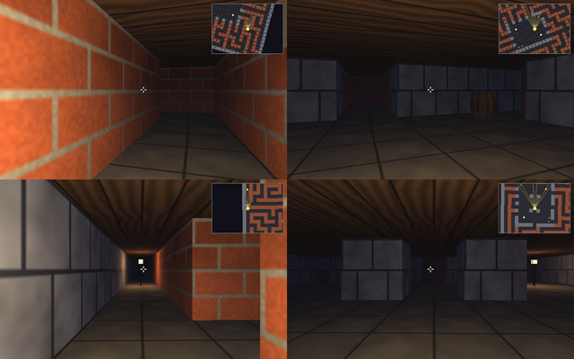
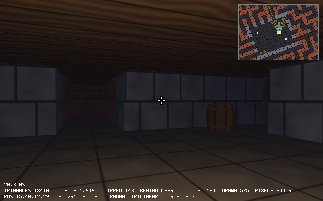

# Chapter 22 — The First-Person Client

The renderer can draw the whole maze now. This chapter makes it a game you walk around in. The
mouse looks up and down as well as sideways, up to 85°. The player stops being a point and
becomes a circle of radius 0.25 that slides along walls and stops at barrels, so you can no
longer walk into the near plane and see through a wall (Chapter 21's window shot). A crosshair
marks the view direction, and an info key clears the numbers off the screen.

The second half of the chapter is about time. Since Chapter 9 the simulation has depended on
nothing but each tick's input and the fixed 1/60 s tick. So if we write down every tick's
input and feed it back later, the game plays out the same way again, down to the last pixel.
`--record` and `--demo` do that. A script that "drives" the player through the labyrinth like a
person would produces a built-in, 33-second `tour`, and that tour becomes the scripted walk the
next two chapters measure their speed on.

Previous: [Chapter 21 — Building the World](21-building-the-world.md). Next:
[Chapter 23 — Visibility and Occlusion](23-visibility-and-occlusion.md).

## Looking up and down

The camera has had a pitch since Chapter 15: `--pitch` set it at startup, and nothing changed
it after that. Two new fields in `Input` let the player change it, one for keys and one for the
mouse:

```zig
    /// -1 (look down) to 1 (look up).
    tilt: f32 = 0,
    /// How far the mouse moved sideways, in pixels (right is positive).
    look: f32 = 0,
    /// How far the mouse moved up or down, in pixels (down is positive,
    /// as on the screen).
    look_y: f32 = 0,
```

`tilt` is held like `turn`: the Up arrow makes it 1, Down makes it −1. `look_y` is an amount,
like `look` (Chapter 14): how many pixels the mouse moved since the last tick. So it is treated
the same way. `accumulate` adds it up over frames that run no tick, and `take` clears it once a
tick has used it:

```zig
    pub fn accumulate(pending: *Input, fresh: Input) void {
        const presses = pending.pressed.unionWith(fresh.pressed);
        const look = pending.look + fresh.look;
        const look_y = pending.look_y + fresh.look_y;
        pending.* = fresh;
        pending.pressed = presses;
        pending.look = look;
        pending.look_y = look_y;
    }
```

`platform.zig` reads both mouse axes, behind the same `mouse_settled` guard that skips the
first jump when the cursor is captured:

```zig
    pub fn input(window: *Window) Input {
        defer window.mouse_settled = true;
        const mouse: rl.Vector2 = if (window.mouse_settled) rl.GetMouseDelta() else .{ .x = 0, .y = 0 };
        var result: Input = .{
            .forward = axis(rl.KEY_S, rl.KEY_W),
            .strafe = axis(rl.KEY_A, rl.KEY_D),
            .turn = axis(rl.KEY_LEFT, rl.KEY_RIGHT),
            .tilt = axis(rl.KEY_DOWN, rl.KEY_UP),
            .look = mouse.x,
            .look_y = mouse.y,
        };
```

`Player.update` turns them into pitch, next to the yaw it already computed:

```zig
        const turn = input.turn * turn_speed * dt + input.look * mouse_sensitivity;
        player.yaw = @mod(player.yaw + turn, std.math.tau);
        // Moving the mouse down (+y on screen) looks down.
        const tilt = input.tilt * tilt_speed * dt - input.look_y * mouse_sensitivity;
        player.pitch = std.math.clamp(player.pitch + tilt, -max_pitch, max_pitch);
```

- The keys turn the pitch at `tilt_speed`, 1.5 radians per second, so a tick of Up adds
  0.025 rad, about 1.4°. The mouse adds `mouse_sensitivity`, 0.003 rad, per pixel, the same as
  for turning.
- The minus sign: screen y grows downward, so pushing the mouse away from you (up the screen)
  gives a negative `look_y`. It should look up, which is a positive pitch.
- Mouse movement is not multiplied by `dt`. It is already an amount, not a rate.
- The pitch is clamped to ±`max_pitch`, which is 85°. Chapter 15's "Straight up has no right"
  is the reason: `lookAt` builds the right vector from forward × world up, which is zero when
  looking straight up, and near it the view spins as the yaw changes. 85° is far enough to see
  the ceiling right above you and far enough from the pole.

`--pitch` now accepts −85 to 85, the same limit, and `--hold` takes an optional fourth number,
the look-up input, so a headless run can tilt the view:

```zig
            } else if (eql(arg, "--hold")) {
                const text = try value(args, &i);
                // The fourth number, looking up, may be left out.
                const f = parseFloats(4, text) catch
                    try parseFloats(3, text) ++ [1]f32{0};
                opts.hold = .{ .forward = f[0], .strafe = f[1], .turn = f[2], .tilt = f[3] };
```

If four numbers do not parse, three are tried, and `++` appends a 0 to make the array four
long. Both arrays have lengths known at compile time, so the result is a `[4]f32`. Two numbers,
or five, fail both times and stay an error.

The ray-caster view (`V` until `raycast`) ignores the pitch. It draws a wall as a vertical
strip centered on the horizon, and there is no way to tilt that without the walls leaning: a
reminder of what 2.5D could not do. The 3D views simply pass the pitch on to the camera.

## The player is a circle

Chapter 21's last screenshot showed a problem. Walking east from the labyrinth's start, the
player stopped at x = 4.00, exactly on the face of the wall, because the player was a point and
only points inside wall cells were refused. But the camera cannot see anything nearer than the
near plane, 0.05 in front of the eye. With the eye on the wall's face, the wall is closer than
that, the clipper cuts it away, and we look through it into the next corridor.

The fix is to keep the eye far enough from every wall. How far is far enough? The part of the
near plane we see is a rectangle `near` in front of the eye. Its half-width is
`near · tan(hfov/2)` and its half-height `near · tan(vfov/2)`. `delve`'s camera has
`tan(vfov/2) = 0.5`, and the 640 × 400 screen makes `tan(hfov/2) = 0.5 · 640/400 = 0.8`. The
point of that rectangle farthest from the eye is a corner, at distance

```text
near · √(1 + tan²(hfov/2) + tan²(vfov/2)) = 0.05 · √(1 + 0.64 + 0.25) = 0.05 · 1.375 = 0.069
```

A surface farther from the eye than that, in any direction, is beyond the whole visible near
rectangle, so the clipper never cuts it. If the eye can never get within 0.069 of a wall, no
wall is ever opened up. Make the player a circle of that radius or more, keep the circle out of
the walls, and the problem is gone, whichever way the player looks, including up and down.

`delve` uses a radius of 0.25. That leaves a wide margin, and a corridor one cell wide still
leaves the player half a cell of room to move from side to side. The example works the bound
out for other fields of view and screen shapes:

`examples/ch22/near_corner.zig`

```zig
//! How close may a wall come before the near plane cuts it open? The
//! visible part of the near plane is a rectangle `near` in front of the
//! eye, with half-sizes near * tan_h and near * tan_v. Its corners are the
//! points of it farthest from the eye: near * sqrt(1 + tan_h^2 + tan_v^2).
//! A player circle at least that big keeps every wall beyond the near plane.
const std = @import("std");

/// The distance from the eye to a corner of the near rectangle, per unit
/// of `near`.
fn cornerFactor(tan_h: f32, tan_v: f32) f32 {
    return @sqrt(1 + tan_h * tan_h + tan_v * tan_v);
}

pub fn main() void {
    const near = 0.05;
    const radius = 0.25;

    // delve: a vertical fov of 2 atan(0.5) (about 53 degrees) on a 640 x 400
    // screen, so tan_v = 0.5 and tan_h = 0.8.
    const k = cornerFactor(0.8, 0.5);
    std.debug.print("delve: corner at {d:.4} x near = {d:.4}; radius {d} leaves {d:.1}x\n", .{ k, near * k, radius, radius / (near * k) });
    std.debug.print("       the largest near plane radius {d} allows: {d:.3}\n\n", .{ radius, radius / k });

    // Horizontal fovs at a few aspect ratios.
    const aspects = [_]struct { name: []const u8, w: f32, h: f32 }{
        .{ .name = "4:3", .w = 4, .h = 3 },
        .{ .name = "16:10", .w = 16, .h = 10 },
        .{ .name = "16:9", .w = 16, .h = 9 },
        .{ .name = "21:9", .w = 21, .h = 9 },
    };
    const fovs = [_]f32{ 60, 75, 90, 105, 120 };
    std.debug.print("smallest safe radius at near = {d}, by horizontal fov:\n", .{near});
    std.debug.print("{s:>6}", .{"fov"});
    for (aspects) |a| std.debug.print("  {s:>6}", .{a.name});
    std.debug.print("\n", .{});
    for (fovs) |fov| {
        std.debug.print("{d:>6}", .{fov});
        const tan_h = @tan(std.math.degreesToRadians(fov) / 2);
        for (aspects) |a| {
            const tan_v = tan_h * a.h / a.w;
            std.debug.print("  {d:>6.4}", .{near * cornerFactor(tan_h, tan_v)});
        }
        std.debug.print("\n", .{});
    }
}
```

```console
$ zig run examples/ch22/near_corner.zig
delve: corner at 1.3748 x near = 0.0687; radius 0.25 leaves 3.6x
       the largest near plane radius 0.25 allows: 0.182

smallest safe radius at near = 0.05, by horizontal fov:
   fov     4:3   16:10    16:9    21:9
    60  0.0617  0.0605  0.0600  0.0590
    75  0.0693  0.0674  0.0666  0.0651
    90  0.0800  0.0773  0.0761  0.0739
   105  0.0956  0.0917  0.0899  0.0868
   120  0.1192  0.1137  0.1112  0.1067
```

- `delve`'s radius is 3.6 times the bound. Read the other way round, the near plane could move
  out to 0.182 before the radius stopped protecting it. A farther near plane gives the depth
  buffer more precision (Chapter 18), so this is a real trade-off in games.
- A wider field of view needs a bigger circle, because the corners of the near rectangle
  move out. A 90° horizontal fov on a 16:9 screen needs 0.0761.
- For a fixed horizontal fov, a wider screen needs a slightly *smaller* circle: the vertical
  fov shrinks, and so does the rectangle's height.

`player.zig` turns the bound into a check that runs while the program compiles:

```zig
/// The player is a circle this big (in cells) on the map.
pub const radius = 0.25;
/// How far the player can look up or down: 85 degrees. Straight up, the
/// camera would have no well-defined right (gotcha 24).
pub const max_pitch = std.math.degreesToRadians(85.0);

// The farthest point of the near plane that is in view, a corner, is
// near * sqrt(1 + tan²(hfov/2) + tan²(vfov/2)) from the eye. Anything the
// player can touch must stay farther away than that, or the near plane
// cuts it open and we see through it (ch21-window.png).
comptime {
    const tan_v = @tan(camera.vfov / 2.0);
    const tan_h = tan_v * 640.0 / 400.0;
    std.debug.assert(radius > camera.near * @sqrt(1 + tan_h * tan_h + tan_v * tan_v));
}
```

A `comptime` block at the top level of a file runs during compilation. `std.debug.assert` is
an ordinary function, `if (!ok) unreachable`, and reaching `unreachable` at compile time is a
compile error. So if someone later widens the fov, moves the near plane out, or shrinks the
player, and the three no longer fit, the program does not build. Here is what that looks like,
in a throwaway file with the radius set to 0.06:

```console
$ zig run tiny_radius.zig
.../lib/std/debug.zig:442:14: error: reached unreachable code
    if (!ok) unreachable; // assertion failure
             ^~~~~~~~~~~
tiny_radius.zig:7:21: note: called at comptime here
    std.debug.assert(radius > near * @sqrt(1 + tan_h * tan_h + tan_v * tan_v));
    ~~~~~~~~~~~~~~~~^~~~~~~~~~~~~~~~~~~~~~~~~~~~~~~~~~~~~~~~~~~~~~~~~~~~~~~~~~
```

The error points into the standard library, and the note says which call got there. (The
"referenced by" lines that follow are trimmed.) A test would catch the same mistake, but only
when someone runs the tests. The `comptime` check stops every build.

## Pushing out of walls

Since Chapter 11 the player has moved like this: try the step along x, keep it if the new
point is not in a wall; then the same along y. That is a test for a point. A circle needs a
different idea: move, then push the circle back out of whatever it overlaps.

For a circle and a square, the question "do they overlap?" has a neat answer. Find the point of
the square closest to the circle's center. The circle overlaps the square exactly when that
point is closer than the radius. And the closest point of an axis-aligned square is a clamp,
one coordinate at a time:

```text
          ┌──────────┐
          │          │        p₁ is beside the face: the closest point q₁ has the
   p₁ ●───┼● q₁      │        square's x and p₁'s own y, so the push is horizontal.
          │          │
          └──────────●  q₂    p₂ is off the corner: both coordinates are clamped, the
                       ╲      closest point is the corner itself, and the push goes
                        ● p₂  straight away from the corner.
```

If the closest point `q` is closer than the radius, move the center straight away from `q`
until it is exactly a radius away. Here is that on its own, for a few spots around one wall
square and in the inside corner of two:

`examples/ch22/circle_vs_box.zig`

```zig
//! Pushing a circle out of square walls, the way delve's player.zig does:
//! find the point of each square closest to the circle's center, and if it
//! is closer than the radius, move the center straight away from it.
//! Prints where a circle of radius 0.25 ends up at a few spots around a
//! wall, and in the inside corner of two walls.
const std = @import("std");

const Vec2 = @Vector(2, f32);
const radius = 0.25;

/// The point of the unit square with lowest corner `low` closest to `p`:
/// a clamp of each coordinate.
fn closest(low: Vec2, p: Vec2) Vec2 {
    return @max(low, @min(low + Vec2{ 1, 1 }, p));
}

fn length(v: Vec2) f32 {
    return @sqrt(@reduce(.Add, v * v));
}

/// Moves `p` away from `point` until it is `radius` away, if closer.
fn pushOut(p: Vec2, point: Vec2) Vec2 {
    const d = p - point;
    const len = length(d);
    if (len >= radius or len == 0) return p;
    return point + d * @as(Vec2, @splat(radius / len));
}

fn collide(walls: []const Vec2, p: Vec2) Vec2 {
    var q = p;
    for (walls) |low| q = pushOut(q, closest(low, q));
    return q;
}

pub fn main() void {
    // One wall: the square from (1, 1) to (2, 2).
    const one = [_]Vec2{.{ 1, 1 }};
    const spots = [_]struct { name: []const u8, p: Vec2 }{
        .{ .name = "left of the face", .p = .{ 0.9, 1.5 } },
        .{ .name = "far from it", .p = .{ 0.5, 1.5 } },
        .{ .name = "above the face", .p = .{ 1.3, 0.8 } },
        .{ .name = "off the corner", .p = .{ 0.85, 0.85 } },
        .{ .name = "off the corner, skew", .p = .{ 0.95, 0.8 } },
    };
    std.debug.print("one wall, (1,1) to (2,2):\n", .{});
    for (spots) |s| show(&one, s.name, s.p);

    // Two walls meeting in an inside corner: one from (1,1) to (2,2) and
    // one from (2,0) to (3,1). The circle in the corner touches both.
    const two = [_]Vec2{ .{ 1, 1 }, .{ 2, 0 } };
    std.debug.print("two walls, an inside corner at (2,1):\n", .{});
    show(&two, "in the corner", .{ 1.9, 0.9 });
    show(&two, "near the corner", .{ 1.6, 0.8 });

    // Sliding: a step that goes into the wall at 45 degrees keeps only
    // the part along the wall.
    std.debug.print("sliding along the face x = 1:\n", .{});
    var p: Vec2 = .{ 0.75, 1.2 };
    for (0..4) |_| {
        const step: Vec2 = .{ 0.05, 0.05 };
        const moved = collide(&one, p + step);
        std.debug.print("  ({d:.3}, {d:.3}) + step -> ({d:.3}, {d:.3})\n", .{ p[0], p[1], moved[0], moved[1] });
        p = moved;
    }
}

fn show(walls: []const Vec2, name: []const u8, p: Vec2) void {
    const q = collide(walls, p);
    var nearest: f32 = std.math.inf(f32);
    for (walls) |low| nearest = @min(nearest, length(q - closest(low, q)));
    std.debug.print("  {s:<22} ({d:.3}, {d:.3}) -> ({d:.3}, {d:.3})  gap {d:.3}\n", .{ name, p[0], p[1], q[0], q[1], nearest });
}
```

```console
$ zig run examples/ch22/circle_vs_box.zig
one wall, (1,1) to (2,2):
  left of the face       (0.900, 1.500) -> (0.750, 1.500)  gap 0.250
  far from it            (0.500, 1.500) -> (0.500, 1.500)  gap 0.500
  above the face         (1.300, 0.800) -> (1.300, 0.750)  gap 0.250
  off the corner         (0.850, 0.850) -> (0.823, 0.823)  gap 0.250
  off the corner, skew   (0.950, 0.800) -> (0.939, 0.757)  gap 0.250
two walls, an inside corner at (2,1):
  in the corner          (1.900, 0.900) -> (1.750, 0.750)  gap 0.250
  near the corner        (1.600, 0.800) -> (1.600, 0.750)  gap 0.250
sliding along the face x = 1:
  (0.750, 1.200) + step -> (0.750, 1.250)
  (0.750, 1.250) + step -> (0.750, 1.300)
  (0.750, 1.300) + step -> (0.750, 1.350)
  (0.750, 1.350) + step -> (0.750, 1.400)
```

- `@min` and `@max` work element by element on vectors, so `@max(low, @min(low + 1, p))` clamps
  x and y at once, the same way `std.math.clamp` did for Chapter 19's light boxes.
- Beside a face, the push is along the face's normal, and only the coordinate across the face
  changes: (0.9, 1.5) goes to (0.75, 1.5). A circle that does not reach the wall is left alone.
- Off a corner, the push is along the line from the corner to the center, so the center ends
  up on a circle of radius 0.25 around the corner, in whatever direction it came from. Both
  corner cases end with a gap of exactly 0.25.
- In an inside corner both squares push. The first pushes in y, the second in x, and the
  circle ends up a radius from both: (1.75, 0.75).
- The slide is the reason for all of this. Each step goes 0.05 right and 0.05 down, half of it
  into the wall. The push takes back exactly the part across the face and leaves the part
  along it, so the circle slides down the wall at 0.05 per step, 71% of its full speed of
  0.0707. Walking at a wall at a shallow angle barely slows you down; walking straight at it
  stops you.

`collide` in `player.zig` is the same idea, for the map's walls:

```zig
/// Pushes a circle of `radius` at `pos` out of the things and walls it
/// overlaps. Each push goes straight away from the closest point, so only
/// the part of a move that goes into a wall is undone: the player slides.
pub fn collide(map: Map, pos: Vec2) Vec2 {
    var p = pos;
    for (map.sprites) |sprite| {
        const r = thingRadius(sprite.thing) orelse continue;
        p = pushOut(p, sprite.pos, radius + r);
    }
    // A circle smaller than a cell can only touch the 3x3 cells around
    // the one it is in. Walls go last: never end up inside one.
    const cell = @floor(p);
    const cx: i32 = @intFromFloat(cell[0]);
    const cy: i32 = @intFromFloat(cell[1]);
    var y = cy - 1;
    while (y <= cy + 1) : (y += 1) {
        var x = cx - 1;
        while (x <= cx + 1) : (x += 1) {
            if (!map.at(x, y).isWall()) continue;
            // The closest point of the wall's square to the center.
            const low: Vec2 = .{ @floatFromInt(x), @floatFromInt(y) };
            const closest = @max(low, @min(low + Vec2{ 1, 1 }, p));
            p = pushOut(p, closest, radius);
        }
    }
    return p;
}

/// Moves `p` away from `point` until it is `distance` from it, if closer.
fn pushOut(p: Vec2, point: Vec2, distance: f32) Vec2 {
    const d = p - point;
    const len = math.length(d);
    // At len = 0 there is no direction to push in. Steps are much
    // shorter than the radius, so a center never gets onto a wall.
    if (len >= distance or len == 0) return p;
    return point + math.scale(d, distance / len);
}
```

- Only the 3 × 3 cells around the center's cell are tested. A circle of radius 0.25 can reach
  at most a quarter cell beyond its own cell, so no other wall can touch it, and the cost does
  not grow with the size of the map. `map.at` treats everything outside the map as wall, so
  this also works at the edges.
- The step per tick is `move_speed · dt` = 3/60 = 0.05, a fifth of the radius. A circle that
  starts outside every wall can get at most 0.05 into one, so its center never crosses into a
  wall, and the push always goes back the way it came. With steps longer than the radius, a
  fast object could jump through a thin wall between two ticks, called *tunneling*, and
  would need a swept test instead. The `len == 0` guard covers the one direction-free case,
  a center exactly on the closest point, which these steps never produce.
- The things come first and the walls last. The reason is in the next section.

The old test, "moving forward and sliding along a wall", checked only that the player stopped
somewhere before x = 4. The new one knows where:

```zig
test "the player stays a radius away from walls and slides along them" {
    const gpa = std.testing.allocator;
    var map = try Map.parse(gpa,
        \\#####
        \\#>..#
        \\#####
    );
    defer map.deinit(gpa);
    var player: Player = .{ .pos = map.start, .yaw = map.start_yaw };

    // One second forward: 3 cells, but the wall at x = 4 stops us a
    // radius before it.
    for (0..60) |_| player.update(.{ .forward = 1 }, map, 1.0 / 60.0);
    try std.testing.expectApproxEqAbs(4 - radius, player.pos[0], 1e-5);
    try std.testing.expectApproxEqAbs(1.5, player.pos[1], 1e-6);

    // Pushing diagonally into the wall below slides along it.
    player = .{ .pos = map.start, .yaw = std.math.pi / 4.0 };
    for (0..10) |_| player.update(.{ .forward = 1 }, map, 1.0 / 60.0);
    try std.testing.expectApproxEqAbs(2 - radius, player.pos[1], 1e-5);
    try std.testing.expect(player.pos[0] > map.start[0] + 0.3);
}
```

A second test walks at yaw 0.7 for two seconds into the corner of a 3 × 3 room and expects
(3.75, 3.75), a radius from both walls, the inside corner of the example.

## Solid things

Barrels should block the player too. Chapter 14's first exercise did that with a point test.
Now that the player is a circle, a barrel can be one as well, and two circles overlap when their
centers are closer than the sum of the radii. Pushing one out of the other is `pushOut` again,
with the sum as the distance. Each kind of thing gets a size:

```zig
/// How big each kind of thing is, if the player bumps into it. Lamps
/// are thin poles, and the player walks past them.
pub fn thingRadius(thing: Thing) ?f32 {
    return switch (thing) {
        .barrel => 0.23,
        .lamp => null,
    };
}
```

0.23 is the barrel model's widest ring. A lamp is a pole 0.03 wide, and stopping a
quarter cell from it would feel like an invisible wall, so lamps return `null` and `collide`
skips them with `orelse continue`.

Why the order, things first and walls last? A push out of a barrel can move the player toward
a wall. If the walls came first, a barrel next to a wall could push the player into it, and the
player would end the tick inside a wall, the one thing that must never happen. With walls last,
the worst case is ending the tick inside a barrel. That happens when there is no room at all: a
barrel half a cell from a wall leaves a gap of 0.5 − 0.23 = 0.27, and the player's circle needs
0.5. The barrel pushes the player up toward the wall, the wall pushes it back down into the
barrel, and neither push wins. `update` checks for that and refuses the move:

```zig
        // Move, then push the circle back out of whatever it overlaps.
        // Between a barrel and a wall there may be no room at all; then
        // the player stays where it was.
        const moved = collide(map, player.pos + step);
        if (!bumpsThing(map, moved)) player.pos = moved;
```

```zig
/// True if a circle at `pos` overlaps a solid thing.
fn bumpsThing(map: Map, pos: Vec2) bool {
    for (map.sprites) |sprite| {
        const r = thingRadius(sprite.thing) orelse continue;
        // A little slack for rounding: collide put it exactly at the edge.
        if (math.length(pos - sprite.pos) < radius + r - 1e-4) return true;
    }
    return false;
}
```

The slack matters. After a push the distance is exactly `radius + r` in real numbers, but in
f32 it may come out a few millionths short, and without the slack every touch of a barrel would
count as a bump and freeze the player.

The test walks at a barrel, through a lamp's cell, and along a wall into the gap beside a
barrel:

```zig
test "barrels are solid, lamps are not" {
    const gpa = std.testing.allocator;
    var map = try Map.parse(gpa,
        \\#######
        \\#>.o..#
        \\#.....#
        \\#.*...#
        \\#######
    );
    defer map.deinit(gpa);
    // Straight at the barrel: stopped where the two circles touch.
    var player: Player = .{ .pos = map.start, .yaw = 0 };
    for (0..60) |_| player.update(.{ .forward = 1 }, map, 1.0 / 60.0);
    try std.testing.expectApproxEqAbs(3.5 - radius - 0.23, player.pos[0], 1e-4);
    // Through the lamp's cell: it is in the way, but only a thin pole.
    player = .{ .pos = .{ 1.5, 3.5 }, .yaw = 0 };
    for (0..40) |_| player.update(.{ .forward = 1 }, map, 1.0 / 60.0);
    try std.testing.expect(player.pos[0] > 3);
    // Between the barrel and the wall above there is no room: sliding
    // along the wall toward the barrel stops at it.
    player = .{ .pos = .{ 1.5, 1 + radius }, .yaw = 0 };
    for (0..60) |_| player.update(.{ .forward = 1 }, map, 1.0 / 60.0);
    try std.testing.expect(player.pos[0] < 3.1);
}
```

In the last case the player hugs the wall at y = 1.25 and the barrel's center is at y = 1.5,
0.25 lower. The circles touch when the centers are 0.48 apart, which with 0.25 of that across
is `√(0.48² − 0.25²)` = 0.41 along: the player stops near x = 3.09.

A barrel is drawn with 106 triangles and collides as one circle. Games almost always keep the
two apart. The *render mesh* is whatever looks good; the *collision shape* is the simplest thing
that feels right: circles, boxes and capsules, for which the overlap tests are a few lines like
the ones above. A barrel's ring of staves would make a bumpy wall to slide along and cost a
hundred tests per tick for nothing the player could notice.

## A crosshair and less clutter

With the mouse looking around, it helps to see where the middle of the view is. The camera's
view direction goes through the center of the projection, which the viewport transform of
Chapter 15 puts at (320, 200) in canvas coordinates. That is not the center of a pixel. Pixel
centers are at half-integers, so (320, 200) is the corner between the four pixels 319 and 320
across and 199 and 200 down. A crosshair centered on it must be an even number of pixels wide:
two.

```zig
/// A small cross where the view direction meets the screen. That is the
/// corner between the four center pixels, so the cross is 2 pixels wide,
/// with a dark outline to show on light walls.
fn drawCrosshair(canvas: Canvas) void {
    const cx: i32 = @intCast(canvas.width / 2);
    const cy: i32 = @intCast(canvas.height / 2);
    const arms = [_][4]i32{
        .{ cx - 7, cy - 1, 5, 2 }, .{ cx + 2, cy - 1, 5, 2 }, // left, right
        .{ cx - 1, cy - 7, 2, 5 }, .{ cx - 1, cy + 2, 2, 5 }, // up, down
    };
    for (arms) |a| draw.fillRect(canvas, a[0] - 1, a[1] - 1, a[2] + 2, a[3] + 2, .hex(0x000000));
    for (arms) |a| draw.fillRect(canvas, a[0], a[1], a[2], a[3], .hex(0xf0f0f0));
}
```

- Each arm is a 5 × 2 rectangle, starting two pixels from the center, so the very center is
  left open and does not hide what you aim at.
- The black rectangles one pixel bigger go first, so every arm has a dark outline: a white
  cross alone would vanish on the pale stone walls. The outlines overlap at the inner corners,
  and the whole cross covers 108 pixels.
- `render` draws it in the views that use the 3D camera (solid, depth, levels, chunks and
  wireframe), after the scene and before the minimap. The ray caster and the map views go
  without it.

The bottom two lines of the screen have grown with every chapter: the pose, the shading and
filter, the renderer's statistics. They are useful when measuring and in the way when playing.
The `I` key (`toggle_info`) flips `show_info`, and `render` skips `drawInfo` when it is off.

When there is a window, `drawInfo` shows one more line: how long the last frame's `render`
took. `runWindowed` times it with Zig 0.17's clock API in `std.Io`:

```zig
        const before = std.Io.Timestamp.now(io, .awake);
        app.render(canvas);
        // Shown on the next frame: this one is drawn already.
        const ns = before.durationTo(.now(io, .awake)).nanoseconds;
        app.render_ms = @as(f32, @floatFromInt(ns)) / 1e6;
```

- `std.Io.Timestamp.now(io, .awake)` reads a clock through the `Io` interface that `main` gets
  in `init.io`, like file reading does. `.awake` is a monotonic clock that does not count time
  the machine spends asleep, the right one for measuring how long something took.
- `durationTo` gives a `Duration`, whose `nanoseconds` are an integer. The HUD prints
  milliseconds with one decimal.
- The time is measured after the frame is drawn, so the number on screen is always the previous
  frame's. At 60 frames per second nobody can tell.
- `render_ms` is an optional that stays `null` in headless runs, and `drawInfo` only prints the
  line when it has a value. A time would differ from run to run, and headless images must be
  the same every time: the tests and the screenshots in this book depend on it.

One more small fix in the HUD. The pitch is shown in whole degrees, and a pitch of −0.0001
radians rounds to −0, which `{d:.0}` prints as `-0`. `degrees` adds zero:

```zig
/// Whole degrees, for showing. Adding 0 turns -0 (from a tiny negative
/// angle) into 0.
fn degrees(radians: f32) f32 {
    return @round(std.math.radiansToDegrees(radians)) + 0;
}
```

IEEE 754 says that −0 + 0 is +0 (in the default rounding mode), so the sum is an ordinary
zero, and any other number is unchanged. The compiler may not remove the `+ 0` for exactly
this reason.

## Fixed steps, again

Before recording anything, it is worth looking again at the main loop from Chapter 9, because
the rest of this chapter depends on it:

```zig
            // Real time: run as many ticks as the elapsed time asks for.
            lag += window.frameTime();
            while (lag >= tick) : (lag -= tick) try ticker.step(gpa, app);
```

The simulation advances only in ticks of exactly 1/60 s. Frames are a separate thing: each
frame adds the real time that passed to `lag`, runs as many ticks as fit, and keeps the rest
for later. The windowed tour in this chapter's screenshots renders a frame in about 20 ms, a
bit more than a tick, so most frames run one tick and every few frames run two. On a fast
machine at 144 frames per second, most frames run no tick at all, and mouse movement piles up
in `pending` until one does.

Either way, the player's speed, the collision pushes and the mouse look see only ticks:
`dt` is always 1/60, mouse movement is summed per tick, and a key press is handed to exactly
one tick. That is what makes the rest of this chapter possible. The sequence of tick inputs
determines the game completely. The frame rate, the machine and the time of day do not enter.

There is one cost, and Glenn Fiedler's "Fix Your Timestep!" names it. When a frame falls between
two ticks, it still shows the state of the last tick, so motion advances in steps of 1/60 s
even at 144 frames per second. The cure is to draw a blend of the last two ticks' states,
weighted by `lag / tick`. Exercise 1 does that.

## Recording input

If the tick inputs decide everything, then a list of them is a complete record of a game. Play
the list back, tick by tick, and the player walks the same path, bumps into the same barrels
and looks at the same ceiling, and every frame comes out the same. Many games have done this:
Doom saves *demos* as a header and four bytes of input per player per tick, and the game's
attract mode is a few of them, played back.

Why record the input and not, say, the player's position each tick?

- It is smaller. A held key is the same input tick after tick, so a run of them can be stored
  once with a count. Positions change every tick.
- Replaying input runs the whole game: input handling, movement, collision, toggles. If any of
  it changes behavior, the replay goes somewhere else. So a recording is also a regression test,
  for free.
- The catch is that replay is exact only if the simulation is *deterministic*: the same inputs
  must give the same results, bit for bit. In `delve` they do, because each tick does the same
  float operations in the same order, and nothing in `update` reads the clock, the frame rate
  or anything else from outside. A different build, compiled with other floating-point
  settings, or a game that reads the wall clock somewhere in its logic, can drift apart in a
  few seconds of play. Old Doom demos are known to go out of sync on other versions of the game.

### The format

`demo.zig` writes and reads text, one line per *run* of ticks with the same input. Its doc
comment shows a small one:

```zig
//! Recording and replaying input. The simulation depends only on the
//! input of each tick and the fixed tick length, so a list of inputs is
//! all it takes to play a game again exactly as it went.
//!
//! A demo is text, one line per run of ticks with the same input:
//!
//!     # delve demo
//!     map labyrinth
//!     start 1.5 1.5 0 0
//!     90 1 0 0 0 0 0
//!     1 0 0 0 0 0 0 toggle_torch
//!
//! `map` names the map and `start` gives x, y, yaw and pitch (radians).
//! Each run is: how many ticks, then forward, strafe, turn, tilt, look and
//! look_y, then the actions pressed on each of those ticks.
```

That demo walks forward for 90 ticks (1.5 s), then stands for one tick and turns the torch off.
Text costs some bytes compared with a binary format, but you can read it, diff it, and write one
by hand, and the next section writes a long one with a script.

The types are small:

```zig
pub const Start = struct { pos: Vec2, yaw: f32, pitch: f32 };

/// `ticks` ticks in a row with the same input.
pub const Run = struct { ticks: u32, input: Input };

pub const Demo = struct {
    /// The map's name, pointing into the text the demo was parsed from.
    map: ?[]const u8 = null,
    start: ?Start = null,
    runs: []Run,
```

### Collecting runs

`Recorder` gets one input per tick and merges it into the last run when it is the same:

```zig
/// Collects the input of every tick, merging repeats into runs.
pub const Recorder = struct {
    runs: std.ArrayList(Run) = .empty,

    pub fn deinit(rec: *Recorder, gpa: std.mem.Allocator) void {
        rec.runs.deinit(gpa);
    }

    pub fn add(rec: *Recorder, gpa: std.mem.Allocator, input: Input) !void {
        if (rec.runs.items.len > 0) {
            const last = &rec.runs.items[rec.runs.items.len - 1];
            if (std.meta.eql(last.input, input)) {
                last.ticks += 1;
                return;
            }
        }
        try rec.runs.append(gpa, .{ .ticks = 1, .input = input });
    }
};
```

Why `std.meta.eql` and not `==`? Zig does not compare structs with `==`. Two structs may hold
padding bytes, floats where +0 equals −0, or slices where "equal" could mean the same pointer or
the same contents, and Zig would rather not pick a meaning for you. A throwaway file that tries
it:

```console
$ zig run input_eq.zig
input_eq.zig:6:11: error: operator == not allowed for type 'input_eq.Input'
    if (a == b) std.debug.print("same\n", .{});
        ~~^~~~
input_eq.zig:2:15: note: struct declared here
const Input = struct { forward: f32 = 0, turn: f32 = 0, pressed: std.EnumSet(enum { a, b }) = .empty };
              ^~~~~~~~~~~~~~~~~~~~~~~~~~~~~~~~~~~~~~~~~~~~~~~~~~~~~~~~~~~~~~~~~~~~~~~~~~~~~~~~~~~~~~~~
```

`std.meta.eql` compares field by field, recursively, with `==` for numbers. That is what we
want here: two ticks are the same run when every field is the same value.

How much do runs save? It depends on what the player does with the mouse:

`examples/ch22/rle_input.zig`

```zig
//! Run-length encoding a recording. Held keys give the same input tick
//! after tick, so storing "how many ticks, then the input" once per run
//! instead of once per tick shrinks a recording a lot. The mouse is the
//! exception: it moves by a different amount almost every tick.
const std = @import("std");

const Input = struct { forward: f32 = 0, turn: f32 = 0, look: f32 = 0 };
const Run = struct { ticks: u32, input: Input };

/// Appends one tick's input, merging it into the last run if equal.
fn add(runs: *std.ArrayList(Run), gpa: std.mem.Allocator, input: Input) !void {
    if (runs.items.len > 0) {
        const last = &runs.items[runs.items.len - 1];
        if (std.meta.eql(last.input, input)) {
            last.ticks += 1;
            return;
        }
    }
    try runs.append(gpa, .{ .ticks = 1, .input = input });
}

/// The size of the text: one line per tick, or one per run.
fn textSize(runs: []const Run, per_tick: bool) !usize {
    var counter: std.Io.Writer.Discarding = .init(&.{});
    const w = &counter.writer;
    for (runs) |run| {
        const lines = if (per_tick) run.ticks else 1;
        for (0..lines) |_| {
            if (!per_tick) try w.print("{d} ", .{run.ticks});
            try w.print("{d} {d} {d}\n", .{ run.input.forward, run.input.turn, run.input.look });
        }
    }
    return @intCast(counter.fullCount());
}

fn report(name: []const u8, ticks: []const Input) !void {
    const gpa = std.heap.page_allocator;
    var runs: std.ArrayList(Run) = .empty;
    defer runs.deinit(gpa);
    for (ticks) |input| try add(&runs, gpa, input);
    const raw = try textSize(runs.items, true);
    const packed_size = try textSize(runs.items, false);
    std.debug.print("{s}: {d} ticks, {d} runs, {d} bytes -> {d} bytes ({d:.1}x)\n", .{
        name, ticks.len, runs.items.len, raw, packed_size, @as(f32, @floatFromInt(raw)) / @as(f32, @floatFromInt(packed_size)),
    });
    if (runs.items.len <= 5) for (runs.items) |run| {
        std.debug.print("    {d} {d} {d} {d}\n", .{ run.ticks, run.input.forward, run.input.turn, run.input.look });
    };
}

pub fn main() !void {
    var ticks: [300]Input = undefined;
    // Hold W for 2 s (120 ticks), turn right with the arrow key for 2/3 s,
    // then hold W for 2 s more.
    for (ticks[0..120]) |*t| t.* = .{ .forward = 1 };
    for (ticks[120..160]) |*t| t.* = .{ .turn = 1 };
    for (ticks[160..280]) |*t| t.* = .{ .forward = 1 };
    for (ticks[280..300]) |*t| t.* = .{};
    try report("keys", &ticks);

    // The same walk, turning with the mouse: a few pixels a tick, never
    // quite the same twice.
    var prng: std.Random.DefaultPrng = .init(1);
    const random = prng.random();
    for (ticks[120..160]) |*t| t.* = .{ .look = @floatFromInt(random.intRangeAtMost(i32, 3, 9)) };
    try report("mouse", &ticks);
}
```

```console
$ zig run examples/ch22/rle_input.zig
keys: 300 ticks, 4 runs, 1800 bytes -> 38 bytes (47.4x)
    120 1 0 0
    40 0 1 0
    120 1 0 0
    20 0 0 0
mouse: 300 ticks, 36 runs, 1800 bytes -> 293 bytes (6.1x)
```

- `std.Io.Writer.Discarding` is a writer that throws the bytes away and counts them, a cheap
  way to measure formatted text without storing it. Its buffer here is empty, `&.{}`, so every
  byte goes straight to the count.
- Five seconds of walking and turning with keys is four runs: 38 bytes. The same walk turning
  with the mouse gives 36 runs, because nearly every mouse tick differs from the one before. It
  is still six times smaller than a line per tick, since the walking parts are runs.
- A real recording is in between: mostly held keys, with stretches of mouse look.

### Numbers that read back exactly

A replay must see the very same floats that were recorded. A turn input of 0.69180727 written
as `0.692` reads back as a different f32, and after a few hundred ticks of such small
differences the player is somewhere else. Zig's `{d}` format prints the *shortest* decimal text
that reads back as the same float. The example checks that on a million random numbers, against
a fixed three decimals:

`examples/ch22/float_roundtrip.zig`

```zig
//! Does a number written as text read back as the same f32? With `{d}`,
//! Zig prints the shortest decimal that parses back to exactly the same
//! float. With a fixed number of decimals, it rounds, and the value read
//! back is a different float. A demo file must replay exactly, so delve
//! writes its numbers with `{d}`.
const std = @import("std");

fn mismatches(comptime fmt: []const u8, values: []const f32) !usize {
    var buffer: [64]u8 = undefined;
    var wrong: usize = 0;
    for (values) |x| {
        const text = try std.fmt.bufPrint(&buffer, fmt, .{x});
        const back = try std.fmt.parseFloat(f32, text);
        if (@as(u32, @bitCast(back)) != @as(u32, @bitCast(x))) wrong += 1;
    }
    return wrong;
}

fn longest(values: []const f32) !usize {
    var buffer: [64]u8 = undefined;
    var most: usize = 0;
    for (values) |x| most = @max(most, (try std.fmt.bufPrint(&buffer, "{d}", .{x})).len);
    return most;
}

pub fn main() !void {
    const n = 1_000_000;
    const gpa = std.heap.page_allocator;
    const small = try gpa.alloc(f32, n);
    defer gpa.free(small);
    const any = try gpa.alloc(f32, n);
    defer gpa.free(any);
    var prng: std.Random.DefaultPrng = .init(22);
    const random = prng.random();
    // Inputs as a demo has them: turns between -1 and 1.
    for (small) |*x| x.* = random.float(f32) * 2 - 1;
    // Any finite f32 at all, from its bits.
    for (any) |*x| {
        x.* = @bitCast(random.int(u32));
        while (!std.math.isFinite(x.*)) x.* = @bitCast(random.int(u32));
    }

    for ([_][]const f32{ small, any }, [_][]const u8{ "in -1..1", "any f32 " }) |values, name| {
        std.debug.print("{s}: {{d}} wrong {d:>7}   {{d:.3}} wrong {d:>7}   longest {{d}} {d} chars\n", .{
            name, try mismatches("{d}", values), try mismatches("{d:.3}", values), try longest(values),
        });
    }
    std.debug.print("1/3 as {{d}}: {d}   0.1 + 0.2 as {{d}}: {d}\n", .{ @as(f32, 1.0) / 3.0, @as(f32, 0.1) + @as(f32, 0.2) });
}
```

```console
$ zig run examples/ch22/float_roundtrip.zig
in -1..1: {d} wrong       0   {d:.3} wrong  999949   longest {d} 15 chars
any f32 : {d} wrong       0   {d:.3} wrong  545599   longest {d} 48 chars
1/3 as {d}: 0.33333334   0.1 + 0.2 as {d}: 0.3
```

- `{d}` reads back exactly every time, for numbers like a demo's inputs and for any finite f32
  at all. Three decimals get almost every input wrong.
- The comparison is of the bits, through `@bitCast` to `u32`, so it would even tell −0 from +0,
  which `==` thinks are equal.
- `{{` and `}}` in a format string print a literal brace.
- `{d}` never uses an exponent, so a tiny number like 10⁻³⁸ takes 48 characters. Demo inputs
  are near −1..1 and take at most 15.
- `1/3` needs eight digits, `0.33333334`, because that is how many it takes to pin down the
  f32 among its neighbors. In f32, 0.1 + 0.2 is exactly the f32 nearest 0.3, so it prints as
  `0.3`; in f64 it would not be (`0.30000000000000004`).

`Demo.write` prints with `{d}`, and the actions with `{t}`, which prints an enum's tag name:

```zig
    /// Writes the demo in the format `parse` reads.
    pub fn write(demo: Demo, w: *std.Io.Writer) std.Io.Writer.Error!void {
        try w.writeAll("# delve demo\n");
        if (demo.map) |name| try w.print("map {s}\n", .{name});
        if (demo.start) |s| try w.print("start {d} {d} {d} {d}\n", .{ s.pos[0], s.pos[1], s.yaw, s.pitch });
        for (demo.runs) |run| {
            const i = run.input;
            // {d} prints the shortest text that reads back as the same
            // f32, so a replay sees exactly the recorded numbers.
            try w.print("{d} {d} {d} {d} {d} {d} {d}", .{ run.ticks, i.forward, i.strafe, i.turn, i.tilt, i.look, i.look_y });
            var actions = i.pressed.iterator();
            while (actions.next()) |action| try w.print(" {t}", .{action});
            try w.writeByte('\n');
        }
    }
```

It writes to any `*std.Io.Writer`. The test uses a fixed buffer, `main` a growing one.

### Where the input comes from

Until now `main` took each tick's input straight from `pending`. A small struct now sits in
between, because the input can also come from a demo, and may have to be written down:

```zig
/// Where each tick's input comes from: the keyboard and mouse (gathered in
/// `pending`), or a demo while it lasts. With `--record`, every tick's
/// input is also written down.
const Ticker = struct {
    pending: Input,
    playback: ?demo_zig.Playback = null,
    recorder: ?*demo_zig.Recorder = null,

    fn step(t: *Ticker, gpa: std.mem.Allocator, app: *App) !void {
        var input = t.pending.take();
        // --hold and --press still add to a demo's input.
        if (t.playback) |*p| if (p.next()) |recorded| {
            input = combine(recorded, input);
        };
        if (t.recorder) |r| try r.add(gpa, input);
        app.update(input, tick);
    }
};
```

- Both loops, headless and windowed, call `ticker.step` wherever they used to call `update`.
- The demo's input is combined with whatever is pending, the same `combine` that merges
  `--hold` with the keyboard. So `--press toggle_torch` works on a demo, and in a window you
  can push the keys during a replay. (The replay then goes somewhere else, of course.)
- What gets recorded is the input that was used, after combining. Recording a replay with a
  `--hold` added gives a new demo that includes it.
- `if (t.playback) |*p| if (p.next()) |recorded| { ... };` captures a pointer to the payload
  of the optional, because `next` changes the playback's position. With `|p|` the payload
  would be a constant copy, and calling `next` on it would not compile.

At the end of `main`, with `--record FILE`, the runs go to a file:

```zig
    if (opts.record) |path| {
        var text: std.Io.Writer.Allocating = .init(gpa);
        defer text.deinit();
        const recorded: demo_zig.Demo = .{ .map = map_name, .start = start, .runs = recorder.runs.items };
        try recorded.write(&text.writer);
        try std.Io.Dir.cwd().writeFile(init.io, .{ .sub_path = path, .data = text.written() });
    }
```

`std.Io.Writer.Allocating` is a writer whose buffer grows as needed. `text.written()` is the
text so far. `writeFile` creates or replaces the file in one call, through `init.io` like every
other file operation. `start` was taken before the first tick, after `--pos`, `--yaw` and
`--pitch` were applied, so the recording starts where the player really started.

The test records five ticks, checks the exact text, and reads it back:

```zig
test "a recording reads back as the same input, tick by tick" {
    const gpa = std.testing.allocator;
    var rec: Recorder = .{};
    defer rec.deinit(gpa);
    var pressed: Input = .{ .look = 0.1 + 0.2, .look_y = -1.0 / 3.0 };
    pressed.pressed.insert(.toggle_torch);
    const ticks = [_]Input{ .{ .forward = 1 }, .{ .forward = 1 }, .{ .forward = 1 }, pressed, .{ .turn = -0.25, .tilt = 1 } };
    for (ticks) |input| try rec.add(gpa, input);
    // Three runs: the first three ticks are the same.
    try std.testing.expectEqual(3, rec.runs.items.len);

    const recorded: Demo = .{ .map = "labyrinth", .start = .{ .pos = .{ 1.5, 2.25 }, .yaw = 0.1, .pitch = -0.2 }, .runs = rec.runs.items };
    var buffer: [512]u8 = undefined;
    var w: std.Io.Writer = .fixed(&buffer);
    try recorded.write(&w);
    try std.testing.expectEqualStrings(
        \\# delve demo
        \\map labyrinth
        \\start 1.5 2.25 0.1 -0.2
        \\3 1 0 0 0 0 0
        \\1 0 0 0 0 0.3 -0.33333334 toggle_torch
        \\1 0 0 -0.25 1 0 0
        \\
    , w.buffered());

    var line: usize = undefined;
    var demo = try Demo.parse(gpa, w.buffered(), &line);
    defer demo.deinit(gpa);
    try std.testing.expectEqualStrings("labyrinth", demo.map.?);
    try std.testing.expectEqual(recorded.start.?, demo.start.?);
    try std.testing.expectEqual(5, demo.tickCount());
    var playback: Playback = .{ .runs = demo.runs };
    for (ticks) |input| try std.testing.expectEqual(input, playback.next().?);
    try std.testing.expectEqual(null, playback.next());
}
```

`expectEqual` compares structs field by field, as `std.meta.eql` does, so it can check each
tick's whole `Input` against the original.

## Playing it back

Reading a demo is the format in reverse. `parse` goes line by line, drops comments, and looks
at the first word:

```zig
    /// Parses a demo. On error, `line` is the line (from 1) at fault.
    pub fn parse(gpa: std.mem.Allocator, text: []const u8, line: *usize) Error!Demo {
        var demo: Demo = .{ .runs = &.{} };
        var runs: std.ArrayList(Run) = .empty;
        errdefer runs.deinit(gpa);
        var lines = std.mem.splitScalar(u8, text, '\n');
        line.* = 0;
        while (lines.next()) |raw| {
            line.* += 1;
            const content = std.mem.trim(u8, raw[0 .. std.mem.indexOfScalar(u8, raw, '#') orelse raw.len], " \t\r");
            if (content.len == 0) continue;
            var words = std.mem.tokenizeAny(u8, content, " \t");
            const first = words.next().?;
            if (std.mem.eql(u8, first, "map")) {
                demo.map = words.next() orelse return error.BadLine;
            } else if (std.mem.eql(u8, first, "start")) {
                const f = try floats(4, &words);
                demo.start = .{ .pos = .{ f[0], f[1] }, .yaw = f[2], .pitch = f[3] };
            } else {
                const ticks = std.fmt.parseInt(u32, first, 10) catch return error.BadNumber;
                const f = try floats(6, &words);
                var input: Input = .{ .forward = f[0], .strafe = f[1], .turn = f[2], .tilt = f[3], .look = f[4], .look_y = f[5] };
                while (words.next()) |name| {
                    input.pressed.insert(std.meta.stringToEnum(Action, name) orelse return error.UnknownAction);
                }
                try runs.append(gpa, .{ .ticks = ticks, .input = input });
            }
        }
        demo.runs = try runs.toOwnedSlice(gpa);
        return demo;
    }
```

- The error set is spelled out, `error{ OutOfMemory, BadNumber, BadLine, UnknownAction }`, so
  callers know exactly what can go wrong. `line` is an out-parameter, as in the map parser of
  Chapter 21: an error in Zig carries no data, so the line number travels separately.
- `words.next().?` cannot fail: the line has content, so it has a first word.
- The map name is a slice of `text`. The demo does not own it, so the text must outlive the
  demo. In `main` both live until the end.
- Action names go through `std.meta.stringToEnum`, the same function `--press` uses, so a demo
  says `toggle_torch` exactly as the command line does.

`floats` reads a fixed number of floats into an array, and its length is a `comptime`
parameter, so `floats(4, ...)` returns a `[4]f32` and `floats(6, ...)` a `[6]f32`:

```zig
fn floats(comptime n: usize, words: *std.mem.TokenIterator(u8, .any)) Demo.Error![n]f32 {
    var result: [n]f32 = undefined;
    for (&result) |*x| {
        const word = words.next() orelse return error.BadLine;
        x.* = std.fmt.parseFloat(f32, word) catch return error.BadNumber;
    }
    return result;
}
```

`Playback` hands out the runs one tick at a time:

```zig
/// Hands out a demo's input one tick at a time.
pub const Playback = struct {
    runs: []const Run,
    run: usize = 0,
    /// Ticks already played of `runs[run]`.
    done: u32 = 0,

    /// The next tick's input, or null once the demo is over.
    pub fn next(p: *Playback) ?Input {
        while (p.run < p.runs.len and p.done == p.runs[p.run].ticks) {
            p.run += 1;
            p.done = 0;
        }
        if (p.run == p.runs.len) return null;
        p.done += 1;
        return p.runs[p.run].input;
    }
};
```

The loop is a `while`, not an `if`, so a run of 0 ticks, which a hand-written demo could
contain, is skipped like any finished run.

`--demo NAME` names a built-in demo or a file, the same way `--map` does:

```zig
/// Demos built into the program, by name.
pub const builtin: std.StaticStringMap([]const u8) = .initComptime(.{
    .{ "tour", @embedFile("demos/tour.txt") },
});
```

```zig
    // --demo names a built-in demo or a file. It may say which map it
    // was recorded on.
    var demo: ?demo_zig.Demo = null;
    defer if (demo) |*d| d.deinit(gpa);
    if (opts.demo) |name| {
        const text = demo_zig.builtin.get(name) orelse
            std.Io.Dir.cwd().readFileAlloc(init.io, name, init.arena.allocator(), .limited(16 << 20)) catch |err| {
                std.debug.print("delve: cannot read demo {s}: {t}\n", .{ name, err });
                return 1;
            };
        var line: usize = undefined;
        demo = demo_zig.Demo.parse(gpa, text, &line) catch |err| {
            std.debug.print("{s}:{d}: error: {t}\n", .{ name, line, err });
            return 1;
        };
    }

    // --map names a built-in map or a file.
    const map_name = opts.map orelse if (demo) |d| d.map orelse "cellar" else "cellar";
```

Then the demo sets the scene, and the command line can still override it:

- The demo's `map` is used unless `--map` names another one. A demo played on a different map
  walks into different walls, but that can be interesting.
- The demo's `start` places the player, and `--pos`, `--yaw` and `--pitch`, applied after it,
  still win.
- Headless, `--frames` defaults to the demo's length, `tickCount()`, so `--demo tour --out
  end.png` saves the last frame of the tour.
- In a window, the demo plays in real time through the `lag` loop, and when `next` returns
  null, `Ticker.step` just uses the keyboard: you have control, wherever the demo left you.

A bad line names the file and the line, in the same form as compilers and the map parser:

```zig
test "demo errors say which line they are on" {
    const gpa = std.testing.allocator;
    var line: usize = undefined;
    try std.testing.expectError(error.BadNumber, Demo.parse(gpa, "# x\n3 1 0 0 0 0 0\nx 1 0 0 0 0 0\n", &line));
    try std.testing.expectEqual(3, line);
    try std.testing.expectError(error.BadLine, Demo.parse(gpa, "start 1 2\n", &line));
    try std.testing.expectEqual(1, line);
    try std.testing.expectError(error.UnknownAction, Demo.parse(gpa, "1 0 0 0 0 0 0 jump\n", &line));
}
```

Here is a round trip with the real program. Record 120 ticks of walking south from (2.5, 1.5),
turning a little right and looking up, with the torch switched off on the first tick, save the
last frame, then replay the recording and save its last frame:

```console
$ ./zig-out/bin/delve --headless --map labyrinth --pos 2.5,1.5 --yaw 90 --frames 120 \
    --hold 1,0,0.3,0.2 --press toggle_torch --record rec.txt --out rec.png
$ cat rec.txt
# delve demo
map labyrinth
start 2.5 1.5 1.5707964 0
1 1 0 0.3 0.2 0 0 toggle_torch
119 1 0 0.3 0.2 0 0
$ ./zig-out/bin/delve --headless --demo rec.txt --out play.png
$ compare -metric AE rec.png play.png null:
0
```

- `--press` acts on the first tick only, so the first tick is a run of its own.
- The yaw of 90° is stored in radians, as the f32 nearest π/2, which `{d}` writes as
  `1.5707964`.
- ImageMagick's `compare -metric AE` counts the pixels that differ: none. The replay is not
  "close", it is the same frame.

## A guided tour

Recording by hand is fine for a bug report. For a benchmark, a walk should be repeatable,
cover the interesting parts of the map, and be easy to regenerate when the map changes. So
`src/demos/tour.txt` is made by a script that acts like a player: it finds a path through the
maze and steers along it with the keys a person would press. Unlike Chapter 21's labyrinth
generator it is not Zig but Python, on purpose. It has to simulate the player to know where its
keys take it, and a second implementation of the rules, in another language and in 64-bit
floats, is a check on the first one: at the end of this section, the two must agree.

`examples/ch22/tour_gen.py`

```python
# Generates delve's built-in tour demo (src/demos/tour.txt): BFS paths
# through the labyrinth, followed by a pure-pursuit "driver" that presses W
# and the arrow keys, simulated with the same rules as player.zig.
#
# usage: python3 tour_gen.py MAP OUT [LOOKAHEAD]
#   MAP        the labyrinth, src/maps/labyrinth.txt
#   OUT        where to write the demo
#   LOOKAHEAD  how far ahead on the path the driver aims, in cells (0.6)
import math, sys
from collections import deque

rows = [r for r in open(sys.argv[1]).read().split("\n") if r]
LOOK = float(sys.argv[3]) if len(sys.argv) > 3 else 0.6
H, W = len(rows), len(rows[0])
wall = lambda x, y: not (0 <= x < W and 0 <= y < H) or rows[y][x] in "#%"
barrels = [(x + .5, y + .5) for y in range(H) for x in range(W) if rows[y][x] == "o"]
# player.zig's numbers: tick, move speed, turn speed, tilt speed, the
# player's radius and a barrel's.
DT, MOVE, TURN, TILT, R, RB = 1 / 60, 3.0, 2.5, 1.5, 0.25, 0.23

def bfs(a, b):
    """The shortest path of cells from a to b, both included."""
    prev = {a: None}
    q = deque([a])
    while q:
        c = q.popleft()
        if c == b: break
        for d in ((1, 0), (-1, 0), (0, 1), (0, -1)):
            n = (c[0] + d[0], c[1] + d[1])
            if n not in prev and not wall(*n) and rows[n[1]][n[0]] != "o":
                prev[n] = c; q.append(n)
    path = [b]
    while prev[path[-1]] is not None: path.append(prev[path[-1]])
    return path[::-1]

# Collision, as in player.zig: push out of barrels, then out of the 3x3
# wall cells around the player, each push away from the closest point.
def push(p, q, dist):
    dx, dy = p[0] - q[0], p[1] - q[1]
    l = math.hypot(dx, dy)
    if l >= dist or l == 0: return p
    return (q[0] + dx * dist / l, q[1] + dy * dist / l)

def collide(p):
    for b in barrels: p = push(p, b, R + RB)
    cx, cy = math.floor(p[0]), math.floor(p[1])
    for y in range(cy - 1, cy + 2):
        for x in range(cx - 1, cx + 2):
            if wall(x, y):
                p = push(p, (max(x, min(x + 1, p[0])), max(y, min(y + 1, p[1]))), R)
    return p

class Sim:
    """The player, and the runs of input that moved it."""
    def __init__(s, pos, yaw):
        s.pos, s.yaw, s.pitch, s.ticks, s.runs = pos, yaw, 0.0, 0, []
        s.contacts = 0
    def tick(s, fwd=0.0, turn=0.0, tilt=0.0):
        # The file keeps 6 digits; simulate exactly what it will say.
        turn = float(f"{turn:.6g}")
        s.yaw = (s.yaw + turn * TURN * DT) % math.tau
        s.pitch = max(-math.radians(85), min(math.radians(85), s.pitch + tilt * TILT * DT))
        if fwd:
            step = (math.cos(s.yaw) * MOVE * DT, math.sin(s.yaw) * MOVE * DT)
            want = (s.pos[0] + step[0], s.pos[1] + step[1])
            moved = collide(want)
            # A wall or barrel pushed back: the driver touched it.
            if moved != want: s.contacts += 1
            if all(math.hypot(moved[0] - b[0], moved[1] - b[1]) >= R + RB - 1e-4 for b in barrels):
                s.pos = moved
        line = (fwd, turn, tilt)
        if s.runs and s.runs[-1][1] == line: s.runs[-1][0] += 1
        else: s.runs.append([1, line])
        s.ticks += 1
        if s.ticks > 20000: sys.exit("the driver is lost: gave up after 20000 ticks")

def wrap(a): return (a + math.pi) % math.tau - math.pi

def follow(sim, cells, look):
    """Drives along the path through `cells` until at its end."""
    pts = [(x + .5, y + .5) for x, y in cells]
    seg = 0
    stopped = False
    while True:
        p = sim.pos
        # Closest point on the path from the current segment on, then a
        # point `look` cells further along it.
        while seg < len(pts) - 2:
            a, b = pts[seg], pts[seg + 1]
            if (p[0] - b[0]) * (b[0] - a[0]) + (p[1] - b[1]) * (b[1] - a[1]) > 0: seg += 1
            else: break
        a, b = pts[seg], pts[seg + 1]
        seglen = math.hypot(b[0] - a[0], b[1] - a[1])
        t = max(0, min(seglen, ((p[0] - a[0]) * (b[0] - a[0]) + (p[1] - a[1]) * (b[1] - a[1])) / seglen))
        left, i, pos = look, seg, t
        while True:
            a, b = pts[i], pts[i + 1]
            l = math.hypot(b[0] - a[0], b[1] - a[1])
            if pos + left <= l or i == len(pts) - 2:
                u = min(l, pos + left) / l
                target = (a[0] + (b[0] - a[0]) * u, a[1] + (b[1] - a[1]) * u)
                break
            left -= l - pos; pos = 0; i += 1
        end = pts[-1]
        if math.hypot(end[0] - p[0], end[1] - p[1]) < 0.06: return
        # Turn toward the target as fast as the arrow keys allow, but not
        # past it, and not at all for tiny errors.
        diff = wrap(math.atan2(target[1] - p[1], target[0] - p[0]) - sim.yaw)
        turn = 0.0 if abs(diff) < 0.02 else max(-1, min(1, diff / (TURN * DT)))
        # Stop to turn at corners, and walk on once facing the way out.
        if abs(diff) > 0.8: stopped = True
        if abs(diff) < 0.1: stopped = False
        sim.tick(fwd=0.0 if stopped else 1.0, turn=turn)

def turn_by(sim, angle, fwd=0.0):
    n = abs(angle) / (TURN * DT)
    for _ in range(int(n)): sim.tick(fwd=fwd, turn=math.copysign(1, angle))
    if n % 1 > 1e-6: sim.tick(fwd=fwd, turn=math.copysign(n % 1, angle))

def look_up(sim, angle, hold):
    n = int(round(angle / (TILT * DT)))
    for _ in range(n): sim.tick(tilt=1.0)
    for _ in range(hold): sim.tick()
    for _ in range(n): sim.tick(tilt=-1.0)

# From the start to the west room, look at its ceiling, on to the big
# northern room, turn around once there and look up.
sim = Sim((1.5, 1.5), 0.0)
stops = [(1, 1), (13, 12), (40, 9)]
for a, b in zip(stops, stops[1:]):
    print("leg", a, b, len(bfs(a, b)) - 1, "cells", file=sys.stderr)
    follow(sim, bfs(a, b), LOOK)
    if b == (13, 12):
        look_up(sim, 0.6, 30)
turn_by(sim, math.tau)
look_up(sim, 0.75, 45)

out = ["# delve demo: the built-in tour, generated by a script",
       "map labyrinth", "start 1.5 1.5 0 0"]
fmt = lambda v: ("%d" % v) if v == int(v) else repr(float(f"{v:.6g}"))
for n, (f, t, u) in sim.runs:
    out.append(f"{n} {fmt(f)} 0 {fmt(t)} {fmt(u)} 0 0")
open(sys.argv[2], "w").write("\n".join(out) + "\n")
print("ticks", sim.ticks, "runs", len(sim.runs), "end", sim.pos, "yaw", sim.yaw, "contacts", sim.contacts, file=sys.stderr)
```

```console
$ cd project/ch22
$ python3 ../../examples/ch22/tour_gen.py src/maps/labyrinth.txt tour.txt
leg (1, 1) (13, 12) 23 cells
leg (13, 12) (40, 9) 46 cells
ticks 1983 runs 278 end (40.454685167165444, 9.501691220414694) yaw 0.004228109487089959 contacts 0
$ cmp tour.txt src/demos/tour.txt
```

`cmp` prints nothing: the script makes the built-in tour byte for byte. Its parts:

- **The route.** A breadth-first search finds the shortest path of cells from the start (1, 1)
  to the room at (13, 12), 23 steps, and from there to the big northern room at (40, 9), 46
  more. Barrel cells count as walls, so the path never goes through one.
- **Pure pursuit.** Each tick, the driver finds the point of the path nearest the player and
  aims at a point 0.6 cells farther along it. Aiming ahead, rather than at the nearest point,
  makes the player cut gently into turns instead of overshooting and weaving. This is the
  steering rule robot vehicles have used since the 1980s (Coulter's report in the sources), and
  Craig Reynolds' path following for game characters is the same idea.
- **Steering with keys.** The driver can only press the arrow keys, which turn by
  `turn_speed · dt` = 0.0417 rad per tick at full strength. So it asks for
  `turn = diff / (turn_speed · dt)`, clamped to ±1: full turn while far off, and exactly the
  missing amount on the last tick. Inside 0.02 rad it does not turn at all, which keeps it from
  twitching about the line.
- **Hysteresis.** At a sharp corner the driver stops walking (more than 0.8 rad off), turns on
  the spot, and walks again only when within 0.1 rad. Two thresholds instead of one keep it from
  flickering between walking and stopping when the error is near a single threshold.
- **The same rules.** `Sim.tick` is `Player.update` in Python, in 64-bit floats: the same
  speeds, the same pushes, the same barrel check. It counts *contacts*, ticks where a push moved
  the player, to see how well the driver drives. And it rounds each turn to the six digits the
  file will hold, so what it simulates is what the file says.
- **The sightseeing.** In the first room it looks up for 24 ticks (0.6 rad, 34°), holds for 30
  and looks down again. At the end it turns a full circle on the spot, 150 ticks plus a fraction,
  and looks up at the big room's ceiling.

The result is 1983 ticks, 33 seconds, in 278 runs (281 lines with the header): 5 KB. The driver never touched a wall. The
lookahead matters, as the third argument shows:

```console
$ for look in 0.2 0.4 1.0 1.5; do
    python3 ../../examples/ch22/tour_gen.py src/maps/labyrinth.txt tour.txt $look 2>&1 | tail -1
  done
ticks 2176 runs 358 end (40.45187629620159, 9.500551423624517) yaw 6.271727291666673 contacts 0
ticks 2033 runs 268 end (40.459654487805736, 9.50062923018231) yaw 6.267590541666674 contacts 0
ticks 1750 runs 205 end (40.46610166421252, 9.50047712443636) yaw 6.2691111250000064 contacts 21
ticks 1742 runs 528 end (40.47137475091281, 9.499689463668922) yaw 0.010848776153763673 contacts 130
```

- A short lookahead, 0.2, follows the cell centers closely, so it turns late and stops at
  more corners: 2176 ticks, and more runs because it corrects more often.
- A long one cuts corners. At 1.0 the player scrapes walls on 21 ticks, and at 1.5 the aim
  point is so far around the corner that the player slides along walls for 130 ticks and
  wobbles, 528 runs. It is faster only because sliding along a wall is a shortcut.
- 0.6 is the shortest tour without a single contact. All of them end in the same place, near
  (40.5, 9.5), the center of the target cell, within the 0.06 the driver accepts.

Does `delve` agree with the script? The last test in `demo.zig` plays the built-in tour
through `Player.update`, in f32, and checks where it ends:

```zig
test "the tour ends in the big room, where the script that made it ended" {
    const gpa = std.testing.allocator;
    const Map = @import("map.zig").Map;
    const Player = @import("player.zig").Player;
    var line: usize = undefined;
    var demo = try Demo.parse(gpa, builtin.get("tour").?, &line);
    defer demo.deinit(gpa);
    var map = try Map.parse(gpa, @import("map.zig").builtin.get(demo.map.?).?);
    defer map.deinit(gpa);
    const start = demo.start.?;
    var player: Player = .{ .pos = start.pos, .yaw = start.yaw, .pitch = start.pitch };
    var playback: Playback = .{ .runs = demo.runs };
    while (playback.next()) |input| player.update(input, map, 1.0 / 60.0);
    // The script simulated the same rules in 64-bit floats.
    try std.testing.expectEqual(1983, demo.tickCount());
    try std.testing.expectApproxEqAbs(40.4547, player.pos[0], 1e-3);
    try std.testing.expectApproxEqAbs(9.5017, player.pos[1], 1e-3);
}
```

After 1983 ticks of f32 arithmetic the player is within a thousandth of a cell of where the
f64 script left it. They are two different programs, so they could drift apart, but the
driver never touched a wall, and away from walls the error of each step is tiny and does not
grow. If someone changes `move_speed` or the collision code, this test fails, and the tour
needs to be generated again.

## Building delve: a game to walk around in

| File | Change |
|---|---|
| `src/player.zig` | `radius`, `max_pitch` and the `comptime` near-plane check; `thingRadius`, `collide`, `pushOut`, `bumpsThing`; pitch from `tilt` and `look_y`; four new tests replace "moving forward and sliding along a wall" |
| `src/demo.zig` | New: the demo format; `Demo` with `parse`, `write` and `tickCount`, `Playback`, `Recorder`, the `builtin` demos; three tests |
| `src/demos/tour.txt` | New: the built-in tour, 281 lines, made by `examples/ch22/tour_gen.py` |
| `src/input.zig` | `tilt` and `look_y`, which `accumulate`, `take` and `combine` handle; the action `toggle_info` |
| `src/platform.zig` | The mouse's y movement, the Up and Down arrows, and the I key |
| `src/app.zig` | `drawCrosshair`; `show_info` and `drawInfo`; `render_ms` and its line; `degrees` |
| `src/main.zig` | Loading `--demo`; the `Ticker`; writing `--record`; timing `render` in the window |
| `src/options.zig` | `--record` and `--demo`; `--hold` with an optional fourth value; `--pitch` from −85 to 85 |

The complete project is in `project/ch22/`, 5559 lines in all.

### Running it

```console
$ zig build test --summary all
Build Summary: 6/6 steps succeeded; 76/76 tests passed
test success
+- run test 76 pass (76 total) 640ms MaxRSS:10M
   +- compile test debug native success 504ms MaxRSS:175M
      +- WriteFile raylib.h success
      +- compile lib raylib debug native success 7s MaxRSS:403M
      +- compile lib raylib debug native (reused)
      +- translate-c success 18ms MaxRSS:40M
$ zig build --release=fast
$ printf 'map labyrinth\n3 1 0 0 0 0 0\n2 1 0 0 0 0\n' > bad.txt
$ ./zig-out/bin/delve --headless --demo bad.txt
bad.txt:3: error: BadLine
$ ./zig-out/bin/delve --headless --demo nope.txt
delve: cannot read demo nope.txt: FileNotFound
$ ./zig-out/bin/delve --headless --pitch 88
delve: InvalidValue
usage: delve [OPTIONS]
...
```

- Six more tests than Chapter 21: seven new ones, and one replaced.
- The third line of `bad.txt` has five numbers after the tick count instead of six, so `floats`
  runs out of words: `BadLine`. Both errors exit with status 1, and a bad option, as always,
  prints the usage and exits with 2.

`--help` lists the new and changed options:

```text
  --pitch DEG        start looking DEG degrees up (negative: down), -85 to 85
  --hold F,S,T[,U]   hold forward, strafe, turn, look-up input (-1 to 1) all run long
  --record FILE      save every tick's input to FILE, to replay it with --demo
  --demo NAME        replay demo NAME: tour, or a file from --record
```

`zig build run` opens the cellar as before. The mouse now looks up and down as well, and so do
the Up and Down arrows; I hides the numbers. `zig build run -- --demo tour` plays the tour in
the window and hands over the controls at the end. The pictures for this chapter:

```console
$ ./zig-out/bin/delve --headless --map labyrinth --pos 36.5,12.5 --yaw -40 --frames 18 \
    --hold 0,0,0,1 --out ../../images/ch22-look-up.png
$ ./zig-out/bin/delve --headless --map labyrinth --frames 90 --hold 1,0,0 --out ../../images/ch22-wall.png
$ ./zig-out/bin/delve --headless --demo tour --frames 1500 --press toggle_info \
    --out ../../images/ch22-corridor.png
$ for f in 250 700 1200 1700; do
    ./zig-out/bin/delve --headless --demo tour --frames $f --press toggle_info --out tour-$f.png
  done
$ convert \( tour-250.png tour-700.png +append \) \( tour-1200.png tour-1700.png +append \) \
    -append -resize 50% ../../images/ch22-tour.png
$ xvfb-run -a -s "-screen 0 1920x1080x24" ./zig-out/bin/delve --demo tour --frames 700 \
    --scale 1 --screenshot ../../images/ch22-window.png
```


- 18 ticks of the Up arrow at 0.025 rad per tick make 0.45 rad, and the HUD says `PITCH 26`.
- The camera tilts as a whole. The pillars' vertical edges lean toward a point high above the ceiling,
  as they do in a photo taken looking up; a ray caster cannot draw that.
- `OUTSIDE 17520` of 18410 triangles: looking up, the frustum misses most of the floor and the
  far walls. Chapter 23 makes use of that before the triangles are even transformed.

### The wall is solid now


This is the run of Chapter 21's window shot again: 90 ticks of walking east from the
labyrinth's start. The player stops at x = 3.75, `POS 3.75,1.50`, a radius from the wall, and
the wall fills the screen instead of opening into the corridor behind it. It is very close, a
quarter cell, so the bricks are magnified about four times and blurred by the filtering, and the
torch a quarter cell away pushes the colors toward pale orange, the clipping problem of Chapter 19.
`PIXELS 256000`: every pixel of the screen is this one wall.


Tour frame 1500, with `--press toggle_info`: no numbers at the bottom. The stone wall on the left
is the outside of one of the rooms; the minimap shows the tour walking along it.



Frames 250, 700, 1200 and 1700 of the tour, at half size. The minimaps show how the path winds
through the maze. The second one, frame 700, is also the window shot below.



In a window, the third line shows the render time: 20.3 ms for this frame, under xvfb's software
OpenGL on a shared machine. The bottom line still reads
`TRIANGLES 18410  OUTSIDE 17646  ...  DRAWN 575`: of 18,410 triangles, 575 are drawn, and the
renderer works through all of them every frame to find those. That is the next chapter's topic.

## How fast is it?

The collision and the crosshair add almost nothing per frame: a few dozen distance tests per
tick and 108 pixels. To check, here are Chapters 21 and 22 at the same poses, 120 frames each,
ReleaseFast, pinned to one core with `taskset -c 4`, best of three runs:

```console
$ taskset -c 4 ./zig-out/bin/delve --headless --frames 120 --map labyrinth      # ch21: 15.08, ch22: 15.33 ms/frame
$ taskset -c 4 ./zig-out/bin/delve --headless --frames 120 --pos 12.5,18.5 --yaw 0  # ch21: 20.42, ch22: 20.25 ms/frame
```

The differences go both ways and are within the noise of a machine shared with other work
(load average 2.5 to 4.4 during these runs). At the corridor pose the two images differ in
exactly 108 pixels, the crosshair:

```console
$ compare -metric AE ch21.png ch22.png null:
108
```

The tour makes a better benchmark than any single pose. It is 1983 frames of the kind of views a
player sees: corridors, rooms, looking up, turning around. Timed the same way:

| Tour, 1983 frames | ms per frame |
|---|---|
| Phong shading, trilinear textures (the default) | 17.3 |
| `--shading unlit --press toggle_textures` | 4.6 |

Three quarters of the default frame is lighting and texturing pixels. The rest, under 5 ms, goes
through 18,410 triangles a frame to draw a few hundred to a few thousand of them. Chapters 23 and
24 cut both parts, and the tour is how we will know by how much.

## Summary

- The pitch comes from the Up and Down arrows and the mouse's y movement, minus because screen
  y points down. It stops at ±85°, short of the pole where the camera has no right vector.
- The player is a circle. Its radius must exceed `near · √(1 + tan²(hfov/2) + tan²(vfov/2))`,
  the distance to the near rectangle's corners, or walls get cut open. `delve` uses 0.25 against
  a bound of 0.069 and checks it at compile time with a `comptime` block.
- Circle against square: the closest point of the square is a per-axis clamp, and a push straight
  away from it to the radius undoes only the part of the move that went into the wall, so the
  player slides. Only the 3 × 3 cells around the player can touch it. Steps shorter than the
  radius rule out tunneling.
- Barrels are circles too. Things are pushed out first and walls last, so the player never ends
  inside a wall; a move that ends inside a barrel anyway is refused.
- Collision shapes are separate from render meshes: a circle for a 106-triangle barrel.
- The crosshair is two pixels wide because the view direction hits the corner between the four
  center pixels. `std.Io.Timestamp.now(io, .awake)` and `durationTo` time the render; headless
  runs leave the time out so their images are reproducible. `x + 0` turns −0 into 0.
- Fixed ticks make the game a function of its tick inputs. Recording them, as runs of identical
  ticks, gives exact replays and free regression tests, as long as the simulation is
  deterministic.
- `{d}` prints floats as the shortest text that reads back exactly; fixed decimals do not.
  Structs are compared with `std.meta.eql`, not `==`.
- The built-in tour is generated by a script that drives the player along BFS paths with pure
  pursuit and hysteresis, simulating the same rules in f64. The f32 game ends within 10⁻³ of it.
- The tour is the benchmark from now on: 17.3 ms per frame with Phong shading and textures,
  4.6 ms without.

## Exercises

These are sketches: the solutions show the idea and the key code, not every line of the change.

1. **Smooth motion at any refresh rate.** The window draws whatever the last tick left, so on a
   144 Hz display the player moves on only some of the frames, and the motion judders. Draw the
   player where it is *between* the last two ticks instead, by `lag / tick` of the way. Try it
   with `SetTargetFPS(144)`.

   <details><summary>Solution</summary>

   `App` keeps the player of the tick before, `prev_player`, set at the top of `update`, and
   `render` takes the fraction `t = lag / tick`, which `runWindowed` has after its tick loop.
   The blended player is only drawn, never simulated, so recordings and collisions are
   unchanged:

   ```zig
   /// The player `t` of the way from `a` to `b`, the last two ticks.
   fn between(a: Player, b: Player, t: f32) Player {
       // Yaw wraps at tau: going from 6.2 to 0.1 is a small turn left, not
       // almost a full turn right.
       var turn = b.yaw - a.yaw;
       if (turn > std.math.pi) turn -= std.math.tau;
       if (turn < -std.math.pi) turn += std.math.tau;
       return .{
           .pos = a.pos + math.scale(b.pos - a.pos, t),
           .yaw = a.yaw + turn * t,
           .pitch = a.pitch + (b.pitch - a.pitch) * t,
       };
   }
   ```

   The picture lags the simulation by up to one tick, 17 ms, the price of smoothness. Scripted
   runs (`--frames`) pass `t = 1`, so they draw the current tick and their images do not change.

   </details>

2. **Head bob.** Make the eye go up and down a little while walking, as a person's head does,
   and stop when standing. Make it a toggle, since some players get queasy from it.

   <details><summary>Solution</summary>

   `Player` gets `bob: f32`, the distance walked: `update` adds the length of the actual move,
   `@sqrt(math.dot(d, d))` with `d = player.pos - old_pos`, so walking into a wall does not
   bob. The camera puts the eye at

   ```zig
   .pos = .{ player.pos[0], eye_height + 0.02 * @sin(std.math.tau * player.bob / 0.8), player.pos[1] },
   ```

   one bob per 0.8 cells, about two steps. To stop smoothly, keep a `bob_amount` that moves
   toward 1 while walking and toward 0 while standing, by `dt * 4` per tick, and multiply the
   0.02 by it. The near-plane bound still holds: the eye moves only up and down, never closer
   to a wall, and 0.48 to 0.52 is far from the floor and the ceiling.

   </details>

3. **Doors.** Add a door tile, `D`, that is a wall until the player presses E within one cell
   of it; then it slides up into the ceiling over half a second and stays open.

   <details><summary>Solution</summary>

   The door must not be part of the static wall mesh, since it moves. Each door gets its own
   cube mesh, drawn with a model matrix that translates it up by `open` (0 to 1), and an `open`
   value that `App.update` raises by `dt * 2` once triggered. A new action, `use`, on the E key,
   finds the door in the cell ahead. `collide` must treat a door cell as a wall until `open`
   reaches 1, or the player walks under a door that is still at eye height. Because
   `use` is an action, recordings capture it like `toggle_torch`, and a replay opens the
   same doors on the same ticks.

   </details>

4. **A ghost.** Race yourself: while you play, replay an earlier recording as a second player,
   drawn as a barrel, so you can see where you were at the same tick last time.

   <details><summary>Solution</summary>

   `App` gets an optional `ghost: Player` and a `Playback`. Each tick,
   `if (playback.next()) |input| ghost.update(input, map, tick)` moves it exactly as the
   recording moved the real player, and it stops where the recording ends. To draw it, render the barrel mesh
   with a model matrix that translates it to `ghost.pos`, after the world and before the HUD,
   and add a dot on the minimap. The ghost does not collide with the player: it is just a
   picture, and if it did, it would no longer follow its recording.

   </details>

Sources for this chapter: [REFERENCES.md](REFERENCES.md#chapter-22--the-first-person-client)
