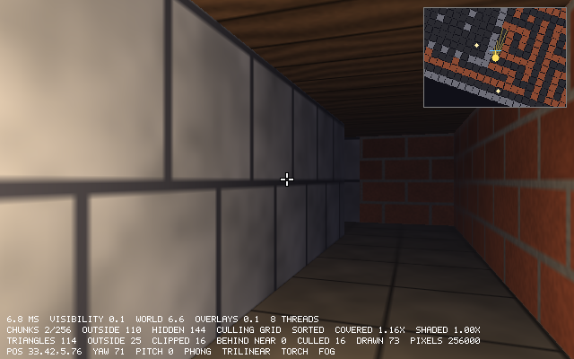

# Chapter 24 — Performance and Finishing

`delve` is a game now. You can walk through the labyrinth, by lamplight and torchlight, past
textured walls, and the renderer draws only what can be seen. This last chapter makes it fast
and then finishes it. It starts by measuring. A stopwatch splits every frame into its stages,
and `zig build bench` replays the tour and prints the mean frame, the median, the 95th
percentile and the worst. A sampling profiler made from `gdb` and a dozen lines of shell shows
where the time goes: texture filtering, lighting and color conversion, nearly all of it once
per pixel. Then we try to make that code faster by hand with SIMD, three times, and lose all
three times. The compiler had vectorized the code already, and *Amdahl's law* explains why
speeding up a small part of a program barely changes the whole.

What does pay is cores. The screen is split into bands of rows, one per thread, with
`std.Io.Group`, and no locks are needed, because no two bands touch the same pixel. On 8 threads
the tour drops from about 15 ms a frame to about 3, and the same law, fitted to the
measurements, predicts how far more threads can go. Next come the release modes, and a mistake
in our own `build.zig` that has been there since Chapter 9. Then `delve` becomes version
1.0.0 with a README. The book ends by mapping every stage of `delve` onto a GPU. You have
written each of those stages yourself, so you know what the hardware does.

Previous: [Chapter 23 — Visibility and Occlusion](23-visibility-and-occlusion.md). Next:
[Appendix A — Cheat Sheet](appendix-a-cheatsheet.md).

## Measure first

Programmers are bad at guessing where time goes. A loop that looks expensive runs once per
frame, while a one-line helper runs half a million times. So before changing any code for speed,
we measure it, in two ways. A *clock* says how long something took. A *profiler* says what the
program was doing during that time. We start with the clock.

Chapter 22 timed frames with `std.Io.Timestamp`, the clock that `std.Io` provides. Timing one
run of something tells you little: the next run can take longer because another program had the
core, the cache was cold, or the operating system was doing its own work. So we time many
runs and look at how the times are spread out:

`examples/ch24/stopwatch.zig`

```zig
//! Timing with the std clock. Runs the same small job 1000 times, times
//! each run with `std.Io.Timestamp`, and prints the mean, the median, the
//! 95th percentile and the worst run. Run it twice: once on a quiet
//! machine, once while something else keeps the cores busy.
const std = @import("std");

/// The job: a few thousand square roots. `doNotOptimizeAway` keeps the
/// compiler from noticing that nobody uses the result.
fn job() void {
    var sum: f32 = 0;
    for (0..20_000) |i| sum += @sqrt(@as(f32, @floatFromInt(i)));
    std.mem.doNotOptimizeAway(sum);
}

pub fn main(init: std.process.Init) !void {
    const io = init.io;
    var times: [1000]u64 = undefined;
    for (&times) |*t| {
        const start: std.Io.Timestamp = .now(io, .awake);
        job();
        t.* = @intCast(start.durationTo(.now(io, .awake)).nanoseconds);
    }

    var sum: u64 = 0;
    for (times) |t| sum += t;
    std.mem.sort(u64, &times, {}, std.sort.asc(u64));
    const n = times.len;
    const us = struct {
        fn f(ns: u64) f64 {
            return @as(f64, @floatFromInt(ns)) / 1000;
        }
    }.f;
    std.debug.print("{d} runs\n", .{n});
    std.debug.print("mean   {d:>8.2} us\n", .{us(sum) / @as(f64, @floatFromInt(n))});
    std.debug.print("median {d:>8.2} us\n", .{us(times[(n - 1) / 2])});
    std.debug.print("95%    {d:>8.2} us\n", .{us(times[(n - 1) * 95 / 100])});
    std.debug.print("worst  {d:>8.2} us\n", .{us(times[n - 1])});
    std.debug.print("best   {d:>8.2} us\n", .{us(times[0])});
}
```

```console
$ zig run examples/ch24/stopwatch.zig
1000 runs
mean      37.58 us
median    36.56 us
95%       41.17 us
worst    114.14 us
best      35.73 us
```

The same program, while four copies of `delve` were drawing the tour on 32 threads each:

```console
$ zig run examples/ch24/stopwatch.zig
1000 runs
mean      40.03 us
median    37.54 us
95%       46.22 us
worst     74.00 us
best      35.73 us
```

- The *median* is the middle run: half the runs were faster, half slower. The *95th
  percentile* is the run that 95% of the runs beat. Both come from the sorted list, at index
  (n − 1)/2 and (n − 1)·95/100.
- The best run is the same, 35.73 µs, on the quiet and the busy machine. The job did not get
  slower. Sometimes another program had the core, and that run had to wait for it to come back.
- Under load the mean rose 7%, the median 3%, and the 95th percentile 12%. Interference shows
  up mostly in the slow runs, and the mean hides that.
- The worst run was worse on the *quiet* machine (114 µs). One run is one event: a page fault, an
  interrupt, the scheduler. Never judge a program by its single worst time, and never by its
  single best time either.
- This is a Debug build, which is fine here: the program measures the machine, not itself.

Games care about these numbers in a particular way. A frame that takes 30 ms among frames of 3
ms is a visible hitch: the picture stops for two refreshes of a 60 Hz display. A game that
always takes 5 ms feels smoother than one that averages 3 ms and stalls once a second. So
`delve` reports the mean, which says how much work a frame is, and the median, the 95th
percentile and the worst frame, which say how steady it is.

### A stopwatch for each stage

A frame of `delve` has three stages: working out what can be seen (Chapter 23), drawing the
world, and drawing the overlays on top (crosshair, minimap, HUD). The new file `profile.zig`
times each one:

`src/profile.zig`

```zig
/// The stages of `App.render`, in order.
pub const Stage = enum {
    /// Working out which chunks to draw.
    visibility,
    /// Clearing the screen and drawing the world: the 3D pipeline.
    world,
    /// The crosshair, minimap, and numbers on top.
    overlays,
};

/// Nanoseconds spent in each stage.
pub const Times = std.EnumArray(Stage, u64);

pub fn total(times: Times) u64 {
    var sum: u64 = 0;
    for (times.values) |ns| sum += ns;
    return sum;
}

pub const Stopwatch = struct {
    io: std.Io,
    last: std.Io.Timestamp,
    times: Times = .initFill(0),

    pub fn start(io: std.Io) Stopwatch {
        return .{ .io = io, .last = .now(io, .awake) };
    }

    /// Adds the time since the last lap (or the start) to `stage`.
    pub fn lap(w: *Stopwatch, stage: Stage) void {
        const now: std.Io.Timestamp = .now(w.io, .awake);
        w.times.getPtr(stage).* += @intCast(w.last.durationTo(now).nanoseconds);
        w.last = now;
    }
};
```

- `std.EnumArray(Stage, u64)` is an array with one `u64` per tag of the enum, indexed by the
  tag: `times.get(.world)`, `times.getPtr(.world)`. Its `values` field is the plain array
  underneath, in the order the tags are declared.
- A stopwatch does not start and stop for each stage. It *laps*: each `lap` charges the time
  since the previous lap to one stage. Nothing between two laps is left out, so the stages
  always add up to the whole frame.
- The clock is `.awake`, which does not count time the computer spends asleep. It is the clock
  Chapter 22 used for the frame time.

`App.render` starts a stopwatch and laps three times:

`src/app.zig`

```zig
    pub fn render(app: *App, canvas: Canvas) void {
        var stopwatch: profile.Stopwatch = .start(app.io);
        // ...
        if (sees_world and (!app.frozen or !app.visibility.valid)) {
            // ...
            app.visibility.update(app.map, app.world, cam, view_proj, aspect, app.culling, app.sort);
        }
        stopwatch.lap(.visibility);
        // ...
        switch (app.view) {
            .solid, .depth, .levels, .chunks, .overdraw => {
                // ... clear, light, draw the world ...
                stopwatch.lap(.world);
                // ... crosshair and minimap ...
            },
            // ... the other views ...
        }

        // The views without a lap of their own count as drawing the world.
        if (stopwatch.times.get(.world) == 0) stopwatch.lap(.world);
        if (app.show_bands and banded) app.drawBands(canvas);
        if (app.show_info) app.drawInfo(canvas, stats, sees_world);
        stopwatch.lap(.overlays);
        app.frame_times = stopwatch.times;
        @memcpy(app.last_band_times, app.band_times);
    }
```

`app.frame_times` replaces Chapter 22's `render_ms`. In a window, the HUD shows the last frame's
times on a line of its own, like `6.8 MS  VISIBILITY 0.1  WORLD 6.6  OVERLAYS 0.1  8 THREADS`.
It shows the *last* frame's because this frame is not finished when its HUD is drawn.
Headless runs leave this line out (`show_times` is set only by `runWindowed`): times differ from
run to run, and the headless images must stay the same from run to run.

### A benchmark: `--bench`

One frame's times are too noisy to compare. A *benchmark* runs the same work many times and
summarizes it. `delve` already has a fixed, repeatable piece of work: the tour demo of Chapter
22, 1983 ticks of recorded input through the labyrinth. `Bench` collects every frame's times
and summarizes them:

`src/profile.zig`

```zig
/// The times of every frame of a run.
pub const Bench = struct {
    /// Each frame's total, in nanoseconds.
    frames: std.ArrayList(u64) = .empty,
    /// Each stage's total over all frames.
    stages: Times = .initFill(0),

    pub fn deinit(b: *Bench, gpa: std.mem.Allocator) void {
        b.frames.deinit(gpa);
    }

    pub fn add(b: *Bench, gpa: std.mem.Allocator, times: Times) !void {
        try b.frames.append(gpa, total(times));
        for (&b.stages.values, times.values) |*sum, ns| sum.* += ns;
    }

    /// Prints the mean frame time, then the median, the 95th percentile,
    /// and the worst: a mean hides the slow frames that make a game feel
    /// jerky. Sorts the frames.
    pub fn report(b: *Bench, w: *std.Io.Writer) !void {
        const n = b.frames.items.len;
        if (n == 0) return;
        std.mem.sort(u64, b.frames.items, {}, std.sort.asc(u64));
        const sorted = b.frames.items;
        const mean = ms(total(b.stages)) / @as(f64, @floatFromInt(n));
        try w.print("{d} frames  mean {d:.2} ms ({d:.0} fps)  median {d:.2}  95% {d:.2}  worst {d:.2}\n", .{
            n,
            mean,
            1000 / mean,
            ms(sorted[(n - 1) / 2]),
            ms(sorted[(n - 1) * 95 / 100]),
            ms(sorted[n - 1]),
        });
        try w.writeAll("per frame:");
        for (std.enums.values(Stage)) |stage| {
            try w.print("  {t} {d:.2} ms", .{ stage, ms(b.stages.get(stage)) / @as(f64, @floatFromInt(n)) });
        }
        try w.writeAll("\n");
    }
};
```

- The mean comes from the stage sums, which add up to the sum of all frames; there is no need
  to add the frames up a second time.
- `{t}` prints an enum's tag name: `visibility`, `world`, `overlays`.
- `report` writes to any `*std.Io.Writer`, so the test can collect the text in memory and
  compare it to the exact expected text:

```zig
test "the bench report gives the mean, median, 95th percentile and worst frame" {
    const gpa = std.testing.allocator;
    var b: Bench = .{};
    defer b.deinit(gpa);
    // Frames of 1 to 100 ms, out of order, all of it drawing the world
    // except 0.5 ms of overlays each.
    for (0..100) |i| {
        const frame_ms = (i * 37) % 100 + 1;
        try b.add(gpa, .init(.{ .visibility = 0, .world = frame_ms * 1_000_000 - 500_000, .overlays = 500_000 }));
    }
    var out: std.Io.Writer.Allocating = .init(gpa);
    defer out.deinit();
    try b.report(&out.writer);
    try std.testing.expectEqualStrings(
        \\100 frames  mean 50.50 ms (20 fps)  median 50.00  95% 95.00  worst 100.00
        \\per frame:  visibility 0.00 ms  world 50.00 ms  overlays 0.50 ms
        \\
    , out.written());
}
```

Since 37 and 100 have no common factor, `(i * 37) % 100` visits every number from 0 to 99
once, in a scrambled order, so the frames are 1 to 100 ms exactly. Their mean is 50.5, the
50th of them in sorted order is 50, the 95th is 95.

`main.zig` adds each frame to a `Bench` when `--bench` is given, in the headless loop and in the
window, and prints the report at the end:

`src/main.zig`

```zig
    if (bench) |*b| {
        var buffer: [256]u8 = undefined;
        var stdout = std.Io.File.stdout().writer(init.io, &buffer);
        try stdout.interface.print("delve {s}, {t} build, threads: {d}, map: {s}\n", .{
            @import("options.zig").version,
            builtin.mode,
            if (app.threaded) app.bands.len else 1,
            map_name,
        });
        try b.report(&stdout.interface);
        try stdout.interface.flush();
    }
```

The report goes to standard output, so it can be piped and saved, while errors stay on
standard error. The first line says *what* was measured: the version, the build mode (more on
that later in this chapter), the threads and the map. A number without those is not worth
keeping.

`build.zig` gets a step that runs the tour headless with `--bench`:

`build.zig`

```zig
    // `zig build bench --release=fast`: time the tour, without a window.
    // Extra arguments are added, for example `-- --threads 1`.
    const bench_cmd = b.addRunArtifact(exe);
    bench_cmd.addArgs(&.{ "--headless", "--demo", "tour", "--bench" });
    bench_cmd.addPassthruArgs();
    b.step("bench", "Time the tour demo").dependOn(&bench_cmd.step);
```

The threads come later in this chapter; for now, one:

```console
$ zig build bench --release=fast -- --threads 1
delve 1.0.0, fast build, threads: 1, map: labyrinth
1983 frames  mean 15.31 ms (65 fps)  median 15.08  95% 19.08  worst 29.41
per frame:  visibility 0.08 ms  world 15.16 ms  overlays 0.07 ms
```

- Drawing the world is 99% of the frame. Chapter 23's visibility, rays and all, costs 0.08 ms,
  and the overlays as much. Anything we speed up must be in the world.
- 65 frames per second is enough for a 60 Hz display, but not with room to spare: the 95th
  percentile is above 16.7 ms, the time a 60 Hz display shows each picture.
- The machine these numbers come from is shared with other work (32 logical CPUs, under WSL2).
  The same command gave means of 14.73, 15.21 and 15.57 ms on other runs. Chapter 23 measured
  this tour at 14.68 ms per frame of CPU time. The last digit is noise, and the first two are
  what we can compare.

The stopwatch itself costs nothing we can measure. The whole tour, pinned to one CPU, took 29.21
and 29.45 s with Chapter 23's `delve` and 29.19 and 29.40 s with this one on one thread:

```console
$ /usr/bin/time -f "%e s" taskset -c 12 ../ch23/zig-out/bin/delve --headless --demo tour
29.21 s
$ /usr/bin/time -f "%e s" taskset -c 12 ./zig-out/bin/delve --headless --demo tour --threads 1
29.19 s
```

(The tour includes 1983 frames, 15 ms each, plus building the world and the textures at
startup.)

## A profiler from a debugger

The stopwatch says the world takes 15 ms. What in the world? The world is a hundred functions
deep, and putting laps in all of them would change what we measure. A *sampling profiler* does
it the other way round. It stops the program often, at random moments, writes down where it was,
and lets it go on. A function that takes 20% of the time is where the program is in about 20%
of the samples.

Linux has `perf`, macOS has Instruments, Windows has its own tools, and every one of them works
differently. They may also be missing: this machine runs Linux under WSL2, without `perf`. But a
debugger can do the same thing, and `gdb` is available almost everywhere. Stopping a program
and printing its stack is exactly what a debugger does. Do it 300 times and count. This is
known as the *poor man's profiler*.

The usual way is to attach `gdb` to the running program with `gdb -p PID`. Here that fails:

```console
$ gdb -batch -ex bt -p "$pid"     # pid: a delve that is running
Could not attach to process.  If your uid matches the uid of the target
process, check the setting of /proc/sys/kernel/yama/ptrace_scope, or try
again as the root user.  For more details, see /etc/sysctl.d/10-ptrace.conf
ptrace: Inappropriate ioctl for device.
```

Many Linux systems set `ptrace_scope` to 1: a process may only debug its own children. So
`gdb` must *start* the program. Then the program is its child, and `gdb` may stop it. The
script runs `gdb` in the background with a long list of commands: run, print the stack, and
then N − 1 times continue and print the stack. Meanwhile the shell sends the program a SIGINT
every 0.05 s. `gdb` stops the program on each one, runs its next commands, and so on:

`examples/ch24/pmp.sh`

```bash
#!/usr/bin/env bash
# A sampling profiler made of gdb and a shell loop ("poor man's profiler").
# Starts PROGRAM under gdb, interrupts it every INTERVAL seconds, and has
# gdb print the stack each time. Summarize the output with pmp_summary.py.
#
#   usage: pmp.sh SAMPLES INTERVAL PROGRAM [ARGS...] > stacks.txt
set -u
samples=$1
interval=$2
shift 2

# gdb stops on SIGINT without passing it on, prints 12 frames, continues;
# after the last sample it kills the program instead of continuing.
cmds=(-iex "set debuginfod enabled off" -ex "set pagination off" -ex "set width 0"
      -ex "set print frame-arguments none"
      -ex "handle SIGINT stop print nopass" -ex run -ex "bt 12")
for ((i = 1; i < samples; i++)); do cmds+=(-ex continue -ex "bt 12"); done
gdb -batch -nx "${cmds[@]}" -ex kill --args "$@" &
gdb_pid=$!

# The program is gdb's child: gdb started it, so it may trace it even
# where attaching to a running process is forbidden.
pid=""
while [ -z "$pid" ]; do
  sleep 0.1
  pid=$(pgrep -P "$gdb_pid" | head -1)
done
for ((i = 0; i < samples; i++)); do
  sleep "$interval"
  kill -INT "$pid" 2>/dev/null || break
done
wait "$gdb_pid"
```

- `handle SIGINT stop print nopass`: on SIGINT, stop and say so, and do not pass the signal on
  to the program, which would end it.
- `bt 12` prints the innermost 12 frames of the stack. That is enough to see which function
  called which; deeper frames are `main` and the start-up code.
- `pgrep -P` lists the children of a process: the program `gdb` started.
- `set print frame-arguments none` prints `...` in place of each argument's value. The
  values are long and are not needed here.

`gdb` prints each stack like this one:

```text
Program received signal SIGINT, Interrupt.
0x00000000010f8845 in render3d.toColor () at /home/tbangma/learn-game-graphics/project/ch24/src/render3d.zig:81
81	    const rgb = @round(std.math.clamp(Vec3{ vary[0], vary[1], vary[2] }, @as(Vec3, @splat(0)), @as(Vec3, @splat(255))));
#0  0x00000000010f8845 in render3d.toColor () at /home/tbangma/learn-game-graphics/project/ch24/src/render3d.zig:81
#1  light.Shader.pixel (s=...) at /home/tbangma/learn-game-graphics/project/ch24/src/light.zig:206
#2  render3d.Fragment(light.Shader).pixel (x=..., y=...) at /home/tbangma/learn-game-graphics/project/ch24/src/render3d.zig:191
#3  raster.fillTriangleRows__func_787 (v=..., first_row=...) at /home/tbangma/learn-game-graphics/project/ch24/src/raster.zig:98
#4  render3d.Renderer.drawMesh__func_785 (r=..., canvas=..., ...) at /home/.../src/render3d.zig:...
```

(Shortened: the stack goes on to `main.main`, frame #9.) Frames #1 to #4 have no address:
they were *inlined* into `toColor`'s caller, so they have no code of their own, but the
debug information still records which source function each instruction came from. Zig names
each instance of a generic function: `fillTriangleRows__func_787` is the one for this
visitor type. A short Python script counts what the stacks say:

`examples/ch24/pmp_summary.py`

```python
#!/usr/bin/env python3
"""Counts the stacks that pmp.sh printed: the function each sample was in
(self), the source line, and every function on the stack (inclusive).

    usage: pmp_summary.py stacks.txt
"""
import collections
import re
import sys

# "#0  0x00000000011ba4e1 in texture.Texture.bilinear (...) at src/texture.zig:198"
# Inlined frames have no address: "#1  texture.Texture.filtered (...) at ...".
FRAME = re.compile(r"^#(\d+)\s+(?:0x[0-9a-f]+ in )?(\S+) \(.*?\)(?: at (\S+):(\d+))?")


def short(name):
    # Zig adds "__anon_1234" or "__func_787" to the names of generic
    # instances; one name per function is enough.
    return re.sub(r"__(anon|func)_\d+", "", name)


stacks = []
with open(sys.argv[1]) as f:
    for line in f:
        m = FRAME.match(line)
        if not m:
            continue
        if m.group(1) == "0":
            stacks.append([])
        if stacks:
            # The last two parts of the path tell src/math.zig from std/math.zig.
            where = f"{'/'.join(m.group(3).split('/')[-2:])}:{m.group(4)}" if m.group(3) else "?"
            stacks[-1].append((short(m.group(2)), where))

n = len(stacks)
self_count = collections.Counter(s[0][0] for s in stacks)
line_count = collections.Counter(s[0][1] for s in stacks)
# A function counts once per sample, however often it is on the stack.
incl_count = collections.Counter(name for s in stacks for name in {f for f, _ in s})


def show(title, counter):
    print(title)
    for name, c in counter.most_common(12):
        print(f"  {100 * c / n:5.1f}%  {name}")


print(f"samples {n}")
show("self (the function the program was in)", self_count)
show("lines", line_count)
show("inclusive (on the stack)", incl_count)
```

- *Self* counts frame #0 only: the function the program was in. *Inclusive* counts every
  function on the stack once per sample: the share of time spent inside it or in anything it
  called.
- The line count points at single lines of source, which is where the profile becomes useful.

We profile one pose, the one at frame 700 of the tour (`--pos 15.4,12.29 --yaw 291`), with
Phong shading and trilinear filtering, the defaults. `--frames 100000` keeps `delve` busy long
enough for 300 samples, 15 seconds; after the last one, `gdb` kills it. The run must use one
thread. On 8 threads, the main thread spends the frame waiting for the others, and the samples
would show it waiting.

```console
$ zig build --release=fast
$ ../../examples/ch24/pmp.sh 300 0.05 ./zig-out/bin/delve --headless --frames 100000 \
    --pos 15.4,12.29 --yaw 291 --threads 1 > stacks.txt 2>/dev/null
$ python3 ../../examples/ch24/pmp_summary.py stacks.txt
samples 300
self (the function the program was in)
   20.3%  texture.Texture.bilinear
   14.7%  texture.Texture.filtered
   11.7%  math.lerp
   11.3%  light.Scene.lightAt
    8.0%  render3d.toColor
    7.7%  math.clamp
    4.3%  texture.fastLog2
    3.7%  raster.fillTriangleRows
    3.7%  render3d.Fragment(light.Shader).pixel
    2.3%  light.Material.at
    2.3%  texture.rgb
    2.3%  light.Shader.pixel
lines
   12.7%  src/math.zig:34
    8.0%  src/texture.zig:89
    7.7%  std/math.zig:536
    6.3%  src/render3d.zig:82
    4.3%  src/light.zig:94
    4.3%  src/texture.zig:57
    3.0%  src/texture.zig:71
    3.0%  src/texture.zig:90
    2.7%  src/light.zig:200
    2.7%  src/light.zig:95
    2.3%  src/texture.zig:139
    2.3%  src/texture.zig:60
inclusive (on the stack)
   99.7%  app.App.render
   98.0%  render3d.Renderer.drawMesh
   98.0%  world.World.draw
   98.0%  app.App.drawWorld
   98.0%  maze3d.drawPart
   97.7%  raster.fillTriangleRows
   94.0%  render3d.Fragment(light.Shader).pixel
   88.3%  main.main
   88.3%  light.Shader.pixel
   53.3%  light.Material.at
   51.0%  texture.Texture.filtered
   27.0%  texture.Texture.bilinear
```

Reading it from the bottom up:

- 94% of the samples are inside `Fragment.pixel`, the code that runs once per pixel. The frame
  *is* its pixels. The rasterizer's own loop, `fillTriangleRows`, is 3.7% self: stepping
  edge functions is cheap.
- `Material.at`, reading the texture, is more than half. Trilinear filtering reads two mip
  levels with `bilinear` and blends them with `math.lerp`: that is the line `src/math.zig:34`,
  `return a + scale(b - a, t);`, at 12.7%. `src/texture.zig:89` is
  `@intFromFloat(@floor(lod))`, choosing the level, and `fastLog2` works out the level of
  detail (Chapter 20).
- `lightAt`, the lighting of Chapter 19, is 11%.
- `toColor` and `math.clamp` (in the standard library, `std/math.zig:536`, which is
  `return @max(lower, @min(val, upper));`) turn the float color into bytes: about 15% together.
  Most of that clamping is `toColor`'s, at `src/render3d.zig:81` and `:82`.
- `main.main` is only 88% inclusive, not 99%: `bt 12` stops at 12 frames, and some stacks are
  deeper than that. The first sample (one of 300) was in the dynamic loader, before `delve`
  started.

Take these numbers as a rough picture, not exact percentages. In an optimized build, the
compiler inlines small functions into their callers and mixes their instructions, so the
debug information sometimes charges an instruction to the wrong line. 300 samples also have
an error of a few percent: a function seen in 30 samples could be 8% or 12% of the time. The
profile still makes the main point plainly. The time goes into texture reads first, then
lighting, then color conversion, nearly all of it per pixel.

### Checking the profile

A profile is a theory. We can test it: switch a feature off and see whether the time goes
down by as much as the profile says. Here is the whole tour on one thread, each run pinned to
one CPU with `taskset` so that the scheduler cannot move it, best of two runs:

```console
$ taskset -c 12 ./zig-out/bin/delve --headless --demo tour --bench --threads 1 --filter nearest
delve 1.0.0, fast build, threads: 1, map: labyrinth
1983 frames  mean 7.87 ms (127 fps)  median 8.00  95% 8.99  worst 17.10
per frame:  visibility 0.08 ms  world 7.72 ms  overlays 0.07 ms
```

| Tour, 1 thread, ms per frame | Phong | Gouraud | Flat | Unlit |
|---|---|---|---|---|
| trilinear (the default) | 14.79 | 12.06 | 12.01 | 12.33 |
| bilinear | 9.36 | | | |
| nearest | 7.87 | | | 5.02 |
| no textures (`--press toggle_textures`) | 7.02 | | | 3.41 |

- Trilinear filtering costs about 7 ms over nearest, with Phong (14.79 against 7.87) and unlit
  (12.33 against 5.02) alike. Nearest reads one texel. Bilinear reads four and blends them,
  and trilinear does that twice and blends the results. This is the profile's "half the time
  in `Material.at`".
- Phong costs about 2.5 ms over unlit (14.79 against 12.33): the profile's 11% for `lightAt`
  and some of `Shader.pixel`. Gouraud and flat shading light the vertices, a few thousand per
  frame, and cost nothing we can measure here.
- With no textures and no lighting, 3.41 ms is left: transforming, clipping, rasterizing,
  the depth test and writing the pixels. That is the floor of this pipeline.

Pinning matters on a shared machine. Without `taskset`, one run of the default configuration
measured 20.98 ms instead of 14.79: the scheduler put it on a core that something else was
using. A 300-frame run pinned in turn to each of the 32 CPUs measured 13.6 to 14.3 ms on 26 of
them, 14.5 to 16.8 ms on five, and 28 ms on one that was busy with other work.

## The compiler got there first

The profile says the time goes into per-pixel float arithmetic. The obvious idea is SIMD: do
the arithmetic for 8 floats at once, with one instruction. This machine's CPU has AVX2, whose
256-bit `ymm` registers hold 8 `f32`s (AVX-512's 16-wide `zmm` registers are not available
here). Zig exposes SIMD with `@Vector`, which Chapter 11 used for `Vec2` and `Vec3`. Before
writing any by hand, let us see what the compiler does with a plain loop:

`examples/ch24/vector_vs_scalar.zig`

```zig
//! A dot product of two arrays, written twice: a plain loop, and with
//! `@Vector(8, f32)`, eight products at a time. Times both. Build it in
//! Debug and in ReleaseFast, and compare; then read both functions in
//! `objdump -d`.
const std = @import("std");

const n = 1 << 20;
const repeats = 200;

const V = @Vector(8, f32);

noinline fn dotScalar(a: []const f32, b: []const f32) f32 {
    var sum: f32 = 0;
    for (a, b) |x, y| sum += x * y;
    return sum;
}

noinline fn dotVector(a: []const f32, b: []const f32) f32 {
    var sum: V = @splat(0);
    var i: usize = 0;
    while (i + 8 <= a.len) : (i += 8) {
        const x: V = a[i..][0..8].*;
        const y: V = b[i..][0..8].*;
        sum += x * y;
    }
    var rest: f32 = 0;
    while (i < a.len) : (i += 1) rest += a[i] * b[i];
    return @reduce(.Add, sum) + rest;
}

fn time(io: std.Io, f: *const fn ([]const f32, []const f32) f32, a: []const f32, b: []const f32) struct { f32, f64 } {
    var result: f32 = 0;
    var best: i96 = std.math.maxInt(i96);
    for (0..repeats) |_| {
        const start: std.Io.Timestamp = .now(io, .awake);
        result = f(a, b);
        std.mem.doNotOptimizeAway(result);
        best = @min(best, start.durationTo(.now(io, .awake)).nanoseconds);
    }
    return .{ result, @as(f64, @floatFromInt(best)) / 1000 };
}

pub fn main(init: std.process.Init) !void {
    const gpa = init.gpa;
    const io = init.io;
    const a = try gpa.alloc(f32, n);
    defer gpa.free(a);
    const b = try gpa.alloc(f32, n);
    defer gpa.free(b);
    var prng: std.Random.DefaultPrng = .init(8);
    for (a, b) |*x, *y| {
        x.* = prng.random().float(f32);
        y.* = prng.random().float(f32);
    }

    const builtin = @import("builtin");
    std.debug.print("{t} build, {d} floats, best of {d}\n", .{ builtin.mode, n, repeats });
    const s_sum, const s_us = time(io, dotScalar, a, b);
    const v_sum, const v_us = time(io, dotVector, a, b);
    std.debug.print("scalar  {d:>8.1} us  sum {d}\n", .{ s_us, s_sum });
    std.debug.print("vector  {d:>8.1} us  sum {d}\n", .{ v_us, v_sum });
    std.debug.print("vector is {d:.2}x as fast\n", .{s_us / v_us});
}
```

```console
$ zig run examples/ch24/vector_vs_scalar.zig
debug build, 1048576 floats, best of 200
scalar    1873.9 us  sum 261899.44
vector    1872.1 us  sum 261932.89
vector is 1.00x as fast
$ zig run -O ReleaseFast examples/ch24/vector_vs_scalar.zig
fast build, 1048576 floats, best of 200
scalar     466.8 us  sum 261899.44
vector     143.2 us  sum 261932.89
vector is 3.26x as fast
```

- `noinline` keeps each function a function of its own, so that it can be found in the
  disassembly and is not optimized together with its caller.
- `a[i..][0..8].*` is an array of 8 floats (a slice with a length known at compile time,
  dereferenced), and an array coerces to a vector of the same length.
- `@reduce(.Add, sum)` adds the 8 lanes of the vector together.
- In Debug the two take the same time: neither is optimized, and the vector code is
  turned into 8 scalar operations anyway.
- In ReleaseFast, the vector version is 3.3 times as fast (3.8 in another run). The sums are
  *different*.

The compiler did not turn the scalar loop into vector code. `objdump -d` (from GNU binutils)
shows the machine code of the ReleaseFast build. Here is the inner loop of each:

```console
$ zig build-exe -O ReleaseFast examples/ch24/vector_vs_scalar.zig
$ objdump -d --no-show-raw-insn vector_vs_scalar | less
```

```text
<vector_vs_scalar.dotScalar>:
  ...
  vmovss (%rdi,%rcx,4),%xmm1
  vmovss 0x4(%rdi,%rcx,4),%xmm2
  vmulss (%rdx,%rcx,4),%xmm1,%xmm1
  vaddss %xmm1,%xmm0,%xmm0
  vmulss 0x4(%rdx,%rcx,4),%xmm2,%xmm1
  vmovss 0x8(%rdi,%rcx,4),%xmm2
  vmulss 0x8(%rdx,%rcx,4),%xmm2,%xmm2
  vaddss %xmm1,%xmm0,%xmm0
  vaddss %xmm2,%xmm0,%xmm0
  ... (five more vmulss and vaddss)
  add    $0x8,%rcx

<vector_vs_scalar.dotVector>:
  ...
  vmovups (%rdi,%rcx,4),%ymm1
  vmulps (%rdx,%rcx,4),%ymm1,%ymm1
  vaddps %ymm1,%ymm0,%ymm0
```

- `ss` means *scalar single*: one `f32`. `ps` means *packed single*: all the floats in the
  register, 8 of them in a `ymm`.
- The scalar loop was unrolled: 8 elements per pass, to save the loop overhead. But every
  `vaddss` adds into the same register, `%xmm0`. Each addition has to wait for the one before it,
  which takes a few cycles to finish.
- The vector loop keeps 8 separate sums, one per lane, and adds 8 products to them with one
  instruction.

Why didn't the compiler do this itself? Because it would change the answer. Float addition is
not associative: (a + b) + c and a + (b + c) can round differently. The scalar loop asks for
((s + x₀y₀) + x₁y₁) + …, in that order, and the compiler must give exactly that. The vector
version asks for something else: 8 partial sums, added together at the end. That is a
different calculation, and it gives a different result, 261932.89 instead of 261899.44.
(The 8 partial sums are each smaller, so each addition loses less to rounding. The vector
version's sum is the more accurate of the two. The order you write a calculation in matters.)
Telling the compiler that reordering is allowed, with `@setFloatMode(.optimized)` in the scalar
function, was not enough here: it fused each multiply and add into one `vfmadd` instruction,
but kept the single chain.

Most of `delve`'s float arithmetic is not one long sum. It is the same operation on the
three channels of a color, the 16 varyings of a vertex, or the three edge functions. Those
are already written as `@Vector`s, ever since Chapter 11, so the compiler can turn each into
vector instructions. Let us count them in `delve`:

```console
$ objdump -d zig-out/bin/delve | grep -c ymm
14192
$ objdump -d zig-out/bin/delve | grep -c zmm
0
$ objdump -d zig-out/bin/delve | grep -c vmulps
2860
$ objdump -d zig-out/bin/delve | grep -c vaddps
1803
$ objdump -d zig-out/bin/delve | grep -c vfmadd
1604
$ objdump -d zig-out/bin/delve | grep -c 'call.*<roundf'
0
```

- 14,192 instructions use the 8-wide `ymm` registers. (The binary includes raylib, which has
  some of its own; `delve`'s per-pixel code has plenty too.) The 16 varyings of Chapter 20,
  `@Vector(16, f32)`, are two `ymm` registers, and interpolating them is a few `vmulps` and
  `vaddps`. A `Vec3` fits in a 4-wide `xmm` register.
- `@round` and `@floor` became `vroundps` and `vroundss` instructions; there are no calls to the
  C library's `roundf` or `floorf`.
- The Phong pixel loop, `drawMesh`'s instance for the Phong shader with everything inlined into
  it, is 879 instructions: 71 use `ymm` registers, 126 use packed `xmm`, 101 are scalar.

Before writing SIMD by hand, read what the compiler made. Often, as here, it has done the easy
part already.

## Three experiments that lost

We tried anyway. While `delve` was being written, three hand-written SIMD versions of hot
code were built and timed on the tour, in ReleaseFast. All three were slower than what they
replaced, and none of them is in the project. The numbers below were measured at that time,
the same way as the rest of this chapter (the tour's mean frame on one thread). They are
reported here, not rerun, so there is no console output for them.

**(a) Eight pixels at once.** The rasterizer tests one pixel at a time: three edge functions,
three signs. With `@Vector(8, i32)`, the three edge functions of 8 neighboring pixels can be
computed with a few instructions. A comparison gives a vector of 8 `bool`s, and `@bitCast`
turns that into an 8-bit integer, one bit per pixel. A loop with `@ctz` (count trailing
zeros) then visits the set bits. Here is the mask part on its own, with one mistake:

```zig
const std = @import("std");

pub fn main() void {
    const xs: @Vector(8, i32) = .{ 3, -1, 4, -1, 5, -9, 2, 6 };
    const inside = xs >= @as(@Vector(8, i32), @splat(0));
    const mask: std.meta.Int(.unsigned, 8) = @bitCast(inside);
    std.debug.print("{b:0>8}\n", .{mask});
}
```

```console
$ zig run mask_mistake.zig
mask_mistake.zig:6:25: error: root source file struct 'meta' has no member named 'Int'
    const mask: std.meta.Int(.unsigned, 8) = @bitCast(inside);
                ~~~~~~~~^~~~
```

Older Zig code builds integer types with `std.meta.Int`. In Zig 0.17 that function is gone,
and the builtin `@Int(.unsigned, 8)` does the same thing. With that change:

```console
$ zig run mask_mistake.zig
11010101
```

Lane 0 is the lowest bit, printed last: 3 ≥ 0 gives the 1 at the right, −1 the 0 next to it.

In `delve`, this lost. With the 8-wide edge vectors kept live across the call to the pixel
visitor, a frame took 22 ms against 16. The visitor needs most of the registers, so the
vectors had to be saved to memory and loaded back around every call (a *register spill*).
Rebuilding the vectors for each block of 8 from the scalar edge values fixed that, and it was
still about 2% slower with Phong shading and 6% slower unlit (3.79 against 3.57 ms).

**(b) Trilinear filtering as vectors.** Filtering is the biggest item in the profile. This
version put both mip levels' texture coordinates in one `@Vector(4, f32)` and computed the
weighted sum of all 8 texels with vector arithmetic. It drew exactly the same pixels (compared
with ImageMagick's `compare -metric AE`, 0 pixels differed) and was about 4% slower. Each
texel's color was already a `Vec3`, blended with vector instructions. Packing the coordinates
together added shuffles between registers, and the eight memory reads were not faster.

**(c) Lights as structure of arrays.** `lightAt` loops over the lights that reach a cell and
skips each one as soon as it is too far away. This version stored the lights as a *structure of
arrays* (SoA): one vector of 8 x coordinates, one of 8 y, and so on. It handled 8 lights per
step, with a `@select` mask for the ones in range and `@reduce` to add up their light. It
was 12% slower: 17.2 against 15.4 ms. Most surfaces are reached by one to three lights, and the
scalar loop does work only for those. The vector version did the work for all 8 every time.

### Amdahl's law

Experiment (a) could never have won much, and a little arithmetic shows why. Say a program
takes time 1, and a part p of it is made s times faster. The rest, 1 − p, is unchanged.
The new time is

```text
T = (1 - p) + p / s
```

and the speedup is 1/T. This is *Amdahl's law*, after Gene Amdahl, who used it in 1967 to argue
that a computer's speed is limited by its serial part. Its consequence is simple: the
untouched part sets a limit. Even with s infinite, T is at least 1 − p, so the speedup is at
most 1/(1 − p).

The rasterizer's own loop, `fillTriangleRows`, was 3.7% of the samples. Make it 8 times faster,
which is the most 8 lanes can give:

```text
T = 0.963 + 0.037 / 8 = 0.968        speedup 1.033
```

3%, at best. Make it infinitely fast and the frame gets 3.8% faster. Experiment (a) also
added work to the pixels themselves, and the pixels are the other 96%. The lesson is the
one this chapter started with: profile, and then work on what the profile says takes time.

The SoA idea of experiment (c) was right, but in the wrong place. A GPU uses exactly that
layout, with *pixels* in the lanes: 32 or 64 neighboring pixels run the same shader at the
same time, one per lane. That works because every pixel of a triangle runs the same code,
whereas the number of lights changes from one surface to the next. The last section comes
back to this.

Amdahl's law also says what *will* pay. To make the whole frame much faster, we need to speed
up nearly all of it, and nearly all of it is per-pixel work that can be done in parallel: each
pixel's color depends only on its own varyings, textures and lights, which no other pixel
changes. This machine has 32 logical CPUs, and `delve` has been using one.

## Splitting the screen

How can several threads draw one frame? The first idea is to split the *triangles*: thread 1
draws the first half of the list, thread 2 the second half. But two triangles can cover the
same pixel, and drawing a pixel is three steps: read its depth, compare, write the color and
the new depth. If two threads do this to one pixel at the same time, the steps can interleave:

```text
thread 1: reads depth 1.0        (its wall is at 0.4)
thread 2: reads depth 1.0        (its wall is at 0.7)
thread 1: 0.4 < 1.0, writes its color and 0.4
thread 2: 0.7 < 1.0, writes its color and 0.7     the farther wall wins
```

This is a *data race*: the result depends on timing, and it can change from frame to frame.
Preventing it needs a lock or an atomic operation on every pixel, and that costs more than the
pixel.

The second idea is to split the *screen*. Cut it into horizontal bands of rows, one per thread.
Every thread goes through all the triangles, but fills only the pixels in its own band. A
pixel belongs to exactly one band, so only one thread ever reads or writes it, and its depth.
Everything else the threads use, the triangles, the textures and the lights, they only read.
Many threads may read the same memory at once; trouble starts only when one of them writes.
So no locks are needed.

The rasterizer needs one change: a way to fill only some rows. `fillTriangle` becomes a call
to a new function that takes the band's rows:

`src/raster.zig`

```zig
pub fn fillTriangle(v: [3]Point, width: usize, height: usize, visitor: anytype) void {
    fillTriangleRows(v, width, 0, height, visitor);
}

/// Like `fillTriangle`, but only rows `first_row` to `end_row - 1`: one
/// band of the screen, for one thread to draw (see render3d.zig).
pub fn fillTriangleRows(v: [3]Point, width: usize, first_row: usize, end_row: usize, visitor: anytype) void {
    const a, const b, const c = v;
    // ...
    // The bounding box of the triangle, in whole pixels, cut to the band.
    const min_x = @max(@divFloor(@min(a.x, b.x, c.x), one), 0);
    const min_y = @max(@divFloor(@min(a.y, b.y, c.y), one), @as(i32, @intCast(first_row)));
    const max_x = @min(@divFloor(@max(a.x, b.x, c.x), one), @as(i32, @intCast(width)) - 1);
    const max_y = @min(@divFloor(@max(a.y, b.y, c.y), one), @as(i32, @intCast(end_row)) - 1);
    if (min_x > max_x or min_y > max_y) return;
    // ... the rest as in Chapter 18
```

That is all. Chapter 18's rasterizer starts at the top of the triangle's bounding box and
steps the edge functions down one row at a time, and the box was already cut to the screen. Now
it is cut to the band. A triangle above or below the band is rejected by the last line,
before any edge function is computed. A pixel's edge function values do not depend on where
the stepping started, so each pixel gets the same values, and the same weights, in a band as
on the whole screen.

The test fills one triangle in four uneven bands, rows 0–5, 5–6, 6–17 and 17–32 of a 32×32
screen. The `Counter` visitor of Chapter 18 counts how often each pixel is visited:

`src/raster.zig`

```zig
test "bands of rows together cover what the whole screen covers" {
    const tri = [3]Point{ px(3.2, 1.7), px(30.1, 12.4), px(9.9, 31.3) };
    var whole: Counter = .{};
    fillTriangle(tri, Counter.size, Counter.size, &whole);
    var bands: Counter = .{};
    const cuts = [_]usize{ 0, 5, 6, 17, 32 };
    for (cuts[0..4], cuts[1..]) |first, end| {
        var band: Counter = .{};
        fillTriangleRows(tri, Counter.size, first, end, &band);
        for (band.counts, 0..) |row, y| for (row) |n| {
            // Nothing outside the band.
            if (y < first or y >= end) try testing.expectEqual(0, n);
        };
        for (&bands.counts, band.counts) |*total, row| {
            for (total, row) |*t, n| t.* += n;
        }
    }
    try testing.expectEqual(whole.counts, bands.counts);
}
```

`cuts[0..4]` and `cuts[1..]` walked side by side give the pairs (0, 5), (5, 6), (6, 17) and
(17, 32). The band of one row, 5–6, is there on purpose: edge cases live at the edges.

### A renderer per band

The renderer has scratch memory: `drawMesh` writes each vertex's world position, clip-space
position and varyings into arrays before it draws the triangles. Two threads cannot share
those arrays. So each band gets a renderer of its own, a copy of the main one with its own
scratch arrays and its own rows:

`src/render3d.zig`

```zig
pub const Renderer = struct {
    // ... world, clip, vary, depth, overdraw, width, height as before
    /// The rows this renderer fills: all of them, or one band (see
    /// `band`).
    first_row: usize,
    end_row: usize,
    /// A band shares the depth and overdraw buffers of the renderer it
    /// was made from, and must not free them.
    owns_screen: bool = true,

    // ...

    /// A renderer that fills only rows `first_row` to `end_row - 1` of
    /// `r`'s screen. It has its own scratch memory for vertices and shares
    /// the depth buffer, so several bands can draw at the same time, on
    /// different threads: no two of them touch the same pixel.
    pub fn band(r: Renderer, gpa: std.mem.Allocator, first_row: usize, end_row: usize) !Renderer {
        std.debug.assert(first_row < end_row and end_row <= r.height);
        const world = try gpa.alloc(Vec3, r.world.len);
        errdefer gpa.free(world);
        const clip_pos = try gpa.alloc(Vec4, r.clip.len);
        errdefer gpa.free(clip_pos);
        var b = r;
        b.world = world;
        b.clip = clip_pos;
        b.vary = try gpa.alloc(Varyings, r.vary.len);
        b.first_row = first_row;
        b.end_row = end_row;
        b.owns_screen = false;
        return b;
    }

    pub fn deinit(r: *Renderer, gpa: std.mem.Allocator) void {
        if (r.owns_screen) {
            gpa.free(r.depth);
            gpa.free(r.overdraw);
        }
        gpa.free(r.vary);
        gpa.free(r.clip);
        gpa.free(r.world);
        r.* = undefined;
    }
```

- `var b = r;` copies the struct: the slices in it still point at the main renderer's memory.
  Then the three scratch slices are replaced by new ones. `depth` and `overdraw` stay shared:
  every band writes into the one depth buffer, each into its own rows.
- Freeing the shared buffers twice would be a bug, so a band marks itself `owns_screen =
  false`. A double free is caught by the testing allocator in a test, but in a release build it
  would corrupt memory, with nothing printed.
- The one line in `drawMesh` that changes passes the rows on:
  `raster.fillTriangleRows(..., r.width, r.first_row, r.end_row, &fragment);`

Each band also counts its own `Stats`. Every band sees every triangle, so the triangle counts
(outside, clipped, culled, drawn) are the same in each band. The pixel counts are the band's own
pixels, so they add up:

`src/render3d.zig`

```zig
/// The stats of a frame drawn in bands. Every band went through every
/// triangle, so the triangle counts are the same in each; but each pixel
/// was drawn by one band, so the pixel counts add up.
pub fn combineBands(bands: []const Stats) Stats {
    var total = bands[0];
    total.tested = 0;
    total.pixels = 0;
    for (bands) |b| {
        total.tested += b.tested;
        total.pixels += b.pixels;
    }
    return total;
}
```

This design repeats work. Every band transforms every vertex and clips every triangle of every
visible chunk, and with 8 bands that is done 8 times. The alternative is to do the vertex work
once, store the screen triangles in a list, and have each band rasterize the list. That is
faster but needs more code and more memory. Bands that repeat the vertex work cost a few lines.
The vertex work is small (the floor of 3.4 ms above includes it, and the pixels), so we start
with the simple version and let the measurements say whether it is enough.

## std.Io.Group

Zig 0.17 puts concurrency in `std.Io`, the same interface that has given us files and clocks
since Chapter 22. `main` gets an `io` from `std.process.Init`. It is a `std.Io.Threaded`, which
has a pool of worker threads: they are started when first needed and then kept. By default it
runs up to one fewer task at a time than there are CPUs, because the calling thread is the
remaining one.

To run several tasks and wait for all of them, use a `std.Io.Group`:

`examples/ch24/group_sum.zig`

```zig
//! Splitting work across threads with `std.Io.Group`. Sums 100 million
//! floats in 1, 2, 4 and 8 bands, one task per band, and prints how long
//! each took and what it got. Each task writes only its own slot of
//! `partial`, so no locks are needed.
const std = @import("std");

const count = 100_000_000;

/// One band's work: add up `data` into `out`.
fn sumBand(data: []const f32, out: *f64) void {
    var sum: f64 = 0;
    for (data) |x| sum += x;
    out.* = sum;
}

pub fn main(init: std.process.Init) !void {
    const gpa = init.gpa;
    const io = init.io;
    const data = try gpa.alloc(f32, count);
    defer gpa.free(data);
    var prng: std.Random.DefaultPrng = .init(24);
    const random = prng.random();
    for (data) |*x| x.* = random.float(f32);
    std.debug.print("{d} floats, {d} cores\n", .{ count, try std.Thread.getCpuCount() });

    for ([_]usize{ 1, 2, 4, 8 }) |bands| {
        var partial: [8]f64 = undefined;
        const start: std.Io.Timestamp = .now(io, .awake);
        var group: std.Io.Group = .init;
        for (0..bands) |k| {
            // Band k: elements k * n / bands to (k + 1) * n / bands.
            const band = data[k * count / bands .. (k + 1) * count / bands];
            group.async(io, sumBand, .{ band, &partial[k] });
        }
        try group.await(io);
        var total: f64 = 0;
        for (partial[0..bands]) |p| total += p;
        const ns = start.durationTo(.now(io, .awake)).nanoseconds;
        std.debug.print("{d} band(s): {d:>6.1} ms  sum {d:.6}\n", .{
            bands,
            @as(f64, @floatFromInt(ns)) / 1e6,
            total,
        });
    }
}
```

```console
$ zig run -O ReleaseFast examples/ch24/group_sum.zig
100000000 floats, 32 cores
1 band(s):   52.9 ms  sum 50000424.566514
2 band(s):   27.0 ms  sum 50000424.566518
4 band(s):   16.0 ms  sum 50000424.566516
8 band(s):   10.7 ms  sum 50000424.566516
```

- `group.async(io, function, arguments)` starts `function` with the arguments as a task of
  the group. The arguments tuple is *copied* into the task, so the loop may move on and build
  the next one. A pointer in it, here `&partial[k]`, is copied as a pointer: the memory it
  points to must outlive the task.
- `group.await(io)` waits until every task of the group has finished. It returns an error only
  if the waiting itself is canceled.
- If no worker thread is free, `async` runs the task right away, on the calling thread, before
  it returns. The program is correct on one core too, only not faster.
- Each task writes only its own `partial[k]`. That is the same rule as the bands of the screen:
  shared data is read, and each thread writes only what is its own.
- Two bands take half the time, but 8 bands take a fifth, not an eighth. Adding floats is almost
  no work per byte, and 400 MB of floats must come from memory. Beyond a few threads, memory
  cannot deliver them faster.
- The sums differ in the last digits. Each band adds its own part first, and then the parts
  are added: a different order of additions, so different rounding, as in the dot product
  above.

The task function must return something that can become `std.Io.Cancelable!void`: `void`, or
an error union whose only error is `error.Canceled`. A task that can fail in other ways is
rejected at compile time:

```zig
const std = @import("std");

fn work(n: usize, out: *usize) !void {
    if (n == 0) return error.Empty;
    out.* = n * 2;
}

pub fn main(init: std.process.Init) !void {
    var result: usize = 0;
    var group: std.Io.Group = .init;
    group.async(init.io, work, .{ 21, &result });
    try group.await(init.io);
    std.debug.print("{d}\n", .{result});
}
```

```console
$ zig run group_error.zig
/home/tbangma/opt/zig-x86_64-linux-0.17.1/lib/std/Io.zig:1368:42: error: expected type 'error{Canceled}!void', found '@typeInfo(@typeInfo(@TypeOf(group_error.work)).@"fn".return_type.?).error_union.error_set!void'
                _ = @as(Cancelable!void, @call(.auto, function, args_casted.*)) catch {};
                                         ^~~~~~~~~~~~~~~~~~~~~~~~~~~~~~~~~~~~~
/home/tbangma/opt/zig-x86_64-linux-0.17.1/lib/std/Io.zig:1368:42: note: 'error.Empty' not a member of destination error set
referenced by:
    async__func_791: /home/tbangma/opt/zig-x86_64-linux-0.17.1/lib/std/Io.zig:1371:84
    main: group_error.zig:11:16
```

A group has nowhere to put each task's error, so the task must handle its own: store it in a
slot of its own, as it stores its result, and let the caller look at it after `await`.

### Drawing the bands

`App.init` now takes the `io` and a band count, and makes one band renderer per band. Band k
gets rows k·h/n to (k + 1)·h/n, which splits the rows as evenly as integers allow: 400 rows in
8 bands are 50 each, and 100 rows in 3 bands are 33, 33 and 34.

`src/app.zig`

```zig
        for (bands, 0..) |*b, k| {
            // Rows k * height / n to (k + 1) * height / n: as even as can be.
            b.* = try renderer3d.band(gpa, k * height / band_count, (k + 1) * height / band_count);
            made += 1;
        }
```

`made` counts the bands made so far, so that an `errdefer` frees exactly those if the next
allocation fails. Drawing the world becomes a function that runs every band as a task:

`src/app.zig`

```zig
    /// Draws the chunks that can be seen: in bands, on threads, unless
    /// threading is off. Each band goes through all the triangles but
    /// fills only its own rows, so the picture comes out the same.
    fn drawWorld(
        app: *App,
        canvas: Canvas,
        view_proj: Mat4,
        paint: maze3d.Paint,
        shading: light.Shading,
        scene: light.Scene,
        options: render3d.Options,
    ) render3d.Stats {
        const chunks = app.visibility.chunks();
        if (!app.threaded or app.bands.len < 2) {
            var stats: render3d.Stats = .{};
            app.world.draw(app.renderer3d, canvas, view_proj, chunks, paint, shading, scene, options, &stats);
            return stats;
        }
        var group: std.Io.Group = .init;
        for (app.bands, app.band_stats, app.band_times) |band, *stats, *ns| {
            stats.* = .{};
            group.async(app.io, drawBand, .{ app.io, ns, app.world, band, canvas, view_proj, chunks, paint, shading, scene, options, stats });
        }
        // Waiting fails only if this thread is canceled, and nothing
        // cancels it.
        group.await(app.io) catch unreachable;
        return render3d.combineBands(app.band_stats);
    }

    /// `World.draw` for one band, on a thread of its own, timed.
    fn drawBand(
        io: std.Io,
        ns: *u64,
        world: World,
        band: render3d.Renderer,
        canvas: Canvas,
        view_proj: Mat4,
        chunks: []const u32,
        paint: maze3d.Paint,
        shading: light.Shading,
        scene: light.Scene,
        options: render3d.Options,
        stats: *render3d.Stats,
    ) void {
        const start: std.Io.Timestamp = .now(io, .awake);
        world.draw(band, canvas, view_proj, chunks, paint, shading, scene, options, stats);
        ns.* = @intCast(start.durationTo(.now(io, .awake)).nanoseconds);
    }
```

- The world, the canvas, the band renderer and the scene are passed by value. They are small
  structs of slices and numbers. The memory behind the slices is shared: the mesh, the
  textures and the lights, which every band reads, and the pixels and depths, which each band
  writes in its own rows.
- `stats` and `ns` point to the band's own slots in `app.band_stats` and `app.band_times`.
- The world is drawn in bands only if threading is on and there are at least two bands.
  Otherwise the main renderer draws everything on the calling thread, as it did in Chapter 23.
  That path is kept on purpose: it is the reference that the bands must match.
- Clearing the screen and the depth buffer still happens before `drawWorld`, on the calling
  thread, and the overlays after it.
- `catch unreachable` says that the error cannot happen. If it did, a Debug or ReleaseSafe
  build would stop with a panic.

The test draws the labyrinth with textures and Phong shading at 160×100, once with one renderer
and once in three uneven bands through `std.testing.io`. The pixels and the combined stats must
be identical:

`src/world.zig`

```zig
test "bands on threads draw the same picture and stats as one renderer" {
    const gpa = std.testing.allocator;
    const io = std.testing.io;
    // ... the labyrinth, its world and textures, a camera, a light ...
    var one = try Canvas.init(gpa, 160, 100);
    defer one.deinit(gpa);
    var r = try render3d.Renderer.init(gpa, 1024, 160, 100);
    defer r.deinit(gpa);
    one.clear(.black);
    r.clearDepth();
    var stats: render3d.Stats = .{};
    world.draw(r, one, view_proj, all, paint, .phong, scene, .{}, &stats);

    // Three uneven bands, as 100 rows split three ways are.
    var banded = try Canvas.init(gpa, 160, 100);
    defer banded.deinit(gpa);
    banded.clear(.black);
    r.clearDepth();
    var bands: [3]render3d.Renderer = undefined;
    for (&bands, [_]usize{ 0, 33, 66 }, [_]usize{ 33, 66, 100 }) |*b, first, end| b.* = try r.band(gpa, first, end);
    defer for (&bands) |*b| b.deinit(gpa);
    var band_stats: [3]render3d.Stats = @splat(.{});
    var group: std.Io.Group = .init;
    for (bands, &band_stats) |b, *s| {
        group.async(io, World.draw, .{ world, b, banded, view_proj, all, paint, .phong, scene, render3d.Options{}, s });
    }
    try group.await(io);

    try std.testing.expectEqualSlices(Color, one.pixels, banded.pixels);
    try std.testing.expectEqual(stats, render3d.combineBands(&band_stats));
    try std.testing.expect(stats.pixels > 0);
}
```

`World.draw` returns nothing, so it can be a task as it is. `std.testing.io` is an `Io` for
tests, with threads like the one `main` gets.

A test with threads can pass by luck. A race that happens one time in a thousand would not
show here. The real argument is the one above: each pixel has one owner. The test checks that
the code does what the argument says: no band draws outside its rows, and together they draw
everything.

### Seeing the bands

Two keys go with the threads. `J` turns threading off and on, to compare. `K` shows the
bands: a line between each two, a bar in each band's color on the right edge, and a label.

```console
$ ./zig-out/bin/delve --headless --demo tour --frames 700 --press toggle_bands --out ../../images/ch24-bands.png
```


In a window, each label also shows how long that band took in the last frame. This is the same
frame of the tour, in a window:


- In this frame, band 0 took 7.43 ms and the others about 4 to 4.9. The frame waits for the
  slowest band: the world took 7.8 ms, a little more than band 0.
- The bands have equal rows but not equal work. Wall rows have more triangles than rows of
  ceiling, and pixels near the camera use larger, finer mip levels. Where the work is in one
  frame is not where it is in the next.
- These are the times of one frame, in a window on a shared machine, under `xvfb`. The next
  frame's numbers are different.

The headless images have not changed. Every view of frame 700, drawn on 1 thread and on 8, is
identical to Chapter 23's, pixel for pixel:

```console
$ for v in solid depth levels chunks overdraw overhead; do
    for t in 1 8; do ./zig-out/bin/delve --headless --demo tour --frames 700 --view $v --threads $t --out t$t-$v.png; done
    ../ch23/zig-out/bin/delve --headless --map labyrinth --demo tour --frames 700 --view $v --out c23-$v.png
    echo "$v $(compare -metric AE t1-$v.png c23-$v.png null: 2>&1) $(compare -metric AE t8-$v.png c23-$v.png null: 2>&1)"
  done
solid 0 0
depth 0 0
levels 0 0
chunks 0 0
overdraw 0 0
overhead 0 0
```

`compare -metric AE` (ImageMagick) prints the number of pixels that differ. The overdraw view
counts every pixel each band covers into the shared `overdraw` buffer, and the depth view reads
the shared depth buffer: both prove that the bands did together what one renderer did alone.

## How many threads?

`--threads N` sets the number of bands. Here is the whole tour on 1 to 32 threads. Each value
is the best mean of three `--bench` runs, made with this loop (and again with `--shading unlit
--filter nearest`). These runs cannot be pinned to one CPU, since they
need several; the machine's load average was 3 to 9 during them.

```bash
for t in 1 2 3 4 6 8 12 16 24 32; do
  for i in 1 2 3; do ./zig-out/bin/delve --headless --demo tour --bench --threads $t | sed -n 2p; done
done
```

| Threads | 1 | 2 | 3 | 4 | 6 | 8 | 12 | 16 | 24 | 32 |
|---|---|---|---|---|---|---|---|---|---|---|
| Phong, ms | 14.74 | 8.44 | 6.45 | 4.83 | 3.81 | 3.76 | 2.88 | 2.53 | 2.16 | 2.19 |
| speedup | 1.00 | 1.75 | 2.29 | 3.05 | 3.87 | 3.92 | 5.12 | 5.83 | 6.82 | 6.73 |
| unlit, nearest, ms | 5.15 | 2.90 | 2.41 | 2.03 | 1.97 | 1.95 | 1.57 | 1.50 | 1.49 | 1.53 |
| speedup | 1.00 | 1.78 | 2.14 | 2.54 | 2.61 | 2.64 | 3.28 | 3.43 | 3.46 | 3.37 |

Two threads nearly halve the frame. After that every thread helps less, and 32 threads are less
than 7 times as fast as one. Amdahl's law describes this too. If a part p of the frame is split
over n threads and the rest is not, the frame takes (1 − p) + p/n. We can find the p that
fits the measurements:

`examples/ch24/amdahl.zig`

```zig
//! Amdahl's law. If a share p of a program's time can be split over n
//! cores and the rest cannot, the time goes from 1 to (1 - p) + p / n,
//! and the speedup is the inverse of that. Prints the speedup for three
//! values of p, then fits p to measured times and compares the law's
//! predictions with them.
const std = @import("std");

fn speedup(p: f64, n: f64) f64 {
    return 1 / ((1 - p) + p / n);
}

/// The p that best explains measured speedups. The law says
/// 1/s - 1 = p * (1/n - 1): a straight line through the origin with slope
/// p, so least squares gives p = sum(x * y) / sum(x * x).
fn fit(cores: []const f64, speedups: []const f64) f64 {
    var xy: f64 = 0;
    var xx: f64 = 0;
    for (cores, speedups) |n, s| {
        const x = 1 / n - 1;
        const y = 1 / s - 1;
        xy += x * y;
        xx += x * x;
    }
    return xy / xx;
}

pub fn main() void {
    const cores = [_]f64{ 1, 2, 4, 8, 16, 32, 64, 1e9 };
    std.debug.print("{s:>6}", .{"p \\ n"});
    for (cores[0 .. cores.len - 1]) |n| std.debug.print("{d:>7}", .{n});
    std.debug.print("  limit\n", .{});
    for ([_]f64{ 0.5, 0.9, 0.99 }) |p| {
        std.debug.print("{d:>6.2}", .{p});
        for (cores) |n| std.debug.print("{d:>7.2}", .{speedup(p, n)});
        std.debug.print("\n", .{});
    }

    // delve's tour, Phong, mean ms per frame on n threads (chapter 24).
    const threads = [_]f64{ 1, 2, 3, 4, 6, 8, 12, 16, 24, 32 };
    const ms = [_]f64{ 14.74, 8.44, 6.45, 4.83, 3.81, 3.76, 2.88, 2.53, 2.16, 2.19 };
    var measured: [ms.len]f64 = undefined;
    for (&measured, ms) |*s, t| s.* = ms[0] / t;
    const p = fit(&threads, &measured);
    std.debug.print("fitted: p = {d:.3}\n", .{p});
    std.debug.print("threads  measured  predicted\n", .{});
    for (threads, measured) |n, s| {
        std.debug.print("{d:>7}  {d:>8.2}  {d:>9.2}\n", .{ n, s, speedup(p, n) });
    }
}
```

```console
$ zig run examples/ch24/amdahl.zig
 p \ n      1      2      4      8     16     32     64  limit
  0.50   1.00   1.33   1.60   1.78   1.88   1.94   1.97   2.00
  0.90   1.00   1.82   3.08   4.71   6.40   7.80   8.77  10.00
  0.99   1.00   1.98   3.88   7.48  13.91  24.43  39.26 100.00
fitted: p = 0.877
threads  measured  predicted
      1      1.00       1.00
      2      1.75       1.78
      3      2.29       2.41
      4      3.05       2.92
      6      3.87       3.72
      8      3.92       4.30
     12      5.12       5.10
     16      5.83       5.63
     24      6.82       6.27
     32      6.73       6.65
```

- The table is the law's lesson in numbers. With 90% of a program parallel, 64 cores give less
  than 9×, and no number of cores gives more than 10×. Even at 99%, 64 cores give 39×.
- `fit` turns the law into a straight line. From 1/s = (1 − p) + p/n follows 1/s − 1 = p(1/n −
  1): with x = 1/n − 1 and y = 1/s − 1, y = p·x. The best p for all the points together, in the
  least-squares sense, is Σxy/Σxx.
- The fitted p is 0.877. One curve with one number predicts every measurement to within about
  10%. The worst point is 8 threads, measured 3.92× against 4.30× predicted. That run was made
  while the load was 5.9; other runs at 8 threads gave 2.92 to 3.35 ms, 4.4× to 5.0×.
- With p = 0.877, about 12% of a frame on one thread does not get faster with more threads.
  That is the serial part: visibility, clearing the screen and the overlays, which run on one
  thread, and the vertex work that every band repeats. Waiting for the slowest band acts like
  serial time too.

The unlit pipeline stops improving sooner: about 2.6× at 8 threads, 3.4× at 16. It has less
per-pixel work to share, so the serial part is a larger share of its frame. The vertex work
is the same as for Phong, and it is done once per band.

So how many threads should `delve` use? The default is one band per CPU, but at most 8:

`src/main.zig`

```zig
/// More threads than this stop paying: see chapter 24.
const max_threads = 8;
```

```zig
    // One band per core, but no more than are worth it, and no more than
    // the rows can be split into.
    const threads: usize = opts.threads orelse
        @min(std.Thread.getCpuCount() catch 1, max_threads);
    var app: App = try .init(gpa, init.io, map, width, height, @min(threads, height));
```

From 8 to 32 threads, the tour gains about a millisecond and uses four times the CPUs, which a
game shares with everything else on the computer. Eight is a judgment, not a law; a different
machine has a different table. `std.Thread.getCpuCount` counts logical CPUs, and on a machine
with fewer than 8, `delve` uses all of them.

Here is the default, 8 threads, on the tour:

```console
$ zig build bench --release=fast
delve 1.0.0, fast build, threads: 8, map: labyrinth
1983 frames  mean 2.71 ms (369 fps)  median 2.66  95% 3.48  worst 7.76
per frame:  visibility 0.07 ms  world 2.56 ms  overlays 0.07 ms
```

Other runs of the same command gave means of 2.92, 3.16 and 3.31 ms, with the worst frame
between 5.9 and 8.7 ms. A frame takes about 3 ms where it took 15. Even the worst frame is
under half of the 16.7 ms a 60 Hz display allows.

## Release modes

While measuring for this chapter, we found a bug in our own `build.zig`. It has been there since
Chapter 9:

`project/ch09/build.zig` to `project/ch23/build.zig`

```zig
    // A software renderer is slow without optimizations, so plain
    // `zig build --release` means `fast`.
    const optimize = b.standardOptimizeOption(.{ .preferred_optimize_mode = .fast });
```

The idea was good: `delve` is too slow to use in Debug, so a plain `zig build --release` should
mean ReleaseFast. But here is what `standardOptimizeOption` does with a preferred mode, in Zig
0.17's `lib/std/Build.zig`:

```zig
    if (options.preferred_optimize_mode) |mode| {
        if (b.option(bool, "release", "optimize for end users") orelse (graph.release_mode != .off)) {
            return mode;
        } else {
            return .debug;
        }
    }
```

With a preferred mode, the only question asked is whether a release was requested
(`graph.release_mode != .off`). *Which* release does not matter: `--release=safe` and
`--release=small` both build the preferred mode, `fast`, without a word. Building Chapter 23
three ways gives three identical files:

```console
$ cd ../ch23
$ for m in fast safe small; do zig build --release=$m --prefix $m; done
$ for m in fast safe small; do echo "$m $(stat -c %s $m/bin/delve) $(sha256sum $m/bin/delve | cut -c1-16)"; done
fast 9283416 7b752f721b8b7295
safe 9283416 7b752f721b8b7295
small 9283416 7b752f721b8b7295
```

Same size, same hash: the same program. Chapter 9 tested that `zig build --release` and
`--release=fast` work. They did, and the other two modes never came up until now. The lesson is
not about this option. A build setting is code like any other, and code that is not tested is
not known to work. Now the bench output prints the build mode, `{t}` of `builtin.mode`, on its
first line. Had it done that since Chapter 9, a `safe` build saying `fast build` would have
shown the mistake at once.

Chapter 24 removes the preferred mode:

`build.zig`

```zig
    // A software renderer is slow without optimizations: build with
    // `--release=fast`. (A preferred mode would make `--release=safe` and
    // `--release=small` build `fast` too.)
    const optimize = b.standardOptimizeOption(.{});
```

Now `--release=fast`, `--release=safe` and `--release=small` mean what they say, and
`-Doptimize=ReleaseSafe` works again. A plain `--release` no longer has a meaning, and asks you
to choose:

```console
$ zig build --release
the project does not declare a preferred optimization mode. choose: --release=fast, --release=safe, or --release=small
error: configure command exited with code 1: .zig-cache/o/.../configurer --zig ... --release
```

(The second line is shortened.) The snapshots of Chapters 9 to 23 keep the preferred mode as
they were written, so the plain `zig build --release` of Chapters 9 to 12 still works with
them and builds ReleaseFast. From here on, and in the README, the command is
`--release=fast`, which means the same with every snapshot.

Now the four modes can be compared. Here are 300 frames of the tour, with one thread pinned to a
CPU and with 8 threads not pinned, best of two runs:

```console
$ for m in safe fast small; do zig build --release=$m --prefix $m; done
$ zig build --prefix debug
$ taskset -c 12 ./small/bin/delve --headless --demo tour --frames 300 --threads 1 --bench | head -2
delve 1.0.0, small build, threads: 1, map: labyrinth
300 frames  mean 55.79 ms (18 fps)  median 54.45  95% 68.42  worst 80.90
```

| Mode | Binary | 1 thread | 8 threads | Safety checks |
|---|---|---|---|---|
| Debug | 35.5 MB | 109.11 ms | 21.20 ms | yes |
| ReleaseSafe | 9.65 MB | 15.61 ms | 2.81 ms | yes |
| ReleaseFast | 9.62 MB | 13.63 ms | 2.68 ms | no |
| ReleaseSmall | 1.16 MB | 55.79 ms | 10.02 ms | no |

- **Debug** is 8 times slower than ReleaseFast. It does not optimize, so that a debugger can
  show every variable as the source has it: values live in memory, and every small function is
  a real call. This is why the 3D chapters build in a release mode.
- **ReleaseSafe** optimizes and keeps the safety checks: array bounds, integer overflow,
  `unreachable`, `@intCast` that does not fit. They cost about 15% here. That is a fair price
  while a program is being developed. A check that fires in ReleaseSafe gives a stack trace,
  while ReleaseFast would go on with corrupted memory.
- **ReleaseFast** removes the checks. If one of them would have failed, the behavior is
  undefined. That is the price of the last 15%.
- **ReleaseSmall** optimizes for size: it inlines less and unrolls less, and it leaves out the
  debug information. Its machine code is about half as long (183,815 lines of `objdump`
  output against 355,291), with 6,203 instructions using `ymm` registers against 14,192. It is
  4 times slower than ReleaseFast, because `delve`'s per-pixel code is built from small
  functions (the visitor, the shader, the texture reads) that only run fast when they are
  inlined into each other.

The Debug binary is large because of its debug information. ReleaseSafe and ReleaseFast keep
debug information too, which is why the profiler could name functions and lines; ReleaseSmall
has none, and `gdb` could only show addresses in it.

## Finishing

A program is finished when someone else can build it, run it, and find out what it does
without reading its source. `delve` gets four last changes for that.

**A version.** `build.zig.zon` says `.version = "1.0.0"`, and `options.zig` has the same
string as a constant, which the usage text and the bench report print:

`src/options.zig`

```zig
pub const version = "1.0.0";

pub const usage = "delve " ++ version ++ "\n" ++
```

`++` joins arrays at compile time, so `usage` is still one constant string. `delve --help`
prints it, to standard error like any usage message:

```console
$ ./zig-out/bin/delve --help 2>&1 | head -2
delve 1.0.0
usage: delve [OPTIONS]
```

The two version strings must be changed together. The build could pass the version from
`build.zig.zon` to the program with `b.addOptions`; for one string that changes once in a
while, a constant next to the usage text is simpler.

**New options.** `--threads N` and `--bench` join the usage text:

```text
  --threads N        draw the 3D views on N threads (default: one per core, up to 8)
  --bench            print how long the frames took, and where the time went
```

`--threads 0` is refused, with the usage and status 2, like any bad value: a frame needs at
least one band.

**The labyrinth by default.** Since Chapter 21 the labyrinth has been the real level and the
cellar the small test map, but `delve` still started in the cellar. Now `main.zig` picks the
labyrinth when neither `--map` nor a demo says otherwise:

`src/main.zig`

```zig
    const map_name = opts.map orelse if (demo) |d| d.map orelse "labyrinth" else "labyrinth";
```

**A README.** `project/ch24/README.md` is the page someone sees first. In 121 lines it says
what `delve` is, how to build and run it, the controls (the movement keys and the 19 keys that
switch something), the command line, the map format, how one frame is drawn, and where to go
next. Here is part of the controls table:

```text
| J | drawing on several threads on / off |
| K | show the threads' bands and how long each took |
| M | the minimap |
| I | the numbers at the bottom |
```

A README is documentation, and documentation goes stale like code does. When an option
changes, the README changes in the same commit.

Everything still runs headless and reproducibly. Every picture in this book is made by a
command, and running the commands again makes the same pictures. The threads don't change
that, as the identical images above show.

## Building delve: delve 1.0

| File | Change |
|---|---|
| `src/profile.zig` | New, 105 lines: `Stage`, `Times`, `total`, `Stopwatch` (`start`, `lap`), `Bench` (`add`, `report`); one test |
| `src/raster.zig` | `fillTriangleRows`, which `fillTriangle` calls; one test |
| `src/render3d.zig` | `Renderer.first_row`, `end_row` and `owns_screen`; `Renderer.band`; `combineBands` |
| `src/world.zig` | The test "bands on threads draw the same picture and stats as one renderer" |
| `src/app.zig` | `io`, `bands`, `band_stats`, `band_times`, `last_band_times`, `threaded`, `show_bands`, `frame_times`, `show_times`; `drawWorld`, `drawBand`, `drawBands`, `band_colors`, `msFrom`; the stopwatch's laps in `render`; the HUD's time line |
| `src/main.zig` | `max_threads` and the band count; `--bench`; the labyrinth as the default map; `runWindowed` no longer times frames itself |
| `src/options.zig` | `version`, `--threads`, `--bench`, the usage text |
| `src/input.zig`, `src/platform.zig` | The actions `toggle_threads` (J) and `toggle_bands` (K) |
| `build.zig` | No preferred optimize mode; the `bench` step |
| `build.zig.zon` | Version 1.0.0 |
| `README.md` | New, 121 lines |

The complete project is in `project/ch24/`, 6637 lines of Zig in all.

### Running it

```console
$ zig build test --summary all
Build Summary: 6/6 steps succeeded; 85/85 tests passed
test success
+- run test 85 pass (85 total) 1s MaxRSS:15M
   +- compile test debug native success 493ms MaxRSS:195M
      +- WriteFile raylib.h cached
      +- compile lib raylib debug native cached 11ms MaxRSS:39M
      +- compile lib raylib debug native (reused)
      +- translate-c cached 10ms MaxRSS:39M
$ zig build --release=fast
$ ./zig-out/bin/delve --headless --threads 0
delve: InvalidValue
delve 1.0.0
usage: delve [OPTIONS]
...
```

Three more tests than Chapter 23: the bench report, the bands of rows, and the bands on
threads.

`zig build --release=fast run` opens the labyrinth. `zig build bench --release=fast` times the
tour; arguments after `--` are added, as in `zig build bench --release=fast -- --threads 1
--shading gouraud`. The pictures for this chapter:

```console
$ ./zig-out/bin/delve --headless --out ../../images/ch24-start.png
$ ./zig-out/bin/delve --headless --demo tour --frames 700 --press toggle_bands --out ../../images/ch24-bands.png
$ for f in 400 1250; do
    ./zig-out/bin/delve --headless --demo tour --frames $f --press toggle_info --out final-$f.png
  done
$ ./zig-out/bin/delve --headless --demo tour --frames 1700 --press toggle_info --view overhead --out final-1700.png
$ ./zig-out/bin/delve --headless --demo tour --press toggle_info --out final-end.png
$ convert \( final-400.png final-1250.png +append \) \( final-1700.png final-end.png +append \) \
    -append -resize 50% ../../images/ch24-final.png
$ xvfb-run -a -s "-screen 0 1920x1080x24" ./zig-out/bin/delve --demo tour --frames 700 \
    --press toggle_bands --scale 1 --screenshot ../../images/ch24-threads.png
$ xvfb-run -a -s "-screen 0 1920x1080x24" ./zig-out/bin/delve --demo tour --frames 1500 \
    --scale 1 --screenshot ../../images/ch24-window.png
```


`delve --headless` with no options now draws the labyrinth's start, at (1.5, 1.5) in its
top-left corner, facing east. Two of the 256 chunks are drawn, 106 triangles, and every pixel is
shaded once (`SHADED 1.00X`).


The finished client, at frames 400, 1250 and 1700 of the tour and at its end, with the HUD
hidden (`toggle_info`). The overhead view at frame 1700 shows Chapter 23's visibility at work:
only the chunks that the rays reach are drawn with their textures.



- The time line, `6.8 MS  VISIBILITY 0.1  WORLD 6.6  OVERLAYS 0.1  8 THREADS`, is the last
  frame's. It appears only in a window.
- The window's frame took longer than the bench's 2.7 ms. This window ran under `xvfb`, on a
  shared machine, and the time line shows one frame, not a mean. It differs from run to run;
  the rest of the picture does not.

## The tour, one last time

Part II started in Chapter 9 with a window that showed an array of pixels. Here is what each
chapter added on the way to 1.0:

| Chapter | `delve` gained |
|---|---|
| 9 Framebuffers | A canvas of our own pixels, saved as PPM and PNG, shown in a raylib window; `--headless` |
| 10 Drawing in 2D by Hand | Spans, lines, circles, filled triangles with edge functions, a bitmap font |
| 11 Vectors and the Maze | `math.zig` on `@Vector`, the text map, a player who walks and slides along walls |
| 12 Matrices and Transforms | `Mat4` and its inverse, the map drawn through a matrix, actions |
| 13 Ray Casting | The first 3D view: a Wolfenstein-style ray caster with a DDA |
| 14 Ray Casting II | Generated brick, stone, floor and ceiling textures; lamps and barrels; mouse look |
| 15 Cameras and Projection | A camera with yaw and pitch, the view and perspective matrices |
| 16 Wireframe 3D | Meshes, and the first pipeline in `render3d.zig` |
| 17 Clipping | Triangles cut to the view volume before the divide |
| 18 Rasterizing Triangles | Filled triangles, the top-left rule, the depth buffer, varyings |
| 19 Shading and Lighting | Normals, Lambert, point lights, a torch, fog; flat, Gouraud and Phong |
| 20 Texture Mapping | Perspective-correct textures, mipmaps, bilinear and trilinear filtering |
| 21 Building the World | The level built once into chunks of meshes, the labyrinth |
| 22 The First-Person Client | Looking up and down, a player of radius 0.25, the crosshair, the tour |
| 23 Visibility and Occlusion | Frustum and grid culling, nearest-first drawing, the overdraw view |
| 24 Performance and Finishing | The stopwatch and `--bench`, bands on threads, version 1.0.0 |

And the tour's frame, in ReleaseFast, as the last chapters measured it:

| | Tour, ms per frame |
|---|---|
| Chapter 22 | 17.29 |
| Chapter 23, culling and sorting | 14.68 |
| Chapter 24, 1 thread | 14.7 to 15.6 |
| Chapter 24, 8 threads | 2.7 to 3.3 |

(Chapters 22 and 23 measured CPU time per frame on one pinned CPU; Chapter 24's are the
lowest and highest means of the whole tour's `--bench` runs in this chapter.) On one thread
the frame costs what it cost in Chapter 23, and on 8 it costs a fifth of that: about 300
frames per second, at 640×400, with per-pixel lighting, trilinear filtering and fog, and not
one triangle drawn by a GPU.

## Where next: GPUs and shaders

Everything `delve` does, a GPU does too, in hardware or in programs you write for it. You have
now written each stage yourself, so you know what each one does. Here is where each part of
`delve` goes on a GPU:

| `delve` (CPU) | GPU pipeline |
|---|---|
| `Renderer.transform`, the shader's `vertex()` | vertex shader |
| `clip.clipTriangle` | fixed-function clipping (with guard bands) |
| divide by w, `camera.toScreen` | perspective divide, viewport transform |
| the back-face test by signed area | rasterizer culling state |
| `raster.fillTriangle`, the top-left rule | fixed-function rasterizer (Direct3D uses the same rule) |
| `render3d.interpolate` | perspective-correct varyings (`noperspective` opts out) |
| the shader's `pixel()` | fragment (pixel) shader |
| the depth buffer, `z < depth` | depth test state (`LESS`) |
| `Texture.filtered`, mipmaps, `levelOfDetail` | samplers, mipmaps, derivatives from 2×2 quads |
| `Renderer.band` on threads | thousands of shader cores, screen tiles |
| `Visibility`, chunk sorting | still on the CPU: culling, draw order, draw calls |

- A *vertex shader* is a small program the GPU runs once per vertex. It does what
  `Renderer.transform` and the shader's `vertex` do: multiply by the matrices and pass on the
  varyings. A *fragment shader* runs once per pixel, like `pixel()`, and returns its color.
  You write both, in a shading language such as GLSL, HLSL, WGSL or Metal's.
- Clipping, the divide by w, rasterizing and interpolating the varyings perspective-correctly
  are done by fixed-function hardware. You set them up with state (which faces to cull, which
  depth test) but do not program them. They work as Chapters 17 and 18 described.
- A GPU shades neighboring pixels together in 2×2 *quads*, so it always has a pixel's
  neighbors at hand. The difference in u between two neighbors is the derivative Chapter 20
  worked out from the gradients of the triangle; a sampler uses it to choose the mip level.
  Shaders can read it as `dFdx` and `dFdy`.
- A GPU runs a fragment shader for 32 or 64 pixels at once, one per lane, in SIMD. That is the
  structure-of-arrays idea that lost when the lanes held lights. In lanes of pixels, all the
  lanes run the same code.
- The bands are the GPU's screen tiles: many GPUs split the screen into tiles and give each
  to a group of cores, for the same reason we did. A tile's pixels belong to it alone.
- Visibility stays on the CPU. Deciding which chunks to draw, in what order, and with which
  draw calls, is the game's job on a GPU too.

### Paths onward

- **raylib's 3D API.** raylib has been `delve`'s platform layer. It also has its own 3D
  drawing: `DrawCube`, `DrawModel`, meshes, materials, and `LoadShader` for your own GLSL.
  Exercise 4 draws the labyrinth's walls with it. It is the shortest way from this book to a
  GPU.
- **OpenGL.** LearnOpenGL takes you from a triangle to lighting, shadows and deferred shading,
  and every chapter of Part II has a counterpart there.
- **Vulkan, WebGPU, Direct3D 12, Metal.** These are the modern APIs. They are explicit: you
  manage memory, synchronization and the pipeline state yourself. That is more code, but
  every row of the table above becomes a structure you fill in, and you know what each field
  means. Learn WebGPU and Vulkan Tutorial are good starts.
- **Faster software rendering.** The CPU renderer can go further too, and the ideas are the
  ones GPUs use. Transform each vertex once and give the bands a shared list of screen
  triangles. Split the screen into small tiles, more than threads, and let each thread take
  the next free tile (*work stealing*), so that no thread waits for a slow band. Rasterize 2×2
  quads and shade 8 pixels in the lanes of one vector. Michael Abrash's article on rasterization
  for Larrabee and Fabian Giesen's series on rasterizers and on the GPU pipeline explain these
  in depth.

## Summary

- Measure before changing code. A stopwatch with laps splits each frame into stages that add
  up to the whole. A benchmark repeats fixed work (the tour) and reports the mean, which says
  how much work a frame is, and the median, 95th percentile and worst, which say how steady it
  is. Pin single-threaded runs to one CPU on a shared machine, repeat, and keep the best.
- A sampling profiler stops a program at random moments and counts where it was. `gdb` can do
  it: start the program as its child, send it SIGINT, print the stack. Self time says which
  function the program was in; inclusive time says what it was inside of. For `delve`, nearly
  all of it is per pixel: texture filtering, lighting, color conversion.
- Check what the compiler did before writing SIMD by hand: `objdump -d`. `delve`'s `@Vector`
  math is already in `ymm` registers. The compiler will not reorder float additions, because
  that changes the result; asking for 8 partial sums yourself is a different calculation.
- Amdahl's law: speeding up a part p by s gives 1/((1 − p) + p/s). The untouched part limits
  the whole. Three hand-written SIMD experiments lost; vectorizing the rasterizer's loop, 3.7%
  of the samples, could never have made the frame more than 3.8% faster.
- Split work so that every piece of memory that is written has one owner. Bands of rows give
  each thread its own pixels and depths; the meshes, textures and lights are only read. No
  locks are needed.
- `std.Io.Group` runs tasks on the `Io`'s threads: `group.async(io, function, args)` for each,
  then `group.await(io)`. Each task's function must return `void` or `Cancelable!void`, and
  each writes its result to its own slot.
- On 8 threads the tour went from about 15 ms a frame to about 3. Amdahl's law with p = 0.877
  fits the scaling from 1 to 32 threads; the serial 12% is the work every band repeats and
  the work that runs alone.
- A preferred optimize mode makes every `--release=…` build that mode. `delve` 1.0 has none,
  prints its build mode with `--bench`, and is 8 times faster in ReleaseFast than in Debug,
  4 times faster than in ReleaseSmall, and a little faster than in ReleaseSafe.
- Every stage of `delve` has a GPU counterpart: vertex and fragment shaders, fixed-function
  clipping and rasterizing, samplers, depth state, and tiles of pixels in SIMD lanes.

## Exercises

1. **Interleaved rows.** With bands, a thread whose band is all ceiling finishes early and
   waits. Give each thread every n-th row instead: thread k draws rows k, k + n, k + 2n, and so
   on, so each gets a share of every part of the screen. Is it faster?

   <details><summary>Solution</summary>

   In `raster.zig`, `fillTriangleRows` becomes the case `step = 1` of a more general function.
   It starts at the triangle's first row that is a whole number of steps below `first_row`, and
   steps the edge functions `s` rows down at a time:

   ```zig
   pub fn fillTriangleRows(v: [3]Point, width: usize, first_row: usize, end_row: usize, visitor: anytype) void {
       fillTriangleEvery(v, width, first_row, end_row, 1, visitor);
   }

   /// Like `fillTriangleRows`, but only every `step`-th row: `first_row`,
   /// `first_row + step`, and so on.
   pub fn fillTriangleEvery(v: [3]Point, width: usize, first_row: usize, end_row: usize, step: usize, visitor: anytype) void {
       // ... min_x, min_y, max_x, max_y as before ...
       // Move down to the first row of ours: one that is a whole number of
       // steps below `first_row`.
       const s: i32 = @intCast(step);
       const top = min_y + @mod(@as(i32, @intCast(first_row)) - min_y, s);
       if (min_x > max_x or top > max_y) return;
       // ... bias as before ...
       const start: Point = .{ .x = min_x * one + one / 2, .y = top * one + one / 2 };
       // ... row, step_x as before ...
       const step_y: Vec3i = .{ (c.x - b.x) * one * s, (a.x - c.x) * one * s, (b.x - a.x) * one * s };
       // ...
       var y = top;
       while (y <= max_y) : (y += s) {
   ```

   `@mod`, not `@rem`: `first_row - min_y` is negative when the triangle starts below the
   first row, and `@mod` with a positive divisor is never negative. A test like the bands'
   test checks that 3 interleaved renderers fill exactly the pixels of the whole triangle,
   and that renderer k touches no row y with y % 3 ≠ k.

   `Renderer` gets `row_step: usize = 1`, `drawMesh` passes it on, and a constructor makes
   renderer k of n:

   ```zig
   pub fn interleaved(r: Renderer, gpa: std.mem.Allocator, k: usize, n: usize) !Renderer {
       var b = try r.band(gpa, k, r.height);
       b.row_step = n;
       return b;
   }
   ```

   `App.init` calls `renderer3d.interleaved(gpa, k, band_count)` instead of `band`. All 86 tests
   pass and the tour's frames are the same pixels (AE 0), but on 8 threads, in alternating runs
   of the two binaries, the bands won all three times:

   | Run | Bands, mean (95%) | Interleaved, mean (95%) |
   |---|---|---|
   | 1 | 3.35 (4.65) ms | 3.66 (4.71) ms |
   | 2 | 3.19 (4.40) ms | 3.41 (4.48) ms |
   | 3 | 3.18 (4.41) ms | 3.47 (4.57) ms |

   The load is evener, but every thread now sets up every triangle that covers more than one
   row, and neighboring rows, which read neighboring texels, are on different cores, each with
   its own cache. Evening out the work pays only if it costs less than it saves. (The K view
   also assumes contiguous bands, and would need its own change.)

   </details>

2. **Profile the cheap pipeline.** Profile `delve` with `--shading unlit --filter nearest`, the
   cheapest combination, at the same spot as the profile above. What is left on top, and can
   you make it cheaper?

   <details><summary>Solution</summary>

   ```console
   $ ../../examples/ch24/pmp.sh 300 0.05 ./zig-out/bin/delve --headless --frames 100000 \
       --pos 15.4,12.29 --yaw 291 --threads 1 --shading unlit --filter nearest > stacks.txt 2>/dev/null
   $ python3 ../../examples/ch24/pmp_summary.py stacks.txt
   samples 300
   self (the function the program was in)
      27.0%  render3d.toColor
      17.0%  math.clamp
       8.3%  raster.fillTriangleRows
       8.0%  maze3d.FlatShader.pixel
       7.7%  render3d.Fragment(maze3d.FlatShader).pixel
       5.3%  math.scale
       5.0%  light.Material.at
   ...
   lines
      17.0%  std/math.zig:536
      16.7%  src/render3d.zig:82
      10.3%  src/render3d.zig:81
   ```

   With the texture filtering and lighting gone, converting the color to bytes is 44% of the
   time: `toColor` and the `clamp` inside it.

   ```zig
   pub fn toColor(vary: Varyings) Color {
       const rgb = @round(std.math.clamp(Vec3{ vary[0], vary[1], vary[2] }, @as(Vec3, @splat(0)), @as(Vec3, @splat(255))));
       return .{ .r = @intFromFloat(rgb[0]), .g = @intFromFloat(rgb[1]), .b = @intFromFloat(rgb[2]) };
   }
   ```

   `objdump` shows why: `@round` rounds halves away from zero, which takes a `vandps`, a
   `vorps`, a `vaddps` and a `vroundps`, and then each lane is converted separately, with three
   `vcvttss2si`. After the clamp the values are never negative, and rounding a number that is not
   negative is adding a half and dropping the fraction. Converting a whole vector does all three
   lanes in one instruction:

   ```zig
   pub fn toColor(vary: Varyings) Color {
       const rgb = @min(@max(Vec3{ vary[0], vary[1], vary[2] }, @as(Vec3, @splat(0))), @as(Vec3, @splat(255)));
       // Rounding a number from 0 up is adding a half and dropping the fraction.
       const c: @Vector(3, u8) = @intFromFloat(rgb + @as(Vec3, @splat(0.5)));
       return .{ .r = c[0], .g = c[1], .b = c[2] };
   }
   ```

   Now it is one `vaddps` and one `vcvttps2dq`. The two versions can differ for a value a hair
   below one half, such as 0.49999997, where adding 0.5 rounds up to exactly 1.0; no color is
   that close to a half often enough to matter, and the tests and pictures agree. All 85 tests pass, and the tour's pictures are the same
   in unlit and in Phong (AE 0). On one pinned thread, unlit nearest went from 5.03 to 4.12 ms
   a frame, 18% less, and Phong trilinear from 14.77 to 14.08 ms. That is Amdahl's law the other
   way around: the same change is worth more where it is a bigger part of the time.

   </details>

3. **Missed frames.** A 60 Hz display shows a new picture every 16.7 ms. A frame that takes
   longer misses that moment, and the last picture is shown twice. Make the bench report count
   the frames that would miss at 60 Hz and at 144 Hz.

   <details><summary>Solution</summary>

   In `Bench.report`, after the line of stages; `sorted` is the frame times the percentiles
   were taken from:

   ```zig
           // Frames that took longer than a 60 Hz or 144 Hz display waits
           // between pictures: each of those shows the last picture twice.
           try w.writeAll("\nmissed:");
           for ([_]u64{ 60, 144 }) |hz| {
               const budget = 1_000_000_000 / hz;
               var late: usize = 0;
               for (sorted) |ns| late += @intFromBool(ns > budget);
               try w.print("  {d} over {d:.1} ms ({d} Hz)", .{ late, ms(budget), hz });
           }
   ```

   The test's expected report gains the line
   `missed:  84 over 16.7 ms (60 Hz)  94 over 6.9 ms (144 Hz)` (its 100 frames take 1 to 100
   ms). On the tour:

   ```text
   threads 1:  missed:  67 over 16.7 ms (60 Hz)  1983 over 6.9 ms (144 Hz)
   threads 8:  missed:  0 over 16.7 ms (60 Hz)  0 over 6.9 ms (144 Hz)
   ```

   The single-threaded mean, 14.85 ms in this run, is within 60 Hz, but 67 frames are not. On
   8 threads, not one frame misses even at 144 Hz. This is why the report gives more than the
   mean: a player notices the slow frames.

   </details>

4. **The same walls on a GPU.** Draw the labyrinth's walls, floor and ceiling with raylib's 3D
   API, from `delve`'s start, with `delve`'s field of view, and compare the picture with
   `delve --shading unlit` without textures.

   <details><summary>Solution</summary>

   A new program, `src/gpu.zig`, uses `delve`'s map, camera constants and colors:

   ```zig
   //! The labyrinth's walls drawn by the GPU, through raylib's 3D API, from
   //! delve's start pose with delve's field of view. Saves gpu.png.
   const std = @import("std");
   const rl = @import("rl");
   const map_zig = @import("map.zig");
   const camera = @import("camera.zig");
   const raycast = @import("raycast.zig");
   const Color = @import("canvas.zig").Color;

   fn rlColor(c: Color) rl.Color {
       return .{ .r = c.r, .g = c.g, .b = c.b, .a = 255 };
   }

   pub fn main(init: std.process.Init) !void {
       const gpa = init.gpa;
       var map = try map_zig.Map.parse(gpa, map_zig.builtin.get("labyrinth").?);
       defer map.deinit(gpa);

       rl.SetTraceLogLevel(rl.LOG_WARNING);
       rl.InitWindow(640, 400, "delve on the GPU");
       defer rl.CloseWindow();
       // delve's camera: map (x, y) is world (x, height, y), yaw from +x toward +z.
       const eye: rl.Vector3 = .{ .x = map.start[0], .y = camera.eye_height, .z = map.start[1] };
       const cam: rl.Camera3D = .{
           .position = eye,
           .target = .{ .x = eye.x + @cos(map.start_yaw), .y = eye.y, .z = eye.z + @sin(map.start_yaw) },
           .up = .{ .x = 0, .y = 1, .z = 0 },
           .fovy = std.math.radiansToDegrees(camera.vfov),
           .projection = rl.CAMERA_PERSPECTIVE,
       };
       const w: f32 = @floatFromInt(map.width);
       const h: f32 = @floatFromInt(map.height);
       var frame: usize = 0;
       while (!rl.WindowShouldClose()) : (frame += 1) {
           rl.BeginDrawing();
           rl.ClearBackground(rlColor(.hex(0x101018)));
           rl.BeginMode3D(cam);
           // Floor and ceiling: thin boxes, so the ceiling's underside faces down.
           rl.DrawCube(.{ .x = w / 2, .y = -0.005, .z = h / 2 }, w, 0.01, h, rlColor(raycast.floor_color));
           rl.DrawCube(.{ .x = w / 2, .y = 1.005, .z = h / 2 }, w, 0.01, h, rlColor(raycast.ceiling_color));
           for (0..map.height) |y| for (0..map.width) |x| {
               const tile = map.at(@intCast(x), @intCast(y));
               if (!tile.isWall()) continue;
               const center: rl.Vector3 = .{ .x = @as(f32, @floatFromInt(x)) + 0.5, .y = 0.5, .z = @as(f32, @floatFromInt(y)) + 0.5 };
               rl.DrawCube(center, 1, 1, 1, rlColor(raycast.wallColor(tile)));
           };
           rl.EndMode3D();
           rl.EndDrawing();
           // The first frames may not be on screen yet.
           if (frame == 3) {
               rl.TakeScreenshot("gpu.png");
               break;
           }
       }
   }
   ```

   In `build.zig`, a second executable with the same raylib module and library, and a step:

   ```zig
       // `zig build gpu`: the same walls, drawn by raylib on the GPU.
       const gpu_mod = b.createModule(.{
           .root_source_file = b.path("src/gpu.zig"),
           .target = target,
           .optimize = optimize,
           .imports = &.{.{ .name = "rl", .module = rl.createModule() }},
       });
       gpu_mod.linkLibrary(raylib_dep.artifact("raylib"));
       const gpu = b.addExecutable(.{ .name = "gpu", .root_module = gpu_mod });
       b.step("gpu", "Draw the walls with raylib").dependOn(&b.addRunArtifact(gpu).step);
   ```

   Then compare:

   ```console
   $ xvfb-run -a -s "-screen 0 1280x720x24" zig build gpu --release=fast
   $ ./zig-out/bin/delve --headless --shading unlit --press toggle_textures --press toggle_info \
       --press toggle_minimap --out cpu.png
   ```

   This sends all 1,791 wall cells of the labyrinth, 12 triangles each, every frame, with no
   culling at all, and the GPU draws them, hidden or not. (Under `xvfb` the "GPU" was Mesa's driver on the machine's Intel graphics; on a desktop it
   is your graphics card.) The two pictures agree where the geometry agrees: the ceiling's
   color covers 35,031 pixels in each, the floor's another 35,031, and none of those pixels is
   in a different place. The walls differ in color, on purpose: `delve`'s flat shader darkens
   the faces along one axis by `raycast.y_side_shade`, 0.75, as the ray caster did, so its brick
   is (120, 68, 45) where raylib's is (160, 90, 60). `delve` also draws the crosshair. The
   projection, the depth test and the rasterizer's coverage are the same, as the table above
   says.

   </details>

Sources for this chapter: [REFERENCES.md](REFERENCES.md#chapter-24--performance-and-finishing)
