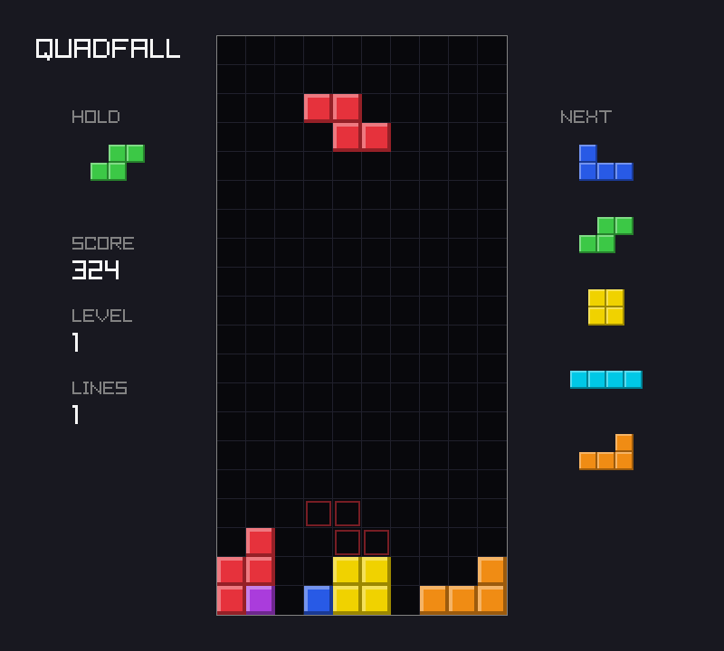
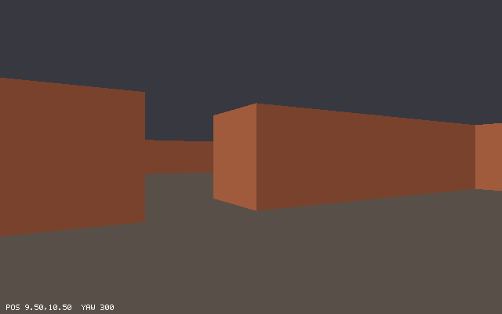
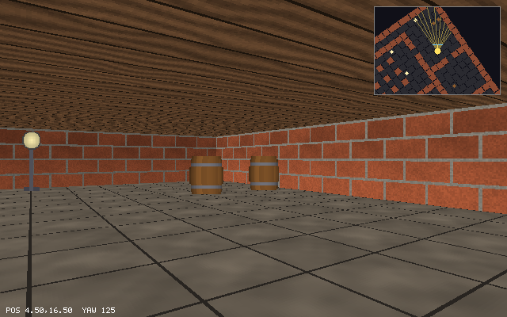
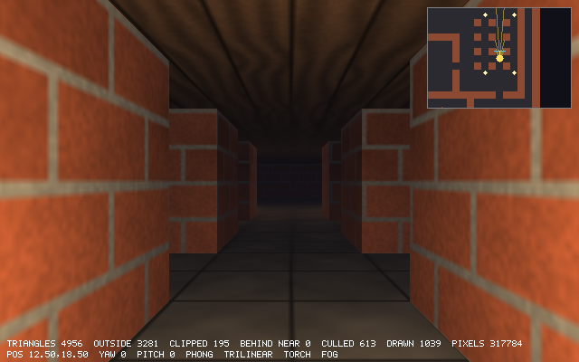
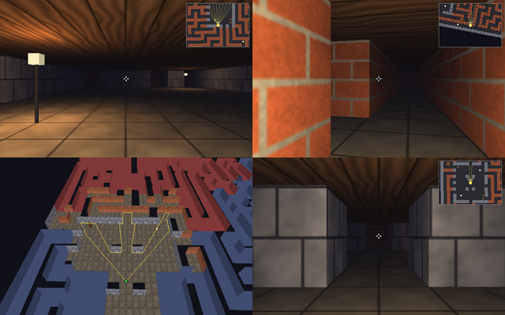

# Learn Game Graphics by Building `quadfall` and `delve`

This course teaches how games put pictures on the screen, from the game loop up to a complete
3D renderer that you write yourself, in [Zig](https://ziglang.org/) 0.17.1 with
[raylib](https://www.raylib.com/) 6.2. It is project-driven. Every chapter adds one feature to a
real program, and at the end of each chapter you have a program that builds, runs, and passes
its tests.

There are two projects:

- **Part I (chapters 1–8): `quadfall`**, a falling-tetromino game inspired by Tetris. Here raylib
  does the drawing. You learn how a game is organized: a game loop with a fixed timestep, rules
  in a pure core that never sees raylib, input as data, scenes, sound, saving, replays and
  tests.
- **Part II (chapters 9–24): `delve`**, a first-person walk through a maze. Here raylib only
  opens the window, reads the keyboard and mouse, and shows a finished picture. Every pixel is
  computed by our own Zig code on the CPU. The path goes from a raw pixel array through 2D
  drawing, vectors and matrices, to a *Wolfenstein 3D*-style ray caster. From there it builds a
  full polygon pipeline: projection, clipping, triangle rasterization with a depth buffer,
  lighting, perspective-correct textures with mipmaps, a world built from a text map,
  visibility culling, and rendering on several threads.

The course borrows from two classics. As in *Go by Example*, every idea comes with a small,
complete example and the output it really printed. As in *The Rust Programming Language*, the
chapters tell a story: each one explains *why* the code works the way it does, derives the
math before it uses it, and shows the mistakes and compiler errors you are likely to meet along
the way.

After chapter 24 you should be able to structure and ship a small game, and to explain what a
GPU does with a triangle, because you will have written every one of those steps yourself.
Chapter 24 ends by mapping each stage of `delve` onto the GPU pipeline that OpenGL, Vulkan,
Direct3D, Metal and WebGPU expose.

## What you'll build

**`quadfall`** has a title screen, the seven pieces with SRS rotation and wall kicks, a 7-bag
randomizer, hold, a five-piece preview, a ghost, a gravity curve computed at compile time, lock
delay, scoring and levels, pause, a saved high score, square-wave sounds generated at startup,
and replays that reproduce a game pixel for pixel. It has 37 tests.



**`delve`** starts with a ray caster like the one in *Wolfenstein 3D*. Chapters 13 and 14 add
flat walls first, then procedural textures, floor and ceiling casting, sprites, and mouse look:





Then it becomes a real polygon renderer: triangles that are clipped and rasterized with a depth
buffer, Phong lighting, a torch, fog, and trilinear-filtered textures:



**`delve` 1.0** (chapter 24) is a first-person client for a 63×63 labyrinth built from a text
file. It has smooth mouse look, collision, recorded demos, frustum and occlusion culling with
the ray caster, and rendering on up to 8 threads. Here are four frames of its guided tour,
including the overhead debug view that shows which chunks are drawn:



[Appendix B](appendix-b-quadfall-reference.md) and [Appendix C](appendix-c-delve-reference.md)
describe the finished projects in full.

## Requirements

- **Zig 0.17.1**, exactly. Zig changes between versions, and the code, the compiler errors and
  the APIs in this course are those of 0.17.1. Get it from
  [ziglang.org/download](https://ziglang.org/download/) and put it on your `PATH`.
- **raylib 6.2.** You don't install it. Each project's `build.zig.zon` pins it to tag 6.2 at
  commit `02566453880e06bec97f5b8160fa6fe1e98397ca`, and the first `zig build` fetches and
  compiles it:
  ```zig
  .url = "git+https://github.com/raysan5/raylib?ref=6.2#02566453880e06bec97f5b8160fa6fe1e98397ca",
  .hash = "raylib-6.0.0-whq8uDpYOAVcH_KyOZ0--nYF1dEsjdQ5r4e9R24UkQOi",
  ```
  The hash says `6.0.0` because that is the version raylib's own `build.zig.zon` declares;
  the commit is the 6.2 release. Zig's package cache stores the download in a `zig-pkg/`
  directory next to each project's `build.zig` (about 87 MB, git-ignored).
- **On Linux, the X11 and OpenGL development libraries** that raylib links against. On Debian
  or Ubuntu:
  ```console
  $ sudo apt install libgl-dev libx11-dev libxrandr-dev libxinerama-dev libxi-dev libxcursor-dev
  ```
- **Optional: `xvfb`** (`sudo apt install xvfb`), to run the windowed programs without a screen,
  as the course does for its screenshots. `delve --headless` needs no X server at all.
- A 64-bit machine with a few cores helps in chapter 24. Everything else runs anywhere Zig and
  raylib do.

The course was written and checked on x86-64 Linux. raylib and Zig also support Windows and
macOS, and `quadfall` cross-compiles to Windows (see [What was verified](#what-was-verified)).

## How to use this course

Read the chapters in order. Each one starts from the project as the previous chapter left it,
shows every change as a diff or a new file, and ends with a snapshot of the whole project in
`project/chNN/`. Type the code yourself if you can; if you get lost, diff your copy against the
snapshot.

**Run a project snapshot** (from `project/chNN/`):

```console
$ cd project/ch08
$ zig build run                        # quadfall
$ zig build test --summary all         # its tests (37/37 in ch08)
$ cd ../ch24
$ zig build --release=fast run         # delve: always build it optimized
$ zig build --release=fast run -- --demo tour   # arguments after -- go to the program
$ zig build test --summary all         # 85/85 in ch24
$ zig build bench --release=fast       # time the tour without a window (ch24)
```

A debug build of `delve` works but runs about 10 times slower. `zig build test` prints the test
counts only when it actually runs the tests; after a cached run it prints nothing, so delete
`.zig-cache/` to see the counts again.

**Run an example** (from `examples/`). Every chapter has small, single-file examples in
`examples/chNN/`. One shared `build.zig` builds whichever example you name, and each example
can import raylib as `rl`:

```console
$ cd examples
$ zig build run -Dexample=ch01/window
$ zig build run -Dexample=ch01/window -- --frames 60 --screenshot window.png
```

Examples that use only Zig's standard library also run on their own:
`zig run examples/ch11/vector_basics.zig` or `zig test examples/ch02/tests.zig`. Each
chapter shows the command for its examples.

**Run without a screen.** Both projects can run a fixed number of frames and save the last one,
which is how every screenshot in `images/` was made, and how you can check your work against
the book:

```console
$ xvfb-run -a -s "-screen 0 1280x720x24" ./zig-out/bin/quadfall --frames 400 --seed 7 --mute --screenshot shot.png
$ ./zig-out/bin/delve --headless --frames 60 --out frame.png
```

Each chapter ends with exercises, most with a hidden hint or solution, and a link to its
sources in [REFERENCES.md](REFERENCES.md).

## Repository layout

```text
learn-game-graphics/
├── README.md                         this file
├── 01-getting-started.md … 08-organizing-a-game.md            Part I: quadfall
├── 09-framebuffers.md … 24-performance-and-finishing.md       Part II: delve
├── appendix-a-cheatsheet.md          commands, Zig idioms, raylib calls, graphics formulas
├── appendix-b-quadfall-reference.md  quadfall: controls, options, rules, files, architecture
├── appendix-c-delve-reference.md     delve: options, keys, views, formats, architecture, numbers
├── REFERENCES.md                     sources for every chapter, with archived copies
├── images/                           screenshots, all made by the course's own code
├── examples/
│   ├── build.zig, build.zig.zon      builds one example: zig build run -Dexample=chNN/name
│   ├── demo.zig                      helper for --frames/--screenshot in raylib examples
│   └── ch01/ … ch24/                 small, focused examples, one folder per chapter
└── project/
    ├── ch01/ … ch08/                 quadfall at the end of each chapter
    └── ch09/ … ch24/                 delve at the end of each chapter (ch24 has a README)
```

## What was verified

- **Everything was built and run on x86-64 Linux with Zig 0.17.1 and raylib 6.2.** That covers
  all 24 project snapshots and every example in `examples/`.
  - `zig build test` passes in every snapshot: 5 tests in ch02 growing to 37 in ch08, then 7 in
    ch09 growing to 85 in ch24.
  - `zig fmt --check` is clean over all the code.
- **The console output is real.** Every output, compiler error and test result in the chapters
  was copied from a real run, not written by hand. Where an output is long, the chapter says
  what was cut.
- **The screenshots are real.** Every image in `images/` was rendered by the snapshot or
  example the chapter names. `quadfall` and the raylib examples ran under `xvfb-run`. `delve`
  ran with `--headless`, or under `xvfb-run` for the window shots.
  - Scripted input (`--script`, `--hold`, `--press`, `--demo`) and fixed seeds make the shots
    reproducible.
  - The `--frames` mode advances exactly one 1/60 s tick per frame, so a run gives the same
    picture every time.
- **Windows was cross-compiled but never run.** `zig build release` (chapter 8) builds a
  Windows `quadfall.exe` and the course shows that the build succeeds. No Windows machine or
  Wine was used to run it. macOS was not tested.
- **Nobody listened to the sound.** The sound code was built and run, but the scripted runs
  used `--mute`, or ran with no audio device, where `quadfall` skips its sounds.
- **Timings are rough.** Frame times and speedups (chapters 14–24) were measured on a shared
  32-core machine while other work was running. The chapters say how each number was taken
  (ReleaseFast, best of several runs, sometimes pinned to one core with `taskset`) and compare
  numbers only within one session. Expect different absolute numbers on your machine; the
  ratios should be similar.
- **Links.** Every link between the course's own files was checked. The external links in
  [REFERENCES.md](REFERENCES.md) were not fetched; see that file for how its archive links were
  made.

If something does not build with these versions or prints something different, please report
it with the chapter, the command and the output.

## Table of contents

### Part I — `quadfall`: organizing a 2D game

| # | Chapter | You'll learn | Project milestone |
|---|---------|--------------|-------------------|
| 1 | [Getting Started: Zig, raylib, and the Game Loop](01-getting-started.md) | `build.zig.zon` dependencies, `addTranslateC`, the game loop, frame time, headless runs | a window, a well, smooth and stepped blocks, `--frames`/`--screenshot` |
| 2 | [The Board](02-the-board.md) | enums, structs, the board as data, text pictures, `format`, tests, a core module without raylib | the board drawn with bevelled cells |
| 3 | [Tetrominoes](03-tetrominoes.md) | `comptime` tables, `inline for`, rotation in a box, `EnumArray` | seven pieces turning |
| 4 | [Input and Movement](04-input-and-movement.md) | packed structs, collision, DAS/ARR, SRS wall kicks, a script language for input | the player moves and turns a piece |
| 5 | [Time](05-time.md) | fixed timestep, fixed-point gravity, tagged unions, lock delay, line clears | a game you can lose |
| 6 | [Rules and Progression](06-rules-and-progression.md) | seeded randomness, the 7-bag, hold, scoring, a comptime gravity curve, the ghost | the full rules |
| 7 | [Scenes and UI](07-scenes-and-ui.md) | scene state machines, events, juice, ZON save files, procedural sound | title, pause, game over, high score, sound |
| 8 | [Organizing a Game](08-organizing-a-game.md) | the core/platform split, record and replay, golden tests, release builds, cross-compiling | `quadfall` finished: replays and release builds |

### Part II — `delve`: a software 3D renderer

| # | Chapter | You'll learn | Project milestone |
|---|---------|--------------|-------------------|
| 9 | [Framebuffers: Pixels in Memory](09-framebuffers.md) | pixels as memory, RGBA, writing PPM and PNG by hand, showing a canvas with raylib | `delve` shows its own pixels; `--headless --out` |
| 10 | [Drawing in 2D by Hand](10-drawing-in-2d.md) | spans, Bresenham lines, midpoint circles, edge-function triangles, a bitmap font | an animated test card with a HUD |
| 11 | [Vectors and the Maze](11-vectors.md) | `@Vector`, dot and cross products, rotation, float tests, grid maps, sliding collision | a top-down maze to walk around |
| 12 | [Matrices and Transforms](12-matrices-and-transforms.md) | `Mat4`, homogeneous coordinates, composition, the inverse | maps drawn through matrices; actions |
| 13 | [Ray Casting: The Maze in 2.5D](13-ray-casting.md) | DDA, a camera plane, perpendicular distance and the fisheye | first person for the first time |
| 14 | [Ray Casting II: Textures, Sprites, and Mouse Look](14-textures-and-sprites.md) | procedural textures, wall and floor texturing, sprites, a depth buffer per column, mouse look | a textured cellar with lamps and barrels |
| 15 | [Cameras and Projection](15-cameras-and-projection.md) | view matrices, the perspective matrix, clip space, the viewport | 3D points over the ray caster; pitch |
| 16 | [Wireframe 3D](16-wireframe-3d.md) | meshes, indices, winding, the vertex pipeline | the maze and a cube in wireframe |
| 17 | [Clipping](17-clipping.md) | homogeneous clipping, outcodes, Sutherland–Hodgman | no more holes or runaway lines |
| 18 | [Rasterizing Triangles](18-rasterizing-triangles.md) | fixed-point edge functions, the top-left rule, barycentrics, the z-buffer, back-face culling, perspective-correct interpolation | solid 3D walls |
| 19 | [Shading and Lighting](19-shading-and-lighting.md) | normals, Lambert, flat/Gouraud/Phong, attenuation, ambient, fog | lamps, a torch and fog |
| 20 | [Texture Mapping](20-texture-mapping.md) | UVs, perspective-correct texturing, wrapping, bilinear filtering, mipmaps, level of detail | textured, lit polygons |
| 21 | [Building the World](21-building-the-world.md) | meshes from data, hidden-face removal, chunks, map files with errors, OBJ models | a labyrinth built from a text map |
| 22 | [The First-Person Client](22-the-first-person-client.md) | mouse look with pitch, circle collision, a deterministic loop, record and replay | a playable game with a demo tour |
| 23 | [Visibility and Occlusion](23-visibility-and-occlusion.md) | bounding boxes, frustum planes, grid occlusion with rays, front-to-back order, overdraw | only what can be seen is drawn |
| 24 | [Performance and Finishing](24-performance-and-finishing.md) | profiling, Amdahl's law, SIMD, threads with `std.Io.Group`, release modes, the GPU pipeline | `delve` 1.0 |

### Appendices

| | Appendix | Contents |
|---|---|---|
| A | [Cheat Sheet](appendix-a-cheatsheet.md) | commands, Zig 0.17 idioms, raylib calls, and the graphics formulas of the course |
| B | [quadfall Reference](appendix-b-quadfall-reference.md) | controls, options, script language, rules and numbers, files, architecture, concept → code |
| C | [delve Reference](appendix-c-delve-reference.md) | options, keys, views, file formats, architecture, one frame step by step, concept → code, measurements, delve → GPU |

[REFERENCES.md](REFERENCES.md) lists the sources behind each chapter, each with an archived copy.

## License and credits

The course text, examples and project code were written for this repository. Zig, raylib and
the other tools are their authors' work under their own licenses. The articles and papers the
chapters build on are credited in [REFERENCES.md](REFERENCES.md).
